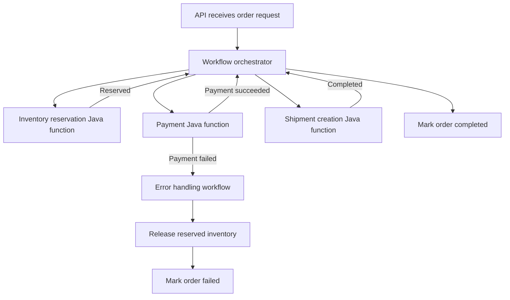
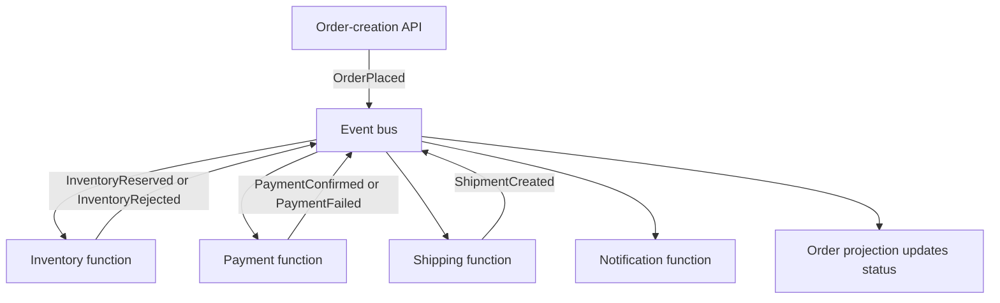

# Distinguishing Orchestration and Choreography

## Learning Objectives

After this lesson, you will be able to:

- Explain how orchestration and choreography coordinate multiple components in a business workflow.
- Identify where state is stored, where the next step is decided, and how functions communicate in each model.
- Analyze the effects of retries, duplicate events, out-of-order events, and mid-flight failures.
- Choose the right model for a serverless application written in Java, and know when to combine both.

## 1. Why Coordinate Multiple Functions?

A Java function should typically handle a clearly scoped unit of work: validating an HTTP request, reserving inventory, charging a payment, sending a notification, or processing an event. When a business process spans multiple steps, the system must decide who is responsible for coordinating them.

For example, when a customer places an order, the system may have to:

1. Check and reserve product stock.
2. Process payment.
3. Create a shipment request.
4. Send confirmation to the customer.

These steps have dependencies. Shipment cannot proceed without stock; an order should not be confirmed as paid if the payment gateway declines; if payment succeeds but shipment creation fails, the system must handle the order state properly.

In a serverless model, these steps typically execute in independent functions or services. One function may be invoked via HTTP, another triggered by a message, and a third reacting to an event on an event bus. Each invocation may run on a different instance. Instance memory is not a durable place to store state for the overall workflow.

Two common coordination patterns are **orchestration** and **choreography**. Both can use functions, messages, and asynchronous events. The difference lies in where control over the business flow resides.

## 2. Orchestration: One Coordinator Manages the Flow

In orchestration, a coordinating component (the orchestrator) knows which steps belong to the workflow, which step runs next, and how to respond when a step succeeds or fails. Functions perform specialized tasks and return results to the coordinator.



The orchestrator may be a managed workflow engine, a durable function framework, or a dedicated coordination service. Examples of technologies implementing this pattern include AWS Step Functions, Azure Durable Functions, and Google Workflows. Product names differ, but the shared idea is persisting execution state and resuming the workflow across multiple function invocations.

### 2.1. Responsibilities of the Orchestrator

An orchestrator is typically responsible for:

- Initializing the workflow with an identifier, such as `orderId` or `workflowId`.
- Calling the right function for each step and passing required inputs.
- Persisting current state, completed step outcomes, and the next step.
- Enforcing timeouts, retries, and error-handling branches per workflow policy.
- Triggering compensating actions when a later step fails and earlier steps must be undone from a business standpoint.
- Exposing status so other systems can query whether the workflow is running, completed, or failed.

Orchestrated functions should focus on a single business operation. A function does not need to look up the next function or understand the entire ordering workflow. This makes each function easier to test and reuse across multiple workflows.

### 2.2. Where Is Workflow State Stored?

A workflow may last seconds, minutes, or longer—for example, waiting for a provider confirmation or an external signal. Never keep a Java function running continuously while waiting for an entire workflow to finish. Functions have execution time limits, instances can be reclaimed, and holding compute resources while idle is costly.

In serverless orchestration, the workflow engine persists execution state outside the functions. When the next step is ready, the engine launches the corresponding function and passes the saved state. When the workflow must wait, the engine can pause and resume when a timer expires or a signal arrives.

For example, an order's workflow states might be modeled as follows:

| Workflow State | Meaning | Possible Next Step |
|---|---|---|
| `STARTED` | Workflow was just created | Reserve inventory |
| `INVENTORY_RESERVED` | Stock has been reserved | Process payment |
| `PAYMENT_CONFIRMED` | Payment has been confirmed | Create shipment |
| `COMPLETED` | Required steps have finished | End |
| `COMPENSATING` | A step failed; compensating actions are running | Release stock or refund |
| `FAILED` | Workflow ended with a business or unrecoverable error | Escalate for manual handling if needed |

State names are illustrative. A real system must define states in business terms rather than exposing technical labels like `FUNCTION_2_DONE` as order states.

### 2.3. Orchestration Flow Example

An order fulfillment workflow can be described with the following pseudocode:

```text
Workflow FulfillOrder(orderId):
    inventory = ReserveInventory(orderId)

    if inventory fails:
        RejectOrder(orderId, reason = "OUT_OF_STOCK")
        end

    payment = ChargePayment(orderId)

    if payment fails:
        ReleaseInventory(orderId)
        RejectOrder(orderId, reason = "PAYMENT_FAILED")
        end

    shipment = CreateShipment(orderId)

    if shipment fails:
        RefundPayment(orderId)
        ReleaseInventory(orderId)
        MarkOrderForManualReview(orderId)
        end

    CompleteOrder(orderId)
```

This is a logical description, not syntax for any specific workflow engine. In implementation, each operation is typically a task invoking a Java function or a service integration. Branches, retries, and timeouts are declared in the workflow definition or corresponding configuration.

### 2.4. Strengths and Limitations

Orchestration fits when a business flow has an explicit sequence, conditional branching, long wait times, or requires a single place to inspect overall status. Operators can see which step a workflow stopped at and why it failed. Retry rules and compensating actions are also more centralized.

In return, the orchestrator must understand the steps and contracts of participating components. When workflows change frequently, the workflow definition can become a concentration of logic. Routing every minor task through a central workflow can increase state transitions, execution cost, and coupling to the coordinator.

The orchestrator itself must be fault-tolerant. Managed workflow engines typically persist state durably, yet the application must still handle timeouts, integration errors, quota limits, and the possibility of a task being re-invoked.

## 3. Choreography: Services Coordinate via Events

In choreography, no central component holds the entire business flow or commands each step. Each service executes its own responsibility, emits an event describing what happened, and interested services react to that event.



The diagram depicts a happy path. In practice, each function subscribes only to the event types it requires. For instance, the payment function reacts only to `InventoryReserved`; the shipping function reacts only to `PaymentConfirmed`. Functions do not call the next function directly and do not need to know the full list of services consuming an event.

### 3.1. Events Represent Facts That Happened

Event names should convey past tense or confirmed facts, for example:

- `OrderPlaced`: the order has been created.
- `InventoryReserved`: stock has been reserved.
- `InventoryReservationRejected`: the stock reservation request was rejected.
- `PaymentConfirmed`: payment has been confirmed.
- `PaymentFailed`: payment failed.
- `ShipmentCreated`: the shipment request has been created.

Distinguishing **events** from **commands** is crucial:

- A command asks a component to do something, such as `ReserveInventory` or `ChargePayment`.
- An event announces that something occurred, such as `InventoryReserved` or `PaymentConfirmed`.

An event should not be named like an unconfirmed imperative. `PaymentConfirmed` is an event; `ChargePayment` is a request to perform an action. In larger systems, commands are typically directed to a single responsible owner, whereas events can be subscribed to by many consumers.

### 3.2. Responsibility Lies with Each Service

Each service must know:

- Which events are meaningful to it.
- Which preconditions allow processing an event.
- Which local business state must be updated.
- Which subsequent events to emit after succeeding or failing.

For example, the inventory service receives `OrderPlaced`, checks stock, and emits `InventoryReserved` or `InventoryReservationRejected`. The payment service does not need to know how inventory calculates stock; it only needs to enforce its own rules and react to `InventoryReserved`.

An event bus or message broker handles routing, buffering, and message delivery according to configuration. Common options include Amazon EventBridge, Azure Event Grid or Service Bus, and Google Pub/Sub or Eventarc. The event bus is shared infrastructure, not necessarily the place where the entire business workflow is decided.

### 3.3. How Is Overall State Formed?

In choreography, each service typically owns state within its own scope. Inventory manages reservations; payment manages payment transactions; shipping manages shipments. An order-tracking view can build a projection by consuming events and updating the displayed status.

This introduces eventual consistency. After payment succeeds, there may be a brief delay before the order screen reflects the new status. Applications must define intermediate states such as `PAYMENT_PENDING` or `PROCESSING`, rather than assuming all services update simultaneously.

If the business needs to know whether a workflow completed or got stuck for too long, the system must aggregate state or detect overdue processes. Choreography does not automatically provide an end-to-end status view.

### 3.4. Strengths and Limitations

Choreography works well when multiple services need to react independently to the same event, when new consumers must be added without modifying producers, or when steps can progress asynchronously. Services retain ownership over their logic and data; event contracts serve as integration boundaries.

However, the business flow becomes distributed. To understand why an order has not finished, operators may have to stitch together logs and state across multiple services. When one event fans out to many consumers, dependencies and execution branches become harder to see. If multiple services emit events triggering one another without clear rules, the system can form loops or cascading chains.

Choreography also does not eliminate coupling. Producers and consumers remain coupled to event semantics, schemas, and compatibility rules. Renaming fields, changing status meanings, or altering emission order can break multiple consumers.

## 4. Side-by-Side Comparison

| Criterion | Orchestration | Choreography |
|---|---|---|
| Where flow control lives | Orchestrator or workflow engine | Distributed across participating services |
| Coordination mechanism | Orchestrator invokes tasks and decides next steps | Services emit events; consumers react |
| Visibility of full workflow | Centralized in workflow definition and workflow state | Must be aggregated from events and multi-service state |
| Changing the workflow | Usually edits workflow definition or coordinator logic | Usually edits one or more consumers and related event contracts |
| Function reuse | Functions can be invoked by multiple workflows | Consumers can react to shared events |
| Error tracing | Easy to identify current step if engine persists state well | Requires correlation, tracing, and state aggregation tools |
| Fan-out to many consumers | Orchestrator must know or configure branches | Event bus can route to many consumers |
| Primary dependencies | Depends on workflow engine and process definition | Depends on event contracts, broker, and consumer behavior |
| Best suited when | Flow has clear sequence, branching, timeouts, and compensation | Multiple independent, asynchronous reactions and consumer extensibility |

Neither model is universally superior. The choice depends on whether the system needs an explicit place controlling the process or services reacting independently to events.

## 5. Implementing the Same Workflow Both Ways

Consider an order fulfillment process involving inventory reservation, payment, shipment creation, and notification.

With orchestration, the workflow engine invokes the inventory-reservation function. On success, it invokes the payment function, then the shipping function and notification function. If payment fails, the engine invokes the release-inventory function. If shipment creation fails after payment succeeds, the workflow can invoke a refund function and move the order to a review state.

With choreography, the API emits `OrderPlaced`. Inventory consumes it and emits `InventoryReserved` or `InventoryReservationRejected`. Payment handles only `InventoryReserved`, then emits `PaymentConfirmed` or `PaymentFailed`. Shipping handles `PaymentConfirmed`. Notification may listen to `OrderPlaced`, `PaymentConfirmed`, or `ShipmentCreated` depending on the notifications to send.

The clearest difference is where the next step is decided. In orchestration, the workflow engine decides based on task outputs. In choreography, emitting and subscribing to events forms the execution flow. Both approaches can use message brokers, retries, and asynchronous functions.

A hybrid design is also very common: a workflow engine orchestrates the critical order steps—such as inventory reservation, payment, and shipment creation—and once the order reaches the appropriate state, the service emits an event so independent consumers handle emails, analytics, search index updates, or notifications. That keeps tightly controlled business steps explicit while allowing side reactions to scale independently.

## 6. Error Handling in Both Models

Serverless functions can encounter timeouts, network errors, quota limits, authentication failures, invalid data, or external service outages. A function may complete a business side effect while the response is lost. Therefore, never infer that “no response received” means “the operation did not happen.”

### 6.1. Retries Only for Recoverable Errors

Retries help with transient errors such as brief timeouts, rate limits, or overloaded dependencies. Configure maximum attempts, exponential backoff, jitter, and overall time limits. Never retry infinitely.

Business errors such as out-of-stock items, declined cards, or invalid inputs will not resolve themselves across retries. Route these along corresponding business branches—such as rejecting the order or asking the user to update details.

In orchestration, retries are usually configured per workflow task or step. In choreography, retries may be performed by the event source, broker, or consumer policy. Know exactly which layer performs retries to avoid multiplicative retry storms that amplify load.

### 6.2. Idempotency to Tolerate Duplicate Execution

Many serverless platforms and message brokers provide at-least-once delivery semantics in several processing paths. That means an event or task can be redelivered. A timeout can also prompt a caller to retry even though the earlier attempt succeeded.

An idempotent operation can be executed repeatedly with the same key without creating unintended additional business side effects. For example, payment requests should carry an idempotency key derived from the order ID or payment attempt ID. Consumers can persist processed `eventId` values in an inbox table with a unique constraint. When the same event arrives again, the consumer recognizes it was already processed and avoids duplicating the transaction.

Never rely on an in-memory variable inside a Java function for deduplication, since subsequent invocations may run on another instance. Idempotency markers must be persisted durably in a database or appropriate storage service.

### 6.3. Transactional Outbox and Inbox

A common bug occurs when updating the database and emitting an event happen as two separate operations. If the update succeeds and the function crashes before publishing, consumers never learn of the change. If publishing succeeds and the database update fails, consumers may receive an event that does not reflect committed state.

The transactional outbox closes this gap by writing business changes and the event record inside the same database transaction. A separate process or function reads the outbox and publishes events; if publishing fails, it retries. Because the publisher may retry after sending succeeds but before marking the row complete, consumers must remain idempotent.

An inbox is the counterpart on the consumer side: storing the received event ID and applying business updates in the same appropriate transaction. Combining inbox and outbox reduces the risk of lost events or duplicate processing, though it does not replace idempotency keys and error handling for external services.

### 6.4. Compensation and Sagas

A distributed workflow typically cannot wrap multiple services in a single ACID transaction. If the third step fails after the first two steps committed, the system needs compensating actions to return business state to an acceptable condition.

Examples:

| Completed Action | Possible Compensating Action |
|---|---|
| Reserve inventory | Release inventory |
| Charge payment | Refund or issue a reversal transaction |
| Create shipping label | Void label if still permitted by the carrier |
| Send email | Usually cannot be recalled; may send a follow-up correction |

A sequence of business steps together with compensating actions is commonly called a **Saga**. A Saga can be implemented via orchestration or choreography. An orchestrated Saga has a coordinator invoking steps and compensations. A choreographed Saga lets each service react to success or failure events and emit subsequent events.

Compensation is not a technical rollback. A refund does not erase the original payment transaction; it creates a new business transaction. Some effects cannot be fully reversed, such as an email already sent or goods that already left the warehouse. In those cases, the workflow needs a manual-intervention state or alternative remediation.

In particular, if a payment call times out, before refunding or retrying payment, the system must check the outcome via an idempotency key or query transaction status. Otherwise, it risks refunding an uncharged payment or charging twice.

### 6.5. Dead-Letter Queues and Replay

After exceeding retry limits, events can be routed to a dead-letter queue (DLQ) or equivalent error store. A DLQ preserves messages for investigation rather than dropping failure evidence. When handling a DLQ, identify the root cause, fix data or code defects, and perform a controlled replay.

Replaying events can re-trigger multiple consumers. Therefore, ensure idempotency, preserve the original `eventId` or establish a separately tracked replay workflow, and evaluate impact on current state. Never purge a DLQ or bulk-replay blindly just to clear alerts.

## 7. Java Example: Consumer in a Choreography Model

An event envelope should include metadata for identification, correlation, and ordering checks. The following example illustrates the data structure; serialization and trigger setup depend on the serverless platform used.

```java
import java.time.Instant;

public record EventEnvelope<T>(
    String eventId,
    String eventType,
    int schemaVersion,
    String aggregateId,
    long aggregateVersion,
    Instant occurredAt,
    String correlationId,
    String causationId,
    T payload
) {}

public record OrderPlaced(
    String orderId,
    String customerId
) {}
```

`eventId` identifies a specific event emission; `aggregateId` is typically the business entity ID such as `orderId`; `aggregateVersion` helps detect stale or out-of-order events; `correlationId` links activities belonging to the same workflow; `causationId` indicates which event led to the current event. `schemaVersion` supports controlled evolution of event structures.

An illustrative consumer handling `OrderPlaced` might look like this:

```java
public final class InventoryConsumer {
    private final InboxRepository inbox;
    private final InventoryService inventory;
    private final OutboxRepository outbox;
    private final TransactionRunner transaction;

    public InventoryConsumer(
            InboxRepository inbox,
            InventoryService inventory,
            OutboxRepository outbox,
            TransactionRunner transaction) {
        this.inbox = inbox;
        this.inventory = inventory;
        this.outbox = outbox;
        this.transaction = transaction;
    }

    public void handle(EventEnvelope<OrderPlaced> event) {
        transaction.execute(() -> {
            // insertIfAbsent must have a unique constraint on eventId.
            if (!inbox.insertIfAbsent(event.eventId())) {
                return; // Event was already processed.
            }

            var result = inventory.reserve(event.payload().orderId());
            var nextEvent = result.toEvent(
                    event.correlationId(),
                    event.eventId());

            // Write outbox in the same transaction as the inventory change.
            outbox.append(nextEvent);
        });
    }
}
```

Interfaces such as `InboxRepository`, `InventoryService`, `OutboxRepository`, and `TransactionRunner` are illustrative components, not part of standard Java. The key requirement is that inbox insertion, local business data updates, and outbox writing share an appropriate transaction boundary, typically within the same database. A separate process turns outbox rows into events on the broker.

Do not place a network call to a remote inventory service inside a database transaction and assume both systems commit atomically. If inventory is an independent service, the consumer should send a command or event to it and handle the outcome asynchronously per the defined contract.

In an orchestrated workflow, Java functions can be deployed as task handlers. The workflow engine invokes tasks, persists results, and decides the next step. Task handlers still need idempotency because workflows may retry after timeouts or transient errors.

## 8. Operational Concerns to Design Upfront

### 8.1. Event Ordering and Consistency

Do not assume every event on a broker is processed in strict global order. If business logic requires per-order ordering, use a partition key or ordering mechanism by `aggregateId` when supported by the platform. Also persist `aggregateVersion` so consumers can detect stale, duplicate, or prematurely arriving events.

When an event arrives out of order, a consumer can ignore stale events, park events for later processing, or fetch authoritative state from the data-owning service. The choice depends on business rules; there is no single strategy for all event types.

### 8.2. Event Contract Design

Events are contracts between producers and consumers. Prefer backward-compatible changes: add optional fields, keep existing field meanings unchanged, and never repurpose an event name for a new meaning. When breaking changes are necessary, plan versioning, transition windows, and consumer upgrade schedules.

Do not dump entire database records into an event when consumers need only a subset of fields. Include only the data needed to react, plus identifiers enabling authorized consumers to query further details. Avoid placing passwords, tokens, secrets, or unnecessary personal data in payloads, logs, and DLQs.

### 8.3. End-to-End Workflow Observability

Individual function logs are insufficient to see which steps an order traversed. Propagate `correlationId` or trace context across calls and events. Logs should include `eventId`, `aggregateId`, step name, outcome, and error codes; omit sensitive data.

Useful metrics include:

- End-to-end duration from workflow start to completion.
- Processing duration and error rate per step.
- Retry counts, duplicate event counts, and DLQ message counts.
- Workflows waiting too long or stuck in a state.
- Compensation success rate and workflows requiring manual intervention.
- Cost per workflow, function invocation, event publish/delivery, and storage duration.

In orchestration, workflow engines often provide helpful execution history. In choreography, combine distributed tracing, structured logs, and a projection or business-state query tool.

### 8.4. Security and Access Control

Each function should hold permissions only to publish, subscribe, read, or write the exact resources it needs. Never grant broad permissions to every function simply because they share an event bus. Validate event schemas and sources; verify tenant or resource ownership before applying business side effects.

DLQs, workflow history, and logs may contain business data. Enforce read access controls, encryption, retention periods, and appropriate data deletion procedures. An event bus must not become a secret-distribution channel merely because sharing data through it is convenient.

### 8.5. Traffic Spikes and Cost

Serverless runtimes can scale function instances automatically, yet downstream dependencies may not scale accordingly. An event fanning out to multiple consumers can generate heavy load on databases or payment APIs. Configure concurrency limits, rate limits, batch sizes, queue depth alarms, and appropriate backpressure.

Orchestration incurs costs per workflow execution, state transition, or execution duration depending on the platform. Choreography incurs costs for publishing, delivery, event storage, retries, and broker operations. Beyond direct fees, account for observability, DLQ handling, and the engineering effort of investigating distributed failures.

## 9. Which Model Should You Choose?

Start from business requirements and how the operations team needs to understand the workflow.

| Scenario | Typically Suitable Choice | Reason |
|---|---|---|
| Workflow with mandatory ordering and complex conditional branches | Orchestration | Control flow and state are modeled centrally |
| Long-running workflow with wait periods or explicit timeouts | Orchestration | Workflow engine persists state and resumes after waiting |
| Multiple independent systems reacting to the same event | Choreography | Consumers can be added without producer coordinating each one |
| Steps spanning multiple bounded contexts needing high autonomy | Choreography or hybrid | Each service keeps logic and data within its own boundary |
| Tracking a Saga with multiple compensations | Orchestration is often easier to observe | One place displays progress and compensation branches |
| Sending notifications, updating indexes, or analytics after a business step | Choreography | Secondary tasks consume events independently |
| Flow needing tight core control alongside fan-out | Hybrid | Workflow manages core steps; events drive independent reactions |

Before deciding, answer these questions:

1. Does one component need to know with certainty what the next step of the workflow is?
2. Do we need an end-to-end status view showing exactly where a workflow is waiting?
3. How many services must react to the same event, and do consumers evolve independently?
4. When a step fails, which steps should retry and which effects require compensation?
5. Can the system tolerate eventual consistency, or does the caller need an immediate synchronous response?
6. Is the team equipped to operate tracing, event contracts, DLQs, and replays when flows are distributed?

Do not choose choreography simply because an event bus already exists. An event bus is messaging infrastructure; it does not make a workflow understandable or reliable on its own. Likewise, do not force every operation into one giant workflow if some are purely independent side reactions.

## 10. Common Design Mistakes

- **Using a single function as a long-lived orchestrator:** a function looping and waiting on multiple services easily hits timeouts, loses state if recycled, and scales poorly. Use a workflow engine or durable execution mechanism for long workflows.
- **Treating event delivery as exactly-once:** duplicate delivery can still occur. Design idempotent consumers and persist processing markers durably.
- **Retrying every error:** business errors do not self-heal on retry. Separate transient errors from unrecoverable errors.
- **Lacking compensation:** a later failure can leave reserved resources or captured charges behind. Define compensating actions and their limits before deployment.
- **Publishing events before data commits:** consumers may receive data inconsistent with persisted state. Consider transactional outbox.
- **Encoding workflow logic in cryptic topic names or routing rules:** event contracts should express business events; flows should not depend on obscure implicit conventions.
- **Omitting correlation IDs:** when failures happen, teams cannot stitch together invocations and events belonging to the same business transaction.
- **Skipping event versioning:** payload changes can break running older consumers.
- **Letting every consumer read every event:** widens blast radius and data exposure risk.
- **Omitting concurrency limits:** rapid function scaling can overload databases or payment providers.

## 11. Process for Designing a Serverless Workflow

The following sequence applies to both orchestration and choreography:

1. **Define business boundaries.** Specify the starting event, success outcome, failure outcome, and data owner for each step.
2. **Map flow and failure branches.** Mark synchronous steps, asynchronous steps, state transition preconditions, and wait timeouts.
3. **Choose where control lives.** Use an orchestrator when an explicit workflow is needed; use choreography when services react independently; use hybrid when both needs coexist.
4. **Define contracts.** For tasks, specify inputs/outputs and returned errors. For events, specify names, payloads, versions, event IDs, aggregate IDs, and correlation IDs.
5. **Design durable state.** Never store workflow state solely in function memory. Identify where workflow history, domain state, inbox, and outbox live.
6. **Design retries and idempotency.** Specify retryable errors, max attempts, backoff, idempotency keys, and duplicate-event handling.
7. **Design compensation.** List committed side effects and remediation when later steps fail; identify points requiring human intervention.
8. **Design operations and security.** Add tracing, metrics, alerts, DLQs, least-privilege permissions, schema checks, and retention policies.
9. **Test realistic failures.** Simulate timeouts after a service already acted, duplicate events, out-of-order events, mid-flight consumer crashes, and overloaded dependencies.

When testing, do not test only the happy path. A reliable serverless workflow must behave deterministically when an invocation repeats, a response is lost, or a dependency recovers only after several minutes.

## 12. Self-Check

**Question 1.** What is the core difference between orchestration and choreography?

**Suggested Answer:** Orchestration uses a coordinating component that decides the next step and manages workflow state. Choreography distributes coordination: services emit events, and interested consumers react autonomously.

**Question 2.** Does choreography mean functions know nothing about one another?

**Suggested Answer:** No. They still depend on event contracts, business semantics, and compatibility rules. Choreography reduces direct call coupling, but does not remove data and behavioral dependencies.

**Question 3.** Why should you avoid keeping a Java function running while waiting hours for customer confirmation?

**Suggested Answer:** Functions have execution time limits, and instances are not durable state stores. Persist state using a workflow engine or data store and resume the workflow when the signal arrives.

**Question 4.** If a consumer receives the same `OrderPlaced` event twice, what prevents the system from reserving stock twice?

**Suggested Answer:** The consumer needs idempotency keyed by `eventId` or a business key, stored durably and updated atomically alongside data changes. Never rely on function memory.

**Question 5.** When payment succeeds but shipment creation fails, how do retries and compensation differ?

**Suggested Answer:** Retries re-attempt shipment creation if the failure is recoverable. Compensation executes a compensating business action—such as refunding payment or routing the order for manual review—if the step cannot be completed.

**Scenario Exercise:** After an order is paid, three independent tasks must occur: sending an email, updating a search index, and sending data to an analytics system. Propose a coordination design, state the event to emit, explain how to handle prolonged failure in one consumer, and explain how to avoid sending duplicate emails or double-counting analytics. Then explain why all three tasks do not necessarily belong inside the core order workflow.

**Hint:** A sound option is emitting `PaymentConfirmed` after payment status commits. Three separate consumers subscribe to the event with their own retries/DLQs, idempotency via `eventId` or a business key, and correlation IDs for tracing. Because these tasks do not determine whether the order counts as paid, they can progress independently; email delivery or index sync status is tracked within each consumer's scope.

## Conclusion

Orchestration places control flow inside a workflow engine or coordinator; choreography lets services coordinate via events. Orchestration is typically easier to specify and monitor for workflows with branching, wait periods, and compensations. Choreography typically fits independent, asynchronous reactions and consumer extensibility. In both models, reliability still depends on durable state, idempotency, bounded retries, error handling, end-to-end observability, and proper access control. Real-world serverless architectures often combine both along business boundaries.
