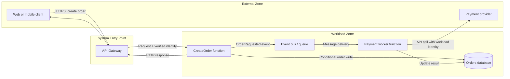

# Designing Data Flows and Identifying Trust Boundaries

A serverless application typically consists of many small functions, an API gateway, queues, an event bus, data stores, and external services. Each component can be deployed and scaled independently, yet the data flowing through them still belongs to the same business workflow. If a team designs each function in isolation, it is easy to overlook where data is validated, where permissions are checked, or what happens when a message is redelivered.

Data flow design answers where data originates, which components it traverses, where it is transformed and stored, who may read or modify it, and how the system reacts when a step fails. Identifying trust boundaries highlights the points where data or identity crosses into a zone with different security assumptions. These two practices belong together: every data path needs a clear owner, contract, validation mechanism, and error-handling policy.

Within serverless architecture, flows typically start from an HTTP request, a queue message, an event bus event, or a change in object storage. A function handling a single invocation generally does not hold durable state between runs. Consequently, the design must account for context propagation, persisting state in external services, retries, deduplication, concurrent scaling, and per-invocation cost.

## 1. Modeling Data Flows Before Deployment

A Data Flow Diagram (DFD) describes four kinds of elements:

- **External actors or sources:** users, mobile apps, partner systems, payment providers, or event producers.
- **Processing steps:** API gateways, functions, workflows, or services that perform authentication, input validation, and business rules.
- **Data stores:** databases, object storage, caches, secret stores, or workflow state stores.
- **Data flows:** requests, responses, events, messages, files, or query results moving between components.

For each arrow, specify what data is transferred, the protocol or trigger mechanism, contract format, calling identity, where authorization is enforced, and how unavailability of the target is handled. A connector labeled merely “call function” is insufficient to evaluate security and reliability.

For example, an order-creation flow can be modeled as follows:



This diagram shows two distinct paths. The HTTP path returns request acknowledgment to the client; the event path processes payment asynchronously. An API success response may mean only that the order was recorded and the event emitted—not that payment succeeded. The API contract should express that state clearly, such as returning the order ID alongside status `PENDING_PAYMENT`.

When diagramming, also mark:

1. Entry points where untrusted data enters.
2. Identity authentication points and resource authorization points.
3. Where payload structure, size, and semantics are validated.
4. Data stores along with read, write, and delete permissions.
5. Outbound calls leaving the system.
6. Points generating side effects, retries, state persistence, or event replays.

There is no need to draw every internal library call. Focus on components with distinct deployment boundaries, access permissions, storage, networking, or operational responsibilities.

## 2. Trust Boundaries Are Where Security Assumptions Change

A trust boundary appears whenever data or control crosses from a domain with one security policy into a domain with another. Boundaries can exist between the Internet and a public API, between two functions with different IAM permissions, between two tenants, between two organizations' cloud accounts, or between internal systems and partner APIs.

A trust boundary is not synonymous with a network boundary. Two functions inside the same virtual network can still have different permissions and trust levels. Conversely, a managed cloud service may sit outside the application's private network yet still verify workload identities and enforce strict access policies.

Start by classifying the following domains:

| Domain | Assumptions That Must Be Checked | Common Controls |
|---|---|---|
| Client and Internet | Requests, headers, files, and parameters can all be forged | TLS, authentication, size limits, schema validation, rate limiting |
| API gateway | Forwarded identity is trustworthy only if the gateway verifies it and prevents client spoofing | Verify tokens, audience, issuer, expiration; strip client-supplied identity headers |
| Function or workload | Code executes with the permissions of its assigned execution role | Least-privilege IAM per function, separate read/write permissions, secret management |
| Queue or event bus | Being authorized to publish does not guarantee every payload field is valid | Producer/consumer policies, schema checks, tenant and business-state verification |
| Database and object storage | Stored data may still be stale, malformed, missing, or belong to another tenant | Resource-level access control, encryption, application-layer authorization, retention |
| Partner systems | Responses, webhooks, and availability depend on external parties | Mutual authentication where appropriate, webhook signatures, timeouts, egress allowlists, bounded retries |

Whenever data crosses a boundary, ask:

- Who produced the data, and how was their identity verified?
- Which actions is the receiving component authorized to perform?
- Is the data protected in transit and at rest?
- Could the data be tampered with, replayed, duplicated, or arrive out of order?
- Could this data be abused to access another tenant's resources?
- When verification fails, does the system reject, quarantine, or route the message to an error queue?

A key principle is that **verifying the sender does not replace validating the content**. A message arriving from a legitimate queue may still carry bad fields, stale data, or a request that is no longer permitted. Likewise, a valid token proves a verified identity, not that the identity is authorized to read every order.

## 3. Separating Authentication, Authorization, and Data Validation

These three steps answer three distinct questions:

- **Authentication:** who is calling?
- **Authorization:** what is that identity allowed to do on which resource?
- **Validation:** does the data conform to format, bounds, and business rules?

For HTTP triggers, the API gateway can verify the access token's signature, issuer, audience, and expiration. The function receives the verified identity from the context provided by the platform or gateway. Never take `userId`, `role`, or `tenantId` from a JSON body or arbitrary client header and treat it as an authenticated identity. If the gateway forwards identity via headers, the gateway must strip any client-supplied headers with the same name before injecting trusted values.

After authentication, the function must still check authorization on the target resource. For example, a user may be permitted to create orders in their own tenant but not read orders belonging to another tenant. Authorization should be enforced where data operations occur, especially when multiple entry points access the same repository or database.

An HTTP handling flow typically follows this order:

1. Verify request size and content type are acceptable.
2. Authenticate identity or read the already-verified identity context.
3. Parse and validate the payload against its schema.
4. Check authorization for the target tenant and resource.
5. Check the idempotency key if the operation causes side effects.
6. Execute business logic and persist durable state.
7. Return a response without leaking secrets or internal details.

The Java example below illustrates separating these responsibilities. `Request`, `VerifiedIdentity`, `Authorization`, and `IdempotencyStore` are application abstractions; how `VerifiedIdentity` is constructed depends on the API gateway or framework adapter in use.

```java
public Response createOrder(
        Request request,
        VerifiedIdentity identity) {

    // Parse and validate structure, limits, and input rules.
    CreateOrderCommand command =
            requestValidator.validateAndMap(request.body());

    // Identity must come from a trusted token verification step.
    // tenantId in the body must not be used in place of identity.
    authorization.requireCanCreateOrder(
            identity,
            command.tenantId()
    );

    String key = request.requireHeader("Idempotency-Key");

    return idempotencyStore.execute(
            identity.tenantId() + ":" + identity.subject() + ":" + key,
            () -> orderService.create(command, identity.subject())
    );
}
```

In a real implementation, the idempotency store must ensure key acquisition is atomic, store the outcome or processing state, and enforce an appropriate expiration policy. Checking the key and recording it in two non-atomic steps still lets two concurrent invocations create two orders.

For message triggers, a function has no HTTP request to challenge the user. Producer identity is governed by permissions to publish to the queue or event bus, while the consumer's execution role is scoped to the required queue/topic and resources. The consumer must still validate schema, tenant, business state, and authorization to perform side effects. Never rely solely on a `producer` or `tenantId` field inside the payload as proof of authentication.

## 4. Designing Data Contracts for HTTP, Messages, and Events

A data contract defines the structure, semantics, version, and compatibility rules of data exchanged between producer and consumer. In distributed systems, producers and consumers can be deployed on independent schedules. Payload changes therefore require an explicit compatibility strategy.

An event can use an envelope such as:

```json
{
  "eventId": "evt-8f31",
  "eventType": "orders.created",
  "schemaVersion": 1,
  "occurredAt": "2026-11-17T10:15:30Z",
  "producer": "orders-api",
  "tenantId": "tenant-42",
  "correlationId": "req-91ac",
  "causationId": "cmd-22bd",
  "data": {
    "orderId": "ord-1042",
    "currency": "VND",
    "totalAmount": 250000
  }
}
```

Each field serves a specific purpose:

- `eventId` uniquely identifies an event for duplicate detection.
- `eventType` describes the business event and should not simply be a Java class name.
- `schemaVersion` tells consumers how to interpret the payload.
- `occurredAt` records when the business event occurred; it differs from when a consumer receives the message.
- `producer` aids tracing and diagnostics, though the string alone does not prove producer identity.
- `tenantId` provides routing or partitioning context; consumers must cross-check it against policies and related data.
- `correlationId` links multiple steps within the same workflow.
- `causationId` identifies the command or event that caused the current event.
- `data` contains the minimal business payload required by consumers.

Never put access tokens, passwords, API keys, or unnecessary personal data in events. Messages can reside in queues, logs, DLQs, or replay stores longer than expected. If a consumer needs additional sensitive data, consider passing a reference identifier and having the consumer fetch it under its own authorization.

When evolving schemas:

- Prefer adding optional fields with clear default values.
- Do not change the meaning of existing fields within the same version.
- Do not repurpose a field name for a different concept.
- Plan for older consumers, newer consumers, and in-flight messages remaining in queues.
- Validate schema compatibility in CI or at publish time.
- Release a new major version only when breaking changes are truly necessary.

Validation should occur both at system edges and before critical operations. Gateway validation rejects malformed requests early; function validation protects logic when invoked from multiple triggers; domain-layer validation protects business invariants before persistence. Never assume every producer enters through the same gateway.

## 5. Designing Specifically for Each Trigger Type

### HTTP Triggers

HTTP fits operations needing a direct response. APIs must clearly define request timeouts, response status codes, payload limits, authentication, authorization, and client retry semantics.

If a function persisted an order but the response was lost in transit, the client may resend the request. An idempotency key ensures two calls sharing the same intent produce a single business outcome. Keys should be scoped to an identity or tenant and operation type; never use a global key space prone to cross-user collisions.

For long-running tasks, APIs should return a resource ID or processing status so clients can poll later. Do not hold an HTTP invocation open waiting on multiple external systems when the workflow can be moved to asynchronous processing.

### Queue and Event Triggers

Queues decouple producers from consumers and absorb traffic bursts. Many platforms deliver messages with at-least-once semantics, meaning a message can be reprocessed. Some systems can also deliver messages out of order or concurrently. Consumers must be designed to withstand these conditions.

A safe message-processing pipeline typically looks like:

1. Receive the message and validate envelope, schema, tenant, and business state.
2. Acquire or check an idempotency key derived from the event ID or a stable business identifier.
3. Apply data updates within an appropriate transaction.
4. Acknowledge the message only after results are durably persisted per platform semantics.
5. For transient errors, allow bounded retries with backoff.
6. For unrecoverable errors, route the message to a dead-letter queue (DLQ) or quarantine mechanism for investigation.

Do not infinitely retry a schema-invalid payload or a request rejected by business rules. Separate transient errors like timeouts and throttling from permanent errors like invalid input. When replaying messages from a DLQ, preserve the original event ID or business key so idempotency checks continue working.

When an operation must update a database and emit an event, those two actions can fail independently. Committing the database while failing to publish leaves consumers unaware of the change. A transactional outbox bridges this gap by writing business data and the outbox row in the same transaction; a separate process publishes outbox rows as events and marks them sent. Consumers still need idempotency because publishing or delivery may repeat.

### Webhooks and Partner Events

Webhooks carry data across organizational boundaries. Verify signatures using securely managed secrets, validate timestamps within an acceptable tolerance window, and use event IDs for replay protection. Use constant-time signature comparison where provided by libraries. Never trust a request simply because the webhook URL is hard to guess.

After verification, durably record the event and return a quick acknowledgment to the partner. Run lengthy business processing asynchronously via a queue. This lowers the risk of partner retries caused by slow endpoint responses while letting consumers leverage retries and DLQs.

### Object Storage Triggers

Object-created events may arrive more than once or arrive after the object was modified or deleted. Treat the event primarily as a signal to read the object and check its current state. The function should verify bucket/container, key, version or generation if supported, size, actual content format, and access permissions.

Never construct an object key from arbitrary input to read files without path/scope validation. When users upload files, consider using a quarantine area, enforcing size limits, inspecting actual file contents rather than trusting extensions or content types alone, and only then moving files to an application-trusted location.

## 6. Managing State, Side Effects, and Consistency

Functions are typically initialized to handle an invocation and can be torn down at any time. Platforms may reuse execution environments, yet local memory is not a durable or cross-instance shared state store.

Classify state cleanly:

| State Type | Suitable Storage | Notes |
|---|---|---|
| Business data | Database or appropriate storage service | Supports transactions, authorization, backups, and retention |
| Files and large blobs | Object storage | Use versioning, lifecycle rules, access checks, and content inspection |
| Idempotency keys | Database or key-value store with conditional writes | Requires atomic operations and retention TTL |
| Multi-step workflow state | Workflow engine or database | Model timeouts, retries, compensation, and intermediate states |
| Cache | Shared cache | Can be evicted or expire; never treat as single source of truth |
| Configuration and secrets | Configuration service or secret manager | Separate regular config from secrets; restrict read access |

Avoid storing user data or tokens in Java static variables expecting subsequent invocations to run on the same instance. Instances can be reused, replaced, or run in parallel. Sensitive data also risks lingering in memory beyond a single request. If immutable configuration is cached to reduce cold starts, enforce a refresh policy and never let caches substitute for authorization checks.

Every side effect needs safe repeatability rules. For instance, before charging payment, the consumer should verify payment status and record a unique payment operation ID. Before sending an email, the system can persist delivery state or use a business key to prevent unintended duplicate sends. Not every side effect is reversible; for multi-step workflows, use sagas or workflows with compensating steps rather than assuming the whole flow sits inside one distributed transaction.

Define business states explicitly, for example:

```text
CREATED -> PENDING_PAYMENT -> PAID
                         \-> PAYMENT_FAILED
PAID -> FULFILLMENT_PENDING -> FULFILLED
```

Each state transition requires valid preconditions and concurrency-controlled writes (optimistic locking, conditional updates, or transactions). A late-arriving stale event must never regress state from `PAID` back to `PENDING_PAYMENT`. Compare aggregate versions, sequence numbers, or current state before applying an event.

## 7. Limiting Permissions and Protecting Data at Every Hop

In serverless architectures, each function typically has its own execution role or service identity. Grant permissions strictly for the assigned task: the order-creation function may write to order tables and publish a specific event; the payment worker may read the payment queue and update payment fields; another function that does not need those capabilities must never share that broad role.

Practical guidelines:

- Apply least privilege per function, queue/topic, bucket, table, and action.
- Separate publish permissions from consume permissions; separate read from write whenever possible.
- Use workload identity or platform service authentication instead of embedding long-lived access keys in source code.
- Store secrets in a secret manager, restrict which principals can read them, and enforce rotation procedures.
- Encrypt data in transit with TLS and at rest using service encryption or organization-managed keys.
- Enforce tenant checks server-side on every data access operation; never rely solely on client-supplied filters.
- Restrict outbound egress to required destinations. When fetching user-supplied URLs, validate scheme, hostname, post-DNS resolved IP, and block internal addresses to mitigate SSRF.
- Enforce request limits, concurrency caps, and quotas to curb abuse or runaway costs.
- Log only data required for operations; mask tokens, secrets, payment details, and personal data.

Encryption does not replace authorization. A function allowed to decrypt or read a database can still access excessive data if IAM policies and tenant checks are overly permissive. Similarly, placing a function inside a private network does not automatically make requests or events trustworthy.

## 8. Retries, Timeouts, and End-to-End Flow Observability

A serverless data flow often involves several independent timeouts: client, API gateway, function, database, queue, and partner services. Design them deliberately in order. Timeouts on dependency calls should be shorter than the invocation's remaining execution budget; total retry duration must stay within business-acceptable bounds.

Retries need attempt limits, exponential backoff, and jitter so many invocations do not hit a dependency at the exact same instant. Retry only recoverable errors. For HTTP, define clearly which status codes clients may retry and how idempotency keys must be resent. For queues, tune visibility timeouts or message lock durations to match maximum processing time and platform retry behavior.

Under rising load, queues may accumulate messages while functions scale concurrency. If downstream databases or partner APIs cannot scale equally, higher concurrency can worsen outages. Apply concurrency limits, batch sizing, rate limits, and backpressure to protect dependencies. Monitor queue depth, oldest message age, retry rate, and DLQ inflow.

To trace a workflow across multiple functions, propagate `correlationId`, `eventId`, and trace context across messages. Each function should emit structured logs containing function name, trigger, outcome, duration, and correlation identifiers. Do not dump sensitive payloads into logs merely for debugging convenience.

Useful metrics include:

- Invocations, errors, timeouts, throttling, and duration per function.
- End-to-end latency from request intake to business completion.
- Queue depth, message age, retry count, and DLQ depth.
- Duplicate rate intercepted by idempotency checks.
- Authentication, authorization, and validation failure rates.
- Call counts, latency, and error rates for external dependencies.
- Cost per function or business flow, when supported via appropriate tagging.

Observability must separate technical failures from business rejections. A request denied due to insufficient permissions must not be counted like a database timeout; a message landing in a DLQ due to schema mismatch needs enough metadata to identify the producer and version without exposing sensitive data.

## 9. Process for Designing a Secure Data Flow

Apply the following sequence for each use case:

1. **Start from the business goal.** Specify who initiates, expected outcomes, intermediate states, and completion criteria.
2. **Inventory sources and destinations.** List participating clients, gateways, functions, queues, workflows, databases, object storage, and partner systems.
3. **Map data paths.** For each path, document payload, protocol, trigger, owner, frequency, and expected size.
4. **Mark trust boundaries.** Highlight where principal, tenant, account, organization, network zone, or data classification changes.
5. **Define identities and permissions.** Specify who authenticates producers, which role each consumer runs with, and where resource authorization is checked.
6. **Define contracts.** Choose schemas, versions, compatibility rules, size limits, and correlation fields.
7. **Design state and safe repeatability.** Identify durable storage, transactions, idempotency keys, event ordering, and side-effect handling.
8. **Set failure policies.** Specify timeouts, retries, DLQs, replays, compensation, and client error responses.
9. **Test data and permissions at every boundary.** Test malformed payloads, expired tokens, mismatched tenants, stale events, duplicate messages, and unavailable dependencies.
10. **Monitor and optimize.** Attach correlation IDs, measure latency, error rates, load, and cost; update diagrams as flows evolve.

A practical design review test is tracing a specific piece of data from creation to deletion. For `orderId`, for example, verify you can answer which client may create it, which functions may read it, which events carry it, which consumers update state, which logs reference it, and how long the data is retained. If any answer is unclear, the diagram or access policies still need refinement.

## 10. When Does Data Flow Modeling Show FaaS Is a Good Fit?

FaaS fits well when a processing step has well-defined inputs and outputs, can be triggered by HTTP, messages, or events, finishes within platform duration limits, and delegates durable state to appropriate services. Splitting flows across queues or event buses lets parts scale independently and consume compute only when work exists.

Consider a workflow engine or always-on service when a process spans many long-running steps, needs complex state coordination, requires persistent connections, sustains continuous load where per-invocation pricing becomes unfavorable, or demands low-level control over system resources. Do not split functions merely to have more components; every new boundary adds contracts, permissions, network hops, retry points, and observability overhead.

A sound design is one where the team can clearly explain where data travels, who is authorized to process it, where state lives, what happens when the same event arrives twice, and how recovery works when a dependency goes down. When those answers are captured in diagrams, contracts, and runtime controls, serverless architectures become far easier to secure, operate, and scale.
