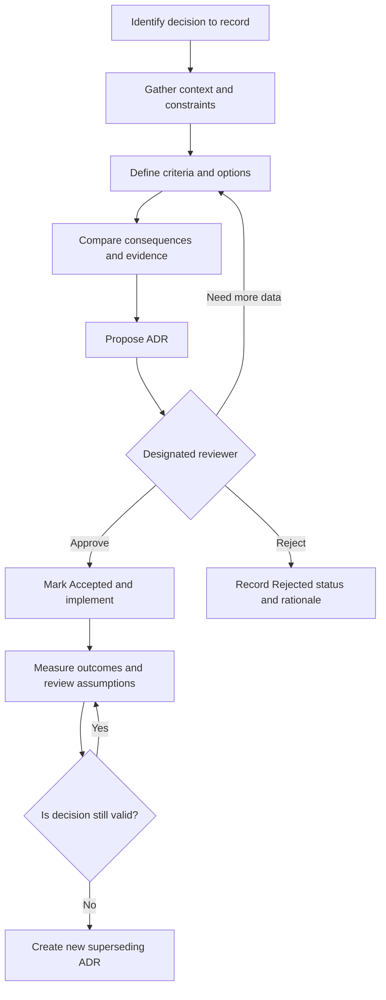

# Recording Architectural Decisions and Trade-Off Criteria

Serverless architecture involves many choices with long-term impact: using synchronous HTTP or asynchronous messages, where to draw function boundaries, where to store state, which managed services to select, how to grant permissions, and how to cap scaling. No single choice is best for every system. Each choice satisfies certain needs while creating costs or risks elsewhere.

Recording architectural decisions helps the team understand why an option was chosen, which alternatives were considered, what assumptions underpinned the choice, and which consequences must be managed. This document is commonly called an *Architecture Decision Record* (ADR). An ADR is valuable when it captures the reasoning and conditions behind a decision, allowing future readers to evaluate the choice in proper context rather than looking solely at the final diagram or configuration.

For Java serverless applications, ADRs should connect technical choices to how functions are triggered, deployed, authorized, retried, stateful or stateless, scaled, and billed. A decision should be considered sound only when it meets key requirements in real-world context and its trade-offs have been explicitly accepted.

## 1. What Does an ADR Record?

An ADR is a short record focused on one significant architectural decision. It answers: what problem needs solving, what are the context and constraints, what options exist, which option did the team choose, why, and what consequences follow.

For example, the sentence “the system uses a queue” merely describes a component. A better ADR explains that the order-creation API must respond quickly, inventory reservation may be slow or temporarily unavailable, the team chose to record the order in `PENDING` status and dispatch processing via a queue, and the team accepts that the final outcome will arrive asynchronously. The ADR also documents duplicate-processing prevention, aged-message monitoring, and consumer failure recovery.

Create an ADR when a decision:

- Affects system structure, function boundaries, inter-component contracts, or data flows.
- Changes quality attributes such as latency, availability, consistency, security, scalability, or maintainability.
- Creates long-term commitments to a cloud platform, Java runtime, data service, event bus, workflow engine, or deployment tooling.
- Is hard to reverse, costly to change, or affects multiple teams.
- Has multiple reasonable alternatives and the team needs to document clearly why one was selected.

Do not write an ADR for every minor implementation detail. Renaming a variable, tweaking a log line, or refactoring an internal method rarely constitutes an architectural decision. If every change gets an ADR, documentation grows so noisy that readers cannot find key decisions. Focus on choices with meaningful impact or those that will need to be re-understood in the future.

An ADR also does not replace detailed design specs, API specifications, deployment diagrams, runbooks, or source code. Those artifacts describe the current system or how to operate it. An ADR explains the rationale and consequences of a choice. When changes happen, operational and design documents still must be updated accordingly.

## 2. Structure of a Readable ADR

An ADR can follow this structure. Teams may adjust section headings, provided enough information remains for readers to understand the decision without relying on the author's memory.

| Section | Content to Record |
|---|---|
| ID and title | Stable identifier; title naming one specific decision |
| Status | Proposed, Accepted, Rejected, Deprecated, or Superseded |
| Date and owners | Date recorded, proposer, and approver if required by process |
| Context | Problem statement, current architecture, goals, constraints, and assumptions |
| Decision drivers | Most important requirements or quality attributes |
| Options considered | Alternatives genuinely evaluated, including status quo if viable |
| Decision | Accepted choice, scope of applicability, and rationale |
| Consequences | Benefits, costs, risks, limitations, and resulting obligations |
| Verification plan | Metrics, tests, review milestones, or triggers requiring re-evaluation |
| Links | Related ADRs, issues, diagrams, benchmarks, threat models, or contract docs |

### Context Must Be Concrete

Avoid vague context statements such as “the system needs good performance” or “requires high scalability.” Describe who uses the system, expected traffic, access patterns, which data is critical, what happens when a dependency fails, and existing platform limits.

A quality requirement should state a scenario and a measurement. You can use this template:

1. **Stimulus:** what happens, such as a traffic spike or message redelivery.
2. **Environment:** whether the system is under normal load, peak load, or experiencing a dependency failure.
3. **Expected response:** what the system must do when receiving that stimulus.
4. **Measure:** what condition proves the response satisfies the requirement.

For example: “When API traffic rises to three times normal load for 10 minutes, the system accepts valid requests while keeping overload error rates below the agreed threshold; queue depth does not grow unboundedly and the database stays within connection limits.” Concrete figures and thresholds must come from product requirements, SLOs, and project measurements; never invent arbitrary numbers just to make an ADR look precise.

### Distinguishing Constraints from Prioritization Criteria

Constraints are mandatory conditions an option must satisfy—for example, data must stay in an approved region, the system must use Java due to organizational standards, or budget must stay within an approved cap. Any option violating a constraint must be eliminated regardless of how well it scores on other criteria.

Prioritization criteria compare the remaining viable options. For instance, response latency may outweigh cost for a transactional API, whereas cost per task may outweigh latency for high-volume background jobs. Separating constraints from criteria prevents high scores elsewhere from masking a security or compliance violation.

## 3. Defining Trade-Off Criteria in Serverless

Do not pick criteria simply because they are popular. Start from product goals, SLOs, data constraints, and how the team operates the system. For Java serverless, the following criterion groups are usually helpful.

### Latency and User Experience

Evaluate the response time users actually perceive, not just a single function's execution time. An API calling several functions and external services sequentially can accumulate end-to-end latency far exceeding any single invocation. Cold starts, framework initialization, database connections, retries, and queue wait times all affect experience.

Distinguish intake acknowledgment latency from business completion latency. An API can return `202 Accepted` very quickly while work remains queued. This works if the product allows asynchronous processing and provides a way to query status; it fails requirements if users must receive the final outcome within the same request.

### Reliability and Resilience

Evaluate how the system behaves when a function times out, a message is redelivered, a queue backs up, an external service goes down, or a deployment region experiences an outage. Consider retries, backoff, DLQs, idempotency, timeouts, circuit breakers where appropriate, and replay procedures.

A short synchronous call chain can be easy to follow, yet callers depend on the availability of every downstream component. Asynchronous flows decouple intake timing from processing timing, at the cost of introducing pending states, duplicate handling, event ordering, and compensation flows. The ADR must record the required mechanisms so the chosen option genuinely achieves target reliability.

### Consistency and Data Ownership

Specify where authoritative data is recorded, who is permitted to mutate it, and when state is considered final. A local database transaction can guarantee a group of updates commit together. When a flow crosses multiple functions and services, do not assume a single distributed transaction spans every step.

If eventual consistency is accepted, the product must account for intermediate states and failure handling when a step fails. A transactional outbox, workflow, saga, or compensating actions may be necessary. These mechanisms add structural and operational overhead; those obligations belong in the ADR.

### Scalability and Load Control

FaaS can scale instance counts with load, yet rapid scaling does not mean every downstream dependency can absorb that traffic. Evaluate concurrency limits, queue consumption rates, connection pools, API quotas, and database capacity.

Splitting functions lets each workload type scale independently. In return, more functions mean more configurations, permissions, dashboards, contracts, and failure paths. Weigh whether scaling independence justifies the added operational complexity.

### Security and Compliance

Compare caller authentication, execution identities, IAM permissions, secret management, encryption, private networking, audit logging, and the scope of data processed. A notification-only function usually does not need read access to payment data. Per-function least privilege increases configuration overhead while shrinking the blast radius during incidents.

Constraints on data residency, retention, auditing, or personal data handling are typically mandatory. Document how each option meets these constraints and what evidence confirms compliance.

### End-to-End Cost

Serverless cost is not limited to function invocation counts. Include execution duration, memory/CPU sizing, API requests, messages, events, workflows, storage, logs, traces, data transfer, retries, and pre-warmed capacity settings. An option reducing latency with provisioned capacity may raise baseline cost during low traffic. An option splitting functions finely may raise invocation counts and inter-service messaging.

Compare costs under identical assumptions for traffic, error rates, payload sizes, and retention windows. Clarify which figures are measured and which are estimates. Where data is missing, state uncertainty ranges and a plan to measure after deployment.

### Maintainability, Team Skills, and Provider Dependency

Consider Java code readability, library ecosystem, release speed, local testability, and dependence on proprietary SDKs, event formats, IAM, and workflow services. Cloud managed services reduce operational burden while raising switching costs if the architecture couples deeply to proprietary APIs.

Do not treat vendor lock-in as inherently bad. If a proprietary service satisfies critical requirements and the team accepts switching costs, it can be the right choice. Document which parts depend on the provider, which data and contracts are portable, and what exit path applies if risk shifts.

## 4. Comparing Options with Discipline

Before scoring, assemble a realistic set of options. Usually two to four genuinely distinct options work best, including keeping the status quo or deferring if viable. Never invent weak straw-man options merely to make a favored option stand out.

For each option, describe how it behaves in the same scenario. For instance, when comparing synchronous HTTP with a queue, spell out where state is stored, how the caller gets results, how errors are handled, how retries work, and who owns the data. Comparing technology names without comparing behavior leads to superficial conclusions.

### Weighted Decision Matrix

When multiple criteria matter, teams can use a matrix to clarify priorities. A simple process:

1. Eliminate options that violate mandatory constraints.
2. Select criteria that genuinely differentiate the decision.
3. Assign weights to each criterion totaling 100% or 1.
4. Score each option on a consistent scale, e.g., 1 for very poor to 5 for very strong.
5. Multiply scores by weights and sum them.
6. Run a sensitivity check: if a weight shifts within a reasonable range, does the winner flip?

Formula:

\[
\text{Option Score} = \sum_{i=1}^{n} \text{Weight}_i \times \text{Score}_{i}
\]

A matrix is a discussion aid, not absolute objective proof. Scores still rest on team assumptions and judgment. Document the rationale behind high or low scores and the confidence level of supporting data.

Illustrative example: an order-creation API can acknowledge requests fast while inventory reservation and receipt delivery run later. The team is comparing Option A (sequential processing inside the request) with Option B (saving the order in pending status and emitting events to consumers). Suppose the product accepts asynchronous final results and must tolerate transient failures in downstream services.

| Criterion | Weight | A: Synchronous Processing | B: Asynchronous Processing |
|---|---:|---:|---:|
| Fast intake acknowledgment | 10% | 3 | 5 |
| Resilience to transient dependency errors | 25% | 2 | 4 |
| Immediate final result in request | 15% | 5 | 2 |
| State and consistency management | 15% | 4 | 3 |
| Independent scaling per stage | 15% | 2 | 5 |
| Operational simplicity | 10% | 4 | 2 |
| Cost at assumed load | 10% | 4 | 3 |
| **Weighted score** | **100%** | **3.25/5** | **3.50/5** |

These scores are illustrative for discussion purposes, not a benchmark or universal conclusion across platforms. Option B scores higher in this assumed context because fast intake and fault isolation outweigh returning the final result inside the initial request. If product requirements mandated confirming payment or inventory reservation before responding, weights and scores would shift and Option A could become the better fit.

When two options score closely, do not manufacture a winner by tweaking weights until the desired answer appears. Identify what remains uncertain and run a prototype or load test to gather evidence. You can also decide in phases, leaving an explicit checkpoint to re-evaluate once data arrives.

## 5. Example ADR for a Java Serverless Application

Below is a sample ADR. Service names and thresholds are illustrative; for a real system, replace them with verified data and constraints.

### ADR-001: Accept Orders via HTTP and Process Downstream Steps via Events

**Status:** Accepted

**Context:** A Java API receives order-creation requests. Persisting the order must be acknowledged within a short response window; inventory reservation and receipt delivery depend on services with differing latencies and availability. Callers may resend requests if no response arrives. Messages may be redelivered after timeouts or consumer errors. The product allows orders to remain in a pending state while downstream steps complete and provides a status query view.

**Decision Drivers:**

- The API must confirm order intake without waiting for email delivery to finish.
- Transient email-service failures must not lose recorded orders.
- The inventory-reservation consumer must scale independently with event volume.
- Repeated processing must not create duplicate orders or duplicate stock reservations.
- The team must track status from intake through completion or failure.

**Options Considered:**

1. Execute order creation, inventory reservation, and receipt delivery sequentially inside one HTTP invocation.
2. Persist the order in pending status, emit an event, and let consumers process downstream steps independently.
3. Use a stateful workflow to coordinate inventory reservation, payment, and compensating actions; the API only starts the workflow and returns a tracking ID.

**Decision:** Choose Option 2 for order intake and independently processable tasks. The API validates the request, checks the idempotency key, and writes the initial order together with an outbox record in a single local transaction. A publisher turns outbox rows into `OrderPlaced` events. The inventory consumer and receipt consumer process according to separate contracts. Order status is updated so clients can query it.

**Rationale:** This option cuts the time the API waits on external services, lets consumers scale independently, and isolates receipt-delivery failures from order creation. The outbox bridges the gap between order persistence and event emission. Idempotency keys combined with conditional writes protect against duplicate requests.

**Positive Consequences:** The API acknowledges intake quickly; background tasks have isolated retries; consumers can deploy independently; the team can monitor backlogs and per-stage progress.

**Accepted Trade-Offs:** Final outcomes are not in the HTTP response; the team must manage intermediate states, outbox publishing, retries, DLQs, and replays; cross-component data reaches consistency after a delay; dashboards and procedures for stuck events are required.

**Controls:** Store idempotency keys with orders; enforce unique constraints in the data store; ensure consumers record processed events in a concurrency-safe manner; configure bounded retries and DLQs; propagate correlation IDs; alert when message age or backlog exceeds agreed thresholds; provide controlled reconciliation and replay operations.

**Re-evaluation Triggers:** If product requirements change to mandate confirming stock reservation or payment before returning API success, re-evaluate synchronous boundaries and workflows. Also re-evaluate if event costs, outbox operations, or end-to-end completion latency exceed acceptable limits.

This example shows that an ADR must record both the decision and the new work created by that decision. Writing only “chose event-driven for easy scaling” would omit pending states, idempotency, outbox, DLQs, and replay operations—the very factors that determine whether the system operates reliably.

## 6. Recording Verifiable Consequences

A useful ADR turns trade-offs into concrete items to measure, observe, or control. Do not stop at a generic list of pros and cons.

| Decision | Potential Consequence | How to Verify or Control |
|---|---|---|
| Move processing to a queue | Completion lag and backlogs | Track message age, queue depth, and intake-to-completion duration |
| Split into multiple functions | More contracts, invocations, and failure points | Track end-to-end traces, per-step error rates, and total flow cost |
| Use a workflow to manage progress | Workflow state and orchestration cost | Test timeouts, retries, error branches, and compensating actions |
| Raise concurrency | Can overload downstream databases or APIs | Set caps; monitor connections, throttling, and downstream error rates |
| Use provisioned capacity | Cuts part of cold starts but increases baseline cost | Compare p95/p99 latency and cost under identical load patterns |
| Use cloud-specific SDKs | Speeds integration while increasing vendor coupling | Isolate adapters, pin versions, and document migration scope |
| Use per-function permissions | More IAM configuration | Run automated permission checks, audit logs, and periodic access reviews |

Define measurements and review timing upfront. For example, an ADR might require load testing before raising concurrency, measuring cost across one representative load cycle, or verifying DLQ rates after release. Thresholds should tie to agreed SLOs or operational limits.

### Do Not Ignore Assumptions and Uncertainty

Every decision rests on assumptions. For instance, the team may assume traffic spikes seasonally, a provider supports idempotency, a queue retains messages long enough, or the Java runtime starts within acceptable bounds. If an assumption proves wrong, the decision may no longer hold.

State clearly:

- Which assumptions have been verified by data or experiments.
- Which assumptions remain estimates or judgments.
- Which risks carry low probability yet high impact.
- Which evidence or events will trigger a review.

When data is scarce, a small prototype or targeted benchmark is usually far more valuable than a decision matrix packed with ungrounded numbers. Benchmarks should reflect the expected runtime, memory config, dependencies, payloads, and load pattern; results from a developer laptop rarely reflect cold starts or concurrency on the target deployment platform.

## 7. Process for Creating, Reviewing, and Maintaining ADRs

The process can be organized into short steps aligned with the development lifecycle:

**Step 1 — Identify and scope.** Write a one-sentence description of the decision to make. Avoid bundling unrelated decisions into one giant ADR. For example, choosing asynchronous communication and choosing a database are two related decisions that nonetheless have distinct criteria and options.

**Step 2 — Gather context.** Review product requirements, SLOs, platform limits, and current architecture. Identify users, owning teams, sensitive data, load, and failure scenarios. Separate verified facts from assumptions.

**Step 3 — Define criteria and options.** Pick the few criteria that matter most, explicitly separating mandatory constraints from prioritized weights. Describe options concretely enough to compare against the same scenario.

**Step 4 — Gather evidence.** Use prototypes, integration tests, benchmarks, cost estimates, threat modeling, or operational analysis as needed. Link to findings and note the limits of the evidence.

**Step 5 — Review and decide.** Designated owners review context, options, consequences, and risks. Record the decision alongside status and approvers per team process. If data is still insufficient, keep the ADR in `Proposed` status while running experiments.

**Step 6 — Implement and verify.** Turn consequences into tasks, metrics, alerts, runbook updates, and acceptance criteria. Verify whether the live system behaves as the ADR anticipated.

**Step 7 — Review when context changes.** When load, SLOs, providers, regulations, or team structure change, revisit affected decisions. Old ADRs remain historical evidence of why a choice made sense at that time.

### Managing Status and History

A commonly used status set:

- `Proposed`: under discussion, not yet accepted.
- `Accepted`: approved and currently in effect.
- `Rejected`: evaluated and not chosen; kept with rationale to avoid rehashing the same debate.
- `Deprecated`: no longer recommended, though a full replacement decision is not yet in place.
- `Superseded`: replaced by a newer ADR; must link to the new ADR.

When an `Accepted` decision changes, create a new ADR and link `supersedes` or `superseded by` to the old record. Do not silently rewrite historical decision text as if the team always used the new approach. Fixing typos or adding links is fine, while the original decision and rationale should stay intact for traceability.

Store ADRs inside the source repository or a place where the team can search, inspect history, and review them alongside related code changes. Use stable IDs, searchable titles, and links to pull requests, issues, or technical specs. Folders can be numbered or dated; what matters is consistent naming independent of any individual's personal workspace.

## 8. Common Mistakes When Recording Decisions

| Mistake | Why It Causes Trouble | How to Improve |
|---|---|---|
| Recording only the chosen technology | Fails to explain the problem and rationale | Record context, criteria, options, and consequences |
| Using vague terms like “fast,” “cheap,” or “scalable” | Cannot be verified or compared | State scenarios, metrics, and assumptions |
| Listing only benefits | Hides costs and risks | Explicitly record trade-offs and controls |
| Picking weights after knowing the desired winner | Turns the matrix into rubber-stamping | Agree on criteria upfront, run sensitivity checks, and record rationale |
| Comparing options under inconsistent assumptions | Makes scores meaningless | Use identical load, payloads, SLOs, and failure scenarios |
| Bundling multiple decisions into one ADR | Hard to review and supersede piecemeal | Focus each ADR on one primary decision |
| Leaving ADRs stale when context shifts | Misleads readers with outdated decisions | Review, write a superseding ADR, and link history |
| Failing to tie consequences to operations | Known risks go unmonitored | Create concrete metrics, alerts, tasks, and owners |
| Writing an ADR like a sales pitch | Hides real alternatives considered | Present options fairly and record rejection reasons |

An ADR does not have to be long to be valuable. It must be concrete enough for readers to understand why the decision was made, what had to be accepted, and what conditions trigger a re-evaluation. If a passage does not help explain or verify the decision, move detailed specifications into related design documents.

## 9. Checklist Before Accepting an ADR

Before marking an ADR as `Accepted`, the team can review:

- [ ] The decision is stated in one clear sentence with a well-defined scope.
- [ ] Context, goals, constraints, and assumptions are clearly documented.
- [ ] Critical quality requirements include concrete measures or scenarios.
- [ ] Mandatory constraints are separated from prioritization criteria.
- [ ] Viable options, including the status quo where applicable, were evaluated fairly.
- [ ] Rationale ties the selected option to system needs and evidence.
- [ ] Positive consequences, negative trade-offs, risks, and operational tasks are documented.
- [ ] Retries, idempotency, state, security, and cost were examined where relevant.
- [ ] Post-deployment verification and re-evaluation triggers are specified.
- [ ] Owners, status, and links to related documents are clear.

A checklist does not replace architectural judgment. It helps the team catch missing pieces before committing to a decision with lasting consequences.

## 10. Applying ADRs in Java Serverless Projects

In a Java FaaS project, start with decisions that directly shape how code is built and operated:

**Function boundaries and use cases.** Record why a business workflow lives in one function or spans multiple functions. State factors such as IAM permissions, triggers, load, retries, timeouts, and independent deployment. Avoid splitting functions solely by method count.

**Trigger and data contracts.** Record why HTTP, queue, event, or schedule was chosen; how schemas are versioned; who owns producers and consumers; and how breaking changes roll out in phases.

**State and correctness.** Record where durable state resides, idempotency keys, retention periods for processed markers, how duplicate or out-of-order messages are handled, and the strategy when a side effect occurs before an invocation times out.

**Runtime and cold starts.** Record Java version, packaging model, frameworks, memory/CPU settings, and rationale for optimizations. Use benchmarks representative of the real artifact; record p95/p99 latency, cold start rate if measured, and the cost of keeping instances warm.

**Concurrency and downstream protection.** Record concurrency caps, queue consumption rates, connection limits, and responses to downstream throttling. Rapidly scaling functions can exhaust connection pools or breach quotas on other systems.

**Permissions and secrets.** Record per-task least-privilege principles, execution identities, permitted resources, and secret rotation procedures. If a shared role is chosen for a specific reason, document the risk and blast-radius mitigations.

**Observability and recovery.** Record correlation IDs, trace context, metrics, alerts, DLQs, replay procedures, and who owns stalled flows. The ADR should specify which states are externally observable and how data is reconciled.

**Cost and vendor dependency.** Record assumptions for invocation counts, execution duration, messages, storage, logs, and network traffic. Note which parts depend on specific cloud APIs or services alongside estimated migration effort if the system must move.

An architectural decision does not end when code merges. Once the system runs in production, compare actual behavior against ADR assumptions. If latency, cost, error rates, or operational complexity differ from expectations, use that data to adjust the decision and issue a superseding record when needed.

## Conclusion

ADRs help teams preserve context, criteria, options, rationale, and consequences behind architectural decisions. To keep decisions verifiable, express requirements via scenarios and measures, separate constraints from priorities, compare options under consistent assumptions, and state trade-offs explicitly. In Java serverless, evaluate triggers, state, retries, idempotency, permissions, cold starts, concurrency, observability, and end-to-end cost together. When context changes, create a new decision linked to history so the architecture continues reflecting real needs.
