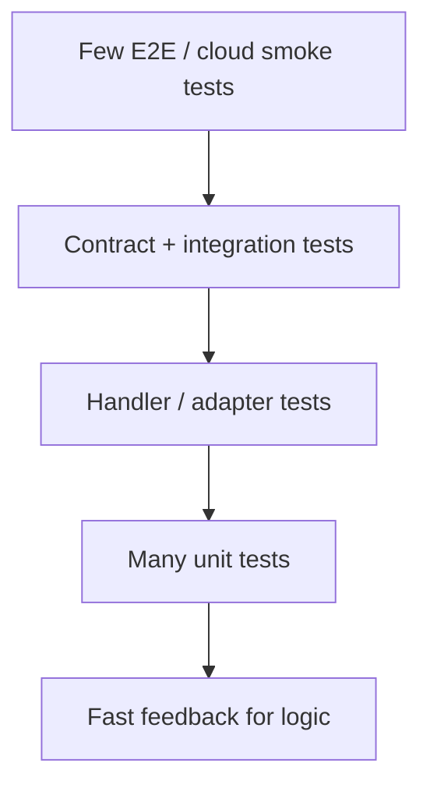
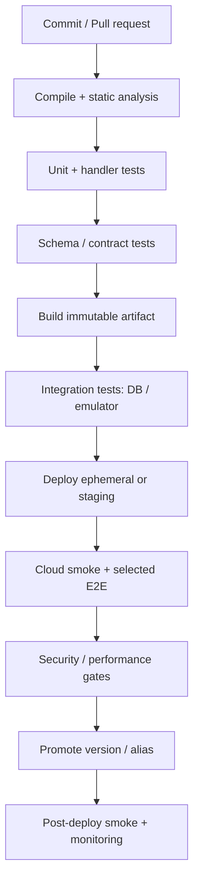

# Designing Unit, Integration, Contract, and End-to-End Test Strategies

Serverless applications typically consist of multiple independent components: HTTP handlers, function runtimes, queues, event buses, databases, object storage, IAM policies, and orchestration services. A function can run properly when invoked directly yet still fail when triggered from SQS, a webhook, or API Gateway because of a different event envelope, missing permissions, an unsuitable timeout, or event redelivery by the platform.

Therefore, serverless testing must cover both Java logic and how functions interact with triggers and external services. Unit tests validate business rules; integration tests check adapters and real dependencies; contract tests protect event/API structures between parties; and end-to-end tests verify the entire deployed flow in a production-like environment.

This lesson builds a testing strategy for Java functions/FaaS. The goal is to choose the right type of test for each risk, keep tests fast and reliable, and still catch bugs that only appear when running on a serverless platform.

## 1. Why does serverless testing need multiple layers?

### 1.1. Functions do not run in isolation

A function typically depends on external contracts:

- triggers send HTTP requests, queue messages, stream records, or event envelopes;
- the runtime locates the handler, deserializes input, and serializes output;
- IAM determines which services the function is allowed to call;
- networking determines whether the function can connect to a database or private endpoint;
- queues/event sources govern acknowledgements, retries, batches, and DLQs;
- timeouts, memory, concurrency, and ephemeral storage constrain execution.

Unit tests cannot prove that production IAM policies are correct. Mocking SQS cannot prove that the event source mapping handles partial batch responses as intended. A single end-to-end test also cannot replace hundreds of unit tests because it is slow, hard to pinpoint root causes, and prone to infrastructure flakiness.

### 1.2. Testing layers

| Layer | What does it test? | Dependencies | Speed and scope |
| --- | --- | --- | --- |
| Unit | Business rules, validation, retry decisions, idempotency logic | None or small mocks/fakes | Very fast, many tests |
| Handler/adapter test | Event mapping, response, exceptions, and context | Direct Java handler, fixtures | Fast, tests the function boundary |
| Integration | Repositories, JDBC, serialization, queue/storage clients, and real configuration | Database/container/emulator or test service | Medium, fewer than unit tests |
| Contract | HTTP/event schemas, headers, statuses, versions, and semantics between producer/consumer | Schema/fixtures/provider verification | Fast to medium |
| End-to-end | Trigger → function → dependencies → final outcome | Integrated cloud/stack environment | Slow, small count |
| Non-functional | Load, concurrency, cold start, timeout, security, resilience | Production-like environment | Controlled, scheduled or pre-release |

Not every function needs the same number of tests in every layer. Allocate by risk: a tax-calculation function needs many unit tests; an SQS consumer needs more batch, duplicate, and retry tests; an HTTP API needs contract and authorization tests; a multi-step workflow needs end-to-end tests for critical branches.

### 1.3. Test pyramid and feedback loop



Unit tests should make up the largest share because they run fast and pinpoint specific errors. Integration and contract tests check boundaries where code and dependencies are likely to drift. Keep E2E tests small in number, focusing on critical business flows and actual deployment configuration.

This is not a rigid percentage rule. An event-driven system may need more integration/contract tests than a simple CRUD application. The criterion is that each test must verify a risk that lower layers cannot detect.

## 2. Preparing code for testability

### 2.1. Decoupling the handler from business logic

The handler should be responsible for converting input into a command, invoking an application service, and converting the result into output. Business logic should live in plain Java classes without depending on `Context`, event SDKs, or static globals.

```java
public record CreateOrderCommand(
        String customerId,
        String productId,
        int quantity,
        String idempotencyKey) {
}

public record CreateOrderResult(
        String orderId,
        String status) {
}

public interface OrderRepository {
    void save(Order order);
}

public interface InventoryService {
    boolean reserve(String productId, int quantity, String key);
}

public final class CreateOrderService {
    private final OrderRepository orders;
    private final InventoryService inventory;

    public CreateOrderService(
            OrderRepository orders,
            InventoryService inventory) {
        this.orders = orders;
        this.inventory = inventory;
    }

    public CreateOrderResult execute(CreateOrderCommand command) {
        if (command.quantity() <= 0) {
            throw new IllegalArgumentException("quantity must be positive");
        }
        if (command.idempotencyKey() == null
                || command.idempotencyKey().isBlank()) {
            throw new IllegalArgumentException("idempotency key is required");
        }

        boolean reserved = inventory.reserve(
                command.productId(),
                command.quantity(),
                command.idempotencyKey());
        if (!reserved) {
            throw new OutOfStockException(command.productId());
        }

        Order order = Order.create(
                command.customerId(),
                command.productId(),
                command.quantity(),
                command.idempotencyKey());
        orders.save(order);
        return new CreateOrderResult(order.id(), "CREATED");
    }
}
```

The `Order` and `OutOfStockException` classes are application domain types. The service does not know whether it is called from API Gateway, SQS, or a test. As a result, unit tests can verify logic without starting the Lambda runtime.

### 2.2. Avoiding static globals and side effects in constructors

Do not initialize database connections, call Secrets Manager, or write business data in static initializers. A handler's constructor should accept dependencies or only create lightweight clients with a clear lifecycle. External operations should sit behind interfaces so tests can substitute them.

In production, you can use a factory or dependency injection to create clients shared across an execution environment. In tests, pass fakes or mocks. Do not share mutable state across tests or invocations.

### 2.3. Injecting clock, ID generator, and retry policy

Factors such as time, UUIDs, random backoff, and retry policies make tests hard to reproduce if fetched directly from the system. Wrap them behind abstractions:

```java
public interface IdGenerator {
    String nextId();
}

public final class OrderExpiryPolicy {
    private final java.time.Clock clock;

    public OrderExpiryPolicy(java.time.Clock clock) {
        this.clock = clock;
    }

    public boolean isExpired(java.time.Instant expiresAt) {
        return !expiresAt.isAfter(clock.instant());
    }
}
```

Unit tests can use `Clock.fixed(...)` to test exact time boundaries. For retry/backoff, inject a policy or random source so tests do not actually sleep and do not depend on random numbers.

## 3. Unit tests for domain and application services

### 3.1. What should be tested

Unit tests focus on the observable outcomes of logic:

- valid and invalid inputs;
- business rules and state transitions;
- distinguishing business rejections from technical failures;
- idempotency keys and duplicate handling;
- retry decisions by error type;
- retry limits and deadlines;
- handling of missing, null, or boundary data;
- whether expected side effects occur the right number of times.

Do not write tests for internal implementation details such as how many times a private helper is called if that is not part of the contract. Tests should remain valid when refactoring class structure while preserving behavior.

### 3.2. JUnit 5 and Mockito example

```java
import static org.junit.jupiter.api.Assertions.*;
import static org.mockito.Mockito.*;

import org.junit.jupiter.api.BeforeEach;
import org.junit.jupiter.api.Test;

class CreateOrderServiceTest {
    private OrderRepository orders;
    private InventoryService inventory;
    private CreateOrderService service;

    @BeforeEach
    void setUp() {
        orders = mock(OrderRepository.class);
        inventory = mock(InventoryService.class);
        service = new CreateOrderService(orders, inventory);
    }

    @Test
    void createsOrderWhenInventoryIsAvailable() {
        when(inventory.reserve("sku-1", 2, "req-123"))
                .thenReturn(true);

        CreateOrderResult result = service.execute(
                new CreateOrderCommand("customer-1", "sku-1", 2, "req-123"));

        assertEquals("CREATED", result.status());
        assertNotNull(result.orderId());
        verify(inventory).reserve("sku-1", 2, "req-123");
        verify(orders).save(any(Order.class));
    }

    @Test
    void rejectsNonPositiveQuantityBeforeCallingDependencies() {
        assertThrows(IllegalArgumentException.class, () ->
                service.execute(new CreateOrderCommand(
                        "customer-1", "sku-1", 0, "req-123")));

        verifyNoInteractions(inventory, orders);
    }

    @Test
    void reportsOutOfStockWithoutSavingOrder() {
        when(inventory.reserve("sku-1", 2, "req-123"))
                .thenReturn(false);

        assertThrows(OutOfStockException.class, () ->
                service.execute(new CreateOrderCommand(
                        "customer-1", "sku-1", 2, "req-123")));

        verify(orders, never()).save(any());
    }
}
```

Mocks help verify that the service interacts with dependencies according to contract. For logic with complex state or algorithms, an in-memory fake can be easier to understand and less coupled than mocks. Do not mock every object: if a test only checks a getter on a simple object, use the real object.

### 3.3. Testing idempotency at the business level

An important test is ensuring that the same idempotency key does not create two orders or deduct inventory twice. A fake repository can simulate a unique constraint; an integration test then verifies that the database actually enforces the invariant.

Test both cases:

- same key and same payload: returns the previous result or an equivalent result without repeating side effects;
- same key with a different payload: rejects because the key was already used for another request.

Do not only test "the function receives the event twice." You must test the final invariant in the database or side-effect system.

### 3.4. Property-based and boundary tests

For parsers, validation, pricing, or retry policies, testing across many boundary inputs can catch bugs missed by a few fixed examples. Property-based testing can generate inputs via generators and check properties such as:

- negative/zero quantity is always rejected;
- total amount is non-negative and follows the rounding policy;
- retry delay never exceeds max delay;
- every accepted archive path stays under the destination root;
- the same idempotency key never creates more than one business outcome.

Always add a regression test for any bug that has occurred so it does not return.

## 4. Handler and adapter tests

### 4.1. Testing handlers without starting the cloud runtime

For Java `RequestHandler<I,O>`, you can call `handleRequest(input, context)` directly in tests. Use accurate event fixtures and mock/fake `Context` if the logic needs the request ID or remaining time.

Handler tests should check:

- deserialization/input mapping and handling of missing fields;
- response status, headers, body, and content type;
- mapping exceptions to HTTP responses or invocation failures;
- correlation/request IDs are propagated correctly;
- batch events and partial failure responses;
- no false success is returned when a dependency fails;
- the timeout budget is checked before long operations.

### 4.2. HTTP handler test example

Suppose a handler converts `APIGatewayProxyRequestEvent` into a command and returns `APIGatewayProxyResponseEvent`:

```java
import static org.junit.jupiter.api.Assertions.*;
import static org.mockito.Mockito.*;

import com.amazonaws.services.lambda.runtime.Context;
import com.amazonaws.services.lambda.runtime.events.APIGatewayProxyRequestEvent;
import com.amazonaws.services.lambda.runtime.events.APIGatewayProxyResponseEvent;
import org.junit.jupiter.api.Test;

class OrdersHttpHandlerTest {
    @Test
    void returnsBadRequestWhenOrderIdIsMissing() {
        CreateOrderService service = mock(CreateOrderService.class);
        OrdersHttpHandler handler = new OrdersHttpHandler(service);
        APIGatewayProxyRequestEvent request =
                new APIGatewayProxyRequestEvent().withPathParameters(null);
        Context context = mock(Context.class);

        APIGatewayProxyResponseEvent response =
                handler.handleRequest(request, context);

        assertEquals(400, response.getStatusCode());
        verifyNoInteractions(service);
    }
}
```

A constructor accepting the service is a seam for testing and dependency injection. If the runtime requires a default constructor, you can provide a factory/no-arg constructor for production and a package-private/public constructor for tests. Avoid forcing tests to mutate static singletons or global environment variables.

### 4.3. Representative event fixtures

Store sample payloads for each trigger in `src/test/resources/events/`:

```text
src/test/resources/events/
  api-gateway-create-order.json
  sqs-order-created.json
  sqs-partial-batch.json
  eventbridge-order-paid.json
  s3-object-created.json
  webhook-provider-a.json
```

Fixtures should come from official schemas/documentation or sanitized real events with sensitive data redacted. Do not hand-craft JSON that only "looks similar" and assume it matches real events. Keep fixtures versioned so schema changes are reviewed like API changes.

### 4.4. Testing serialization/deserialization

Separately test deserializing event JSON into Java classes and serializing responses back to JSON. Check:

- required and optional fields;
- timestamp formats and timezones;
- unrecognized enum values;
- large numbers, nulls, and Unicode;
- HTTP bodies that may be JSON-encoded strings;
- base64-encoded bodies if the trigger uses them;
- headers that may have different casing;
- newer payload versions adding extra fields that older consumers must safely ignore.

Do not just call Java constructors and skip JSON mapping if the actual runtime uses a serializer. A naming strategy bug or missing default constructor may only surface during deserialization.

## 5. Integration tests for dependencies

### 5.1. When are integration tests needed?

Integration tests verify that components actually work together. Examples:

- JDBC repositories execute valid SQL and transactions;
- database schemas have compatible migrations;
- JSON serializers produce valid payloads;
- queue clients send/receive messages with the right attributes;
- object storage uploads, metadata, and versioning work;
- Secrets Manager clients read the right version with the configured identity;
- SDK retries/timeouts are passed correctly.

Mocks do not prove SQL is valid, IAM permissions are right, or queue visibility timeout is configured as intended. These boundaries require integration or cloud tests.

### 5.2. Database tests with Testcontainers

Testcontainers can start a real database in a container for repository tests. For example, PostgreSQL:

```java
import org.junit.jupiter.api.AfterAll;
import org.junit.jupiter.api.BeforeAll;
import org.testcontainers.containers.PostgreSQLContainer;

class OrderRepositoryIT {
    static PostgreSQLContainer<?> postgres =
            new PostgreSQLContainer<>("postgres:16-alpine")
                    .withDatabaseName("orders_test")
                    .withUsername("test")
                    .withPassword("test");

    @BeforeAll
    static void startDatabase() {
        postgres.start();
        // Create DataSource from container JDBC URL/credentials.
        // Run migrations and initialize real repository.
    }

    @AfterAll
    static void stopDatabase() {
        postgres.stop();
    }
}
```

The snippet is an illustrative skeleton; you need Testcontainers PostgreSQL/JUnit dependencies and actual `DataSource`, migration, and cleanup configuration. Use pinned image versions, not `latest`, so tests are reproducible. If CI does not support Docker, you can use a managed test database service, but data must be isolated.

Integration tests should check idempotency key unique constraints, rollback when a step fails, isolation, optimistic locking, and migrations from older schemas. Use a database engine compatible with production; H2 does not always accurately simulate PostgreSQL/MySQL.

### 5.3. Emulators and local cloud stacks

Some services have emulators or local test environments, such as the Pub/Sub emulator, Firestore emulator, or LocalStack for certain AWS APIs. They help test client/serialization flows quickly and reduce cloud test costs.

However, emulators can differ from real services in:

- IAM and policy evaluation;
- retry/backoff and redelivery semantics;
- consistency, transactions, and ordering;
- batch behavior, visibility timeouts, and DLQs;
- quotas, throttling, cold starts, and concurrency;
- networking, DNS, VPC, and encryption integration.

Use emulators for fast feedback; still run a set of tests on real cloud services for provider-dependent behavior. Document known differences to avoid treating passing local tests as complete proof.

### 5.4. Testing object storage

For upload pipelines, integration tests must verify:

- objects are created in the right bucket/key;
- metadata and content type are stored as expected;
- version/generation IDs are retrieved accurately;
- scanners read the right object version;
- quarantined objects are not public;
- promoting/copying to clean storage preserves required checksums and metadata;
- cleanup/lifecycle rules do not delete objects currently being processed.

For presigned URLs, test the URL method, expiry, object scope, and signed headers. A presigned URL still needs permission checks after upload; tests should not only verify that the URL returns HTTP 200.

## 6. Contract tests for HTTP, events, and messages

### 6.1. A contract is an agreement between producer and consumer

A contract describes the structure and semantics one party provides to another. In serverless, a contract can be:

- HTTP method/path, headers, status codes, response schemas, and error codes;
- event envelope, `source`, `type`, `detail`, schema version, and timestamp;
- queue message body, attributes, ordering key, and deduplication ID;
- webhook signature, retry response, and event ID;
- partial batch response format of the event source adapter.

Syntactically valid JSON can still violate a contract if a field name, enum, semantics, or status code changes.

### 6.2. Consumer-driven contracts

Consumer-driven contracts start from the consumer's actual needs. The consumer describes which fields it reads and what behavior it expects; the provider verifies that its implementation still satisfies that contract.

For example, a consumer only needs `orderId`, `eventId`, and `occurredAt` from `OrderPaid`. The provider can add new optional fields without breaking the consumer, but renaming `orderId` to `id` or changing the timestamp format can be a breaking change.

Common compatibility rules:

- adding optional fields can be compatible if consumers ignore unknown fields;
- removing or renaming a field in use is usually a breaking change;
- changing data types or enums can break older consumers;
- changing semantics without changing the schema can still break business logic;
- event/API versioning and deprecation processes must be explicit.

### 6.3. Schema validation

Use JSON Schema, OpenAPI, AsyncAPI, or a schema registry suited to your system to validate payloads. Schemas should describe required fields, types, formats, enums, and versions. You can run schema validation in unit/contract tests to catch invalid payloads early in CI.

Schemas do not replace semantic tests. For example, a schema allows `quantity` to be a positive integer but does not prove the consumer handles inventory properly. Combine schema tests with consumer/provider behavior tests.

### 6.4. Contracts for event versioning

When upgrading an event schema:

1. Identify current consumers and the fields they use.
2. Add new fields in a backward-compatible way when possible.
3. Older consumers must ignore unknown fields.
4. If a breaking change is needed, publish a new event type/version or roll out a phased migration.
5. Run the contract suite for all supported consumers.
6. Monitor the share of consumers processing the old version before retiring it.

Do not change the production payload and merely update test fixtures to match the new payload; doing so can make tests agree with a bug.

### 6.5. Contracts for webhooks

Webhooks must test both the payload and source verification:

- the signature is computed over the exact raw request body;
- the signature algorithm and header match the provider contract;
- the timestamp/replay window is validated;
- the event ID is persisted to prevent duplicates;
- the response code and acknowledgement timing are appropriate;
- unknown event types are handled according to policy;
- secret rotation does not break verification of valid events.

Tests must include fixtures for a valid signature, invalid signature, body modified after signing, expired timestamp, and duplicate event ID. Do not use a mock verifier to replace testing the crypto/signature implementation.

## 7. Testing retries, duplicates, and idempotency

### 7.1. Identify who retries

Not every exception causes FaaS to retry. Identify the retry owner:

| Trigger/invocation | Component that may retry | What to test |
| --- | --- | --- |
| HTTP synchronous | HTTP client, gateway policy, or caller | Status codes, timeouts, retry budgets, and idempotency keys |
| Direct synchronous invoke | SDK caller | Function error response and caller-side retries |
| Async invocation | Platform delivery policy | Configured retry count/window and failure destination |
| Queue event source | Queue/event source mapping | Visibility timeout, max receive, batch failure, DLQ |
| Stream source | Event source mapping/checkpoint | Ordering, shard/partition blocking, and poison record policy |
| Workflow orchestrator | Workflow state machine | Retry/Catch, backoff, timeout, and compensation |

Application-level tests should verify error classification decisions; cloud tests should verify that the platform/trigger executes retries according to real configuration.

### 7.2. Testing duplicate delivery

Event-driven functions often face at-least-once delivery. Write tests that send the same event multiple times and verify that only one business side effect occurs. Then test concurrent duplicates, not only sequential ones.

Scenarios to include:

- the same event ID is delivered twice;
- two invocations process the same idempotency key concurrently;
- the handler commits to the database but loses the connection before acknowledgement;
- a worker completes a side effect but times out before returning success;
- an older event arrives after a newer event;
- the same key arrives with a different payload;
- the idempotency record's TTL expires while an event replay can still arrive.

### 7.3. Verifying idempotency at the persistence boundary

A unit test can confirm that the service calls the repository properly, but an integration test must confirm that unique constraints/transactions actually prevent duplicates. For external side effects, test provider-side idempotency keys or use the outbox/inbox pattern.

Example invariant:

```text
Given: eventId = evt-123 is delivered multiple times
When: consumer processes all deliveries
Then: only one order transition is committed
And: only one business outbox event is created
And: duplicate deliveries return the processed result
```

Do not only assert mock call counts. Read back the database state or final record count.

### 7.4. Testing retry classifiers and backoff

Error classification:

- validation/business rejection: do not retry;
- permission/configuration error: stop and alert operations;
- timeout, connection reset, or throttling: retryable with backoff;
- indeterminate side-effect outcome: reconcile before retrying;
- errors exceeding retry budget: route to DLQ/failure path.

Inject a clock/random source to test exponential backoff, jitter, max delay, and deadlines without using `Thread.sleep()`. Verify that total retry duration does not exceed the invocation/workflow deadline and does not cause a retry storm.

## 8. Testing batch, queue, and stream triggers

### 8.1. Batch failure semantics

With batch events, one failing record can cause the whole batch to be redelivered. If the platform supports partial batch responses, test the exact response format and failed record identifiers.

Tests should cover:

- empty batch or maximum-size batch;
- one failing record in the middle of a batch;
- multiple failing records;
- duplicate records;
- malformed-schema records;
- an exception before processing the first record;
- a timeout after some records have committed;
- partial failure responses are serialized properly.

### 8.2. Do not acknowledge a batch before durable processing

If a handler returns success after only buffering records in memory, messages may be acknowledged before side effects are persisted. If the function terminates, data is lost. Tests should simulate failures around every commit/ack boundary to confirm no data loss and no duplicate business effects.

### 8.3. Poison messages

A poison message is an event that consistently makes the consumer fail. Test max receive count, DLQ routing, redrive, and the ability to isolate a failing record so it does not block the entire queue/partition. For ordering-preserving streams, tests must verify that the failing-record policy does not stall the shard indefinitely.

## 9. End-to-end tests in deployed environments

### 9.1. What should E2E tests verify?

E2E tests verify a flow from a real trigger to the final business outcome. Examples:

- an HTTP request goes through the gateway, invokes the Java function, writes to the database, and returns a response;
- uploading an object to quarantine triggers the scanner, and the object is promoted once clean;
- publishing a message to a queue triggers the consumer, updates the database, and emits the next event;
- a webhook has its signature verified, is deduplicated, and creates one business record;
- a workflow retries a transient dependency failure and either completes or enters compensation.

E2E tests should use an isolated ephemeral or staging environment, dedicated test data, and least-privilege permissions. Never run destructive tests against production data.

### 9.2. Testing the actual deployment artifact

Run tests against the exact published JAR/container image, not just the IDE classpath. This catches:

- wrong handler strings;
- missing dependencies in shaded/fat JARs;
- unpackaged resources/schemas;
- incompatible Java runtime/architecture;
- missing environment variables or secret references;
- misconfigured timeout, memory, concurrency, or VPC settings.

A post-deploy smoke test can invoke the function with a simple payload, verifying the response, logs, and dependency connectivity. Smoke tests do not replace the full E2E suite.

### 9.3. Testing real IAM and networking

Mock IAM clients do not verify production policies. In staging, use a runtime service account/role structured like production and test:

- the function is allowed to call the intended resources;
- the function is denied access to out-of-scope resources;
- the trigger principal has invoke permissions;
- the function cannot read ungranted secrets;
- private database endpoints are reachable over VPC;
- public egress and DNS behave according to policy.

Test both positive and negative authorization. A "can connect" test does not prove permissions are properly scoped.

### 9.4. Cleaning up test resources

E2E tests often create queues, objects, database records, function versions, or workflow executions. Use dedicated prefixes/namespaces, TTLs, and cleanup in `finally`/pipeline teardown. If a test fails mid-run, there must still be a process to clean up orphaned resources.

Never delete shared buckets/databases using broad wildcards. Cleanup must know the exact resources created by the test and delete only those.

## 10. Performance, concurrency, and cold start testing

### 10.1. Metrics to measure

- p50/p95/p99 invocation duration;
- cold start/init duration and warm duration;
- throughput and concurrent executions;
- timeout, error, throttle, and retry rates;
- peak CPU/memory and GC pauses;
- queue age/backlog and batch processing time;
- database connection count and query latency;
- cost per successful business operation.

Do not use a single local run to draw conclusions about cloud cold starts or concurrency. Runtime, region, VPC, memory, architecture, and deployment package all affect results.

### 10.2. Load testing with realistic profiles

Load models should include:

- steady baseline;
- ramp-up and ramp-down;
- sudden bursts;
- sustained peaks;
- small/large payloads;
- slow or throttled dependencies;
- duplicates/retries for event-driven workloads.

Monitor both the function and its dependencies. Lambda may scale successfully while the database runs out of connections or a downstream API gets throttled. Bound concurrency according to what downstream systems can sustain.

### 10.3. Cold start testing

To measure cold starts, force new execution environments or use an appropriate deployment/scaling mechanism, record init duration, and distinguish cold from warm invocations. Do not assume each test call creates a new cold start; the platform may reuse environments.

Compare configurations:

- small JAR vs. JAR with large frameworks;
- eager initialization vs. lazy initialization;
- different memory/CPU settings;
- provisioned/minimum instances where available;
- JVM vs. native image where appropriate.

Measure latency percentiles alongside cost. Reducing cold starts by keeping warm instances increases idle cost; decisions must be driven by SLAs.

### 10.4. Testing timeouts and graceful failure

Simulate dependencies slower than the deadline, connection resets, and thread interruption. Verify that the handler:

- propagates timeouts down to HTTP/JDBC clients;
- stops starting new steps when insufficient time remains;
- rolls back/cleans up within safe bounds;
- never returns a false success;
- logs with a correlation ID;
- lets the trigger/workflow apply retries according to policy.

## 11. Security testing for functions and pipelines

Security testing should cover:

- unauthenticated and unauthorized invocations;
- tenant isolation and object-level authorization;
- secrets never appearing in logs/error responses;
- payload injection, malformed JSON, and oversized requests;
- replay/duplicate webhooks;
- path traversal and Zip Slip;
- archive bombs bounded by bytes/entries/depth/time;
- SSRF or outbound requests to disallowed hosts if the function fetches user-supplied URLs;
- IAM least privilege and negative permission tests;
- dependency/image vulnerability scans.

For upload scanners, use safe test fixtures designed to verify antivirus engines such as EICAR under internal procedures—never real malware. Archive bombs should use small resource-bounded samples to verify guardrails; do not create payloads that can exhaust CI runners.

Do not only test that malicious requests return 4xx. Verify that objects are not promoted, status is `REJECTED`, quarantined data is retained per policy, and no public download path exists.

## 12. Resilience and failure injection testing

Serverless has many distributed failure modes. You can test under controlled conditions:

- database unavailable or connection pool exhausted;
- duplicate or delayed queue deliveries;
- out-of-order events;
- storage timeouts during object copy/promote;
- Secrets Manager or external API throttling;
- function timeout after commit but before acknowledgement;
- a batch containing a poison record;
- scanner process OOM or kill;
- a new deployment version with an incompatible schema.

The goal is to confirm the system recovers properly, creates no duplicate side effects, loses no data, and does not amplify incidents. Run failure injection only in authorized environments with bounded blast radius and clear abort criteria.

## 13. Organizing test suites and CI/CD

### 13.1. Suggested project structure

```text
src/
  main/java/...
  test/java/...
  test/resources/
    events/
    contracts/
    files/
```

Naming conventions:

- `*Test`: fast unit and handler tests;
- `*IT`: integration tests requiring a database/container/emulator;
- `*ContractTest`: schema/provider/consumer contract suites;
- `*E2ETest`: tests requiring a deployed cloud environment.

Configuring Maven Surefire for fast tests and Failsafe for integration tests is a common approach. With Gradle, you can create separate source sets/tasks for integration tests. The key is that CI can select test layers by stage and does not accidentally run cloud tests on every compile.

### 13.2. Suggested pipeline



Pull requests should run fast, deterministic tests and contract tests. Integration tests run in CI when dependency containers/emulators are available. Cloud E2E and load/security tests can run pre-release or on a schedule, depending on cost and duration. Post-deploy smoke tests must run against the actual artifact.

### 13.3. Managing test data and environments

- Give each test its own data and unique identifiers.
- Use fixtures with PII/secrets redacted.
- Do not share mutable resources across parallel tests without isolation.
- Create a dedicated namespace/prefix per pipeline run.
- Clean up queues, objects, database rows, and function versions created by tests.
- Use short-lived credentials and least-privilege IAM roles.
- Never commit cloud keys or secrets to the repository.
- Record runtime version, region, architecture, and test configuration to reproduce failures.

### 13.4. Avoiding flaky tests

Flaky tests typically stem from fixed sleeps, ordering dependencies, real clocks, shared data, eventual consistency, or incomplete cleanup.

Remedies:

- use polling with a deadline instead of fixed `Thread.sleep()`;
- inject clocks and random sources;
- wait for observable business conditions;
- use unique test IDs and namespaces;
- do not rely on event ordering if the contract does not guarantee ordering;
- retry only state-observation operations, never blindly retry side effects;
- save redacted logs/traces and payloads when tests fail.

## 14. Example contract test for event JSON

A Java consumer receives an `OrderPaid` event. You can use Jackson to deserialize the fixture and verify required fields before calling the service.

```java
import static org.junit.jupiter.api.Assertions.*;

import com.fasterxml.jackson.databind.ObjectMapper;
import org.junit.jupiter.api.Test;

class OrderPaidContractTest {
    private final ObjectMapper mapper = new ObjectMapper();

    @Test
    void acceptsPublishedOrderPaidFixture() throws Exception {
        String json = """
                {
                  "specversion": "1.0",
                  "id": "evt-123",
                  "source": "/orders",
                  "type": "com.example.order.paid.v1",
                  "time": "2026-11-17T10:15:30Z",
                  "data": {
                    "orderId": "order-42",
                    "customerId": "customer-7"
                  }
                }
                """;

        CloudEvent<OrderPaidData> event = mapper.readValue(
                json,
                mapper.getTypeFactory().constructParametricType(
                        CloudEvent.class,
                        OrderPaidData.class));

        assertEquals("evt-123", event.id());
        assertEquals("com.example.order.paid.v1", event.type());
        assertEquals("order-42", event.data().orderId());
    }
}

record CloudEvent<T>(
        String specversion,
        String id,
        String source,
        String type,
        java.time.Instant time,
        T data) {
}

record OrderPaidData(String orderId, String customerId) {
}
```

The example illustrates a CloudEvents-style envelope; field names and serialization must match the producer/trigger's actual contract. Configure the Jackson module supporting Java time if using `Instant` by adding `jackson-datatype-jsr310` and registering `JavaTimeModule`. In real projects, load fixtures from `src/test/resources` instead of hard-coding payloads in tests.

## 15. Testing matrix by function type

| Function type | Unit | Integration/contract | E2E and non-functional |
| --- | --- | --- | --- |
| HTTP API | Validation, domain rules, error mapping | OpenAPI/schema, serializer, DB/client | Gateway auth, routes, statuses, latency, concurrency |
| Queue consumer | Record processing, idempotency, retry classifier | Batch schema, queue client, persistence uniqueness | Redelivery, DLQ, partial batch, backlog, poison messages |
| Stream consumer | Transformation, ordering rules, checkpoint decisions | Record envelope, partition key, DB | Shard lag, poison records, replay, and failover |
| Object upload/scanner | File policy, path validation, archive limits | Storage versions, checksums, scanner integration | Upload → scan → promote, malware rejection, quotas, and cleanup |
| Webhook | Signature logic, replay window, event mapping | Provider payload/signature contract | Public endpoint, duplicate delivery, secret rotation |
| Workflow step | Transitions, compensation, retry classification | Workflow input/output and persistence | Retry/Catch, timeouts, execution history, and recovery |

This matrix is a starting point. Add tests for specific risks such as sensitive data, multi-tenancy, payments, file uploads, or external dependencies.

## 16. Test strategy checklist

- [ ] Business logic is decoupled from cloud SDKs and handler adapters.
- [ ] Unit tests cover business rules, validation, and boundary conditions.
- [ ] Handler tests use event fixtures close to real payloads.
- [ ] Serialization/deserialization is tested, not just constructors.
- [ ] HTTP/event/webhook contracts are versioned and checked in CI.
- [ ] Integration tests use databases/queues/storage sufficiently compatible with real dependencies.
- [ ] Differences between emulators and cloud services are documented.
- [ ] IAM/networking/secrets have tests in an isolated cloud environment.
- [ ] Retry owner, retry budget, and DLQ are defined per trigger.
- [ ] Duplicate delivery and concurrent idempotency are tested at the persistence boundary.
- [ ] Batch/partial failure/poison messages are tested if the function receives batches.
- [ ] E2E tests verify real triggers, real artifacts, and final business outcomes.
- [ ] Load, concurrency, cold starts, timeouts, and downstream pressure are measured.
- [ ] Security tests include negative authorization, replay, oversized payloads, and parser/archive cases.
- [ ] Failure injection has bounded blast radius and an abort plan.
- [ ] CI separates unit, integration, contract, cloud E2E, and performance stages.
- [ ] Test data, credentials, and resources are isolated/cleaned up after each run.
- [ ] Flaky tests are eliminated using deterministic clocks, polling deadlines, and isolated fixtures.
- [ ] Post-deploy smoke tests and monitoring gates are in place.

## Conclusion

An effective serverless testing strategy combines unit, handler, integration, contract, and end-to-end tests. Unit tests protect business logic with fast feedback; handler and contract tests guard event/API boundaries; integration tests verify that databases, storage, and client SDKs interact properly; and E2E tests verify triggers, IAM, networking, and artifacts in deployed environments.

For asynchronous functions, test duplicate deliveries, retries, batch failures, DLQs, and idempotency where side effects are committed. For HTTP and webhooks, test schemas, statuses, authentication, signatures, and replays. For all function types, measure concurrency, cold starts, timeouts, and dependency load instead of looking only at handler duration.

Put fast tests in pull requests, dependency tests in CI, and targeted cloud smoke/E2E/performance tests in staging or release pipelines. Good tests do not merely prove a function works once; they prove the system preserves its contracts and state when events arrive repeatedly, dependencies fail, load spikes, or deployments change.
