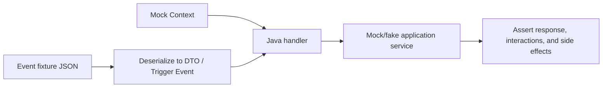
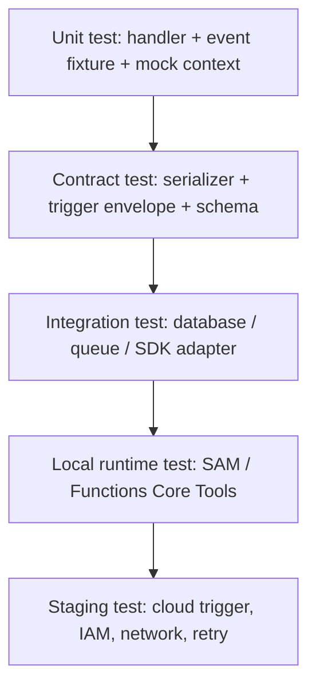

# Testing Handlers with Event Fixtures and Mock Contexts

In serverless environments, Java functions are typically invoked by the runtime with an event and a context object. The event carries business data or an envelope generated by the trigger; the context provides invocation metadata such as the request ID, remaining time, and logger. When testing a handler, you can create **event fixtures** to simulate inputs and **mock/fake contexts** to control the information provided by the runtime.

This approach verifies handler logic quickly, repeatably, and without deploying the function to the cloud for every run. However, a mock context does not simulate the full runtime, triggers, IAM, or how the platform transforms payloads. Therefore, combine unit tests with contract tests for events and integration tests at platform boundaries.

## 1. How does a handler receive events and context?

An invocation typically has two groups of inputs:

- **Event:** the data triggering the function. It can be a business DTO, an HTTP request envelope, an SQS record batch, a timer event, or a payload emitted by an event bus.
- **Context:** invocation metadata and utilities provided by the runtime, such as the invocation/request ID, function name, remaining execution time, and logger.



AWS Lambda Java example using `RequestHandler`:

```java
public interface RequestHandler<I, O> {
    O handleRequest(I input, Context context);
}
```

The runtime calls `handleRequest` with the deserialized input and a real `Context`. In unit tests, we call this method directly with a DTO created from a JSON fixture and a mock `Context`.

In Azure Functions Java, triggers and contexts typically appear as parameters of a method annotated with `@FunctionName`. For example, a queue-triggered function receives the message body and `ExecutionContext`. Tests can call the method directly with a sample message and a mocked `ExecutionContext`.

## 2. Preparing event fixtures

A fixture is fixed input data stored alongside tests so multiple tests can reuse it. Fixtures should resemble the actual payloads the platform sends to the function, including field names, data types, nested structures, and required metadata.

A simple Maven layout:

```text
src/
├── main/
│   └── java/com/example/orders/
│       ├── OrderCreatedEvent.java
│       ├── ProcessingResult.java
│       ├── OrderService.java
│       └── OrderCreatedHandler.java
└── test/
    ├── java/com/example/orders/
    │   └── OrderCreatedHandlerTest.java
    └── resources/
        └── events/
            ├── order-created.json
            ├── order-created-missing-id.json
            └── order-created-duplicate.json
```

Example `order-created.json`:

```json
{
  "eventId": "evt-1001",
  "orderId": "ord-2048",
  "customerRef": "cust-ref-82"
}
```

Corresponding Java DTO:

```java
package com.example.orders;

public record OrderCreatedEvent(
        String eventId,
        String orderId,
        String customerRef) {
}
```

Records work well for immutable event DTOs and keep tests readable. If your project's serializer or framework requires a no-arg constructor/getters/setters, use a corresponding POJO. What matters is deserializing fixtures using a serializer configuration compatible with production.

### 2.1. Event DTOs and trigger envelopes are two distinct layers

Not every trigger sends a business DTO directly. For example:

- HTTP API Gateway sends an envelope with method, path, headers, query parameters, and body.
- SQS sends an envelope containing a `Records` array; each record has `messageId`, `body`, attributes, and source metadata.
- EventBridge sends an envelope with `id`, `source`, `detail-type`, `time`, and `detail`.
- Azure Queue Trigger usually passes the message body to the trigger parameter, while invocation metadata resides in the context or other bindings.

If a function accepts `SQSEvent`, the fixture must have the `Records` structure; you cannot pass `OrderCreatedEvent` JSON directly as the handler input and expect the runtime to wrap it into an SQS event. If the SQS body contains business JSON, tests should verify both reading the envelope and parsing `record.body`.

Abbreviated SQS event example:

```json
{
  "Records": [
    {
      "messageId": "msg-501",
      "receiptHandle": "receipt-placeholder",
      "body": "{\"eventId\":\"evt-1001\",\"orderId\":\"ord-2048\",\"customerRef\":\"cust-ref-82\"}",
      "attributes": {},
      "messageAttributes": {},
      "md5OfBody": "placeholder",
      "eventSource": "aws:sqs",
      "eventSourceARN": "arn:aws:sqs:ap-southeast-1:123456789012:orders-test",
      "awsRegion": "ap-southeast-1"
    }
  ]
}
```

Abbreviated fixtures are suitable for testing the fields the handler uses. When testing the full trigger contract, take sample payloads from official documentation or sanitized records stripped of sensitive data; avoid using real receipt handles, tokens, or production data.

## 3. Creating a mock context for AWS Lambda Java

AWS Lambda provides `com.amazonaws.services.lambda.runtime.Context`. A real context is created by the runtime for each invocation. Unit tests can use Mockito to stub the methods the handler calls.

Example handler:

```java
package com.example.orders;

import com.amazonaws.services.lambda.runtime.Context;
import com.amazonaws.services.lambda.runtime.RequestHandler;
import java.util.Objects;

public final class OrderCreatedHandler
        implements RequestHandler<OrderCreatedEvent, ProcessingResult> {

    private final OrderService orderService;

    public OrderCreatedHandler() {
        this(new DefaultOrderService());
    }

    OrderCreatedHandler(OrderService orderService) {
        this.orderService = Objects.requireNonNull(orderService);
    }

    @Override
    public ProcessingResult handleRequest(
            OrderCreatedEvent event,
            Context context) {

        Objects.requireNonNull(event, "event is required");
        Objects.requireNonNull(context, "context is required");

        if (event.eventId() == null || event.eventId().isBlank()) {
            throw new IllegalArgumentException("eventId is required");
        }

        if (context.getRemainingTimeInMillis() < 1_000) {
            throw new IllegalStateException("Not enough time to process event");
        }

        context.getLogger().log("Processing eventId=" + event.eventId());
        return orderService.process(event);
    }
}
```

Illustrative interface and service:

```java
package com.example.orders;

public interface OrderService {
    ProcessingResult process(OrderCreatedEvent event);
}
```

```java
package com.example.orders;

public record ProcessingResult(String status) {
}
```

```java
package com.example.orders;

final class DefaultOrderService implements OrderService {
    @Override
    public ProcessingResult process(OrderCreatedEvent event) {
        // Replace with real business logic or an adapter to a repository.
        return new ProcessingResult("COMPLETED");
    }
}
```

The no-arg constructor lets the Lambda Java runtime instantiate the handler by standard convention. The package-private constructor accepting `OrderService` lets tests inject a mock without connecting to a database. In a real application, `DefaultOrderService` calls the configured application service/repository; a DI framework can be used if the runtime adapter supports it.

### 3.1. Creating a mock Context and LambdaLogger

`Context` is an interface; only stub the methods the handler actually uses. You do not need to implement the entire context if the test only cares about the logger and remaining time.

```java
Context context = mock(Context.class);
LambdaLogger logger = mock(LambdaLogger.class);

when(context.getRemainingTimeInMillis()).thenReturn(5_000);
when(context.getLogger()).thenReturn(logger);
```

These values allow tests to control the scenario. For example, set remaining time to 5,000 ms for the happy path and 200 ms to test that the handler refuses to start work when near the deadline.

## 4. Writing unit tests with JUnit 5 and Mockito

Maven needs the corresponding production and test dependencies. Minimal dependency example:

```xml
<dependencies>
    <dependency>
        <groupId>com.amazonaws</groupId>
        <artifactId>aws-lambda-java-core</artifactId>
        <version>1.2.3</version>
    </dependency>

    <dependency>
        <groupId>com.fasterxml.jackson.core</groupId>
        <artifactId>jackson-databind</artifactId>
        <version>2.18.2</version>
    </dependency>

    <dependency>
        <groupId>org.junit.jupiter</groupId>
        <artifactId>junit-jupiter</artifactId>
        <version>5.11.4</version>
        <scope>test</scope>
    </dependency>

    <dependency>
        <groupId>org.mockito</groupId>
        <artifactId>mockito-junit-jupiter</artifactId>
        <version>5.15.2</version>
        <scope>test</scope>
    </dependency>
</dependencies>
```

The versions above illustrate a compatible set; real projects should use versions vetted in the organization's dependency management/BOM. Configure Maven Surefire for JUnit 5 if your project's Maven/plugin version does not enable it by default.

### 4.1. Happy path: valid event is processed

```java
package com.example.orders;

import static org.junit.jupiter.api.Assertions.assertEquals;
import static org.junit.jupiter.api.Assertions.assertFalse;
import static org.junit.jupiter.api.Assertions.assertNotNull;
import static org.junit.jupiter.api.Assertions.assertThrows;
import static org.mockito.Mockito.mock;
import static org.mockito.Mockito.verify;
import static org.mockito.Mockito.verifyNoInteractions;
import static org.mockito.Mockito.when;

import com.amazonaws.services.lambda.runtime.Context;
import com.amazonaws.services.lambda.runtime.LambdaLogger;
import com.fasterxml.jackson.databind.ObjectMapper;
import java.io.InputStream;
import org.junit.jupiter.api.BeforeEach;
import org.junit.jupiter.api.Test;

class OrderCreatedHandlerTest {
    private final ObjectMapper objectMapper = new ObjectMapper();
    private OrderService orderService;
    private Context context;
    private LambdaLogger logger;
    private OrderCreatedHandler handler;

    @BeforeEach
    void setUp() {
        orderService = mock(OrderService.class);
        context = mock(Context.class);
        logger = mock(LambdaLogger.class);

        when(context.getRemainingTimeInMillis()).thenReturn(5_000);
        when(context.getLogger()).thenReturn(logger);

        handler = new OrderCreatedHandler(orderService);
    }

    @Test
    void processesValidEvent() throws Exception {
        OrderCreatedEvent event;
        try (InputStream input = getClass().getResourceAsStream(
                "/events/order-created.json")) {
            if (input == null) {
                throw new IllegalStateException("Missing event fixture");
            }
            event = objectMapper.readValue(input, OrderCreatedEvent.class);
        }

        when(orderService.process(event))
                .thenReturn(new ProcessingResult("COMPLETED"));

        ProcessingResult result = handler.handleRequest(event, context);

        assertEquals("COMPLETED", result.status());
        verify(orderService).process(event);
        verify(logger).log("Processing eventId=evt-1001");
    }

    private OrderCreatedEvent loadEvent(String resource) throws Exception {
        try (InputStream input = getClass().getResourceAsStream(resource)) {
            if (input == null) {
                throw new IllegalStateException("Missing event fixture: " + resource);
            }
            return objectMapper.readValue(input, OrderCreatedEvent.class);
        }
    }
}
```

This test verifies four things: the fixture deserializes into the DTO; the handler receives the event and context; the service is called with the expected event; and the result and log are produced as expected. Because the service is mocked, the test needs no real database or queue.

### 4.2. Context near expiration

```java
@Test
void doesNotStartWorkWhenDeadlineIsNear() {
    OrderCreatedEvent event = new OrderCreatedEvent(
            "evt-1002", "ord-2049", "cust-ref-83");
    when(context.getRemainingTimeInMillis()).thenReturn(200);

    assertThrows(
            IllegalStateException.class,
            () -> handler.handleRequest(event, context));

    verifyNoInteractions(orderService);
}
```

This test verifies that the handler does not begin work when remaining time is below the threshold. In real systems, the threshold must be sufficient for business operations and cleanup. Do not use a mock context to assume the runtime will always grant a fixed amount of time; the test checks the code's decision when given the supplied context value.

Required fields can be validated right at the handler:

```java
@Test
void rejectsEventWithoutEventId() {
    OrderCreatedEvent event = new OrderCreatedEvent(
            null, "ord-2049", "cust-ref-83");

    assertThrows(
            IllegalArgumentException.class,
            () -> handler.handleRequest(event, context));

    verifyNoInteractions(orderService);
}
```

### 4.3. Business errors must be propagated properly

```java
@Test
void propagatesRetryableServiceFailure() {
    OrderCreatedEvent event = new OrderCreatedEvent(
            "evt-1003", "ord-2050", "cust-ref-84");
    when(orderService.process(event))
            .thenThrow(new IllegalStateException("Temporary failure"));

    assertThrows(
            IllegalStateException.class,
            () -> handler.handleRequest(event, context));
}
```

If an error requires runtime/broker retries, the handler must let the exception propagate or return an error result according to the trigger contract. Never catch all exceptions, log them, and return `COMPLETED`, because the platform may treat the invocation as successful and acknowledge the message. With HTTP triggers, errors typically map to HTTP status codes/bodies; do not apply queue retry semantics to HTTP requests.

## 5. Testing event serialization and schema contracts

A handler can process a DTO properly when the test constructs the DTO directly, yet fail when the runtime deserializes JSON due to mismatched field names, data types, or serializer settings. Therefore, add tests that read JSON fixtures using the exact serializer configuration used by the application.

Example checking required fields:

```java
@Test
void fixtureContainsRequiredEventFields() throws Exception {
    OrderCreatedEvent event = loadEvent("/events/order-created.json");

    assertNotNull(event.eventId());
    assertFalse(event.eventId().isBlank());
    assertNotNull(event.orderId());
    assertFalse(event.orderId().isBlank());
}
```

Additional fixtures should represent:

- Required fields missing or `null`.
- Fields with wrong types, e.g., a number instead of a string.
- New fields added to the schema.
- Unsupported enum or event types.
- Empty payloads or invalid JSON.
- Older-version events still remaining in the queue/stream.
- Messages with duplicate event IDs.

Unknown-field handling depends on the serializer. Some Jackson configurations ignore unknown properties; others reject them. Explicitly test the schema compatibility policy your system intends rather than leaving it to unintended library defaults.

For SQS, have one test fixture for the `SQSEvent` envelope and a separate test parsing the body into `OrderCreatedEvent`. For API Gateway, test the request envelope and mapping of `pathParameters`, `queryStringParameters`, headers, or body. For EventBridge, test `detail-type`, `source`, and `detail`. Every trigger has its own contract.

## 6. Testing Azure Functions ExecutionContext

Azure Functions Java uses `com.microsoft.azure.functions.ExecutionContext`. This interface provides a logger, function name, and invocation ID. It can be mocked with Mockito just like AWS `Context`.

Example message-handling method:

```java
import com.microsoft.azure.functions.ExecutionContext;
import com.microsoft.azure.functions.annotation.FunctionName;
import com.microsoft.azure.functions.annotation.QueueTrigger;
import java.util.logging.Logger;

interface AzureOrderService {
    void processMessage(String message);
}

public final class AzureOrderFunction {
    private final AzureOrderService orderService;

    public AzureOrderFunction() {
        this(message -> {
            // Replace with the application service that processes queue messages.
        });
    }

    AzureOrderFunction(AzureOrderService orderService) {
        this.orderService = orderService;
    }

    @FunctionName("processAzureOrder")
    public void run(
            @QueueTrigger(
                    name = "message",
                    queueName = "orders",
                    connection = "StorageConnection")
            String message,
            ExecutionContext context) {

        context.getLogger().info(
                "Processing invocationId=" + context.getInvocationId());
        orderService.processMessage(message);
    }
}
```

Test the method directly:

```java
import static org.mockito.Mockito.mock;
import static org.mockito.Mockito.verify;
import static org.mockito.Mockito.when;

@Test
void processesQueueMessageWithFakeExecutionContext() {
    AzureOrderService service = mock(AzureOrderService.class);
    AzureOrderFunction function = new AzureOrderFunction(service);
    ExecutionContext context = mock(ExecutionContext.class);
    Logger logger = mock(Logger.class);

    when(context.getInvocationId()).thenReturn("invocation-test-01");
    when(context.getLogger()).thenReturn(logger);

    function.run("ord-2048", context);

    verify(service).processMessage("ord-2048");
    verify(logger).info("Processing invocationId=invocation-test-01");
}
```

The example assumes `AzureOrderService.processMessage(String)` is the application's queue-processing service contract. When running locally or on Azure, the Functions host creates a real `ExecutionContext`, and the binding passes the queue message into the `message` parameter. Unit tests invoke the method directly, so they do not verify whether the host reads the right queue, whether the binding connection is valid, or whether the message is deserialized properly.

## 7. Fake vs. mock context: which to choose?

| Approach | Description | When suitable |
|---|---|---|
| Mockito mock | Create a mock object and stub needed methods | Quickly testing logic branches that depend on invocation ID, logger, or deadline |
| Fake implementation | Write a test class holding values and returning them from methods | When you need a context with simple, stable behavior reused across many tests |
| Real context from runtime | Let the Functions host/Lambda runtime create the context | Integration tests or local/cloud verification |

For AWS `Context`, a fake implementation requires implementing many methods; Mockito is usually more concise. For Azure `ExecutionContext`, mocking is also convenient. Avoid mocking too many methods that the handler never calls, as tests become tightly coupled to implementation details and harder to maintain.

Context is runtime metadata, not a place to store business state. Do not put processing results into the context or assume the context persists across invocations. If you need to pass a correlation ID or tenant ID, pass them via validated events/headers and test the contract explicitly.

## 8. Testing idempotency and side effects

Serverless triggers may retry or redeliver events. Handler tests should verify how code reacts when the same event appears multiple times, though idempotency logic should live in the application service/repository so it can be tested independently.

Example scenarios to test:

| Scenario | What to verify |
|---|---|
| New event ID | Business action executes and a processed marker is saved |
| Already-processed event ID | Order, payment, or email is not created a second time |
| Database commit error | Processed marker and business changes roll back in the same transaction |
| Commit succeeds but ACK is lost | Redelivery is recognized and does not repeat side effects |
| Two invocations with same event ID | Unique constraint/transaction prevents concurrent double processing |
| Downstream timeout with unknown outcome | Retry uses an idempotency key or checks state before repeating |

Do not use a mock service to claim database transactions or unique constraints work. For those properties, write repository integration tests against a compatible database or suitable test container. Unit tests only verify that the handler passes the event properly and handles results/errors correctly.

## 9. Layered testing

An effective strategy divides testing into multiple layers:



| Layer | What it tests | Real cloud required? |
|---|---|---|
| Unit | Handler logic, validation, mapping, context branches, service interactions | No |
| Contract | JSON fixtures, serializer, trigger envelopes, schema compatibility | Not necessarily |
| Integration | Repositories, transactions, queue clients, external adapters | Can use containers/local services or a sandbox |
| Local runtime | Runtime adapter, handler discovery, binding metadata, and event invocation | Not necessarily; needs runtime tooling |
| Staging | IAM/RBAC, resource policies, trigger delivery, retries, timeouts, VPC/VNet, and scaling | Yes |

### 9.1. AWS Lambda local testing

AWS SAM CLI can invoke a function locally using an event fixture:

```bash
sam local invoke OrderCreatedFunction \
  --event src/test/resources/events/order-created.json
```

The SAM template must declare the function resource and matching runtime/package. This command additionally tests the runtime adapter and serialization compared to direct unit tests, though it does not fully reproduce IAM, event source mappings, concurrency, or cloud services. Use integration tests in an AWS sandbox to verify those layers.

### 9.2. Azure Functions local testing

Azure Functions Core Tools runs the Functions host locally:

```bash
mvn clean package
func start
```

For HTTP triggers, send requests to the local endpoint. For queue, timer, or Service Bus triggers, configure an appropriate local connection, such as Azurite or a test namespace. `local.settings.json` must not contain production secrets and must not be committed to source control.

## 10. Common pitfalls when testing handlers

| Symptom | Cause | Fix |
|---|---|---|
| Tests pass but cloud deserialization fails | Fixture does not match trigger envelope or serializer config differs | Use sanitized real payloads and the same ObjectMapper/config |
| `NullPointerException` from context | Mock has not stubbed a method the handler calls | Stub the required method or create a fake context |
| Order-dependent tests | Shared static mutable state or shared mocks | Create fresh mocks/fixtures per test and reset state |
| Tests pass but event source never triggers function | Unit tests do not check bindings/permissions/triggers | Add local runtime and staging integration tests |
| Test expects retry but none happens | Handler swallows exceptions or test only invokes method directly | Verify exception contract; test retries in runtime integration |
| Log assertions fail on minor text differences | Assertions depend on unstable log strings | Check event ID/correlation fields or use a captor |
| Flaky deadline tests | Using real wall-clock time or `Thread.sleep` | Stub remaining time or inject `Clock` |
| Duplicate test passes yet database writes duplicates | Only mocked repository, never tested unique constraint/transaction | Write integration tests with a compatible database |

## 11. Principles for stable, maintainable tests

- **Use small, meaningful fixtures:** each file represents one scenario; filenames indicate valid, missing-field, error, or duplicate cases.
- **Never use production data:** anonymize IDs, emails, tokens, receipt handles, and customer details.
- **Stub only the context parts used:** there is no need to stand up the whole runtime when tests only read remaining time and logger.
- **Inject dependencies:** pass services, repositories, clocks, and clients into handlers/application services via constructors or factories so tests can swap them easily.
- **Never call the cloud in unit tests:** unit tests must run fast and independently of credentials, networking, or cloud accounts.
- **Never sleep to wait:** use fake clocks, Awaitility, or proper test synchronization when testing asynchronous behavior.
- **Verify key behaviors:** outcomes, service calls, exceptions, and side effects; avoid over-specifying private details.
- **Keep fixtures aligned with schema versions:** when event contracts change, intentionally update fixtures and backward-compatibility tests.
- **Keep logs safe:** ensure event fixtures contain no secrets and tests do not accidentally log full sensitive payloads.

## 12. Handler testing checklist

1. Do event fixtures match the actual trigger structure and schema version?
2. Does the DTO deserialize with the same serializer/configuration as production?
3. Do tests cover valid events, missing fields, wrong types, and older event versions?
4. Does the mock/fake context provide the exact invocation ID, logger, and remaining time the handler uses?
5. Does the handler invoke the right application service and return the expected result?
6. Are retryable exceptions propagated according to the trigger contract?
7. Do duplicate events avoid repeating side effects?
8. Do tests isolate handler logic from database transactions and external APIs?
9. Are contract tests in place for the corresponding API Gateway, SQS, EventBridge, or Azure trigger envelope?
10. Are local runtime or staging tests in place for bindings, IAM/RBAC, networking, and retries?
11. Are secrets and personal data stripped from fixtures and logs?
12. Do tests run independently without depending on order, wall-clock time, or cloud credentials?

## Conclusion

Testing handlers with event fixtures and mock contexts enables fast verification of Java logic under deterministic conditions. Fixtures should mirror real payloads and trigger envelopes; mock contexts provide only the runtime metadata the handler reads. Use JUnit and Mockito to test happy paths, validation, deadlines, exceptions, and interactions with application services. Then add contract tests, integration tests, and local/staging runtime tests to verify serializers, bindings, permissions, retries, and platform behavior. This layered approach catches bugs early while maintaining real checks at boundaries unit tests cannot simulate.

## Official references

- [AWS Lambda Java handler](https://docs.aws.amazon.com/lambda/latest/dg/java-handler.html)
- [AWS Lambda Java context object](https://docs.aws.amazon.com/lambda/latest/dg/java-context.html)
- [AWS Lambda Java events library](https://github.com/aws/aws-lambda-java-libs)
- [AWS SAM local invoke](https://docs.aws.amazon.com/serverless-application-model/latest/developerguide/using-sam-cli-local-invoke.html)
- [Azure Functions Java developer guide](https://learn.microsoft.com/en-us/azure/azure-functions/functions-reference-java)
- [ExecutionContext interface for Azure Functions Java](https://learn.microsoft.com/en-us/java/api/com.microsoft.azure.functions.executioncontext)
- [Azure Functions Core Tools](https://learn.microsoft.com/en-us/azure/azure-functions/functions-run-local)
