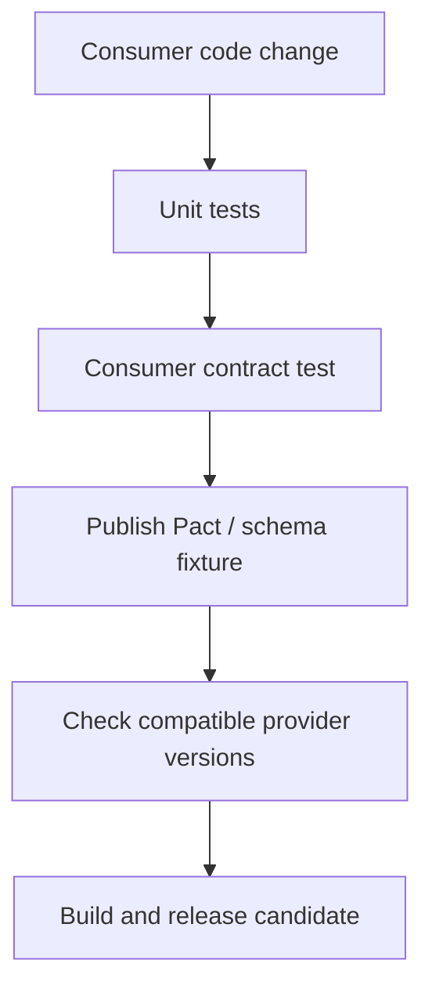
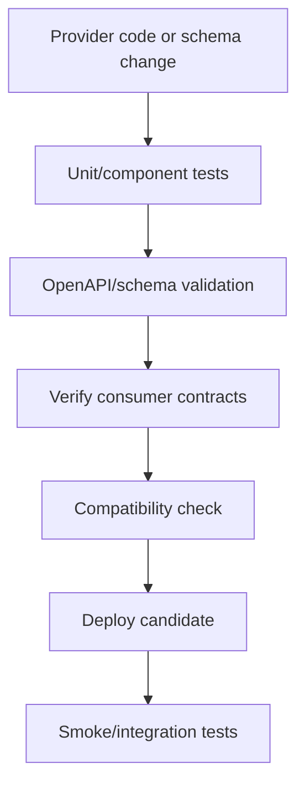

# Contract Testing for HTTP APIs and Event Schemas

## 1. Why does a serverless system need contract tests?

Serverless applications are typically composed of many independent functions and services. An HTTP function may call an order service API; a queue consumer receives events from another function; a webhook handler depends on payloads sent by a partner. Each component can be built and deployed independently, yet each must still properly understand the others' requests, responses, and messages.

A small change can break integration even while each function's unit tests keep passing. For example, a producer renames `orderId` to `id`, changes `amount` from a number to a string, or switches a field from optional to required. The producer still passes its internal tests; older consumers fail to parse the event or process corrupted data.

**Contract testing** verifies the agreement between two communicating parties: what data and behavior the sender commits to provide, and what data and behavior the receiver relies on. A contract can be an OpenAPI specification for HTTP, JSON Schema for payloads, AsyncAPI for message channels, or a consumer-driven contract such as Pact. Tests verify that real implementations still comply with that agreement.

In serverless, contract testing is especially valuable because functions are often deployed independently, triggers and event sources have distinct envelopes, messages may be retried or delivered multiple times, and schema changes can ripple across many consumers. Contract tests catch compatibility issues before deployment and reduce reliance on spinning up an entire cloud environment for every check.

Contract tests do not replace unit tests, integration tests, end-to-end tests, or reliability tests. They focus on communication boundaries. A strong test suite combines these layers to verify internal logic, contracts, integration with real services, and operational behavior.

## 2. What does a contract include?

### 2.1. HTTP API contract

An HTTP contract is more than a JSON response. At minimum, it describes:

- HTTP methods and routes/path parameters.
- Query parameters, headers, and content types.
- Authentication/authorization mechanisms and scope/role requirements.
- Request bodies: fields, data types, required/optional status, formats, and limits.
- Response status codes for each outcome.
- Response headers and bodies.
- Error structures, stable error codes, and correlation/request IDs if present.
- Pagination, filtering, sorting, and empty-result semantics.
- Idempotency, timeouts, retries, and behavior when requests are replayed.
- Versioning and compatibility policies.

For example, `POST /orders` may commit to accepting `customerId` and a list of items, returning `201 Created` with `Location` upon creation, returning `409 Conflict` when an idempotency key is reused with a different payload, and returning `422 Unprocessable Content` when syntax is valid but business rules are violated.

### 2.2. Event/message contract

An event contract describes:

- Envelope: event ID, source, type, subject, time, schema version.
- Payload: field names, types, required/optional, nullability, and formats.
- Semantics: whether the event represents a fact that already happened or a command to process.
- Ordering, partition keys, and duplicate delivery possibility.
- Retries, acknowledgements, visibility timeouts, dead-lettering, and replays.
- Handling of unknown fields, newer event versions, and older events.
- Access permissions, sensitive data, and retention.

An `OrderPaid` message should represent a completed payment event. Consumers should not interpret it as a command to charge again. The event ID enables deduplication; `orderId` links to the business aggregate; `schemaVersion` or `dataschema` identifies the payload structure.

### 2.3. Provider and consumer

In contract testing, the **provider** is the party exposing an API or emitting events; the **consumer** is the party calling the API or receiving events.

| Role | Responsibility |
| --- | --- |
| Consumer | Describes the slice of the contract it actually uses; tests its client/handler code against that contract |
| Provider | Verifies its implementation satisfies its consumers' contracts or published schemas |
| Contract artifact | Stores versioned OpenAPI, AsyncAPI, JSON Schema, or Pact pact files |
| CI/CD | Runs contract checks before release and verifies compatible version combinations |

Consumer-driven contracts (CDC) start from the consumer's real needs. Provider-driven contracts typically start from a canonical API/schema published by the provider. The two complement each other: OpenAPI/AsyncAPI serve as shared canonical documentation; Pact verifies the specific interactions consumers rely on.

## 3. How do contract tests differ from other test types?

| Test type | Scope | Example |
| --- | --- | --- |
| Unit test | A single function or class, dependencies isolated | Testing a mapper that turns `OrderCreatedEvent` into a command |
| Component test | A single function/service with mocked or local dependencies | Calling an HTTP handler and asserting the response |
| Contract test | Boundary between provider and consumer | Which fields/statuses does the consumer require; does the provider satisfy them? |
| Integration test | Multiple real components connected together | Function writing to DynamoDB or receiving messages from Service Bus |
| End-to-end test | Business flow across multiple services | Creating an order via API, paying, receiving events, and verifying state |
| Resilience test | Behavior under failures, overload, or disruptions | Queue redelivery, timeouts, DLQs, and recovery |

Contract tests are usually faster and narrower in scope than end-to-end tests. They can use mock servers, generated stubs, or schema validators instead of calling live cloud services. However, passing contracts does not prove IAM, networking, event source mappings, retry configuration, or database behavior are configured correctly.

## 4. Designing HTTP API contracts with OpenAPI

### 4.1. What is OpenAPI?

OpenAPI is a language-agnostic specification for describing HTTP APIs. An OpenAPI file typically defines paths, operations, parameters, requestBody, responses, schemas, security schemes, and server URLs. It can be used to generate documentation, client SDKs, mock servers, lint rules, and contract tests.

OpenAPI should be managed as a versioned source artifact. Avoid updating documentation only after code changes; otherwise docs can drift from implementation. It is better to review contract changes in the same pull request that modifies the API.

### 4.2. Abbreviated OpenAPI example

```yaml
openapi: 3.1.0
info:
  title: Order API
  version: 1.0.0
paths:
  /orders:
    post:
      operationId: createOrder
      security:
        - bearerAuth: []
      parameters:
        - name: Idempotency-Key
          in: header
          required: true
          schema:
            type: string
            minLength: 8
      requestBody:
        required: true
        content:
          application/json:
            schema:
              $ref: '#/components/schemas/CreateOrderRequest'
      responses:
        '201':
          description: Order created
          content:
            application/json:
              schema:
                $ref: '#/components/schemas/Order'
        '400':
          description: Invalid request
        '401':
          description: Authentication required
        '409':
          description: Idempotency conflict
components:
  securitySchemes:
    bearerAuth:
      type: http
      scheme: bearer
  schemas:
    CreateOrderRequest:
      type: object
      required: [customerId, items]
      properties:
        customerId:
          type: string
        items:
          type: array
          minItems: 1
          items:
            $ref: '#/components/schemas/OrderItem'
    OrderItem:
      type: object
      required: [sku, quantity]
      properties:
        sku:
          type: string
        quantity:
          type: integer
          minimum: 1
    Order:
      type: object
      required: [id, status]
      properties:
        id:
          type: string
        status:
          type: string
          enum: [PENDING, CONFIRMED, CANCELLED]
        createdAt:
          type: string
          format: date-time
```

This is an illustrative contract. Real APIs must explicitly define error bodies, response headers, pagination, maximum lengths, decimal precision, currency, timezones, rate limits, and relevant status codes. If API Gateway or the serverless platform transforms requests/responses, test the contract at both the gateway boundary and the function handler.

### 4.3. What should be checked in an HTTP contract

- Methods/paths match the operation.
- Required headers/query/path parameters are validated.
- Content types and encodings are supported.
- Valid and invalid bodies produce corresponding responses.
- Status codes do not change outside the contract.
- Response bodies have the expected fields and data types.
- Unknown fields are handled according to the published policy.
- Error responses use stable error codes without leaking stack traces/secrets.
- Authentication failures and authorization failures are distinguished appropriately.
- Idempotency keys and duplicate requests have defined semantics.

Do not merely assert that a JSON response contains a field. Verify its type, nullability, format, and semantics. For example, `amount` cannot switch from integer minor units to floating point without an explicit contract change.

## 5. Consumer-driven contracts with Pact

### 5.1. How does Pact work?

Pact is a consumer-driven contract testing tool. A consumer test describes a specific interaction it requires from a provider. Pact generates a contract file (pact file) containing request/response or message expectations. Provider verification replays that contract against the provider implementation to confirm it satisfies the expectations.

The workflow typically consists of:

1. The consumer writes tests based on how it actually calls the provider.
2. Tests run against a mock server supplied by Pact.
3. The pact file is generated and published to a Pact Broker or artifact store.
4. The provider fetches the consumer's pact file and runs verification.
5. Verification results are published along with the provider's version/branch.
6. The pipeline checks which consumer/provider combinations can be deployed safely.

Pact verifies interactions declared by the consumer; it does not replace OpenAPI documentation or full business testing. If a consumer test omits a header or field that real code depends on, the contract will not protect that dependency.

### 5.2. HTTP consumer contract example

The Java snippet below illustrates the Pact DSL concept. Packages/imports and test annotations must match the Pact JVM version used in the project.

```java
@Pact(consumer = "OrderPortal", provider = "OrderApi")
public RequestResponsePact orderExists(PactDslWithProvider builder) {
    return builder
        .given("order 42 exists")
        .uponReceiving("a request for order 42")
            .path("/orders/42")
            .method("GET")
        .willRespondWith()
            .status(200)
            .headers(Map.of("Content-Type", "application/json"))
            .body(new PactDslJsonBody()
                .stringType("id", "42")
                .stringType("status", "PAID"))
        .toPact();
}
```

The consumer test then calls the application's real HTTP client against the Pact mock server and asserts that client code parses/handles the response. Do not call the mock server with a test-only HTTP client, as that bypasses production client code.

### 5.3. Provider verification

Provider verification runs pact interactions against the real provider in a test environment. The provider may require state setup such as "order 42 exists." State setup should create minimal, repeatable data without depending on production environments.

Provider verification must check:

- Requests route to the right endpoint.
- Authentication/headers follow the contract.
- Response status and body match the matchers.
- Provider state is set up before each interaction.
- Test data is isolated and cleaned up after running.
- Contracts for all supported consumers pass.

The provider must not pass tests by mocking the exact implementation under test. If verification only hits a fake controller instead of the real handler/service, it fails to prove the provider contract.

### 5.4. Matchers and flexible contracts

Pact supports matchers for data types, regexes, arrays, objects, and example values. Describe what the consumer needs rather than locking every value to a rigid fixture when real values can legitimately vary.

For example, a consumer may require `status` to be a string within the set of values it understands. If the consumer only needs `id` to exist, there is no need to require the entire response to keep a fixed field order. JSON objects have no key-ordering semantics.

Overly loose contracts can miss breaking changes; overly strict contracts can block providers from adding compatible fields. Choose matchers based on actual consumer dependencies.

## 6. Contracts for event schemas

### 6.1. Event envelope and payload

Separate the shared envelope from the domain payload. The envelope holds metadata for routing, tracing, and versioning; the payload holds business data.

Example `OrderPaid` event:

```json
{
  "specversion": "1.0",
  "id": "evt-7f9a",
  "source": "/payments/service",
  "type": "com.example.payment.paid.v1",
  "subject": "orders/order-42",
  "time": "2026-11-17T10:15:30Z",
  "datacontenttype": "application/json",
  "dataschema": "https://schemas.example.com/payment-paid/1.0.0.json",
  "data": {
    "paymentId": "pay-88",
    "orderId": "order-42",
    "amountMinor": 120000,
    "currency": "VND",
    "status": "PAID"
  }
}
```

This example follows the CloudEvents structure in structured JSON mode. CloudEvents standardizes metadata such as `id`, `source`, `type`, `subject`, `time`, `datacontenttype`, and `dataschema`. It does not define the domain schema inside `data`; that still requires JSON Schema, Avro, Protobuf, or a separate contract.

### 6.2. JSON Schema

JSON Schema describes the structure and constraints of JSON payloads. Abbreviated schema example for `OrderPaid`:

```json
{
  "$schema": "https://json-schema.org/draft/2020-12/schema",
  "$id": "https://schemas.example.com/payment-paid/1.0.0.json",
  "title": "OrderPaidData",
  "type": "object",
  "required": ["paymentId", "orderId", "amountMinor", "currency", "status"],
  "properties": {
    "paymentId": { "type": "string", "minLength": 1 },
    "orderId": { "type": "string", "minLength": 1 },
    "amountMinor": { "type": "integer", "minimum": 0 },
    "currency": { "type": "string", "pattern": "^[A-Z]{3}$" },
    "status": { "const": "PAID" }
  },
  "additionalProperties": true
}
```

`additionalProperties: true` allows consumers to receive extra fields they do not yet recognize. This is generally a schema-evolution-friendly choice for consumers expected to ignore unknown fields. Setting it to `false` can cause validation to fail whenever a producer adds a new field. Choose based on compatibility policy and domain strictness.

### 6.3. Event schema registry

When multiple producers/consumers share events, schemas can be managed in a repository or schema registry. A registry stores schemas by subject/type/version, supports compatibility checks when publishing new schemas, and lets consumers discover payload versions.

A schema registry does not replace contract tests. It checks schema compatibility against configured rules; contract tests also confirm that real consumer code can process the payload and the provider emits data as expected.

## 7. AsyncAPI and contracts for message channels

AsyncAPI describes message/event-driven APIs: servers, channels, operations, messages, payloads, headers, correlation IDs, and broker bindings. It is useful when systems use Azure Service Bus, Event Hubs, AWS SNS/SQS, Kafka, or similar brokers.

Abbreviated AsyncAPI example:

```yaml
asyncapi: 3.0.0
info:
  title: Order Events
  version: 1.0.0
servers:
  broker:
    host: events.example.com
    protocol: kafka
channels:
  orderPaid:
    address: order.paid
    messages:
      OrderPaid:
        $ref: '#/components/messages/OrderPaid'
operations:
  consumeOrderPaid:
    action: receive
    channel:
      $ref: '#/channels/orderPaid'
    messages:
      - $ref: '#/channels/orderPaid/messages/OrderPaid'
components:
  messages:
    OrderPaid:
      name: OrderPaid
      contentType: application/cloudevents+json
      payload:
        $ref: 'schemas/order-paid-1.0.0.json'
```

This is an illustrative structure; when using AsyncAPI, validate against your specification version and toolchain syntax. Broker-specific bindings can add consumer groups, queues/topics, routing keys, acknowledgements, or message keys.

Message contracts must describe both payload and delivery semantics. For instance, queues may deliver at least once; consumers must be idempotent. Kafka consumers may rely on partition keys and offsets; ordering is guaranteed only within a partition. Never write a blanket promise of "exactly once" unless the system genuinely provides those semantics across all side effects.

## 8. Schema evolution and backward compatibility

### 8.1. Typically compatible changes

Several changes are usually compatible if consumers follow the rule of ignoring unknown fields and schemas provide appropriate defaults:

- Adding a new optional field.
- Adding metadata that does not alter event meaning.
- Relaxing field constraints that older consumers can still handle.
- Adding a new event type if consumers can ignore unsubscribed types.

However, "adding a field" is not always safe. If a consumer runs strict schema validation with `additionalProperties: false`, or deserializes Java with unknown-property rejection enabled, a new field can break older consumers.

### 8.2. Typically breaking changes

- Removing a field used by consumers.
- Renaming a field or changing its JSON path.
- Changing data types, e.g., integer to string or object to array.
- Making an optional field required when older producers do not supply it.
- Changing semantics while keeping the same field name and type.
- Narrowing enums/constraints so previously valid values become invalid.
- Changing timezones/units or precision without versioning.

Adding an enum value can also break consumers written with exhaustive `switch` statements or strict unknown-value rejection. If a producer can introduce new states, consumers need an `UNKNOWN`/default branch or the schema contract must define how to handle them.

### 8.3. Forward and backward compatibility

| Compatibility type | Meaning |
| --- | --- |
| Backward compatibility | Newer consumers can read data emitted by older producers |
| Forward compatibility | Older consumers can still read data emitted by newer producers |
| Full compatibility | Satisfies both directions under the chosen schema rules |
| Breaking change | One or more existing consumers/providers no longer satisfy the contract |

Compatibility depends on both the schema and how code processes data. For instance, JSON Schema may permit unknown fields while a Java mapper is configured strictly; conversely, a mapper may ignore unknown fields while business logic assumes an enum has only three values.

### 8.4. Versioning strategy

Events can be versioned via type name (`com.example.order.created.v2`), schema URI/version, or a `schemaVersion` field. Pick one consistent strategy and publish support windows for older versions.

You do not need a new version for every optional field. A new version is appropriate when changes are incompatible or event semantics shift significantly. During transition, you can emit v1/v2 in parallel or have consumers read both versions, while avoiding processing the same business event twice.

## 9. Writing schema contract tests in Java

### 9.1. Validating JSON payloads with JSON Schema

You can use a JSON Schema validator in Java tests to validate sample payloads or real events serialized by a producer. The example below uses Jackson to read JSON; `schemaValidator` represents the JSON Schema validator library chosen by the project.

```java
import com.fasterxml.jackson.databind.JsonNode;
import com.fasterxml.jackson.databind.ObjectMapper;
import org.junit.jupiter.api.Test;

import static org.junit.jupiter.api.Assertions.assertTrue;

class OrderPaidSchemaTest {
    private final ObjectMapper mapper = new ObjectMapper();

    @Test
    void producerPayloadMatchesPublishedSchema() throws Exception {
        OrderPaidEvent event = new OrderPaidEvent(
                "pay-88", "order-42", 120000, "VND", "PAID");

        JsonNode payload = mapper.valueToTree(event);
        boolean valid = schemaValidator.validate(
                "schemas/order-paid-1.0.0.json", payload);

        assertTrue(valid, "Serialized event must satisfy the published schema");
    }
}
```

`OrderPaidEvent` is the producer's DTO; `schemaValidator` is the adapter to the actual validator. In production tests, keep schemas in source control or fetch versioned artifacts from a registry, and report validation errors with JSON Pointers for easy debugging.

### 9.2. Testing consumers with realistic producer payloads

Schema validation only proves structural validity. Test consumers with representative payloads to verify:

- Deserialization into DTOs succeeds.
- Optional/missing/null fields are handled properly.
- Unknown fields do not crash the consumer when allowed by the contract.
- New enum values have safe fallback branches.
- Unsupported event types/schema versions are rejected or routed to DLQ per policy.
- Duplicate event IDs do not repeat side effects.

Example Java DTO:

```java
public record OrderPaidEvent(
        String paymentId,
        String orderId,
        long amountMinor,
        String currency,
        String status) {}
```

If using Jackson, explicitly configure unknown properties, naming strategy, date/time modules, null handling, and enum behavior. Never let local defaults differ from production.

### 9.3. Contract tests for HTTP clients

For HTTP consumers, tests should run the real client code against a Pact mock server or WireMock configured per contract. Conceptual example:

```java
@Test
void orderClientReadsProviderResponse() {
    // Pact mock server was started according to the interaction in the test.
    OrderClient client = new OrderClient(mockServerBaseUrl);

    Order order = client.getOrder("42");

    assertEquals("42", order.id());
    assertEquals("PAID", order.status());
}
```

`mockServerBaseUrl` must point to the mock server managed by the contract test. Do not mock `OrderClient` in this test, since the goal is verifying the real client's serialization, URLs, headers, and response mapping.

## 10. Contract testing serverless HTTP handlers

### 10.1. Testing the function boundary

An HTTP function may receive requests through API Gateway, Azure Functions HTTP triggers, or another platform's HTTP ingress. Tests must also verify the adapter/boundary:

- Paths and methods route correctly.
- Headers/queries/bodies map accurately.
- Identity/claims pass into the handler per contract.
- Response statuses, headers, and bodies match the gateway integration.
- Validation/authentication errors map consistently.
- Large requests, malformed JSON, and wrong content types are handled properly.

If the gateway has mapping templates or policies transforming requests, testing only the function handler will miss mapping bugs. Add a separate test layer for gateway configuration or run contract tests through the gateway in an integration environment.

### 10.2. HTTP response contract

Example success response:

```http
HTTP/1.1 201 Created
Content-Type: application/json
Location: /orders/order-42
X-Request-Id: req-91

{"id":"order-42","status":"PENDING"}
```

Example error contract:

```json
{
  "type": "https://api.example.com/problems/validation-error",
  "title": "Request validation failed",
  "status": 400,
  "code": "INVALID_ORDER_ITEM",
  "detail": "quantity must be greater than zero",
  "requestId": "req-91"
}
```

You can use RFC 9457 Problem Details for HTTP errors. If using a custom format, keep the schema stable and never expose exception classes, SQL statements, stack traces, or secrets in responses.

### 10.3. Idempotency and retries in HTTP contracts

If an API accepts `Idempotency-Key`, the contract must specify:

- Key uniqueness scope: tenant, user, endpoint, or operation.
- Retention duration for idempotency results.
- What result is returned for the same key and same payload.
- What status/error is returned for the same key with a different payload.
- Behavior when the operation is currently `IN_PROGRESS`.
- What happens when the first request times out after side effects have completed.

Contract tests should include a case resending the same key and verifying the provider does not create a second resource or charge. This is a business-behavior check; merely asserting header presence is insufficient.

## 11. Contract testing queues and event-driven functions

### 11.1. Testing event adapters separately from domain handlers

Each cloud provider's event sources use different envelopes. For example, SQS sends batch records, EventBridge has `detail-type` and `detail`, Azure Service Bus has message properties, and Kafka has keys/partitions/offsets. Do not couple domain logic directly to provider envelopes.

Separate two layers:

1. **Trigger adapter:** parses the envelope, validates metadata, and maps messages to the application's canonical DTO.
2. **Domain handler:** processes the business event, idempotency, and side effects.

Adapter contract tests verify that provider payloads translate cleanly into DTOs. Domain consumer contract tests verify that supported DTOs/versions are accepted and processed properly.

### 11.2. CloudEvents Java DTO example

```java
public record CloudEvent<T>(
        String specversion,
        String id,
        String source,
        String type,
        String subject,
        String time,
        String datacontenttype,
        String dataschema,
        T data) {}

public record OrderPaidData(
        String paymentId,
        String orderId,
        long amountMinor,
        String currency,
        String status) {}
```

This is an illustrative DTO for structured events. When using a CloudEvents SDK or specific bindings, prefer the SDK's standard implementation to handle attributes, extension attributes, binary mode, and validation rather than parsing every variant with a fixed DTO.

### 11.3. Partial batch failures

Some queue triggers deliver multiple messages in one invocation. If one message fails, the provider may redeliver the entire batch unless the function uses a supported partial batch response mechanism. Contracts and tests must specify:

- Which messages succeeded.
- Which messages need retry.
- How failed item lists are reported per the event source mapping contract.
- Whether the consumer is idempotent if a succeeded message is redelivered.
- When messages move to a DLQ.

Do not apply the same assumption to every trigger. SQS, Kinesis, Event Hubs, and Service Bus have different acknowledgement/checkpoint semantics. Verify real trigger configuration alongside the handler contract.

### 11.4. Ordering and partitions

Schema contracts should state whether consumers depend on event ordering. Kafka guarantees ordering only within a partition; FIFO queues can guarantee ordering per message group; standard event buses generally do not guarantee global ordering.

If consumers update state by version/sequence, payloads should carry an aggregate version or sequence number. Consumers can detect stale events, late arrivals, or sequence gaps and decide whether to retry, buffer, or reconcile.

## 12. Schema evolution for event producers/consumers

### 12.1. Rules for resilient DTO design

- Use stable, business-meaningful field names.
- Use explicit data types: integer minor units for money, ISO-8601/UTC for timestamps, strings for IDs.
- Distinguish missing fields, nulls, and default values.
- Add new fields as optional when older consumers must continue working.
- Consumers ignore unknown fields when the contract permits.
- Provide fallbacks for new enum/type values.
- Never reuse an old field with new semantics.
- Identify schema versions or event types explicitly.

### 12.2. Expand-and-contract migration

When breaking changes are necessary, use the expand-and-contract strategy:

1. **Expand:** producer begins emitting the new field while keeping the old field.
2. **Consumer migration:** deploy consumers capable of reading both fields/versions.
3. **Switch:** producer switches consumers to the new field once all supported consumers are verified.
4. **Observe:** monitor consumer versions and parse/validation errors.
5. **Contract:** stop emitting the old field after the announced deprecation window.

With asynchronous events, older messages can linger in queues, retention, or DLQs. Do not delete old schemas immediately after producers stop emitting them; consumers may replay historical messages days or months later.

### 12.3. Consumer compatibility testing

Maintain a set of representative fixtures for all still-supported schema versions. On every consumer change, run all old and new fixtures. On every producer change, run contract/schema validation and provider verification before release.

Fixtures should include:

- Minimal payload with required fields.
- Full payload.
- Missing optional fields.
- Optional fields set to null if allowed.
- Unknown fields.
- New/unsupported enum values.
- Payloads with wrong types or missing required fields.
- Older-version payloads still sitting in queues/DLQs.

## 13. Common Java tooling

| Tool | Role | When to use |
| --- | --- | --- |
| JUnit 5 | Test framework | Unit, component, and contract tests |
| Pact JVM | Consumer-driven contracts for HTTP/messages | Consumer tests, pact artifacts, and provider verification |
| OpenAPI Generator | Generate client/server models from OpenAPI | Reduce drift between contracts and code, though implementation tests are still needed |
| Swagger Parser / OpenAPI validators | Parse, lint, and check OpenAPI | Validate API specs in CI |
| JSON Schema validator | Validate event/request payloads | Verify producer outputs and consumer fixtures |
| AsyncAPI tooling | Validate/generate message contracts | Describe channels, messages, and broker bindings |
| WireMock | HTTP mock server | Test HTTP clients with controlled behavior |
| Testcontainers | Run dependencies in containers | Integration tests with real or equivalent brokers/databases |
| Awaitility | Wait for async conditions in tests | Assert eventual state without fixed sleeps |

Avoid adopting too many tools for the same purpose. Pick one primary contract source, one suitable schema validation tool, and one maintainable consumer/provider testing approach.

## 14. Organizing contract artifacts and CI/CD

### 14.1. Storage and versioning

Contract artifacts should be versioned alongside code or published to a registry/broker. Attach metadata such as service name, version, branch, commit SHA, and environment. Never overwrite an already-published contract version because consumers/providers may be referencing it.

OpenAPI/AsyncAPI and JSON Schemas usually fit well in Git for diff reviews. Pact files can be published to a Pact Broker to track consumer/provider versions and verification results.

### 14.2. Consumer pipeline



The consumer pipeline verifies that code calling APIs or parsing events matches the contract declared by the consumer. If the consumer changes its needs, a new pact/schema artifact must be published so the provider can verify it.

### 14.3. Provider pipeline



The provider pipeline checks contracts before deployment. If a provider has many consumers, identify which consumers remain supported and which versions are deployed. Do not skip pact verification merely because a consumer is inactive in the test environment; maintain a clear deprecation process.

### 14.4. Deployment safety and can-i-deploy

Passing a contract on a branch is not enough to prove a version is compatible with every live deployment. With a Pact Broker, verification results and version/branch metadata can check consumer/provider combinations before deployment. The general rule is to deploy only when the provider version has been verified against all supported consumer versions.

If not using a Pact Broker, maintain a compatibility matrix in the pipeline or registry. What matters is knowing which consumers are running in production, which provider is being released, and which contracts have been verified.

## 15. Contract testing for event-driven serverless

A test suite should be structured by boundary:

| Boundary | Recommended test | What to verify |
| --- | --- | --- |
| Producer function → event schema | Serialize output and validate JSON Schema | Payload matches schema, envelope has right type/version |
| Broker → trigger adapter | Event source fixtures or local broker | Envelope is parsed and metadata maps properly |
| Adapter → domain handler | Consumer contract test | DTO and schema version are supported |
| Consumer → database/API | Integration test | Mapping, idempotency, and transactions are correct |
| Queue delivery → handler | Resilience test | Duplicates, retries, partial failures, DLQ, and ordering |
| HTTP gateway → function | Gateway/contract test | Routing, auth, mapping, statuses, and response headers |

Even if producer and consumer live in the same repository, still test contracts at the boundary. Sharing a Java DTO library helps prevent type duplication, but it does not prove the producer serializes properly or that the consumer runtime runs the same library version. Shared libraries also introduce version coupling; contract artifacts remain valuable to verify behavior.

## 16. Common mistakes

| Mistake | Consequence | Fix |
| --- | --- | --- |
| Only checking that OpenAPI parses | Spec is valid while implementation may be wrong | Run provider verification or test implementation against the spec |
| Consumer tests use a mock client instead of the real client | Misses wrong URLs/headers/serialization in production code | Call the real client against a Pact/WireMock mock server |
| Overly strict contract | Even compatible field additions break tests | Use matchers and schema policies reflecting consumer needs |
| Overly loose contract | Breaking changes slip through | Declare required fields, types, statuses, and semantics the consumer actually needs |
| Only testing the latest schema | Old messages in queues/DLQs cannot be read | Keep fixtures and schemas for supported older versions |
| Treating optional and nullable as identical | Consumer fails to parse null or missing fields | Explicitly define missing/null/default in schemas and DTOs |
| Not testing unknown enum values | Consumer crashes when producer adds a state | Add fallback handling and test unknown values |
| Ignoring duplicates/retries in event contracts | Side effects execute multiple times | Test idempotency and delivery semantics |
| Testing only the function, skipping gateway mapping | Routes/headers/bodies get transformed unexpectedly | Test contracts through the API gateway or test mappings separately |
| Publishing schemas without version management | Consumers do not know which schema matches an event | Version artifacts and retain older schemas per retention |
| Sharing a DTO library without checking wire format | Same Java types yet different JSON | Validate actual serialized payloads |

## 17. Contract testing checklist

- [ ] Identify provider, consumers, and owner for each contract.
- [ ] Choose OpenAPI for HTTP, AsyncAPI for message channels, and JSON Schema/an appropriate format for payloads.
- [ ] Document HTTP API methods, paths, headers, auth, statuses, errors, and idempotency.
- [ ] Document event envelopes, types, IDs, schema versions, ordering, and delivery semantics.
- [ ] Write consumer contracts from real client/handler code.
- [ ] Run provider verification against the real implementation in a test environment.
- [ ] Test raw body and signature boundaries for webhooks where applicable.
- [ ] Test missing/null/unknown fields and new enum values.
- [ ] Test duplicate events, retries, partial batch failures, and DLQ behavior.
- [ ] Retain fixtures for older schema versions still supported.
- [ ] Check backward/forward compatibility in CI.
- [ ] Tag contract artifacts with commit, branch, and release version.
- [ ] Verify consumer/provider version compatibility before deployment.
- [ ] Maintain a deprecation and migration process for breaking changes.
- [ ] Keep secrets and sensitive production data out of fixtures/logs.

## 18. Conclusion

Contract testing enables serverless functions and services to evolve independently while continuing to communicate reliably. For HTTP, contracts must cover methods, routes, requests/responses, statuses, headers, security, and idempotency. For events, contracts must describe envelopes, payloads, schema versions, ordering, retries, and duplicate deliveries.

OpenAPI and AsyncAPI provide specifications that can be reviewed, validated, and used to drive tooling. JSON Schema validates payloads against published structures. Pact verifies the interactions consumers actually rely on and confirms providers meet those expectations. In Java, JUnit, Pact JVM, JSON Schema validators, WireMock, and Testcontainers can be combined to verify each boundary.

The key is managing contracts as versioned artifacts, testing both producers and consumers, staying compatible with older messages, and integrating checks into CI/CD. Contract tests do not replace cloud integration tests, but they catch most communication mismatches early before they become production incidents.
