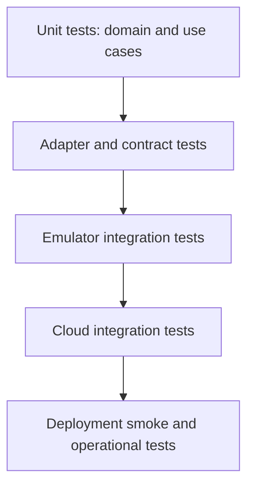
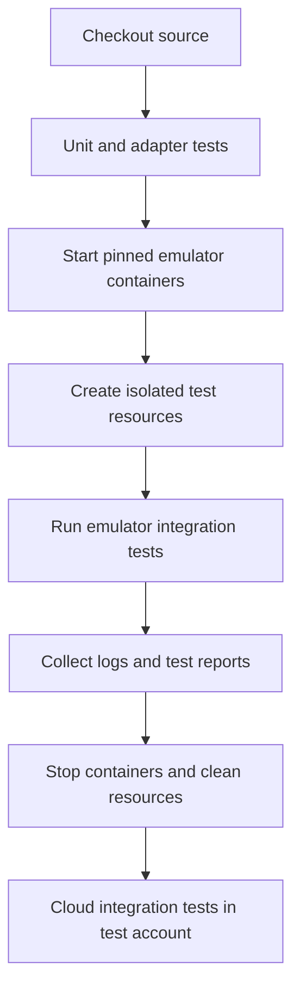

# Emulating Cloud Services and Recognizing Emulator Limitations

Java serverless functions typically depend on cloud services such as object storage, queues, event buses, databases, secret stores, and API gateways. If every unit test run had to connect to a live cloud environment, the feedback loop would be slow, costly, and hard to reproduce. Emulators and test doubles help test many flows directly on a developer machine or in CI, but they do not fully replicate cloud provider behavior.

The key is picking the right kind of test for the question you need to answer. Mocks can verify that an application service calls the right port; emulators can check code integration with service APIs; only a real cloud environment can verify behaviors such as IAM, managed identities, network policies, platform retries, scale-out, cold starts, and billing. A passing emulator test does not mean a function will behave identically in production.

Within **CLOUD_SERVERLESS**, this lesson focuses on developing and deploying Java functions triggered by HTTP, messages, or events, while handling triggers, state, access permissions, retries, idempotency, cold starts, scaling, and cost. It covers how to use emulators to accelerate testing, recognize fidelity gaps, and combine local testing with real cloud testing.

## 1. How do mocks, fakes, stubs, and emulators differ?

These techniques are often grouped under test doubles, yet their purpose and fidelity to real systems differ.

| Type | How it works | Suitable for testing | Main limitation |
|---|---|---|---|
| Stub | Returns preconfigured data | Processing branches when a dependency returns a specific result | Does not simulate full dependency behavior |
| Mock | Records calls and enables interaction assertions | Application service calling the right port with the right arguments | Tests can couple too tightly to implementation details |
| Fake | Simple implementation with realistic behavior where needed | In-memory repository, fake clock, simple idempotency store | Lacks production traits such as transactions or distribution |
| Emulator | Simulates a cloud service's API/behavior | SDK integration, serialization, queries, and basic data flows | Does not guarantee complete parity with the real service |
| Cloud integration test | Calls real cloud services in a test account | IAM, networking, trigger delivery, retries, and real limits | Slower, incurs cost, and requires resource management |

Do not use mocks for everything. If a test needs to verify a DynamoDB statement or how the SDK sends an S3 request, an emulator can catch integration errors that mocks miss. Conversely, if you are only testing order-creation business rules, a fake repository is usually faster and clearer than spinning up all of LocalStack.

## 2. Building a multi-layered testing strategy

A Java function should be tested across multiple levels, from fast and isolated to production-like.



| Layer | Example | Relative speed/cost | Question answered |
|---|---|---|---|
| Unit | Domain rules, idempotency policies, validation | Fast, low | Is the business logic correct? |
| Adapter/contract | HTTP mapping, event JSON, schema versions | Fast, low | Do inputs/outputs follow the contract? |
| Emulator | S3 API, DynamoDB queries, Pub/Sub publish | Medium, low to moderate | Do the SDK and basic integration work? |
| Cloud integration | IAM, KMS, queue delivery, event source mappings | Slower, paid | Are real service configurations and behaviors right? |
| Smoke/operational | Deploy function, send real requests/messages | Slower, paid | Do the artifact, trigger, permissions, and production observation path work? |

You do not need to run the entire cloud integration layer for every edit to a pure Java function. Run unit and adapter tests frequently; emulator tests in CI; and cloud integration and deployment smoke tests on critical pull requests, nightly builds, or before releases based on risk.

## 3. What can emulators help test?

Emulators are useful when verifying protocol/API-level communication without relying on a cloud account.

- Does the SDK client have the right endpoint, region, credential provider, and serialization?
- Does the code create buckets, queues, topics, tables, or subscriptions as configured?
- Are objects uploaded/downloaded with the expected keys and metadata?
- Do basic queries/puts/gets work with test data?
- Are messages/events serialized and deserialized according to schema?
- Does the handler process payloads, batches, and basic error cases?
- Can tests create and clean up isolated data and run repeatably without affecting other environments?

Emulators are especially helpful for adapter integration tests. For example, `S3ObjectStoreAdapter` can be tested with LocalStack to verify the AWS SDK v2 sends the right requests and reads back written objects.

## 4. What emulators typically do not simulate completely

Emulators usually prioritize common APIs and basic development flows. Internal behavior, service limits, and multi-service integrations can differ from the real cloud.

| Behavior area | Common gap | Where to test |
|---|---|---|
| IAM/RBAC | Policy evaluation, resource policies, conditions, role assumption may be simplified | Cloud integration with real identities |
| Network | VPCs, private endpoints, firewalls, DNS, and routing are not fully reproduced | Staging cloud environment |
| Event delivery | Retries, duplicates, ordering, batch failures, and timeouts may differ | Send events through real services |
| Scaling | Concurrency, autoscaling, throttling, and quotas differ from production | Load testing in the cloud |
| Runtime | Cold starts, CPU/memory allocation, and instance lifecycle differ from reality | Deploy on the target runtime/plan |
| Consistency | Eventual consistency, transactions, and race conditions may differ | Test real services under concurrent data |
| Security | KMS, secrets, managed identities, auditing, and token exchange may be incomplete | Test IAM/KMS/identity in the cloud |
| Cost/quotas | Billing, regional quotas, throttling, and service limits are not accurately calculated | Monitoring/budgets in a test account |

Therefore, explicitly document which parts an emulator verifies. Do not use emulator results to claim production IAM, retry semantics, or function scaling are verified.

## 5. AWS SAM CLI and local function testing

AWS SAM CLI supports running Lambda functions locally in runtime containers, invoking functions with event fixtures, and running local HTTP APIs. This helps verify handlers, event deserialization, and response mapping before deployment.

Example invoking a function with an event fixture:

```bash
sam build
sam local invoke OrderFunction --event events/order-created.json
```

Example running a local HTTP API:

```bash
sam local start-api
```

Once the local server starts, you can send HTTP requests to local endpoints matching the routes in your template. `sam local invoke` and `sam local start-api` simulate launching the function and part of the event/API path; they do not automatically replicate API Gateway authorizers, IAM policies, networking, throttling, or Lambda scaling behavior.

For SQS/SNS/S3 events, you can craft representative JSON fixtures and invoke the function directly. Putting an object into local S3 and verifying that Lambda is triggered automatically is a different test: it requires an emulator supporting event wiring or a cloud integration environment. Do not conflate the two tests.

## 6. LocalStack for AWS service integration

LocalStack provides a local environment emulating many AWS APIs. It can test integrations such as S3, SQS, SNS, DynamoDB, EventBridge, and Lambda depending on the service, version, and edition.

Example running LocalStack with Docker:

```bash
docker run --rm -d \
  --name localstack-serverless-test \
  -p 4566:4566 \
  -e SERVICES=s3,sqs,dynamodb \
  localstack/localstack:VERSION
```

Replace the `VERSION` tag with a version approved by the testing team. Do not use `latest` in CI if you want reproducible tests.

Create a bucket using AWS CLI pointed at the local endpoint:

```bash
aws --endpoint-url=http://localhost:4566 \
  --region=us-east-1 \
  s3 mb s3://serverless-test-bucket
```

Create a queue:

```bash
aws --endpoint-url=http://localhost:4566 \
  --region=us-east-1 \
  sqs create-queue --queue-name orders-test
```

LocalStack typically uses dummy credentials for local environments; never pass production credentials into the container. API support and fidelity vary by version/edition. Before relying on a feature such as event notifications, IAM conditions, or Step Functions, check the service coverage of the exact pinned version.

## 7. DynamoDB Local

DynamoDB Local runs a DynamoDB-compatible API on a developer machine or CI. It works well for testing basic operations such as `PutItem`, `GetItem`, `Query`, key schemas, and certain condition expressions.

Example running with Docker:

```bash
docker run --rm -d \
  --name dynamodb-local-test \
  -p 8000:8000 \
  amazon/dynamodb-local:VERSION \
  -jar DynamoDBLocal.jar -sharedDb -inMemory
```

AWS SDK for Java 2.x can connect to the local endpoint using `endpointOverride` and dummy credentials. For local tests, set the region explicitly and never use credentials from a real account.

DynamoDB Local is not a complete clone of the managed DynamoDB service. Features related to IAM, backup/restore, autoscaling, throttling, global tables, streams, and certain operational behaviors must be verified against current documentation/versions and tested on real AWS. Never use an emulator to conclude that a production table will meet target throughput or latency.

## 8. Google Cloud Pub/Sub emulator

Google Cloud SDK provides a Pub/Sub emulator for testing basic publish/subscribe flows locally. You can start it with:

```bash
gcloud emulators pubsub start \
  --project=serverless-test \
  --host-port=127.0.0.1:8085
```

In the test process, configure the Pub/Sub client to point to the emulator endpoint and use a no-credentials provider per your Java library's instructions. The `PUBSUB_EMULATOR_HOST` variable is commonly used so compatible clients detect the emulator endpoint.

The emulator helps test topics/subscriptions, publish/receive, and basic payload mapping. It does not verify production IAM, service accounts, quotas, network paths, retry behavior across the full Eventarc/Cloud Functions pipeline, or real throughput. If a function is triggered via Eventarc, also test the event envelope and delivery path in a test cloud project.

## 9. Azure Storage emulator Azurite

Azurite emulates part of the Azure Storage API for Blob, Queue, and Table storage. It is useful when Java functions use Azure Storage bindings or SDKs to read/write blobs, enqueue/dequeue messages, and perform basic table operations.

Example running the container:

```bash
docker run --rm -d \
  --name azurite-test \
  -p 10000:10000 \
  -p 10001:10001 \
  -p 10002:10002 \
  mcr.microsoft.com/azure-storage/azurite:VERSION \
  azurite --blobHost 0.0.0.0 --queueHost 0.0.0.0 --tableHost 0.0.0.0
```

In local development, the Azure Storage SDK can often use a development connection string such as `UseDevelopmentStorage=true` when using Azurite's default endpoints. If using custom hostnames/container networks, configure the appropriate endpoints.

Azurite does not emulate all of Azure. It does not replace testing with Azure Service Bus, Event Hubs, Event Grid, managed identities, RBAC, private endpoints, or other services. An Azure Storage queue also differs from a Service Bus queue in settlement, sessions, and semantics; never use Azurite to verify Service Bus triggers.

## 10. Choosing an emulator by service

| Cloud/service | Common local tool | What to test | What not to infer |
|---|---|---|---|
| AWS Lambda runtime/API | AWS SAM CLI | Handler invocation, HTTP mapping, event fixtures | IAM, scaling, cold starts, and all event-source behavior |
| AWS S3/SQS/DynamoDB | LocalStack or DynamoDB Local | SDK calls and supported API flows | Complete AWS parity or production IAM |
| Google Pub/Sub | Pub/Sub emulator | Topics/subscriptions and basic publish/receive | IAM, Eventarc delivery, quotas, and production throughput |
| Azure Blob/Queue/Table | Azurite | Storage APIs and basic local bindings | Service Bus/Event Hubs or managed identities |
| HTTP handler | Framework test client/Functions Framework | Routing, request parsing, response/error mapping | Gateway authorizers, WAF, ingress, and network policies |
| Database | Matching Testcontainers database | SQL, migrations, and transactions on the running engine | Managed database services, IAM auth, failover, and scaling |

A project can use multiple emulators. Keep each emulator in its proper role and do not treat identical API names as proof of identical semantics.

## 11. Using Testcontainers in Java

Testcontainers lets Java tests launch dependencies in containers, wait for readiness, obtain dynamic endpoints, and clean up containers afterward. This reduces reliance on manually started Docker Compose setups and makes CI environments more reproducible.

Illustrative Maven dependencies for JUnit 5 and the LocalStack module:

```xml
<dependency>
  <groupId>org.testcontainers</groupId>
  <artifactId>junit-jupiter</artifactId>
  <scope>test</scope>
</dependency>
<dependency>
  <groupId>org.testcontainers</groupId>
  <artifactId>localstack</artifactId>
  <scope>test</scope>
</dependency>
```

Manage versions through the Testcontainers BOM and pin a compatible LocalStack image version. Do not copy illustrative snippets without checking your project's dependency management.

Example S3 adapter test with AWS SDK v2:

```java
import static org.junit.jupiter.api.Assertions.assertEquals;

import org.junit.jupiter.api.Test;
import org.testcontainers.containers.localstack.LocalStackContainer;
import org.testcontainers.junit.jupiter.Container;
import org.testcontainers.junit.jupiter.Testcontainers;
import org.testcontainers.utility.DockerImageName;
import software.amazon.awssdk.auth.credentials.AwsBasicCredentials;
import software.amazon.awssdk.auth.credentials.StaticCredentialsProvider;
import software.amazon.awssdk.regions.Region;
import software.amazon.awssdk.services.s3.S3Client;
import software.amazon.awssdk.services.s3.S3Configuration;
import software.amazon.awssdk.services.s3.model.CreateBucketRequest;
import software.amazon.awssdk.services.s3.model.GetObjectRequest;
import software.amazon.awssdk.services.s3.model.PutObjectRequest;
import software.amazon.awssdk.core.sync.RequestBody;

@Testcontainers
class S3AdapterIntegrationTest {
    @Container
    static final LocalStackContainer cloud =
            new LocalStackContainer(
                    DockerImageName.parse("localstack/localstack:VERSION"))
                    .withServices(LocalStackContainer.Service.S3);

    @Test
    void storesAndReadsObjectThroughS3Api() {
        try (S3Client s3 = S3Client.builder()
                .endpointOverride(cloud.getEndpointOverride(
                        LocalStackContainer.Service.S3))
                .credentialsProvider(StaticCredentialsProvider.create(
                        AwsBasicCredentials.create(
                                cloud.getAccessKey(), cloud.getSecretKey())))
                .region(Region.of(cloud.getRegion()))
                .serviceConfiguration(S3Configuration.builder()
                        .pathStyleAccessEnabled(true)
                        .build())
                .build()) {

            String bucket = "serverless-test-bucket";
            String key = "incoming/sample.txt";
            String expected = "hello from local S3";

            s3.createBucket(CreateBucketRequest.builder()
                    .bucket(bucket).build());
            s3.putObject(PutObjectRequest.builder()
                            .bucket(bucket).key(key).build(),
                    RequestBody.fromString(expected));

            String actual = s3.getObjectAsBytes(GetObjectRequest.builder()
                            .bucket(bucket).key(key).build())
                    .asUtf8String();

            assertEquals(expected, actual);
        }
    }
}
```

Replace the image placeholder with a pinned version. This test verifies that AWS SDK v2 communicates with the S3 API provided by LocalStack and that data can be written and read. It does not prove S3 notifications actually trigger Lambda, Lambda permissions evaluate like AWS, or the IAM execution role has the right permissions. Those require separate tests and potentially an AWS test account.

## 12. Testing adapters with fakes instead of starting emulators when appropriate

If the goal is testing a use case, define a port and use a fake implementation. For example:

```java
import java.util.Map;
import java.util.Optional;
import java.util.concurrent.ConcurrentHashMap;

public interface ObjectStore {
    Optional<byte[]> read(String bucket, String key);
    void write(String bucket, String key, byte[] content);
}

final class InMemoryObjectStore implements ObjectStore {
    private final Map<String, byte[]> objects = new ConcurrentHashMap<>();

    @Override
    public Optional<byte[]> read(String bucket, String key) {
        return Optional.ofNullable(objects.get(bucket + "/" + key));
    }

    @Override
    public void write(String bucket, String key, byte[] content) {
        objects.put(bucket + "/" + key, content.clone());
    }
}
```

This fake is sufficient to verify that the application service calls read/write properly and handles missing objects. It does not test the AWS SDK, S3 key encoding, IAM, or metadata. Therefore, complement fake-based unit tests with a set of emulator integration tests for the S3 adapter.

## 13. Event fixtures for HTTP, queue, and event triggers

Functions typically receive payloads created by a gateway or source service. Test fixtures must accurately reflect the trigger envelope.

Example HTTP gateway fixture:

```json
{
  "version": "2.0",
  "routeKey": "POST /orders",
  "rawPath": "/orders",
  "headers": {"content-type": "application/json"},
  "body": "{\"customerId\":\"cus-100\",\"items\":[{\"sku\":\"A-1\",\"quantity\":2}]}",
  "isBase64Encoded": false
}
```

Example message payload:

```json
{
  "messageId": "msg-123",
  "eventType": "OrderSubmitted",
  "schemaVersion": 1,
  "data": {
    "orderId": "ord-456",
    "customerId": "cus-100"
  }
}
```

Example CloudEvents envelope:

```json
{
  "specversion": "1.0",
  "id": "evt-789",
  "source": "/orders/service",
  "type": "com.example.order.submitted",
  "subject": "orders/ord-456",
  "time": "2026-11-17T08:30:00Z",
  "datacontenttype": "application/json",
  "data": {
    "orderId": "ord-456"
  }
}
```

Fixtures should be stored alongside tests with clear schema versions and origins. Avoid hand-writing JSON that approximates a real payload while omitting critical fields such as encoded bodies, event versions, message attributes, bucket/key encoding, or batch wrappers.

## 14. Testing retries and idempotency

Emulators may support redelivering messages or replaying requests, but they do not always faithfully reproduce real cloud retry schedules, lock expirations, or at-least-once delivery.

In unit tests, invoke the use case with the same idempotency key multiple times and verify the side effect is recorded only once. In adapter tests, replay the same event fixture and verify the handler forwards the right event ID to the use case. In emulator integration tests, verify basic queue/API behavior. Finally, use cloud integration tests to verify real retry policies, visibility timeouts, lock renewals, DLQs, and event source mappings.

Example scenarios to cover:

| Scenario | Expected outcome |
|---|---|
| Same event ID delivered twice | Does not create two orders or two payments |
| Dependency returns transient error | Invocation retries according to configured policy |
| Payload violates schema | Does not retry indefinitely; logged or quarantined per policy |
| Function times out after DB write but before ack | Retry recognizes the side effect already completed |
| Batch has one failing record | Partial failure behavior matches the real event source |
| Out-of-order event arrival | State transition is not overwritten by an older event |

## 15. Testing access permissions

Emulators often use dummy credentials or a simplified set of IAM behaviors. Passing tests with dummy credentials do not prove a production role follows least privilege and proper scoping.

Split permission testing into three parts:

1. **Application authorization:** unit tests verifying whether a user/tenant is permitted to perform an action on a resource.
2. **Policy validation:** static analysis or policy-as-code checking that IAM/RBAC policies do not grant overly broad access.
3. **Cloud identity integration:** deploy the function to a test project/account, attach a real service account/execution role, and test access to S3, KMS, Pub/Sub, Service Bus, or secret stores.

Never put production access keys into emulators. In cloud tests, use dedicated, narrowly scoped service accounts/roles and synthetic data. Test both allowed and denied cases; testing only positive cases fails to catch overly broad policies.

## 16. Testing triggers and event wiring

Invoking a handler directly with JSON fixtures tests payload-handling code, not trigger configuration. An end-to-end trigger check must verify:

- Is the event source configured with the right bucket, queue, topic, or subscription?
- Does the function have permission to receive/be invoked by the event?
- Are batch size, filters, consumer groups, and event source mappings right?
- Are messages acked/completed or checkpointed after processing?
- Do errors trigger retries or DLQ routing per policy?
- Are configuration changes applied after deployment?

Local emulators may support part of event wiring. Check the service coverage of your emulator and extension version; if unsupported, use event fixtures to test the handler and write cloud integration tests for the real trigger path.

## 17. Test container lifecycle and data isolation

Testcontainers or Docker Compose can launch emulators for a test suite. Each test needs isolated data to run in parallel and independently of execution order.

Best practices:

- Use unique bucket/table/queue name suffixes per test or suite.
- Create resources in setup and delete them in teardown.
- Use a separate database/schema per test suite.
- Do not share mutable global state across parallel tests.
- Wait on emulator health/readiness checks instead of fixed sleeps.
- Pin image versions and store emulator configuration in the repository.
- Restrict exposed ports and avoid binding to public interfaces unnecessarily.
- Clean up volumes/containers after CI runs to avoid stale data causing false passes.

If an emulator persists data across runs, tests must include an explicit reset step. A test passing by reading an object left over from a previous run is a false positive.

## 18. Documenting fidelity gaps

Every emulator integration should carry a brief note listing what behaviors have been verified and what remains unverified.

Example:

| Emulator/test | Verified | Unverified |
|---|---|---|
| LocalStack S3 | AWS SDK v2 bucket creation, put/get object | S3-to-Lambda delivery, IAM resource policies, KMS conditions, regional behavior |
| DynamoDB Local | Key schemas, basic put/get/query | IAM, autoscaling, throttling, global tables, and production latency |
| Pub/Sub emulator | Publish/subscribe and payload deserialization | IAM, Eventarc delivery, quotas, throughput, and production retries |
| Azurite | Basic Blob/Queue APIs | Managed identities, RBAC, Service Bus semantics, and private endpoints |
| SAM local | Lambda handler invocation and HTTP event mapping | AWS account policies, VPCs, scaling, cold starts, and billing |

The list above is illustrative; service coverage varies by version. Update notes when upgrading emulators or extensions. Do not rely on an old test to conclude a new feature is supported.

## 19. CI pipeline for emulator tests

CI should launch emulators using pinned container versions, create test resources, run integration tests, and clean up the environment. Example workflow:



Never run emulator tests against `latest` because behavior can change without any commit in the repository. Pin versions, review release notes on upgrades, and re-run contract tests.

For the cloud integration stage, use a dedicated account/project, restricted permissions, budgets/alerts, and TTL-based automatic resource cleanup. If a test fails mid-run, the cleanup job must still execute to avoid leaving billable buckets, queues, functions, or databases behind.

## 20. Controlled real cloud testing

Certain questions can only be answered in a real cloud environment:

- Does the function assume the right execution role/service account?
- Does the resource policy allow the intended event source to invoke the function?
- Do KMS key policies, secret access, and network paths work?
- Does the event source retry, time out, batch, and route to DLQ as configured?
- Does the function scale under bursts while keeping downstream systems within limits?
- What are cold starts and memory/CPU usage on the real runtime?
- Does the trigger work after deployment or revision rollout?

Cloud integration tests should use synthetic data, uniquely prefixed/tagged resources, and an account/project free of production data. Cap concurrency, timeouts, and retry counts to prevent tests from generating runaway costs or event storms.

## 21. Performance, cold start, and cost testing

Emulators running on a developer machine do not represent the CPU, network, disk, scheduler, or autoscaler of a cloud provider. Never use local latency measurements to predict production cold starts or costs.

In a cloud test environment, measure:

- Cold start latency and warm invocation latency separately.
- p50, p95, and p99 of HTTP requests or event processing.
- Peak memory, CPU utilization, and instance/concurrency counts.
- Queue backlog, consumer lag, retry counts, and DLQ counts.
- Database connection counts, pool wait times, and downstream throttling.
- Cost per request, duration, memory, storage, logs, and networking.

Run both steady load and bursts, including idle intervals to observe cold starts. Test max concurrency/instance limits and verify backpressure. Keep tests bounded, budgeted, and configured to abort automatically upon reaching safety thresholds.

## 22. Checking schemas and contracts independently of emulators

Event contracts should be verified with versioned schemas and fixtures. An emulator alone does not ensure producers and consumers use the same schema.

For JSON events, check:

- Required fields, data types, enums, and timestamp formats.
- Schema versions and backward/forward compatibility rules.
- Whether unknown fields are safely ignored.
- Whether event IDs, correlation IDs, and idempotency keys are present when needed.
- How oversized payloads, missing fields, or invalid encodings are handled.

If using JSON Schema, Avro, or Protobuf, validate fixtures in unit/contract tests before sending them to an emulator. Contract tests can also verify that consumers accept events produced by newer producers and that producers do not break schemas for older consumers.

## 23. Common pitfalls of over-relying on emulators

| Symptom | Cause | Improvement |
|---|---|---|
| Passes locally but hits AccessDenied in cloud | Emulator does not fully simulate IAM policies | Add cloud identity integration tests |
| Function never triggers despite passing handler tests | Only invoked handler directly without testing event wiring | Test source mappings/notifications in the cloud |
| Retry behavior differs from production | Emulator does not fully reproduce locks/acks/checkpoints | Test retries against real services |
| Intermittent test failures | Container not ready yet or shared test data | Use health checks and isolated resources |
| Tests pass due to leftover data | Emulator volume was not reset | Clean up or create unique namespaces |
| Low local latency yet slow in production | Local environment does not represent cold starts/networking | Benchmark on the real cloud runtime |
| Upgrading emulator breaks tests | Service compatibility changed | Pin versions, review release notes, and update contracts |
| Slow test suite | Starting emulators even for unit tests | Restrict emulators to layers needing integration |
| Production data/secrets leak locally | Wrong credentials used or real payloads dumped | Dummy credentials and sanitized fixtures |

## 24. Emulator test design checklist

| Question | Required evidence |
|---|---|
| Is the test checking business rules or cloud APIs? | Choose unit fakes/mocks or an emulator appropriately |
| Does the emulator support the required APIs? | Service coverage of the pinned version/edition |
| Do fixtures reflect real triggers? | Versioned event JSON and contract validation |
| Are local credentials safe? | Dummy credentials, zero production access keys |
| Are endpoints explicitly configured? | SDK endpoint overrides or emulator environment settings |
| Do tests isolate data? | Dedicated resources and teardown cleanup |
| Is the container ready before tests run? | Health/readiness checks rather than arbitrary sleeps |
| Are fidelity gaps documented? | List of verified and unverified behaviors |
| Are cloud integration tests present? | IAM, networking, event delivery, retries, and KMS verified for real |
| Is cloud performance tested? | Cold starts, scaling, latency, quotas, and cost measured |
| Is CI reproducible? | Pinned emulator images, logs, and test reports preserved |
| Is there cleanup when pipelines fail? | Teardown jobs and TTLs for test cloud resources |

## 25. Choosing the right testing level

For domain logic changes, run unit tests and fake repositories. For HTTP/event mapping changes, run adapter tests with fixtures. When modifying AWS SDK, Azure SDK, Google Cloud client, or repository adapters, run emulator integration tests. When changing IAM, trigger configuration, retries, event source mappings, KMS, networking, or scaling, add cloud integration tests.

An emulator is a tool for accelerating development and checking API contracts. It is not a complete miniature cloud provider. A sound testing strategy documents what is verified locally, what requires the real cloud, and what evidence must exist before release. This stratification keeps Java serverless fast during daily development while still catching bugs that only appear on the live platform.
