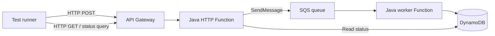
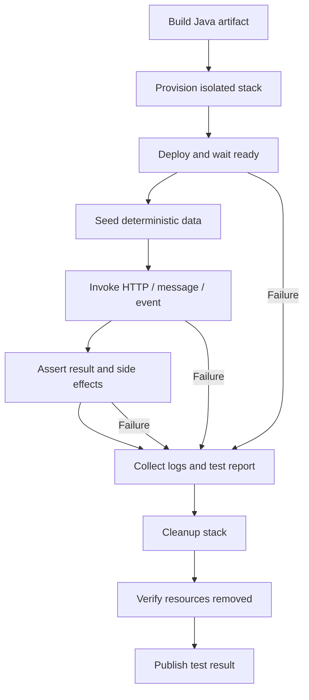

# Integration Testing in an Isolated Cloud Environment

## 1. What is a cloud integration test?

Integration tests verify that multiple components work together across their real boundaries. In a serverless application, a business flow may pass through API Gateway, a Java Lambda function, a queue, a Lambda worker, a database, and an event publishing service. Testing individual classes or calling handler methods directly does not prove the components are configured properly, have permission to invoke one another, or handle events with the intended semantics when running in the cloud.

Integration testing in an isolated cloud environment deploys a dedicated version of the infrastructure and application for a single test run or test group. Tests send requests through real endpoints, publish messages/events through real services, and verify outcomes at service boundaries. Afterward, the pipeline tears down the temporary resources.

For example, an order creation test might trace this flow:



The test verifies that the HTTP request is accepted, the message is processed, order state is persisted, and the API returns the final status. Thus, the test verifies integration across the API, Lambda, SQS, IAM, database, and business logic.

Within the CLOUD_SERVERLESS module, integration tests should cover how functions are triggered by HTTP, messages, or events; how state is persisted; access permissions; retries; idempotency; cold starts; scaling; and cost. An isolated environment enables these checks without altering production data or traffic.

## 2. How do integration tests differ from unit tests and end-to-end tests?

| Test type | Scope | Example | Best at catching |
|---|---|---|---|
| Unit test | Single method/class, mocked dependencies | Testing `OrderValidator` | Small business rules, error branches |
| Component test | Single component running with fake/local dependencies | Function handler with LocalStack or an emulator | Event mapping, serialization, internal wiring |
| Cloud integration test | Group of real deployed services in an isolated account/environment | API Gateway → Lambda → SQS → DynamoDB | IAM, real triggers, networking, retries, service configuration |
| End-to-end test | Full user journey across multiple systems | Creating an order and receiving a confirmation email | Cross-system contracts and behavior |
| Contract test | Agreement between producer and consumer | JSON event schema of `OrderCreated` | Payload compatibility and versioning |

Not every test needs to run in the cloud. Unit tests are fast and cheap; emulators are useful for early feedback; cloud integration tests verify behavior depending on real services; end-to-end tests should be kept small in number because they are slow and hard to diagnose.

A single test can be both an integration test and part of an end-to-end flow. What matters is defining the boundaries, real dependencies, and evidence to collect so you do not turn every test into a long, brittle scenario.

## 3. When is an isolated cloud environment needed?

Run cloud integration tests when outcomes depend on the configuration or real semantics of cloud services, for example:

- API Gateway has routes, authorizers, mappings, or timeouts to verify.
- Lambda requires real Java runtime behavior, environment variables, layers, memory, architecture, or permissions.
- SQS/SNS/EventBridge/Kinesis triggers the function with retries, visibility timeouts, or ordering.
- The function accesses databases, object storage, secrets, or services over private networking.
- IAM roles/resource policies could cause `AccessDenied` even though unit tests pass.
- Cold starts, concurrency, throttling, event age, or scaling behavior must be measured.
- Deployment artifacts, environment configuration, and infrastructure-as-code must be validated.

You do not need a new cloud environment per test method. One environment can serve a test suite or pipeline run, provided data and resources are uniquely namespaced, tests do not race over shared state, and cleanup can reclaim everything.

## 4. Isolation levels

There are multiple ways to establish isolation boundaries. Pick a level matching your risk, cost, and speed.

| Isolation level | How it is implemented | Pros | Cons |
|---|---|---|---|
| Dedicated account per test run | Provision a temporary/sandbox account or organizational account | Clear IAM, quota, network, and billing boundaries | Slow account provisioning, requires governance |
| Shared test account, dedicated stack | One CloudFormation/CDK stack per run | Easy to automate, dedicated resources | IAM limits and quotas still shared across the account |
| Shared stack, dedicated namespace | Prefix queues/tables/keys with the run ID | Fewer resources, lower cost | Easy to leak data if code forgets namespacing |
| Shared persistent environment | One integration environment across many pipelines | Fast to provision | Test collisions, hard to reproduce, cross-test interference |

For tests verifying IAM, resource policies, VPCs, or account boundaries, dedicated accounts add high value. For standard functional tests, a dedicated stack per pipeline run is usually a good balance. Dedicated namespaces work only when all resources support strict partitioning and tests prevent cross-access.

Never use a production account or production data as a test environment. If realistic comparisons are needed, use synthetic fixtures or masked/anonymized copies with restricted access.

## 5. Designing an isolated environment per run

Each test run needs a unique identifier, for example:

```text
TEST_RUN_ID=it-20261117-482-3
CloudFormation stack=orders-it-20261117-482-3
Queue=orders-it-20261117-482-3
DLQ=orders-it-20261117-482-3-dlq
Table=orders-it-20261117-482-3
```

In CI systems, IDs can be constructed from the repository, PR/run number, and attempt. Never include personal data in resource names. Respect each service's length and character limits; if using branch names, normalize them and append a hash to avoid collisions.

The test environment needs:

- Infrastructure provisioned via IaC (CDK, CloudFormation, Terraform, or equivalent).
- Java artifacts built from the commit under test.
- Endpoints and resource names exported to the test runner.
- Repeatable, deterministic seed data.
- IAM roles scoped strictly to the test run's resources.
- Logging/metrics queryable by `testRunId` or correlation ID.
- TTL/cleanup handling both failed tests and canceled pipelines.

Tag resources with metadata such as `EnvironmentType=integration`, `TestRunId`, `OwnerRepo`, `CommitSha`, `CreatedAt`, and `ExpiresAt`. Tags aid inventory and cleanup, though they do not replace IAM authorization or ownership checks before deletion.

## 6. End-to-end workflow: provision, test, collect, cleanup

A cloud integration test pipeline should be split into distinct stages:

1. **Build:** compile, run unit tests, and package the Java function.
2. **Provision:** create the isolated stack/resources and attach ownership tags.
3. **Deploy:** deploy artifacts, configure triggers, permissions, and networking.
4. **Wait ready:** wait for CloudFormation completion, function/API availability, and passing health checks.
5. **Seed data:** insert fixture data with unique IDs.
6. **Execute:** call HTTP endpoints, send messages, or publish events.
7. **Assert:** verify responses, final state, side effects, logs, or required metrics.
8. **Collect evidence:** save test reports, request/correlation IDs, logs, and CloudFormation events on failure.
9. **Cleanup:** delete the stack and any out-of-stack resources belonging to the test run.
10. **Reconcile:** run a scheduled job to find expired TTL test stacks orphaned by lost runners or canceled workflows.



Cleanup must run even if build/deploy/test fails after resources were created. If deployment fails mid-way, CloudFormation may still have resources or be rolling back; cleanup must check stack status before deleting.

## 7. Preparing fixtures and test data

A good test knows its inputs and expected state. Use reproducible fixtures instead of relying on pre-existing data.

Example order fixture:

```json
{
  "orderId": "it-482-3-9f12a6",
  "customerId": "customer-test-01",
  "items": [
    { "sku": "SKU-TEST-001", "quantity": 2 }
  ],
  "currency": "USD",
  "total": 25.50
}
```

Data rules:

- Use random IDs or IDs namespaced by the test run to avoid colliding with other runs.
- Never use real customers, emails, phone numbers, or payment tokens.
- Log/record fixtures so failing tests can be reproduced.
- Use controlled clocks/fixed timestamps when logic depends on time.
- Define clearly what data must exist before the test and what must be deleted afterward.
- When testing schema migrations, create a temporary database/table/schema and delete it separately afterward.
- Never depend on test execution order or state left by an earlier test.

If the test suite runs in parallel, each worker needs its own namespace or independent data. Share only immutable fixtures; never let multiple tests update the same record simultaneously.

## 8. Testing HTTP triggers through real endpoints

HTTP integration tests must invoke the deployed endpoint via the URL of API Gateway, Azure Functions, or the corresponding HTTP service. Calling the handler method directly cannot verify routing, authorizers, TLS, request mapping, timeouts, or gateway integration.

What to check:

- HTTP methods, paths, and query parameters route accurately.
- Authentication/authorization accepts valid principals and rejects invalid ones.
- Request bodies failing schema validation return appropriate status codes.
- Response bodies, headers, content types, and status codes satisfy the contract.
- Correlation IDs propagate from the gateway to the function and downstream.
- Timeouts and payload limits behave as configured.
- Duplicate requests do not repeat side effects when the API supports idempotency keys.
- CORS and custom domains if real clients depend on them.

Do not only assert HTTP 200. For APIs accepting asynchronous work, a `202 Accepted` response may be the right outcome; the test must then poll for business completion through a read API or test database.

## 9. Java HTTP integration test with JUnit 5

The example below calls an order-creation API. The API returns `202 Accepted`; the test sends an `orderId` it generated, the worker processes the message asynchronously, and updates the status to `COMPLETED`. The test invokes the real endpoint and polls status within a bounded deadline.

```java
import com.fasterxml.jackson.databind.JsonNode;
import com.fasterxml.jackson.databind.ObjectMapper;
import org.junit.jupiter.api.Test;

import java.net.URI;
import java.net.http.HttpClient;
import java.net.http.HttpRequest;
import java.net.http.HttpResponse;
import java.time.Duration;
import java.util.UUID;

import static org.junit.jupiter.api.Assertions.assertEquals;
import static org.junit.jupiter.api.Assertions.fail;

class OrdersCloudIntegrationTest {
    private static final HttpClient HTTP = HttpClient.newBuilder()
            .connectTimeout(Duration.ofSeconds(3))
            .build();
    private static final ObjectMapper JSON = new ObjectMapper();
    private static final String BASE_URL = requiredEnv("TEST_BASE_URL");

    @Test
    void createsOrderAndEventuallyCompletesIt() throws Exception {
        String orderId = "it-" + UUID.randomUUID();
        String correlationId = "corr-" + UUID.randomUUID();

        String payload = """
                {
                  "orderId": "%s",
                  "customerId": "customer-test-01",
                  "items": [{"sku":"SKU-TEST-001","quantity":2}]
                }
                """.formatted(orderId);

        HttpRequest create = HttpRequest.newBuilder()
                .uri(URI.create(BASE_URL + "/orders"))
                .timeout(Duration.ofSeconds(5))
                .header("Content-Type", "application/json")
                .header("X-Correlation-Id", correlationId)
                .header("Idempotency-Key", orderId)
                .POST(HttpRequest.BodyPublishers.ofString(payload))
                .build();

        HttpResponse<String> accepted = HTTP.send(
                create, HttpResponse.BodyHandlers.ofString());

        assertEquals(202, accepted.statusCode(), accepted.body());
        awaitCompleted(orderId);
    }

    private static void awaitCompleted(String orderId) throws Exception {
        long deadline = System.nanoTime() + Duration.ofSeconds(40).toNanos();
        URI statusUri = URI.create(BASE_URL + "/orders/" + orderId);

        while (System.nanoTime() < deadline) {
            HttpRequest request = HttpRequest.newBuilder()
                    .uri(statusUri)
                    .timeout(Duration.ofSeconds(3))
                    .GET()
                    .build();

            HttpResponse<String> response = HTTP.send(
                    request, HttpResponse.BodyHandlers.ofString());

            if (response.statusCode() == 200) {
                JsonNode body = JSON.readTree(response.body());
                if ("COMPLETED".equals(body.path("status").asText())) {
                    return;
                }
                if ("FAILED".equals(body.path("status").asText())) {
                    fail("Order processing failed: " + response.body());
                }
            } else if (response.statusCode() != 404 && response.statusCode() != 202) {
                fail("Unexpected status response: " + response.statusCode()
                        + " body=" + response.body());
            }

            Thread.sleep(250);
        }

        fail("Order did not reach COMPLETED before the deadline: " + orderId);
    }

    private static String requiredEnv(String name) {
        String value = System.getenv(name);
        if (value == null || value.isBlank()) {
            throw new IllegalStateException("Missing environment variable: " + name);
        }
        return value;
    }
}
```

The test reads `TEST_BASE_URL` provided by the pipeline from stack outputs. It does not hardcode an endpoint or sleep a fixed duration assuming work finished; polling ends on reaching a terminal state or expiring the deadline. In a real project, add JUnit 5 and Jackson dependencies and adapt endpoints/response schemas to your API. If the endpoint requires a token, obtain a short-lived test token from the pipeline's security mechanism and never print tokens to logs.

The test above verifies the flow through the API, yet can only prove the database was updated if the status endpoint reads from the canonical data store. If direct data-store inspection is needed, use AWS SDK/Azure SDK in a test runner granted read-only permissions scoped strictly to the test run's resources; never grant broad permissions to the entire test suite.

## 10. Testing message triggers and asynchronous processing

For queue triggers, tests must verify both message receipt and downstream side effects. One successful `SendMessage` only proves the queue accepted the message, not that the worker executed.

A queue test typically does:

1. Send a message with a unique `eventId`/`messageId`.
2. Wait for the worker to process it within a bounded deadline.
3. Read business state from the test API or data store.
4. Assert the side effect is accurate and occurred only once.
5. Verify the message is no longer in the main queue, or moved to the DLQ when intentionally triggered to fail.

With SQS Standard, delivery can repeat. Do not assert that the function was invoked strictly once. Assert final state and the count of business side effects; rely on idempotency keys/unique constraints to prevent duplicates.

With FIFO queues, test `MessageGroupId`, `MessageDeduplicationId`, and processing order when business logic depends on ordering. Use a real FIFO queue when verifying FIFO semantics.

## 11. Testing event triggers

Event-driven integration tests must publish events conforming to real schemas and verify consumers process them properly. For example, with EventBridge, a test can emit `OrderCreated` to the test run's isolated event bus and then query the resulting state in the data store.

What to check:

- Does the event source accept schema-compliant events?
- Do rules/event filters route to the right targets?
- Are event versions and required fields compatible with consumers?
- Are filtered-out events prevented from triggering unintended consumers?
- Do consumers handle duplicate events via idempotency keys?
- Do retries, max event age, and failure destinations work when consumers fail?
- Are events isolated from production buses or consumers?

For Kinesis/DynamoDB Streams, tests must account for checkpoints, shard ordering, and retention. Do not assume one failing record retries only that record; depending on configuration, the whole batch or records after the checkpoint may be reprocessed. When testing partial batch responses, inject an intentional failing record and verify the checkpoint/failure destination.

## 12. Waiting for eventual consistency properly

Queues, event buses, and streams operate asynchronously. Results may not appear immediately after sending an event. Use deadline-bounded polling instead of `Thread.sleep(10000)` followed by assuming completion.

A solid polling loop needs:

- An explicit overall deadline.
- A reasonable polling interval to avoid hammering APIs.
- Early exit once a success or terminal failure state is reached.
- Captured correlation IDs and last-observed state for diagnostics.
- No turning timeouts into passes merely because the runner stopped waiting.
- Distinction between "record not ready yet" (`404`/`PENDING`) and auth or system errors (`401`, `403`, `5xx`).

If processing times have a long tail, use bounded exponential backoff or gradually increasing polling intervals. Never retry a failed assertion indefinitely; timeouts must fail the test with actionable diagnostics.

## 13. Testing retries, duplicates, and idempotency

A strong integration suite checks more than the happy path. Verify how functions behave when receiving duplicate events or facing transient dependency errors.

Scenarios:

| Scenario | How to trigger | What to verify |
|---|---|---|
| Duplicate message | Send two messages with the same `eventId` or redrive | Business side effect occurs only once |
| Transient dependency error | Configure a test dependency to return controlled transient errors | Retries occur and eventually succeed or exhaust policy |
| Poison message | Intentionally invalid payload | Message is quarantined/routed to DLQ per config without blocking forever |
| Function timeout | Test handler waits past timeout or dependency hangs | Observable invocation failure and retry per policy |
| Throttling | Restrict concurrency or apply controlled load | Backoff/queue age stays within expected SLAs |
| Partial batch failure | One record in a batch fails | Successful records are not unnecessarily reprocessed |
| Replay | Replay events from DLQ/failure destination | Original event recovers safely without duplicating side effects |

Do not rely on random failures in production dependencies to drive tests. Use controllable fake dependencies or fault-injection endpoints that exist solely in test environments.

Idempotency should be verified through durable state. For example, send the same `eventId` twice and confirm only one payment/order transition or ledger entry exists. Checking counts/unique constraints in the database is far more reliable than counting how many times a handler logged "processed."

## 14. Testing DLQs and failure destinations

DLQs store events/messages that failed after exhausting retries or exceeding limits. Tests must verify:

- Messages land in the right queue/topic or failure destination.
- Payloads/metadata are sufficient for investigation and replay.
- IAM permissions allow the function/source to send records to the destination.
- Retention is long enough for operational incident handling.
- Messages are not routed to the DLQ prematurely before the intended retry policy completes.
- Redrives preserve the original event ID/idempotency key.

Distinguish source DLQs from Lambda destinations. For SQS event source mappings, the redrive policy/DLQ lives on the source queue. For asynchronous invocations, Lambda can use an on-failure destination or function-level DLQ. Tests must configure the exact mechanism matching the trigger rather than merely checking whether any queue contains a message.

## 15. Testing real IAM and access permissions

Local tests often run under broad developer credentials, masking missing permissions on the Lambda execution role. Cloud integration tests must verify that the actual runtime principal holds the required permissions.

Examples:

- API Gateway is permitted to invoke Lambda.
- Producer Lambda has `sqs:SendMessage` on the exact queue.
- Consumer Lambda has receive/delete message permissions on the source queue.
- Worker has read/write access on the exact DynamoDB table.
- Function reads secrets through the appropriate managed identity/execution role.
- KMS key policies permit encrypt/decrypt as required.
- Resource policies do not accidentally expose resources to unintended principals.

Test both allowed and denied actions. A security test can verify that the function's role cannot read production secrets or another test run's queue. Never use a deployment role with CloudFormation admin rights to stand in for the execution role in business tests.

## 16. Networking and test runners

If a function runs inside a VPC or a service only has a Private Endpoint, the test runner also needs an appropriate network path. A laptop might reach public APIs while a cloud runner cannot resolve private DNS; conversely, an in-VPC runner can reach endpoints a developer machine cannot.

Choose one approach:

- Self-hosted runner inside the test VPC.
- Runner in a subnet routed via VPN/peering to the test VPC.
- Authenticated public test API with IP restrictions for the runner.
- Managed, audited test bastion/proxy.

Verify DNS, routing, NSGs/security groups, firewalls, TLS, and return paths from the exact test execution location. Never expose databases or private endpoints to the public Internet just to simplify testing.

## 17. Testing cold starts and scaling behavior

Cold starts and scale-out are runtime/platform behaviors that cannot be evaluated by unit tests alone. Dedicated tests can measure:

- Time from first invocation after deployment to response.
- Latency percentiles p50/p95/p99 under a defined load.
- Time to scale from 1 instance to multiple instances.
- Concurrency and throttling during bursts.
- Database connections/pool saturation when multiple instances start simultaneously.
- Impact of VPC attachment, dependency initialization, JIT, or native images.

To measure cold starts, distinguish freshly deployed functions, warm functions, and functions after idle periods. Do not use an endpoint hit continuously to draw conclusions about cold-start latency. Record runtime, memory, architecture, package size, region, concurrency, and provisioned concurrency status if used.

Separate performance tests from the functional integration suite. High load generates cost, consumes quotas, and adds noise to other tests. Use dedicated accounts, time windows, and budgets; set rate limits and stop load when safety thresholds are reached.

## 18. Data, state, and post-test cleanup

Cloud functions are usually stateless, while the services they call retain state. Integration tests must have a strategy to create and clean up that state.

- Use a dedicated database/table/schema per test run whenever possible.
- If using a shared table, key records by `testRunId` and delete only the test's partition/prefix.
- Use dedicated queues so cleanup can delete the entire queue without affecting other tests.
- Set a dedicated S3 object prefix, then delete that exact prefix.
- Never purge shared queues, truncate shared tables, or delete shared buckets.
- Preserve needed test evidence before deleting the environment.
- Run a TTL reaper to clean up resources when runners die or workflows are canceled.

Cleanup must be idempotent: running a second time when resources are already deleted must not fail unexpectedly. If stack deletion fails, record `CleanupPending`, collect CloudFormation events, and alert rather than ignoring it.

## 19. CI/CD pipeline for cloud integration tests

Pipelines should separate build/test permissions from provision/cleanup permissions. Test code can execute arbitrary commands; never grant deploy credentials or production secrets to a test suite merely because it calls the cloud.

Abbreviated GitHub Actions workflow example:

```yaml
name: Cloud integration tests

on:
  pull_request:
    types: [opened, synchronize, reopened]

permissions:
  contents: read

jobs:
  build:
    runs-on: ubuntu-latest
    steps:
      - uses: actions/checkout@v4
      - uses: actions/setup-java@v4
        with:
          distribution: temurin
          java-version: '21'
      - run: mvn -B test package
      - uses: actions/upload-artifact@v4
        with:
          name: application-artifacts
          path: '**/target/*.jar'

  provision:
    needs: build
    if: github.event.pull_request.head.repo.full_name == github.repository
    runs-on: ubuntu-latest
    environment: integration-sandbox
    permissions:
      contents: read
      id-token: write
    outputs:
      stack_name: ${{ steps.meta.outputs.stack_name }}
      api_url: ${{ steps.deploy.outputs.api_url }}
    steps:
      - uses: actions/checkout@v4
        with:
          # Use deployment code from the protected default branch.
          # The PR-built JAR remains an untrusted artifact.
          ref: ${{ github.event.repository.default_branch }}
      - uses: actions/download-artifact@v4
        with:
          name: application-artifacts
          path: artifacts
      - uses: aws-actions/configure-aws-credentials@v4
        with:
          role-to-assume: ${{ vars.INTEGRATION_DEPLOY_ROLE_ARN }}
          aws-region: ${{ vars.AWS_REGION }}
      - id: meta
        run: echo "stack_name=orders-it-${GITHUB_RUN_ID}-${GITHUB_RUN_ATTEMPT}" >> "$GITHUB_OUTPUT"
      - id: deploy
        env:
          STACK_NAME: orders-it-${{ github.run_id }}-${{ github.run_attempt }}
        run: |
          ./scripts/deploy-integration-stack.sh "$STACK_NAME"
          URL=$(aws cloudformation describe-stacks --stack-name "$STACK_NAME" \
            --query "Stacks[0].Outputs[?OutputKey=='ApiUrl'].OutputValue | [0]" --output text)
          echo "api_url=$URL" >> "$GITHUB_OUTPUT"

  integration-test:
    needs: provision
    runs-on: ubuntu-latest
    permissions:
      contents: read
    env:
      TEST_BASE_URL: ${{ needs.provision.outputs.api_url }}
    steps:
      - uses: actions/checkout@v4
      - uses: actions/setup-java@v4
        with:
          distribution: temurin
          java-version: '21'
      - run: mvn -B -Pintegration verify
      - if: always()
        uses: actions/upload-artifact@v4
        with:
          name: integration-test-results
          path: |
            **/target/surefire-reports/**
            **/target/failsafe-reports/**
          if-no-files-found: ignore

  cleanup:
    needs: [provision, integration-test]
    if: >-
      always() &&
      github.event.pull_request.head.repo.full_name == github.repository
    runs-on: ubuntu-latest
    environment: integration-sandbox
    permissions:
      contents: read
      id-token: write
    steps:
      - uses: aws-actions/configure-aws-credentials@v4
        with:
          role-to-assume: ${{ vars.INTEGRATION_CLEANUP_ROLE_ARN }}
          aws-region: ${{ vars.AWS_REGION }}
      - name: Delete test stack if it exists
        env:
          STACK_NAME: orders-it-${{ github.run_id }}-${{ github.run_attempt }}
        run: |
          if ! STACK_JSON=$(aws cloudformation describe-stacks --stack-name "$STACK_NAME" 2>&1); then
            case "$STACK_JSON" in
              *"does not exist"*) echo "Test stack already removed."; exit 0 ;;
              *) printf '%s\n' "$STACK_JSON"; exit 1 ;;
            esac
          fi
          ENV_TYPE=$(printf '%s' "$STACK_JSON" | jq -r '.Stacks[0].Tags[]? | select(.Key == "EnvironmentType") | .Value')
          TEST_RUN_ID=$(printf '%s' "$STACK_JSON" | jq -r '.Stacks[0].Tags[]? | select(.Key == "TestRunId") | .Value')
          OWNER_REPO=$(printf '%s' "$STACK_JSON" | jq -r '.Stacks[0].Tags[]? | select(.Key == "OwnerRepo") | .Value')
          EXPECTED_RUN_ID="it-${GITHUB_RUN_ID}-${GITHUB_RUN_ATTEMPT}"
          if [ "$ENV_TYPE" != "integration" ] || [ "$TEST_RUN_ID" != "$EXPECTED_RUN_ID" ] || [ "$OWNER_REPO" != "$GITHUB_REPOSITORY" ]; then
            echo "Refusing to delete a stack not owned by this test run."
            exit 1
          fi
          aws cloudformation delete-stack --stack-name "$STACK_NAME"
          aws cloudformation wait stack-delete-complete --stack-name "$STACK_NAME"
```

This is an illustrative skeleton; add deployment scripts, CloudFormation outputs, CDK/CLI versions, and Maven profile configuration in a real repository. If `provision` fails before exporting outputs, cleanup reconstructs the stack name from `run_id`/`run_attempt` to delete the partially created stack. In production systems, the `integration-sandbox` GitHub Environment should enforce branch restrictions/required reviewers; OIDC trust policies must restrict repository, environment, and audience. Cleanup verifies the `EnvironmentType`, `OwnerRepo`, and `TestRunId` tags before deletion.

If a PR comes from a fork, the `provision` job condition prevents obtaining AWS credentials; build steps can still run while cloud integration tests are skipped. When testing IaC changes inside a PR itself, use a sandbox account, a protected deployment workflow, and manual approval before granting permissions; never run unreviewed IaC scripts with roles that can access shared environments.

The `integration-test` job does not receive AWS OIDC permissions in this example because it only calls the API via `TEST_BASE_URL`. If direct database/queue reads are needed, use a read-only sandbox role scoped strictly to that test run; never reuse the deploy role. For forked PRs or untrusted code, never expose tokens or AWS credentials to test code that could exfiltrate them. Run tests in an isolated sandbox with approval, or restrict cloud integration tests to trusted branches/PRs.

In GitHub Actions, `if: always()` ensures cleanup runs after dependency jobs fail or are skipped, though it does not guarantee the runner survives. A cloud-side TTL reaper remains essential for killed runners, whole-workflow timeouts, or Git provider outages.

## 20. Collecting evidence when tests fail

A failing test is only useful if you can diagnose its root cause. Capture the following:

- Test run ID, commit SHA, stack name, account, and region.
- Request ID, API Gateway request ID, Lambda request ID, and correlation ID.
- Event/message ID, queue ARN, event source mapping UUID, and retry count if available.
- CloudFormation events and resource statuses when deploy/cleanup fails.
- Relevant CloudWatch log streams and trace IDs.
- Test inputs stripped of secrets/PII alongside expected results.
- Start/end timestamps, deadline, and final status.

Never log bearer tokens, secrets, connection strings, or real customer data. Store test reports and logs with short, appropriate retention; when tests pass, there is no need to retain the full environment for reproduction.

## 21. Flaky tests and reducing noise

Cloud integration tests can be unstable due to eventual consistency, throttling, shared quotas, DNS propagation, cold starts, or external dependencies.

Reduce flakiness by:

- Using an isolated environment per run and unique IDs per test.
- Polling with deadlines instead of fixed sleeps.
- Waiting for `Ready` resource states before sending traffic.
- Using deterministic fixtures and controllable clocks where possible.
- Capping parallel test execution to dependency quotas and capacity.
- Avoiding reliance on test ordering or leftover data from prior runs.
- Mocking/sandboxing external services outside the verification scope.
- Recording correlation IDs and traces to separate application bugs from platform issues.

Do not automatically rerun every failed test and report a pass if a retry succeeds. Test retries can mask real defects. When retries are necessary to tolerate transient infrastructure glitches, record the initial failure, retry count, and final root cause.

## 22. Distinguishing application, configuration, and platform errors

| Symptom | Possible cause category | Evidence to inspect |
|---|---|---|
| HTTP 403 | Authorizer, IAM/resource policy, API key, or access restriction | API access logs, authorizer logs, policies, and principal |
| Lambda not invoked | Route/integration, permissions, or event source mapping | API config, Lambda resource policy, mapping state |
| `AccessDenied` inside handler | Execution role, resource policy, or KMS key policy | CloudWatch logs, IAM policy simulator, and CloudTrail |
| Function timeout | Slow dependency, route/DNS, connection pool, or timeout too low | Traces, VPC flow logs, dependency metrics |
| Messages not processed | Disabled queue mapping, permissions, or batch errors | Queue depth, mapping state, Lambda errors |
| Event processed multiple times | At-least-once delivery, visibility timeout, or missing idempotency | Event ID, processed-event table, retry metrics |
| Records routed to DLQ | Poison message, code bug, or unrecoverable dependency failure | DLQ payload, receive count, function logs |
| Fails only in parallel runs | Shared data, resource name collision, or quotas | TestRunId, resource namespace, throttling metrics |
| Cleanup fails to delete stack | Retain policy, non-empty bucket, permissions, or stack update in progress | CloudFormation events and resource inventory |

Do not raise timeouts or grant `*` permissions before diagnosing the cause. Network errors need DNS/route fixes; permission errors need exact action/resource grants; duplicate errors need idempotency; quota errors need concurrency caps or controlled quota increases.

## 23. Managing cloud test costs and quotas

Cloud integration tests consume real resources. A continuously running suite can incur significant costs from Lambda invocations, API requests, queues, databases, log ingestion, NAT Gateways, VPC endpoints, or test data left behind after runs finish.

Controls:

- Run cloud integration tests on critical PRs, nightly, or pre-release; they are not required for documentation-only edits.
- Use small stacks and resources sized to test scope.
- Cap concurrency and test duration.
- Set pipeline timeouts and stack TTLs.
- Use short log retention for test environments.
- Avoid creating per-run NAT Gateways/VPCs unless networking must be tested.
- Use DynamoDB on-demand or small ephemeral databases where appropriate.
- Configure AWS Budgets/cost alerts on sandbox accounts.
- Tag resources to allocate costs by repository, commit, and test run.
- Run a reaper to scan expired-TTL resources and alert on orphans.

Tracking costs per test run or per PR highlights expensive suites. If a test only checks JSON mapping, keep it in unit/component tests; use the real cloud only when service boundaries require verification.

## 24. Differences across cloud platforms

Isolation and lifecycle principles remain consistent across providers, while resource types and deployment tools differ.

| Aspect | AWS | Azure | Google Cloud |
|---|---|---|---|
| Infrastructure unit | Account, CloudFormation stack/CDK app | Subscription/resource group, Bicep/ARM | Project, Terraform/Deployment Manager equivalent |
| Function | AWS Lambda | Azure Functions | Cloud Run functions / Cloud Functions per supported generation |
| HTTP entry | API Gateway, ALB, or Function URL | HTTP trigger, API Management | API Gateway, HTTPS trigger |
| Queue/event | SQS, SNS, EventBridge, Kinesis | Service Bus, Event Grid, Event Hubs, Storage Queue | Pub/Sub, Eventarc |
| State/data | DynamoDB, S3, RDS | Cosmos DB, Storage, Azure SQL | Firestore, Cloud Storage, Cloud SQL |
| Logs/traces | CloudWatch, X-Ray | Application Insights, Azure Monitor | Cloud Logging, Cloud Trace |
| Cleanup | Delete CloudFormation stack, TTL reaper | Delete resource group/deployment, scheduled cleanup | Delete project/resource, scheduled cleanup |

With Azure Functions, a test environment can be a dedicated resource group per run ID with a dedicated Function App and Storage/Service Bus, deleting the resource group afterward. With Google Cloud, use a dedicated test project or namespace resources by run ID and delete the project upon completion. In all cases, never delete a shared resource group/project/account simply because a single test run ended.

## 25. Checklist before adding cloud integration tests to CI

- [ ] Clearly define the boundaries under test and which dependencies must be real services.
- [ ] Provide a dedicated account/stack/resource namespace per test run or suite.
- [ ] Attach ownership tags and test run IDs to all resources.
- [ ] Build artifacts from the exact commit under test.
- [ ] Provision infrastructure via IaC and output endpoints/resource IDs.
- [ ] Ensure runners have proper routing/DNS/auth to reach the environment.
- [ ] Use synthetic/masked, reproducible test data isolated from production.
- [ ] Test HTTP, queue, and event triggers through real invocation paths.
- [ ] Use deadline polling for async assertions and distinguish pending vs. failure states.
- [ ] Test retries, duplicates, idempotency, partial batches, and DLQs where applicable.
- [ ] Run IAM tests with the actual runtime principal and least privilege.
- [ ] Never log secrets or expose them to untrusted PR code.
- [ ] Add dedicated tests for cold starts/scaling when required by SLAs.
- [ ] Collect test reports, request IDs, correlation IDs, and logs on failure.
- [ ] Ensure cleanup runs on test failure and can be retried safely.
- [ ] Run a TTL reaper to clean up leftover environments if runners/pipelines are canceled.
- [ ] Ensure cleanup verifies ownership and never deletes shared resources.
- [ ] Enforce quotas, concurrency limits, budgets, and cost tags.
- [ ] Test deploy failures, test timeouts, and cleanup failure scenarios.

## References

- [AWS Lambda testing guidance](https://docs.aws.amazon.com/lambda/latest/dg/testing-guide.html)
- [AWS Serverless Application Testing](https://docs.aws.amazon.com/serverless-application-model/latest/developerguide/serverless-test-and-debug.html)
- [AWS CDK testing](https://docs.aws.amazon.com/cdk/v2/guide/testing.html)
- [AWS Lambda with Amazon SQS](https://docs.aws.amazon.com/lambda/latest/dg/with-sqs.html)
- [AWS Lambda asynchronous error handling](https://docs.aws.amazon.com/lambda/latest/dg/invocation-async-error-handling.html)
- [GitHub Actions OIDC in AWS](https://docs.github.com/actions/deployment/security-hardening-your-deployments/configuring-openid-connect-in-amazon-web-services)
- [JUnit 5 User Guide](https://junit.org/junit5/docs/current/user-guide/)
- [Azure Functions testing strategies](https://learn.microsoft.com/azure/azure-functions/functions-test-a-function)

## Conclusion

Integration testing in an isolated cloud environment verifies that Java functions, triggers, IAM, queues, databases, and networking genuinely work together on the target platform. A reliable workflow provisions a per-run environment, uses isolated fixtures, exercises real triggers, waits on async outcomes with deadlines, verifies retries/idempotency, and collects logs on failure. Afterward, the pipeline tears down the stack based on ownership, while a TTL reaper catches orphaned environments. Combining data isolation, least privilege, properly networked runners, and cost controls enables realistic cloud testing without impacting production.
