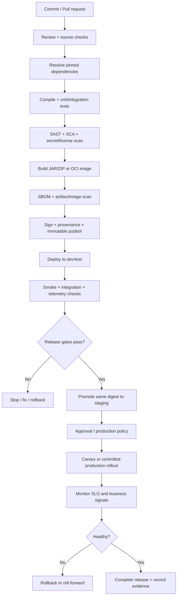

# Designing Pipelines from Source Code to Artifacts and Target Environments

A Java serverless function can be deployed as a JAR/ZIP to a managed runtime or packaged in an OCI container image. Regardless of the packaging format, the CI/CD pipeline must take changes from a reviewed commit through build, test, security checks, artifact creation, release, and deployment to target environments in a repeatable manner.

The goal of a good pipeline is **build once, test that artifact, and promote the exact tested artifact across environments**. Do not rebuild a different version when moving from staging to production. Do not embed secrets or environment-specific configurations into the artifact. Every release must be traceable back to its commit, dependencies, build workflow, artifact digest, SBOM, test results, and running deployment.

This lesson focuses on designing pipelines for Java FaaS triggered by HTTP, messages, or events. The content covers both package-based function deployments and function/container deployments; examples use GitHub Actions and CLI commands for illustration and can be adapted for GitLab CI, Azure DevOps, Jenkins, or other CI/CD systems.

## 1. CI and CD in Serverless

**Continuous Integration (CI)** automatically validates every change when a developer opens a pull request or pushes a commit: compilation, unit tests, integration tests, dependency checks, security scans, and trial packaging.

**Continuous Delivery/Deployment (CD)** takes the artifact that passed CI and releases it to environments. Continuous Delivery typically requires an approval step before production; Continuous Deployment can automatically push changes to production when all conditions are met.

A serverless pipeline typically includes the following stages:

1. Validate source and pull request.
2. Resolve dependencies using pinned versions.
3. Compile, test, and run quality analysis.
4. Scan source/dependencies/secrets and generate an SBOM.
5. Package as a JAR/ZIP or OCI image.
6. Scan, sign, and store provenance for the artifact/image.
7. Publish the immutable artifact to a registry/repository.
8. Deploy to the target environment using separate configuration/IaC.
9. Run smoke tests, integration checks, and post-deploy observability.
10. Promote the same artifact to staging/production or roll back according to release policy.



CI/CD is not just a sequence of build and deploy commands. It is also how permissions, evidence, configuration, data changes, and release decisions are controlled.

## 2. Designing Pipelines by Artifact Type

Before writing a pipeline, determine the exact deployable unit:

| Deployment Type | Primary Artifact | What the Pipeline Must Control |
| --- | --- | --- |
| AWS Lambda Java ZIP/JAR | ZIP containing JAR/dependencies or shaded/uber JAR | Handler, runtime, package layout, dependencies, hash, and Lambda configuration |
| AWS Lambda container | OCI image in registry | Image digest, base image, image scan, entry point, and Lambda container contract |
| Azure Functions Java | Deployment package containing function artifact and metadata | Java/runtime version, Functions host, binding extensions, package, and app settings |
| Google Cloud Run service/job | OCI image | Digest, port/command, service account, resource limits, and revision/job config |
| Google Cloud Run function | Source/buildpack artifact or platform-built image | Functions Framework entry point, build configuration, runtime, and trigger |
| Other platforms | JAR/ZIP, image, or platform-specific package | Entry point contract, trigger, runtime, version, and deploy metadata |

Do not use a single packaging process for every platform. The same Java use case can share source/domain modules, but adapters and deployment artifacts can differ. The pipeline should have shared stages for compile/test/security and target-specific packaging/deploy stages.

### Source Artifacts and Deployable Artifacts

A source bundle is source code together with build metadata. A deployable artifact is a built binary: a JAR/ZIP or an image. With source-based deployment, the platform may rebuild from source during deployment; record the builder, buildpack/runtime version, and output artifact if exact reproducibility is needed.

If strict control is required, build the artifact/container inside a controlled pipeline, scan it, and store it; then deploy the exact artifact created. For platforms that only accept a source package, pin the commit, toolchain, and build environment, and store the deployment package/digest that the platform builds or returns if available.

## 3. Repository Structure Supporting CI/CD

A Java serverless repository can be organized into modules to separate business logic, adapters, and infrastructure:

```text
orders-serverless/
├── pom.xml
├── mvnw
├── .mvn/wrapper/
├── src/
│   ├── main/java/com/example/orders/
│   │   ├── domain/
│   │   ├── application/
│   │   ├── adapter/http/
│   │   └── adapter/events/
│   └── test/java/com/example/orders/
├── infra/
│   ├── dev/
│   ├── staging/
│   └── production/
├── deploy/
│   ├── lambda/
│   ├── azure-functions/
│   └── cloud-run/
├── Dockerfile
├── .dockerignore
└── .github/workflows/
    ├── ci.yml
    └── release.yml
```

This is an example, not a mandatory structure. If functions have independent release lifecycles, you can use multi-module Maven/Gradle or separate repositories. Avoid a monorepo pipeline that builds and deploys every function whenever a small module changes if the dependency graph can accurately determine the affected scope.

### Build Wrappers and Toolchain

- Commit the Maven Wrapper or Gradle Wrapper so developers and CI use the same build tool version.
- Pin the JDK/toolchain and compiler target to match the platform runtime.
- Pin versions of plugins, annotation processors, and critical dependencies.
- Use lockfiles/dependency verification if the build tool supports them.
- Avoid `latest`, dynamic versions, or SNAPSHOTs in release builds.
- Store build metadata: commit SHA, version, build number, toolchain, and dependency lock state.

A wrapper helps standardize the build tool version, but the pipeline still needs to verify the wrapper distribution URL/checksum and review wrapper updates.

## 4. Branches, Pull Requests, and Merge Conditions

The pipeline should run checks early before changes are merged into a release branch.

| Event | Checks Typically Run | Does It Deploy? |
| --- | --- | --- |
| Pull request | Compile, unit tests, static analysis, SCA, secret scan, IaC validation | No production deploy; may create ephemeral preview/dev |
| Push to main branch | Build artifact, full tests, SBOM, scan, publish snapshot/release candidate | Can deploy to dev/test |
| Release tag | Verify version, build/retrieve release artifact, sign, publish immutable | Deploy staging or start promotion |
| Production approval | Verify artifact, policy, approval, and environment config | Deploy production |
| Scheduled security scan | Re-scan dependencies/images/SBOM and check runtime versions | Usually no build/deploy unless remediation is created |

Require code reviews, required status checks, branch protection, and CODEOWNERS for `infra/`, `deploy/`, or IAM policy directories. Permission or network changes should be reviewed by the appropriate owners.

Do not let pull requests from forks run workflows that can read production secrets. Use minimal default permissions for the CI token; only grant publish/deploy permissions in the workflow/release stages that need them.

## 5. Java Build and Test Stages

A CI build typically includes:

1. Check out the exact commit SHA; do not use a branch head that could change while the pipeline is running.
2. Install the pinned JDK and build tool versions.
3. Restore the dependency cache with a key based on lock/POM/Gradle files.
4. Compile and run formatting/static analysis checks.
5. Run unit tests.
6. Run integration tests with database/queue emulators or a test service environment.
7. Produce the candidate JAR/ZIP/image.
8. Export test reports and build metadata.

Maven example:

```bash
./mvnw -B -ntp clean verify
```

`verify` runs earlier phases and plugins bound to the lifecycle, typically including compile/test/package and configured integration/verification plugins. If the project does not bind integration tests to the lifecycle, this command does not automatically prove integration tests ran; inspect `pom.xml` and reports.

Gradle example:

```bash
./gradlew --no-daemon clean check
```

`check` runs verification tasks attached to the lifecycle. Make sure integration test, contract test, and static analysis tasks are explicitly configured. Do not use `-x test` or `-DskipTests` in a release pipeline just to save time without an equivalent test stage.

### Testing by Trigger

Java serverless requires testing adapter contracts beyond business unit tests:

| Trigger | What to Test |
| --- | --- |
| HTTP | Method/path/headers/body, auth, status codes, timeouts, idempotency keys |
| Queue | Duplicate messages, visibility/lock expiry, poison/DLQ, retries, and batch behavior |
| Event | Schema/version, source/type, event ID, ordering if applicable, redelivery |
| Timer | Timezone, schedule expression, missed runs, and idempotent execution |
| Object storage | Large files, content type/signature, object version/ETag, and retries |

Tests should not only call the handler method directly. When needed, run the adapter through a local runtime/emulator or deploy an integration environment to verify actual bindings/triggers.

## 6. Security Gates Before Creating a Release

The pipeline should perform checks appropriate for the artifact type:

- Secret scanning on source, Git diffs, and build context.
- SAST and code linting.
- SCA/dependency vulnerability scanning and license policy checks.
- SBOM generation for runtime dependencies.
- IaC scanning for IAM, networking, public endpoints, encryption, and resource policies.
- Container image scanning for OS packages, JRE, and application dependencies if deploying images.
- Artifact signing/provenance when supported by the pipeline and platform.

Policy gates should be based on severity, exploitability, exposure, and fix availability. For example, a real committed secret or a critical vulnerability with an exploit and reachability can block a release. Test-only findings or false positives must be verified and documented as exceptions with an owner, scope, and expiration date; never suppress an entire severity level.

A green security scan at build time does not guarantee an artifact will remain free of new vulnerabilities in the future. Store the SBOM and image digest for periodic re-scanning after deployment.

## 7. Creating Immutable and Traceable Artifacts

Artifacts must be identified by an immutable version/hash:

- JAR/ZIP: store the release version and SHA-256 checksum.
- OCI image: deploy by image digest `sha256:...`, not by mutable tags such as `latest`.
- SBOM/provenance: attach to the explicit artifact digest or build ID.
- Release metadata: record commit SHA, build run ID, toolchain, dependency snapshot, scan report, and build timestamp.

Do not rebuild when promoting from staging to production. If staging tested image digest A, production must deploy the exact digest A. If changing the base image, dependencies, or build arguments alters the artifact, it is a new artifact and must be re-tested and re-scanned.

### Versioning

You can use Semantic Versioning for applications/libraries (for example `2.4.1`) combined with commit SHA/build number. For each release:

```text
service: orders-function
version: 2.4.1
commit: 7a3f...
artifact: orders-function-2.4.1.zip
sha256: 9d2c...
environment: staging
```

Do not embed environment names or secrets in the binary. The same artifact can be deployed to dev, staging, and production with different app settings, IAM roles, networks, and resource configurations.

## 8. Packaging Java Functions as JAR/ZIP

With a managed runtime, the platform can provide the JVM and host. The pipeline packages the code along with dependencies according to the provider's contract.

### AWS Lambda Java Package

AWS Lambda Java can accept a JAR/ZIP with a configured handler. The artifact must include the required dependencies or use an appropriate dependency layer/runtime mechanism. With Maven, you can create a shaded JAR or a ZIP package matching the project's deployment structure.

The pipeline should verify:

- The handler class/method matches the function configuration.
- The Java runtime is supported and bytecode target is compatible.
- Runtime dependencies are included in the artifact or versioned layers.
- No credentials or `application-prod.properties` containing secrets are packaged.
- The artifact hash is stored alongside release metadata.
- Handler/event shape tests match API Gateway, SQS, EventBridge, or actual triggers.

Example command to deploy a package using AWS CLI:

```bash
aws lambda update-function-code \
  --function-name orders-handler \
  --zip-file fileb://target/orders-function.zip
```

This command updates code for an existing function; it does not configure runtime, handler, IAM role, environment variables, VPC, or triggers. Those configurations should be managed via IaC or versioned deploy commands. For production, you can publish a Lambda version and point an alias to the new version to decouple artifact release from traffic shifting.

### Azure Functions Java Package

The Azure Functions Maven plugin can build and deploy a Java package along with function metadata. The pipeline should validate `host.json`, function metadata, binding extensions, JDK/runtime compatibility, and app settings. Do not include `local.settings.json` containing secrets in the production package.

Package build example:

```bash
./mvnw -B clean package
```

After verifying the plugin output, store the exact deployable package as a CI artifact. Deployment can use the Azure Functions Maven plugin or the corresponding package deployment/API. Runtime configuration, app settings, managed identity, and networking are managed separately using Bicep/Terraform/ARM or pipeline configuration.

### Google Cloud Functions / Cloud Run Functions

Java functions typically use the Functions Framework and runtime-based buildpack/source deployment. The pipeline must verify the entry point, dependencies, runtime version, trigger configuration, and service account. If the platform builds an image from source, record the builder/runtime and deployment revision; if image control is required, consider container-based deployment where supported.

Do not confuse a source bundle with the final image. When an image is built, store its digest and scan that image; if the build is performed by the platform, store the build provenance and revision/image reference provided by the platform.

## 9. Packaging Java Functions as OCI Container Images

For Lambda containers, Cloud Run services/jobs, or other container platforms, the pipeline typically builds an OCI image:

```bash
docker build --pull -t registry.example.com/orders-function:2.4.1 .
docker push registry.example.com/orders-function:2.4.1
```

In production, do not rely solely on tags. After pushing, retrieve the digest from the registry, scan that digest, sign the digest, and deploy by digest. The build stage requires:

- Multi-stage Dockerfile so Maven/Gradle caches and compilers are not included in the runtime image.
- Maintained JRE base image, pinned by digest with an update process.
- Non-root user, `.dockerignore`, and no copied secrets.
- Process entry point/port matching the target's contract.
- Graceful shutdown and logging to stdout/stderr.
- Image SBOM and scanning of OS/JRE/application packages.

For example, tags help operators read releases; digests identify exact contents. Do not use the `latest` tag as a production deployment reference because tags can be overwritten.

## 10. Infrastructure as Code and Separating Configuration from Artifacts

Infrastructure as Code (IaC) describes cloud resources and configurations in version-controlled files. Depending on the organization, you can use Terraform, AWS SAM/CloudFormation, Azure Bicep/ARM, or Google Cloud Deployment Manager/Terraform.

IaC can manage:

- Function/service/job resources and runtime/handler/container digests.
- IAM roles, managed identities, service accounts, and resource policies.
- HTTP endpoints, queues/topics, event subscriptions, schedulers, and dead-letter queues.
- Non-sensitive environment variables, secret references, and identity bindings.
- Memory/CPU, timeouts, concurrency, min/max instances, and retries.
- VPC/subnets/security groups/private endpoints/network egress.
- Log groups, retention, metrics, alerts, and dashboards.
- Databases, buckets, registries, and supporting resources.

### Configuration per Environment

The artifact is the same, but environments can differ:

| Configuration | Dev | Staging | Production |
| --- | --- | --- | --- |
| Database | Dev database | Staging copy with test data | Production database |
| IAM identity | Sandbox permissions | Staging permissions | Least-privilege production permissions |
| Queue/topic | Dev queue | Staging queue | Production queue |
| Memory/timeout | Enough for fast tests | Close to production | Per workload/SLO |
| Concurrency | Low limit | Scale testing | Per load and downstream capacity |
| Secret | Dev secret | Staging secret | Dedicated production secret |
| Logging | Limited debug | Structured logs/traces | Retention/alerts per policy |

Do not build a separate JAR for production just to change a database URL. Use app settings, secret managers, and IaC variables. However, the configuration schema must be validated; missing critical environment variables should fail deployment/health checks early with an error message that contains no secrets.

## 11. Pipeline Identity vs. Runtime Identity

The pipeline and the function are two different workloads and require different identities:

- **CI identity:** checkout/build/test, publish artifacts, generate release metadata.
- **Deploy identity:** update functions/services/jobs, IaC, and traffic routing.
- **Runtime identity:** function accessing secrets, databases, queues, storage, or APIs at runtime.

Do not use a function's execution role to deploy that same function. Do not grant production permissions to every CI job. Prefer OIDC federation or workload identity mechanisms so pipelines obtain short-lived credentials rather than storing long-lived cloud access keys in the CI secret store.

### Permission Principles Example

| Identity | Permissions It Should Have | Permissions It Should Not Have by Default |
| --- | --- | --- |
| PR test job | Read source/dependencies, run tests | Deploy to production, read production secrets |
| Artifact publisher | Push to designated repository/registry | Modify IAM policies or read runtime data |
| Deploy staging | Update staging resources and traffic | Account/subscription/project-wide admin |
| Deploy production | Deploy approved artifact to production resources | Read unnecessary business data |
| Function runtime | Only call services needed for its task | Deploy, edit IAM, or read another function's secrets |

Separate environment protection and approval. For production, restrict who can approve, who can deploy, and which artifacts are allowed to be promoted.

## 12. Managing Secrets in the Pipeline

Secrets used during build/deploy may include registry credentials, signing keys, cloud deployment identities, or package repository tokens. Runtime secrets include database passwords/API keys. These two groups should not be shared.

- Use OIDC/workload identity federation to obtain short-lived cloud credentials.
- Use a secret manager for required credentials; never echo them to terminal/logs.
- Do not pass secrets via command-line arguments if process lists or logs can expose them.
- Do not expose secrets to pull requests from forks or workflows running on untrusted branches.
- Log masking is an extra layer of defense, not a substitute for not printing secrets.
- Rotate deploy credentials and signing identities according to policy.
- Use secret references in IaC; never commit plaintext values.

The pipeline should only fetch secrets in the stages that need them. For example, unit tests do not need to read the production database password; building an image does not need a runtime API key.

## 13. Migrations and Data Schema Changes

Deploying new code does not mean the database schema can be changed in a breaking way at the same time. In serverless, multiple function versions can run concurrently during a rollout; queues can hold older messages and retry after the schema has already changed.

Apply expand-and-contract:

1. **Expand:** add new columns/tables/indexes in a way that old code still works.
2. **Deploy compatible code:** new code can read old/new schemas and write in a compatible way.
3. **Backfill:** migrate data in checkpointed batches/jobs.
4. **Switch:** move consumers/producers to the new field or format.
5. **Observe:** confirm no old code/messages still need the old schema.
6. **Contract:** remove old fields/indexes in a later release once safe.

Do not run destructive migrations before all old functions/consumers have drained. Migrations must be idempotent or track state/checkpoints to resume after failure. For event schemas, use versioning and backward-compatible consumers.

## 14. Deployment Strategies for Serverless

Not all platforms support the same rollout strategies. Choose a strategy based on trigger type, versioning/traffic-splitting capabilities, and availability requirements.

| Strategy | Meaning | When Appropriate |
| --- | --- | --- |
| Rolling/replace | Replace resource code/config via platform mechanism | Low-risk workloads or platforms without traffic splitting |
| Blue/green | Stand up new target, verify, then switch traffic | APIs needing fast rollback and independent new environment |
| Canary | Shift a portion of traffic to the new revision, increasing gradually | APIs with solid metrics for comparison |
| Weighted traffic split | Split traffic across multiple revisions/versions | Cloud Run services or Lambda aliases that support it |
| Event consumer cutover | Create new consumer version, switch trigger/alias or queue subscription in a controlled way | Message/event workloads needing to avoid duplicate processing or message loss |

### AWS Lambda Versions and Aliases

Lambda can publish immutable versions of a function and use aliases such as `staging` or `production` pointing to a version. Aliases can be used to shift traffic between versions as supported by configuration. The pipeline should publish a version after updating code/config, run smoke tests against the staging version/alias, and then shift the production alias. With weighted aliases, monitor errors and latency before increasing the percentage.

### Cloud Run Revisions

A Cloud Run service creates a new revision when configuration/deployment changes. You can keep traffic on the old revision, shift a fraction to the new revision, and increase gradually after verification. Ensure the image digest and service configuration correspond to the tested revision.

### Azure Functions

Azure Functions provides deployment slots on supported hosting plans. A staging slot can be deployed and tested before swapping with production; understand slot-specific settings, trigger behavior, storage/host IDs, and plan limitations. If slots are unavailable or triggers are unsuitable for swapping, use a deploy/rollback strategy suited to the plan's actual capabilities.

### Event-Driven Cutover

With queue/event triggers, rollout is not just shifting HTTP traffic. Control:

- Which event source mapping/trigger is enabled.
- Which consumer version is receiving messages.
- Visibility timeout/lock duration and invocation drain time.
- Duplicate events and idempotency when two consumers are active simultaneously.
- Schema compatibility between old producers and new consumers.
- DLQ, retries, and replay after deployment.

Do not enable two non-idempotent consumers on the same queue assuming they will split messages safely as desired. Verify the trigger semantics and specific scaling mechanisms.

## 15. Post-Deploy Smoke Tests and Health Checks

Control plane deployment success only confirms the resource was updated, not that the function processes business logic correctly.

A smoke test should verify:

- The function/service can be invoked and returns the expected response.
- The runtime identity can read required secrets/config.
- Connections to databases/queues/object storage work.
- Triggers/bindings are properly registered and sample events are processed.
- Logs/traces appear with the release ID and correlation ID.
- Permission denied errors, timeouts, and retries do not spike abnormally.
- Endpoints did not accidentally become public or lose authentication.

Smoke tests should not create irreversible production transactions. Use a test tenant, synthetic event, canary resource, or cleanable operation. For queues, verify the message is processed properly and leaves no fake side effects.

### Readiness and Liveness

Container services can expose health endpoints; managed runtime functions may have separate health/telemetry mechanisms. Do not create a health check that only checks whether the process is alive and call it business readiness. Readiness can check required config and dependencies with short timeouts, but should not call every heavy dependency on every health request. Liveness should not continuously restart instances just because a downstream dependency is temporarily failing.

## 16. Promotion Across Dev, Staging, and Production

A clear promotion model:

| Stage | Goal | Promotion Criteria |
| --- | --- | --- |
| Dev | Early integration testing with sandbox services | Smoke tests and proper logging |
| Test/QA | Verify behavior, contracts, failures, and regressions | Test suite passes, no blockers |
| Staging | Validate production-like config, load, and deploy strategy | SLO/acceptance criteria met, security gates pass |
| Production | Serve real traffic | Approval, artifact digest verified, change window/policy met |

Promotion should use the same artifact digest with environment-specific configuration. Do not rebuild just to change `DATABASE_URL`, queue names, or IAM roles. If the platform must rebuild from source for each environment, record the build identity and ensure identical source commit/toolchain; promoting a pre-built package/image is better when supported.

### Approval Gates

Production approval should be able to review:

- Related commit and pull request.
- Artifact/image digest and checksum.
- SBOM, SCA/image scans, and policy exceptions.
- Test reports and staging smoke tests.
- IaC plan/diff and permission changes.
- Database migration plan.
- Rollback/roll-forward plan.
- Owner and deployment time.

Approval should not be a button click without evidence. IAM/network/database changes may require different reviewers than application code reviewers.

## 17. Rollback and Roll-Forward

Rollback reverts traffic or deployment to a previous version. Roll-forward releases a new fix when rollback is unsafe or schema/data has already changed.

Before releasing, know:

- What the previous artifact/revision/version is and where it is retained.
- Whether aliases/traffic can be shifted back to the old version.
- Whether database migrations remain compatible with old code.
- Whether message/event schemas can still be read by old consumers.
- Whether secrets/keys/configs are still valid for the old version.
- Whether executed side effects can be reversed or require compensation.

Do not blindly roll back code after a destructive migration. If new code has written data using an incompatible schema, roll forward or run a compensating migration. For event-driven functions, already-processed messages do not automatically revert on rollback; if replay is needed, there must be a selective process and idempotency.

### Rollback Trigger Criteria

Set specific thresholds, for example:

- HTTP 5xx rate exceeds threshold within an observation window.
- p95/p99 latency exceeds SLO.
- Function timeouts/throttles or retries/DLQ spike sharply.
- Business errors such as failed payments or duplicate orders increase.
- Database/queue connections exhaust or dependency errors rise.
- Security/authentication failures increase abnormally.

Thresholds and windows must fit the baseline; a single isolated error may not require a full rollback if a single tenant or dependency can be isolated.

## 18. IaC Plans, Drift, and Environment Changes

The pipeline should review infrastructure changes before applying:

- Terraform: `plan` and save the plan output; apply the approved plan.
- AWS SAM/CloudFormation: validate/template/package and inspect the change set before deploying.
- Azure Bicep/ARM: validate/what-if before deploying.
- Google Cloud: validate configurations and use Terraform/Config Controller or standardized IaC tools.

Do not run `terraform apply` directly from untrusted pull requests. State backends must be protected, locked, and backed up; state storage permissions should not be granted to runtime functions. Review drift periodically because console/manual changes can cause real configurations to diverge from IaC.

Separate state/workspaces or stacks by environment and account/subscription/project when isolation is needed. Avoid using a single state with permissions to modify all production resources for every pipeline job.

## 19. GitHub Actions Example for Java Maven CI

The workflow below illustrates CI validation for a Java project. It is an adaptable skeleton, not a complete deployment pipeline for a specific provider:

```yaml
name: java-ci

on:
  pull_request:
  push:
    branches: [main]

permissions:
  contents: read

jobs:
  verify:
    runs-on: ubuntu-latest
    steps:
      - name: Checkout exact commit
        uses: actions/checkout@v4

      - name: Set up JDK
        uses: actions/setup-java@v4
        with:
          distribution: temurin
          java-version: '21'
          cache: maven

      - name: Verify
        run: ./mvnw -B -ntp clean verify

      - name: Upload test reports
        if: always()
        uses: actions/upload-artifact@v4
        with:
          name: test-reports
          path: '**/target/surefire-reports/**'
```

In production, pin actions by commit SHA or per organization policy; version tags like `@v4` are illustrative only. Add SAST/SCA/secret scans, license policy checks, SBOM generation, artifact packaging, and retention. Do not grant `id-token: write` or package/deploy permissions to test-only jobs if unnecessary.

## 20. GitHub Actions Example to Build and Publish an OCI Image

An image pipeline should build once, capture the digest, scan, and publish metadata. The following skeleton illustrates the sequence; registry login, scanning, and signing actions must be pinned per policy and configured with appropriate OIDC:

```yaml
name: release-image

on:
  push:
    tags: ['v*']

permissions:
  contents: read
  packages: write
  id-token: write

jobs:
  build:
    runs-on: ubuntu-latest
    steps:
      - uses: actions/checkout@v4

      - uses: actions/setup-java@v4
        with:
          distribution: temurin
          java-version: '21'
          cache: maven

      - name: Test and package
        run: ./mvnw -B -ntp clean verify

      - name: Build image
        run: docker build -t ghcr.io/example/orders:${GITHUB_SHA} .

      - name: Publish image
        run: |
          docker push ghcr.io/example/orders:${GITHUB_SHA}
          docker image inspect ghcr.io/example/orders:${GITHUB_SHA} \
            --format '{{index .RepoDigests 0}}' > image-digest.txt

      - name: Preserve release metadata
        uses: actions/upload-artifact@v4
        with:
          name: release-metadata
          path: image-digest.txt
```

This remains a minimal example: `GITHUB_SHA` is used as a tag to avoid commit collisions, but real registry login/push steps, SBOM, image scanning, signatures/provenance, retention, and deployment are required. In real environments, do not assume `docker image inspect` after push always returns the registry digest under every driver/setup; you can obtain the digest from the build/push action or registry API. The deploy stage must read the stored digest rather than building the image again.

## 21. Platform Deployment Examples

The following commands illustrate updating artifacts; substitute resource names, regions, accounts/projects, and configurations per environment.

### AWS Lambda

For ZIP/JAR:

```bash
aws lambda update-function-code \
  --function-name orders-handler \
  --zip-file fileb://orders-function.zip

aws lambda publish-version \
  --function-name orders-handler
```

After publishing, the pipeline can update the staging/production alias to the tested version. For container images, update function code using the supported image URI with digest in ECR/registry. IAM roles, VPC, environment variables, and event source mappings should be managed via IaC and release policy.

### Azure Functions Java

The pipeline builds the package with the Maven plugin, publishes the artifact, and then deploys the package to the Function App. Depending on the hosting plan and configuration, a deployment slot can be used for verification before swapping. App settings, managed identity, networking, trigger connections, and extension configurations are separated from the package.

Do not include `local.settings.json` in the production artifact. Verify slot-specific settings and trigger behavior before swapping, especially with timer/queue triggers and host storage.

### Google Cloud Run Service

Deploy an image by digest to create a revision:

```bash
gcloud run deploy orders-api \
  --image REGION-docker.pkg.dev/PROJECT/REPOSITORY/orders@sha256:DIGEST \
  --region REGION
```

Then verify the revision and traffic split. You can shift a portion of traffic to the new revision and increase gradually as metrics meet targets.

### Google Cloud Run Job

Deploy a job image by digest and execute:

```bash
gcloud run jobs deploy invoice-import \
  --image REGION-docker.pkg.dev/PROJECT/REPOSITORY/importer@sha256:DIGEST \
  --region REGION

gcloud run jobs execute invoice-import --region REGION
```

Jobs do not receive HTTP traffic like services; the pipeline must monitor execution/task status and output. If a job produces large datasets, save the execution ID and manifest/checkpoint for retries/reconciliation.

## 22. Canary, Traffic Splitting, and Release Validation

Canary rollouts reduce blast radius by sending a portion of traffic or workload to the new version first.

A typical process:

1. Deploy the new revision/version without shifting all traffic.
2. Run synthetic requests/events to verify startup and dependencies.
3. Shift a small percentage of traffic, such as 5% or 10%, if the platform supports it.
4. Monitor error rate, latency, timeouts, throttles, retries, DLQ, and business metrics.
5. Increase the percentage in predefined steps if signals remain stable.
6. Shift 100% of traffic and retain the old version during the rollback window.

For event-driven functions, canarying can be more complex than HTTP because event sources do not always support traffic splitting. You can use separate queues/topics, canary subscriptions, alias/version routing, or replay a test event set. Avoid duplicate side effects between old and new consumers.

Do not monitor only CPU and invocation counts. Business metrics such as duplicate orders, failed payments, dropped events, corrupted data, or workflow completion times show whether a release is functionally sound.

## 23. Managing Triggers and Event Sources in Releases

A function can be invoked directly, via an API gateway, event source mapping, scheduler, or event router. The pipeline must manage triggers as part of the release:

- Trigger name/ARN/endpoint and permissions.
- Batch size, concurrency, retries, visibility timeout/lock duration.
- Dead-letter queue or failure destination.
- Event schema/version and filter criteria.
- Mapping between function version/alias and event source.
- How to disable/enable triggers during deployment or rollback.

When changing message schemas, deploy in a backward-compatible direction: new consumers can read old events; new producers only emit the new schema after consumers are ready. If compatibility cannot be preserved, version the topic/queue or use a translation adapter during the transition.

## 24. Observability and Release Evidence

Every release must attach metadata to logs/traces/metrics or deployment records:

- Release version and commit SHA.
- Artifact digest or package checksum.
- Function version, alias, revision, or job execution.
- Environment and region.
- Pipeline run ID and approver.
- Correlation ID, invocation ID, and event ID when processing requests.

Monitor at minimum:

| Category | Signals |
| --- | --- |
| Availability | HTTP success/error, invocation success, task completion |
| Latency | p50/p95/p99, cold start, downstream duration |
| Reliability | Timeout, retry, throttle, DLQ, duplicate events |
| Capacity | Concurrency, max instances, memory, CPU, database connections |
| Business | Transaction success, order/payment errors, workflow age, data correctness |
| Security | AccessDenied, secret read anomalies, IAM changes, image vulnerabilities |
| Cost | Cost per invocation/job/result, data egress, idle/min instances |

Release markers help compare metrics before and after deployment. Set alerts and rollback thresholds before deploying, rather than waiting until an incident occurs to decide thresholds.

## 25. Managing Releases Across Multiple Environments and Functions

A module may have multiple functions with different triggers and release cadences. The pipeline should know which functions are affected by a change:

- If only a shared domain module changes, functions depending on that module need to be rebuilt/retested.
- If only an HTTP adapter changes, queue workers do not necessarily need to deploy if artifacts are separate.
- If a shared dependency version changes, every artifact containing that dependency must be evaluated.
- If IaC or IAM changes, infrastructure review/deployment may need to be separated from code releases.
- If an event schema changes, producers and consumers may need to release in a compatible order.

In a monorepo, use a dependency graph or path filters while ensuring changes to shared modules trigger the proper downstream builds. Do not rely on simple path filters if they can miss transitive dependencies.

## 26. Common Pitfalls in Serverless CI/CD

1. **Rebuilding artifacts per environment.** Binaries may differ despite the same commit; build once and promote the digest.
2. **Deploying with mutable tags.** Tags can be overwritten; store and deploy image digests.
3. **Embedding secrets in JARs/images or build args.** Secrets can persist in layers, logs, and artifact caches.
4. **Sharing identities across CI, deploy, and runtime.** A compromised token could both deploy and access production data.
5. **Deploying code while forgetting triggers/IAM/config.** The function exists but is never invoked or has wrong permissions.
6. **Not testing event redelivery and idempotency.** The function works once but fails on retries.
7. **Running destructive migrations simultaneously with rollout.** Old function versions may still be running and unable to read the new schema.
8. **Having no post-deploy smoke tests.** The control plane reports success while runtime cannot access secrets/databases.
9. **Rolling back code without considering data.** Schemas or side effects may render the old version incompatible.
10. **Not retaining old artifacts.** When rollback is needed, rebuilding from changed source/dependencies becomes necessary.
11. **Granting production secrets to pull requests.** Untrusted code can exfiltrate credentials.
12. **Not re-scanning after deployment.** New advisories can affect running artifacts.
13. **Not controlling concurrency during canary.** Two versions process the same event or exceed downstream limits.
14. **Measuring only technical metrics.** APIs return 200 while business events may be lost or recorded incorrectly.

## 27. Pipeline Design Checklist

### Source and Build

- [ ] Pull requests have reviews and required status checks.
- [ ] CI checks out the exact commit SHA and uses pinned JDK/build tools.
- [ ] Dependency/plugin versions are managed; no dynamic versions in releases.
- [ ] Unit, integration, contract, and adapter tests are explicitly configured.
- [ ] Builds do not depend on production secrets.

### Artifacts and Security

- [ ] Deployable artifact is clearly defined as JAR/ZIP or OCI image.
- [ ] Artifact is built once and has an immutable version/hash/digest.
- [ ] SCA, SAST, secret scans, license scans, and IaC scans have run.
- [ ] SBOM is generated and linked to the exact artifact/image digest.
- [ ] Image scans include JRE/OS packages if using containers.
- [ ] Artifacts/images are signed with provenance when supported by the pipeline.
- [ ] The scanned artifact is the exact artifact published and deployed.

### Identity and Environments

- [ ] CI, deploy, and runtime use separate identities.
- [ ] OIDC/workload identity is preferred over long-lived credentials.
- [ ] Production environment has appropriate approval/protection.
- [ ] Secrets/config are supplied outside the artifact and separated by environment.
- [ ] IAM, networking, triggers, and resources are managed via IaC.
- [ ] IaC plans/diffs are reviewed before applying.

### Deployment and Operations

- [ ] Smoke/integration tests run after deployment.
- [ ] Triggers, batching, retries, DLQ, and event schemas are managed with the release.
- [ ] Canary/blue-green/slot/alias is in place if supported by the platform and needed by the workload.
- [ ] Database migrations are backward-compatible and have checkpoint/rollback plans.
- [ ] Rollback/roll-forward is rehearsed with old artifacts.
- [ ] Logs/metrics/traces include release ID, request/event ID, and business context.
- [ ] Rollback thresholds are defined based on SLOs and business metrics.
- [ ] SBOMs/images are re-scanned periodically after deployment.

## 28. Reference Release Workflow

A standardized workflow for each Java serverless release:

1. Developer opens a pull request; reviewers inspect code, IaC, and permissions.
2. CI runs compilation, unit/integration tests, SAST, SCA, secret, and license scans.
3. Merge to main; pipeline builds the JAR/ZIP or OCI image from the exact commit.
4. Generate checksum/digest, SBOM, scan reports, and provenance; sign the artifact if supported.
5. Publish the immutable artifact and store the release manifest.
6. Deploy to dev/test using IaC and environment config; run smoke/integration tests.
7. Promote the same digest to staging; test load, retries, permissions, and event contracts.
8. Reviewers approve production based on evidence and the rollback plan.
9. Deploy to production using canary/slot/alias/traffic split or an appropriate strategy.
10. Monitor technical and business signals; automatically halt/re-route traffic if thresholds are breached.
11. Finalize the release record, retain the previous artifact, and update the running inventory.
12. Re-scan SBOMs/images against new advisories and schedule remediation.

A CI/CD pipeline for Java serverless must govern the entire path from commit to runtime: reproducible builds, immutable artifacts, security checks, separated environment configuration, least-privilege identities, reviewed IaC, observable rollouts, and data/event-aware rollbacks. When a pipeline promotes the exact tested artifact and stores sufficient release evidence, teams can deploy faster while still knowing precisely what code is running, what permissions it holds, and how to recover when a change causes failures.

## Official References

- [GitHub Actions – Building and testing Java with Maven](https://docs.github.com/actions/automating-builds-and-tests/building-and-testing-java-with-maven)
- [GitHub Actions – OpenID Connect](https://docs.github.com/actions/security-for-github-actions/security-hardening-your-deployments/about-security-hardening-with-openid-connect)
- [AWS Lambda – Deploying function code](https://docs.aws.amazon.com/lambda/latest/dg/deploying-lambda-apps.html)
- [AWS Lambda – Versions and aliases](https://docs.aws.amazon.com/lambda/latest/dg/configuration-versions.html)
- [Azure Functions – Deployment technologies](https://learn.microsoft.com/azure/azure-functions/functions-deployment-technologies)
- [Azure Functions – Maven plugin](https://learn.microsoft.com/azure/azure-functions/functions-create-first-java-maven)
- [Google Cloud Run – Continuous deployment](https://cloud.google.com/run/docs/continuous-deployment)
- [Google Cloud Run – Traffic migration](https://cloud.google.com/run/docs/rollouts-rollbacks-traffic-migration)
- [SLSA – Build provenance](https://slsa.dev/spec/v1.0/provenance)
- [OpenSSF Scorecard](https://scorecard.dev/)
