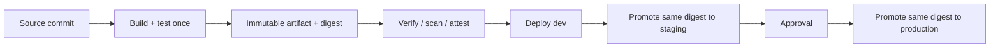
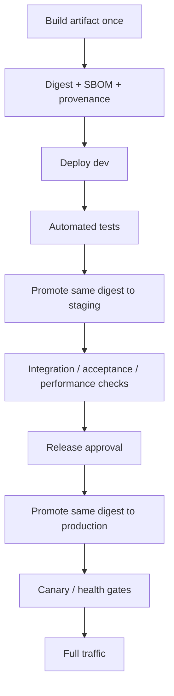

# Immutable Artifact Packaging and Promotion Across Environments

A reliable CI/CD pipeline must guarantee that the artifact that was tested is the exact artifact deployed to staging and production. If each environment rebuilds from source, dependencies or toolchains may change between builds; when production fails, the team struggles to prove whether the running binary is actually the one that was tested.

For Java serverless, an artifact can be a JAR/ZIP for a function runtime or an OCI container image for a container platform. The safe release approach is to **build once, identify the artifact by digest, test that artifact, and promote the exact same artifact across environments**. Environment configurations, secrets, IAM, and infrastructure are managed separately, yet must remain compatible with the promoted code version.

This lesson covers packaging immutable artifacts, verifying provenance and integrity, separating configuration by environment, organizing CI/CD, progressive rollouts, rollbacks, and managing database/event contract changes for Java functions/FaaS.

## 1. What Is an Immutable Artifact?

### 1.1. Artifact as a Deployable Output

An artifact is the product created from defined source code and dependencies, ready to be deployed. Depending on the platform:

| Deployment Type | Common Artifact | Contents |
| --- | --- | --- |
| Java function runtime | JAR or ZIP | Handler classes, dependencies, resources, and required metadata |
| Container-based function | OCI image | Application JAR, runtime/base image, and container configuration |
| Framework/serverless package | ZIP/package generated by build tool | Function code, dependencies, and deployment metadata |

An immutable artifact is an artifact that has been created and published under a unique identifier; its contents cannot be modified after the build. If code or dependencies need changes, a new artifact and a new digest must be produced.

### 1.2. Version Tags and Digests

A human-readable version might look like:

```text
orders-api:1.8.2
orders-api:git-a4c91e7
orders-api:release-2026-11-17.3
```

Tags are useful for humans, but can be overwritten if the registry allows it. A content digest such as SHA-256 identifies the exact bytes of the artifact:

```text
sha256:4d8c... (illustrative digest)
```

For OCI images, deploying by digest (`image@sha256:...`) ensures the runtime receives the exact tested image. For JAR/ZIP files, store the SHA-256 checksum in the artifact manifest and verify it before deployment.

A checksum proves the contents have not changed relative to the recorded value; by itself, it does not prove who created the artifact or which source was used. To verify origin, provenance/attestation and trusted signatures are also required.

### 1.3. Why Not Build Separately for Each Environment?

Suppose commit `a4c91e7` is built three times:

- dev builds at 09:00 using dependency resolution at that moment;
- staging builds at 11:00 using a base image tag that was just updated;
- production builds at 15:00 using a plugin or dependency that changed.

Even though the source commit is identical, the three artifacts can differ in bytes and behavior. A build-once/promote-same-artifact pipeline eliminates this discrepancy at the binary layer.



Environments can still have different configurations, but the deployed binary must remain unchanged. If a different build is needed for production, it is a different release candidate and must go through a new testing process.

## 2. Identifying Artifact Versions and Metadata

### 2.1. Artifact Identity

Each artifact should have enough metadata to answer:

- which repository and commit it was built from;
- which Java version, Maven/Gradle version, and toolchain built it;
- which dependency versions were resolved;
- which pipeline run produced the artifact;
- what the artifact digest is;
- which tests, scans, and policy gates passed;
- which registry/repository the artifact was published to;
- which environments received the artifact and when it was deployed.

Do not use filenames like `app-final.jar`, `app-final-2.jar`, or the `latest` tag as release identifiers. Human-readable names can accompany digests, but the digest is the content reference that must be stored in the release record.

### 2.2. Artifact Manifest

A manifest can be generated alongside the JAR/ZIP:

```json
{
  "application": "orders-api",
  "version": "1.8.2",
  "source": {
    "repository": "git@example.com/platform/orders-api.git",
    "commit": "a4c91e7"
  },
  "build": {
    "pipelineRun": "ci-4821",
    "java": "21",
    "maven": "3.9.x"
  },
  "artifact": {
    "file": "orders-api-1.8.2.jar",
    "sha256": "REPLACE_WITH_REAL_SHA256"
  }
}
```

The values above are illustrative only. The manifest should be generated automatically by the pipeline, never typed manually. Do not put secrets, tokens, or sensitive internal details in the manifest. The manifest must be stored with release metadata and protected from unauthorized modification.

### 2.3. Semantic Versioning and Build Metadata

Semantic versioning (`MAJOR.MINOR.PATCH`) helps express the scope of API/behavior changes. The commit SHA and build number distinguish artifacts created from the same branch or version. A version label does not replace a digest.

One naming convention:

```text
1.8.2+git.a4c91e7.build.4821
```

Never reuse the same version for two different contents. If a release has already been published, bug fixes must produce a new version.

## 3. Creating Repeatable Builds

### 3.1. Pinning the Toolchain

Build outputs can change when the toolchain changes. Explicitly manage:

- Java toolchain/runtime version;
- Maven or Gradle wrapper version;
- compiler and build plugin versions;
- dependency versions and repositories;
- base container image digest if building images;
- build arguments and environment variables affecting the binary;
- generated sources/resources and timestamp rules.

Commit the Maven Wrapper (`mvnw`, `.mvn/wrapper`) or Gradle Wrapper (`gradlew`, `gradle/wrapper`) so CI uses a defined build tool version. Use dependency management/BOMs and avoid dynamic versions such as `1.+`, `LATEST`, or uncontrolled snapshots in release builds.

### 3.2. Controlling Dependencies

Dependencies should be resolved from trusted repositories with fixed versions. For Maven, use `dependencyManagement` or a BOM; for Gradle, use version catalogs and dependency locking. Store resolved dependency information so an older artifact can be investigated.

Check:

- dependency trees and dependency conflicts;
- transitive libraries;
- license policies;
- CVEs/vulnerabilities;
- dependency checksums or provenance where feasible;
- whether the artifact contains dependencies required for runtime.

Do not download dependencies from unknown URLs during the deploy step. The deploy stage should fetch the built artifact and not re-run dependency resolution.

### 3.3. Clean Builds and Reproducible Builds

A repeatable build requires that the same source, toolchain, dependencies, and inputs produce identical artifact contents, or at least allow exact provenance verification. Timestamps, generated metadata, and archive ordering can cause two JARs to have different digests even with identical logic.

Useful practices:

- run clean builds in CI;
- pin plugin and dependency versions;
- avoid fetching unpinned network data during the build;
- normalize timestamps/archive metadata if the build tool supports it;
- use the same container/toolchain image for builds;
- store build logs, test reports, and dependency/SBOM metadata;
- periodically test rebuilding to detect sources of non-reproducibility.

Reproducible builds are a stronger goal than a "passing build." However, even when builds are not yet fully reproducible, the pipeline must still promote the exact tested artifact rather than rebuilding.

### 3.4. Maven Build for Java Functions

A commonly used build command:

```bash
./mvnw --batch-mode --no-transfer-progress clean verify
```

`verify` runs preceding phases, including compile, test, package, and configured verification plugins. For Lambda Java, verify the JAR/ZIP contains the correct handler class and dependencies. For Cloud Run/container functions, build the image from the verified artifact and pin the base image.

Example checksum generation after build:

```bash
sha256sum target/orders-api-1.8.2.jar > target/orders-api-1.8.2.jar.sha256
```

On Windows runners, use the runner's corresponding checksum tool. The key is to generate the digest from the exact file to be published, then store the checksum with the release record.

## 4. Packaging Java Serverless Artifacts

### 4.1. JAR/ZIP for Function Runtimes

The JAR/ZIP must contain:

- the handler class and application classes;
- runtime dependencies;
- required resources/schemas/templates;
- metadata matching the runtime/deployment package;
- no credentials or secret configuration files.

Inspect contents using `jar tf` or unzipping in the pipeline. Verify the handler string points to the right class/method. Do not rely solely on Maven reporting build success; classes may be omitted from packaging or improperly relocated.

### 4.2. Container Images for Java Functions

For container-based runtimes, the image consists of the application artifact and base image/runtime. Best practices:

- use a base image by digest rather than a mutable tag;
- run the process as a non-root user if supported by the platform;
- exclude build tools and unnecessary source files from runtime layers;
- never bake secrets into image layers;
- scan the image and dependencies;
- attach OCI labels for source revision/version;
- publish the image once and deploy by digest.

Do not build separate images for dev/staging/prod just to embed endpoints or passwords. Configuration should be injected at deploy/runtime.

### 4.3. Keep Environment Config Out of Binaries

The artifact holds code and dependencies. Values that vary by environment should be supplied externally:

- database host/instance references;
- queue/topic/bucket identifiers;
- feature flags;
- log levels;
- timeout or concurrency settings;
- secret references and version policies.

Some compile-time settings may be exceptions, but they must be treated as build inputs and produce a distinct artifact if they genuinely alter the binary. For serverless, externalized configuration allows the exact same artifact to run in multiple environments.

## 5. Verifying Integrity, Provenance, and Supply Chain

### 5.1. Checksums

Checksums detect corrupted or altered artifacts during storage/transfer. When deploying:

1. download the artifact by the ID/digest recorded by the release pipeline;
2. recompute SHA-256;
3. compare against the checksum in the manifest/release record;
4. halt deployment on mismatch.

Checksums do not protect against an attacker who has permission to modify both the artifact and the manifest. Therefore, manifests and checksums must be stored in a location with proper access control, auditing, and immutability.

### 5.2. Provenance/Attestation

Provenance describes how an artifact was created: source repository/commit, builder identity, build parameters, and pipeline run. Attestation is cryptographically signed or protected evidence so the deployer can verify provenance.

A release policy might require:

- source repository is on the allowlist;
- commit was reviewed and branch protection passed;
- build ran on a trusted pipeline/builder;
- test and scan reports are linked to the digest;
- provenance confirms the artifact was built from the intended commit;
- the artifact was not modified after build.

Concepts such as SLSA provenance and in-toto attestations provide ways to represent origin and supply chain data. Organizations can adopt an appropriate level; never claim compliance with a SLSA level unless all requirements for that level are met.

### 5.3. SBOM

A Software Bill of Materials (SBOM) lists components/dependencies inside an artifact. An SBOM helps:

- find applications containing a library with a newly disclosed CVE;
- check licenses;
- evaluate transitive dependencies;
- support incident response and compliance;
- reconcile deployed artifacts against component inventories.

Generate the SBOM from the artifact or build dependency graph, link the SBOM to the digest, and store it with release metadata. SBOMs must be updated whenever the artifact changes; do not use a single shared SBOM across versions.

### 5.4. Artifact Signing

Signatures allow verifying that an artifact/attestation was produced by a trusted identity and has not been tampered with. For OCI images, tools like Sigstore Cosign can be used; for JARs, JAR signing or the build system's artifact signing/attestation mechanism can be used.

Signatures are only useful when the deploy pipeline checks the signer identity and trust policy. Never accept just any valid signature; only accept authorized builder/release identities.

### 5.5. Vulnerability and License Gates

Scan dependencies, JAR/container images, and base images. Policies can block releases when:

- critical/high vulnerabilities lack an approved exception;
- dependencies come from unknown sources;
- prohibited licenses are present;
- images contain secrets or credentials;
- artifacts lack required SBOM/provenance/signatures per policy.

Exceptions require an owner, rationale, expiration date, and remediation plan. Vulnerabilities should never be ignored indefinitely just because a pipeline needs to pass.

## 6. Artifact Storage and Retention Management

### 6.1. Artifact Repositories/Registries

Store artifacts in repositories/registries with access control, auditing, and retention. Examples:

- Maven repository for JARs;
- versioned object storage for ZIPs/packages;
- OCI registry for container images.

Do not use a CI runner's workspace as a release store. Runners can be destroyed or reused; artifacts must be published to a location with reliable retrieval.

### 6.2. Immutable Tags and Retention

Enable immutable tags if the registry supports them. Even so, storing digests and deploying by digest remains a stronger way to pinpoint exact contents. Do not delete artifacts referenced by production or rollback environments.

Retention policies should keep:

- artifacts currently running in production;
- previous releases within the rollback window;
- artifacts currently under staging/QA testing;
- manifests, SBOMs, provenance, signatures, and test reports;
- artifacts retained for audit/compliance requirements.

Before deleting an artifact, verify no alias/version/deployment still needs it. Deleting an image used by an older revision may not immediately stop existing containers, but it will break scaling or rollback capabilities.

### 6.3. Avoid `latest` in Production

`latest` is a mutable tag and does not represent a specific release. Production configs should point to an immutable version or digest. If a human-readable alias like `prod` is needed, the alias should only point to a defined version; the release record must still store the actual digest.

## 7. Separating Configuration by Environment

### 7.1. Same Code, Different Configuration

One artifact can be deployed across dev, staging, and production with distinct configurations:

| Configuration | Dev | Staging | Production |
| --- | --- | --- | --- |
| Database | Dev DB | Staging DB | Production DB |
| Queue/topic | Dev resources | Staging resources | Production resources |
| Secret reference | Dev secret | Staging secret | Production secret |
| Runtime identity | Dev SA/role | Staging SA/role | Production SA/role |
| Concurrency | Low | Near production | Per capacity/SLA |
| Log level | Controlled debug | Info | Info/warn per policy |
| Network | Dev VPC | Staging VPC | Production VPC |

Never copy production secrets to staging. Do not share databases or queues between environments if testing could cause side effects on real data.

### 7.2. Configuration Schema and Validation

Applications should validate configuration at startup:

- required variables have values;
- URLs/hostnames are valid;
- ports are within valid ranges;
- timeouts/concurrency are positive and within bounds;
- secret references exist for the identity;
- environment names belong to an allowlist;
- feature flags have valid values.

Fail fast on misconfiguration instead of letting the function accept traffic and crash on the first request. Never print secret values when validation fails; only log config names or permitted secret resource IDs.

### 7.3. Secrets and Runtime Identity

Credentials should be retrieved from a secret manager or platform workload identity/role. The deploy pipeline should not read secrets and embed them into the artifact. Runtime identities should only have permissions to read secrets needed for their respective environment.

If secret rotation changes versions, define whether the application reads `latest`, a pinned version, or caches with a TTL. Secret reference configurations can change between environments while the binary stays the same.

### 7.4. Feature Flags

Feature flags let you toggle behavior by environment or traffic group without building a new binary. Use flags for gradual rollouts, while ensuring:

- clear ownership and purpose;
- safe defaults;
- audited changes;
- expiration timelines for cleaning up old flags;
- flags never replace authorization or security controls.

Flags alter behavior and can impact schemas/state. Test critical flag combinations while avoiding an explosion of combinations.

## 8. Infrastructure as Code and Release Configuration

### 8.1. Managing Infrastructure as Source

Functions, triggers, IAM policies, queues, DLQs, API routes, networking, and monitoring should be declared in IaC such as AWS SAM/CDK/CloudFormation, Terraform, Google Cloud deployment tooling, or Azure Bicep depending on the platform.

IaC enables change reviews, environment recreation, and drift detection. The pipeline should:

1. format/validate templates;
2. run policy/security checks;
3. generate a plan/preview;
4. review high-impact changes;
5. apply per environment with least privilege;
6. store state/outputs and deployment records.

### 8.2. Separating Artifact Releases from Infrastructure Changes

A release might change only code, only infrastructure configuration, or both. Separating them into distinct steps/records helps pinpoint root causes when a deployment fails.

For example:

- artifact digest `sha256:abc...` was promoted;
- IaC revision `infra-91bd2f` created a new queue;
- config revision `prod-config-2026-11-17.2` changed a timeout;
- function version `42` points to the artifact digest above.

The release record should link these revisions. They do not have to be published in a single file; what matters is tracing the exact code, config, and infrastructure running together.

### 8.3. Preventing Drift Between Environments

Dev/staging/prod can differ in resource IDs, secrets, and capacity, but infrastructure structure should remain consistent. Use shared IaC modules/templates with environment parameters. Check for drift periodically; never apply manual edits in production and forget to update the source of truth.

If a manual hotfix is necessary, bring the change back into IaC/repository immediately afterward and create an audit record. Otherwise, the next apply may overwrite the hotfix.

## 9. CI Pipeline: Build, Test, and Publish Once

### 9.1. CI Stages

A CI pipeline for a Java function can include:

1. Check out the reviewed commit.
2. Set up the Java/Maven/Gradle toolchain.
3. Compile and run static analysis.
4. Run unit/handler/contract tests.
5. Run integration tests with databases/containers/emulators.
6. Build the JAR/ZIP or OCI image.
7. Verify artifact contents and handler entry point.
8. Generate checksum, SBOM, and provenance.
9. Scan for vulnerabilities/licenses/secrets.
10. Sign the artifact/attestation if required by policy.
11. Publish the immutable artifact to the registry.
12. Store release metadata and test reports.

Do not publish an artifact if required tests or policy gates fail. Do not modify a JAR file after computing its checksum; if edits are needed, rebuild, generate a new digest, and re-run all gates.

### 9.2. GitHub Actions Workflow Example for JAR

The simplified workflow below illustrates building once and publishing an artifact with its checksum. Adapt action versions, permissions, repository, and artifact storage to your organization.

```yaml
name: build-orders-function

on:
  push:
    branches: [main]
  pull_request:

permissions:
  contents: read

jobs:
  build:
    runs-on: ubuntu-latest
    steps:
      - uses: actions/checkout@v4

      - uses: actions/setup-java@v4
        with:
          distribution: temurin
          java-version: '21'
          cache: maven

      - name: Verify and package
        run: ./mvnw --batch-mode --no-transfer-progress clean verify

      - name: Calculate digest
        run: |
          cd target
          sha256sum orders-api.jar > orders-api.jar.sha256

      - name: Publish build output
        uses: actions/upload-artifact@v4
        with:
          name: orders-api-${{ github.sha }}
          path: |
            target/orders-api.jar
            target/orders-api.jar.sha256
          if-no-files-found: error
          retention-days: 30
```

The JAR name must match the Maven build configuration. The example workflow saves CI artifacts; in production, publish to an artifact repository/registry with retention, immutable versions, and appropriate access controls. For container images, publish the image and record the digest returned by the registry.

### 9.3. Build Artifacts Once

After publishing:

- do not re-run Maven package in deploy jobs;
- do not swap dependencies or resources inside the artifact;
- do not modify the JAR to inject environment variables;
- do not build separate images for staging and production;
- only create environment-specific config/deployment revisions.

Deploy jobs must fetch the exact artifact by build ID/digest, verify its checksum, and use that artifact. If temporary CI artifacts expire, retrieve from the release repository; do not rebuild and assign the same version.

## 10. Promotion Across Dev, Staging, and Production

### 10.1. What Is Promotion?

Promotion is moving the exact same artifact that passed gates into a higher-trust environment. Promotion does not create a new binary.



Each environment has a deployment record containing the artifact digest, config revision, IaC revision, runtime version, target function/version/alias, and health check results.

### 10.2. Pre-Deploy Verification

The deploy stage should verify:

- the artifact ID/digest matches the approved release;
- the checksum or registry digest is valid;
- signatures/provenance are valid if required by policy;
- SBOM and vulnerability gates passed;
- the artifact is authorized for deployment to this environment;
- required config/secret references exist;
- IaC/network/IAM prerequisites are ready;
- schema/event contracts are compatible with running versions.

Never let a deployer pick an arbitrary file from a workspace. Release candidates should be selected via an immutable ID published by CI.

### 10.3. Promotion Manifest

A promotion record might contain:

```yaml
release:
  application: orders-api
  version: 1.8.2
  sourceCommit: a4c91e7
  artifactDigest: sha256:REPLACE_WITH_REAL_DIGEST
  artifactUri: registry.example.com/orders-api@sha256:REPLACE_WITH_REAL_DIGEST
  sbomUri: artifacts/orders-api/1.8.2/sbom.cdx.json
  provenanceUri: artifacts/orders-api/1.8.2/provenance.json

deployment:
  environment: staging
  configRevision: staging-config-17
  infrastructureRevision: infra-91bd2f
  deployedAt: 2026-11-17T10:00:00Z
  deployedBy: release-pipeline
```

This manifest only illustrates the release record structure. Do not store secret values or tokens in the manifest. `artifactUri` should point directly to the digest; `version` and tags are for lookup only.

### 10.4. Approval Gates

Approvals can be automated or manual depending on risk. Examples:

- PR review and branch protection before build;
- unit/contract/integration tests passing;
- security/license policy passing;
- staging acceptance tests passing;
- performance/error budgets unviolated;
- database migration plans reviewed;
- owner/operations approval for production releases;
- canary health gates passing before increasing traffic.

Approvals must be tied to a specific artifact digest. If the binary changes after approval, create a new release candidate and re-run relevant gates.

## 11. Serverless Deployment Strategies

### 11.1. Direct Replacement

Replace the current version with the new version all at once. This is simple, but has a larger blast radius. Only suitable for low-risk workloads with fast rollback and no need for gradual traffic testing.

### 11.2. Blue/Green

Deploy the new version as green while blue still serves traffic. Run smoke/acceptance tests on green, then switch traffic. If errors occur, switch back to blue.

Advantages are fast rollback and easy verification of the new version. Drawbacks are needing parallel capacity, compatible schemas/databases, and controlled green side effects during testing.

### 11.3. Canary

Route a small percentage of traffic to the new version, monitor errors/latency/business metrics, and increase gradually. For example:

```text
5% → 10% → 25% → 50% → 100%
```

Step sizes and observation durations must be based on representative traffic. If traffic is low, 5% may only be a few requests and not enough data to conclude.

### 11.4. Linear Rollout

Increase traffic in uniform steps, such as 10% per interval. Linear rollout is easy to operate and gives observation windows, though it can lengthen releases. Set clear timeouts and halt criteria.

### 11.5. Rolling Deployment

Replace instances/pods in batches while the service continues running. Suitable for container/Kubernetes platforms. Requires readiness/liveness probes, spare capacity, graceful shutdown, and cross-version compatibility during rollout.

### 11.6. Platform Options

| Platform | Common Mechanism |
| --- | --- |
| AWS Lambda | Publish immutable function versions; aliases can point to versions and support weighted routing per configuration |
| Google Cloud Run | Each deploy creates a revision; traffic can be split across revisions |
| Newer Cloud Functions generations | Depending on product model, can deploy via revision/Cloud Run semantics; verify specific capabilities |
| Azure Functions | Deployment slots/slot swaps on supported hosting plans; verify trigger and plan semantics |
| Kubernetes/Knative | Revision/traffic split, rolling update, or blue/green via ingress/gateway |

Not every asynchronous trigger supports weighted traffic like HTTP. For queues/streams, you may need to run consumer versions in parallel, switch event source mappings, or manage custom routing. Check trigger and platform capabilities before choosing a strategy.

## 12. Health Gates and Rollout Stop Criteria

### 12.1. Monitoring Both Technical and Business Metrics

Technical metrics:

- invocation error rate;
- timeouts/throttles;
- p95/p99 duration;
- cold start/init duration;
- concurrency and memory;
- queue age/backlog and DLQ depth;
- dependency errors/latency.

Business metrics:

- orders created successfully;
- payment success/failure;
- events processed to completion;
- validation rejection rate;
- duplicate side effects count;
- time from event to business completion.

A function can return 200 while writing incorrect data or enqueueing events improperly. Health gates must look at business outcomes, not just HTTP status codes.

### 12.2. Defining Rollback Thresholds

Policy examples:

- new version error rate exceeds baseline by an agreed threshold;
- p95 latency violates SLA during the observation window;
- DLQ or queue age grows continuously;
- business success rate drops;
- database connections/CPU exceed capacity budget;
- security/permission errors appear after deployment.

Thresholds must be derived from real SLOs/baselines rather than copied from generic numbers. Include minimum observation windows and sample size conditions to avoid rolling back over a single error when traffic is very low.

### 12.3. Automatic Halt and Rollback

Pipelines can automatically halt traffic increases when health gates fail. Automatic rollback should only be enabled when:

- metrics are sufficiently reliable;
- rollback actions are safe and tested;
- database/event contracts are compatible;
- rollback does not cause duplicate side effects or data loss;
- notifications and audit trails are provided to operators.

If data state is unclear or migrations are irreversible, the pipeline should pause rollout and require controlled intervention rather than automatically reverting to an old binary.

## 13. Rollback and Data Compatibility

### 13.1. Rolling Back Artifacts Does Not Roll Back Databases

Reverting a function to an older version does not automatically undo schema migrations, written data, or emitted events. A release may have:

- added database columns;
- written a new payload format;
- created new objects;
- sent events that old consumers do not understand;
- executed payments or external side effects.

Before releasing, determine which changes are reversible and which require a forward fix/compensation.

### 13.2. Expand-and-Contract Migrations

To maintain compatibility while two versions run concurrently:

1. **Expand:** add new columns/tables/fields in a way that does not break old code.
2. **Dual-compatible release:** new code can read both old and new data; old code continues to function.
3. **Backfill:** migrate data in controlled batches.
4. **Switch:** shift traffic/consumers to the new code.
5. **Observe:** confirm no old version is still reading old fields.
6. **Contract:** drop old columns/fields in a later release once certain no consumer depends on them.

Do not drop/rename columns in the same release while old code can still run. For event schemas, use versioning and dual-read/dual-publish phases if needed.

### 13.3. Event Compatibility

During rollouts, producers and consumers may be on different versions. Keep schemas backward/forward-compatible as supported by the system:

- add optional fields instead of modifying required fields;
- consumers ignore unknown fields;
- never silently change semantics;
- use a new event type/version for breaking changes;
- keep old consumers running until backlogs and replay windows finish;
- test DLQ/redrive against new schemas.

With queues, events published before the release may still sit in the backlog after new consumers deploy. Test both old and new messages.

### 13.4. Rollbacks and Side Effects

If a function has sent a payment, email, or device command, rolling back code cannot erase side effects that already occurred. You need idempotency, outbox/inbox patterns, compensation, or reconciliation. Record release/version in events/logs to know which version executed the side effect.

## 14. CI/CD for Asynchronous Functions

HTTP traffic can be split by revision or alias, whereas queue/event triggers have different semantics. Some deployment approaches:

- deploy the new consumer version without attaching triggers yet and test with sample messages;
- create a new event source mapping with limited concurrency;
- switch routing or subscriptions to the new consumer;
- run two consumers in parallel using idempotency and controlled side effects;
- drain the backlog before shutting down the old consumer if ordering/compatibility requires it;
- maintain DLQs and replay paths for unprocessed messages.

Never let two consumers process the same message if business logic is not idempotent. If running a shadow consumer to compare results, the shadow must produce no production side effects or must write to a sandbox destination.

## 15. Release Records, Auditing, and Traceability

Each deployment should record:

- application/service and environment;
- artifact version, URI, and digest;
- source commit and repository;
- build pipeline/run ID;
- SBOM/provenance/signature references;
- test reports and security gate results;
- IaC/config revisions;
- function version/revision/alias or container image digest;
- trigger/event source mapping version;
- approver person or pipeline;
- deployment time, rollout steps, and health results;
- rollback target and rollback results if applicable.

Release records help investigate "which code is running where," compare dev/staging/prod, and identify tested artifacts. You do not need to store full logs in the manifest; link to logging/tracing systems with appropriate retention and access controls.

## 16. Pre-Production Promotion Checklist

- [ ] Artifact was built once from a reviewed commit.
- [ ] Java/toolchain/build plugin/dependency versions are pinned.
- [ ] JAR/ZIP/container image contents and entry point were verified.
- [ ] Artifact has an immutable version and digest; not deployed with `latest`.
- [ ] Checksum is verified before deployment.
- [ ] SBOM and provenance were generated and linked to the digest.
- [ ] Signatures/attestations are verified against trust policies if required.
- [ ] Vulnerability, license, and secret scans passed or have time-bound exceptions.
- [ ] Artifact is published to a repository/registry with retention and auditing.
- [ ] Deploy stage downloads the exact artifact without rebuilding.
- [ ] Configuration, secrets, and runtime identity are managed separately per environment.
- [ ] IaC revision and config revision are recorded in the release record.
- [ ] Dev/staging tests used the same artifact digest planned for promotion.
- [ ] Production approval is bound to the specific digest.
- [ ] Deployment strategy fits HTTP or async trigger semantics.
- [ ] Canary/health gates cover both technical and business metrics.
- [ ] Rollback target remains retained in the registry.
- [ ] Database migrations follow expand-and-contract when two-version compatibility is needed.
- [ ] Event schemas and backlogs are compatible with old/new consumers.
- [ ] Side effects have appropriate idempotency/compensation/reconciliation.
- [ ] Post-deploy smoke tests and audit trails are saved.

## Conclusion

Packaging immutable artifacts ensures teams know exactly which binary was tested and is running in each environment. For Java serverless, the artifact can be a JAR/ZIP or an OCI image; attach a version and digest, and store checksums, SBOMs, provenance, and signatures according to required controls. The deploy stage must retrieve the exact published artifact and verify it before deploying.

Promotion across dev, staging, and production should change configurations, secrets, IAM, and infrastructure per environment while keeping the artifact digest unchanged. CI/CD needs test/security gates, approvals tied to release candidates, gradual rollouts, and health gates based on both technical and business metrics.

Rollbacks are only safe when code, database schemas, event contracts, and side effects are designed for compatibility while two versions coexist. Combining immutable artifacts, IaC, expand-and-contract migrations, idempotency, and release records makes serverless releases verifiable, repeatable, and recoverable during incidents.
