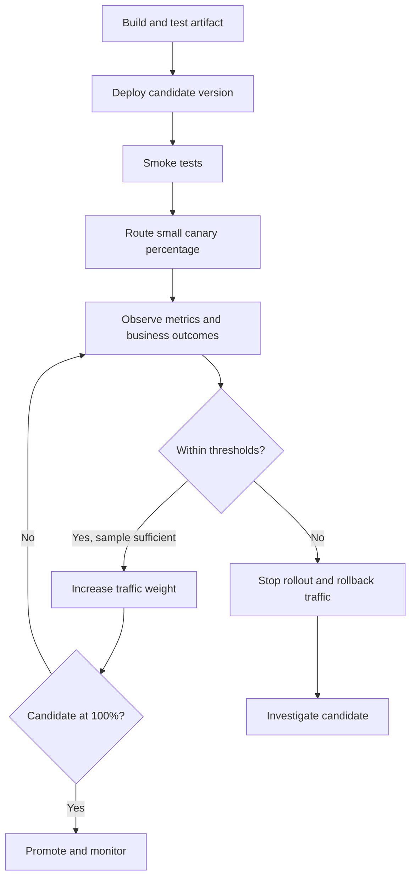
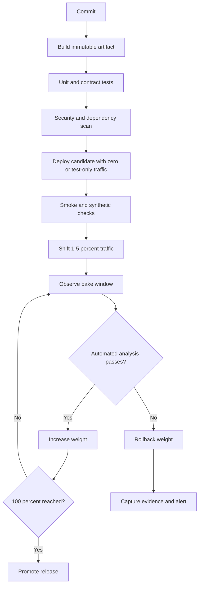

# Canary Deployments and Weighted Traffic Shifting

## 1. What Is a Canary Deployment?

Canary deployment is the practice of releasing a new version to a small subset of traffic first, observing the outcomes, and then gradually increasing the share of users or events routed to that version. If the new version performs well, the team expands traffic until the entire system runs on it. If errors are detected, the team shifts traffic back to the stable version.

The name "canary" comes from sending a small portion into a new environment early to detect issues promptly. In serverless, you can deploy two function versions or two service revisions, then route a percentage of requests to the new one. This reduces the blast radius when bugs arise in code, dependencies, configuration, or performance.

For example, an HTTP function processing payments is running version `v17`. The team releases `v18` and initially routes only 5% of requests to the new version. After observing error rates, latency, timeouts, and business outcomes, the team increases to 10%, 25%, 50%, and finally 100%. If errors exceed thresholds, traffic is shifted back to `v17`.

A canary is not merely deploying a new version and waiting. A solid canary rollout requires:

- Immutable, accurately identifiable artifacts/versions.
- Two versions coexisting during the trial window.
- Explicit traffic distribution rules.
- Health indicators and a baseline from the stable version.
- Observation duration and minimum request counts.
- Predefined thresholds to proceed, pause, or roll back.
- Mechanisms to handle data and side effects while two versions run concurrently.

In the CLOUD_SERVERLESS module, canarying must be evaluated for HTTP functions, queue/event consumers, and Java services running on serverless platforms. Each trigger type has distinct traffic distribution and retry semantics; not every trigger can be percentage-split in the same way.

## 2. Canary, Blue-Green, and Rolling Deployments

These three strategies are often used together, yet differ in how traffic transitions.

| Strategy | Deployment Method | Traffic Shift | When Appropriate |
| --- | --- | --- | --- |
| Canary | Run new version alongside current version | Gradually increase share to new version in steps | Limiting blast radius and validating with real traffic |
| Blue-green | Maintain two equivalent environments | Shift most or all traffic from blue to green at once | Fast cutover with an old environment ready for fallback |
| Rolling | Gradually replace instances/replicas in a group | Scheduler replaces subsets of instances in batches | Platforms with multiple long-lived instances supporting replica rollouts |

Canary focuses on the proportion of users or requests exposed to the new version. Blue-green focuses on two full environments and one large traffic switch. Rolling replaces instances incrementally; actual traffic shares may vary with replica counts and load balancing.

A rollout can combine approaches: stand up a green environment, route 1% of traffic to green, step up to 100%, and keep blue during the rollback window. Here blue-green provides the standby environment while canary governs the transition.

## 3. Traffic Distribution Methods

### 3.1. Weighted Routing

Weighted routing splits requests across multiple versions by weight. For example:

| Version | Weight |
| --- | ---: |
| Stable `v17` | 95% |
| Candidate `v18` | 5% |

With sufficient request volume and a functioning router, the share of requests reaching each version approaches the configured ratio. This is a probabilistic distribution, not a guarantee that every batch of 100 requests sends exactly 5 to the canary. A small batch can deviate noticeably from the expected ratio.

Weighted routing usually fits independent HTTP requests. The router may pick a version per request, per connection, by cookie, or via hashing. Understand the platform's exact semantics: splitting per request, per connection, or per session yields different results.

### 3.2. Headers, Cookies, Tenants, or User Cohorts

Instead of random selection, routing can use attributes:

- Internal headers such as `X-Canary: true` for testers.
- Cookies so a browser stays on the same version.
- Tenant or customer cohorts for phased rollouts by customer group.
- Consistent hashing on user ID or account ID.
- Specific region, partner, or request type.

Sticky routing prevents a user from bouncing back and forth between two versions within a single session. This helps when UI, sessions, or caches could be affected by version differences. However, sticky routing can skew traffic if one large tenant generates most requests.

Never allow external clients to set a canary header themselves to access unapproved features. Rollout control headers must be set by a trusted gateway or authenticated and restricted to an allowlisted tester group.

### 3.3. Shadow Traffic

Shadow traffic sends a copy of requests/events to the new version to observe behavior without using the new version's response as the primary result. This validates parsing, performance, or output differences without directly impacting users.

Shadow mode is only safe when the shadow version produces no side effects. If both versions send emails, charge payments, update databases, or create resources, the system may execute actions twice. Use read-only mode, mocked downstreams, or isolated data.

For sensitive data, verify usage permissions and data policies before mirroring requests to another environment. Never forward production data into test environments without proper safeguards.

## 4. Calculating Percentages and Sample Sizes

### 4.1. Expected Count

If total requests during the observation window are `N` and canary share is `p`, the expected number of requests reaching the canary is:

\[
E[canary] = N \times p
\]

For example, with 2,000 requests and a 5% share, the canary is expected to receive about 100 requests. With 20 requests and a 5% share, the expectation is only one request; such a small sample is insufficient for confident quality conclusions.

### 4.2. Probability of Zero Requests Reaching Canary

If each request is chosen independently with probability `p`, the probability that zero requests reach the canary after `N` requests is:

\[
P(0) = (1-p)^N
\]

With a 5% canary and only 20 requests, the chance of zero requests hitting the new version is roughly 35.8%. Thus, a short canary window under low traffic may not meaningfully exercise the new version at all.

This is a simplified model. If the platform routes by connection, cookie, or hash cohort, requests are not independent and actual distribution may differ. When evaluating, use actual invocation counts per version rather than relying solely on configured percentages.

### 4.3. Bake Time

Bake time is how long a canary percentage is held before deciding to increase traffic. Bake time should be long enough to:

- Collect a meaningful number of requests/events.
- Cover representative load cycles, such as peak hours or a batch run.
- Observe slow-developing failures like timeouts, memory leaks, or downstream throttling.
- Verify business outcomes and persisted data.
- Evaluate key traffic segments.

Do not apply a single fixed wait period across all services. An API handling thousands of requests per minute reaches sample size quickly; a function invoked only a few times daily needs a longer observation window or proactive synthetic testing.

## 5. General Canary Process

A typical rollout consists of:

1. Build and test the new artifact.
2. Publish an immutable artifact with version/commit/digest.
3. Deploy the new version without shifting production traffic yet, or allow test-only access.
4. Run smoke tests and baseline health checks.
5. Shift a small percentage of traffic, such as 1% or 5%.
6. Monitor stable and canary metrics during the bake window.
7. If conditions pass, step up traffic incrementally.
8. If thresholds are violated, halt rollout and shift traffic back to stable.
9. Upon reaching 100%, continue monitoring and delete the old version only after the defined rollback window.
10. Record outcomes, versions, weights, timestamps, and release decisions.



Weight steps might be 1% → 5% → 10% → 25% → 50% → 100%. These are illustrative only; choose percentages based on traffic volume, risk, rollback capability, and metric reliability.

## 6. What to Measure During a Canary

### 6.1. Technical Metrics

| Metric | Why Monitor |
| --- | --- |
| Error rate by version | Detect exceptions, error responses, and runtime failures in candidate |
| p50/p95/p99 latency | Detect latency increases, especially tail latency |
| Timeout rate | Detect functions failing to complete within deadlines |
| Throttling/concurrency | Detect concurrency limits or downstream capacity constraints |
| Memory/CPU | Detect memory pressure, GC pauses, or rising resource costs |
| Cold start/init duration | Detect new packages/frameworks slowing initial invocations |
| Retry and DLQ counts | Detect event handler or message processing errors |
| Queue age/backlog | Detect new consumers processing slower than producer rates |
| Dependency errors | Distinguish candidate faults from shared database/API outages |

Tag metrics with version/revision/alias labels to compare stable against canary. Looking only at aggregate function metrics lets errors in a 5% candidate get masked by 95% stable traffic.

### 6.2. Business Metrics

Passing technical metrics does not guarantee business correctness. Also track:

- Payment success/failure rates.
- Order creation, confirmation, or cancellation rates.
- Count of duplicate or dropped transactions.
- Refund or compensation rates.
- User funnel completion rates.
- Discrepancies between received, processed, and persisted event counts.
- Requests rejected due to validation or authorization.

Business metrics should be segmented by version without putting personal data into labels. For event consumers, reconcile messages received, acked/checkpointed, duplicated, and sent to DLQ.

### 6.3. Comparing Against Baseline

Do not simply check whether the candidate's error rate is below an absolute number. Compare against stable over the same time window and same traffic segment. For example, if stable has a 0.1% error rate while canary is at 1.5%, the candidate is likely regressing even if still below a generic 2% alert threshold.

Baselines must account for shared downstream incidents. If the database is overloaded and latency spikes on both versions simultaneously, do not blame the candidate. Use per-dependency metrics, traces, and cohorts to pinpoint root causes.

### 6.4. Proceed and Rollback Thresholds

Define clear criteria before rollout. For example:

| Condition | Recommended Action |
| --- | --- |
| Candidate error rate rises significantly over stable | Stop increasing traffic; roll back if predefined threshold breached |
| p99 latency exceeds SLO continuously | Pause rollout and investigate |
| Payment failure rate increases | Roll back immediately per business threshold |
| Abnormal rise in DLQ or retries | Stop ramping up new consumer share |
| Insufficient sample size | Hold current weight and continue observing |
| Shared downstream incident affecting both versions | Pause decision and analyze common cause |

Specific thresholds must align with the system's SLOs, error budgets, and business risk. Never apply sample numbers as a blanket policy across all functions.

## 7. Canary for HTTP Functions

### 7.1. Routing at the Gateway or Alias Layer

For HTTP functions, traffic can be split at multiple layers:

- API gateway or ingress selecting backend/function versions.
- Load balancer splitting traffic between two services/revisions.
- Function platform providing aliases or deployment slots with weighted routing.
- A release controller adjusting weights in routing configuration.

Designate a single layer responsible for traffic distribution and document it in the architecture. If the gateway already splits 5% of traffic to a new service, and that service splits another 10% to a candidate function, the effective share is the product of both weights (0.5% in this example), not 10%.

### 7.2. AWS Lambda: Versions and Weighted Aliases

A published Lambda version is an immutable snapshot of code and part of the function's configuration. An alias is a named pointer to a specific version. An alias can configure weighted routing to a secondary version, shifting a portion of invocations to the new version.

Conceptual example:

```text
Alias: production
  primary version: 17
  additional version: 18
  additional version weight: 0.05
```

In this example, most invocations through the `production` alias go to version 17 and a target 5% are routed to version 18. Callers must invoke the alias ARN rather than directly invoking a version or `$LATEST` for weights to take effect.

AWS CodeDeploy can orchestrate Lambda canary or linear deployment configurations. The pipeline can publish a version, update the alias, monitor CloudWatch alarms, and automatically roll back if an alarm triggers. Verify deployment configuration names and semantics against your active AWS setup.

Notes:

- Weighted routing applies only to invocations going through an alias with routing configured.
- Certain integrations or event sources have their own retry/batch semantics; do not assume every event source splits traffic like independent HTTP requests.
- Metrics must be segmented by executed version, not just aggregate alias metrics.
- The old version must remain available during the rollback window.
- Changes to IAM, environment variables, layers, or runtimes must also be evaluated alongside code versions.

### 7.3. Azure Functions: Deployment Slots and Traffic Routing

Azure Functions supports deployment slots on eligible hosting plans. Each slot is a separate deployment environment with its own configuration and endpoint; certain settings can be marked as slot settings so they do not swap. You can use slot traffic routing to direct a percentage of HTTP requests to a staging slot, or use slot swaps to switch versions.

When using slots for canarying, verify:

- The hosting plan and Function App type support slots as needed.
- Which triggers actually follow traffic routing; do not assume queue/timer triggers percentage-split like HTTP.
- Which app settings and connection strings are slot-sticky.
- Whether two slots could run listeners/consumers concurrently and cause duplicate message processing.
- Whether storage, host IDs, and shared resources could conflict.
- Whether rolling back via routing change or swap restores all required configuration.

Background triggers typically require separate strategies such as disabling listeners on the staging slot, using separate queues/subscriptions, or controlled consumer deployment. Read the exact trigger and plan semantics rather than applying HTTP percentages to every function.

### 7.4. Google Cloud Run: Revision Traffic Splitting

Cloud Run deploys containers as revisions. A service can split traffic percentages across revisions—for example, 95% to the stable revision and 5% to the new revision. This model fits HTTP services running on Cloud Run; Cloud Run is a serverless container platform, not identical to every FaaS function runtime model.

When using revision traffic splitting:

- Tag revisions for direct testing where appropriate.
- Ensure service configs, secrets, and service accounts are compatible.
- Monitor request counts, error rates, latency, and instance scaling by revision.
- Check session affinity if the service uses stateful sessions.
- Roll back by shifting traffic back to the stable revision.

Never store sessions or business state solely in container memory, because revisions can scale to zero or be replaced.

## 8. Canary for Queue Consumers and Event-Driven Functions

### 8.1. Not Every Event Can Be Split Like HTTP

With HTTP, a router typically picks one version per request. With queues or event streams, splitting consumers involves acknowledgements, checkpoints, ordering, batching, and retries. If two independent consumer groups read the same topic, both may receive all events rather than each receiving a share.

Common approaches:

- Use broker subscriptions/filters to send a selected subset of events to the candidate consumer.
- Split by tenant, event type, partition, or message key.
- Create a dedicated canary queue/subscription and route a subset of messages there.
- Use conditional event router/rules to choose targets.
- For streams, control partition assignment or establish an isolated test stream.
- Run a shadow consumer that only reads without producing side effects.

Never let stable and candidate process the exact same business message if both can mutate state or call downstreams. To compare outputs, use shadow mode, shared idempotency, or isolated data.

### 8.2. Canary by Tenant or Partition

For events requiring aggregate ordering, selecting a stable set of tenants or partitions can be safer than randomly splitting individual messages. For example, all events for `tenant-42` go to the candidate during canarying. This ensures related events for the same aggregate are handled by the same version.

However, partition keys can distribute load unevenly. If one large tenant is picked, the candidate may receive a much higher share of actual traffic than the tenant count suggests. Measure both tenant counts and message/byte throughput.

### 8.3. Retries and DLQ

When the candidate fails to process an event, the broker may redeliver the message. If stable is also processing the same event or consumer groups shift between versions, side effects may repeat. Ensure:

- Idempotency keys keyed by event ID and consumer operation.
- Clear distinction between transient and permanent errors.
- Proper retry/backoff and DLQ configuration.
- Monitoring oldest message age and backlog.
- Verifying partial batch failures if the trigger supports them.
- A DLQ replay plan after fixing bugs, with compatible schema versions.

Canarying must not lose checkpoints or skip events. For streams, consumer group or offset changes must be controlled to prevent unexpected re-reads or data gaps.

## 9. Data Compatibility Between Versions

During a canary, stable and candidate run concurrently. Thus, both must be able to read/write data throughout the transition window.

### 9.1. Expand-and-Contract Database Migrations

Suppose a new version wants to rename column `customer_name` to `display_name`. Dropping the old column immediately when deploying the candidate will break the running stable version. Use expand-and-contract:

1. **Expand:** add the new column while keeping the old column.
2. **Dual compatibility:** update code to read old/new data; if needed, write both during transition.
3. **Backfill:** copy old data to the new column using a retryable job.
4. **Canary:** deploy candidate and verify reads/writes across both versions.
5. **Promote:** ramp traffic after confirming data compatibility.
6. **Contract:** drop the old column only after all old versions have stopped running and the rollback window has closed.

Never run destructive data migrations in the same step as the initial canary. Rolling back code cannot restore a dropped column or lossy data transformations.

### 9.2. Event Schema Compatibility

If the candidate emits a new event schema while old consumers still run, old consumers must be able to parse new events or producers must emit compatible versions. Use optional fields, versioned event types, and expand-and-contract for schemas.

For messages already sitting in queues or DLQs, keep consumers supporting old schemas throughout retention/replay windows. Canary testing should validate both new events and historical event fixtures.

### 9.3. Feature Flags

Feature flags allow deploying new code while toggling features per user/tenant/region. They complement traffic routing:

- Traffic routing chooses which code version receives requests.
- Feature flags choose which behavior is active within that version.

Never substitute feature flags for deployment rollback. If candidate code has startup crashes or dependency incompatibilities, toggling off a flag does not revert requests to the stable version. You need both behavior toggles and traffic-shifting control.

## 10. Java-Specific Considerations During Canary

### 10.1. Immutable Artifacts

Every version should be built from a specific commit with a checksum/digest. Never rebuild the same tag once canarying starts, as the artifact could change while the version identifier stays unchanged. Record metadata:

- Git commit SHA.
- Build number and build timestamp.
- Java release/runtime version.
- Dependency lock/BOM and SBOM if available.
- Container image digest or deployment package checksum.
- Build-time configuration and relevant extensions/modules.

When rolling back, you must know exactly which version ran previously and confirm its artifact remains deployable.

### 10.2. Cold Starts and Warm-Up

A candidate may exhibit different cold starts than stable due to changes in JDK, framework, package size, dependencies, or native images. A low-percentage canary may spin up few environments; early requests may reflect cold starts rather than warm latency.

Track separately:

- Init duration/cold start.
- Warm invocation latency.
- p95/p99 by version.
- Peak memory and timeouts.
- Environment/concurrency counts by version.

Do not send warm-up requests that trigger business side effects. If pre-warming is needed, use safe check endpoints or events and exclude them from business metrics.

### 10.3. Java Runtime, Frameworks, and Serialization

If the candidate upgrades the Java runtime or frameworks like Quarkus/Micronaut, test:

- Serialization/deserialization of requests and events.
- Reflection, dependency injection, and native-image metadata if using native executables.
- TLS/certificates and HTTP client behavior.
- Connection pools and database limits.
- Logging/tracing agents or Lambda extensions.
- Timeouts and thread/executor configurations.

Two concurrently running versions can nearly double database connections if each maintains separate pools. Size total connections for the combined peak concurrency of both versions, not just one version alone.

### 10.4. Avoid Storing Business State In-Process

Candidate and stable may execute across many instances. Sessions, idempotency records, locks, and workflow state must live in durable stores. If a new version changes cache formats or serialized session layouts, use compatibility strategies or separate cache namespaces so the two versions do not read/write incompatible data.

## 11. Rollback and Recovery

### 11.1. Fast Traffic Rollback

The simplest rollback sets candidate weight to 0% and routes all traffic back to stable. Exact operations for aliases/slots/revisions depend on the platform. Pipelines should keep stable version details ready and hold permissions to roll back without rebuilding.

Traffic rollback only restores the code path for incoming requests. It does not automatically:

- Cancel in-flight candidate invocations.
- Reverse sent payments or emails.
- Restore modified database records.
- Return acknowledged messages back to queues.
- Undo misprocessed events.

Consequently, you need idempotency, compensation, reconciliation, or replay strategies for side effects. Some incidents require pausing consumers, quarantining messages, or running data-repair jobs before resuming.

### 11.2. Automated Rollback

Rollback can be automated when CloudWatch/Azure Monitor/Cloud Monitoring alarms breach thresholds or when a deployment controller detects failed health checks. Automated rollback helps when objective conditions and thresholds have been validated.

Do not automatically roll back over a single transient spike in a noisy metric. Use:

- Continuous evaluation windows.
- Minimum request thresholds.
- Candidate-versus-stable comparisons.
- Multiple independent signals like error rate and latency.
- Stricter thresholds for business metrics such as double charges.
- Cooldowns to prevent flapping between rollout and rollback.

For failures causing financial loss, data leaks, or broken access control, immediate rollback may be needed even at low sample sizes. Prioritize by risk severity rather than statistics alone.

### 11.3. Rollback Does Not Replace Roll-Forward

Some failures must be fixed with a newer release rather than reverting to an older version—for example, when data has already migrated to a new format unreadable by stable. Prepare a roll-forward plan and controlled data-fix scripts.

Do not delete the old version immediately after promotion. Retain artifacts and configurations long enough for rollback or investigation. Retention periods should align with policy, cost, and audit requirements.

## 12. CI/CD Pipeline for Canary

### 12.1. Recommended Stages



Pipelines must persist rollout state and record every weight change. If a pipeline restarts midway, it must read the actual deployment state before continuing; never assume a prior step finished simply because the job restarted.

### 12.2. Pseudoconfiguration

Provider-neutral configuration example:

```yaml
release:
  service: order-api
  stableVersion: v17
  candidateVersion: v18
  strategy: canary
  steps:
    - weight: 1
      bakeMinutes: 5
    - weight: 5
      bakeMinutes: 10
    - weight: 10
      bakeMinutes: 15
    - weight: 25
      bakeMinutes: 20
    - weight: 50
      bakeMinutes: 20
    - weight: 100
  analysis:
    minimumRequests: 500
    maxErrorRateIncreasePercentagePoints: 0.5
    maxP99LatencyRegressionPercent: 10
    rollbackOnBusinessInvariantViolation: true
```

This is a pseudoconfiguration illustrating policy structure, not a deployment schema for AWS, Azure, or Google Cloud. Thresholds are illustrative; calibrate them to your SLOs, baselines, and risk levels.

### 12.3. Pre-Promotion Verification

Pipelines should verify:

- The candidate artifact has been scanned and signed/identified.
- Smoke tests passed through the actual configured ingress/alias/revision.
- Health checks validate essential dependencies rather than just process liveness.
- Contracts with API consumers and event consumers remain compatible.
- Data migrations are compatible with both stable and candidate.
- Metrics include version labels and sufficient sample sizes.
- No critical alarms or abnormal DLQ/backlog spikes exist.
- Rollback commands have been tested and permissions are in place.

## 13. Application-Level Canary Routing Example

In a self-managed routing system, a release controller or gateway can select targets. Pseudocode example:

```java
import java.util.concurrent.ThreadLocalRandom;
import java.util.concurrent.atomic.AtomicReference;

public final class VersionRouter {
    private final AtomicReference<RoutingConfig> config;

    public VersionRouter(AtomicReference<RoutingConfig> config) {
        this.config = config;
    }

    public Target chooseTarget() {
        RoutingConfig current = config.get();
        int draw = ThreadLocalRandom.current().nextInt(10_000);
        int candidateThreshold = (int) (current.candidateWeight() * 10_000);
        return draw < candidateThreshold
                ? current.candidate()
                : current.stable();
    }
}
```

This merely illustrates weighted random selection inside a single process. Do not build distributed routing using an `AtomicReference` inside individual function instances, because each instance holds separate state, may update out of sync, and cannot enforce accurate global ratios. Production should rely on gateway/platform routing capabilities or a centralized control plane with clear consistency.

If sticky routing is required, replace random selection with consistent hashing on principal/tenant ID. Verify load balance and never rely on an ID that untrusted clients can spoof to bypass canary limits.

## 14. Testing the Canary Strategy

Before using canarying in production, test both traffic shifting and rollback:

- Candidate receives the expected share over a sufficiently large request volume.
- Stable continues receiving the remaining traffic.
- Version labels appear accurately in metrics/logs/traces.
- Cookie/header/tenant routing preserves cohorts where used.
- When candidate fails, traffic returns to stable within the target timeframe.
- In-flight requests do not drop responses outside policy.
- Candidate invocations with side effects do not duplicate on rollback.
- Schemas and databases remain compatible while both versions coexist.
- Alarms do not false-trigger under low traffic or shared downstream incidents.
- Pipelines resume safely after job interruptions.
- Event consumers do not drop messages, double-process, or corrupt checkpoints.

Use synthetic traffic or test tenants to validate the candidate before exposing real users. Synthetic requests must create no real side effects or use cleanable test resources.

## 15. Common Mistakes

| Mistake | Consequence | Fix |
| --- | --- | --- |
| Deploying candidate without segmenting metrics | Canary errors hidden in aggregate metrics | Tag version/revision labels and compare groups |
| Increasing traffic based solely on elapsed time | Sample size may be too small | Combine bake time with minimum request/event counts |
| Using identical weights for every service | Low/high-volume workloads carry different risk | Tailor steps to traffic, SLOs, and impact |
| Letting two consumers process the same event | Side effects or data get duplicated | Split events at broker, read-only shadow, or idempotency |
| Using sticky cohorts without tracking skew | One large tenant can dominate canary share | Measure requests/bytes per cohort and balance selection |
| Rolling back traffic without handling side effects | Data or payments remain corrupted | Compensation, reconciliation, and controlled replay |
| Breaking stable with database migrations | Code rollback stops working | Expand-and-contract, preserve schema compatibility |
| Relying on client-supplied canary headers | Users can opt themselves into unvetted builds | Gateway authenticates and enforces cohort membership |
| Splitting traffic inside each function instance | Inconsistent weights across instances | Use platform router or centralized control plane |
| Deleting stable version immediately after promotion | Cannot roll back quickly | Retain artifacts and configs through rollback window |
| Watching technical metrics while ignoring business metrics | Could ship double-charge bugs or lost orders | Add business invariant and reconciliation metrics |

## 16. Canary Deployment Checklist

- [ ] Immutable stable and candidate versions exist with traceable artifacts.
- [ ] Traffic-splitting layer and weight semantics are clearly defined.
- [ ] Starting share, increment steps, and bake times are chosen.
- [ ] Minimum sample size is set for each step.
- [ ] Baseline and version-segmented metrics are in place.
- [ ] Error rate, p95/p99, timeouts, cold starts, memory, and concurrency are tracked.
- [ ] Business metrics, duplicates, retries, DLQs, and backlogs are tracked.
- [ ] Proceed, pause, and rollback criteria are defined.
- [ ] Rollback permissions and automation are tested.
- [ ] Database and event schemas are compatible while two versions coexist.
- [ ] Side effects have appropriate idempotency or compensation.
- [ ] Untrusted clients cannot self-select canary cohorts.
- [ ] Specific behaviors for HTTP, queue, stream, and timer triggers are verified.
- [ ] Stable artifact is retained throughout the rollback window.
- [ ] Roll-forward plan exists when rollback is unsafe.
- [ ] Outcomes, versions, weights, timestamps, and release decisions are logged.

## 17. Conclusion

Canary deployments reduce release risk by exposing a new version to a subset of traffic, observing behavior, and gradually ramping up weights. Weighted routing suits independent HTTP requests; header, cookie, or tenant routing manages cohorts; shadow traffic aids comparison provided duplicate side effects are prevented.

For serverless, understand platform-specific capabilities: Lambda versions/weighted aliases, Azure Functions deployment slots, and Cloud Run revision traffic each work differently. Queues and event streams require dedicated message-splitting strategies because batching, ordering, acknowledgements, and retries differ from HTTP. Throughout the period where stable and candidate coexist, databases, event schemas, caches, and side effects must stay compatible.

A safe canary combines immutable artifacts, controlled routing, versioned metrics, adequate sample sizes, rollback thresholds, and data recovery plans. When pipelines automate these steps, teams can release more frequently with smaller blast radii and clear evidence before promoting new versions.
