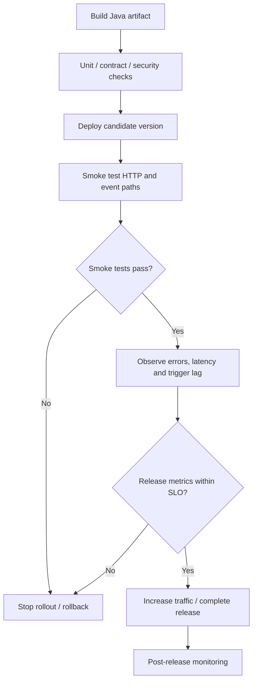
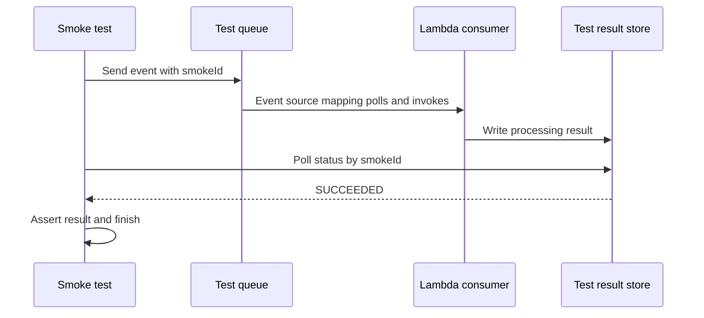

# Smoke Tests, Post-Release Verification, and Automatic Blocking of Faulty Releases

A successfully deployed Java function is not guaranteed to work properly. An artifact can upload cleanly yet have the wrong handler, missing environment variables, insufficient IAM/RBAC permissions, an API Gateway pointing to the wrong version, or triggers failing to read messages. Therefore, pipelines must verify the function after release and include mechanisms to halt rollouts or revert to a stable version when errors are detected.

**Smoke tests** are a fast, small-scope set of checks confirming that the most critical paths still work after deployment. Smoke test results should act as a release gate: if checks fail, the pipeline must not expand traffic or mark the release successful. For serverless, combine checks across HTTP, event triggers, logs/metrics, and critical dependencies.

## 1. Distinguishing Smoke Tests, Health Checks, and Synthetic Tests

These check types have overlapping goals yet differ in scope:

| Check Type | Goal | Example |
|---|---|---|
| Health check | Indicates whether an app or component is ready per specific criteria | `/health` endpoint returns status; verifies required configuration loaded |
| Smoke test | Confirms the most critical flow works after deployment | Calls API to submit a test request and asserts valid response |
| Synthetic test | Simulates user or producer behavior on a schedule for continuous error detection | Periodically sends requests from an agent/location and checks responses |
| Regression test | Verifies existing behavior remains intact after changes | Full business, contract, and integration test suite |
| Load/performance test | Verifies load handling and latency | Ramps concurrency, measures p95/p99 and throttling |

Smoke tests do not replace regression tests or load tests. They should be small enough to run rapidly after every deployment and realistic enough to catch severe configuration or integration failures.

### 1.1. Liveness and Readiness in FaaS Environments

With a serverless function, there is no long-lived web server process to probe continuously like a persistent container. Every call to an HTTP health endpoint is either a new invocation or a request routed to an existing warm instance. Thus:

- **Liveness-style check:** confirms the endpoint and handler can be invoked, and the runtime can deserialize events and return responses.
- **Readiness-style check:** confirms essential configurations and dependencies required by the business flow are usable.
- **Business smoke test:** executes a safe test transaction through the exact API/trigger used by users or producers.

Never let a health endpoint run migrations, send emails, create real orders, or execute heavy queries. Health checks should be lightweight, have short timeouts, and create no side effects. When checking dependencies, test only the minimum needed and avoid letting a non-essential secondary dependency mark the entire function unhealthy.

## 2. Defining Release Gates Before Deployment

A release gate is a mandatory condition that must pass before the pipeline advances to the next step. For serverless, verify artifacts, configuration, invocation paths, and observable outcomes.



Gates are typically ordered as:

1. **Artifact gate:** build succeeds, tests pass, package has a pinned version/hash, dependencies and images are scanned.
2. **Configuration gate:** runtime, handler, environment, identity, timeout, memory, and trigger mappings match the environment.
3. **Deployment gate:** platform reports version/resource updated; alias or slot points to the candidate.
4. **Smoke gate:** primary HTTP and event paths return expected outcomes.
5. **Telemetry gate:** errors, latency, throttling, queue age, and business metrics stay within thresholds over the observation window.
6. **Promotion gate:** increase traffic or complete swap only when all mandatory conditions pass.

Do not check only the exit code of the deploy command. A zero exit code only confirms the deployment request was accepted; it does not prove the function can process real events.

## 3. Preparing Repeatable Smoke Tests

A good smoke test needs deterministic inputs, verifiable outputs, and post-test cleanup.

### 3.1. Use Dedicated Test Data

- Use a dedicated test tenant, account, or resource.
- Include a correlation ID or release ID to locate invocations in logs.
- Prefix test data clearly, such as `smoke-<build-id>`.
- Never use real customer data, trigger real payments, or send real emails.
- If the flow requires side effects, use a sandbox downstream or a controlled test inbox.
- Clean up test data afterward or apply TTLs so test data expires automatically.

Smoke tests must be safe to run repeatedly. If a test sends the same event multiple times, use a unique idempotency key and confirm no duplicate side effects occur. If the function emits messages, send to a test queue/topic or attach a test flag that consumers know how to handle safely.

### 3.2. Verify the Exact Newly Released Version

Each artifact should carry a build ID, commit SHA, or release version. You can expose a non-sensitive version via health responses or custom metrics to verify requests reach the right version. Never expose secrets, sensitive branch info, or full environment dumps in responses.

When using aliases or slots, smoke tests must target the specific candidate before opening production traffic. After promotion, re-check the production endpoint to confirm routing now points to the new version.

## 4. Smoke Testing HTTP Functions

For HTTP-triggered functions, check at minimum:

- DNS/TLS and endpoint reachability from the appropriate network.
- Authentication/authorization enforcement; requests lacking tokens or with invalid keys must be rejected as designed.
- Correct HTTP status codes, content types, and response schemas.
- The function processes a safe business request successfully.
- Responses include correlation IDs or request IDs for tracing.
- Latency stays within reasonable bounds for the critical path.

Bash script example calling a health endpoint:

```bash
#!/usr/bin/env bash
set -euo pipefail

: "${BASE_URL:?BASE_URL is required}"

response_file="$(mktemp)"
trap 'rm -f "$response_file"' EXIT

status_code="$(curl --silent --show-error \
  --output "$response_file" \
  --write-out '%{http_code}' \
  --max-time 10 \
  "$BASE_URL/health")"

if [ "$status_code" != "200" ]; then
  echo "Smoke test failed: HTTP $status_code"
  cat "$response_file"
  exit 1
fi

jq -e '.status == "ok"' "$response_file" >/dev/null
echo "HTTP health smoke test passed"
```

This script assumes the endpoint returns JSON with field `status: "ok"`; adapt assertions to your application's contract. In the pipeline, pass `BASE_URL` from deployment stage outputs or environment configuration. If the endpoint requires a JWT/API key, fetch credentials from the pipeline's secret store and pass via secure headers; never log tokens.

### 4.1. Checking Authentication Failures

A smoke suite should include both positive and negative checks. For instance, call a protected endpoint without credentials and verify it returns `401` or `403` as designed. This catches misconfigurations that accidentally turn an authenticated API public.

Do not treat every `4xx` as a release failure. `400` for an invalid payload may be correct behavior. Smoke tests must explicitly specify expected status codes per request.

## 5. Smoke Testing Event-Driven Functions

HTTP tests do not prove queues, streams, or event buses work. For functions triggered by messages/events, test the entire producer → source → trigger → function → outcome path.

SQS flow example:



An event smoke test can include `eventId`, `eventType`, `schemaVersion`, `smokeId`, and a test payload. The consumer writes results to a test store or emits an acknowledgement event. The test waits within a timeout, asserts the outcome, and checks that the DLQ does not grow unexpectedly.

When testing event source mappings:

- Send messages to a dedicated test queue/topic or use identifiable, isolated test payloads.
- Confirm the event source mapping is enabled and invokes the function.
- Verify the processing outcome, not merely that the message left the queue.
- Confirm failed messages retry or route to the DLQ per contract.
- Check that retries produce no duplicate side effects.
- Enforce an overall test timeout; on timeout, collect logs, queue age, and DLQ data for diagnosis.

For Kinesis/Kafka, verify consumer lag and processing results by partition/sequence. For EventBridge, confirm events match rules and targets receive invocations. For Azure Service Bus/Queue triggers, confirm messages are consumed and business outcomes appear. Each source has distinct acknowledgement, retry, and checkpoint semantics.

Never send smoke events into production queues if consumers might execute payments, send notifications, or mutate real data. If testing the production path is unavoidable, design clearly identified test events with safe consumer handling branches and sandboxed downstream data.

## 6. Post-Deployment Verification via Telemetry

After smoke tests, observe a time window long enough to catch issues caused by live load or dependencies. Size the window based on traffic and trigger latency; never use a single fixed duration across all systems.

### 6.1. Metrics to Monitor

| Component | Key Metrics | What to Detect |
|---|---|---|
| Lambda/Function App | Invocation count, errors, p95/p99 duration, throttles, concurrency | Function failures, slowness, or resource limits |
| API Gateway/HTTP | 5xx, latency, integration latency, auth failures | Misconfigured gateway or integration |
| SQS | ApproximateAgeOfOldestMessage, visible messages, DLQ count | Slow consumer, message backlog, or repeated failures |
| Kinesis/DynamoDB Streams | Iterator age, batch failures, throttles | Consumer lag and poison records blocking shards |
| Async invocation | AsyncEventAge, dropped events, destination/DLQ | Delayed or dropped events |
| Azure Functions | Function execution count, failures, duration, host/worker errors | Runtime or function failures post-release |
| Service Bus/Event Hubs | Active message count, dead-letter count, consumer lag | Trigger falling behind producer |
| Business metrics | Orders accepted, payments authorized, jobs completed | System returns HTTP success while business flows stall |

Compare against pre-release baselines and SLOs. A single error might be invalid test data; rising error rates alongside latency or queue age are stronger signals. Never look only at total invocation counts, as low traffic can hide failures.

### 6.2. Logs and Traces

Every smoke invocation should carry a correlation ID. Logs should show:

- Release/build ID and function version.
- Trigger type, event ID, or request ID.
- Processing outcome and dependency timings.
- Standardized error codes and retry status if applicable.

Never log access tokens, connection strings, or full sensitive payloads. Use CloudWatch Logs/metrics on AWS or Application Insights/Azure Monitor on Azure to locate invocations. Trace context connects HTTP requests to messages and downstream functions when systems propagate W3C `traceparent` or matching correlation metadata.

## 7. Automatically Blocking Rollouts When Smoke Tests or Metrics Fail

The release pipeline must explicitly define which outcomes fail the pipeline:

- Artifact checksum/version mismatch.
- Health endpoint unresponsive or returning invalid schema/status.
- Authentication checks yielding unexpected results.
- Event tests failing to complete within the allowed timeout.
- Error rates, throttles, latency, or queue lag breaching thresholds during observation.
- Abnormal DLQ growth or severe business errors.
- Inability to query required telemetry needed to evaluate the release.

When a gate fails:

1. Mark the deployment stage failed and block traffic increases/promotion.
2. Preserve build ID, test output, correlation IDs, logs, and metric snapshots.
3. If partial traffic already shifted, trigger automatic rollback or revert aliases/slots to the stable version.
4. Confirm endpoints and triggers are running the old version.
5. Open an incident/investigation task; never infinitely auto-retry deployments.

Failures can be categorized as *hard gates* versus *warnings*. Wrong smoke-test status codes, auth bypasses, or dropped events are hard gates. Minor fluctuations in secondary metrics may be warnings if SLOs remain intact. Rules must be agreed upon before release; avoid loosening thresholds mid-deploy just to turn a pipeline green.

## 8. AWS Lambda: Canaries, Aliases, and Automatic Rollback

A Lambda version is an immutable snapshot of code and selected settings. An alias such as `live` points to a specific version and can distribute a percentage of traffic to a secondary version. Using aliases decouples endpoints/callers from concrete version numbers.

With CodeDeploy or AWS SAM deployment preferences, traffic can shift via canary/linear steps instead of 100% at once. Example:

```yaml
Resources:
  OrdersFunction:
    Type: AWS::Serverless::Function
    Properties:
      Runtime: java21
      Handler: com.example.OrderHandler::handleRequest
      CodeUri: target/function.zip
      AutoPublishAlias: live
      DeploymentPreference:
        Type: Canary10Percent5Minutes
        Alarms:
          - !Ref OrdersFunctionErrorsAlarm
```

This is an illustrative snippet in AWS SAM; the stack must define the corresponding alarm and other function properties. With this deployment type, SAM/CodeDeploy creates the required version and alias, then shifts a portion of traffic to the new version. If an alarm enters ALARM state during deployment, CodeDeploy can halt and roll back according to deployment configuration.

### 8.1. Pre-Traffic and Post-Traffic Validation

Validation Lambda hooks can attach to the deployment lifecycle:

- **Pre-traffic hook:** validates the candidate before shifting any production traffic to the new version.
- **Post-traffic hook:** validates after traffic has shifted per the deployment strategy.

Hooks should invoke the candidate or a controlled test endpoint, validate responses, and report success/failure back to CodeDeploy. Hooks need clear timeouts, logging, and permissions; never depend on flaky external test systems.

### 8.2. CloudWatch Alarms as Rollback Gates

Alarms should measure errors and latency of the function alias or associated integration. Examples:

- Lambda `Errors` exceeding threshold.
- API Gateway `5XXError` or integration latency breaching SLO.
- Abnormal spikes in `Throttles`.
- Business failure metrics or custom error metrics exceeding baseline.

Alarms need evaluation periods and datapoints suited to traffic. Under low traffic, a single error can produce a 100% rate; combine with minimum sample counts or business metrics. If no requests arrive during the window, insufficient-data metrics must not be mistaken for a healthy release.

Alias rollback only reverts traffic to the old version. It does not undo database changes, processed messages, written objects, or emitted side effects. Design migrations with expand-and-contract and backward-compatible event contracts so application rollbacks stay safe.

## 9. Azure Functions: Deployment Slots and Pre-Swap Checks

On hosting plans supporting deployment slots, packages can deploy to a staging slot, undergo verification, and then swap with production. Slots allow testing code and configuration in a production-like environment before switching the production endpoint.

A typical workflow includes:

1. Deploy the built artifact to the staging slot.
2. Configure dedicated slot settings for test endpoints, queues, secrets, and resources.
3. Warm up the slot and call health/smoke endpoints directly on the staging hostname.
4. Run safe synthetic transactions and inspect Application Insights.
5. If all gates pass, swap staging with production.
6. Re-check the production hostname and monitor errors/duration/trigger lag.
7. If errors emerge post-swap, swap slots back or redeploy the stable artifact per runbook.

### 9.1. Slot Settings and Trigger Side Effects

Selected app settings can be marked as deployment slot settings so their values remain bound to the slot during swaps. Use this for connection strings, queue names, secret references, or environment-identifying settings. Carefully audit which settings swap versus which stay slot-sticky.

Especially with Queue/Service Bus/Timer triggers, the staging slot can start listeners. If staging and production both consume the live queue, both may process messages concurrently, causing duplicates or message contention. Use dedicated test queues/topics, disable listeners on staging via appropriate settings, or design idempotent consumers with explicit cutover plans.

Deployment slots are not available on every hosting plan, and some behaviors vary by OS/plan. Verify the target plan supports slots before designing pipelines reliant on swaps.

## 10. Rollback and Forward-Fix for Event-Driven Systems

Rolling back code does not always revert business state. A function may have already sent emails, captured payments, updated databases, or acknowledged messages before alarms caught the bug.

Therefore, safe releases prepare both rollback and forward-fix paths:

- **Code rollback:** revert aliases/slots to the stable version.
- **Configuration rollback:** restore compatible app settings, environment variables, IAM policies, or trigger configurations.
- **Data compatibility:** apply additive migrations first and drop old fields only after all consumers have switched.
- **Message compatibility:** keep consumers able to read old event schemas across retention/replay windows.
- **Side-effect recovery:** maintain idempotency keys, compensation, or manual procedures for irreversible business operations.
- **Queue recovery:** inspect DLQs, visibility timeouts, offsets/checkpoints, and replay workflows after rollback.

If the new version writes data in a format unreadable by the old version, rollback can worsen the outage. Before releasing, verify previous and new versions can coexist throughout the rollout.

## 11. Post-Deployment Pipeline Example

A general pipeline can be structured as follows:

```yaml
stages:
  - build
  - verify
  - deploy_candidate
  - smoke_test
  - observe
  - promote

smoke_test:
  stage: smoke_test
  needs: [deploy_candidate]
  script:
    - ./scripts/smoke-http.sh
    - ./scripts/smoke-event.sh
  allow_failure: false

observe:
  stage: observe
  needs: [smoke_test]
  script:
    - ./scripts/check-release-metrics.sh
  allow_failure: false

promote:
  stage: promote
  needs: [observe]
  script:
    - ./scripts/promote-release.sh
```

This is pseudoconfiguration illustrating stage dependencies, not complete YAML for a specific CI provider. In real pipelines, configure `needs`, artifact passing, credentials, and approvals using GitHub Actions, GitLab CI, Azure Pipelines, or your active system's syntax. The key rule is that `promote` runs only after smoke tests and metric gates pass; `allow_failure` must never be enabled on mandatory gates.

A production pipeline should record:

- Commit SHA, artifact checksum, image digest, and function version.
- Deployment ID, and alias/slot before and after release.
- Smoke test outputs and correlation IDs.
- Pre/post-rollout metric snapshots.
- Promote/rollback decisions and the person or automation that executed them.

## 12. Setting Reasonable Thresholds and Observation Windows

No single threshold fits every function. An API receiving a few requests per minute and a consumer processing thousands of messages per second require different evaluation rules.

When designing thresholds:

- Use existing SLOs as benchmarks; if none exist, derive temporary thresholds from baselines.
- Set minimum sample sizes so a single failing request does not skew conclusions during low traffic.
- Use p95/p99 and error rates rather than average duration alone.
- Evaluate queue age/consumer lag by backlog growth rate and catch-up capability.
- Separate errors caused by invalid test fixtures from runtime/dependency errors.
- Use multi-window evaluation or hysteresis to reduce flapping alerts.
- Ensure metrics have data; missing telemetry must be treated as unknown rather than automatically passing.

For example, a gate might require: all smoke tests pass; at least N observed requests/records; error rate and p95 within SLO; queue age not rising continuously; zero critical business errors. Choose N and thresholds from your system's traffic and SLOs.

## 13. Common Mistakes in Post-Release Verification

| Symptom | Possible Cause | How to Fix |
|---|---|---|
| Green deploy yet HTTP smoke test fails | Wrong route/alias, missing auth config, wrong environment | Check endpoints, integrations, aliases, and app settings |
| Health endpoint passes yet business logic fails | Shallow health check, wrong downstream permissions or schema | Add business smoke tests with sandbox data |
| HTTP smoke test passes yet queue stays unprocessed | Event source mapping disabled, missing poll permissions, wrong queue | Send test event and check mapping/lag/DLQ |
| Intermittent smoke test timeouts | Cold starts, slow dependencies, or overly tight test timeout | Separate init duration from dependency timings; size timeout to SLO |
| Canary fails to auto-rollback | Alarm not attached to deployment or metrics lack data | Check CodeDeploy alarm configuration and missing-data treatment |
| Azure staging passes yet production fails | Slot settings swapped wrongly or staging used different dependencies | Check sticky settings and production config post-swap |
| Code rolled back yet messages keep failing | Incompatible schema/data changes already occurred | Use expand-contract, keep compatible consumers, prepare replay |
| Pipeline passes despite missing telemetry | Query returned empty and script treated empty as success | Treat missing data as fail/unknown per release policy |

## 14. Pre- and Post-Release Checklist

1. Does the artifact have an explicit build ID, checksum/digest, and version?
2. Was the candidate deployed to the right alias/version or slot?
3. Do HTTP smoke tests verify status codes, response schemas, auth, and latency?
4. Do event smoke tests confirm producer → trigger → handler → outcome?
5. Do tests use sandbox resources/tenants and avoid production side effects?
6. Is a correlation ID available to locate invocations, logs, and traces?
7. Are error rates, p95/p99, throttling, concurrency, and dependency failures within thresholds?
8. Are queue age, iterator age, DLQs, and async event age stable?
9. Are missing telemetry or insufficient samples treated as unverified/unmet?
10. Do canary/linear rollouts have alarms and automatic rollback configured?
11. Does the Azure staging slot use safe configs and trigger sources?
12. Is rollback compatible with schemas, event payloads, and already-occurred side effects?
13. Does the pipeline block promotion whenever any hard gate fails?
14. Are deployment ID, artifact version, test outputs, and metric snapshots stored for auditing?

## Conclusion

Smoke tests and post-release verification confirm that a Java function genuinely works after deployment. For HTTP triggers, verify endpoints, authentication, and response contracts; for event triggers, confirm messages traverse the full path from source to processing outcome. Combine smoke tests with telemetry gates, canary/linear rollouts, and automatic rollback to limit the blast radius of faulty releases. On AWS, aliases, CodeDeploy, and CloudWatch alarms enable controlled traffic shifting; on Azure, deployment slots enable pre-swap staging verification. Always remember that code rollback does not automatically undo already-occurred data changes, messages, or side effects—so design compatible schemas and business flows throughout the release lifecycle.

## Official References

- [AWS Lambda deployment configurations](https://docs.aws.amazon.com/lambda/latest/dg/configuring-alias-routing.html)
- [Deploy Lambda functions with CodeDeploy](https://docs.aws.amazon.com/lambda/latest/dg/deploying-lambda-apps.html)
- [AWS SAM gradual deployments](https://docs.aws.amazon.com/serverless-application-model/latest/developerguide/automating-updates-to-serverless-apps.html)
- [CodeDeploy Lambda deployment hooks](https://docs.aws.amazon.com/codedeploy/latest/userguide/reference-appspec-file-structure-hooks.html)
- [Monitor and roll back Lambda deployments](https://docs.aws.amazon.com/codedeploy/latest/userguide/deployments-rollback-and-redeploy.html)
- [Azure Functions deployment slots](https://learn.microsoft.com/en-us/azure/azure-functions/functions-deployment-slots)
- [Azure Functions monitoring](https://learn.microsoft.com/en-us/azure/azure-functions/functions-monitoring)
- [Azure Functions deployment technologies](https://learn.microsoft.com/en-us/azure/azure-functions/functions-deployment-technologies)
