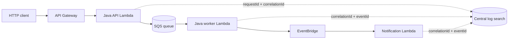

# Correlating Logs with Request ID and Correlation ID

A request in a serverless system may pass through API Gateway, Java Lambda, a queue, one or more workers, EventBridge, and external services. Each function invocation has its own logs; a message may be retried; an event may be fanned out to multiple consumers. When searching logs only by function name or timestamp, stitching together log lines belonging to the same business operation becomes difficult.

**Request ID** identifies a single request or invocation at a component. **Correlation ID** links multiple requests, messages, and function invocations belonging to the same business flow. **Trace ID** links spans within a distributed trace. They are related but have different scopes and purposes. Clearly designing these identifiers helps operations teams find root causes of errors, track retries, and measure processing time across multiple services.

In Cloud Serverless, logs must carry sufficient context from HTTP triggers to event consumers without exposing tokens, secrets, or personal data. Java functions must propagate identifiers through messages/events, include them in structured logs, and clean up context after each execution to prevent context leakage between invocations or records in the same batch.

## 1. Why Do Logs Need Correlation?

Suppose a customer sends `POST /orders`. API Gateway invokes a Java function; the function saves the order and sends a message to SQS; a worker handles inventory; EventBridge emits `OrderCreated`; a notification function sends an email. If the notification fails, a message may be retried several times.

Without end-to-end identifiers, operators must search by timestamp, order ID, or log message text. Those methods easily miss logs, especially when many requests run concurrently and functions run across multiple instances.

Correlating logs helps:

- Find all logs related to an operation or a business process.
- Distinguish errors at the API, producer, broker, consumer, or downstream system.
- Identify retries, duplicate deliveries, and fan-out branches.
- Measure elapsed time from request receipt to completion of asynchronous processing.
- Link logs with distributed traces and metrics when deep investigation is needed.
- Support technical auditing without logging the entire business payload.



Each component logs locally but uses the same field names and format. The centralized logging system can filter all records by `correlationId`, then use `requestId`, `eventId`, or `traceId` to drill down into each step.

## 2. Distinguishing Identifier Types

You should not use a single ID for every purpose. Each ID has a different lifecycle:

| Identifier | Scope | Who Creates It? | On Retry? | Purpose |
|---|---|---|---|---|
| Request ID | One request at one hop or one invocation | API gateway, runtime, or receiving service | Usually gets a new ID for the new invocation/request | Find logs of a single execution |
| Correlation ID | One operation or workflow across multiple services | Edge service or workflow-initiating service | Preserved across steps/retries of the same workflow | Correlate logs across the entire flow |
| Trace ID | One distributed trace | Tracing SDK/instrumentation or upstream trace context | May stay the same within the trace; independent retries may create new spans per tracing model | Link spans and analyze latency |
| Span ID | One operation/span in a trace | Tracing SDK | Every new span has a new ID | Describe a step and parent/child relationships |
| Event ID | One specific business event | Business producer | Preserved when redelivering the same event | Deduplication, idempotency, and event auditing |
| Message ID | One message at the broker | Broker or producer depending on service | May stay the same on broker redelivery; a new message has a different ID | Find a message in the queue/broker |
| Causation ID | The event/request that caused the current event | Producer creating the next event | Preserves causal relationship | Reconstruct the business causal chain |

### Request ID

A Request ID typically has a narrow scope. API Gateway has its gateway request ID; AWS Lambda has `awsRequestId` for the invocation; an HTTP client or downstream API may also generate its own request ID. These IDs are not necessarily the same.

When a message is redelivered to Lambda, the new invocation gets a new `awsRequestId`. Therefore, request ID alone is not enough to link an entire workflow or recognize that the same event is being retried.

### Correlation ID

A Correlation ID represents an operation or a chain of work. For example, an order creation flow may go through API, SQS worker, EventBridge, and a notification function. All of those steps share the same `correlationId`.

The Correlation ID can be generated at the edge if the client does not provide a valid ID. If accepting a client-supplied ID, restrict its format/length and treat that ID as untrusted data. A safe option is to generate an internal `correlationId` and keep `clientCorrelationId` separately for cross-referencing when needed.

### Trace ID and Span ID

Trace ID belongs to distributed tracing. A trace contains multiple spans; each span represents an operation such as an API call, database query, or message processing. W3C Trace Context uses the `traceparent` header to propagate trace ID, parent span ID, and flags between supporting services.

Correlation ID does not replace Trace ID. Correlation ID is useful for searching logs by business flow, even when tracing is disabled or sampling drops a trace. Trace ID provides parent/child structure and detailed timing. A log record should include both when tracing is enabled.

### Event ID and Causation ID

Event ID must remain stable for the same business event across deliveries/retries. Correlation ID may be shared by multiple events within a workflow; therefore, do not use correlation ID as an idempotency key.

Example:

```text
correlationId = flow-9f3a       # entire order creation flow
eventId       = evt-order-001   # OrderCreated event
eventId       = evt-stock-002   # InventoryReserved event
causationId   = evt-order-001   # InventoryReserved was caused by OrderCreated
```

## 3. Rules for Generating and Accepting Correlation IDs

Define a consistent rule across the entire system:

1. At ingress, read the correlation ID from a trusted source or generate a new ID.
2. Validate format, length, and allowed characters.
3. Do not use this ID for authentication, authorization, or as an idempotency key.
4. Return the correlation ID in a response header or response body if the API contract allows.
5. Record the ID in structured logs and pass it through message/event metadata.
6. Preserve the ID across steps of the same workflow; generate a new ID for a new workflow.
7. If a service starts an independent child workflow, explicitly decide whether to keep the parent correlation ID or generate a child correlation ID and log `parentCorrelationId`.

### Should You Trust `X-Correlation-ID` from Clients?

Headers sent by clients can be spoofed or intentionally set to match another request's ID. Therefore:

- Validate the format and enforce a length limit, e.g., maximum 128 characters.
- Accept only a simple character set such as letters, digits, hyphens, and underscores.
- Do not use this value to look up permissions, select a tenant, bypass validation, or access data.
- Consider generating an internal ID at the API gateway/service and storing the client-supplied value in a separate field.
- Avoid logging unbounded raw headers to prevent log injection and uncontrolled cardinality.

A correlation ID is not a secret. Do not put access tokens, emails, phone numbers, account numbers, or personal data into the ID.

### Format Example

```text
X-Correlation-ID: 6e7d0f54-8b25-4a7f-a63a-4f7b9c9d8c31
```

A random UUID is a simple choice. ULIDs or timestamp-prefixed IDs can also be useful for sorting, though you should not rely on strict global ordering across systems. If collision resistance or secure identifiers are needed, choose an appropriate ID generator and do not derive IDs from personal data.

## 4. Propagating IDs Over HTTP

HTTP ingress often has multiple layers: client → CDN/WAF → API Gateway → authorizer → Lambda. Each layer may generate its own request ID. Keep them in distinct fields instead of overwriting a single shared value.

Header example:

```http
POST /orders HTTP/1.1
Content-Type: application/json
X-Correlation-ID: 6e7d0f54-8b25-4a7f-a63a-4f7b9c9d8c31
traceparent: 00-4bf92f3577b34da6a3ce929d0e0e4736-00f067aa0ba902b7-01
```

The receiving service should:

- Read the request ID from the gateway/runtime context.
- Read the correlation ID according to the system's trust rules.
- Extract trace context via tracing instrumentation/propagator.
- Create the log context for the current request.
- Return the correlation ID to the caller when appropriate.

Do not overwrite `traceparent` with a correlation ID. They are two separate protocols.

### API Gateway and Lambda Request IDs

With API Gateway HTTP API, the event has a request context containing the gateway request ID. Lambda `Context` provides `getAwsRequestId()` for the invocation. Log both so you can look up logs in both API Gateway and Lambda:

```json
{
  "apiGatewayRequestId": "gateway-request-123",
  "lambdaRequestId": "lambda-invocation-456",
  "correlationId": "6e7d0f54-8b25-4a7f-a63a-4f7b9c9d8c31"
}
```

Field names and locations in the event depend on the API Gateway event type (REST API v1, HTTP API v2, or ALB). Write adapters matching the actual event type and avoid casting one schema across all triggers.

## 5. Propagating IDs Through Queues and Events

When an HTTP function enqueues a message, the correlation ID must be copied into message attributes or the event envelope. The consumer cannot read the original HTTP headers from the new Lambda's context.

### SQS Message Attributes

SQS supports message attributes to carry metadata such as correlation ID, event type, and schema version. Producer example:

```java
SendMessageRequest request = SendMessageRequest.builder()
        .queueUrl(queueUrl)
        .messageBody(jsonPayload)
        .messageAttributes(Map.of(
                "correlationId", MessageAttributeValue.builder()
                        .dataType("String")
                        .stringValue(correlationId)
                        .build(),
                "eventId", MessageAttributeValue.builder()
                        .dataType("String")
                        .stringValue(eventId)
                        .build()))
        .build();

sqsClient.sendMessage(request);
```

The consumer reads attributes from each record of the SQS event. Do not assume the producer's `awsRequestId` will appear in the consumer Lambda; if you need to link invocations, store it as separate metadata such as `producerRequestId`.

### Event Envelope

With multiple brokers or when schema versioning is needed, you can place metadata inside an event envelope:

```json
{
  "eventId": "evt-order-001",
  "eventType": "OrderCreated",
  "schemaVersion": 1,
  "correlationId": "flow-9f3a",
  "causationId": "cmd-create-order-77",
  "occurredAt": "2026-11-17T12:00:00Z",
  "traceparent": "00-4bf92f3577b34da6a3ce929d0e0e4736-00f067aa0ba902b7-01",
  "data": {
    "orderId": "order-1052",
    "status": "CREATED"
  }
}
```

Metadata should be standardized between producer and consumer. If a broker has dedicated message attributes, you can store correlation ID in attributes and event ID/schema in the body. Avoid storing the same field in multiple places without a precedence rule; when discrepancies occur, the consumer should detect and log a contract error instead of silently picking an arbitrary value.

### SNS, EventBridge, and Other Systems

- SNS: can send correlation ID/event ID via message attributes or payload.
- EventBridge: place correlation ID, causation ID, and business event ID inside `detail`; EventBridge's envelope `id` identifies the event on the bus.
- Kafka: use headers or keys per contract; correlation ID does not have to be the partition key.
- Azure Service Bus: provides `CorrelationId`, `MessageId`, `SessionId`, and `Subject` properties.
- Google Pub/Sub: use message attributes; for trace context, pass metadata according to the tracing library's convention.

Do not confuse a broker-assigned `MessageId` with a business event ID. Broker IDs are useful for investigating delivery; a stable event ID is the right key for business deduplication.

## 6. Rules for Retries, Duplicates, and Fan-Out

Preserve the correlation ID across retries of the same workflow so the entire history can be queried. The invocation's request ID typically changes between runs. Event ID stays the same when the broker redelivers the same event; if the producer creates a new event for a new business change, the event ID must be new.

Example of an event delivered three times:

| Attempt | Correlation ID | Event ID | Lambda request ID | Attempt |
|---|---|---|---|---:|
| 1 | `flow-9f3a` | `evt-order-001` | `lambda-a1` | 1 |
| 2 | `flow-9f3a` | `evt-order-001` | `lambda-b2` | 2 |
| 3 | `flow-9f3a` | `evt-order-001` | `lambda-c3` | 3 |

Each processing run should log `attempt`/receive count if provided by the trigger. With SQS, you can use `ApproximateReceiveCount`; with Lambda async invocations or other brokers, the attempt field may come from context/service metrics or must be stored in the envelope. Do not assume all triggers provide the same retry metadata.

### Fan-Out

One event may trigger multiple consumers. Consumers should keep the shared correlation ID to link the same workflow, while each event/branch may have its own event ID, request ID, and span ID. You can also log `consumerName`, `branch`, or `operation` to distinguish branches.

### Batch Processing

A single Lambda invocation may receive multiple SQS records. Do not put a single `correlationId` in invocation-level MDC and reuse it for the whole batch. Each record may belong to a different workflow. Set and clear MDC per record, or log each record with its own context. Invocation-level logs contain only `awsRequestId`, batch size, and summary; record-level logs contain the corresponding `correlationId`, `eventId`, and message ID.

## 7. Structured Logging

Structured logging stores logs as JSON or structured fields rather than just free-form text sentences. This allows CloudWatch Logs Insights, Azure Application Insights, Google Cloud Logging, or ELK/OpenSearch systems to filter accurately by field.

A log record might look like this:

```json
{
  "timestamp": "2026-11-17T12:00:01.245Z",
  "level": "INFO",
  "service": "orders-worker",
  "environment": "production",
  "functionName": "ProcessOrderFunction",
  "awsRequestId": "lambda-b2",
  "apiGatewayRequestId": "gateway-request-123",
  "correlationId": "flow-9f3a",
  "eventId": "evt-order-001",
  "messageId": "sqs-message-789",
  "traceId": "4bf92f3577b34da6a3ce929d0e0e4736",
  "spanId": "00f067aa0ba902b7",
  "operation": "reserve-inventory",
  "attempt": 2,
  "outcome": "RETRYABLE_FAILURE",
  "durationMs": 184,
  "errorType": "DependencyTimeout"
}
```

Fields should have consistent data types: timestamp is a standard UTC timestamp, duration is a number, attempt is an integer, outcome is an enum/bounded value. Standardize naming across functions so a single query works across the entire system.

### Recommended Field Set

| Field | Meaning | Rules |
|---|---|---|
| `timestamp` | Log time | UTC, ISO-8601 or epoch per log platform standard |
| `level` | Severity | DEBUG/INFO/WARN/ERROR or chosen standard |
| `service` | Service name | Stable, contains no request-specific values |
| `environment` | Environment | dev/staging/prod |
| `functionName` | Handling function | Logical name or normalized resource name |
| `awsRequestId` | Lambda invocation ID | Obtained from Lambda Context |
| `apiGatewayRequestId` | Gateway request ID | Present if request passed through API Gateway |
| `correlationId` | Workflow ID | Preserved across hops |
| `eventId` | Domain event ID | Preserved across redeliveries |
| `messageId` | Broker message ID | Present per trigger/broker |
| `traceId` / `spanId` | Distributed trace context | Per tracing SDK/propagator |
| `operation` | Business step | Name from a bounded value domain |
| `attempt` | Attempt number | Present when provided by trigger |
| `durationMs` | Step processing time | Number |
| `outcome` | Result | Bounded enum such as SUCCESS/FAILURE/RETRY |

Do not place high-cardinality IDs into metric dimensions unnecessarily. Correlation ID, event ID, and request ID are suitable for searching logs/traces; metric dimensions should use `service`, `operation`, `environment`, `outcome`, or `errorType` with a controlled value domain.

## 8. Java: Creating Log Context with SLF4J MDC

SLF4J MDC (Mapped Diagnostic Context) lets you attach key/value pairs to logs within a thread. The logging backend can emit those values into JSON or pattern output.

Example helper for managing MDC:

```java
import org.slf4j.MDC;
import java.util.Map;

public final class LogContext implements AutoCloseable {
    private final Map<String, String> previous;

    private LogContext(Map<String, String> previous) {
        this.previous = previous;
    }

    public static LogContext open(Map<String, String> values) {
        Map<String, String> previous = MDC.getCopyOfContextMap();
        MDC.clear();
        values.forEach((key, value) -> {
            if (value != null && !value.isBlank()) {
                MDC.put(key, value);
            }
        });
        return new LogContext(previous);
    }

    @Override
    public void close() {
        MDC.clear();
        if (previous != null) {
            MDC.setContextMap(previous);
        }
    }
}
```

`try-with-resources` ensures the context is restored even when processing throws an exception:

```java
try (LogContext ignored = LogContext.open(Map.of(
        "correlationId", correlationId,
        "eventId", eventId,
        "awsRequestId", context.getAwsRequestId()))) {
    log.info("Processing order event");
    orderService.process(event);
    log.info("Order event processed");
}
```

The `Map.of` example does not accept nulls; if an ID can be null, build a mutable map and add only non-null values before calling `LogContext.open`. The helper above saves the previous context so it works safely with nested scopes. In Lambda, you still must clean up the context after each invocation/record; execution environments can be reused.

### Preventing MDC Leakage to the Next Invocation

Lambda execution environments can be reused. If MDC is set without clearing, logs from the subsequent invocation may carry the previous request's correlation ID. Always use `try/finally` or `AutoCloseable` and test both success and exception paths.

MDC is typically thread-bound. When code delegates to `CompletableFuture`, an executor, or a thread pool, context may not propagate automatically to other threads. Capture context when submitting the task, set context in the executing thread, and restore/clear in `finally`. Do not rely on `InheritableThreadLocal` as a general solution for thread pools.

## 9. Java Lambda HTTP Handler

The following example illustrates extracting the gateway request ID, Lambda request ID, and a validated correlation ID. DTOs and services are defined by the application.

```java
import com.amazonaws.services.lambda.runtime.Context;
import com.amazonaws.services.lambda.runtime.RequestHandler;
import com.amazonaws.services.lambda.runtime.events.APIGatewayV2HTTPEvent;
import com.amazonaws.services.lambda.runtime.events.APIGatewayV2HTTPResponse;
import org.slf4j.Logger;
import org.slf4j.LoggerFactory;
import java.util.HashMap;
import java.util.Map;
import java.util.UUID;

public final class CreateOrderHandler implements
        RequestHandler<APIGatewayV2HTTPEvent, APIGatewayV2HTTPResponse> {

    private static final Logger log =
            LoggerFactory.getLogger(CreateOrderHandler.class);

    @Override
    public APIGatewayV2HTTPResponse handleRequest(
            APIGatewayV2HTTPEvent request, Context context) {

        String gatewayRequestId = request.getRequestContext() == null
                ? null : request.getRequestContext().getRequestId();
        String clientId = header(request.getHeaders(), "X-Correlation-ID");
        String correlationId = UUID.randomUUID().toString();

        Map<String, String> fields = new HashMap<>();
        fields.put("correlationId", correlationId);
        fields.put("awsRequestId", context.getAwsRequestId());
        fields.put("apiGatewayRequestId", gatewayRequestId);
        if (isValidId(clientId)) {
            fields.put("clientCorrelationId", clientId);
        }

        try (LogContext ignored = LogContext.open(fields)) {
            log.info("Create order request received");
            // Validate request and call the application service here.
            return APIGatewayV2HTTPResponse.builder()
                    .withStatusCode(202)
                    .withHeaders(Map.of("X-Correlation-ID", correlationId))
                    .withBody("{\"status\":\"accepted\"}")
                    .build();
        }
    }

    private static String header(Map<String, String> headers, String name) {
        if (headers == null) return null;
        return headers.entrySet().stream()
                .filter(e -> name.equalsIgnoreCase(e.getKey()))
                .map(Map.Entry::getValue)
                .findFirst().orElse(null);
    }

    private static boolean isValidId(String value) {
        return value != null && value.length() <= 128
                && value.matches("[A-Za-z0-9_-]+");
    }
}
```

This example generates a new internal correlation ID for each request and keeps the client-provided header in `clientCorrelationId` only after format validation. If an internal gateway has already authenticated and normalized the correlation ID per contract, the service may continue using that ID according to agreed trust rules. Format validation does not turn an ID into a trusted identity. Do not use correlation ID to select tenants or grant permissions.

For REST API v1 or ALB events, the request context structure differs; create an appropriate adapter. Do not assume every HTTP trigger uses `APIGatewayV2HTTPEvent`.

## 10. Java SQS Batch Handler: Per-Record Context

A batch may contain messages from multiple workflows. Each record needs its own MDC:

```java
import com.amazonaws.services.lambda.runtime.Context;
import com.amazonaws.services.lambda.runtime.RequestHandler;
import com.amazonaws.services.lambda.runtime.events.SQSEvent;
import com.amazonaws.services.lambda.runtime.events.SQSBatchResponse;
import org.slf4j.Logger;
import org.slf4j.LoggerFactory;
import java.util.ArrayList;
import java.util.HashMap;
import java.util.List;
import java.util.Map;

public final class OrderQueueHandler implements
        RequestHandler<SQSEvent, SQSBatchResponse> {

    private static final Logger log = LoggerFactory.getLogger(OrderQueueHandler.class);

    @Override
    public SQSBatchResponse handleRequest(SQSEvent event, Context context) {
        List<SQSBatchResponse.BatchItemFailure> failures = new ArrayList<>();

        for (SQSEvent.SQSMessage message : event.getRecords()) {
            String correlationId = message.getMessageAttributes() != null
                    && message.getMessageAttributes().containsKey("correlationId")
                    ? message.getMessageAttributes().get("correlationId").getStringValue()
                    : "unknown";

            Map<String, String> fields = new HashMap<>();
            fields.put("correlationId", correlationId);
            fields.put("awsRequestId", context.getAwsRequestId());
            fields.put("messageId", message.getMessageId());

            try (LogContext ignored = LogContext.open(fields)) {
                try {
                    log.info("Processing SQS message");
                    OrderService.process(message.getBody());
                } catch (Exception ex) {
                    log.error("SQS message processing failed", ex);
                    failures.add(new SQSBatchResponse.BatchItemFailure(
                            message.getMessageId()));
                }
            }
        }
        return new SQSBatchResponse(failures);
    }
}
```

This is an illustrative example; `MessageAttribute` types and event classes depend on the AWS Lambda Java Events version. The consumer should validate the correlation ID and parse the event envelope to retrieve event ID/schema version. If a record fails, partial batch response must be enabled in the event source mapping so only failed records are retried. Correlation ID does not replace event ID or an idempotency key.

## 11. Propagating Context Across Threads and Asynchronous Java Code

SLF4J MDC is typically based on ThreadLocal. When using an executor, thread pool, or `CompletableFuture`, logs inside callbacks may lack the correlation ID or use a stale context if not propagated properly.

A simple approach is to capture context before submitting and restore it inside the task:

```java
import org.slf4j.MDC;
import java.util.Map;
import java.util.concurrent.Executor;

public final class MdcTask {
    public static Runnable wrap(Runnable task) {
        Map<String, String> captured = MDC.getCopyOfContextMap();
        return () -> {
            Map<String, String> previous = MDC.getCopyOfContextMap();
            try {
                MDC.clear();
                if (captured != null) MDC.setContextMap(captured);
                task.run();
            } finally {
                MDC.clear();
                if (previous != null) MDC.setContextMap(previous);
            }
        };
    }

    public static void execute(Executor executor, Runnable task) {
        executor.execute(wrap(task));
    }

    private MdcTask() {}
}
```

In a Spring environment, you can use a `TaskDecorator` on the executor to propagate MDC. With OpenTelemetry, prefer OpenTelemetry's context propagation API/agent/instrumentation instead of manually propagating trace IDs via MDC. MDC serves log context only; it does not replace tracing context.

Do not store request-specific context in mutable `static` variables. Lambda can reuse execution environments, and executors can reuse threads for other requests. Use a well-scoped lifetime and always restore.

## 12. W3C Trace Context and OpenTelemetry

W3C Trace Context defines how to propagate trace context across services via `traceparent` and optional `tracestate`. OpenTelemetry provides APIs/SDKs and instrumentation to create spans, inject/extract context, and export traces to backends.

A `traceparent` looks like:

```text
00-4bf92f3577b34da6a3ce929d0e0e4736-00f067aa0ba902b7-01
│  │                                │                └─ trace flags
│  │                                └─ parent span ID
│  └─ trace ID
└─ version
```

Applications should not manually parse and concatenate `traceparent` strings in every handler when tracing instrumentation is available. Use OpenTelemetry's propagator to extract from HTTP headers or inject into outbound requests/messages. This ensures format compliance, handling of invalid contexts, and sampling integration.

### Correlation ID and Trace Context Working Together

A log record should carry `correlationId`, `traceId`, and `spanId`:

- `correlationId` answers: “Which steps belong to the same business flow?”
- `traceId` answers: “Which spans belong to the same distributed trace?”
- `spanId` answers: “In which specific operation did this log originate?”

A long-running workflow may outlive a single trace or span multiple traces. In that case, correlation ID still links the workflow, while trace ID may change per execution segment. Log `parentCorrelationId`, `causationId`, or span links if you need to describe those relationships.

### Sampling and Logs

Distributed tracing typically uses sampling to control cost. When a trace is not sampled, logs still need correlation ID for investigation. Do not assume every log record has a trace ID; the field may be absent if instrumentation is not initialized or the trace was dropped by sampling policy.

Do not use trace ID as a metric label or business key. Trace IDs can be regenerated, changed at boundaries, or stripped by intermediary systems.

## 13. Integrating with Logging and Observability Platforms

Logging platforms typically support JSON fields and trace linking via their own conventions:

| Platform | Common Correlation Approach |
|---|---|
| Amazon CloudWatch Logs | JSON logs from Lambda, Logs Insights queries by `correlationId`, `awsRequestId`, `eventId` |
| AWS X-Ray | Trace ID/segment/subsegment and log linking via trace context when properly integrated |
| Azure Application Insights | Operation ID/parent operation ID, request/dependency telemetry, and custom properties |
| Google Cloud Logging/Trace | `trace`, `spanId`, `traceSampled` alongside structured log fields |
| OpenSearch/ELK | Index JSON fields and query by correlation/event/request ID |
| OpenTelemetry Collector | Receive logs/traces/metrics and export to configured backends |

Platform auto-generated field names can differ. Keep a stable application schema and map to the backend's standard fields. For example, Azure Application Insights has its own operation context; Google Cloud Logging has the `trace` field; AWS Lambda provides request ID in context. Avoid creating multiple similar names like `correlation_id`, `correlationId`, and `CorrelationID` without clear mapping.

### CloudWatch Logs Insights Queries

Example finding logs by correlation ID:

```sql
fields @timestamp, level, service, operation, awsRequestId,
       correlationId, eventId, message
| filter correlationId = "flow-9f3a"
| sort @timestamp asc
```

Find all logs for a single invocation:

```sql
fields @timestamp, level, correlationId, message
| filter awsRequestId = "lambda-b2"
| sort @timestamp asc
```

Find errors by workflow:

```sql
fields @timestamp, service, operation, eventId, errorType, message
| filter correlationId = "flow-9f3a" and level = "ERROR"
| sort @timestamp asc
```

Field names and level formats depend on the JSON formatter. If the log backend parses nested JSON inside `@message` instead of top-level fields, use parse syntax appropriate to your ingestion configuration.

## 14. Secure Logging and Preventing Log Injection

Correlation IDs may come from clients or partners and therefore must be treated as untrusted input. A value containing newlines or control characters can forge additional log lines if the logger writes raw text. Use structured logging, enforce length limits, and reject control characters.

Do not log:

- `Authorization`, cookies, access tokens, refresh tokens, or API keys.
- Passwords, secret values, private keys, or sensitive connection strings.
- Raw request bodies containing PII/payment data unless required.
- Full message/DLQ contents when payloads contain sensitive data.
- Correlation IDs containing emails, phone numbers, or personal information.

Instead, log field names, pseudonymized resource IDs, event types, schema versions, outcomes, and sanitized errors. You can log partial IDs or salted hashes when linking is needed without exposing direct identifiers; this choice must align with investigation needs and data policies.

### Do Not Use Correlation ID for Authorization

An attacker can send a correlation ID matching another request. If the system uses that ID to look up sessions, fetch data, or bypass permissions, it creates a security vulnerability. Correlation ID is purely observability metadata; authorization must rely on verified principals and resource policies.

### Limiting Cardinality

Request IDs and correlation IDs are typically nearly unique per request. Putting them into metric dimensions can cause very high cardinality, raising costs and degrading metric backend performance. Keep them in logs/traces; metrics should use low-cardinality dimensions such as service, function, environment, operation, and outcome.

## 15. Request ID and Correlation ID in Special Scenarios

### One HTTP Request Calling Multiple Downstream Services

Keep the correlation ID consistent end-to-end. Each outbound HTTP call may receive its own request ID assigned by the target service; log that ID under a field like `downstreamRequestId` for troubleshooting with partners. With trace instrumentation, each outbound call creates its own client span.

### An Event Creating a New Workflow

If an event triggers an independent workflow, you can generate a new correlation ID and record `parentCorrelationId` pointing to the previous workflow. If the event is simply the next step of the same business flow, keep the current correlation ID.

### Scheduled Functions Without an HTTP Request

Generate a correlation ID for each scheduled execution or each business batch. Log the schedule name, scheduled time, execution ID, and batch ID. If a scheduled run processes multiple tenants, create a separate context per tenant/batch record when logging business operations.

### A Batch Containing Multiple Events

The invocation request ID is shared across the batch; each event has its own event ID and correlation ID. Do not attach a single batch correlation ID to all records if they do not belong to the same workflow. You can include a `batchId` to link the batch at the invocation level.

### Broker Retries vs. Application Retries

If the broker redelivers the same message, keep the event ID and correlation ID. If the application creates a new retry command after a previous workflow ended, determine whether it is a new operation or the same operation. Log `attempt`, `retryReason`, and `previousRequestId` when helpful for investigation; do not alter the event ID merely to bypass duplicate detection.

## 16. Testing Correlation and Request Context

Write tests for both propagation and context cleanup:

- HTTP requests without a correlation ID are assigned a new ID.
- HTTP requests with a valid ID preserve or map the ID per policy.
- IDs that are too long or contain newlines/control characters are rejected or replaced with an internal ID.
- Responses return the right correlation ID per contract.
- Producers include correlation ID and event ID in message/event metadata.
- Consumers restore the right context from each record.
- Retries preserve correlation/event IDs while getting a new invocation request ID.
- Batches across multiple workflows do not mix MDC between records.
- Exceptions still clean up MDC.
- Async executors propagate context properly and restore thread context after the task.
- Logs do not contain tokens, secrets, or raw PII.

Example unit test verifying MDC cleanup:

```java
import org.junit.jupiter.api.Test;
import org.slf4j.MDC;
import java.util.Map;
import static org.junit.jupiter.api.Assertions.*;

class LogContextTest {
    @Test
    void restoresPreviousContextAfterScope() {
        MDC.put("existing", "outer");
        try (LogContext ignored = LogContext.open(
                Map.of("correlationId", "flow-1"))) {
            assertEquals("flow-1", MDC.get("correlationId"));
            assertNull(MDC.get("existing"));
        }
        assertEquals("outer", MDC.get("existing"));
        assertNull(MDC.get("correlationId"));
        MDC.clear();
    }
}
```

Add tests for exceptions inside the scope and batch tests processing two records with different correlation IDs. For integration tests, query logs in the backend by correlation ID and verify all expected services emitted logs.

## 17. Procedure for Investigating a Failed Request

When you have a correlation ID from a ticket or alert:

1. Search all logs by `correlationId` within the appropriate time window.
2. Sort by timestamp and inspect `service`, `operation`, `eventId`, and `messageId`.
3. Identify each invocation's request ID to open detailed function logs.
4. If a trace ID is present, open the distributed trace to see which span was slow or errored.
5. For SQS/events, check receive count, retry attempt, DLQ, and event source mapping.
6. For fan-out, separate branches using `consumerName` or `operation`.
7. Compare event IDs to distinguish duplicate deliveries from new business events.
8. Check downstream logs using `downstreamRequestId` if the error occurred outside the system.
9. Record the relevant correlation ID, request ID, trace ID, and event ID in the incident note; do not copy sensitive secrets/payloads.

Do not rely solely on timestamps because logs may be ingested late or system clocks may not be perfectly synchronized. Correlation IDs and trace context provide more reliable linking; timestamps remain useful for approximate ordering and latency analysis.

## 18. Common Design Mistakes

| Mistake | Consequence | Fix |
|---|---|---|
| Using Lambda request ID as correlation ID | Cannot link invocations across queues/retries | Use correlation ID across the workflow; keep request ID separate |
| Using correlation ID as event ID | Multiple valid events treated as duplicates | Create a separate event ID per domain event |
| Trusting client correlation ID as identity | Can be spoofed, cause unauthorized access, or pollute logs | Validate and never use for authorization |
| Not propagating IDs through messages | Consumer logs cannot link back to HTTP ingress | Send metadata in attributes/envelopes |
| Using one MDC for an entire SQS batch | Log records are attributed to the wrong workflow | Open/close MDC separately per record |
| Not clearing MDC | Subsequent invocations may carry stale context | Use try/finally or AutoCloseable |
| Expecting MDC to propagate automatically across executors | Async logs have missing or wrong correlation | Capture/restore context or use OTel context propagation |
| Putting IDs in metric dimensions | Cardinality and costs surge | Keep IDs in logs/traces |
| Relying only on trace ID | Loses ability to search long workflows or sampled-out traces | Keep correlation ID independent |
| Logging raw headers/bodies | Log injection or sensitive data exposure | Structured logging, validation, and redaction |

## 19. Implementation Checklist

### Identifiers

- [ ] Request ID, correlation ID, trace ID, span ID, and event ID each have a distinct purpose.
- [ ] Rules exist for generating correlation IDs at ingress and handling client-supplied IDs.
- [ ] Correlation ID contains no secrets/PII and is not used for access control.
- [ ] Event ID stays stable across redeliveries; correlation ID is preserved across the workflow.
- [ ] Causation ID/parent context is present when causal chains need reconstruction.

### Propagation

- [ ] HTTP gateway request ID and Lambda invocation ID are logged separately.
- [ ] Correlation ID is returned in responses per the API contract.
- [ ] Producers propagate IDs via SQS/SNS/EventBridge/Pub/Sub/Service Bus metadata.
- [ ] Consumers restore context from each message/event.
- [ ] Retries, fan-out, scheduled runs, and batches have clear ID rules.
- [ ] Trace context is propagated via OpenTelemetry/W3C propagators when tracing is used.

### Logging

- [ ] Logs are structured JSON or a consistent field format.
- [ ] Logs include timestamp, service, environment, operation, outcome, and duration.
- [ ] Request/correlation/event/trace IDs match the trigger.
- [ ] MDC is cleared/restored after each invocation and each record.
- [ ] Async executors propagate context accurately.
- [ ] No tokens, secrets, raw PII, or unsanitized inputs are logged.
- [ ] High-cardinality IDs are used only in logs/traces, not as metric dimensions.

### Operations and Testing

- [ ] Queries/dashboards exist to search logs by correlation ID.
- [ ] Links from logs to traces and invocations exist where platform-supported.
- [ ] Propagation, retries, duplicates, batch isolation, and exception cleanup are tested.
- [ ] Log ingestion delay, retention, and sampling are well understood.
- [ ] Investigation runbooks document how to trace from correlation ID to request/event/trace IDs.

Request ID identifies a single execution at one hop; correlation ID links multiple steps of the same workflow; trace ID and span ID describe the technical execution path; event ID identifies a business event. By keeping these roles distinct, propagating metadata across HTTP and brokers, emitting structured logs, and cleaning up MDC according to lifecycle boundaries, Java serverless applications can reliably correlate logs from the initial request to the final consumer while keeping security and observability costs under control.
