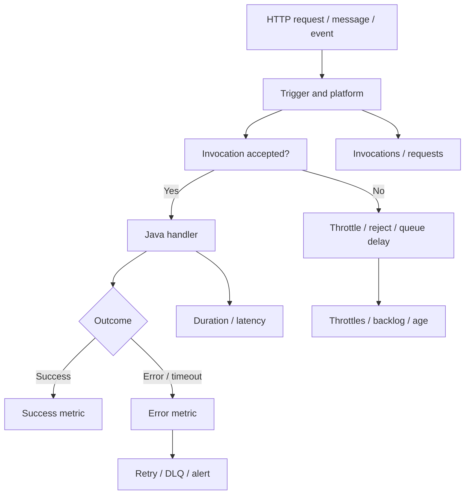

# Metrics for Invocations, Errors, Duration, and Throttling

A Java serverless function may execute thousands of invocations in a few minutes and then receive almost no requests for hours. Because the runtime scales automatically, watching the CPU of a fixed server is insufficient to tell whether the function is healthy or experiencing issues. You must monitor metrics that directly reflect how the function is invoked, its success rate, completion time, load capacity, and whether the platform is rejecting or delaying invocations.

The four foundational metric groups are **invocations/requests**, **errors**, **duration/latency**, and **throttling**. For message/event-driven functions, you also need message counts, message age, retries, backlog, and dead-letter counts. For HTTP functions, you must distinguish the full request latency experienced by the client from the handler execution duration. These metrics enable early incident detection, bottleneck identification, and SLO-based scaling/alerting thresholds.

## 1. Four Operational Questions to Answer

A basic dashboard should answer:

1. **How many invocations are occurring?** How is traffic increasing/decreasing, and are there spikes or dropped triggers?
2. **How many invocations are failing?** How are error rates, timeouts, retries, throttling, and dependency errors changing?
3. **How long does the function take to process?** Are average, p50, p95, p99, and full request latency exceeding SLOs?
4. **Can the function absorb the load?** Are concurrency, instance limits, quotas, throttling, and backlog growing?



Do not monitor invocation count alone. A function may receive the expected number of invocations while returning 500 errors, running slowly, or getting throttled. Conversely, a drop in invocations may be normal seasonal traffic or a sign of a broken trigger. Read metrics together and compare against a baseline.

## 2. Distinguishing Requests, Invocations, Events, and Messages

Platforms use different terminology; one invocation does not always equal one request or one message.

| Concept | Meaning | Example |
| --- | --- | --- |
| HTTP request | A request sent to an endpoint | Client calls `POST /orders` once |
| Invocation/execution | One time the runtime invokes the handler or executes the function | One Lambda handler invocation |
| Event | A business or system event | `OrderCreated` is emitted |
| Message | A unit of data in a queue/topic | A message in SQS or Service Bus |
| Batch | Multiple records passed into a single invocation | One Lambda invocation receives 10 SQS records |
| Retry/redelivery | Another attempt to process the same event/message/request | Message redelivered after handler failure |

For example, an SQS event source mapping may poll 10 messages and invoke Lambda once. In that case, invocation count is 1, while processed record count is 10. If the batch is retried, the same records can appear again. Therefore, understanding business load requires measuring both invocation count and record/message count.

With HTTP, a request may never produce an invocation if blocked at the API gateway, load balancer, or authentication layer. With async events, the source may accept an event first and deliver it to the function later; publish time and handler start time are two different timestamps.

## 3. Invocation and Request Volume Metrics

Invocation count indicates how many times the runtime called the function during a time window. Request count usually counts requests at the gateway/server. Event/message count reflects the volume of work produced or consumed.

Monitor:

- Total invocations/requests per minute or 5-minute window.
- Growth/decline rate compared to the baseline for the same time of day/day of week.
- Requests by endpoint, method, or function name.
- Events/messages received, processed, completed, and discarded.
- Average and p95 batch size, and records per invocation.
- Rate of invocations with no useful records or triggered erroneously.

### Invocation Rate

If there are (N) invocations in a window of (T) seconds, the average invocation rate is:

\[
\text{Invocation rate} = \frac{N}{T}
\]

For example, 6,000 invocations in 5 minutes equals an average of 20 invocations/second. Averages can hide short bursts; inspect metrics at fine enough granularity and combine them with concurrency/throttling.

### Monitoring Input and Output Volume

For queues/events, compare:

- Messages published/received.
- Records processed successfully.
- Records retried or sent to a DLQ.
- Remaining backlog.

If producers publish 1,000 messages/minute while consumers complete only 700 messages/minute, the backlog tends to grow by roughly 300 messages/minute (excluding deleted messages, duplicates, or batch semantics). Looking only at invocation count may miss this imbalance.

## 4. Error Count and Error Rate

Error count is the number of failed invocations over a time period. Error rate is the ratio of failures to total evaluated invocations.

\[
\text{Error rate} = \frac{\text{Failed requests}}{\text{Eligible requests}} \times 100\%
\]

For example, 40 failed requests out of 10,000 requests:

\[
\frac{40}{10,000} \times 100\% = 0.4\%
\]

When calculating error rate, clearly define the denominator. You can separate:

- **Application error rate:** the handler ran but returned an error or threw an exception.
- **HTTP 5xx rate:** requests ending in server errors.
- **HTTP 4xx rate:** requests rejected due to input, auth, or missing resources; usually not system failures but still worth tracking.
- **Platform failure rate:** invocations ending in timeout, crash, out-of-memory, or runtime error.
- **Throttle/rejection rate:** requests rejected due to concurrency/quota limits; must be tracked separately.
- **Message processing failure rate:** records/messages that fail to complete successfully after one or more attempts.

Do not lump all 4xx, 5xx, timeouts, and throttles into a single number. A spike in 401s from expired tokens requires different handling than 500s from a database outage. Some platforms do not count throttled requests in invocation/error metrics; verify the exact metric definitions.

### Categorizing Errors

| Error Type | Example | Metrics/Logs to Inspect |
| --- | --- | --- |
| Input/business | Malformed JSON, missing field, invalid order | 4xx/business rejections, validation reason |
| Authentication/authorization | Expired token, IAM AccessDenied | 401/403, denied count, audit logs |
| Dependency | Database, API, or secret manager failure | Dependency errors, timeouts, retry count |
| Runtime | Unhandled exception, crash, out-of-memory | Function errors, runtime logs, memory |
| Timeout | Handler exceeded deadline | Timeout count, duration, downstream spans |
| Throttling/quota | Exceeded concurrency or quota | Throttle count, concurrency, backlog |
| Delivery | Message lock expired, event retry, DLQ | Delivery count, age, retries, DLQ depth |

A handler may return HTTP 200 yet fail to persist data if an exception is caught and ignored. Therefore, platform success metrics must be cross-checked against business outcomes, such as order created or payment confirmed.

## 5. Duration and Latency Are Not the Same Measurement

**Function duration** typically measures the time from when the runtime starts executing the handler until the handler completes. **Request latency** measures the time from when a request enters the gateway/platform until the response reaches the client. These two values can differ due to gateway routing, authentication, cold starts, queue wait time, or serialization.

For event-driven functions, you can measure:

- Event age: time from when an event is created/published until the function begins processing it.
- Queue wait time: time a message sits in the queue before a consumer receives it.
- Handler duration: time the function spends processing the record/batch.
- End-to-end processing time: from when the producer creates the event until the final side effect completes.

For example, an HTTP request has 900 ms latency, of which gateway/network takes 100 ms, cold start takes 450 ms, and the handler takes 350 ms. Looking only at handler duration can cause operations teams to miss the main cause, which is cold start.

### Average and Percentiles

Averages are useful for seeing general trends, but they can hide slow requests. Monitor:

- **p50:** half of requests are faster than or equal to this value; describes the typical experience.
- **p95:** 95% of requests are faster than or equal to this; reflects tail latency.
- **p99:** 99% of requests are faster than or equal to this; useful for critical APIs and high traffic.
- **Max:** largest value in the window; easily skewed by a single outlier.

Example:

| Metric | Value |
| --- | ---: |
| Average duration | 180 ms |
| p50 | 120 ms |
| p95 | 650 ms |
| p99 | 1,800 ms |

An average of 180 ms looks good, yet 1% of requests take around 1.8 seconds or more. If the SLO requires p99 under 1 second, the system is still in violation.

Do not compute percentiles by averaging p95 values across multiple instances or time windows. Use histograms/distributions or a metrics system that supports accurate/properly estimated percentile aggregation.

## 6. What Is Throttling?

Throttling occurs when the platform rejects or delays requests/invocations because the function has hit concurrency, quota, or invocation-rate limits. Some platforms return an error like HTTP 429; some queue triggers retain messages for later delivery; some async sources retry according to policy.

Common causes:

- The function reached maximum concurrency or maximum instances.
- The account/project/subscription hit an overall quota.
- The function has reserved concurrency lower than incoming load.
- Downstream databases/APIs cannot sustain the current scale and the system intentionally limits throughput.
- The trigger has batch, partition, or consumer throughput limits.
- Regional capacity or platform quota is insufficient during bursts.

Throttling is not necessarily a code bug. It can be a resource protection mechanism. However, if unplanned, it causes increased latency, retry storms, rising queue age, and eventually client timeouts.

### Throttling Differs from Error Rate

Some `Errors` metrics only count invocations that started running and ended in failure. Throttled requests may not be counted in `Invocations` or `Errors`. Therefore, monitor `Throttles`/rejected requests separately, and compute the rate against total incoming requests at the gateway/producer if available.

\[
\text{Throttle rate} = \frac{\text{Throttled requests}}{\text{Incoming requests}} \times 100\%
\]

If the gateway does not provide an incoming request count, the denominator must come from the client/producer or another appropriately defined metric.

## 7. Concurrency, Capacity, and Utilization

Concurrency is the number of invocations running simultaneously. This is a critical metric for understanding scaling and pressure on downstream systems.

If each invocation runs for 200 ms on average and there are 100 invocations/second, average concurrency by Little's Law is approximately:

\[
L = \lambda W = 100 \times 0.2 = 20
\]

Where (L) is the average number of in-flight invocations, (lambda) is the arrival rate, and (W) is the average processing time in seconds. Bursts, tail latency, and batching can make actual concurrency significantly higher.

Monitor:

- Concurrent executions/active instances.
- Maximum configured concurrency/instance count.
- CPU utilization and memory working set.
- Connection pool active/idle/waiting counts.
- Database connection count and downstream API rate limits.
- Queue backlog and oldest message age.

High concurrency is not automatically bad. If duration is stable, errors are low, and downstream systems still have capacity, it may simply be normal scaling. Conversely, rising concurrency paired with rising duration, timeouts, and throttles can signal system overload.

### Per-Instance Concurrency

Some platforms allow a single instance to handle multiple concurrent requests. When increasing concurrency, verify whether the Java code is thread-safe, whether HTTP client/database pools are large enough, and whether memory grows with concurrent requests. Setting concurrency too high can exhaust instance memory; setting it too low can spawn many instances and increase cold starts/costs.

## 8. Cold Start and Initialization Duration

Cold start is the time the platform spends preparing a new execution environment before the function is ready to process requests. Java may need to load the JVM, classes, dependencies, DI container, SDK clients, and connection pools. Cold starts typically impact tail latency more than the average.

Useful metrics/logs:

- Initialization duration or startup duration.
- Cold start count/rate.
- Instance creation/startup count.
- p95/p99 latency by revision/runtime version.
- Time from instance start to first request.

Not every cloud exposes cold starts as a standalone metric. They can be inferred from platform logs, traces, or custom startup metrics. Distinguish initialization time from handler duration; do not double-count them if platform duration already includes part of startup by its own definition.

## 9. Retries, Event Age, and Dead-Letter Metrics

With async functions, a failure can trigger a retry. Retries increase handler execution counts relative to unique events. Measure:

- Retry attempt count or delivery count.
- Event age/queue age before processing.
- Oldest message age.
- Failed invocation/record count.
- Dead-letter queue depth and rate of messages entering the DLQ.
- Redrive/replay count.
- Batch size and partial batch failures.

If retries increase while final success remains healthy, transient errors are likely recovering. If retries rise alongside event age and DLQ depth, the backlog may be losing its ability to recover on its own.

### Event Age

Event age is the elapsed time from when an event is created or ingested into the system until the function processes it, depending on the provider's metric definition. Continuously rising event age usually indicates that consumers are slower than producers, concurrency is too low, downstream systems are throttled, or the trigger is stalled.

For queues, the oldest message age metric is often more informative than queue length alone: a queue with 10 messages where the oldest message has waited 30 minutes can severely violate an SLO. Conversely, a queue with 10,000 messages where consumers process fast and age remains low may still be healthy.

## 10. Metrics by Trigger Type

Not every function uses the same metric set. Choose metrics based on the trigger source:

| Trigger | Additional Metrics |
| --- | --- |
| HTTP | Request count, 4xx/5xx, latency, integration latency, 429, active requests |
| Queue | Visible/in-flight messages, oldest age, receive/delete, dequeue/delivery count, DLQ depth |
| Stream/Event Hub | Records received/processed, iterator/partition lag, checkpoint age, batch failures |
| Object storage | Object event count, trigger delay, object size, processing duration, retries |
| Timer/Scheduler | Schedule fired, missed/late runs, execution duration, last successful run |
| Workflow | Step success/failure, execution age, retries, timeouts, stuck states |

An HTTP function may show healthy request counts while the queue worker behind it is building a backlog. Dashboards should include both ingestion API metrics and worker completion metrics.

## 11. AWS Lambda and CloudWatch Metrics

AWS Lambda provides default metrics in the `AWS/Lambda` namespace. Commonly used metrics:

| Metric | Meaning | How to Read |
| --- | --- | --- |
| `Invocations` | Number of times the function was invoked | Use `Sum` to count within a window |
| `Errors` | Number of invocations ending in a function/runtime error | Use `Sum`; compare to `Invocations` for error rate |
| `Duration` | Function execution time | Inspect p50/p95/p99 and max; unit is milliseconds |
| `Throttles` | Number of throttled requests | Track separately from invocations/errors |
| `ConcurrentExecutions` | Number of concurrent executions | Inspect peak and trend near quota |
| `UnreservedConcurrentExecutions` | Concurrency used from the unreserved pool | Helps observe account-level concurrency pressure |
| `ProvisionedConcurrencySpilloverInvocations` | Invocations exceeding provisioned concurrency and running on-demand | Can increase cold starts/latency |
| `AsyncEventAge` | Age of async event before function processing | Monitor delivery delay |
| `AsyncEventsDropped` | Async events dropped after exhausting retries/retention per policy | Alerts on event loss |
| `IteratorAge` | Delay reading records from a stream | Useful for Kinesis/DynamoDB Streams |

Metrics and dimensions may vary by trigger/runtime type. `Init Duration` typically appears in the REPORT log line for cold starts and should not automatically be assumed to be a standard CloudWatch metric like `Duration`. You can create metric filters or use appropriate telemetry to analyze initialization.

### CloudWatch Formulas

Error rate over a window:

\[
\text{Error rate} = \frac{\operatorname{Sum}(Errors)}{\operatorname{Sum}(Invocations)} \times 100\%
\]

Throttle rate requires the incoming request denominator from the gateway/producer because `Throttles` may not be included in `Invocations`:

\[
\text{Throttle rate} = \frac{\operatorname{Sum}(Throttles)}{\text{Incoming requests}} \times 100\%
\]

When using CloudWatch Metric Math, select the proper `FunctionName`, `Resource`, or alias/version dimensions so you do not mix multiple functions. When inspecting `Duration`, choose percentile statistics instead of only `Average`.

### API Gateway and Queue Metrics

If Lambda is invoked via API Gateway, also inspect the `AWS/ApiGateway` namespace or corresponding HTTP API metrics such as request count, 4xx/5xx, and latency. `IntegrationLatency` helps separate API Gateway backend wait time from full request latency.

With SQS, monitor `ApproximateAgeOfOldestMessage`, `ApproximateNumberOfMessagesVisible`, `ApproximateNumberOfMessagesNotVisible`, and messages sent/received/deleted according to queue type. Combine these with Lambda `Errors`, `Throttles`, `ConcurrentExecutions`, and event source mapping metrics if enabled. Rising queue depth alongside oldest age signals that consumers are falling behind.

## 12. Azure Functions and Application Insights/Azure Monitor

Azure Functions can emit metrics on execution count, execution units, requests/responses, and resources depending on the hosting plan/runtime. Application Insights provides request, dependency, exception, and trace telemetry to observe function behavior at the application level.

Metrics/signals to monitor:

| Group | Metrics/Telemetry |
| --- | --- |
| Execution | Function execution count, execution units, invocation success/failure |
| HTTP | Request count, HTTP 4xx/5xx, response time/latency |
| Runtime | CPU, memory working set, instance count, worker restarts |
| Dependency | Dependency duration, failed dependency calls, timeouts |
| Queue/Service Bus | Active messages, dead-letter count, delivery count, oldest message age or source-specific backlog |
| Event Hubs | Incoming/outgoing events, partition lag/checkpoint age per source |
| Host | Throttle/scale signals, host startup, function timeouts, and exceptions |

Exact metric names and availability depend on the plan, Functions runtime version, extensions, and resource type. For HTTP-triggered Function Apps, some request metrics are provided via App Service/Azure Monitor; for non-HTTP triggers, Application Insights invocation telemetry and event-source metrics are often more important.

### Application Insights Tables

In workspace-based Application Insights, commonly used tables include:

- `requests`: request/invocation telemetry, duration, result code, and success.
- `dependencies`: calls to databases, HTTP APIs, or dependent services.
- `exceptions`: recorded exceptions.
- `traces`: application logs.
- `customMetrics`: metrics emitted by the application.
- `customEvents`: business events logged by the application.

Example KQL query counting requests and success rate over the last 30 minutes:

```kusto
requests
| where timestamp > ago(30m)
| summarize
    total = count(),
    failed = countif(success == false),
    p50 = percentile(duration, 50),
    p95 = percentile(duration, 95),
    p99 = percentile(duration, 99)
  by bin(timestamp, 5m), cloud_RoleName
| extend errorRate = 100.0 * failed / total
| order by timestamp desc
```

This is an illustrative query for the `requests` table. Verify the actual workspace schema and the unit of `duration` in the table/SDK being used. With queue triggers, not every invocation appears as an HTTP request; cross-check traces/exceptions and trigger extension metrics.

## 13. Google Cloud Functions/Cloud Run and Cloud Monitoring

Newer-generation Google Cloud Functions run on Cloud Run infrastructure. Specific metrics depend on function type, generation, trigger, and deployment method. For functions running on Cloud Run, Cloud Run metrics typically help observe requests, instances, CPU, memory, and concurrency.

Metrics to check routinely:

| Group | Cloud Monitoring Metrics/Signals |
| --- | --- |
| HTTP requests | Request count, response code class, request latency |
| Function execution | Execution count, execution duration, execution status per function/runtime metrics where available |
| Instance | Instance count, startup/instance creation, max request concurrency |
| Resources | Container CPU utilization, memory utilization, network bytes |
| Capacity | Max instances, concurrency, request queueing/latency, and quota errors |
| Event delivery | Eventarc delivery/retries/errors, Pub/Sub backlog/oldest unacked message age, or source metrics |

Exact metric names and prefixes may differ between Cloud Functions 1st gen, Cloud Functions 2nd gen/Cloud Run functions, and Cloud Run services. For example, Cloud Run metrics usually live under the `run.googleapis.com/` prefix; legacy Cloud Functions have their own metrics under `cloudfunctions.googleapis.com/`. Do not copy metric names from one generation to another without verifying in Metrics Explorer for the running resource.

### Cloud Logging and Traces

Cloud Logging stores application logs and request logs; Cloud Trace helps analyze latency by span; Cloud Monitoring provides metrics and alerts. For functions triggered by Pub/Sub/Eventarc, also monitor event-source metrics: backlog, oldest unacked message age, delivery attempts, and dead-letter counts. A handler with low duration but high event age usually points to a delivery/consumer capacity issue rather than business code.

## 14. Instrumentation in Java: Micrometer

Platform metrics show whether a function was invoked, failed, or throttled. Custom metrics add business visibility and per-step timing inside code. Micrometer is a popular metrics facade in Java/Spring; it can export to compatible backends such as Prometheus or through an appropriate registry.

Example measuring execution counts and duration of a use case:

```java
import io.micrometer.core.instrument.Counter;
import io.micrometer.core.instrument.MeterRegistry;
import io.micrometer.core.instrument.Timer;

public final class OrderProcessor {
    private final Counter succeeded;
    private final Counter failed;
    private final Timer duration;

    public OrderProcessor(MeterRegistry registry) {
        this.succeeded = Counter.builder("orders.processed")
                .tag("result", "success")
                .register(registry);
        this.failed = Counter.builder("orders.processed")
                .tag("result", "failure")
                .register(registry);
        this.duration = Timer.builder("orders.processing.duration")
                .publishPercentileHistogram()
                .register(registry);
    }

    public void process(Runnable operation) {
        Timer.Sample sample = Timer.start();
        try {
            operation.run();
            succeeded.increment();
        } catch (RuntimeException ex) {
            failed.increment();
            throw ex;
        } finally {
            sample.stop(duration);
        }
    }
}
```

This example measures an in-process use case and does not replace platform invocation metrics. In batch functions, the `orders.processed` metric counts business records, which can exceed invocation count. If the operation throws checked exceptions, adjust the signature/catch blocks for your actual service.

### Cardinality and Labels

Metric labels should have a small, stable set of values, such as `function`, `trigger`, `result`, `region`, or `operation`. Do not use `requestId`, `userId`, `orderId`, email, or raw URLs as labels because each distinct value creates a new time series, increasing cardinality, cost, and risk of data leakage. Use logs/traces for high-cardinality identifiers.

## 15. Instrumentation in Java: OpenTelemetry Tracing

Metrics tell you how many requests are slow; traces help locate which step was slow for a given request. OpenTelemetry lets you create spans for handlers, database queries, HTTP clients, and message processing steps.

Example creating a manual span:

```java
import io.opentelemetry.api.GlobalOpenTelemetry;
import io.opentelemetry.api.trace.Span;
import io.opentelemetry.api.trace.Tracer;

public final class PaymentService {
    private static final Tracer tracer =
            GlobalOpenTelemetry.getTracer("payment-service");

    public void authorize(String paymentId) {
        Span span = tracer.spanBuilder("payment.authorize").startSpan();
        try (var scope = span.makeCurrent()) {
            span.setAttribute("payment.operation", "authorize");
            // Call payment provider and handle result.
        } catch (RuntimeException ex) {
            span.recordException(ex);
            span.setStatus(io.opentelemetry.api.trace.StatusCode.ERROR);
            throw ex;
        } finally {
            span.end();
        }
    }
}
```

This snippet illustrates the tracing API; production requires configuring the OpenTelemetry SDK/exporter or OpenTelemetry Java agent, resource attributes, sampling, and context propagation. Do not put payment IDs, tokens, or sensitive data into span attributes if they can identify users or transactions.

With serverless, ensure the exporter flushes telemetry before the runtime freezes/shuts down per platform capabilities. Use an appropriate exporter/collector and batch processor configured for short executions; avoid spawning exporter threads that the runtime does not keep alive. Some clouds provide their own integration/agent, so choose a single export path to avoid sending duplicate telemetry.

## 16. Computing Key Ratios

### Error Rate

\[
\text{Error rate} = \frac{E}{I} \times 100\%
\]

Where (E) is the number of failed invocations/requests and (I) is the total invocations/requests under the same definition. Do not mix gateway requests with handler invocations if they have different scopes.

### Success Rate

\[
\text{Success rate} = 100\% - \text{Error rate}
\]

This is meaningful only when success and error are mutually exclusive and share the same denominator. For queues, records retried multiple times must distinguish attempt failures from final message failure.

### Throttle Rate

\[
\text{Throttle rate} = \frac{T}{R} \times 100\%
\]

Where (T) is the number of throttled requests and (R) is the number of requests reaching the ingress layer. Do not use invocation count as the denominator if throttled requests are not counted as invocations.

### Average Duration

\[
\text{Average duration} = \frac{\sum_{i=1}^{n} d_i}{n}
\]

Averages help track trends, but do not replace percentiles. With batches, measure both duration per invocation and duration/throughput per record to avoid misreading performance.

### Batch Throughput

\[
\text{Record throughput} = \frac{\text{Records successfully processed}}{\text{Time window}}
\]

Measuring record throughput helps compare functions processing 1 record/invocation with batch-processing functions. However, high throughput does not guarantee low latency for individual messages; monitor oldest age as well.

## 17. Minimum Dashboard for Java Serverless

An overview dashboard can be organized into rows:

| Dashboard Row | Charts |
| --- | --- |
| Traffic | Incoming requests/events, invocation count, records per invocation |
| Reliability | Error count/rate, timeouts, exceptions, success rate, DLQ |
| Latency | Duration average/p50/p95/p99, end-to-end latency, event age |
| Capacity | Concurrency, active instances, max instances, CPU/memory, throttles |
| Dependencies | Database/API duration, errors, connection pool, rate limits |
| Cost/cold start | Billed duration, memory/CPU, cold starts/initialization, provisioned/min instances |
| Business | Order/payment successes, event completions, job age, duplicate/invalid records |

Dashboards should include filters for function/service, environment, region, and revision/version. Use the same time range and units when comparing. Do not make tenant ID or request ID default dimensions.

### Drill-Down

When error rate increases:

1. Identify which function and which revision are affected.
2. Inspect error codes/exception classes and trigger types.
3. Compare duration, concurrency, throttles, and dependency errors.
4. Open traces/request logs by invocation ID or correlation ID.
5. Check deployment markers, config changes, and secret rotations around that time.
6. For queues, inspect message age, retries, DLQ, and batch size.

Do not start by reading thousands of random logs; use metrics to narrow the scope, traces to find the slow path, and logs to understand details.

## 18. SLO-Based Alerting Instead of a Single Static Threshold

Alerts should reflect impact on users or work. Examples:

| Signal | Reference Alert Condition | First Action |
| --- | --- | --- |
| HTTP 5xx | Error rate exceeds error budget over short and long windows | Check revision, dependencies, and error traces |
| p95/p99 latency | Exceeds SLO over multiple consecutive windows | Analyze cold starts, DB/API, and concurrency |
| Throttling | Sustained throttling or throttle rate exceeds threshold | Check concurrency/quotas and downstream capacity |
| Queue oldest age | Exceeds maximum processing time per SLO | Check consumer health, backlog, and downstream |
| DLQ depth | Messages entering DLQ or growing continuously | Check payloads, retry limits, and poison messages |
| Timeouts | Sharp spike compared to baseline | Check duration, deadlines, and downstream timeouts |
| Invocation volume | Abnormal compared to history/expected traffic | Check triggers, producers, bots, or routing |
| Dependency failures | DB/API errors/latency increasing | Check dependent services, connection pools, and rate limits |

Do not set an alert to “page on-call on a single failed invocation” for workloads with millions of invocations and expected input errors. Conversely, a low-volume payment processing function may need immediate alerting when a single critical transaction fails. Assign severity by business criticality.

### Multi-Window Alerts

To avoid alerting on brief spikes, combine short and long windows. For example, error rate is high over 5 minutes and simultaneously high over 1 hour; or p99 exceeds the SLO over multiple evaluation periods. Windows and thresholds must be grounded in real traffic, SLOs, and error budgets rather than copied from another system.

## 19. Throttling and Capacity: How to Investigate

When throttles rise, check in order:

1. Did incoming request/event rate spike?
2. Did current concurrency hit reserved/max concurrency or max instances?
3. Is account/project/region quota being consumed by another function?
4. Did duration increase, causing each invocation to hold a slot longer?
5. Is a downstream database/API slow or rate-limiting, causing concurrency to build up?
6. Does the queue/event source have backlog, partition hot spots, or batch configuration issues?
7. Was a new revision deployed with different memory/CPU/concurrency settings?

Do not fix every throttle by raising quotas. If the database is already out of connections, raising concurrency only worsens the incident. You may need to reduce batch/concurrency, scale downstream capacity, add a queue buffer, optimize duration, or apply backpressure.

### Little's Law Example

Suppose a function receives 150 requests/second. Average duration rises from 100 ms to 600 ms due to a slow database:

| State | Arrival Rate | Average Duration | Estimated Average Concurrency |
| --- | ---: | ---: | ---: |
| Before incident | 150 req/s | 0.1 s | 15 |
| During slow database | 150 req/s | 0.6 s | 90 |

Duration growth alone increased average concurrency sixfold, even though the request rate stayed constant. This can push the function to its concurrency limit and trigger throttling. The root cause may lie in the database rather than the function quota.

## 20. Distinguishing Platform Metrics from Business Metrics

Platform metrics answer whether the function ran and how long it took. Business metrics answer whether the work achieved its goal.

For example, an order worker may report:

- Platform: 100 invocations, 0 errors, p95 duration 250 ms.
- Business: only 60 orders marked `PROCESSED`; 40 messages were duplicates or skipped by rules.

This is not necessarily an error. However, if the goal was to process 100 new orders, you need to classify duplicates, invalid items, and successful business operations. Measure:

- `orders.received`.
- `orders.validated`.
- `orders.processed`.
- `orders.rejected` by a low-cardinality reason code.
- `orders.duplicate`.
- `orders.processing.duration`.

Business metrics catch cases where the handler returns success but the outcome is wrong. Ensure metrics do not cause side effects or fail invocations if the telemetry backend is temporarily unavailable.

## 21. Common Mistakes When Reading Metrics

1. **Equating invocations with messages.** One invocation may process a batch of multiple records.
2. **Using Errors/Invocations while ignoring Throttles.** Throttled requests may not be counted as invocations.
3. **Looking only at average duration.** Tail latency p95/p99 can violate SLOs even when the average looks fine.
4. **Confusing handler duration with end-to-end latency.** Gateway, queue wait, and cold starts can account for most of the elapsed time.
5. **Looking only at queue length.** Oldest message age reveals actual processing delay.
6. **Assuming high concurrency is an incident.** It must be evaluated against capacity and downstream health.
7. **Increasing concurrency to fix throttles without checking the DB.** This can cause connection exhaustion.
8. **Not separating application errors from platform errors.** Logs/traces are needed to isolate the source.
9. **Using request IDs as metric labels.** Creates high cardinality and increases cost.
10. **Not measuring business outcomes.** Handler success does not guarantee business completion.
11. **Not verifying metric names per runtime/plan.** Metrics differ across function generations and services.
12. **Not accounting for retries in load.** A failing event can generate multiple invocations/attempts.

## 22. Process for Setting Up Observability for a Java Function

1. Identify triggers and distinguish requests, invocations, events, messages, and batch records.
2. Choose platform metrics for invocation count, errors, duration, throttling, and concurrency.
3. Choose event-source metrics such as queue age, partition lag, retries, and DLQ.
4. Instrument Java code with Micrometer/OpenTelemetry for business steps and dependencies.
5. Standardize request ID, invocation ID, event ID, and correlation ID in logs/traces.
6. Build dashboards filtered by function/environment/region/revision.
7. Define SLIs/SLOs for availability, latency, and event processing age.
8. Configure alerts based on error budgets, p95/p99, throttles, timeouts, and backlog.
9. Test load, downstream slowdowns, retries, and quotas to verify alerts.
10. Review metric cardinality, sampling, retention, and telemetry costs.
11. Add release markers to compare before/after deployments.
12. Tune thresholds based on baselines and business criticality.

## 23. Pre-Production Metrics Checklist

- [ ] Do you know how many requests/messages/records a single invocation can contain?
- [ ] Are incoming request/event counts and invocation counts tracked separately when needed?
- [ ] Do you have success/error counts and an error rate with a clearly defined denominator?
- [ ] Are 4xx, 5xx, timeouts, dependency failures, and throttles separated?
- [ ] Do you track duration average alongside p50/p95/p99?
- [ ] Are end-to-end latency or event age measured for async workloads?
- [ ] Are concurrency, instance count, CPU/memory, and downstream connection metrics tracked?
- [ ] Are retry count, batch failures, oldest message age, and DLQ depth tracked?
- [ ] Are cold start and dependency duration metrics/traces available when needed?
- [ ] Are business metrics in place to verify work actually completes?
- [ ] Are metric labels low-cardinality and free of sensitive data?
- [ ] Do dashboards filter by environment, region, function, and revision?
- [ ] Are alerts tied to SLOs/error budgets with incident playbooks?
- [ ] Are metric names/namespaces verified for the exact cloud runtime/plan?
- [ ] Are telemetry cost, retention, and sampling under control?

Invocation, error, duration, and throttling metrics form the foundation for operating Java serverless workloads. Invocations show incoming work volume; error rates reflect reliability; latency percentiles reveal tail user experience; throttling/concurrency expose capacity limits. For HTTP, add request latency; for messages/events, add event age, backlog, retries, and DLQ metrics. Combining platform metrics with logs, traces, and business metrics in Java lets operations teams distinguish code bugs, dependency failures, cold starts, overload, and trigger issues rather than staring at a single aggregate number.

## Official References

- [AWS Lambda metrics](https://docs.aws.amazon.com/lambda/latest/dg/monitoring-metrics.html)
- [AWS Lambda monitoring and observability](https://docs.aws.amazon.com/lambda/latest/dg/lambda-monitoring.html)
- [Amazon SQS CloudWatch metrics](https://docs.aws.amazon.com/AWSSimpleQueueService/latest/SQSDeveloperGuide/sqs-available-cloudwatch-metrics.html)
- [Amazon API Gateway metrics](https://docs.aws.amazon.com/apigateway/latest/developerguide/api-gateway-metrics-and-dimensions.html)
- [Azure Functions monitoring](https://learn.microsoft.com/azure/azure-functions/functions-monitoring)
- [Azure Monitor supported metrics for Microsoft.Web/sites](https://learn.microsoft.com/azure/azure-monitor/reference/supported-metrics/microsoft-web-sites-metrics)
- [Application Insights data model](https://learn.microsoft.com/azure/azure-monitor/app/data-model)
- [Google Cloud Run metrics](https://cloud.google.com/monitoring/api/metrics_gcp#gcp-run)
- [Google Cloud Functions metrics](https://cloud.google.com/monitoring/api/metrics_gcp#gcp-cloudfunctions)
- [Google Cloud Monitoring alerting](https://cloud.google.com/monitoring/alerts)
- [Micrometer documentation](https://micrometer.io/docs)
- [OpenTelemetry Java](https://opentelemetry.io/docs/languages/java/)
