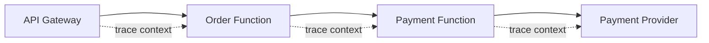

# Propagating Trace Context Across HTTP and Asynchronous Events

In a serverless system, a request may travel through an API Gateway, a Java function, a queue, an event bus, one or more additional functions, and then reach a database or external service. Each function has its own invocations and logs; without propagating trace context across boundaries, operations teams struggle to tell which logs and spans belong to the same business flow.

Trace context is the metadata that enables components to continue the same distributed trace. Over HTTP, context is typically propagated via W3C standard headers such as `traceparent` and `tracestate`. With queues/events, that same metadata must be placed in message attributes or event extensions so consumers can extract it and create linked spans.

Java serverless applications commonly use OpenTelemetry to create spans, inject/extract context, and export telemetry to an observability backend. This lesson focuses on properly propagating context across synchronous HTTP and asynchronous events, handling batches/retries, keeping context data secure, and testing the full flow.

## 1. Trace Context and Distributed Traces

### 1.1. Trace, Span, and Context

A **trace** describes the complete journey of a request or distributed workflow. A trace consists of multiple **spans**; each span represents an operation with a start/end time, name, kind, attributes, events, and status.

Trace context is the minimal metadata needed to connect spans across different processes. Under W3C Trace Context, the key components are:

- `trace-id`: trace identifier, 16 bytes (32 hex characters), shared across spans in the trace.
- `parent-id`: parent span identifier, 8 bytes (16 hex characters); a new span becomes the parent of subsequent operations.
- `trace-flags`: control flags, including the sampled bit indicating whether the trace is sampled according to context.
- `tracestate`: vendor-specific state data, forwarded according to W3C rules.

Example of a version `00` HTTP `traceparent` header:

```text
traceparent: 00-4bf92f3577b34da6a3ce929d0e0e4736-00f067aa0ba902b7-01
```

The illustrative value above has the structure `version-trace-id-parent-id-trace-flags`. Do not split the string manually with substrings to construct traces; use OpenTelemetry's propagator to validate and handle versions/formats according to specification.

### 1.2. Context Propagation Creates Parent-Child Relationships

Consider an HTTP request passing through three services:



Each service creates its own spans while keeping the same trace ID. When Order Function calls Payment Function over HTTP, it injects the current span's context into the request. Payment Function extracts context from the request, creates a server/consumer span with the corresponding parent, and continues injecting when calling the provider.

Without propagation, each function may start its own root trace. The backend will still show the spans, but cannot automatically tell they belong to the same business flow.

### 1.3. Trace Context Differs from Correlation ID

`trace-id` serves distributed tracing. `correlationId`, `requestId`, `orderId`, or `workflowId` serve business tracking and application-level investigation. Both types of IDs may appear together in logs, but they should not replace one another.

| Value | Purpose | Should Be Used for Authorization? |
| --- | --- | --- |
| Trace ID | Connects spans across services | No |
| Span ID | Identifies a single operation within a trace | No |
| Correlation ID | Finds logs related to a request/workflow | No, unless verified as separate business data |
| User/Tenant ID | Identifies the business principal | Only after authentication and authorization checks |
| Idempotency/Event ID | Prevents duplicate processing and reconciles events | Does not replace authorization |

Trace context can be set arbitrarily by external callers. Do not use trace ID to authenticate users, identify tenants, enforce permissions, or prevent replay attacks.

## 2. W3C Trace Context Standard and OpenTelemetry

### 2.1. `traceparent`

`traceparent` carries information to establish parent relationships between spans. The header has a standard format, commonly version `00`. Trace ID and parent ID must not be all zeros. Parsers must validate version, length, and valid characters.

When a service receives a request:

1. Read `traceparent` and `tracestate` from the carrier;
2. The propagator validates and extracts into an OpenTelemetry `Context`;
3. Create a server/consumer span with the extracted context;
4. Make the span current in context for the duration of processing;
5. Close the scope and end the span when the operation finishes.

When a service calls downstream:

1. Create a client/producer span;
2. Make the span current;
3. Inject the current context into headers/message attributes;
4. Send the request/message;
5. End the span when the call or publish finishes.

### 2.2. `tracestate`

`tracestate` carries additional tracing vendor state. Services should preserve and forward it per standard rules without arbitrarily rewriting another vendor's entries. This header is not a place to store arbitrary business metadata.

If the system does not need vendor-specific state, it may propagate only `traceparent`. When using multiple tracing backends or vendors, verify propagator behavior and policies for preserving `tracestate` through gateways, proxies, and message brokers.

### 2.3. Baggage

W3C Baggage is a mechanism for passing optional key/value pairs across service boundaries. For example, it may carry `tenant.tier=gold` or `workflow.type=refund` if those values are non-sensitive and helpful for telemetry.

Baggage differs from span attributes:

- span attributes are attached to a specific span;
- baggage is forwarded across services when propagators support it;
- baggage can multiply across many requests/messages and inflate header/event sizes.

Do not put passwords, access tokens, emails, phone numbers, payment data, session IDs, or sensitive personal data into baggage. Limit the number of keys, maximum length, and allowed key set. Retain only values needed for telemetry.

### 2.4. OpenTelemetry Propagators

OpenTelemetry uses `TextMapPropagator` to inject/extract context into a key/value carrier. The carrier can be HTTP headers, message attributes, or event extension attributes.

Propagators should be configured consistently between producers and consumers. For W3C Trace Context, use the W3C propagator; if propagating baggage, also configure the W3C Baggage propagator. Do not write custom `traceparent` parsers when the standard library already handles it.

## 3. Propagating Context Over HTTP

### 3.1. Ingress: Extracting Context from Requests

At HTTP ingress, context is usually extracted from headers before running business logic. If using the OpenTelemetry Java agent or framework instrumentation, server span creation and extraction may already happen automatically. Do not create a duplicate server span if instrumentation already created one for the same request.

If writing a custom adapter, you need to:

- read `traceparent`, `tracestate`, and baggage per standard;
- handle missing, malformed, or oversized headers;
- start a new root trace when no valid context exists;
- never fail a request solely because a trace header is invalid;
- never use trace context in place of authentication/authorization.

### 3.2. Egress: Injecting Context into HTTP Clients

When a Java function calls an HTTP downstream service, the current context must be injected into request headers. If using an OpenTelemetry-instrumented HTTP client, propagation usually happens automatically. If managing the carrier yourself or using an uninstrumented client, you can inject manually.

Example helper for a `Map<String, String>` carrier:

```java
import io.opentelemetry.api.GlobalOpenTelemetry;
import io.opentelemetry.context.propagation.TextMapPropagator;
import io.opentelemetry.context.propagation.TextMapSetter;

import java.util.HashMap;
import java.util.Map;

public final class TraceHeaders {
    private static final TextMapPropagator PROPAGATOR =
            GlobalOpenTelemetry.getPropagators().getTextMapPropagator();

    private static final TextMapSetter<Map<String, String>> SETTER =
            (carrier, key, value) -> carrier.put(key, value);

    private TraceHeaders() {}

    public static Map<String, String> injectCurrentContext() {
        Map<String, String> headers = new HashMap<>();
        PROPAGATOR.inject(io.opentelemetry.context.Context.current(), headers, SETTER);
        return headers;
    }
}
```

`GlobalOpenTelemetry` must be configured with an appropriate SDK/propagator before use. If the global propagator is a no-op, the map may be empty; verify startup configuration and exporters in the deployed environment.

### 3.3. Extracting Context in a Java Adapter

Example getter for a carrier map. HTTP headers are case-insensitive; if the carrier stores keys as-is, the getter should look up keys case-insensitively or normalize keys before calling the propagator.

```java
import io.opentelemetry.api.GlobalOpenTelemetry;
import io.opentelemetry.context.Context;
import io.opentelemetry.context.propagation.TextMapGetter;
import io.opentelemetry.context.propagation.TextMapPropagator;

import java.util.Map;

public final class TraceContextExtractor {
    private static final TextMapPropagator PROPAGATOR =
            GlobalOpenTelemetry.getPropagators().getTextMapPropagator();

    private static final TextMapGetter<Map<String, String>> GETTER =
            new TextMapGetter<>() {
                @Override
                public Iterable<String> keys(Map<String, String> carrier) {
                    return carrier == null ? java.util.List.of() : carrier.keySet();
                }

                @Override
                public String get(Map<String, String> carrier, String key) {
                    if (carrier == null) {
                        return null;
                    }
                    return carrier.entrySet().stream()
                            .filter(entry -> entry.getKey().equalsIgnoreCase(key))
                            .map(Map.Entry::getValue)
                            .findFirst()
                            .orElse(null);
                }
            };

    private TraceContextExtractor() {}

    public static Context extract(Map<String, String> headers) {
        return PROPAGATOR.extract(Context.root(), headers, GETTER);
    }

    public static TextMapGetter<Map<String, String>> getter() {
        return GETTER;
    }
}
```

In production applications, use an appropriate HTTP/framework adapter to retrieve multi-value headers according to the server contract. The example above only illustrates a simple carrier map; do not merge or concatenate multiple header values arbitrarily.

### 3.4. Server Spans and Client Spans

When creating spans manually, use the proper `SpanKind`:

| Operation | Common Span Kind |
| --- | --- |
| Receiving an HTTP request | `SERVER` |
| Calling an HTTP downstream | `CLIENT` |
| Publishing a message/event | `PRODUCER` |
| Consuming/processing a message | `CONSUMER` |
| Internal logic | `INTERNAL` |

If a framework or agent already creates server/client spans, only add needed attributes/events rather than creating a second span representing the same operation.

### 3.5. Gateways and Intermediary Proxies

API Gateways, ingress controllers, service meshes, CDNs, or reverse proxies may preserve, strip, generate, or normalize headers. Verify:

- whether `traceparent` reaches the function;
- whether headers are rewritten on retries or routing to another revision;
- whether `tracestate` and baggage are capped or amplified;
- whether the gateway creates its own span and links the parent properly;
- whether the gateway's request ID is logged separately.

Do not assume headers sent by clients always reach the handler. Verify real traces across both ingress and egress paths.

## 4. Propagating Context Through Asynchronous Events

### 4.1. Why Do Events Need a Dedicated Carrier?

HTTP has headers, whereas queue messages/events may not preserve HTTP headers. When a producer publishes a message, it needs to inject trace context into transport-supported metadata. The consumer reads that metadata and extracts it before processing.

Common locations:

| Transport | Context Propagation Location |
| --- | --- |
| SQS-like queue | Message attributes |
| Pub/Sub | Message attributes |
| Kafka | Record headers |
| RabbitMQ/AMQP | Message headers/properties |
| CloudEvents | Extension attributes such as `traceparent`, `tracestate` if the contract allows |
| Webhook | W3C HTTP headers |

You do not need to stuff trace context into the business payload. Metadata/headers are generally cleaner and avoid altering business schemas. However, some event platforms permit only specific attribute sets; verify size limits, character rules, and reserved names.

### 4.2. Producer: Injecting Context into Message Attributes

Java example creating metadata for a message:

```java
import io.opentelemetry.api.GlobalOpenTelemetry;
import io.opentelemetry.api.trace.Span;
import io.opentelemetry.api.trace.SpanKind;
import io.opentelemetry.api.trace.Tracer;
import io.opentelemetry.context.Scope;
import io.opentelemetry.context.propagation.TextMapPropagator;
import io.opentelemetry.context.propagation.TextMapSetter;

import java.util.HashMap;
import java.util.Map;

public final class OrderEventPublisher {
    private static final Tracer TRACER =
            GlobalOpenTelemetry.getTracer("orders-publisher");
    private static final TextMapPropagator PROPAGATOR =
            GlobalOpenTelemetry.getPropagators().getTextMapPropagator();
    private static final TextMapSetter<Map<String, String>> SETTER =
            (carrier, key, value) -> carrier.put(key, value);

    private final MessageTransport transport;

    public OrderEventPublisher(MessageTransport transport) {
        this.transport = transport;
    }

    public void publish(OrderPaid event) {
        var span = TRACER.spanBuilder("publish order paid")
                .setSpanKind(SpanKind.PRODUCER)
                .startSpan();
        try (Scope ignored = span.makeCurrent()) {
            Map<String, String> attributes = new HashMap<>();
            PROPAGATOR.inject(io.opentelemetry.context.Context.current(),
                    attributes, SETTER);
            transport.send(event, attributes);
        } catch (RuntimeException error) {
            span.recordException(error);
            span.setStatus(io.opentelemetry.api.trace.StatusCode.ERROR);
            throw error;
        } finally {
            span.end();
        }
    }
}
```

`MessageTransport` is an application abstraction; the concrete adapter must map these key/value pairs to broker message attributes or record headers. If the SDK already auto-instruments the producer and injects context, do not inject a duplicate set of headers.

If `transport.send()` returns an async future/publisher, the publish span in the example only measures until the send operation is initiated or accepted per the adapter contract. To measure until broker acknowledgment, end the span inside the acknowledgment completion callback and propagate context into that callback.

### 4.3. Consumer: Extracting Before Processing

For a single message, the consumer can extract context and create a consumer span:

```java
import io.opentelemetry.api.GlobalOpenTelemetry;
import io.opentelemetry.api.trace.Span;
import io.opentelemetry.api.trace.SpanKind;
import io.opentelemetry.api.trace.StatusCode;
import io.opentelemetry.api.trace.Tracer;
import io.opentelemetry.context.Context;
import io.opentelemetry.context.Scope;
import io.opentelemetry.context.propagation.TextMapGetter;
import io.opentelemetry.context.propagation.TextMapPropagator;

import java.util.Map;

public final class OrderEventConsumer {
    private static final Tracer TRACER =
            GlobalOpenTelemetry.getTracer("orders-consumer");
    private static final TextMapPropagator PROPAGATOR =
            GlobalOpenTelemetry.getPropagators().getTextMapPropagator();

    private static final TextMapGetter<Map<String, String>> GETTER =
            new TextMapGetter<>() {
                @Override
                public Iterable<String> keys(Map<String, String> carrier) {
                    return carrier == null ? java.util.List.of() : carrier.keySet();
                }

                @Override
                public String get(Map<String, String> carrier, String key) {
                    if (carrier == null) return null;
                    return carrier.entrySet().stream()
                            .filter(entry -> entry.getKey().equalsIgnoreCase(key))
                            .map(Map.Entry::getValue)
                            .findFirst()
                            .orElse(null);
                }
            };

    private final OrderApplicationService service;

    public OrderEventConsumer(OrderApplicationService service) {
        this.service = service;
    }

    public void handle(OrderPaid event, Map<String, String> attributes) {
        Context parent = PROPAGATOR.extract(Context.root(), attributes, GETTER);
        var span = TRACER.spanBuilder("process order paid")
                .setSpanKind(SpanKind.CONSUMER)
                .setParent(parent)
                .startSpan();

        try (Scope ignored = span.makeCurrent()) {
            service.process(event);
        } catch (RuntimeException error) {
            span.recordException(error);
            span.setStatus(StatusCode.ERROR);
            throw error;
        } finally {
            span.end();
        }
    }
}
```

If a message lacks valid context, `extract` returns a context without a remote parent; the consumer still creates an independent span. Do not reject messages solely for missing trace metadata unless an internal contract mandates it for a clear operational reason.

### 4.4. CloudEvents Extension Attributes

With CloudEvents, trace context can be placed in extension attributes if producer and consumer agree on the contract. Envelope example:

```json
{
  "specversion": "1.0",
  "id": "evt-9821",
  "source": "/orders",
  "type": "com.example.order.paid.v1",
  "traceparent": "00-4bf92f3577b34da6a3ce929d0e0e4736-00f067aa0ba902b7-01",
  "data": {
    "orderId": "order-42",
    "status": "PAID"
  }
}
```

This is an illustrative example. CloudEvents extension names must follow CloudEvents naming rules; `traceparent` and `tracestate` can serve as extensions if the platform and binding permit. If the transport already provides dedicated message attributes, prefer keeping context in metadata so the business payload stays uncluttered.

## 5. Parent, Child, and Span Links in Async Workflows

### 5.1. When to Use Parent-Child

Parent-child represents an operation invoked as a direct continuation of the preceding operation. For HTTP request/response or a single message processed directly, the consumer span can use the producer context as its parent if system semantics fit.

However, a queue may hold messages for minutes or hours. The producer span finished long before the consumer starts. A trace can still link parent-child, yet timing no longer resembles a synchronous call stack. Choose the model that accurately reflects semantics and backend visualization capabilities.

### 5.2. Span Links for Asynchronous Work

Span links represent causal relationships between spans without forcing the new span to have a single parent. Links are useful when:

- a consumer receives a batch containing multiple messages from multiple traces;
- a workflow aggregates multiple independent events;
- a job is triggered by multiple sources;
- async processing is delayed and the producer span should not be treated as a direct call-stack parent;
- fan-in/fan-out creates one-to-many or many-to-one relationships.

For a batch of multiple messages, do not pick the first record's context as the parent for the entire batch. Create a consumer span for the batch and add a link to each message's valid `SpanContext`.

### 5.3. Batch Consumer Example Using Links

```java
import io.opentelemetry.api.GlobalOpenTelemetry;
import io.opentelemetry.api.trace.Span;
import io.opentelemetry.api.trace.SpanContext;
import io.opentelemetry.api.trace.SpanKind;
import io.opentelemetry.api.trace.Tracer;
import io.opentelemetry.context.Context;
import io.opentelemetry.context.Scope;
import io.opentelemetry.context.propagation.TextMapPropagator;

import java.util.List;
import java.util.Map;

public final class BatchOrderConsumer {
    private static final Tracer TRACER =
            GlobalOpenTelemetry.getTracer("orders-batch-consumer");
    private static final TextMapPropagator PROPAGATOR =
            GlobalOpenTelemetry.getPropagators().getTextMapPropagator();

    public void handle(List<Message<OrderPaid>> messages) {
        var builder = TRACER.spanBuilder("process order batch")
                .setSpanKind(SpanKind.CONSUMER)
                .setNoParent();

        for (Message<OrderPaid> message : messages) {
            Context extracted = PROPAGATOR.extract(
                    Context.root(), message.attributes(), TraceContextExtractor.getter());
            SpanContext linkedContext = Span.fromContext(extracted).getSpanContext();
            if (linkedContext.isValid()) {
                builder.addLink(linkedContext);
            }
        }

        var span = builder.startSpan();
        try (Scope ignored = span.makeCurrent()) {
            for (Message<OrderPaid> message : messages) {
                processOne(message);
            }
        } finally {
            span.end();
        }
    }

    private void processOne(Message<OrderPaid> message) {
        // Idempotent business processing for one message.
    }
}
```

`Message`, `OrderPaid`, and `TraceContextExtractor.getter()` are illustrative types/adapters to connect with application code. `setNoParent()` makes the batch span the root of batch processing; producer contexts are represented via links. If framework instrumentation already creates a consumer span and links for the batch, do not create a duplicate span.

### 5.4. Fan-Out and Fan-In

In fan-out, one request may publish multiple messages. Each message should carry the context of its corresponding publish operation. Each message's consumer creates its own span and can link or use an appropriate parent.

In fan-in, a function aggregates multiple results from multiple upstream traces. The aggregating span should link to the source contexts, since no single parent accurately represents all of them.

## 6. Retries and Redeliveries in Traces

### 6.1. Each Delivery Is a Separate Execution

A queue may deliver the same message multiple times. The original trace context usually stays attached to the message, yet each delivery attempt is a new execution. You can create a separate consumer span for each attempt and attach attributes such as:

- `messaging.message.id` or message identifier per the active semantic conventions;
- delivery attempt number if provided by the broker;
- queue/topic/subscription;
- `error.type` on failure;
- non-sensitive retry/backoff metadata.

Do not reuse the same span object across multiple invocations. Spans must end within their corresponding invocation. On redelivery, the consumer creates a new span; spans may point to the producer context or connect via a workflow/retry context.

### 6.2. Internal Retries vs. Platform Retries

Distinguish:

- **Internal retries:** code calls a dependency again within the same invocation. You can create child spans per attempt under the current processing span.
- **Platform/queue retries:** the function invocation ends in failure and the platform redelivers the message. Each new invocation creates a new span, usually linked back to the context propagated in the message.
- **Redrive from DLQ:** the message is replayed after some time; preserve the event identity and original trace context if policy allows, while recording separate replay metadata.

Do not overwrite the message's `traceparent` with the new retry attempt's context if you want to retain the link to the original producer. If you need to represent retry workflows, add spans/links or attempt attributes rather than erasing the origin.

### 6.3. Correlation and Idempotency Do Not Depend on Traces

Trace sampling may drop some traces from the backend. Trace context may be missing or spoofed by callers. Therefore, retries, deduplication, and idempotency must rely on verified, durably stored event IDs/idempotency keys, not on trace IDs.

Trace context is strictly for observability. Do not use `trace-id` as a database key, event identity, or duplicate-prevention condition.

## 7. Context in Java Threads and Asynchronous Execution

### 7.1. Context Is Typically Bound to a Thread-Local Scope

OpenTelemetry Java `Context.current()` typically reads the current context from thread-bound storage. Opening a scope makes the context current within that block; closing the scope restores the previous context.

Always close `Scope` with try-with-resources:

```java
try (Scope scope = extractedContext.makeCurrent()) {
    service.process(event);
}
```

Never leave a scope open across invocations or store request-specific context in static fields. Serverless runtimes can reuse execution environments; failing to close a scope can leak the previous request's context into the next request.

### 7.2. CompletableFuture and Executors

When offloading work to a thread pool, the worker thread may not carry the caller thread's current context. Capture context before submitting and make it current inside the task, or use instrumentation that handles propagation automatically.

Example:

```java
import io.opentelemetry.context.Context;
import io.opentelemetry.context.Scope;

import java.util.concurrent.CompletableFuture;
import java.util.concurrent.Executor;

public CompletableFuture<Result> processAsync(
        Command command,
        Executor executor) {

    Context captured = Context.current();
    return CompletableFuture.supplyAsync(() -> {
        try (Scope ignored = captured.makeCurrent()) {
            return service.process(command);
        }
    }, executor);
}
```

Do not pass context through static mutable variables. If using Reactor, virtual threads, reactive frameworks, or async SDKs, verify instrumentation/context propagation compatibility with the version in use.

### 7.3. Avoid Keeping Scopes Open Across Incomplete Callbacks

Never open a scope on thread A and close it from thread B. Each callback/thread must restore its own context within its execution block. For multiple callbacks, capture the same context and open a scope inside each callback.

### 7.4. Serverless Warm Environments

Process-level tracers, exporters, propagators, and thread-safe clients can be reused. Do not reuse spans or current contexts between invocations. End spans in `finally`, close scopes, and avoid holding references to requests/events in global caches.

## 8. Baggage, Privacy, and Trust Boundaries

### 8.1. Propagate Only Data Needed for Telemetry

Baggage is replicated across many services and may travel to external systems. Every key/value pair should be treated as metadata observable by multiple components. Do not propagate:

- access tokens, API keys, cookies, or credentials;
- passwords or secrets;
- emails, phone numbers, addresses, or personal data;
- payment details;
- raw user input or large payloads;
- values used for access control without re-verification.

If tenant segmentation is needed in telemetry, use non-sensitive classification codes governed by clear policies; avoid putting personal IDs directly into baggage or metric labels.

### 8.2. Limit Size and Key Count

HTTP headers and message attributes have size limits. Oversized baggage can cause rejected requests, messages exceeding size caps, or higher network overhead. Enforce a key allowlist, max length, and item count limit. Strip unnecessary keys before calling external providers.

### 8.3. Context Arriving from the Internet Is Untrusted

Public callers can send arbitrary `traceparent`, `tracestate`, or baggage values. This can fragment traces, forge metadata, or skew sampling if the system blindly trusts remote sampled flags.

At the trust boundary:

- decide by policy whether to continue the remote parent or start a new trace;
- do not trust the remote sampled flag to dictate overall telemetry costs;
- cap `tracestate` and baggage;
- strip disallowed baggage entries;
- never use context for authorization, tenant routing, or rate limiting;
- use gateway/collector policies to control inbound propagation from outside.

If starting a new trace at the edge, you can retain a reference to the external context using a span link where appropriate and supported by the backend. This keeps internal traces controlled while still referencing the caller's trace.

## 9. Integrating OpenTelemetry in Java FaaS

### 9.1. API, SDK, and Instrumentation

OpenTelemetry Java has three parts to distinguish:

- **API:** interfaces for creating spans, reading current context, and recording attributes.
- **SDK:** implementations of tracer providers, samplers, processors, and exporters.
- **Instrumentation:** automatic instrumentation for frameworks, HTTP clients, JDBC, messaging SDKs, or runtimes where supported by libraries.

You can use the Java agent, framework instrumentation, or manual instrumentation. Avoid instrumenting the same boundary twice—for example, having the agent create an HTTP server span while application code creates a second server span for the same request.

### 9.2. Propagators Must Be Configured Consistently

Example configuring W3C propagators in the SDK:

```java
import io.opentelemetry.api.OpenTelemetry;
import io.opentelemetry.api.GlobalOpenTelemetry;
import io.opentelemetry.context.propagation.ContextPropagators;
import io.opentelemetry.api.trace.propagation.W3CTraceContextPropagator;
import io.opentelemetry.api.baggage.propagation.W3CBaggagePropagator;
import io.opentelemetry.context.propagation.TextMapPropagator;
import io.opentelemetry.sdk.OpenTelemetrySdk;

TextMapPropagator propagator = TextMapPropagator.composite(
        W3CTraceContextPropagator.getInstance(),
        W3CBaggagePropagator.getInstance());

OpenTelemetry openTelemetry = OpenTelemetrySdk.builder()
        .setPropagators(ContextPropagators.create(propagator))
        // Configure TracerProvider, sampler, span processor, and exporter here.
        .build();

GlobalOpenTelemetry.set(openTelemetry);
```

This snippet illustrates propagator setup; a complete application must configure `SdkTracerProvider`, resource attributes, span processors, and exporters before using a tracer. Initialize the global SDK only once per process lifecycle. If the platform/framework already configures the SDK, use the existing setup and do not call `GlobalOpenTelemetry.set()` a second time.

### 9.3. Semantic Conventions

Use semantic conventions matching your deployed OpenTelemetry version for HTTP, messaging, databases, and serverless. Common attributes include:

- `http.request.method`, `http.response.status_code`;
- `url.scheme`, `server.address`, `network.protocol.name`;
- messaging system, destination, operation, and message ID;
- `faas.name`, `faas.trigger`, `cloud.region` if supported by the semantic convention/runtime;
- `error.type` and exception events per API version.

Attribute names can evolve across semantic convention versions. Pin instrumentation versions and check the schema supported by your observability backend; do not mix old and new attribute names arbitrarily.

### 9.4. Exporting Spans in Serverless Environments

A function's execution environment may be frozen or terminated immediately after an invocation. A batch span processor may fail to send data if the exporter waits on a batch interval longer than the invocation lifecycle.

Options:

- use a platform-supported extension/agent/collector to ship telemetry outside the handler;
- use an exporter suited for serverless runtimes and flush via supported lifecycle hooks;
- tune batch/queue sizes and timeouts to fit invocation durations;
- verify whether spans are exported before the environment freezes.

Do not blindly call `forceFlush()` after every operation if it adds significant latency. Measure export latency, span loss, and cost. Some platforms offer native telemetry integrations; verify runtime-specific semantics.

## 10. Sampling and Trace Continuity

### 10.1. What Does Sampling Affect?

Sampling decides which traces/spans are recorded and exported. If producers and consumers use different samplers, traces may appear with missing spans. The W3C sampled flag is propagated in `traceparent`, though trust-boundary policies may choose not to honor remote flags.

### 10.2. Head Sampling

A head sampler decides when the span starts. It is fast and lowers overhead, but does not yet know the trace's final outcome. If a request fails on the last step, the trace may have already been dropped at the start.

### 10.3. Tail Sampling

Tail sampling decides after the collector receives enough spans of a trace, enabling retention of error traces, high-latency traces, or traces with specific attributes. You must ensure all spans of a trace route to the same tail-sampling collector/decision point; if routed inconsistently, the collector lacks complete data.

### 10.4. Sampling and Async Delays

Producers and consumers may run minutes apart. If the collector evicts state or the tail-sampling window is shorter than the queue delay, traces may not be sampled as intended. Verify state retention/windows, trace-ID routing, and sampling policies for messaging workloads.

Do not use trace sampling to discard audit logs or business events. Telemetry can be sampled; business and audit records need dedicated storage per requirements.

## 11. Testing Trace Propagation

### 11.1. Inject/Extract Round-Trip Unit Tests

Basic test steps:

1. create a span in context;
2. inject into a carrier;
3. extract from the carrier;
4. assert trace ID and span ID are preserved with the expected relationship;
5. assert invalid/missing headers do not fail the handler.

Conceptual test example:

```java
import static org.junit.jupiter.api.Assertions.*;

import io.opentelemetry.api.OpenTelemetry;
import io.opentelemetry.api.trace.Span;
import io.opentelemetry.api.trace.SpanKind;
import io.opentelemetry.api.trace.Tracer;
import io.opentelemetry.context.Context;
import io.opentelemetry.context.Scope;
import io.opentelemetry.context.propagation.ContextPropagators;
import io.opentelemetry.api.trace.propagation.W3CTraceContextPropagator;
import io.opentelemetry.context.propagation.TextMapPropagator;
import io.opentelemetry.context.propagation.TextMapGetter;
import io.opentelemetry.context.propagation.TextMapSetter;
import io.opentelemetry.sdk.OpenTelemetrySdk;
import io.opentelemetry.sdk.trace.SdkTracerProvider;
import org.junit.jupiter.api.Test;

import java.util.HashMap;
import java.util.Map;

class TracePropagationTest {
    @Test
    void injectThenExtractPreservesTraceIdentity() {
        TextMapPropagator propagator = W3CTraceContextPropagator.getInstance();
        TextMapSetter<Map<String, String>> setter = (carrier, key, value) ->
                carrier.put(key, value);
        TextMapGetter<Map<String, String>> getter = new TextMapGetter<>() {
            @Override
            public Iterable<String> keys(Map<String, String> carrier) {
                return carrier == null ? java.util.List.of() : carrier.keySet();
            }

            @Override
            public String get(Map<String, String> carrier, String key) {
                return carrier.entrySet().stream()
                        .filter(entry -> entry.getKey().equalsIgnoreCase(key))
                        .map(Map.Entry::getValue)
                        .findFirst()
                        .orElse(null);
            }
        };
        SdkTracerProvider tracerProvider = SdkTracerProvider.builder().build();
        OpenTelemetry openTelemetry = OpenTelemetrySdk.builder()
                .setTracerProvider(tracerProvider)
                .setPropagators(ContextPropagators.create(propagator))
                .build();
        Tracer tracer = openTelemetry.getTracer("trace-propagation-test");

        var producer = tracer.spanBuilder("publish")
                .setSpanKind(SpanKind.PRODUCER)
                .startSpan();
        try {
            Map<String, String> carrier = new HashMap<>();
            try (Scope ignored = producer.makeCurrent()) {
                propagator.inject(Context.current(), carrier, setter);
            }

            Context extracted = propagator.extract(Context.root(), carrier, getter);
            Span extractedSpan = Span.fromContext(extracted);

            assertTrue(extractedSpan.getSpanContext().isValid());
            assertEquals(producer.getSpanContext().getTraceId(),
                    extractedSpan.getSpanContext().getTraceId());
            assertEquals(producer.getSpanContext().getSpanId(),
                    extractedSpan.getSpanContext().getSpanId());
        } finally {
            producer.end();
            tracerProvider.close();
        }
    }
}
```

Real tests should close `SdkTracerProvider` in a `finally` block or test fixture lifecycle in case assertions fail before cleanup, and can use `InMemorySpanExporter` to verify parents/links and exported spans. The example above illustrates a W3C Trace Context round-trip.

### 11.2. Testing Error and Edge Cases

Include:

- missing `traceparent`;
- malformed `traceparent`, wrong version, or all-zero trace ID;
- oversized or malformed `tracestate`;
- baggage containing disallowed keys;
- headers stripped by a proxy;
- messages with no attributes;
- messages redriven from a DLQ;
- retries creating new spans while keeping the expected trace origin;
- batches containing multiple trace contexts;
- no context leaking from one invocation to the next.

Do not fail requests solely because trace metadata is invalid; unless propagation is a mandatory internal contract, tracing errors should fail open so business requests are not disrupted.

### 11.3. Integration/E2E Tests

An end-to-end test can:

1. send an HTTP request with a fixed `traceparent`;
2. invoke the Java function through the gateway;
3. have the function publish a message with injected context;
4. let the queue trigger the consumer function;
5. have the consumer write to the database and log the trace ID;
6. query the backend/collector to verify spans share the same trace ID and correct parents/links.

Also test duplicate delivery and retries to ensure each attempt produces its own span while business operations remain idempotent. Use an isolated test environment and do not rely on fixed export sleep times; poll the backend up to a deadline for traces to appear.

### 11.4. Testing Against Context Leakage

Within the same execution environment, process request A with trace ID A, close the scope, and then process request B with no headers. Request B must start a new trace and must not reuse trace ID A. This is a critical test because serverless runtimes can reuse JVMs across invocations.

## 12. Troubleshooting Broken Traces

| Symptom | Possible Cause | How to Check |
| --- | --- | --- |
| Every function generates a different trace ID | Missing inject/extract or no-op propagator | Inspect headers/message attributes and SDK config |
| HTTP trace breaks at gateway | Gateway strips/rewrites `traceparent` or instrumentation does not bridge context | Inspect headers before/after gateway and server spans |
| Producer has span, consumer lacks parent/link | Message attributes not mapped or dropped by broker adapter | Inspect publish metadata and consumer extraction |
| Baggage disappears after one service | Baggage propagator not enabled or key filtering policy | Check composite propagator and allowlist |
| Trace has duplicate spans | Auto-instrumentation and manual instrumentation both create spans | Check whether the boundary is already instrumented by agent/framework |
| Async spans lack context | Thread pool/callback does not capture context | Use context wrapping or supporting instrumentation |
| Batch trace links only one message | Parent taken from the first record | Use span links for all valid source contexts |
| Trace vanishes after function ends | Exporter batch did not flush or environment froze | Check extension/exporter lifecycle and export timeout |
| Retry spans attach to wrong attempt | Span reused or message trace context overwritten | Create a new span per attempt and keep event identity separate |
| Partially sampled trace | Mismatched samplers or tail sampler did not receive all spans | Check sampled flag, routing, and tail-sampling window |
| Strange trace IDs from public requests | Caller sends arbitrary context | Review trust-boundary policy; never use context for authorization |

## 13. Propagation Implementation Process for Java Serverless

1. Choose a propagation standard, typically W3C Trace Context, plus baggage only if truly needed.
2. Select OpenTelemetry Java agent, framework instrumentation, or manual instrumentation for each boundary.
3. Configure SDK, propagators, sampler, exporter, and resource attributes once at runtime startup.
4. Verify the HTTP gateway preserves `traceparent`/`tracestate` and downstream clients inject headers properly.
5. On producers, inject context into message attributes/record headers/event extensions.
6. On consumers, extract context before processing and create spans with the proper kind.
7. Use span links when batch/fan-in work has multiple upstream contexts or async semantics require causal links.
8. Create a new span for each delivery attempt; keep event ID/idempotency key independent of trace ID.
9. Propagate context across executors/callbacks; always close scopes and end spans.
10. Filter baggage, enforce size limits, and apply trust-boundary policies.
11. Test round-trips, missing/invalid contexts, batches, retries, DLQs, and warm environment reuse.
12. Verify the exporter sends spans before the function freezes/terminates.
13. Monitor broken trace rates, dropped spans, export errors, and telemetry costs.

## 14. Production Checklist

- [ ] A single propagation standard is used across HTTP and messaging, preferably W3C Trace Context.
- [ ] Producers inject `traceparent`/`tracestate` via the transport's proper carrier.
- [ ] Consumers extract before processing and create spans with accurate parent/link semantics.
- [ ] HTTP headers are preserved through gateways, proxies, and service meshes per policy.
- [ ] No duplicate spans conflict with auto-instrumentation.
- [ ] Batch consumers use links for multiple upstream contexts where appropriate.
- [ ] Retries/redeliveries create a separate span for each attempt.
- [ ] Trace ID is never used as an event ID, idempotency key, or for authorization.
- [ ] Baggage has an allowlist, size limits, and contains no secrets/PII.
- [ ] Remote trace context is treated as untrusted input at public boundaries.
- [ ] Context propagates across executors/async callbacks.
- [ ] Every `Scope` is closed and every span is ended in `finally`.
- [ ] Invocation context is never stored in static mutable state.
- [ ] Exporter/lifecycle is tested against FaaS runtime freeze/termination.
- [ ] Sampling policies do not drop audit/business records.
- [ ] Unit, contract, and E2E tests cover propagation across HTTP and events.
- [ ] Metrics/logs exist to investigate missing parents, dropped spans, and export failures.

## Conclusion

Trace context connects spans across multiple Java functions and services within the same distributed trace. For HTTP, use W3C `traceparent`/`tracestate` in request headers; for queues and events, inject the same metadata into message attributes, record headers, or CloudEvents extensions according to the transport contract. OpenTelemetry propagators should perform injection/extraction to avoid manual trace string parsing.

Asynchronous flows must be modeled carefully. A single message can use an appropriate parent context; multi-source batches/fan-in work should use span links rather than forcing all messages under one parent. Each retry/redelivery creates a new span, while event IDs and idempotency keys remain distinct business identifiers.

In Java FaaS, always close scopes, end spans, propagate context across thread/async boundaries, and test exporters before the execution environment freezes. Restrict baggage and treat trace context from external callers as untrusted data. By combining propagation, sampling, security, and end-to-end testing, teams can follow a business flow across HTTP and events without turning tracing into a failure point for the application.
