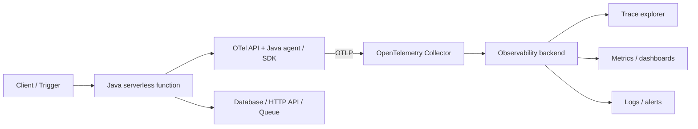
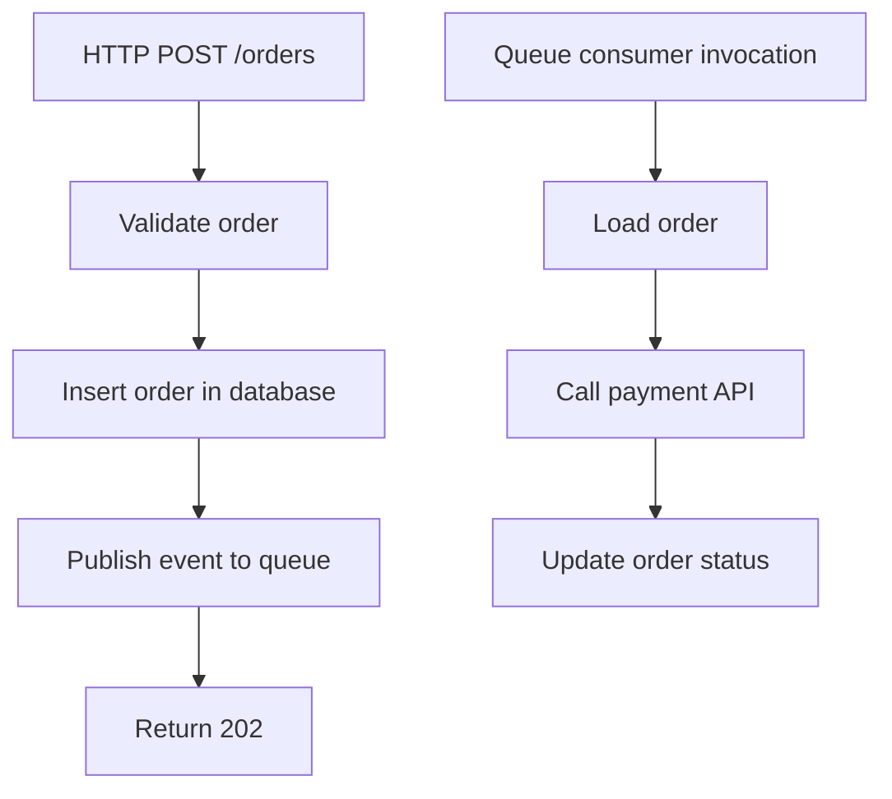

# Instrumenting Java Applications with OpenTelemetry

A Java serverless application may work well during testing yet still be hard to operate when multiple functions, queues, and dependent services are involved. When a request slows down or a message is retried, the team needs to know which components the request traversed, which step consumed time, where the error began, and how the function is utilizing resources. Isolated logs are rarely sufficient to stitch these events into an investigable flow.

OpenTelemetry (OTel) is an open-source standard and toolkit for collecting **traces, metrics, and logs**. Java applications can be instrumented automatically via the Java agent, manually via the API/SDK, or with a combination of both. Telemetry data is typically sent over OTLP to an OpenTelemetry Collector or an observability backend.

In serverless, instrumentation must understand the invocation lifecycle: execution environments can be reused, frozen, or reclaimed; a single invocation may process multiple messages; a function may call downstream HTTP services, databases, or queues; and exporters must ship telemetry before the environment stops. This lesson covers how to instrument Java functions, propagate trace context across triggers, produce useful metrics/logs, and control overhead, cardinality, and sensitive data.

## 1. What Components Make Up OpenTelemetry?

OpenTelemetry provides APIs, SDKs, instrumentation libraries, semantic conventions, and the OTLP protocol. These components work together so applications emit telemetry without locking into a single backend vendor.

| Component | Role |
|---|---|
| OpenTelemetry API | Interfaces for applications to create spans, counters, histograms, and access context |
| OpenTelemetry SDK | Configures providers, samplers, processors, readers, and exporters |
| Instrumentation | Automatically or manually produces telemetry for frameworks, HTTP clients, databases, and business logic |
| Java agent | Attaches instrumentation at JVM startup, usually without modifying application code |
| OTLP | Protocol for transmitting traces, metrics, and logs to collectors/backends |
| OpenTelemetry Collector | Receives, processes, filters, batches, and forwards telemetry |
| Backend | Stores, queries, dashboards, alerts, and analyzes data |
| Semantic conventions | Naming conventions for attributes, spans, resources, and metrics to keep data consistent |



OpenTelemetry is not a storage backend and does not automatically build dashboards for every platform. It standardizes how applications emit telemetry and how data is transported. The backend can be a managed service or a self-hosted system.

### Three Core Signals

- **Traces:** describe a single request or operation across services as a trace of spans with parent-child relationships.
- **Metrics:** aggregated measurements over time such as request count, error rate, latency histograms, and queue processing counts.
- **Logs:** contextualized events, such as validation failures, retry attempts, or database connection errors.

The three signals complement each other. Traces locate slow steps; metrics show how widespread an issue is and when it started; logs provide event details to understand the root cause.

## 2. Traces, Spans, and Context Propagation

A trace represents the execution path of an operation. Each span represents a unit of work with start/end timestamps, a name, status, attributes, and optionally events. Spans within the same trace are linked by a trace ID and parent/child or span-link relationships.

Order creation request example:



The HTTP request may be the initial trace. When the producer sends a message, trace context is passed in message attributes. The consumer can continue the trace via parent context or start a new trace with a span link depending on event semantics and batch handling. If the message is processed minutes later, links are often useful to represent the relationship to the producer without stretching a single trace over an overly long window.

### What Should a Span Record?

A span typically includes:

- A meaningful operation name, such as `orders.validate` or `payment.authorize`.
- Start/end timestamps.
- `OK` or `ERROR` status when appropriate.
- Attributes describing operation type, dependency, outcome, or workload size.
- Events for notable milestones inside the span.
- Exception events when errors need to be recorded.

Do not put sensitive data or high-cardinality values into span names. Span names should stay stable like `GET /orders/{orderId}`, without interpolating actual IDs into the name.

### Context Propagation

Context holds information that must travel with execution, notably the current span and baggage. When one service calls another HTTP service, instrumentation can inject trace context into `traceparent` and `tracestate` headers per W3C Trace Context. The receiving service extracts context to create child or linked spans.

If context is not propagated across service boundaries, traces fracture into disconnected traces. Therefore, verifying propagation is a mandatory part of integration testing.

Do not use baggage to carry secrets, access tokens, personal data, or business payloads. Baggage can propagate through many services and show up in telemetry. Carry only small, explicitly approved technical metadata.

## 3. Choosing Java Agent, SDK, or Manual Instrumentation

There are three main ways to instrument Java:

| Approach | Advantages | Trade-offs |
|---|---|---|
| Java agent | Automatically instruments popular libraries like HTTP clients, JDBC, servlets, and frameworks | Requires startup configuration; instrumentation depends on library/version; can create noisy spans without tuning |
| Manual SDK/API | Full control over business spans and domain metrics | Requires writing code, maintaining naming conventions, and managing lifecycle |
| Hybrid | Agent captures technical telemetry; manual API adds business spans | Must avoid duplicate instrumentation and bound attributes |

For Java serverless, it is usually best to start with an agent or platform-supported instrumentation for HTTP/database spans, then add manual spans at key business boundaries. If the platform does not permit attaching an agent or the runtime uses a dedicated extension, use the corresponding SDK/layer.

### When to Use the Java Agent?

The Java agent fits well when:

- Running a JVM where `-javaagent` can be passed.
- Frameworks and libraries need instrumentation without modifying code.
- You want to roll out instrumentation via deployment configuration.
- You need to test or toggle instrumentation independently of business releases.

JVM startup example:

```bash
java \
  -javaagent:/opt/opentelemetry-javaagent.jar \
  -Dotel.service.name=orders-api \
  -Dotel.exporter.otlp.endpoint=http://otel-collector:4318 \
  -Dotel.exporter.otlp.protocol=http/protobuf \
  -jar app.jar
```

The agent path and endpoint are examples. In containers, bake the agent into the image or mount it via your deployment mechanism. On managed serverless runtimes, adding arbitrary JVM flags is not always possible; use a layer, extension, wrapper, or platform-supported instrumentation mechanism.

### When to Use the Manual SDK?

Manual instrumentation is ideal for creating spans around business logic the agent does not understand, such as pricing calculations, quota checks, tenant selection, or retry decisions. It also supports metrics for accepted orders, rejected events, or processing duration by job type.

If the agent already configures the global OpenTelemetry provider, the application can obtain the global API and create spans without initializing another SDK. Never create two competing global `OpenTelemetrySdk` instances in the same JVM.

## 4. Adding OpenTelemetry Dependencies to Java

If using the Java agent to supply the SDK/exporter, the application typically only needs the OpenTelemetry API for manual instrumentation. Maven dependency example:

```xml
<dependencyManagement>
    <dependencies>
        <dependency>
            <groupId>io.opentelemetry</groupId>
            <artifactId>opentelemetry-bom</artifactId>
            <version>${opentelemetry.version}</version>
            <type>pom</type>
            <scope>import</scope>
        </dependency>
    </dependencies>
</dependencyManagement>

<dependencies>
    <dependency>
        <groupId>io.opentelemetry</groupId>
        <artifactId>opentelemetry-api</artifactId>
    </dependency>
</dependencies>
```

Set `opentelemetry.version` to a release tested by the project. Use the BOM so OpenTelemetry libraries stay on compatible versions. If the application configures the SDK directly instead of using an agent, add the appropriate SDK and exporter artifacts; do not mix dependency versions arbitrarily.

### Configuring the SDK Directly

In environments without the Java agent, the application can construct the SDK provider and exporter programmatically or via the autoconfigure module. In serverless, clearly define who owns the lifecycle of providers, processors, and exporters. Do not initialize a new exporter on every invocation.

A key rule: only one place should own configuring the global provider. If a platform/layer already installs the OpenTelemetry SDK, use the global API; if the application manages it itself, initialize once per execution environment and close/flush according to runtime-supported lifecycle hooks.

## 5. Creating Custom Spans in Java

The following example creates a span for order validation. The span records technical attributes, marks errors if validation fails, and always ends in `finally`.

```java
import io.opentelemetry.api.GlobalOpenTelemetry;
import io.opentelemetry.api.trace.Span;
import io.opentelemetry.api.trace.StatusCode;
import io.opentelemetry.api.trace.Tracer;
import io.opentelemetry.context.Scope;

public final class OrderService {
    private static final Tracer TRACER =
            GlobalOpenTelemetry.getTracer("com.example.orders");

    private final OrderRepository repository;

    public OrderService(OrderRepository repository) {
        this.repository = repository;
    }

    public Order create(CreateOrderCommand command) {
        Span span = TRACER.spanBuilder("orders.create")
                .startSpan();

        try (Scope scope = span.makeCurrent()) {
            span.setAttribute("order.channel", command.channel());
            span.setAttribute("order.item_count", command.items().size());

            validate(command);
            Order order = repository.insert(command);

            span.setAttribute("order.result", "created");
            return order;
        } catch (RuntimeException exception) {
            span.recordException(exception);
            span.setStatus(StatusCode.ERROR);
            throw exception;
        } finally {
            span.end();
        }
    }

    private void validate(CreateOrderCommand command) {
        if (command.items().isEmpty()) {
            throw new IllegalArgumentException("Order must contain at least one item");
        }
    }
}
```

`OrderRepository` and `CreateOrderCommand` represent application domain code. If the Java agent already instruments JDBC, `repository.insert` may automatically generate a database span; the `orders.create` span adds surrounding business context.

### Controlled Naming and Attributes

Use:

- Span names: `orders.create`, `inventory.reserve`, `payment.authorize`.
- Attributes: `order.channel`, `order.item_count`, `payment.provider`, `app.retry_attempt`.
- Status: `ERROR` for failures causing the operation to fail.
- Events: `inventory.reservation_started` or another milestone useful during investigation.

Avoid:

- Span names containing `order-12345` or user emails.
- Attributes with free-form values from unvalidated input.
- Capturing entire request/response bodies.
- Recording access tokens, API keys, passwords, or secrets.

For exceptions, record only information needed for investigation. Some auto-instrumentation may already record the exception; avoid recording the same error repeatedly across multiple layers unless it adds new context.

## 6. Creating Business Metrics

Traces explain a single request; metrics show overall trends. Use counters for occurrence counts, histograms for duration/size distributions, and observable gauges for point-in-time measurements when appropriate.

Counter and histogram example:

```java
import io.opentelemetry.api.GlobalOpenTelemetry;
import io.opentelemetry.api.common.Attributes;
import io.opentelemetry.api.metrics.LongCounter;
import io.opentelemetry.api.metrics.LongHistogram;
import io.opentelemetry.api.metrics.Meter;

public final class OrderMetrics {
    private static final Meter METER =
            GlobalOpenTelemetry.getMeter("com.example.orders");

    private static final LongCounter ACCEPTED = METER.counterBuilder("orders.accepted")
            .setDescription("Number of accepted orders")
            .setUnit("{order}")
            .build();

    private static final LongCounter REJECTED = METER.counterBuilder("orders.rejected")
            .setDescription("Number of rejected orders")
            .setUnit("{order}")
            .build();

    private static final LongHistogram PROCESSING_TIME = METER.histogramBuilder(
                    "orders.processing.duration")
            .ofLongs()
            .setDescription("Order processing duration")
            .setUnit("ms")
            .build();

    private OrderMetrics() {}

    public static void accepted(String channel) {
        ACCEPTED.add(1, Attributes.of(
                io.opentelemetry.api.common.AttributeKey.stringKey("order.channel"), channel));
    }

    public static void rejected(String reasonCode) {
        REJECTED.add(1, Attributes.of(
                io.opentelemetry.api.common.AttributeKey.stringKey("error.type"), reasonCode));
    }

    public static void recordDuration(long elapsedMillis) {
        PROCESSING_TIME.record(elapsedMillis);
    }
}
```

Metric names and units should follow your organization's semantic conventions/naming policies. `reasonCode` should come from a bounded set of values such as `validation`, `inventory_unavailable`, or `dependency_timeout`; never use free-form exception messages as a dimension.

### Cardinality Is an Operational Cost

Every unique combination of attributes produces a separate time series. Adding `user.id`, `order.id`, email, or request ID as a metric label can cause series counts to grow per request, straining backend memory and costs.

Metric labels should be low-cardinality and stable:

- Good: `http.method`, `http.route`, `status_class`, `error.type`, `cloud.region`.
- Use with care: `tenant.tier`, `payment.provider`, `queue.name` if value sets are bounded.
- Avoid: `user.id`, `order.id`, `request.id`, email, full URLs with path parameters.

Unique IDs belong in traces/logs with controlled access and retention, not as metric dimensions.

## 7. Correlating Logs with Traces

Logs are typically read for detailed messages, while traces show which step of a request emitted the log. When a trace context is active, logs should contain `trace_id` and `span_id` so the backend can link logs to traces.

Structured log example:

```json
{
  "timestamp": "2026-11-17T10:15:30.123Z",
  "level": "ERROR",
  "service.name": "orders-worker",
  "message": "Payment authorization failed",
  "trace_id": "4bf92f3577b34da6a3ce929d0e0e4736",
  "span_id": "00f067aa0ba902b7",
  "error.type": "payment_timeout",
  "retry.attempt": 2
}
```

This is an illustrative log. Do not log tokens, card numbers, order contents, or exception messages containing sensitive data. `trace_id`/`span_id` are not secrets, but they should still follow the logging system's access controls and retention policies.

### Using MDC in Java

If the application uses SLF4J/Logback, trace ID and span ID can be placed in MDC while a span is current. The Java agent or logging instrumentation may populate these fields automatically depending on configuration. Before writing custom filters/interceptors, check what the agent already provides to avoid duplication.

Example Logback pattern displaying MDC:

```xml
<configuration>
    <appender name="CONSOLE" class="ch.qos.logback.core.ConsoleAppender">
        <encoder>
            <pattern>%d{ISO8601} %-5level trace_id=%X{trace_id} span_id=%X{span_id} %logger - %msg%n</pattern>
        </encoder>
    </appender>
    <root level="INFO">
        <appender-ref ref="CONSOLE"/>
    </root>
</configuration>
```

MDC key names depend on the agent/bridge/configuration. Verify actual log output and configure mappings accordingly. With asynchronous execution, MDC and thread-local context must be propagated properly; never assume another thread inherits context from its parent thread automatically.

## 8. Propagating Trace Context Over HTTP and Message Queues

### HTTP Clients

When using libraries instrumented by OpenTelemetry, the agent usually injects/extracts W3C trace context automatically for supported HTTP clients/servers. For example, when service A calls service B, request headers may contain:

```http
traceparent: 00-4bf92f3577b34da6a3ce929d0e0e4736-00f067aa0ba902b7-01
tracestate: vendor=value
```

Do not build `traceparent` via manual string concatenation or generate trace IDs by hand. Use OpenTelemetry propagators to maintain proper formatting and sampling flags.

If using an HTTP client not instrumented by the agent, you can inject context manually:

```java
import io.opentelemetry.api.GlobalOpenTelemetry;
import io.opentelemetry.context.Context;
import io.opentelemetry.context.propagation.TextMapPropagator;
import io.opentelemetry.context.propagation.TextMapSetter;
import java.util.HashMap;
import java.util.Map;

public final class TraceHeaders {
    private static final TextMapPropagator PROPAGATOR =
            GlobalOpenTelemetry.getPropagators().getTextMapPropagator();

    private static final TextMapSetter<Map<String, String>> SETTER =
            (carrier, key, value) -> carrier.put(key, value);

    private TraceHeaders() {}

    public static Map<String, String> currentHeaders() {
        Map<String, String> headers = new HashMap<>();
        PROPAGATOR.inject(Context.current(), headers, SETTER);
        return headers;
    }
}
```

Pass the generated headers onto the outbound HTTP request. Do not blindly copy all inbound client headers downstream; propagate only policy-approved context and never forward unintended authentication credentials.

### Queues and Event Messages

With queue triggers, producers must put trace context into message attributes/headers. Consumers extract context before creating a processing span. With batches, each record may carry its own trace context; do not attach all records to a single parent context if they originate from different traces.

Example extracting from a message attributes map:

```java
import io.opentelemetry.api.GlobalOpenTelemetry;
import io.opentelemetry.context.Context;
import io.opentelemetry.context.propagation.TextMapGetter;
import java.util.Map;

public final class MessageTraceContext {
    private static final TextMapGetter<Map<String, String>> GETTER =
            new TextMapGetter<>() {
                @Override
                public Iterable<String> keys(Map<String, String> carrier) {
                    return carrier.keySet();
                }

                @Override
                public String get(Map<String, String> carrier, String key) {
                    return carrier == null ? null : carrier.get(key);
                }
            };

    private MessageTraceContext() {}

    public static Context extract(Map<String, String> messageAttributes) {
        return GlobalOpenTelemetry.getPropagators()
                .getTextMapPropagator()
                .extract(Context.root(), messageAttributes, GETTER);
    }
}
```

The map in this example holds headers produced by the producer's propagator. When processing a record, use the returned context to start a span; if a batch has multiple records, create a span per record or use span links according to the chosen model. For retried messages, keep the business event ID for idempotency; trace ID is not an idempotency key.

### Async Threads and Executors

OpenTelemetry context is typically stored in the current execution context. If code spawns threads or submits tasks to an executor, context may not propagate unless appropriate wrappers/context propagation are used. The Java agent instruments several standard executors, but custom executors must be verified.

Never store a `Span` in a static field and reuse it across invocations. A span belongs to a single operation; retaining old context can corrupt traces or misattribute requests. With `CompletableFuture`, pass context explicitly or use context wrappers provided by your OpenTelemetry version.

## 9. Instrumenting the Serverless Function Lifecycle

In serverless, a process may be reused across many invocations. Initializing tracers, meters, SDK clients, and exporters at the execution environment level generally reduces overhead. Request data, spans, and business state must still be scoped per invocation.

### Initialize Once, End Every Operation

- Share `Tracer`, `Meter`, and thread-safe HTTP/KMS/database clients when safe.
- Create spans per invocation or per message.
- End spans in `finally` so exceptions never leak open spans.
- Never store request context, user identity, or payloads in static fields.
- Never create a new exporter/provider per invocation.
- Ensure flushing/exporting follows a suitable mechanism before the runtime freezes or terminates the process.

### Cold Starts and Init Spans

Cold starts occur before the handler runs. If instrumentation initializes inside a static initializer, part of startup cost may fall outside business spans. Startup telemetry can be recorded via resource/runtime logs or appropriate platform hooks. When adding custom initialization spans, avoid leaving a long-lived span open across multiple invocations.

Distinguish:

- JVM/framework/agent initialization time.
- Invocation/handler execution time.
- Dependency call time.
- Queue wait time before the handler starts.

Do not add measurements with different scopes together and call the sum function latency. Clearly label metric sources and measurement boundaries.

### Exporters and Freeze/Thaw

Some serverless runtimes freeze the execution environment immediately after the handler returns a response. A batch span processor or metric reader may not finish exporting data in time. Approaches include:

- Using a platform-supported collector/extension/layer to receive telemetry outside the application process.
- Using an exporter and flush strategy recommended by the runtime documentation.
- Ensuring exporter timeouts do not push invocations past their deadlines.
- Verifying whether telemetry is lost on function timeouts, kills, or environment reclamation.
- Accepting and measuring telemetry drop rates if the runtime does not guarantee graceful shutdown.

Do not unconditionally call `forceFlush()` after every invocation if it noticeably increases latency or adds a synchronous network call per execution. Choose batch/flush settings based on reliability needs, invocation duration, and how the collector receives data.

## 10. Configuring OTLP and the OpenTelemetry Collector

OTLP can transmit over gRPC or HTTP/protobuf. Applications need to know the endpoint, protocol, resource attributes, propagators, and sampling policy. The endpoint is typically an internal collector or local extension; avoid sending directly from functions to a public backend by default when an intermediary collector can be used.

Common environment variables:

| Variable | Purpose |
|---|---|
| `OTEL_SERVICE_NAME` | Service name displayed in the backend |
| `OTEL_RESOURCE_ATTRIBUTES` | Resource attributes such as deployment environment, service version, or cloud region |
| `OTEL_EXPORTER_OTLP_ENDPOINT` | Shared OTLP endpoint |
| `OTEL_EXPORTER_OTLP_TRACES_ENDPOINT` | Separate endpoint for traces if needed |
| `OTEL_EXPORTER_OTLP_METRICS_ENDPOINT` | Separate endpoint for metrics if needed |
| `OTEL_EXPORTER_OTLP_LOGS_ENDPOINT` | Separate endpoint for logs if needed |
| `OTEL_EXPORTER_OTLP_PROTOCOL` | Protocol, e.g., `grpc` or `http/protobuf` |
| `OTEL_PROPAGATORS` | Propagators, commonly `tracecontext,baggage` |
| `OTEL_TRACES_SAMPLER` | Sampling strategy |
| `OTEL_TRACES_SAMPLER_ARG` | Sampler argument, e.g., sampling ratio |

Configuration example for a Java container:

```text
OTEL_SERVICE_NAME=orders-worker
OTEL_RESOURCE_ATTRIBUTES=deployment.environment=staging,service.version=2.4.0
OTEL_EXPORTER_OTLP_ENDPOINT=http://otel-collector:4318
OTEL_EXPORTER_OTLP_PROTOCOL=http/protobuf
OTEL_PROPAGATORS=tracecontext,baggage
OTEL_TRACES_SAMPLER=parentbased_traceidratio
OTEL_TRACES_SAMPLER_ARG=0.10
```

This is an illustrative configuration. The endpoint and protocol must match the collector listener. Do not hard-code bearer tokens or API keys in Dockerfiles, source code, or committed config files; inject secrets via a secret manager/runtime identity and configure exporter authentication through supported mechanisms.

### Collector Pipeline Example

```yaml
receivers:
  otlp:
    protocols:
      grpc:
        endpoint: 0.0.0.0:4317
      http:
        endpoint: 0.0.0.0:4318

processors:
  memory_limiter:
    check_interval: 1s
    limit_mib: 256
  batch:
    timeout: 5s

exporters:
  otlphttp:
    endpoint: ${env:BACKEND_OTLP_ENDPOINT}

service:
  pipelines:
    traces:
      receivers: [otlp]
      processors: [memory_limiter, batch]
      exporters: [otlphttp]
    metrics:
      receivers: [otlp]
      processors: [memory_limiter, batch]
      exporters: [otlphttp]
    logs:
      receivers: [otlp]
      processors: [memory_limiter, batch]
      exporters: [otlphttp]
```

The collector configuration above is a minimal example. Select the right exporter and auth extension for your backend, secure the OTLP listener, restrict network access, and verify your Collector version supports `${env:...}` syntax. If the backend requires a token, inject it via secrets and configure appropriate header/auth settings; never store tokens directly in this file.

### What Can the Collector Do?

- Batch telemetry to reduce network overhead.
- Limit memory and queue sizes to prevent the collector from causing outages itself.
- Enrich or normalize resource attributes.
- Filter out unnecessary telemetry.
- Perform tail sampling on errors or latency if the collector architecture supports it.
- Export to one or multiple backends.
- Maintain a network boundary between functions and observability systems.

The collector is also a dependency. Monitor collector queue/export failures, memory, CPU, and load capacity. If the collector is unavailable, the application must never hang indefinitely just to send telemetry.

## 11. Sampling and Controlling Telemetry Costs

Sending 100% of traces can be helpful in test environments or low-traffic systems. With high production traffic, sampling keeps data volume, costs, and overhead under control.

### Head Sampling

A head sampler decides whether to keep a trace when the first span is created. For example, a 10% parent-based trace ID ratio keeps roughly 10% of new traces while respecting upstream sampling decisions per parent-based configuration.

The advantage is immediate data reduction at the application. The drawback is that the decision is made before knowing whether the trace will fail or exhibit high latency; an unsampled trace usually cannot be recovered later.

### Tail Sampling

Tail sampling decides after the collector receives the necessary spans of a trace. It can prioritize keeping error traces, slow traces, or traces for important services/tenants. In return, the collector must hold trace state in memory/queues long enough and be provisioned with adequate capacity.

### Sampling Does Not Replace Metrics

When only a fraction of traces are sampled, metrics must still record total requests/errors/latency. Inferring error rates from sampled traces yields skewed results. Use metrics for SLIs/SLOs and traces to investigate representative or anomalous requests.

## 12. Semantic Conventions and Resource Attributes

Resource attributes describe the service or runtime emitting telemetry; span attributes describe a specific operation. Follow semantic conventions so field names stay consistent across services and backends.

Commonly useful resource attributes:

- `service.name`: service/function name per organizational convention.
- `service.version`: released artifact version.
- `deployment.environment`: dev, staging, or production.
- `cloud.provider`, `cloud.region`: cloud provider and region.
- `service.namespace`: domain group or bounded context if needed.

Do not put function invocation IDs, request IDs, or user IDs into resource attributes because a resource persists across many invocations while those values change per request. Request-scoped values belong in controlled span/log context.

Semantic convention names can change across OTel specification versions. Pin SDK/agent versions and standardize naming across the organization so dashboards do not have to support multiple names for the same concept.

## 13. Instrumenting Triggers and Queue Workers

HTTP functions typically have a server span for each request. Queue workers need to record the event source, message processing, and processing outcome. With batches, a single invocation may contain many records; one span for the whole batch can hide failing messages or varying processing times.

One structured approach:

1. Create an invocation span describing the received batch.
2. For each record, extract its own trace context.
3. Create a processing span per record or span links to producer contexts.
4. Record allowed technical event IDs, attempt number, and classified outcome.
5. End each span immediately after processing the record.
6. Record metrics for total batch size, success count, retryable failures, and permanent failures.

Do not use the message body as a span attribute. For large batches, bound the number of spans and events so telemetry overhead does not scale linearly with unbounded payloads.

### Retries and Duplicate Deliveries

When a message is redelivered, a new trace may be created for the new attempt; preserve the event ID to connect attempts in logs/metrics. You can add `retry.attempt` or `messaging.message.id` per applicable conventions, but never use unique IDs as metric labels.

A message processed successfully whose response/ack is lost may be redelivered. Traces expose multiple attempts; idempotency must still be enforced in the business layer. Telemetry is not an exactly-once delivery mechanism.

## 14. Telemetry Security and Privacy

Traces, logs, and metrics can contain sensitive data. Before enabling automatic instrumentation, check whether the agent captures HTTP headers, query strings, SQL statements, or exception details.

Principles:

- Never record `Authorization`, cookies, API keys, passwords, or secrets.
- Never capture request/response bodies by default if they contain PII or financial data.
- Never place emails, phone numbers, access tokens, or identifying data into baggage.
- Use an allowlist for captured headers; never enable wildcard header capture.
- Mask or strip sensitive SQL parameters.
- Restrict access to trace/log backends and limit retention periods.
- Segregate data by environment/tenant if required by law or contracts.
- Define who can view telemetry and what may be exported outside the organization.

Telemetry is often queried more broadly than business databases. Therefore, include only the minimum data required for investigation and auditing. Even an internal ID can be sensitive if it can be linked to an individual user.

## 15. Integrating OpenTelemetry Across Serverless Environments

### AWS Lambda

Java Lambda can be instrumented using the OpenTelemetry Java agent, the AWS Distro for OpenTelemetry (ADOT) Lambda layer/extension, or corresponding runtime mechanisms. Verify Java runtime support, architecture, and deployed layer versions.

Key considerations:

- Layers/extensions may provide their own collector or export mechanism; configure endpoints and protocols per that version's documentation.
- The execution role needs permissions to send telemetry to the destination if the exporter calls an IAM-protected service.
- If running inside a VPC, ensure network connectivity to the collector/backend.
- Execution environments are reused; avoid initializing exporters on every invocation.
- Verify spans/metrics are exported both when the handler finishes and when the function times out.
- With SQS triggers, verify trace context propagation through message attributes and batch semantics.

Do not assume a container-based Java agent runs unmodified in every Lambda packaging format. Pick an instrumentation mechanism supported by AWS/the runtime and test on the exact Java runtime.

### Azure Functions

Java Azure Functions can use the OpenTelemetry Java agent or SDK alongside the Azure Monitor/Application Insights exporter/distribution depending on architecture. Verify worker model, hosting plan, and JVM option configuration mechanisms. If the platform already collects request/dependency telemetry automatically, avoid enabling overlapping instrumentation that creates duplicate spans.

Managed identity can be used for Azure service access and exporters/backends when the target supports Entra authentication. Never embed connection strings or instrumentation keys in source code; use application settings/secret stores per environment policy.

### Google Cloud Functions and Cloud Run

Java services can use the Java agent or SDK and export OTLP to a compatible collector or backend. Cloud Run supports container lifecycles and can run a sidecar/collector in appropriate architectures; managed functions have specific constraints around sidecars and runtimes. Check the actual deployment model before choosing a local vs. remote collector.

Resource attributes should reflect service name, revision/version, project, and region per convention. Use service accounts and IAM to secure the export path if the endpoint supports identity. Prevent telemetry export from blocking request handlers indefinitely.

## 16. Testing Instrumentation

Instrumentation must be tested as part of the application. A function returning HTTP 200 does not prove trace context was propagated or metrics were exported properly.

### Unit Testing Custom Instrumentation

You can use an in-memory exporter or test SDK to assert span names, statuses, and attributes without calling a real backend. Example checks:

- On successful order creation, the `orders.create` span has the expected status.
- On validation failure, the span has error status and an exception event.
- Attributes contain no PII or request bodies.
- The histogram records duration and the counter increments exactly once.
- Scopes are closed and spans are ended even on exceptions.

### Integration Testing with the Collector

Run a collector in the test environment and send OTLP to its receiver. Verify:

- Traces arriving at the collector and backend carry accurate service/resource attributes.
- HTTP client/server spans form parent-child relationships.
- `traceparent` propagates across HTTP.
- Message producers/consumers have linked contexts.
- Metrics have stable names/units/attributes and controlled cardinality.
- Logs include trace ID/span ID when inside an active context.
- Collector failures do not hang the function indefinitely.

### Testing the Serverless Lifecycle

Test at least these scenarios:

| Scenario | Expected Outcome |
|---|---|
| Consecutive warm invocations | No new provider/exporter created per invocation; traces remain cleanly separated per request |
| Cold start | Startup telemetry or platform init signals can be correlated with request timing |
| Concurrent invocations | Trace contexts do not mix across requests; custom state is not improperly shared |
| Handler exception | Span is ended and marked error; logs retain correlation |
| Function timeout | Telemetry loss boundaries are understood; do not assume flush always completes |
| Queue batch with one failing record | Spans/metrics distinguish succeeded records from records needing retry |
| Collector unavailable | Handler honors timeout/availability policies; telemetry drops are measured |
| Low sampling rate | Metrics still reflect total traffic even when only a subset of traces is kept |

## 17. Common Mistakes

| Mistake | Consequence | Fix |
|---|---|---|
| Instrumenting only the handler and skipping downstream | Blind to time spent in HTTP/DB/APIs | Enable library instrumentation and add business spans |
| Java agent and SDK creating two global providers | Split telemetry or duplicate exports | Have a single owner of the SDK/provider |
| Creating exporters on every invocation | Higher cold starts, connection churn, and resource leaks | Initialize once per execution environment |
| Not propagating trace context | Broken traces across services/queues | Use W3C propagators and test HTTP/message carriers |
| Using unique IDs as metric labels | High cardinality and surging costs | Put IDs in controlled traces/logs |
| Logging sensitive request bodies/headers | PII, token, or secret exposure | Header allowlists, redaction, and no default body capture |
| Not ending spans on exceptions | Missing traces or artificially long spans | Use `finally` and explicit scopes |
| Keeping request context in static fields | Context bleeds between invocations | Scope context per operation; keep only thread-safe clients/providers static |
| Batch exports not flushed before runtime freeze | Partial telemetry loss | Use runtime-appropriate extensions/collectors and flush strategies |
| Collector receives data but does not export | No traces visible in backend | Monitor collector queues, exporter errors, and endpoint/auth |
| Using sampled traces to compute error rates | Skewed SLIs | Use metrics for total request/error counts |
| Instrumenting the same dependency twice | Duplicate spans and misleading latency | Inspect agent/modules and disable overlapping instrumentation |

## 18. OpenTelemetry Rollout Process for Java Serverless

A rollout roadmap can proceed step by step:

1. **Define goals.** Identify target operations, SLIs/SLOs, and critical dependencies.
2. **Standardize resources.** Set `service.name`, `service.version`, environment, cloud provider, and region.
3. **Choose instrumentation.** Start with the Java agent/layer if supported by the runtime; use the manual API for domain operations.
4. **Configure propagation.** Use W3C Trace Context for HTTP and message attributes for queues/events.
5. **Configure exporters.** Select OTLP protocol, endpoint, auth, and appropriate collector.
6. **Add metrics.** Counters for requests/outcomes, histograms for latency, and required queue/backlog metrics.
7. **Correlate logs.** Add trace/span IDs, structured logging, and redaction.
8. **Configure sampling.** Choose rates matching traffic/cost; keep error/slow traces if using tail sampling.
9. **Test lifecycle.** Cold, warm, concurrency, timeouts, batch retries, and collector unavailability.
10. **Roll out by environment.** Enable in dev/staging first, measure overhead, then expand to production.
11. **Monitor telemetry quality.** Watch dropped spans, exporter failures, cardinality, and backend cost.

## 19. Pre-Production Checklist

- [ ] Every service/function has clear `service.name`, version, and environment attributes.
- [ ] Only one mechanism owns the global OpenTelemetry SDK/provider.
- [ ] Agent/SDK versions are pinned and compatible with the Java runtime.
- [ ] HTTP, JDBC, and critical dependencies are instrumented accurately without duplication.
- [ ] Custom spans exist for key business steps.
- [ ] Trace context propagates across HTTP and queues/events.
- [ ] Batch consumers handle context per record or use appropriate span links.
- [ ] Metrics use consistent names/units and contain no high-cardinality identifiers.
- [ ] Logs include trace/span correlation and omit unnecessary secrets/PII.
- [ ] OTLP endpoint, protocol, authentication, and networking are configured securely.
- [ ] Collector has memory limits, batching, queuing, and exporter monitoring.
- [ ] Sampling fits traffic and SLOs; metrics still measure total traffic.
- [ ] Export/flush behavior is tested against runtime freezes, timeouts, and shutdowns.
- [ ] Tests cover cold/warm, concurrency, retries, duplicates, and collector outages.
- [ ] CPU/memory/latency overhead and telemetry costs stay within budget.

## Conclusion

OpenTelemetry enables Java serverless applications to emit traces, metrics, and logs under a unified standard. The Java agent provides automatic instrumentation for frameworks and dependencies; the manual API/SDK adds business context. For end-to-end tracing, propagate W3C context over HTTP and message queues; for reliable operations, configure resource attributes, sampling, OTLP Collectors, export lifecycles, and access controls. Limit cardinality, scrub secrets/PII from telemetry, and use metrics for overall SLOs. In serverless, test cold starts, warm reuse, concurrency, retries, timeouts, and collector outages to ensure instrumentation delivers actionable visibility without disrupting the critical processing path.
