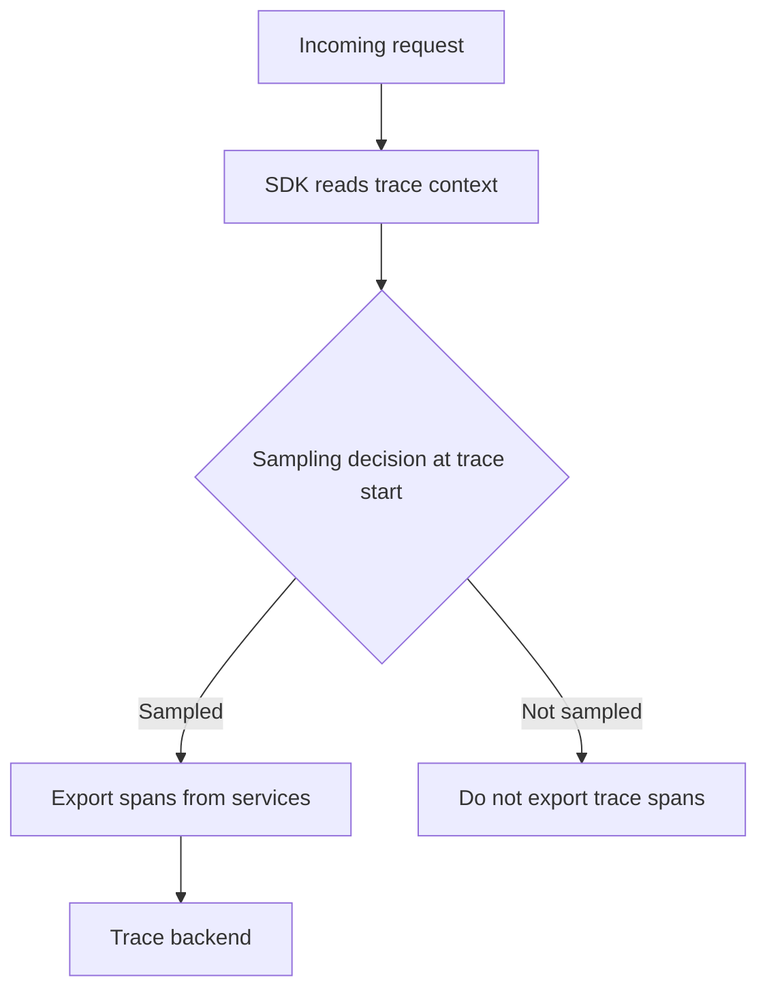
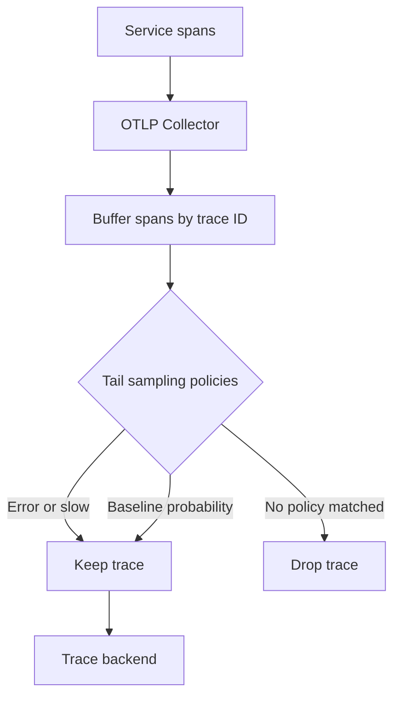

# Choosing Sampling and Controlling Telemetry Cardinality

## 1. Why Are Sampling and Cardinality Important for Serverless?

A serverless system can generate massive amounts of telemetry even when each function is small. An HTTP request flowing through API Gateway, Java Lambda, a queue, worker Lambda, and a database can emit many spans, log records, and metric datapoints. When traffic spikes, invocations and events grow accordingly; telemetry grows as well—sometimes faster than business load because each invocation produces multiple observability records.

Two decisions directly impact observability and cost:

- **Sampling:** selecting a subset of traces or logs to retain for investigation rather than storing every record at all times.
- **Cardinality control:** limiting the number of attribute value combinations that form distinct time series or data groups. Excessive cardinality drives steep increases in series count, indexing, memory, and cost.

Sampling too low can lose evidence of rare errors, slow requests, or anomalous behavior. Sampling too high raises ingestion, storage, and query costs. High metric cardinality can push backends past series limits, slow down dashboards, or cause metrics to be dropped. Good design preserves operationally useful signals while keeping costs within budget.

In the CLOUD_SERVERLESS module, telemetry needs to answer which function errored, which trigger is building backlog, which requests are slow, whether retries are increasing, whether cold starts have an impact, and where costs are rising. Sampling and cardinality must be designed around these questions, not just a fixed percentage.

## 2. Distinguishing Traces, Metrics, and Logs

The three telemetry types have different characteristics, so you should not apply the same sampling policy to all of them.

| Type | Description | Used to Answer | Data Characteristics |
|---|---|---|---|
| Trace | A request/event journey composed of multiple spans | Which services did the request traverse, where was it slow, where did the error start? | Has parent-child relationships, typically includes trace ID and span ID |
| Metric | Numerical measurements aggregated over time and attribute sets | How are error rate, latency, throughput, and queue age changing? | Great for dashboards, alerts, and trends; series are identified by metric name and attributes |
| Log | Detailed event record or message | What did the function do, what was the exact error? | Flexible content, typically includes timestamp, severity, and correlation fields |

A trace may contain multiple spans; each span can link logs and metric exemplars. Metrics generally need continuous collection to calculate rates and trends. Traces can be sampled to reduce volume. Logs can be filtered by severity or rate-limited for repetitive messages, though audit/security logs must never be dropped arbitrarily.

Do not use sampled traces to infer exact total request counts. If you only keep 5% of traces, the stored trace count is not the true request count. Use metric counters recorded for every request to measure throughput/error rates; trace sampling is strictly for detailed diagnostics.

## 3. What Is Cardinality?

Cardinality is the number of distinct values or value combinations for a set of attributes. For metrics, a time series is typically identified by the metric name and the complete set of labels/attributes. Every new attribute combination can create a new series.

Example metric `http.server.request.duration` with dimensions:

```text
service = orders-api
environment = production
http.route = /orders/{orderId}
http.request.method = POST
http.response.status_code = 200
```

These values have a relatively small, stable domain. If you add `order.id`, `customer.id`, `request.id`, or a full URL like `/orders/8a2...`, each request can create a new combination. The number of series grows with the number of distinct IDs.

For independent labels, the potential number of combinations approximates the product of each label's distinct value count. Example:

```text
environment: 3 values
region:      4 values
route:      20 values
status:      5 values
method:      4 values

Max combinations = 3 × 4 × 20 × 5 × 4 = 4,800 series
```

This is an upper-bound estimate; some combinations may never occur. Adding a label with 100,000 user IDs explodes potential cardinality. With classic bucketed histograms, each attribute combination also creates multiple bucket series along with `_sum` and `_count`.

High cardinality does not mean invalid data. `trace_id` and `user_id` are valuable in traces/logs when investigating a specific transaction, but they are generally unsuitable as metric labels/dimensions.

## 4. Low-Cardinality vs. High-Cardinality Attributes

| Attribute | Typical Cardinality | Where Should It Live? | Reason |
|---|---|---|---|
| `service.name` | Low | Metrics, traces, logs | Managed set of services |
| `deployment.environment` | Low | Metrics, traces, logs | dev/staging/prod have a bounded domain |
| `cloud.region` | Low | Metrics, traces, logs | Bounded list of regions |
| `http.request.method` | Low | Metrics, traces | GET/POST/PUT/... |
| `http.route` as template | Low to medium | Metrics, traces | `/orders/{orderId}` instead of concrete URLs |
| `http.response.status_code` | Medium | Metrics, traces | Bounded set of HTTP codes; can be grouped by class |
| `error.type` | Medium if standardized | Metrics, traces, logs | Use stable exception types, not messages |
| `function.name` | Low | Metrics, traces, logs | Deployed function name |
| `queue.name` | Low | Metrics, traces | Managed queue name |
| `tenant.id` | Can be very high | Controlled traces/logs | Useful for investigation but should not be a default metric dimension |
| `user.id`, `order.id`, `request.id` | Very high | Controlled traces/logs | Every request can produce a new value |
| Full URL/query string | Very high | Avoid; normalize into a route template | Path/query may contain IDs and sensitive data |
| Exception message | Very high | Logs, with redaction | Messages often include dynamic values or input data |

Practical rule: metric labels should describe stable groups; traces/logs may carry specific identifiers when genuinely needed for investigation, provided retention, access control, and sensitive data are strictly bounded.

## 5. What Is Sampling and Where Does It Happen?

Sampling selects a subset of telemetry according to a rule. It can occur at multiple layers:

1. **SDK/instrumentation:** decides whether to create or record spans inside the process.
2. **Collector/agent:** receives telemetry and selects which data to forward.
3. **Backend:** stores everything or applies retention/query policies post-ingest.

Sampling in the SDK reduces spans created/exported and saves bandwidth. Sampling at the collector can inspect information appearing at the end of a trace, but the collector must receive and buffer data before deciding. Sampling at the backend can reduce storage costs depending on the service, yet usually does not reduce ingestion costs already incurred.

With serverless, choosing the sampling layer also depends on how long functions can hold state, whether collectors have stable endpoints, and whether spans of the same trace reach the same decision point.

## 6. Head-Based Sampling

Head-based sampling decides as soon as a trace begins, before knowing the entire journey. The SDK typically uses the trace ID or a probability to decide whether to keep/drop the trace. That decision is propagated to downstream services through trace context.

Example 5% ratio:



Advantages:

- Export cost and load are reduced immediately inside the function.
- Fast decision with no need to buffer entire traces.
- Well suited for short-lived, high-invocation serverless workloads.
- Parent-based sampling keeps services within the same trace consistent.

Limitations:

- Cannot know in advance whether the trace will error or be slow.
- A trace dropped at the head cannot be recovered by a downstream tail sampler.
- A fixed ratio may miss rare but critical flows.

Head sampling fits baseline tracing under heavy traffic. You can apply higher rates to critical services/routes or staging environments, while keeping the number of policies small for predictable costs.

## 7. Parent-Based and Trace ID Ratio Sampling

In multi-service architectures, each function should not sample randomly in isolation. A parent-based sampler honors the parent span's sampling decision: if the parent trace was sampled, child spans continue to be sampled; if the parent trace was dropped, child spans are generally dropped too. For root traces without a parent, the sampler uses probability based on the trace ID.

Trace ID ratio sampling selects traces using part of the trace ID to make a consistent decision across the trace. If services share the same rules and receive the same trace context, they make compatible decisions.

Example configuration with OpenTelemetry Java SDK:

```java
import io.opentelemetry.sdk.trace.SdkTracerProvider;
import io.opentelemetry.sdk.trace.export.BatchSpanProcessor;
import io.opentelemetry.sdk.trace.samplers.Sampler;

SdkTracerProvider tracerProvider = SdkTracerProvider.builder()
        .setSampler(Sampler.parentBased(
                Sampler.traceIdRatioBased(0.05)))
        .addSpanProcessor(BatchSpanProcessor.builder(spanExporter).build())
        .build();
```

This example keeps roughly 5% of new root traces and follows parent decisions for traces with existing context. `spanExporter` is the configured backend exporter; the provider must be closed according to application/runtime lifecycle.

With the OpenTelemetry Java agent/autoconfigure, samplers can be configured via corresponding environment variables, such as `OTEL_TRACES_SAMPLER=parentbased_traceidratio` and `OTEL_TRACES_SAMPLER_ARG=0.05`. Confirm your SDK/agent version supports these settings before rollout.

Do not set an independent 5% sampler on every service while ignoring parent context. Doing so leaves traces fragmented with only disconnected spans, making end-to-end reconstruction difficult.

## 8. Tail-Based Sampling

Tail-based sampling waits to receive all or most spans of a trace before deciding whether to keep or drop it. Because the final outcome is known, the collector can prioritize:

- Traces containing spans with `ERROR` status.
- Traces exceeding a latency threshold.
- Traces with unusual exceptions or retries.
- A baseline percentage of normal traces.
- Specific critical operations selected by policy.



The advantage is retaining nearly all error and slow traces while keeping only a small fraction of healthy traces. The drawback is that the collector requires buffering, memory, and wait time; telemetry can be lost if the collector restarts or spans fail to arrive in time.

Tail sampling especially requires proper routing: all spans of a trace must arrive at the same tail-sampling collector instance. When running multiple collectors, a trace-ID load-balancing tier is usually needed in front of the tail sampler. If spans of the same trace land on different collectors, each collector sees only part of the trace and makes flawed decisions.

### Example OpenTelemetry Collector Policy

```yaml
processors:
  memory_limiter:
    check_interval: 1s
    limit_percentage: 75
    spike_limit_percentage: 15

  tail_sampling:
    decision_wait: 10s
    num_traces: 50000
    expected_new_traces_per_sec: 1000
    policies:
      - name: keep-errors
        type: status_code
        status_code:
          status_codes: [ERROR]
      - name: keep-slow
        type: latency
        latency:
          threshold_ms: 2000
      - name: baseline-five-percent
        type: probabilistic
        probabilistic:
          sampling_percentage: 5

  batch: {}

service:
  pipelines:
    traces:
      receivers: [otlp]
      processors: [memory_limiter, tail_sampling, batch]
      exporters: [otlp]
```

This is an illustrative configuration for a Collector with the tail-sampling processor. Actual receivers/exporters must be declared and checked against your Collector version. `decision_wait`, `num_traces`, and `expected_new_traces_per_sec` must be sized to throughput, spans/trace, trace completion time, and memory. The combined policy retains error traces, slow traces, or a fraction of baseline traces; traces matching no policy are dropped.

Do not set `decision_wait` too short if traces experience queue delays or span multiple asynchronous services. If spans arrive after the collector decides, they may be dropped or produce incomplete traces. For long workflows, consider splitting into per-stage traces connected via span links.

## 9. Combining Head Sampling and Tail Sampling

The two mechanisms can be combined, provided you understand the constraint: a tail sampler can only choose from telemetry that actually reaches the collector. If SDK head sampling drops 95% of traces, the collector cannot recover those traces even if they later fail.

Common patterns:

| Pattern | How It Works | When Appropriate |
|---|---|---|
| Head sampling at SDK | Picks a small percentage directly in the function | High traffic needing strict CPU/network and cost control |
| Tail sampling at collector | SDK sends full traces to collector; collector chooses by outcome | Need to keep errors/slow traces and have adequate collector capacity |
| Head baseline + tail refinement | Head picks a subset; collector applies policies to received traces | Acceptable that head-dropped traces cannot be recovered |
| Separate critical path | Critical flows use a higher rate or always-on within a narrow scope | Payments, security-sensitive workflows, or flows requiring audit traces |

Do not enable `always_on` across all traffic just to tail-sample every error unless collector infrastructure is sized for it. Export, network, and collector memory still bear the full span load before sampling.

## 10. Sampling for Serverless and Asynchronous Processing

Serverless has several traits affecting trace sampling:

- Functions may be short-lived and frozen/terminated after each invocation.
- One invocation may process a single event or an entire batch of messages.
- Retries may create new invocations for the same event.
- Queue delays may exceed the tail sampler's wait window.
- Fan-out creates multiple trace branches or multiple consumers processing the same event.
- Context does not automatically cross every trigger type unless producers pass metadata.

For HTTP requests, propagators typically pass trace context via `traceparent` and `tracestate` headers per W3C Trace Context. For SQS/EventBridge/Service Bus/Pub/Sub, verify whether extensions or producers/consumers inject/extract trace context in message attributes/envelopes. Do not assume queues automatically propagate W3C context in every setup.

When processing batches, consider creating an invocation span and child spans per message. If a batch has hundreds of records, creating too many spans can bloat telemetry. You can create an aggregate batch span, spans for failed records, or spans for a sampled subset of records; metrics still count all received/completed records.

For retries, the same event may appear across multiple invocations. Record `event.id`, `messaging.message.id`, attempt count, or receive count in traces/logs when available; do not turn these IDs into metric labels. Idempotency keys must reflect the business event and remain unchanged across retries.

### Long Traces Across Queues

A trace starting in an HTTP producer may finish minutes later when a worker processes the queue. Tail samplers must buffer long enough to receive both producer and consumer spans. If queue delay exceeds `decision_wait`, the trace may close before the consumer runs.

For long workflows or wide fan-out, you can start a new trace at the consumer and add a span link pointing to the producer's context. Span links represent relationships between traces without forcing a single trace to stay open too long. Whether using parent context or span links, keep correlation/event IDs to connect stages during investigations.

## 11. Sampling for Logs

Logs are typically used to read specific errors, yet repetitive debug/info logs on every invocation can dominate volume.

Recommended policy:

- Retain audit, security, access-decision, and mandatory business event logs per retention policy; never sample them arbitrarily.
- Keep structured error logs and necessary stack traces, while avoiding unbounded logging of the exact same error thousands of times.
- Reduce or sample repetitive debug/info logs on hot paths.
- Apply rate limiting or suppression by error fingerprint, while emitting a metric counting suppressed occurrences.
- Separate operational logs from audit logs if retention or access requirements differ.
- Redact tokens, secrets, emails, phone numbers, and sensitive payloads before export.

Do not sample logs independently in a way that breaks trace linkage. Log records should include `trace_id` and `span_id` when context exists. If a trace is not sampled, important logs can still be retained and queried by request/correlation ID.

## 12. Do Not Apply Trace Sampling to Metrics

Metrics are aggregated over time and typically power alerts/SLOs. If you only record metrics for 5% of requests because trace sampling is 5%, counters and histograms no longer reflect total traffic unless explicit scaling corrections are applied.

Examples:

- `http.server.request.count` must increment for every handled request.
- `http.server.request.duration` should record every request or use controlled aggregation.
- `function.errors` must count every error, including sampled-out traces.
- `sqs.messages.received` and `sqs.messages.failed` must reflect the entire batch/record set per metric definition.

Control metric costs by designing sensible instrument counts and dimensions, choosing appropriate histogram buckets, aggregating in the SDK/collector/backend, and picking the right export interval. Do not mechanically apply the trace sampling rate to metric collection.

If you are forced to sample events before computing metrics, understand statistical bias and apply proper sampling weights/estimators. For business alerts, accurate metrics usually matter far more than saving a few datapoints.

## 13. Exemplars: Connecting Metrics to Traces Without Increasing Cardinality

An exemplar is an observed sample attached to a metric datapoint, typically containing a trace ID/span ID and measured value. It lets operators jump from a latency spike or histogram bucket directly to an illustrative trace without adding `trace_id` as a metric label.

For example, the `http.server.request.duration` histogram has dimensions `service`, `route`, and `status_class`. An exemplar can point to the trace of a request that took 4.2 seconds. The dashboard shows p95 climbing and operators open the exemplar to inspect that trace.

Exemplars bridge two telemetry types:

- Metrics keep aggregated numbers and low cardinality.
- Traces keep details of individual sampled journeys.

Exemplars do not replace trace retention or sampling policies. If the trace referenced by an exemplar was dropped or expired, the link may not open. Configure exporters/backends that support exemplars and ensure trace IDs are retained in exemplar data.

## 14. Designing Bounded Metric Dimensions

Before adding an attribute to a metric, ask:

1. Do we need to filter or group alerts by this attribute?
2. Is its value set bounded and managed?
3. Could values contain IDs, URLs, user content, or dynamic error messages?
4. Can it be normalized into stable groups?
5. If this dimension is added, how much does the series count grow?

Normalization examples:

| Input Value | Metric Attribute to Use |
|---|---|
| `/orders/12345` | `/orders/{orderId}` |
| `GET /customers/abc/profile` | `GET /customers/{customerId}/profile` |
| HTTP statuses `200`, `201`, `204` | `2xx` if dashboards only need success classes |
| `java.lang.IllegalArgumentException: invalid sku 88291` | `error.type=IllegalArgumentException` |
| `tenant-9a2c...` | Omit from metrics unless operationally required and tenant count is bounded |
| `request-uuid` | Keep in traces/logs; never use as a label |

Route templates should come from instrumentation/framework routers rather than ad-hoc string slicing on URLs. Query strings are usually unnecessary in metrics and may contain tokens or sensitive data.

## 15. Example OpenTelemetry Java Metrics with Bounded Attributes

The following example creates a counter and histogram with stable dimensions:

```java
import io.opentelemetry.api.common.AttributeKey;
import io.opentelemetry.api.common.Attributes;
import io.opentelemetry.api.metrics.LongCounter;
import io.opentelemetry.api.metrics.DoubleHistogram;
import io.opentelemetry.api.metrics.Meter;

public final class OrderTelemetry {
    private static final AttributeKey<String> ENVIRONMENT =
            AttributeKey.stringKey("deployment.environment");
    private static final AttributeKey<String> OPERATION =
            AttributeKey.stringKey("app.operation");
    private static final AttributeKey<String> OUTCOME =
            AttributeKey.stringKey("app.outcome");

    private final LongCounter ordersProcessed;
    private final DoubleHistogram processingDuration;

    public OrderTelemetry(Meter meter) {
        this.ordersProcessed = meter.counterBuilder("orders.processed")
                .setDescription("Number of orders processed")
                .setUnit("{order}")
                .build();

        this.processingDuration = meter.histogramBuilder("orders.processing.duration")
                .setDescription("Order processing duration")
                .setUnit("s")
                .build();
    }

    public void record(String environment, String outcome, double seconds) {
        Attributes attributes = Attributes.builder()
                .put(ENVIRONMENT, environment)
                .put(OPERATION, "process-order")
                .put(OUTCOME, normalizeOutcome(outcome))
                .build();

        ordersProcessed.add(1, attributes);
        processingDuration.record(seconds, attributes);
    }

    private static String normalizeOutcome(String outcome) {
        return switch (outcome) {
            case "success", "retryable_error", "permanent_error" -> outcome;
            default -> "other";
        };
    }
}
```

Never pass `orderId`, `customerId`, `requestId`, or exception messages into `Attributes`. `normalizeOutcome` constrains outcome values to a finite set. In production code, `environment` should also come from controlled configuration, never from request payloads.

## 16. Limiting Cardinality in the SDK and Collector

Prevent cardinality growth right where metrics are created:

- Instrument only dimensions required for alerts/dashboards.
- Use route templates and standardized enums.
- Never generate dynamic metric names from tenants, function invocations, or unbounded event types.
- Use OpenTelemetry Views to select instruments, change aggregations, filter attributes, or enforce cardinality limits where supported by the SDK.
- Check SDK and backend cardinality limits; do not treat defaults as a design budget.

Collectors can filter/drop unneeded attributes, remove unused metrics, or transform data. However, dropping attributes at the Collector is not always equivalent to merging time series already created in the SDK; post-aggregation processing can leave duplicate or misleading datapoints. Prefer controlling attributes before series creation.

Some metric backends cap series per metric, dimensions per metric, or distinct values per dimension. Check your backend's limits and configure alerts before hitting thresholds. When cardinality spikes unexpectedly, investigate the newly added label rather than simply raising quotas.

## 17. Cardinality in Prometheus and CloudWatch

### Prometheus

Prometheus creates time series by metric name and label value combination. Labels such as `path="/orders/123"` or `user_id="..."` continuously generate new series. High cardinality increases memory, storage, compaction, and query costs.

Do not use labels for unbounded or traffic-proportional data. Use route templates, status classes, bounded enums, and aggregation. With classic histograms, each bucket is a separate series per label combination; reduce bucket counts or dimensions when needed.

### Amazon CloudWatch

CloudWatch custom metrics distinguish metrics by namespace, metric name, and dimensions. Each distinct dimension combination can create a separate metric. With Embedded Metric Format (EMF), dimension sets specified in log events can generate many metric time series; never include request IDs or user IDs in dimension sets.

CloudWatch Logs and metrics have separate pricing models. Lowering trace sampling does not automatically reduce published custom metrics; lowering cardinality requires thoughtful dimension design and metric aggregation.

### Azure Monitor and Google Cloud Monitoring

Azure Monitor/Application Insights and Google Cloud Monitoring also impose limits on dimensions/cardinality, ingestion, and retention. While pricing models differ, the principle remains the same: avoid unbounded labels/dimensions, use aggregated metrics, and place sampling at the right layer.

## 18. Trace and Log Cardinality Must Also Be Controlled

Traces and logs do not generate time series like metrics, yet high-cardinality attributes still raise indexing, storage, and query costs.

- Keep `trace_id`, `span_id`, and `request_id` when needed for correlation, but avoid indexing every arbitrary field if the backend bills by indexed fields.
- Never attach entire request/response bodies to span attributes.
- Normalize `http.route`; do not store raw URLs with query strings containing personal data.
- Never use dynamic exception messages as `error.type`; use the exception class or a stable error code.
- Limit repetitive span events per record in very large batches.
- Use structured log fields and redaction; avoid creating millions of dynamic field names.
- Set different retention periods for traces, application logs, and audit logs according to purpose.

Cardinality control does not mean deleting every ID. IDs may be essential to locate a specific request. Keep them in traces/logs with appropriate access policies and retention, while avoiding turning IDs into metric dimensions.

## 19. Sampling by Workload Type

No single ratio fits every function. Choose based on throughput, criticality, and investigability.

| Workload | Suggested Trace Sampling | Metrics/Logs |
|---|---|---|
| High-traffic HTTP API | Low-to-moderate baseline head sampling; prioritize errors/slow traces if tail sampling exists | Keep full request/error/latency metrics; keep error logs controlled |
| Batch-processing queue worker | Parent-based sampling and context propagation; optionally reduce per-record spans | Count all messages, batch sizes, age, retries, and failures |
| Event fan-out | Sampling by trace ID; consider span links between producer/consumer | Metrics counting events by bounded event type |
| Infrequent cron/scheduled function | 100% sampling is often reasonable | Full logs/metrics given low volume |
| Payment/security workflow | High ratio or risk-prioritized policy; separate audit logs | Never sample mandatory audit trails |
| High-volume background task | Low baseline, retain errors and latency outliers | Full aggregate metrics; error logs grouped by fingerprint |

The ratios in this table are selection guidelines, not fixed configurations. Measure real volume and cost and tune accordingly.

## 20. Setting a Telemetry Budget

A quantitative telemetry budget helps teams understand how much data and cardinality each service is allowed to produce.

Items to track:

| Metric | Budget/Limit to Set |
|---|---|
| Trace sampling ratio | Baseline ratio per service/operation |
| Error trace retention | Policy for retaining error and slow traces |
| Spans per trace | Reasonable span count per request/batch |
| Trace bytes per invocation | Average telemetry size per invocation |
| Metric series per service | Maximum series count per service/environment |
| Attributes per instrument | Allowed dimension set |
| Histogram buckets | Bucket count and boundaries aligned with SLAs |
| Log bytes per invocation | Log byte limit per invocation |
| Retention days | Retention period per telemetry type |
| Export failure/drop rate | Percentage of telemetry dropped due to exporter/collector overload |

Rough estimation:

```text
Traces kept per minute
  = requests per minute × head sampling ratio

Spans exported per minute
  = traces kept × average spans per trace

Metric series estimate
  ≈ product of distinct values for each bounded dimension

Telemetry ingestion
  ≈ exported span bytes + log bytes + metric datapoint bytes
```

With tail sampling, size collectors for incoming traces per second, spans per trace, span size, and `decision_wait`. With head sampling, verify whether rare error rates still yield enough samples to investigate.

## 21. Observing Telemetry Drops

Intentional sampling and accidental drops are two different issues. If a collector runs out of memory or an exporter times out, telemetry can be lost outside policy.

Monitor:

- Spans/metrics/logs received, exported, and dropped at the SDK/Collector.
- Export queue size, retries, and send failures.
- Collector memory, CPU, restarts, and tail-sampling buffer utilization.
- Traces with missing spans or arriving after the decision window.
- Metric series counts and cardinality limit hits.
- Backend ingestion throttling and rejected datapoints.
- Log suppression/rate-limit counts.

If the sampling ratio is 5% yet the backend receives only 2% of traces, determine whether the missing 3% was excluded by policy or dropped by the pipeline. Emit internal metrics for the telemetry pipeline and alert on abnormal drop rates.

## 22. How to Roll Out a Sampling Policy Safely

Never change sampling ratios across the board without a baseline. Roll out in steps:

1. Measure current trace volume, spans/trace, metric series, and log bytes.
2. Classify services/routes by criticality.
3. Choose baseline head sampling for normal traffic.
4. Add error/slow prioritization policies if a properly sized tail sampler is available.
5. Normalize metric dimensions and strip dynamic IDs/URLs.
6. Verify trace context propagation across HTTP, queues, and event buses.
7. Run in staging/canary and compare detected error rates, latency, cost, and drop rates.
8. Adjust sampling incrementally, recording policy versions.
9. Configure alerts for cardinality spikes and telemetry drops.
10. Ensure sampling policies can be rolled back without redeploying business logic if configuration supports it.

Sampling decisions affect incident investigability. Record policy versions, ratios, and change timestamps in configuration management.

## 23. Common Design Mistakes

| Mistake | Consequence | Fix |
|---|---|---|
| Adding `request_id` as a metric label | Every request creates a new series | Keep IDs in traces/logs; remove from metric attributes |
| Using raw URLs instead of route templates | Paths with IDs cause high cardinality | Use normalized route templates |
| Sampling metrics at the trace sampling rate | Counters/histograms lose accuracy | Keep full aggregate metrics or use explicit estimators |
| Low head sampling while expecting tail sampler to keep all errors | Error traces were dropped before reaching the collector | Send needed traces to the tail sampler or use dedicated policies |
| Each service sampling independently | Fragmented traces | Use parent-based samplers and propagate context |
| Tail sampler receiving traces split across multiple collectors | Each collector sees only part of a trace | Route by trace ID to the same collector instance |
| `decision_wait` too short | Late worker spans are not kept | Tune wait window or split long traces with span links |
| Logging full payloads and exception messages | Raises costs, leaks data, and increases cardinality | Redact, normalize errors, cap payloads |
| Raising cardinality limits as a quick fix | Only delays the problem and increases memory/cost | Find the exploding attribute and fix it at the source |
| Not monitoring telemetry drops | Losing observability data unknowingly | Monitor SDK/Collector/exporter health |

## 24. Production Checklist

- [ ] Clear observability goals exist for each service and trigger.
- [ ] Trace sampling uses parent-based or consistent mechanisms across services.
- [ ] Baseline ratios are chosen based on throughput and budget.
- [ ] Policies exist to retain error/slow traces if tail sampling is deployed and properly sized.
- [ ] Tail samplers are not expected to recover traces dropped by head samplers.
- [ ] Tail sampling routes all spans of the same trace to the same collector.
- [ ] `decision_wait` accommodates queue/event processing delays.
- [ ] W3C trace context or equivalent context is propagated across HTTP/messages/events.
- [ ] Metric counters/histograms are not sampled at the trace ratio.
- [ ] Metric dimensions form a finite, reviewed, budgeted set.
- [ ] User/order/request IDs, raw URLs, and exception messages are never used as metric labels.
- [ ] Routes are normalized into templates; statuses/errors are grouped stably.
- [ ] Exemplars are used where supported by the backend to link metrics to traces.
- [ ] Audit/security logs are not arbitrarily sampled; sensitive data is redacted.
- [ ] SDK, Collector, and backend expose metrics for dropped/rejected telemetry.
- [ ] Alerts fire when cardinality, ingestion, or collector memory climbs abnormally.
- [ ] Sampling policies have versioning, canary rollout, and rollback plans.
- [ ] Retention and access controls match traces/logs containing identifiers.
- [ ] Telemetry costs are attributed by service/environment.

## References

- [OpenTelemetry sampling](https://opentelemetry.io/docs/concepts/sampling/)
- [OpenTelemetry Collector tail sampling processor](https://github.com/open-telemetry/opentelemetry-collector-contrib/tree/main/processor/tailsamplingprocessor)
- [OpenTelemetry metrics data model](https://opentelemetry.io/docs/specs/otel/metrics/data-model/)
- [OpenTelemetry Java SDK](https://opentelemetry.io/docs/languages/java/sdk/)
- [W3C Trace Context](https://www.w3.org/TR/trace-context/)
- [Prometheus instrumentation practices](https://prometheus.io/docs/practices/instrumentation/)
- [Prometheus metric and label naming](https://prometheus.io/docs/practices/naming/)
- [Amazon CloudWatch Embedded Metric Format](https://docs.aws.amazon.com/AmazonCloudWatch/latest/monitoring/CloudWatch_Embedded_Metric_Format.html)
- [AWS Distro for OpenTelemetry](https://aws-otel.github.io/docs/introduction)

## Conclusion

Sampling reduces the volume of traces and logs that must be stored, while cardinality control keeps metric series at an operable and affordable scale. Use parent-based head sampling for baselines when early load reduction is needed; use tail sampling when prioritizing errors and slow traces, while ensuring collectors receive all spans and route by trace ID. Keep full aggregate metrics for alerts/SLOs, design bounded dimensions, and use exemplars to connect metrics with traces. In serverless, pay special attention to context propagation across queues, retries, batches, and asynchronous delays. When policies are budgeted, drop rates are measured, and rollouts are controlled, telemetry remains valuable as load scales without unexpected cost or cardinality explosions.
