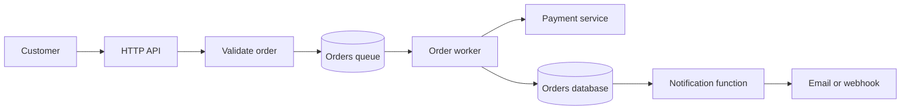
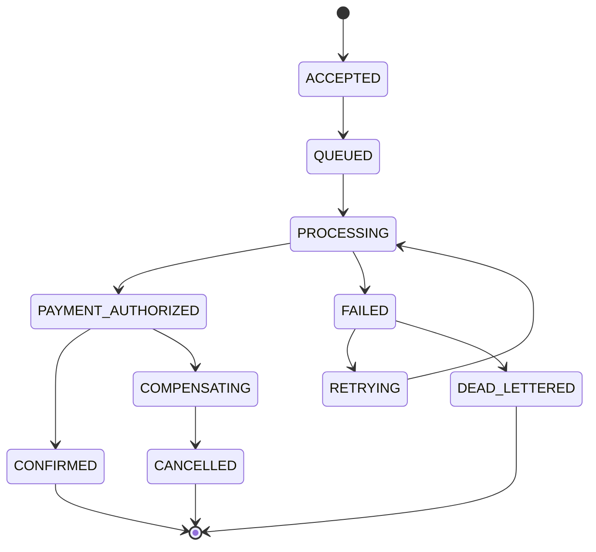
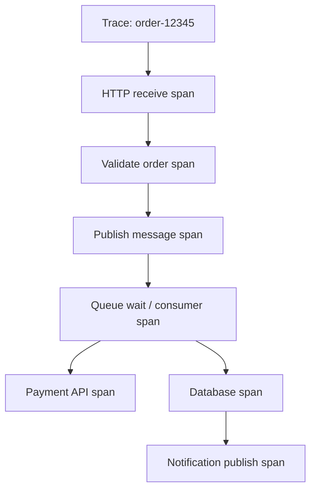

# Designing Dashboards Around Business Flows

A serverless operations dashboard must answer how the business is performing, where requests or events are slowing down, and whether customers are receiving accurate outcomes. A dashboard showing only CPU, memory, invocation count, and error count may show that functions are running, yet fail to tell whether orders were confirmed, payments succeeded, or uploaded files finished processing.

With Java functions triggered by HTTP, messages, or events, a business flow often spans multiple functions and services: an API accepts a request, a queue buffers work, a worker processes it, a database updates state, and another function sends a notification. Each component emits its own metrics; the dashboard must connect them using business identifiers, correlation IDs, traces, and outcome indicators.

Within the scope of **CLOUD_SERVERLESS**, this lesson focuses on developing and deploying serverless applications, particularly Java functions triggered by HTTP, messages, or events. Learners handle triggers, state, permissions, retries, idempotency, cold starts, scaling, and cost. This lesson guides you through designing dashboards centered on business journeys, from high-level outcome metrics down to per-step technical latency and errors.

## 1. Start from Business Questions

Before picking charts, define what decisions viewers need to make. Product owners, on-call engineers, and developers ask different questions:

| Audience | Primary Question | Information Needed |
|---|---|---|
| Product/operations | How many requests are completing? Are any steps stuck? | Business throughput, completion rate, end-to-end duration, backlog |
| On-call engineer | Which flow is failing and what is the blast radius? | Error rate, latency, retries, DLQ, dependency health, and traces |
| Developer | Which function or dependency caused the error? | Function duration, cold starts, exceptions, downstream latency, and logs |
| FinOps/platform | Where are costs rising and are they proportional to volume? | Cost per operation, invocations, duration, memory, egress, and log ingestion |

A good dashboard starts from a concrete business flow, such as `OrderSubmitted → PaymentAuthorized → InventoryReserved → OrderConfirmed`. Each step needs a status, timestamp, outcome, and identifier so it can be linked to logs/traces.

## 2. Map the Business Flow Before Creating the Dashboard

Example of an ordering flow using API Gateway, a Java HTTP function, a queue, and a worker:



From this diagram, the dashboard can be structured into business steps:

1. Request is received.
2. Request is validated and accepted.
3. Message is enqueued.
4. Worker processes and calls the payment service.
5. Database persists the order status.
6. Notification is sent.
7. Order reaches its terminal state.

Each step should have metrics showing incoming volume, successes, failures, and processing duration. Every step does not have to be a separate function; the dashboard reflects actual business boundaries and dependencies.

## 3. Design Multi-Tier Dashboards

Do not crowd every metric onto a single screen. An effective structure usually has three tiers:

**Tier 1 — Business overview:** business outcomes such as completed requests, success rate, end-to-end duration, backlog, and cost per transaction.

**Tier 2 — Workflow health:** individual steps such as received, accepted, queued, processing, persisted, notified; errors, retries, and wait time at each step.

**Tier 3 — Technical diagnostics:** function duration, cold starts, concurrency, memory, downstream latency, logs, traces, and deployment versions.

Viewers should be able to drill down from an anomaly in Tier 1 to the affected business step in Tier 2, and then to the function/logs/traces in Tier 3. This minimizes context switching across disconnected dashboards.

## 4. Choose Meaningful Business KPIs

KPIs must be precisely defined with units, time scopes, and calculation rules. Examples:

| KPI | Example Definition | Why Useful |
|---|---|---|
| Orders accepted | Number of orders accepted by the API within a time window | Measures incoming demand |
| Orders completed | Number of orders reaching `CONFIRMED` status | Measures final outcome |
| Completion rate | Completed / accepted over a matching cohort | Detects dropped or incomplete requests |
| End-to-end latency | Elapsed time from accepted to confirmed | Measures full-journey experience |
| Pending age | Age of requests not yet in a terminal state | Detects stuck work |
| Payment success rate | Payment authorized / payment attempts | Separates business failures from infrastructure errors |
| Cost per completed order | Total allocated cost / completed orders | Tracks economic efficiency |

Completion rate requires defining a cohort. Dividing orders completed within 5 minutes by orders received in that same 5-minute window treats still-processing orders as failures. You can use cohorts grouped by acceptance time and evaluate once the completion deadline passes, or display `pending` separately to avoid misleading conclusions.

## 5. Measure Workflow States and Transitions

A business flow should have a clear state model. Example:



Not every workflow has these exact states. Use your domain's actual state transitions. Dashboards should show counts in each state, time spent in each state, and abnormal transition counts.

If state is inferred solely from free-form log text, calculations break easily when log formats change. For critical workflows, persist state in a database/event store or emit well-schemaed business events; logs and traces serve diagnostics and should not be the sole source of truth for business state.

## 6. Golden Signals for Each Function

Alongside business KPIs, each function needs core technical signals:

| Signal | Question | Example Metrics |
|---|---|---|
| Traffic | How many invocations/requests/events? | Request count, invocation count, messages received |
| Errors | How many invocations or records failed? | Error count, exception count, failed batches |
| Latency | How long does processing take? | Duration histogram, p50/p95/p99 |
| Saturation | Are resources approaching limits? | Concurrency, throttles, memory, CPU, connection pool wait |

For message-driven functions, add queue depth, oldest message age, delivery count, retries, and DLQ counts. For stream processors, add consumer lag, partition ownership, checkpoint age, and event processing rate.

Do not display only successful invocation counts. A function may return success right after enqueuing work while the downstream workflow remains stuck. Final KPIs must be measured where the business operation completes.

## 7. Measure End-to-End Time and Per-Step Time

End-to-end time is the elapsed duration from when a workflow starts until it reaches a terminal state. It can be broken down as:

\[
T_{end-to-end} = T_{ingress} + T_{queue} + T_{processing} + T_{dependency} + T_{finalize}
\]

Where:

- `T_ingress`: request receipt, validation, and enqueueing.
- `T_queue`: wait time before a worker begins processing.
- `T_processing`: business logic execution time.
- `T_dependency`: wait time for databases, payment services, or external APIs.
- `T_finalize`: state update and final notification dispatch.

Dashboards should display both end-to-end latency and per-step latency. If function duration is normal while end-to-end latency rises, the cause likely lies in queue backlog or retry schedules rather than function CPU.

For distributions, use histograms and percentiles instead of averages alone. p95/p99 expose slow request cohorts that averages can mask.

## 8. Correlation ID and Trace Context Across the Workflow

To link multiple invocations, each workflow needs a stable correlation ID. Each request/event may have its own request ID, while the correlation ID represents the entire business journey.

Example:

```text
correlation_id = order-12345
request_id     = api-req-8f21
message_id     = msg-7712
trace_id       = 4bf92f3577b34da6a3ce929d0e0e4736
```

When the API receives a request, generate or validate the correlation ID and pass it via message attributes/application properties. Consumers continue recording that ID in logs and spans. Do not generate a new correlation ID at each function if you want to trace the full journey.

OpenTelemetry context propagation uses trace context such as `traceparent` and `tracestate`. For message brokers, inject context into message attributes when publishing and extract it when consuming. Depending on the SDK and messaging conventions, producer, consumer, and processing spans can be connected via parent/links; for batches containing multiple messages, span links are usually more appropriate than assigning a single parent across independent traces.

Correlation ID is business tracing data, not a credential. Never use it to grant access or trust caller identity.

## 9. Designing Structured Logs for Java Functions

Logs should be JSON or structured fields so they can be filtered and grouped by workflow. Example:

```json
{
  "timestamp": "2026-11-17T09:30:00Z",
  "severity": "INFO",
  "service": "orders-worker",
  "function": "processOrder",
  "release": "orders-2026.11.17.3",
  "correlation_id": "order-12345",
  "message_id": "msg-7712",
  "order_state": "PAYMENT_AUTHORIZED",
  "duration_ms": 182,
  "outcome": "success"
}
```

Log events should include stable fields such as `service`, `function`, `release`, `correlation_id`, `event_id`, `outcome`, and `duration_ms`. Avoid logging only a free-form sentence like `Order processed`, which is hard to parse and prone to change.

Do not log access tokens, passwords, payment card data, secrets, sensitive payloads, or unnecessary personal data. When searching by customer/order is required, use pseudonymized IDs or approved business keys.

## 10. Java Instrumentation with Micrometer

Micrometer provides an abstraction for metrics in Java. For example, a use case can count processing outcomes and measure duration:

```java
import io.micrometer.core.instrument.Counter;
import io.micrometer.core.instrument.MeterRegistry;
import io.micrometer.core.instrument.Timer;

public final class ProcessOrderUseCase {
    private final MeterRegistry registry;
    private final OrderService orderService;

    public ProcessOrderUseCase(
            MeterRegistry registry,
            OrderService orderService) {
        this.registry = registry;
        this.orderService = orderService;
    }

    public void execute(OrderCommand command) {
        Timer.Sample sample = Timer.start(registry);
        String outcome = "success";
        try {
            orderService.process(command);
            Counter.builder("business.orders.processed")
                    .tag("outcome", outcome)
                    .register(registry)
                    .increment();
        } catch (RuntimeException exception) {
            outcome = "failure";
            Counter.builder("business.orders.processed")
                    .tag("outcome", outcome)
                    .register(registry)
                    .increment();
            throw exception;
        } finally {
            sample.stop(Timer.builder("business.orders.processing")
                    .tag("outcome", outcome)
                    .register(registry));
        }
    }
}
```

This is an illustrative example. In applications with many metrics, register meters once or use builders/helpers to avoid recreating meters on every invocation. Use only tags with bounded value sets such as `outcome`, `operation`, or `region`; never attach `orderId`, `customerId`, or `correlationId` as metric labels because cardinality grows without bound.

For function frameworks that do not keep processes running long or lack direct push/pull registries, metrics can be exported via OpenTelemetry or a platform-compatible adapter. Verify how the runtime collects metrics and telemetry costs before increasing metric frequency or volume.

## 11. Distributed Tracing Instrumentation with OpenTelemetry

Traces describe a request/event's path across multiple services. Each span represents an operation such as validating an order, publishing a message, querying a database, or calling a payment provider.



In Java, the OpenTelemetry SDK or Java agent can automatically instrument supported frameworks, HTTP clients, database drivers, and messaging clients. Manual instrumentation is useful for business operations not recognized by libraries.

Example creating a manual span:

```java
Span span = tracer.spanBuilder("orders.process")
        .setSpanKind(SpanKind.INTERNAL)
        .startSpan();

try (Scope scope = span.makeCurrent()) {
    span.setAttribute("business.operation", "process-order");
    span.setAttribute("business.outcome", "success");
    orderService.process(command);
} catch (RuntimeException exception) {
    span.recordException(exception);
    span.setStatus(StatusCode.ERROR);
    throw exception;
} finally {
    span.end();
}
```

Do not put sensitive data or direct personal identifiers into span attributes. Use stable operation names and avoid generating a different span name for every order ID.

## 12. Dashboards for HTTP-Triggered Functions

An HTTP dashboard should show both client experience and backend health:

- Request rate by route/method.
- 2xx, 4xx, and 5xx rates; distinguish client errors from server errors.
- p50/p95/p99 latency.
- Throttled requests, timeouts, and authentication/authorization failures.
- Cold start/startup latency if provided by the platform.
- Concurrent requests, active instances, and max-instance saturation.
- Dependency latency and error rates.
- Business completion rate after requests are accepted.

An API returning `202 Accepted` only proves work was accepted, not that the workflow completed. Dashboards must link `accepted` to terminal state using correlation IDs or business records.

## 13. Dashboards for Queue/Message-Triggered Functions

For queue workers, display:

- Messages published, received, completed/acked, and failed.
- Queue depth/visible messages and in-flight/locked messages.
- Age of oldest message or enqueue-to-start delay.
- Delivery count, retry count, poison messages, and DLQ count.
- Processing duration and batch size.
- Consumer concurrency, throttling, and downstream connection usage.
- Business records completed after messages are processed.

Low queue depth paired with high oldest message age can still signal a stalled worker or a poison message blocking the flow. For FIFO/session-based queues, a group of messages may wait behind a single long-locked message; observe by group/session if the service supports it.

## 14. Dashboards for Event Streams

For Event Hubs, Kafka, or Pub/Sub streams, dashboards should display:

- Event ingress/egress rates.
- Consumer lag or distance between the latest offset and committed checkpoint.
- Processing rate per partition/subscription.
- Partition ownership/rebalances and active consumer count.
- Checkpoint age/frequency and replayed event counts.
- Event parse/schema failures, quarantine, and dead-letter counts.
- End-to-end event age from publish to completed processing.

Average consumer lag can hide a single lagging partition. Display max lag and per-partition lag distribution when possible. If events arrive faster than they are processed over a long period, backlog can exceed the retention window and lose replayability.

## 15. Tracking Retries, Idempotency, and DLQs

Retries can make invocation success rates look good while masking initial errors. Dashboards should distinguish:

- First-attempt success rate.
- Eventual success rate after retries.
- Number of retries per business operation.
- DLQ/quarantine arrival rate.
- Duplicate detection count.
- Operations stuck in `PROCESSING` state too long.
- Idempotency conflicts or duplicate suppression counts.

Looking only at final success can hide a function retrying repeatedly, driving up cost and stretching latency. Looking only at invocation errors can misinterpret succeeded retries as failed workflows. Display both first-attempt and eventual outcomes.

## 16. SLOs, Error Budgets, and Alerting

Dashboards describe the situation; alerts must wake operators when targets risk being breached. SLOs should tie directly to business experience.

Examples:

| SLO | Example Definition |
|---|---|
| API availability | 99.9% of valid requests receive non-5xx responses over a rolling 30-day window |
| Order completion latency | 95% of orders confirmed within 60 seconds of acceptance |
| Message freshness | 99% of messages begin processing within 2 minutes of enqueueing |
| Event processing lag | 99% of events processed within 30 seconds after publishing |
| Data correctness | Duplicate business side-effect rate equals 0 across reconciled transactions |

SLO definitions must clarify the denominator, eligible request types, measurement window, terminal states, and maintenance handling. Alerts should prioritize burn rate or sustained SLO violations rather than paging on brief spikes with no user impact.

Commonly useful alerts:

- Business completion rate drops below threshold.
- p95/p99 end-to-end latency breaches SLO.
- Oldest message age or consumer lag climbs steadily.
- DLQ grows rapidly or new poison messages appear.
- Function throttling/timeouts increase.
- Database pool nears exhaustion or dependency error rate rises.
- Cost per completed operation rises abnormally.

## 17. Cost Dashboards by Business Flow

Serverless costs should be tied to completed units of work. A function may have low per-invocation cost yet incur high total cost through excessive retries, verbose logging, or expensive dependency calls.

Suggested metrics:

- Function invocations, duration, memory/CPU allocation, and provisioned/min instance time.
- Queue/API/storage request counts.
- Data transfer/egress and NAT/connector costs if applicable.
- Log ingestion, trace sampling, and metric series counts.
- Database queries/connections and cache usage.
- `cost_per_accepted_request` and `cost_per_completed_order`.

Example:

\[
Cost\ per\ completed\ order = \frac{Allocated\ platform\ cost}{Orders\ confirmed}
\]

Allocating cost to a flow may require tagging by service, environment, team, or workload. Do not attach business IDs as metric labels to calculate cost; aggregate via billing exports, log analytics, or an appropriate data warehouse.

If completed orders drop while invocation costs stay flat, cost per completed order increases. That can signal workflow failures or heavy retries even before overall infrastructure spend exceeds budget.

## 18. Avoiding Excessive Metric Cardinality

Metric labels must have bounded value sets. Fields such as `orderId`, `userId`, `email`, `requestId`, or `traceId` can create millions of time series, raising costs and degrading query performance.

Use:

- `service`, `function`, `environment`, `region`.
- `operation` from a defined set of values.
- `outcome`: `success`, `failure`, `retry`, `rejected`.
- `error_type` grouped stably, never full exception messages.
- `queue` or `topic` when counts are small and managed.

To look up a specific order, use log/trace search by correlation ID or protected business ID. Metrics capture aggregate trends; logs and traces investigate individual transactions.

## 19. Dashboards and Alerts by Deployment Version

Every log, trace, and metric should carry release/service version info to compare before and after deployments.

Recommended fields:

- `service.name`, `service.version`, `deployment.environment`.
- Git commit or release ID.
- Function version/alias or Cloud Run revision.
- Runtime version and region.
- Config revision or feature flag cohort when applicable.

During canary deployments, dashboards should compare error rates, latency, and business completion between old and new versions. Never merge all revisions into a single metric line when you need to catch a faulty release.

However, do not create metric labels from full commit SHAs if every build spawns a new time series with long retention. You can use controlled version labels on dashboards or log/trace metadata depending on your backend and cardinality budget.

## 20. Example Queries and Charts

If using Prometheus-compatible metrics, illustrative queries include:

Success processing rate:

```promql
sum(rate(business_orders_processed_total{outcome="success"}[5m]))
/ sum(rate(business_orders_processed_total[5m]))
```

p95 processing duration from a histogram:

```promql
histogram_quantile(
  0.95,
  sum by (le) (rate(business_orders_processing_seconds_bucket[5m]))
)
```

Queue age or consumer lag depends on your service's metric exporter. Example metric names might be `queue_oldest_message_age_seconds` or `event_consumer_lag`; use the exact names exposed by your exporter/platform.

With CloudWatch, Cloud Monitoring, or Azure Monitor, metric namespaces, dimensions, and query languages differ. Build dashboards from native service metrics and custom business metrics rather than copying PromQL queries verbatim to another platform.

## 21. Example Dashboard Layout for Order Flow

An overview dashboard can be arranged as follows:

| Position | Widget | Purpose |
|---|---|---|
| Row 1 | Orders accepted, completed, completion rate, pending | Current outcomes |
| Row 2 | End-to-end p50/p95/p99 and completion trend | Experience and trend |
| Row 3 | State distribution: queued, processing, payment, confirmed, failed | Identify bottleneck steps |
| Row 4 | Queue depth, oldest age, retries, DLQ | Async pipeline health |
| Row 5 | Function errors/duration/concurrency/cold starts | Runtime diagnostics |
| Row 6 | Payment/database latency and error rates | Dependency diagnostics |
| Row 7 | Cost per completed order and total cost trend | Cost efficiency |

Each widget needs an appropriate default time range, clear units, and links/drilldowns to detailed dashboards or trace searches. Use alert colors consistently and meaningfully; do not color every metric red simply because a value increased.

## 22. Access Control and Protecting Dashboards

Dashboards can expose sensitive business figures or let viewers infer customer activity. Enforce:

- Role-based access control (RBAC): product/operations view aggregate KPIs; on-call engineers view technical details; developers view logs/traces within authorized scopes.
- Mask or strip PII, tokens, secrets, and sensitive payloads from logs.
- Restrict drilldowns that can query raw events or customer data.
- Control edit permissions for alerts, dashboards, and notification channels.
- Audit changes to critical dashboards and alerts.
- Enforce SSO and least-privilege access on observability tools.

Widely shared dashboards should favor aggregated data. Access to raw payloads must have a business justification, auditing, and appropriate time limits.

## 23. Common Dashboard Design Mistakes

| Issue | Consequence | Fix |
|---|---|---|
| Showing only invocation counts | Blind to whether business operations finished | Add business states and completion KPIs |
| Showing only average latency | Hides tail latency | Use histograms and p50/p95/p99 |
| Combining all functions into one error rate | Hard to isolate the failing step | Split by service/function/operation |
| Not measuring queue age | Backlog grows while dashboard stays green | Add oldest message age and consumer lag |
| Looking only at eventual success | Heavy retries go unnoticed | Show first-attempt and eventual success |
| Using unique IDs as metric labels | Cardinality and costs surge | Put IDs in logs/traces; keep metric labels bounded |
| Logs missing correlation ID | Hard to trace requests across invocations | Propagate context via HTTP and message metadata |
| Dashboards lacking release version | Hard to correlate errors with deployments | Add service version/revision and release annotations |
| Alerting on every spike | Alert fatigue | Alert on SLOs, burn rate, and business impact |
| Using dashboards as the sole state store | Wrong state when logs are missing | Persist business state durably; dashboards only read/aggregate |

## 24. Process for Building a Dashboard from Scratch

1. **Select a business flow:** document actors, triggers, processing steps, dependencies, and terminal states.
2. **Define KPIs:** specify formulas, units, cohorts, time windows, and owners.
3. **Add instrumentation:** business metrics, technical metrics, structured logs, and traces.
4. **Design correlation:** create business IDs, request/event IDs, and propagate trace context.
5. **Build the overview dashboard:** display volume, completion, latency, pending work, and cost.
6. **Add drilldowns:** by step, function, queue, dependency, and release version.
7. **Set SLOs and alerts:** choose impactful thresholds and route to accountable owners.
8. **Validate data:** compare KPIs against source databases/reports to verify formulas.
9. **Configure access control:** strip sensitive data and enforce role-based permissions.
10. **Run incident drills:** simulate queue backlogs, dependency outages, retry storms, and faulty releases to confirm the dashboard pinpoints root causes.

## 25. Production Checklist

| Question | Evidence Required |
|---|---|
| Does the dashboard start from a business flow? | Workflow diagram and terminal states defined |
| Do KPIs have clear formulas? | Denominator, cohort, time window, and owner |
| Is end-to-end latency measured? | Timestamps or traces spanning the workflow |
| Are per-step metrics available? | Accepted, queued, processing, completed, failed |
| Does correlation ID span functions? | Propagated HTTP headers/message attributes/event metadata |
| Are logs structured? | Service, function, release, event ID, and outcome |
| Are distributed traces present? | Spans for functions, messaging, and dependencies |
| Do queues/streams have backlog metrics? | Oldest age, DLQ, consumer lag, and checkpoint age |
| Are first-attempt and eventual success separated? | Retry and duplicate metrics |
| Are SLOs and actionable alerts configured? | Thresholds/burn rates and owner/on-call routing |
| Is cost per business outcome tracked? | Billing allocation and completed operation counts |
| Is cardinality controlled? | No user/order/trace IDs used as metric labels |
| Is the dashboard secured? | RBAC, PII masking, and auditing |
| Are deployment versions attached? | Release ID, function version, or revision |
| Has the dashboard been exercised? | Incident drill proving drilldown from KPI to trace |

## 26. Design Conclusion

An effective serverless dashboard connects business outcomes with technical health. Start with the journey a customer or system needs to complete, define states and KPIs, and instrument each function, queue, event stream, and dependency with metrics, structured logs, and distributed traces.

When a high-level indicator degrades, operators need to pinpoint the slow or failing business step, the affected function/revision, the specific message/event, and the failing dependency. At the same time, the dashboard should reveal retries, backlogs, cold starts, concurrency, and cost per completed outcome. Organizing dashboards this way enables operations teams to make decisions based on real business impact rather than staring at disconnected infrastructure numbers.
