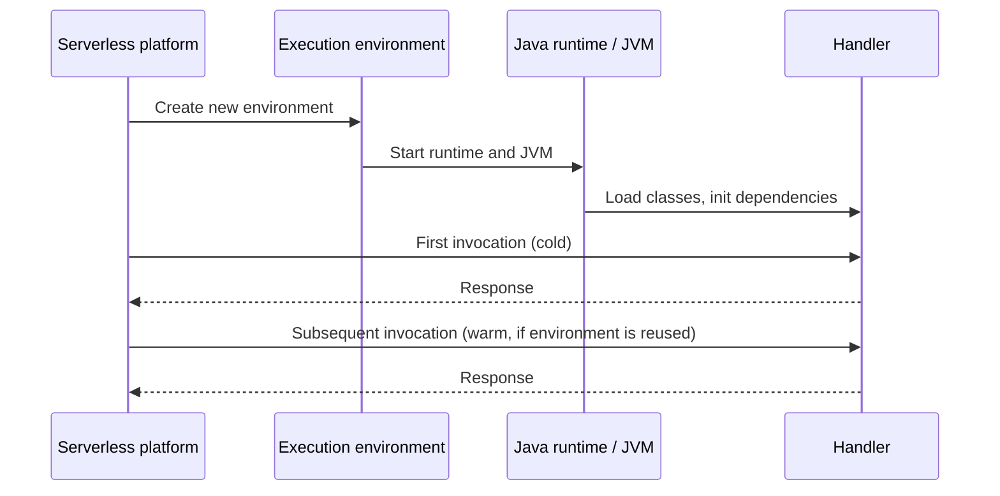

# Benchmarking Cold Starts and Warm Invocations Separately

A Java function can respond very quickly once its execution environment is ready, but the first invocation on a new environment typically incurs extra time to initialize the runtime, JVM, classes, and dependencies. If you lump every request into a single average latency number, the slowness caused by **cold starts** can be hidden by many **warm** runs.

Serverless benchmarking must separate at least two cohorts: cold starts and warm invocations. Each cohort must have its own load-generation approach, execution environment identification, and measurement method. Only then should you compare options such as memory/CPU, Java runtime, package size, provisioned/always-ready capacity, or snapshot mechanisms. The goal is to understand the latency distribution and cold-start rate under conditions close to real traffic, rather than chasing a single nice number from a one-off run.

## 1. What Are Cold Starts and Warm Invocations?

A **cold start** occurs when the platform must prepare a new execution environment to run the function. For Java, this time can include:

- Allocating or selecting a compute instance/container for the invocation.
- Starting the Functions host or Lambda runtime and the Java worker.
- Starting the JVM, loading classes, and executing static initialization.
- Loading the framework, dependencies, and application configuration.
- Initializing extensions, instrumentation, or clients if the application creates them at startup.
- Establishing network connections or accessing external services if the code performs these operations during initialization.

A **warm invocation** runs on an execution environment that has already been initialized and can still be reused. The JVM and classes are already loaded; static clients or connection pools may already exist. The handler still executes business logic and calls dependencies, but it does not pay the full cost of environment initialization again.



Do not define a cold start simply as "the first request after a few minutes without traffic." The platform may keep an environment longer or reclaim it earlier than an assumed idle timeout. An invocation after an idle period can still be warm; a concurrent burst can create many cold environments even if the function just handled a request moments ago.

## 2. Measure Latency Components Accurately

A single end-to-end number from client to response can contain multiple components:

\[
T_{end-to-end} = T_{network} + T_{gateway} + T_{platform-init} + T_{handler} + T_{downstream}
\]

This is a conceptual model; components may overlap or be measured at different boundaries depending on the platform. You must document the start and end points of each measurement.

| Measurement | Start/End Points | Question It Answers |
|---|---|---|
| Client end-to-end latency | Client starts request until response is received | How long does the user actually wait? |
| Platform initialization | Platform starts preparing environment until runtime is ready per provider metric | How much time does a cold start cost? |
| Handler duration | Entering handler until handler returns result | How long do Java logic and dependencies take inside the handler? |
| Dependency duration | Before/after a database, queue, or HTTP API call | Is a downstream service the bottleneck? |
| First invocation in environment | First invocation of a process/environment per application marker | How frequently do new environments appear? |

**Do not mechanically add metrics with different boundaries.** For example, Lambda `Duration` measures handler execution time, while `Init Duration` is recorded separately in the REPORT log when initialization occurs. Client latency also includes network and gateway overhead. Read the platform's metric documentation to know which durations are already included in others.

## 3. Design Two Independent Benchmarks

Cold starts and warm invocations require two separate experiments. If you run one continuous load test and take an average, the data will mix new and existing environments together.

### 3.1. Cold-Start Benchmark

The goal is to measure the cost when a new execution environment is created. Suggested procedure:

1. Create a deployment candidate with a fixed version/build ID.
2. Disable or omit always-ready instance mechanisms if you want to measure pure on-demand cold starts.
3. Create conditions requiring the platform to spin up new environments, such as a controlled concurrency burst or a dedicated test function/version.
4. Attach an environment ID and first-invocation marker inside the application.
5. Collect platform initialization metrics/logs alongside client latency.
6. Classify a sample as cold only when there is evidence from platform metrics or a new environment marker; do not rely on request sequence numbers.
7. Repeat across multiple independent rounds and report valid sample counts, new environments created, and cold rate.

There is no universal API across all FaaS platforms to "clear all warm environments." Waiting for a period of time and sending a request does not guarantee that request is cold. With Lambda, you can observe new execution environments during scale-out bursts; with Azure Functions, you need to observe new instances/processes and startup telemetry. The method used to generate the cold cohort must be described in the benchmark report.

### 3.2. Warm-Invocation Benchmark

The goal is to measure the handler once the environment is ready:

1. Send one or more warm-up requests so the environment loads classes and dependencies.
2. Confirm subsequent invocations belong to the same environment/process using the marker.
3. Run sequentially with concurrency of 1 to reduce the chance of the platform creating additional environments.
4. Exclude the initial invocations from the warm cohort.
5. Collect handler duration and end-to-end latency for a sufficiently large sample size.
6. Repeat across multiple rounds; document pause times and load conditions between calls.

A warm environment can still be reclaimed at any time. If the marker shows that the process/environment changed, classify the new sample as cold or unclassified instead of placing it in the warm cohort.

### 3.3. Measure Burst Scale-Out Separately

Another benchmark should measure rapid concurrency increases. This is not merely an isolated cold start: the platform must create multiple environments, the scale controller must react, and downstream systems must absorb the concurrent load increase.

Run increasing concurrency or request-rate levels, then observe:

- Number of new environments created.
- Percentage of cold invocations at each load level.
- p50/p95/p99 end-to-end latency.
- Throttles, queue age, consumer lag, and downstream saturation.
- Time from the start of the burst until throughput stabilizes.

Do not use burst results to replace a warm microbenchmark. Report latencies separately for the cold cohort, warm cohort, and total burst traffic.

## 4. Control Variables for Meaningful Benchmarks

When comparing two configurations, change only one group of variables at a time. Hold other factors constant so you know what caused the improvement.

| Variable to Hold Constant or Record | Why It Matters |
|---|---|
| Java version and runtime version | JVM startup, JIT, and class libraries may differ |
| Function code, dependencies, and framework | Class count, static initialization, and bootstrap affect cold start |
| Artifact type and size | JAR/ZIP/image may have different download and load times |
| Memory/CPU allocation | CPU affects JVM startup and processing speed |
| Region, architecture, and network | Distance, compute, and native libraries affect latency |
| VPC/VNet, NAT, private endpoints | Network setup can add initialization/connection time |
| Payload and business path | Different inputs may trigger different code branches |
| Downstream services and datasets | Slow databases/APIs add noise to handler duration |
| Logging/tracing/sampling | Instrumentation adds overhead and changes data volume |
| Concurrency and request rate | Can trigger extra environments or throttling |
| Provisioned/always-ready/SnapStart | Changes the nature of the cold-start scenario |

If comparing two memory configurations, keep code, runtime, region, payload, downstream services, and concurrency profile constant. If you change memory, Java version, dependencies, and VPC simultaneously, you cannot conclude which factor caused the difference.

## 5. Adding a Marker to the Java Handler

A static marker can be used to identify the first invocation of a Java process/classloader. This marker is useful for warm/cold classification at the application layer, though it does not replace platform cold-start metrics: the JVM or host may have started before the handler class was loaded.

AWS Lambda Java example:

```java
package com.example.benchmark;

import com.amazonaws.services.lambda.runtime.Context;
import com.amazonaws.services.lambda.runtime.LambdaLogger;
import com.amazonaws.services.lambda.runtime.RequestHandler;
import java.util.Map;
import java.util.UUID;
import java.util.concurrent.atomic.AtomicBoolean;

public final class BenchmarkHandler
        implements RequestHandler<Map<String, Object>, Map<String, Object>> {

    private static final String ENVIRONMENT_ID = UUID.randomUUID().toString();
    private static final AtomicBoolean FIRST_INVOCATION = new AtomicBoolean(true);

    @Override
    public Map<String, Object> handleRequest(
            Map<String, Object> event,
            Context context) {

        boolean firstInProcess = FIRST_INVOCATION.compareAndSet(true, false);
        long startedAt = System.nanoTime();
        LambdaLogger logger = context.getLogger();

        try {
            // Execute the same workload in every benchmark run.
            String result = process(event);
            return Map.of("status", "ok", "result", result);
        } finally {
            double handlerMs = (System.nanoTime() - startedAt) / 1_000_000.0;
            logger.log(String.format(
                    "benchmark envId=%s firstInProcess=%s requestId=%s "
                            + "handlerMs=%.3f remainingMs=%d",
                    ENVIRONMENT_ID,
                    firstInProcess,
                    context.getAwsRequestId(),
                    handlerMs,
                    context.getRemainingTimeInMillis()));
        }
    }

    private String process(Map<String, Object> event) {
        return "processed";
    }
}
```

`System.nanoTime()` is suitable for measuring elapsed time within the same process; do not use `System.currentTimeMillis()` to compute durations because the system clock can be adjusted. `ENVIRONMENT_ID` represents the process/classloader in this example. If the runtime spawns multiple worker processes on the same host instance, this marker identifies the process rather than necessarily the entire VM/cloud instance.

`firstInProcess=true` indicates that this class/process is handling its first invocation since being loaded. It does not measure total platform, JVM, or host startup time. On AWS Lambda, correlate this marker with `Init Duration` in the REPORT log and client latency. Do not enable verbose logging for every request in production benchmarks if logging overhead skews measurements; use sampling or enable it only on test functions.

### 5.1. Do Not Let Instrumentation Dominate the Benchmark

- Avoid logging full payloads or logging inside every loop iteration.
- Use the same logging/tracing configuration across all candidates.
- Measure both an uninstrumented handler and an instrumented handler if you need to estimate overhead.
- Do not instantiate AWS/Azure SDK clients on every invocation if the production app will reuse clients.
- Do not run benchmarks with mocked dependencies if the goal is end-to-end measurement; conversely, use a simple workload if the goal is measuring pure JVM/handler overhead.

## 6. Measuring Cold Starts on AWS Lambda

AWS Lambda records initialization details in CloudWatch Logs. For managed runtimes, the `REPORT` line of a cold invocation can contain `Init Duration`; handler execution is represented by `Duration`. When using SnapStart, separate restore information may appear in logs. Keep metric definitions consistent when comparing standard, SnapStart, and Provisioned Concurrency configurations.

A practical workflow:

1. Invoke the function through the same invocation path (direct SDK or API Gateway) for all candidates.
2. Record request ID, environment marker, and timestamps on the client.
3. Fetch CloudWatch REPORT logs by request ID to collect `Init Duration` and `Duration`.
4. Correlate with client end-to-end latency to reveal network/gateway time.
5. Group samples that have `Init Duration` separately from warm invocations without initialization in the same execution environment.

CloudWatch metrics such as `Duration`, `Errors`, `Throttles`, and `ConcurrentExecutions` help monitor the overall workload. `Init Duration` is typically read from the REPORT log and should not be assumed to be a separate standard CloudWatch metric in every configuration. With Provisioned Concurrency, monitor utilization and spillover to see whether requests ran on on-demand capacity.

### 6.1. Comparing Lambda Modes

| Mode | Appropriate Measurement Method | Key Question |
|---|---|---|
| Default on-demand | Collect Init Duration, handler Duration, and client latency | What are baseline cold start and warm latencies? |
| Provisioned Concurrency | Wait for capacity to be provisioned, then measure requests within provisioned capacity and spillover separately | How does lower latency trade off against the cost of always-ready capacity? |
| SnapStart (supported runtimes) | Measure restore/initialization separately and warm invocations after restore | How much does snapshotting shorten startup, and is restore affected? |
| Increasing memory | Keep workload fixed; measure Init Duration and handler Duration at each tier | Does extra CPU reduce startup/processing enough to offset the cost? |

SnapStart and Provisioned Concurrency have their own support requirements, configurations, and trade-offs. Do not assume they can be enabled simultaneously for every runtime or function. Check Java runtime, architecture, deployment package, and service limits before designing experiments.

## 7. Measuring Cold Starts and Warm Invocations on Azure Functions

On Azure Functions, response time can be influenced by the Functions host, Java worker, JVM, hosting plan, scale controller, and dependencies. You should not take only the Java method duration and treat it as the entire cold start.

A repeatable measurement approach:

1. Include build ID and a process/environment marker in the Java function's logs.
2. Record timestamps on the client before the request and after the response.
3. Record timestamps immediately when the method starts and ends using `System.nanoTime()`.
4. Collect host/worker startup logs and Application Insights request/trace telemetry.
5. Identify the first invocation on a new worker/process using the marker and instance metadata when available.
6. Separate the first request of a new worker from warm invocations in the same process.

With Azure Functions, cold-start behavior and scaling depend on the hosting plan. Consumption/Flex Consumption can scale to zero; Premium provides pre-warmed/always-ready capacity; Dedicated can keep the app running with Always On. Flex Consumption supports configuring always-ready instances. When benchmarking, record the plan, minimum/always-ready instances, Java version, OS, and deployment region.

### 7.1. Example of Recording Timing in an Azure Java Function

```java
import com.microsoft.azure.functions.ExecutionContext;
import com.microsoft.azure.functions.HttpRequestMessage;
import com.microsoft.azure.functions.HttpResponseMessage;
import com.microsoft.azure.functions.HttpStatus;
import com.microsoft.azure.functions.annotation.AuthorizationLevel;
import com.microsoft.azure.functions.annotation.FunctionName;
import com.microsoft.azure.functions.annotation.HttpTrigger;
import java.util.Optional;
import java.util.UUID;
import java.util.concurrent.atomic.AtomicBoolean;

public final class AzureBenchmarkFunction {
    private static final String PROCESS_ID = UUID.randomUUID().toString();
    private static final AtomicBoolean FIRST = new AtomicBoolean(true);

    @FunctionName("benchmark")
    public HttpResponseMessage run(
            @HttpTrigger(
                    name = "request",
                    methods = {com.microsoft.azure.functions.HttpMethod.GET},
                    authLevel = AuthorizationLevel.FUNCTION)
            HttpRequestMessage<Optional<String>> request,
            ExecutionContext context) {

        boolean firstInProcess = FIRST.compareAndSet(true, false);
        long started = System.nanoTime();
        try {
            return request.createResponseBuilder(HttpStatus.OK)
                    .body("ok")
                    .build();
        } finally {
            double durationMs = (System.nanoTime() - started) / 1_000_000.0;
            context.getLogger().info(String.format(
                    "benchmark processId=%s firstInProcess=%s invocationId=%s durationMs=%.3f",
                    PROCESS_ID,
                    firstInProcess,
                    context.getInvocationId(),
                    durationMs));
        }
    }
}
```

The marker only identifies the Java process where the class was loaded. To understand cold starts for the entire Function App, you must correlate host/worker logs, instance metadata, and client timing. A single host instance can have distinct worker behavior; do not infer total instance count from a single static UUID alone.

## 8. Measuring Latency Distribution and Cold-Start Rate

Do not report only the average. Serverless latency typically has a skewed distribution: most warm requests are fast, while a subset of cold requests is significantly slower. Report at least:

- **p50:** the median, representing a typical request.
- **p90/p95:** the tail affecting most slow experiences.
- **p99:** the far tail, useful for latency-sensitive APIs when sample count is sufficient.
- **Min/max:** useful for spotting outliers, but not as the sole conclusion.
- **Cold-start rate:** number of cold invocations divided by total invocations under the benchmark conditions.
- **Sample count:** separate counts for cold and warm samples.

Example results table:

| Scenario | Cold samples | Warm samples | Cold p50/p95 | Warm p50/p95 | Cold rate |
|---|---:|---:|---:|---:|---:|
| On-demand, 512 MB | 40 | 2,000 | 1,450 / 2,100 ms | 85 / 160 ms | 2.0% |
| On-demand, 1,024 MB | 38 | 2,000 | 980 / 1,500 ms | 62 / 120 ms | 1.9% |
| Always-ready, 1 instance | 0 observed | 2,000 | Insufficient cold samples | 58 / 105 ms | 0% in measured cohort |

The figures above illustrate presentation format only and are not actual results or provider guarantees. "0 observed" does not prove cold starts cannot occur; it only states that no cold samples were observed in that cohort. Even with always-ready capacity, spillover or worker replacement can still happen.

### 8.1. Sample Size and Confidence

A handful of requests is not enough to draw conclusions about p95 or p99. Collect enough samples for each group, repeat across multiple rounds, and report sample counts. For rigorous comparisons, use bootstrap confidence intervals or appropriate statistical methods instead of looking at a single percentile point.

For cold starts, samples are usually harder to collect than warm invocations because new environments must be created. You can run multiple independent bursts, but you must record the actual number of confirmed new environments. Do not fire thousands of concurrent requests and treat all of them as cold: some may be handled by existing environments, and some may be throttled.

### 8.2. Report Both Latency and Cold Rate

Two configurations may have similar cold p95s yet different cold rates due to traffic patterns or capacity policies. A configuration with a 1.5-second cold start affecting only 0.1% of requests may suit an API that is not ultra-sensitive to latency; another configuration with an 800 ms cold start affecting 20% of requests may deliver a worse experience.

Therefore, the report should separate:

1. Cold-start latency distribution.
2. Warm invocation latency distribution.
3. Cold-start rate by concurrency and request rate.
4. End-to-end latency of the overall workload.
5. Cost and resource overhead of keeping capacity ready.

## 9. Separating Microbenchmarks from End-to-End Benchmarks

The two tests answer different questions:

| Benchmark | Workload | What to Hold Constant | Purpose |
|---|---|---|---|
| JVM/handler microbenchmark | Parse payload, mapping, computation logic inside handler | No network/database calls; fixed payload and code | Measure runtime and pure Java logic |
| Dependency benchmark | Call database, queue, or HTTP API | Same endpoint/dataset, connection strategy, and network | Measure dependency and pool latency |
| Platform cold-start benchmark | Create new environment and invoke handler | Runtime, package, plan, region, memory | Measure initialization overhead |
| End-to-end benchmark | Invoke via production-like API/trigger | Client location, auth, gateway, payload, and traffic profile | Measure real user experience |

If the handler calls the database inside a static initializer, cold-start latency will include that connection cost; if connections are created per handler invocation, warm latency is also impacted. Measure each component separately or move initialization to an observable location to understand the trade-offs clearly.

## 10. Repeatable Benchmarking Process

A practical process can follow this order:

1. **Define goals:** specify SLOs for cold latency, warm latency, p95/p99, throughput, and cost.
2. **Freeze candidates:** record commit SHA, artifact checksum, Java version, dependencies, and function configuration.
3. **Prepare the environment:** select region, architecture, memory/CPU, plan, network, and downstream dataset.
4. **Run warm-up:** initialize the client/load generator; for the warm cohort, send invocations until the marker confirms the environment is ready.
5. **Run cold cohort:** trigger bursts or new environments using the documented method; collect platform init metrics.
6. **Run warm cohort:** invoke sequentially or at predefined concurrency; exclude first-invocation samples of any new process.
7. **Run scale-out cohort:** step up load incrementally to measure cold rate and throughput.
8. **Repeat:** run multiple rounds under identical conditions and log any environmental changes.
9. **Analyze:** separate cold/warm, compute percentiles, sample counts, errors/throttles, and confidence intervals if needed.
10. **Compare cost:** compare memory, provisioned/always-ready capacity, SnapStart, compute duration, and downstream cost.
11. **Archive the report:** retain scripts, fixtures, configs, log queries, raw samples, and build IDs for reproducibility.

Do not run competing benchmark candidates on the same account/queue/database if they interfere with each other's capacity. If infrastructure must be shared, run sequentially or isolate quotas and document the conditions.

## 11. Java Factors Affecting Cold Starts

### 11.1. Dependency Size and Class Count

Large frameworks, numerous dependencies, and complex classpaths can increase loading and initialization time. Include only necessary runtime dependencies in the package; exclude test libraries and build tools. Inspect the dependency tree and avoid bundling multiple versions of the same library.

### 11.2. Static Initializers and Dependency Injection

Static initializers run when a class is initialized. Performing secret reads, HTTP calls, database connections, or classpath scanning in static blocks can push that cost into the cold start. Creating a thread-safe SDK client once can speed up warm invocations, though initializing the client also incurs a first-time cost. Measure both cohorts before deciding.

### 11.3. JIT and Warm Workloads

The JVM can optimize code over time as methods are called repeatedly. Consequently, the first warm invocation right after startup may differ from warm invocations after running for a while. Distinguish between:

- First invocation in the process.
- Warm-up invocations after startup.
- Steady-state warm invocations after JIT and connection pools stabilize.

Do not pool all warm samples together if your goal is measuring steady state. Document the warm-up policy and discard warm-up samples according to a predefined rule.

### 11.4. Logging, Tracing, and Profilers

Instrumentation provides observability but introduces overhead. Profilers or debug logging can distort latency. Keep production-like configurations, or run a dedicated profiler pass to analyze root causes and then re-benchmark without the profiler to measure actual performance.

## 12. Interpreting Results and Choosing Optimizations

| Observation | Possible Cause | Next Step to Test |
|---|---|---|
| High cold p95, low warm p95 | JVM/class/framework initialization or platform provisioning | Reduce dependencies/static init; test higher memory/CPU or warm capacity |
| Both cold and warm are high | Slow handler logic or downstream | Measure each dependency, query, serialization, and connection pool |
| Low handler duration but high client latency | Network, gateway, auth, TLS, or platform initialization | Compare client timing with platform logs and gateway metrics |
| First warm invocation slow, subsequent ones fast | JIT, caching, lazy initialization, or pool creation | Separate warm-up from steady state; decide if preloading justifies cost |
| Cold rate rises as concurrency rises | Scale-out creates new environments or warm capacity is insufficient | Test concurrency controls, provisioned/always-ready capacity, and queue buffering |
| Throttles increase during bursts | Concurrency quota or downstream limits | Adjust quotas/concurrency, backpressure, and retries |
| Higher memory reduces cold and warm latency | Extra CPU helps JVM start/process faster | Compare cost per successful invocation, not duration alone |
| Always-ready reduces cold starts but raises cost | Always-on capacity | Size instance count based on SLO and traffic profile |

Do not pick a configuration solely because p50 is better. For user-facing APIs, p95/p99 and cold rate can matter more than the median. For queue workers, throughput, queue age, and cost per message can matter more than the cold latency of a single invocation.

## 13. Common Benchmarking Mistakes

| Mistake | Why It Skews Results | How to Avoid |
|---|---|---|
| Calling the first request and declaring it a cold start | No proof the environment was actually new | Use platform init logs and environment markers |
| Waiting some time and assuming it will be cold | Environment reclamation time is not fixed | Confirm cold starts via telemetry, not idle time |
| Mixing cold and warm into one average | Cold tail is hidden or warm appears overly slow | Separate cohorts and report distinct distributions |
| Using high concurrency to measure warm | Platform may spin up new environments | Control concurrency in warm benchmarks and verify markers |
| Using too few samples | Unstable percentiles | Collect enough samples and repeat multiple rounds |
| Measuring only handler duration | Omits platform init, gateway, and network | Measure both client end-to-end and platform telemetry |
| Changing multiple variables at once | Cannot tell which factor caused improvement | Change one variable at a time or use controlled factorial design |
| Using mocked dependencies in end-to-end benchmarks | Ignores real latency and connection behavior | Separate microbenchmarks from dependency benchmarks |
| Enabling debug/profiler in every run | Instrumentation inflates latency | Keep production config and run profilers separately |
| Ignoring throttling and downstream saturation | Latency results may not represent real load | Monitor concurrency, errors, queue age, and dependencies |

## 14. Cold-Start and Warm-Invocation Benchmark Checklist

1. Are cold start and warm invocation clearly defined for the environment/runtime?
2. Are client end-to-end, platform initialization, handler, and dependency durations separated?
3. Does the cold cohort have new-environment evidence from platform telemetry or markers?
4. Does the warm cohort verify the same process/environment and exclude first invocations?
5. Is there a separate benchmark for scale-out bursts?
6. Are Java version, dependencies, artifact, memory, architecture, region, and network recorded?
7. Are payload, downstream dataset, auth, logging, and tracing identical across candidates?
8. Are the warm-up policy, concurrency, and request rate documented?
9. Are there sufficient cold/warm samples and multiple independent runs?
10. Does the report include p50/p90/p95/p99, sample count, cold rate, and errors/throttles?
11. On AWS, are Init Duration/REPORT logs and Provisioned Concurrency/SnapStart behaviors reconciled?
12. On Azure, are the hosting plan, worker/instance marker, and host/worker startup telemetry recorded?
13. Does instrumentation introduce significant overhead or alter results?
14. Are results compared against SLOs and cost per successful invocation?

## Conclusion

Cold starts reflect the cost of creating an execution environment and initializing the runtime/JVM; warm invocations reflect processing on an already-ready environment. The two cohorts must be benchmarked separately, identified via platform telemetry and environment markers, and reported with latency distributions alongside cold rates. For Java, separately observe JVM/class initialization, frameworks, clients, and dependencies while also measuring end-to-end latency so gateway and network effects are not missed. Only by controlling runtime, artifact, memory, region, concurrency, payload, and instrumentation can benchmark results be trustworthy enough to compare configurations or decide between SnapStart, Provisioned Concurrency, always-ready capacity, or code optimizations.

## Official References

- [AWS Lambda execution environment lifecycle](https://docs.aws.amazon.com/lambda/latest/dg/lambda-runtime-environment.html)
- [AWS Lambda performance optimization](https://docs.aws.amazon.com/lambda/latest/dg/best-practices.html)
- [AWS Lambda SnapStart](https://docs.aws.amazon.com/lambda/latest/dg/snapstart.html)
- [AWS Lambda Provisioned Concurrency](https://docs.aws.amazon.com/lambda/latest/dg/provisioned-concurrency.html)
- [AWS Lambda logging and REPORT line](https://docs.aws.amazon.com/lambda/latest/dg/monitoring-cloudwatchlogs-view.html)
- [Azure Functions scale and hosting](https://learn.microsoft.com/en-us/azure/azure-functions/functions-scale)
- [Monitor executions in Azure Functions](https://learn.microsoft.com/en-us/azure/azure-functions/functions-monitoring)
- [Java developer reference for Azure Functions](https://learn.microsoft.com/en-us/azure/azure-functions/functions-reference-java)
