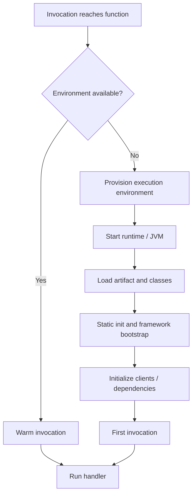

# Reducing Dependencies, Artifact Size, and Initialization Overhead

A Java function can run very fast once the JVM and application have initialized, yet the first invocation on a new execution environment is often slower. This time is influenced by runtime startup, class loading, dependency initialization, dependency injection, configuration, network connections, and operations inside static initializers. A large artifact full of unused libraries increases download, extraction, classpath scanning, and framework initialization time; it also makes building, uploading, and deploying heavier.

Optimizing serverless Java requires looking simultaneously at three areas: the **dependency graph**, the **deployment artifact**, and the **initialization path**. The goal is to preserve correctness, security, and maintainability while reducing the code that must be loaded, the number of classes that must be initialized, synchronous startup work, and resources that must be maintained. The smallest JAR does not always produce the best cold start; you must measure actual workload latency and cost.

## 1. Components That Make Up a Cold Start

A cold start happens when the platform needs to prepare a new execution environment for the function. Depending on the provider and runtime, the steps may include:

1. Allocating or initializing the execution environment.
2. Preparing the runtime/JVM and loading the entry point.
3. Downloading the artifact, or mounting/extracting package or container layers.
4. Loading classes and resolving dependencies.
5. Running static initializers, building the dependency injection container, and reading configuration.
6. Initializing SDK clients, connection pools, serializers, caches, or the framework context.
7. Starting to process the first request/event.



A cold start is not just JVM startup time. An application with fast JVM startup that makes multiple synchronous network calls inside static initializers can still suffer a long initialization time. Conversely, a large package is not necessarily the main culprit if most classes are never loaded on the initial execution path.

### Distinguishing Latency Types

| Component | Meaning | Examples of Slow Sources |
|---|---|---|
| Platform/environment initialization | Preparing the sandbox, container, or execution environment | Scale-out, capacity allocation, image/layer setup |
| Runtime startup | Starting the JVM and runtime adapter | JVM startup, runtime bootstrap |
| Application initialization | Preparing the application before the handler runs | Class loading, static blocks, DI, config parsing |
| First-use initialization | Work occurring only when a specific feature is called first | Lazy beans, serializers, DNS/TLS, SDK credential lookup |
| Handler duration | Invocation processing time after the handler starts | Database queries, business logic, downstream APIs |
| End-to-end latency | Total time observed by the caller | Gateway, queue wait, retries, network, and handler |

Providers may classify and bill these phases differently. When comparing, use the actual platform's metrics and billing model rather than inferring cost solely from a `Duration` field.

## 2. Set Targets and Measure Before Optimizing

Set targets per workload, not just a single generic cold-start number. Synchronous APIs are sensitive to p95/p99 latency; queue workers may prioritize throughput, backlog age, and cost per message. A scheduled function running a few times a day can tolerate a longer startup than an HTTP function receiving continuous traffic.

Metrics to collect:

- Cold-start rate: proportion of invocations requiring a new environment initialization.
- Initialization duration: time from runtime start until the function is ready, if provided by the platform.
- Handler duration: handler execution time.
- End-to-end latency: time from request to response or workflow completion.
- p50, p95, and p99: latency percentiles to observe tail latency.
- Artifact size: size of the built JAR, ZIP, or container image.
- Class count/dependency count: indicators of package complexity.
- Memory, CPU, concurrency, throttles, and downstream connection counts.
- Build time, upload time, and deployment time.
- Cost per request/message and cost of reserved warm capacity.

On AWS Lambda, logs/reports can display `Init Duration` for cold starts and `Duration` for the handler. Azure Functions, Google Cloud Functions/Cloud Run, and other runtimes have corresponding metrics/logs, though names and classifications may differ. Identify the exact metrics of your runtime/provider before establishing a baseline.

### Designing Fair Measurements

1. Use the same workload, payload, region, runtime version, memory/CPU, and dependencies.
2. Separate cold invocations from warm invocations; do not mix them and look only at an average.
3. Run enough iterations for p95/p99 to be meaningful; record concurrency and traffic patterns.
4. Measure from the client/gateway and measure initialization/handler separately if the platform supports it.
5. Compare before/after artifacts and configurations under identical conditions.
6. Repeat after changing frameworks, native image, SnapStart, or provisioned capacity.

Do not use a benchmark calling a Java method inside the same JVM to draw conclusions about serverless cold starts. JMH is useful for microbenchmarking post-startup code, whereas cold starts require integration benchmarks that create new execution environments or use platform measurement mechanisms.

## 3. Auditing the Dependency Graph

Every dependency can pull in numerous transitive dependencies. A small utility library might bring along a logging backend, JSON mapper, HTTP stack, or unnecessary modules. Before removing a dependency, understand whether it is used directly, indirectly, via reflection, `ServiceLoader`, annotation processing, or framework auto-configuration.

### Maven: Inspecting the Dependency Tree

```bash
# Display the full dependency tree
mvn dependency:tree

# Show only runtime dependencies
mvn dependency:tree -Dscope=runtime

# Find libraries with potential version duplicates or pulled via multiple paths
mvn dependency:tree -Dverbose

# Analyze dependencies that are declared but appear unused
mvn dependency:analyze
```

`dependency:analyze` is a signal for review, not a safe auto-remove command. Frameworks may use classes via reflection, service loaders, generated metadata, or runtime configuration where the tool cannot see direct references.

### Gradle: Inspecting the Runtime Classpath

```bash
# View the dependency tree of the runtime classpath
./gradlew dependencies --configuration runtimeClasspath

# Find the dependencies bringing in a specific module
./gradlew dependencyInsight --dependency jackson-databind \
  --configuration runtimeClasspath
```

Keep dependencies explicitly declared when your code directly uses their APIs, even if another library currently pulls them in transitively. This keeps builds stable when parent dependencies change.

### Dependency Groups to Audit

| Group | Questions |
|---|---|
| Logging | Are multiple logging backends/bindings present at once? Is an incompatible backend packaged? |
| JSON | Are multiple JSON mappers doing the same job? Do you only need databind or extra datatype modules too? |
| HTTP client | How many HTTP clients exist? Does the function use one client consistently? |
| Cloud SDK | Is an aggregate SDK pulled in when only one service module is needed? |
| Framework | Are there unused auto-configurations or starters? |
| Database | Are drivers, ORMs, or migration tools included that are not needed in the function runtime? |
| Testing | Are test dependencies accidentally packaged into the runtime artifact? |
| Annotation processor | Are compile-time tools included in the runtime package? |
| Native/transitive libraries | Are there large native libraries or libraries targeting other platforms only? |

## 4. Reducing Dependencies Without Breaking Runtime

### Add Only Needed SDK Modules

Cloud SDKs are typically split by service module. If a function only sends messages to SQS, check whether you can include only the SQS module and required credential module instead of an aggregate containing many service clients. For Azure and Google Cloud, pick client library artifacts matching the services actually used.

### Avoid Duplicate-Purpose Dependencies

A project may unintentionally use two HTTP clients, two JSON mappers, or multiple logging bindings. Standardizing on one choice per concern reduces package size, version conflicts, and classes to load.

### Exclude Transitive Dependencies Deliberately

Maven allows excluding a pulled-in dependency:

```xml
<dependency>
  <groupId>com.example</groupId>
  <artifactId>legacy-client</artifactId>
  <version>${legacy-client.version}</version>
  <exclusions>
    <exclusion>
      <groupId>commons-logging</groupId>
      <artifactId>commons-logging</artifactId>
    </exclusion>
  </exclusions>
</dependency>
```

Exclude only after identifying the replacement dependency and testing runtime execution paths. A library may still require the excluded class even if your code does not reference it directly.

### Use BOMs and Pin Versions

Use a Maven BOM or Gradle platform to keep modules within the same ecosystem on compatible versions. Pinning versions makes builds reproducible and controls security updates. Do not upgrade individual transitive modules independently if the framework or SDK expects a compatible version set.

### Separate Compile/Test/Runtime Scopes

Annotation processors, test frameworks, mock libraries, and code generation tools should not be inside the runtime artifact unless the application truly needs them at runtime. Check Maven scopes (`provided`, `test`, `runtime`, `compile`) and Gradle configurations (`testImplementation`, `runtimeOnly`, `implementation`, `annotationProcessor`). Do not change a scope just to shrink size without confirming the runtime already provides that library.

## 5. Packaging Java Functions

The artifact must include the handler, application classes, and runtime dependencies not supplied by the platform. Packaging depends on the provider and build tool:

- **Thin JAR + dependency directory:** separate application JAR and dependency JARs in a runtime-supported directory.
- **Uber/fat JAR:** a single JAR containing application classes and merged dependencies.
- **ZIP package:** JAR or class files along with dependencies in the ZIP structure required by the platform.
- **Container image:** runtime base image, application artifact, and dependencies inside an image.
- **Native executable:** precompiled binary for the target architecture/runtime when the platform supports corresponding custom runtimes/containers.

Not every provider accepts the same format. Check the handler contract, entry point, package directory layout, and artifact limits of the target runtime.

### Maven Shade Plugin for Fat JARs

Minimal example for a Java Lambda handler:

```xml
<build>
  <plugins>
    <plugin>
      <groupId>org.apache.maven.plugins</groupId>
      <artifactId>maven-shade-plugin</artifactId>
      <version>${maven-shade-plugin.version}</version>
      <executions>
        <execution>
          <phase>package</phase>
          <goals>
            <goal>shade</goal>
          </goals>
          <configuration>
            <createDependencyReducedPom>false</createDependencyReducedPom>
            <transformers>
              <transformer implementation="org.apache.maven.plugins.shade.resource.ServicesResourceTransformer"/>
            </transformers>
          </configuration>
        </execution>
      </executions>
    </plugin>
  </plugins>
</build>
```

The `META-INF/services` transformer merges service provider declarations when multiple JARs provide `ServiceLoader` implementations. Frameworks may also require resource transformers for manifests, Spring metadata, or other configuration files. Use the configuration recommended by the framework and test the built artifact, not only from the IDE.

The Shade Plugin's `minimizeJar` can strip classes it considers unreferenced, but reflection, dependency injection, annotation scanning, and `ServiceLoader` can cause needed classes to be removed mistakenly. Only enable it with proper keep/exclusion rules and thorough integration tests.

### Inspecting the Artifact After Build

```bash
mvn clean package

# Artifact size
ls -lh target/*.jar

# List JAR contents
jar tf target/orders-function.jar

# View resolved dependency graph
mvn dependency:tree -Dscope=runtime
```

On Windows PowerShell, you can use `Get-Item`, `jar tf`, and `Expand-Archive` to inspect ZIPs. Record both the compressed artifact size and uncompressed content size; providers may enforce different limits for each package type.

## 6. What Does Artifact Size Affect?

A large artifact can increase:

- Artifact upload and publish time.
- Download/mount or extraction time when creating a new environment.
- Number of classes/resources that must be searched and loaded.
- Memory needed for class metadata and framework initialization.
- Vulnerability and license scanning time in CI/CD.
- Storage, transfer, and container image registry costs.

However, compressed size is not a perfect proxy for startup. A small JAR whose static initializer calls a database or loads thousands of classes may start slower than a larger JAR with a lightweight init path. Measure artifact size, class loading, initialization duration, and first-use latency together.

### Removing Unnecessary Contents

- Do not package sources, Javadoc, test reports, large fixtures, or temporary build files.
- Do not package test dependencies and compile-time-only tools.
- Do not include multiple versions of the same library in the artifact.
- Keep only resources/configurations needed at runtime.
- Check for duplicate classes and resources when merging JARs.
- Do not bundle a runtime/JRE if the provider already supplies a managed runtime, unless a custom runtime/container model requires it.

### JAR Compression and ZIP Layout

Compression reduces storage and transfer size, though the runtime may have to decompress or read many entries at startup. The impact depends on platform caching, storage, and class loaders. Do not optimize compression levels by guesswork; measure cold starts on actual packages.

## 7. Layers, Shared Dependencies, and Container Images

### Lambda Layers or Shared Package Mechanisms

Layers let you share dependencies across multiple functions and separate infrequently changing components from application code. This helps version management or avoids artifact duplication in deployment pipelines. However, layers do not automatically make cold starts faster: the runtime must still mount/resolve and load classes as needed. Too many layers also make dependency ordering and compatibility harder to manage.

Use layers only when there is a clear benefit, such as sharing centrally managed libraries, isolating agents/extensions, or reducing release duplication. Pin layer versions and test the function-layer combination as a single complete artifact.

### Container Images

Container images fit well when you need control over OS packages, native libraries, or the runtime. Optimize with multi-stage builds, small supported base images, excluding build tools from the final stage, pinning image digests, and ordering layers by stability.

Large images can increase pull/start times and registry storage. Some platforms cache image layers, but do not assume an image will always sit warm on the host. Compare image startup against ZIP/JAR packages using the same workload and runtime.

### Shared Dependencies Do Not Mean Shared Mutable State

A library can be shared across multiple functions, but do not share mutable request data in static fields. Each function still needs its own context, credential scope, and resource policy. Separate dependency packaging from access boundaries.

## 8. Java Frameworks and Bootstrap Cost

Frameworks boost productivity but usually incur initialization overhead. Choose a framework based on application needs and latency budget:

| Deployment Approach | Advantages | Costs/Trade-Offs to Measure |
|---|---|---|
| Plain Java + Lambda handler | Minimal abstraction, easy to control init path | Self-managed DI, validation, HTTP client, and config |
| Spring Boot | Large ecosystem, rich DI/auto-configuration | Context startup, classpath scanning, auto-configuration, and reflection |
| Quarkus | Focused on fast startup, build-time augmentation, and native support | More complex build, extensions/reflective access need verification |
| Micronaut | DI/AOP processes most metadata at compile time | Requires understanding annotation processing and runtime metadata |
| Helidon or other lightweight frameworks | Can reduce bootstrap for small services | Evaluate ecosystem, extensions, and operations |

No framework is universally fastest for every workload. Compare equivalent applications with identical functionality and configuration. A framework with fast startup that consumes more memory or slows down builds may not be optimal overall.

### Reducing Auto-Configuration and Classpath Scanning

- Enable only the modules/starters actually used.
- Exclude unneeded auto-configurations if the framework explicitly supports it.
- Prefer explicit bean wiring for small functions instead of scanning entire packages.
- Avoid scanning the whole classpath for plugins when there is only one fixed implementation.
- Use generated metadata or compile-time DI where appropriate.
- Avoid fetching schemas/configs over the network during initialization if they can be validated/built beforehand.

Optimizing bootstrap should not turn configuration into hardcoding or skip validation. Keep fail-fast checks for mandatory configuration, while executing only essential operations on the init path.

## 9. Optimizing Static Initialization and Application Initialization

Static initializers and singleton constructors typically run before or during first use. Putting too much work there increases cold starts, and initialization errors can fail the entire invocation.

### Work Usually Appropriate in the Init Phase

- Parsing small, immutable configuration.
- Creating reusable, thread-safe SDK clients.
- Compiling regexes or loading small, fixed lookup tables.
- Initializing shared serializers/mappers.
- Building a request-independent dependency graph.

### Work to Consider Moving Out of the Init Phase

- Calling external APIs to fetch continuously changing data.
- Querying a database for business state.
- Loading large files or entire datasets into memory.
- Creating connection pools larger than actual concurrency needs.
- Running migrations or side-effecting writes.
- Waiting on a non-essential service just to start the function.

### Client Reuse Example

```java
import software.amazon.awssdk.services.sqs.SqsClient;

public final class AwsClients {
    // AWS SDK v2 clients are thread-safe and can be reused by warm invocations.
    private static final SqsClient SQS = SqsClient.create();

    public static SqsClient sqs() {
        return SQS;
    }

    private AwsClients() {}
}
```

Reusing clients avoids creating a new HTTP connection manager and credential provider on every request. Do not store user, tenant, request body, or transaction state in static fields. Execution environments can be reused; static mutable request data causes cross-invocation data leakage bugs.

### Lazy Initialization Has Trade-Offs

Lazy initialization shifts work from cold start to the first call of the corresponding feature. It helps if most invocations do not use that dependency. However, if the dependency is always used, lazy initialization merely moves latency to the first request and can worsen p99.

Evaluate based on usage frequency and latency budget. You can pre-initialize core dependencies while lazily initializing rare ones. Ensure initialization is thread-safe if concurrent requests can enter the same environment.

## 10. Avoiding Unnecessary Network I/O During Startup

Operations that seem small can be slow and unstable:

- DNS resolution.
- TLS handshakes and certificate validation.
- Acquiring tokens from an identity provider.
- Reading secrets/configs from a secret manager.
- Opening database connections or warming a connection pool.
- Calling downstream health endpoints.
- Loading remote schemas or plugins.

If all of these run synchronously before the handler, one slow dependency can prevent the function from serving requests even on business paths that do not need it.

Approaches:

- Use SDK credential providers and client reuse per provider guidance.
- Cache secrets/configs with appropriate TTL and refresh strategies; do not cache indefinitely if secrets rotate.
- Open connections on demand or warm a bounded connection if latency budgets require it.
- Set short timeouts, retries with backoff/jitter, and circuit breakers for downstream services.
- Distinguish required dependencies from optional ones; fail fast on invalid core configuration, but do not wait on unrelated services.
- Do not call a database or API solely for a readiness check on every cold start if platform health checks can serve another purpose.

Do not mechanically make every network call lazy. If every request needs the database, deferring the connection simply shifts the cost into the handler. Measure both init duration and first-use latency.

## 11. Class Loading, Reflection, and Resource Discovery

The JVM loads classes on demand, yet frameworks may scan packages, read annotations, search resources, or instantiate proxies. These operations increase startup time and create risks when moving to native images.

Ways to reduce the work:

- Limit package scanning to application code packages.
- Avoid scanning unnecessary dependencies.
- Use explicit registration for plugins/serializers where practical.
- Reduce implementations discovered via `ServiceLoader` if only one provider is needed.
- Remove duplicate resources and unused metadata.
- Avoid instantiating large objects just to produce a small configuration.
- Use class initialization profiling or Java Flight Recorder when the runtime allows.

Do not remove classes/resources based solely on `jdeps` or static analysis if frameworks use reflection. After changing packages, run tests against the packaged artifact and the actual target runtime environment.

## 12. Native Image, SnapStart, and Checkpoint/Restore

Several techniques reduce startup, though each changes how the application is initialized and operated.

### GraalVM Native Image

Native Image compiles a Java application into a native executable ahead of deployment. It can reduce JVM startup and memory footprint for certain applications. Trade-offs include:

- Longer build times and more complex pipelines.
- Reflection, dynamic proxies, resource loading, and `ServiceLoader` may require configuration metadata.
- Some libraries or JNI/native dependencies are incompatible.
- Binaries are tied to OS/CPU architecture and build environment.
- JIT optimization no longer operates like a standard JVM; steady-state performance can differ.

Native image fits workloads prioritizing startup/memory where dependencies are compatible and native build/test pipelines are maintainable. Do not assume native is always cheaper or faster once warm; benchmark cold and steady-state separately.

### JVM Snapshot/Restore Such as AWS Lambda SnapStart

Some platforms support taking a snapshot of initialized state and restoring execution environments from that snapshot. This can cut startup time because the JVM and part of the application context are already prepared.

Snapshotting imposes validity requirements on saved state:

- Do not retain expired or invalid credentials/tokens after restore.
- Do not assume sockets, TLS connections, or database connections remain alive after restore.
- Do not retain random seeds/UUID generators in states that could emit duplicate values across restores; use appropriate entropy sources and hooks per runtime guidance.
- Do not save a "current" timestamp in the snapshot and use it as the actual invocation time.
- Refresh connections, credentials, and required data inside restore hooks or on first use.
- Verify native libraries, threads, file handles, and background tasks against snapshot runtime limits.

Support, limits, and lifecycle hooks depend on provider, Java runtime, and version. Check documentation for the exact version you deploy; do not transfer assumptions from one platform to another.

### CRaC and Checkpoint/Restore

Coordinated Restore at Checkpoint (CRaC) allows an application to prepare state, checkpoint, and restore the JVM. It can reduce startup when the deployment environment supports this workflow. The application must handle resources that need closing before checkpoint and reopening after restore, especially sockets, connection pools, threads, and time-sensitive state.

CRaC is not a default feature available across all managed serverless runtimes. Confirm platform/runtime support, build integration, and proper hooks before choosing it.

### Comparing Techniques

| Approach | Primary Impact | Trade-Off |
|---|---|---|
| Reduce dependencies/framework | Fewer classes/resources and less bootstrap work | May require manual wiring or losing convenience features |
| Lazy initialization | Reduces startup if dependency is rarely used | Higher first-use latency |
| Native image | Eliminates traditional JVM startup | Build/compatibility/reflection complexity |
| Snapshot/restore | Restores pre-initialized state | Must handle credentials, sockets, entropy, and post-restore state |
| Provisioned/warm capacity | Keeps pre-initialized environments ready | Ongoing capacity cost and scaling limits |

## 13. Provisioned Concurrency and Keeping Capacity Ready

Some platforms let you pre-prepare a number of execution environments to reduce cold-start probability during traffic spikes. On AWS Lambda, Provisioned Concurrency is an option for eligible function versions/aliases. Other platforms offer min instances or always-ready instances with their own semantics.

Benefits:

- More consistent latency for sensitive requests.
- Absorbs bursts within provisioned capacity limits.
- Reduces cold-start impact under predictable traffic.

Costs/trade-offs:

- Pay for held capacity according to the provider's pricing model.
- Requires traffic forecasting and proper scaling configuration.
- If concurrency exceeds provisioned capacity, requests may still hit cold starts or throttling depending on the platform.
- Provisioned capacity does not fix slow handlers, heavy dependencies, or downstream bottlenecks.

Do not use scheduled pings as a guarantee to keep environments warm. Providers can recycle instances, scale by their own policies, or shift capacity. Continuous pings also generate requests, logs, and cost. If latency SLOs require ready capacity, use official capacity features and measure cost/benefit.

## 14. How Memory, CPU, and Concurrency Affect Startup

On some platforms, memory allocation scales with CPU/network throughput. Raising memory can shorten JVM startup, class loading, serialization, and handler execution while raising cost per unit time. Lowering memory can slow down GC and startup, extending billed execution time under the provider's model.

Measure multiple memory/CPU tiers rather than defaulting to the lowest. Compare:

- Initialization duration.
- Warm handler duration.
- p95/p99 end-to-end latency.
- Peak memory and GC activity.
- Cost per request/message.
- Downstream connection counts and concurrency.

Excessive concurrency can open too many database connections or downstream requests. Use reserved/max concurrency, bounded connection pools, and queue buffering to keep load within downstream limits.

## 15. Calculating Total Cost

Serverless cost is not just JAR size in GB. An estimation model should include:

```text
Total cost ≈ request/event charges
           + compute duration × allocated resources
           + provisioned/minimum capacity
           + artifact/image storage and transfer
           + logs, metrics and traces
           + network egress, NAT and private endpoints
           + downstream services and connection capacity
           + build, registry and deployment operations
```

This is a conceptual model; exact billing varies by provider and trigger type. An optimization may lower latency while raising cost if it retains higher capacity or memory. Conversely, trimming dependencies and startup I/O often benefits both latency and resource usage, though it should be verified by benchmarks.

Measure cost per successful business operation, not just cost per invocation. Retries, duplicate processing, and downstream failures can cause one business task to trigger more invocations than expected. For queues, track cost per successfully processed message and backlog age.

## 16. Maven Example: Keeping Runtime Dependencies Lean

A small project might only need Lambda core, the event model, and a single AWS SDK module:

```xml
<dependencies>
  <dependency>
    <groupId>com.amazonaws</groupId>
    <artifactId>aws-lambda-java-core</artifactId>
    <version>${lambda-java.version}</version>
  </dependency>
  <dependency>
    <groupId>com.amazonaws</groupId>
    <artifactId>aws-lambda-java-events</artifactId>
    <version>${lambda-events.version}</version>
  </dependency>
  <dependency>
    <groupId>software.amazon.awssdk</groupId>
    <artifactId>sqs</artifactId>
    <version>${aws-sdk.version}</version>
  </dependency>
</dependencies>
```

Version properties are placeholders; projects should manage real versions via properties or the AWS SDK BOM. Do not include the entire SDK just to use one service client. For Azure/GCP, apply the same per-service module selection.

### Checking Runtime Scope

```bash
mvn dependency:tree -Dscope=runtime
mvn dependency:analyze
mvn clean package
jar tf target/orders-function.jar
```

After removing dependencies, run unit tests, integration tests, and test-invoke the packaged artifact. Running tests from an IDE can accidentally use a broader classpath than the deployment package and mask missing dependencies.

## 17. Iterative Optimization Workflow

A practical workflow:

1. **Baseline:** measure artifact size, cold/warm latency, initialization duration, p95/p99, memory, and cost.
2. **Dependency audit:** export the dependency tree, find duplicate modules, packaged test scopes, and large unneeded dependencies.
3. **Packaging audit:** inspect JAR/ZIP/container, duplicate classes/resources, compression, and layers.
4. **Init profile:** find static initializers, classpath scans, DI bootstrap, secret/network calls, and client creation.
5. **Small changes:** change only one group of causes per round to isolate impact.
6. **Compatibility tests:** verify reflection, ServiceLoader, resource metadata, TLS, native libraries, and serialization.
7. **Cold/warm benchmarks:** run on new execution environments and reused environments; record p50/p95/p99.
8. **Cost review:** compare cost per successful request/message, not latency alone.
9. **Rollout:** deploy to canary/alias or test environment, monitor errors, and roll back if needed.
10. **Document:** archive baseline, dependency diff, artifact digest, and measurement results for future comparisons.

Do not optimize everything at once by stripping dependencies, switching to native image, increasing memory, and enabling provisioned capacity in a single change. When metrics shift, it becomes hard to pinpoint the cause and hard to roll back safely.

## 18. Common Optimization Mistakes

| Mistake | Consequence | Fix |
|---|---|---|
| Removing dependencies using static analysis alone | Reflection/ServiceLoader fails at runtime | Inspect dependency tree and test packaged artifact |
| Enabling `minimizeJar` without keep rules | Framework misses classes or resources | Test reflection/DI and configure exclusions |
| Putting everything in static initializers | Long cold starts and init failures make function unavailable | Keep init lightweight, classify eager/lazy |
| Making every dependency lazy | First request for each feature becomes slow | Choose by usage frequency and latency budget |
| Creating SDK clients per invocation | Wastes time, sockets, and memory | Reuse thread-safe clients, handle refresh/stale connections |
| Caching secrets indefinitely | Uses old credentials after rotation | Clear TTL, refresh, and invalidation |
| Splitting JAR into too many layers | Difficult version management, init does not decrease | Use layers only when real sharing benefits exist |
| Choosing native image solely for cold start | Complex builds, reflection errors, or poorer warm throughput | Benchmark end-to-end and verify compatibility |
| Using scheduled pings to stay warm | Does not guarantee instance existence, incurs cost | Use provisioned/min capacity if SLO requires it |
| Looking only at average duration | Misses cold-start tail and p99 | Separate cold/warm, inspect percentiles |
| Raising memory without measuring | Cost increases while latency fails to improve | Benchmark multiple resource tiers |

## 19. Implementation Checklist

### Dependencies and Build

- [ ] Runtime dependency tree exported and duplicate/overlapping libraries identified.
- [ ] Test libraries, annotation processors, and build tools are not packaged accidentally.
- [ ] SDKs are selected per required module/service.
- [ ] Versions are pinned or managed via compatible BOM/platform.
- [ ] Exclusions have clear rationale and are verified with integration tests.
- [ ] Reflection, ServiceLoader, and framework metadata are not stripped accidentally.
- [ ] Artifact contents, compressed size, and uncompressed size are inspected.

### Startup and Runtime

- [ ] Baseline exists for cold-start, warm duration, p95/p99, and cost.
- [ ] Static initializers do not make network calls or unnecessary side effects.
- [ ] Framework scanning/auto-configuration covers only needed modules.
- [ ] Thread-safe SDK clients are reused; request state is not stored in static mutable fields.
- [ ] Secret/config caches have appropriate TTL and refresh.
- [ ] Lazy initialization is chosen based on usage frequency and latency budget.
- [ ] Connection, DNS, TLS, token, and downstream latencies are measured separately when needed.

### Advanced Startup Options

- [ ] Native image verified for reflection/resource/native compatibility.
- [ ] Snapshot/restore handles credentials, sockets, entropy, clocks, and lifecycle hooks.
- [ ] Provisioned/min capacity has a cost model and scaling plan.
- [ ] Memory/CPU/concurrency benchmarked alongside downstream capacity.
- [ ] Container images/layers are pinned, optimized, and tested for real startup.

### Release and Operations

- [ ] Build artifacts are reproducible with digest/version.
- [ ] Tests run against the final artifact, not just the IDE classpath.
- [ ] Cold/warm benchmarks use comparable workloads and configurations.
- [ ] Canary monitors errors, latency, throttling, and cost before broad rollout.
- [ ] Rollback plan exists if native/snapshot/framework optimizations cause failures.
- [ ] Cost per successful request/message and retry overhead are tracked.

Reducing dependencies and artifact size cuts down the work required to download, parse, and maintain; optimizing the initialization path helps the JVM, frameworks, and clients become ready faster. Good results come from separately measuring cold starts, warm execution, and end-to-end latency, then making controlled changes. For serverless Java, keep the dependency graph lean, package for the target runtime, reuse clients safely, avoid unnecessary network I/O during startup, and adopt native image, snapshot/restore, or provisioned capacity only when benchmarks prove clear latency and cost benefits.
