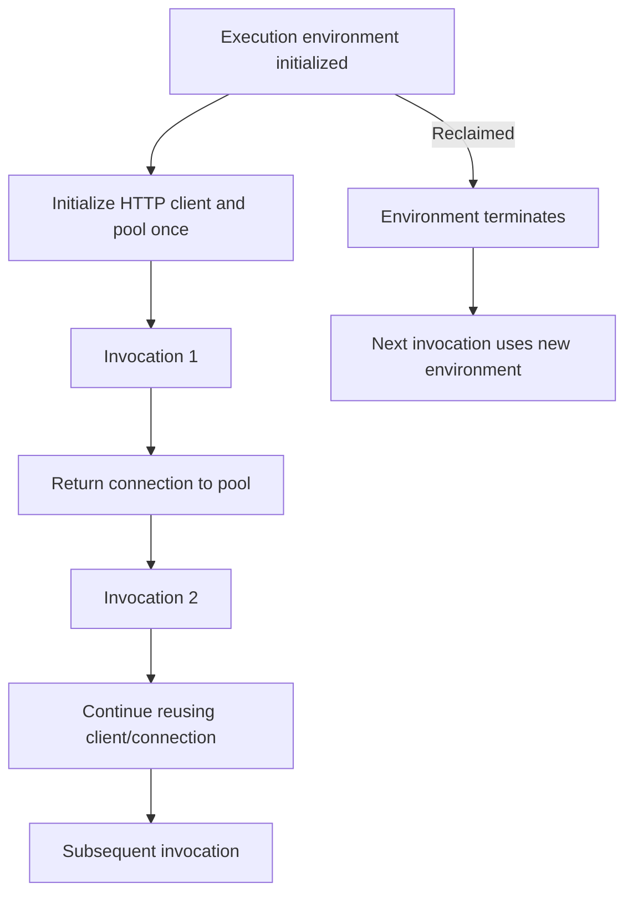

# Reusing HTTP Connections and Reducing Network Round Trips

A Java serverless function can perform very little CPU work yet still respond slowly because it calls multiple services over the network. Each new call can trigger DNS lookup, TCP handshake, TLS handshake, connection pool wait, payload transfer, and server-side processing wait. As the function scales across many execution environments, repeated connection setup also increases load on APIs, databases, and networking infrastructure.

Two optimization directions with direct impact are **reusing HTTP clients/connections** across the execution environment lifecycle and **reducing network round trips** via batching, caching, avoiding N+1 queries, consolidating operations, and bounded parallelism. These techniques must be paired with timeouts, retries, idempotency, and concurrency limits so a latency improvement does not turn into a downstream overload incident.

This lesson covers managing HTTP clients in Java functions, connection pooling and keep-alive, HTTP/2, reducing round trips, designing caches/batches, controlling retries, and measuring impact on serverless platforms.

## 1. Why Does Every Network Call Have Overhead?

An HTTP request is more than just the endpoint's processing time. Before receiving a response, the client may perform these steps:

1. Resolve the hostname via DNS if no valid entry is cached.
2. Establish a TCP connection if no reusable connection exists.
3. Perform a TLS handshake for HTTPS on a new connection.
4. Wait for the connection pool to lease a connection if the pool is busy.
5. Send request headers/body and wait for the server to process.
6. Receive response headers/body and decode or deserialize the payload.
7. Retain or return the connection to the pool for reuse by the next request.

If a function calls four APIs sequentially, total latency can approach the sum of all four calls. If each API call opens a new connection, repeated DNS/TCP/TLS adds latency and CPU overhead. If the APIs are independent, some calls can run in parallel; if they depend on each other's results, reduce round trips through API design or batching.

### Cumulative Latency

Suppose an invocation calls three services sequentially:

| Step | Illustrative Time |
|---|---:|
| DNS + TCP + TLS for API A | 70 ms |
| API A processing and response | 80 ms |
| DNS + TCP + TLS for API B | 70 ms |
| API B processing and response | 100 ms |
| DNS + TCP + TLS for API C | 70 ms |
| API C processing and response | 90 ms |
| **Total** | **480 ms** |

If the client reuses connections and the three APIs can be called in parallel, total time can drop significantly. However, this is only an illustrative example; actual latency also depends on network, servers, pools, payloads, and downstream limits.

## 2. Reusing Clients Within the Serverless Lifecycle

Many serverless runtimes reuse an execution environment across multiple invocations. While the environment remains alive, static fields or singletons can hold thread-safe clients to reuse connection pools, DNS caches, TLS sessions, and configurations.

Principles:

- Initialize HTTP clients and SDK clients once per execution environment, not on every handler invocation.
- Reuse clients, connection managers, and TLS configurations; create separate request objects per operation.
- Do not store user identity, per-request access tokens, payloads, or business state in static fields.
- Set finite timeouts for establishing connections and waiting for responses.
- Design so the client continues functioning when the server closes idle connections or the environment restarts.
- Do not rely on shutdown hooks running reliably when the platform reclaims an environment.



### Lifecycle Across Platforms

| Platform | How to Apply |
|---|---|
| AWS Lambda Java | Place thread-safe clients in static fields or objects initialized outside the handler; environments may be reused without long-term guarantees |
| Azure Functions Java | Use singletons/shared clients within the worker process; check host concurrency and worker lifecycle per hosting plan |
| Google Cloud Functions / Cloud Run | Instantiate clients at the instance/process level; Cloud Run can handle multiple concurrent requests per instance depending on concurrency configuration |
| Other serverless containers | Initialize pools per process/container and calculate total pool connections across max instances/concurrency |

Do not treat static fields as durable state storage. The runtime may create multiple instances, scale in, or restart at any time. Static shared clients are appropriate; static maps holding user data or business results requiring consistency are not.

## 3. Using Java `HttpClient` and Reusing Connections

`java.net.http.HttpClient` has been available since Java 11. The client is designed for reuse across many requests; it manages connections and supports HTTP/1.1, HTTP/2, synchronous, and asynchronous modes. Instantiate the client once rather than calling `HttpClient.newHttpClient()` on every request.

Shared client example:

```java
import java.net.URI;
import java.net.http.HttpClient;
import java.net.http.HttpRequest;
import java.net.http.HttpResponse;
import java.nio.charset.StandardCharsets;
import java.time.Duration;

public final class PartnerClient {
    private static final HttpClient HTTP = HttpClient.newBuilder()
            .connectTimeout(Duration.ofSeconds(2))
            .version(HttpClient.Version.HTTP_2)
            .followRedirects(HttpClient.Redirect.NEVER)
            .build();

    private final URI baseUri;

    public PartnerClient(URI baseUri) {
        this.baseUri = baseUri;
    }

    public String getOrder(String orderId) throws Exception {
        URI uri = baseUri.resolve("/v1/orders/" + encodePathSegment(orderId));
        HttpRequest request = HttpRequest.newBuilder(uri)
                .timeout(Duration.ofSeconds(3))
                .header("Accept", "application/json")
                .GET()
                .build();

        HttpResponse<String> response = HTTP.send(
                request,
                HttpResponse.BodyHandlers.ofString(StandardCharsets.UTF_8));

        if (response.statusCode() == 404) {
            return null;
        }
        if (response.statusCode() < 200 || response.statusCode() >= 300) {
            throw new PartnerApiException("Partner returned HTTP " + response.statusCode());
        }
        return response.body();
    }

    private static String encodePathSegment(String value) {
        // Use a tested URI builder/encoder in real applications.
        return java.net.URLEncoder.encode(value, StandardCharsets.UTF_8)
                .replace("+", "%20");
    }

    public static final class PartnerApiException extends RuntimeException {
        public PartnerApiException(String message) {
            super(message);
        }
    }
}
```

This example demonstrates reusing the client and setting timeouts. In real applications, use an appropriate URI builder to encode paths/queries properly; never concatenate URL strings from untrusted input. Handle response bodies, status codes, and errors according to the API contract. `HttpClient` retains configuration and manages connections; `HttpRequest` is still created per call.

### Things to Remember with JDK HttpClient

- There is no public API to set `maxConnectionsPerRoute` like some other pooling libraries; if you need explicit pool limits, consider Apache HttpClient 5 or a client with pool configuration.
- `connectTimeout` bounds connection establishment time; `HttpRequest.timeout` bounds request duration per JDK client semantics.
- `version(HTTP_2)` requests the client to prefer HTTP/2; the negotiated outcome still depends on the server, TLS/ALPN, and proxies.
- Do not close the client after every request. Since Java 21, `HttpClient` has shutdown lifecycle support; in serverless, do not rely on shutdown hooks for correctness.
- Idle connections may be closed by servers or proxies. Clients must handle connection errors and retry according to safe policies.

## 4. Connection Pooling with Apache HttpClient 5

When you need explicit configuration for total connections, connections per route, connection lifetime, and eviction, Apache HttpClient 5 provides a pooling connection manager.

Maven dependency:

```xml
<dependency>
    <groupId>org.apache.httpcomponents.client5</groupId>
    <artifactId>httpclient5</artifactId>
    <version>${httpclient5.version}</version>
</dependency>
```

Example configuring a shared pool:

```java
import org.apache.hc.client5.http.config.ConnectionConfig;
import org.apache.hc.client5.http.config.RequestConfig;
import org.apache.hc.client5.http.impl.classic.CloseableHttpClient;
import org.apache.hc.client5.http.impl.classic.HttpClients;
import org.apache.hc.client5.http.impl.io.PoolingHttpClientConnectionManager;
import org.apache.hc.client5.http.impl.io.PoolingHttpClientConnectionManagerBuilder;
import org.apache.hc.core5.util.TimeValue;
import org.apache.hc.core5.util.Timeout;

public final class HttpClientsProvider {
    private static final ConnectionConfig CONNECTION_CONFIG = ConnectionConfig.custom()
            .setConnectTimeout(Timeout.ofSeconds(2))
            .setSocketTimeout(Timeout.ofSeconds(3))
            .setValidateAfterInactivity(TimeValue.ofSeconds(5))
            .build();

    private static final PoolingHttpClientConnectionManager CONNECTIONS =
            PoolingHttpClientConnectionManagerBuilder.create()
                    .setMaxConnTotal(40)
                    .setMaxConnPerRoute(10)
                    .setConnectionTimeToLive(TimeValue.ofMinutes(3))
                    .setDefaultConnectionConfig(CONNECTION_CONFIG)
                    .build();

    private static final RequestConfig REQUEST_CONFIG = RequestConfig.custom()
            .setConnectionRequestTimeout(Timeout.ofSeconds(1))
            .setResponseTimeout(Timeout.ofSeconds(3))
            .build();

    private static final CloseableHttpClient CLIENT = HttpClients.custom()
            .setConnectionManager(CONNECTIONS)
            .setDefaultRequestConfig(REQUEST_CONFIG)
            .evictExpiredConnections()
            .evictIdleConnections(TimeValue.ofSeconds(30))
            .build();

    private HttpClientsProvider() {}

    public static CloseableHttpClient get() {
        return CLIENT;
    }
}
```

These numbers are examples only. Size the pool based on max concurrency per instance, number of target routes, downstream limits, and connection hold time. In serverless, potential total connections equal instance count times pool size; a 40-connection pool across 30 instances can open up to 1,200 connections if fully utilized.

`setConnectionRequestTimeout` bounds wait time to lease a connection from the pool; `setResponseTimeout` bounds waiting for a response per HttpClient 5 semantics. Configure appropriate connect/socket timeouts as well and verify exact APIs against the pinned library minor version. `evictIdleConnections` can run pool cleanup via an evictor thread; in serverless, check lifecycle/closing behavior for your runtime and ensure the client is not recreated per invocation. If the runtime freezes processes between invocations, do not assume background evictors always run on schedule; TTL/validate-on-lease or other cleanup mechanisms may be more suitable.

### When to Choose JDK HttpClient vs. Apache?

| Need | Suggested Choice |
|---|---|
| Standard HTTP calls, minimal dependencies | JDK HttpClient |
| HTTP/2 using built-in JDK APIs | JDK HttpClient |
| Explicit max total/per-route connections and pool stats | Apache HttpClient 5 |
| Integrating with libraries already using Apache client | Reuse existing connection manager |
| Framework-managed client | Use framework singleton bean/client, verify actual pool and timeouts |

Avoid running multiple HTTP clients/pools simultaneously for the same dependency without good reason. Every pool adds connections, threads, timeouts, and configuration to operate.

## 5. Keep-Alive, HTTP/2, and TLS

### HTTP/1.1 Keep-Alive

HTTP/1.1 typically allows multiple sequential requests to share a single TCP connection when both sides support persistent connections. The connection returns to the pool once the response body is read or closed properly. If the application ignores or fails to consume the response body, the connection may not be returned for reuse and the pool gradually drains.

Keep-alive does not mean connections live forever. Servers, load balancers, proxies, or NATs can close connections after an idle timeout. Clients must detect stale connections, discard broken ones, and establish new connections when needed.

### HTTP/2 Multiplexing

HTTP/2 allows multiple concurrent streams over a single TCP connection. This reduces connection counts and avoids some sequential limitations of HTTP/1.1. However:

- Servers/proxies must support HTTP/2 end-to-end or translate appropriately.
- A single TCP connection can still suffer head-of-line blocking from TCP packet loss.
- Servers may cap the number of concurrent streams.
- Not every API gateway or service mesh maintains HTTP/2 all the way to the backend.
- Pools/concurrency still need bounds aligned with server capacity.

Measure negotiated protocols, connection counts, and actual concurrent requests; do not assume merely setting HTTP/2 on the client means every hop uses HTTP/2.

### TLS Session Reuse

Reusing connections avoids executing a fresh TLS handshake per request. When connections must be recreated, TLS session resumption can cut handshake cost if both client and server support it. Never disable TLS verification or use trust-all certificates to shave latency. Use valid certificate chains, appropriate TLS versions/ciphers, and inspect handshake times in traces.

## 6. Reducing Round Trips with Batching

If an invocation needs 20 records and calls an API once per record, it creates 20 round trips. If the API supports batching, you can send a list of IDs in one request and receive multiple results together.

Before:

```java
for (String orderId : orderIds) {
    Order order = partnerClient.getOrder(orderId);
    results.add(order);
}
```

After (when the API provides a batch endpoint):

```java
List<Order> orders = partnerClient.getOrders(orderIds);
results.addAll(orders);
```

Batching cuts round trips but requires controlling payload size, timeouts, and partial failures. If one record fails, the API should return per-item results or define a contract enabling targeted retries. Never let an oversized batch exceed request body, memory, or processing time limits.

### Batching for Queue Workers

Queue triggers often deliver multiple messages in a single invocation. Batch processing cuts invocation overhead and can consolidate database/API calls. However, overly large batch sizes can:

- Increase memory usage and processing time per invocation.
- Cause many records to retry when a single record fails if partial batch responses are unsupported.
- Increase the number of side effects requiring idempotency.
- Trigger large bursts against downstream systems when multiple batches run concurrently.

Choose batch sizes based on processing time, memory, concurrency, and downstream limits. For AWS Lambda + SQS, consider `ReportBatchItemFailures` to retry only failed records when the handler and event source mapping are configured accordingly.

### Bulk Database Operations

Instead of issuing one `INSERT`/`UPDATE` per record across many round trips, use JDBC batching or bulk APIs when supported by the database. Watch transaction size, lock duration, parameter limits, and rollback scope. Batches should not grow so large that they increase contention or hold transactions too long.

## 7. Avoiding N+1 Queries and Unnecessary Sequential Calls

N+1 occurs when one query fetches a list of N items and then code executes an additional query/API call for each item—for example, loading 50 orders and then calling the customer service 50 times to fetch names. Common remedies include:

- Using a batch endpoint accepting a list of customer IDs.
- Joining or projecting in a single database query where appropriate.
- Prefetching shared reference data.
- Caching reusable reference data.
- Designing aggregated backend responses instead of forcing clients to call multiple endpoints.

Do not cram everything into a single bloated endpoint if it increases coupling or returns excessive unneeded data. Batch designs must preserve per-resource authorization; a caller must never be allowed to read a record simply because its ID was included alongside valid ones in a batch.

### Parallelizing Independent Calls

When multiple API calls are independent, running them in parallel can reduce wall-clock latency. However, bound concurrent calls; never use `parallelStream()` or unbounded executors carelessly in serverless.

Example using `CompletableFuture` with a bounded executor:

```java
import java.util.List;
import java.util.concurrent.ArrayBlockingQueue;
import java.util.concurrent.CompletableFuture;
import java.util.concurrent.ExecutorService;
import java.util.concurrent.ThreadPoolExecutor;
import java.util.concurrent.TimeUnit;

public final class AggregationService {
    private static final ExecutorService IO_EXECUTOR =
            new ThreadPoolExecutor(
                    8,
                    8,
                    0L,
                    TimeUnit.MILLISECONDS,
                    new ArrayBlockingQueue<>(32),
                    new ThreadPoolExecutor.AbortPolicy());

    private final CatalogClient catalog;
    private final InventoryClient inventory;
    private final PricingClient pricing;

    public AggregationService(
            CatalogClient catalog,
            InventoryClient inventory,
            PricingClient pricing) {
        this.catalog = catalog;
        this.inventory = inventory;
        this.pricing = pricing;
    }

    public ProductView getProduct(String productId) {
        CompletableFuture<Product> product = CompletableFuture.supplyAsync(
                () -> catalog.get(productId), IO_EXECUTOR);
        CompletableFuture<Stock> stock = CompletableFuture.supplyAsync(
                () -> inventory.get(productId), IO_EXECUTOR);
        CompletableFuture<Price> price = CompletableFuture.supplyAsync(
                () -> pricing.get(productId), IO_EXECUTOR);

        CompletableFuture.allOf(product, stock, price)
                .orTimeout(2500, TimeUnit.MILLISECONDS)
                .join();

        return new ProductView(product.join(), stock.join(), price.join());
    }
}
```

The clients in this example must have their own timeouts and proper error handling. `orTimeout` limits total wait time but does not guarantee canceling the underlying HTTP client network call; use HTTP client cancellation/timeouts and handle canceled futures cleanly. The executor has 8 threads and a queue of at most 32 tasks per execution environment; under overload, `AbortPolicy` rejects tasks instead of holding an unbounded queue. Calculate total threads/concurrency when the platform scales across many instances. In Java 21, you can consider virtual threads for blocking I/O, but you must still bound concurrent downstream calls; virtual threads do not raise API quotas.

Do not parallelize operations with data dependencies or unsafe side effects. If one call fails after two other calls have written data, design compensation or idempotency.

## 8. Caching to Avoid Repeated Network Calls

Caching fits data that can be reused over a period of time with clear staleness/invalidation policies—such as product catalogs, public configuration, region metadata, or exchange rates cacheable for a short TTL.

Cache layers:

| Layer | Scope | Examples |
|---|---|---|
| In-memory per environment | Single JVM/container; lost when environment is reclaimed | Small caches for metadata, non-sensitive config |
| Shared cache | Accessed concurrently by multiple instances | Redis/Memorystore/ElastiCache |
| HTTP cache | Per HTTP semantics | `Cache-Control`, `ETag`, `If-None-Match`, `Last-Modified` |
| Data/service cache | Managed by the database/API | Read replicas, materialized views, or service cache layers |

### In-Memory Cache Is Not a System-Wide Cache

A static cache in Lambda or a function lives only inside one execution environment. If there are 20 environments, there may be 20 distinct cache copies refreshing at different times. Never treat an in-memory cache as a canonical source of truth or a state synchronization mechanism across instances.

### TTL, Invalidation, and Stale Data

Before caching, determine:

- Is stale data acceptable, and for how long at most?
- What is the TTL per business requirements?
- When data changes, is the cache invalidated via events, versioning, or TTL expiration?
- Does the cache key include tenant/authorization scope to prevent cross-tenant leakage?
- Does the cache store PII/secrets, and if so, how are encryption, access control, and retention handled?

Never cache permission-filtered responses unless the cache key includes the corresponding scope/permissions. A cache key bug can leak tenant A's data to tenant B.

### Preventing Cache Stampedes

When a key expires, many invocations may hit downstream simultaneously to refresh it. You can use per-instance single-flight, refresh-ahead, jittered TTLs, or appropriate distributed locks. With serverless scale-out, a local lock does not stop other instances from refreshing simultaneously; use a shared mechanism if stampedes have major impact.

Do not cache indefinitely just to cut requests. Caches need memory bounds, TTLs, invalidation, and hit/miss telemetry.

## 9. Reducing Round Trips with Better APIs and Data Access

Some optimizations require changing API contracts or data access patterns:

- **Batch endpoints:** accept multiple IDs or operations in a single request.
- **Projections:** return only needed fields, shrinking payloads and deserialization.
- **Pagination/cursors:** avoid fetching entire large collections in one request.
- **Conditional requests:** use ETag/version to skip re-downloading unchanged data.
- **Aggregation services:** backend aggregates multiple data sources when beneficial for latency and authorization.
- **Event-driven updates:** instead of continuous status polling, use callbacks/events where business logic allows.
- **Coalescing:** merge identical pending requests to execute only one downstream read.
- **Data locality:** co-locate functions near databases/APIs per region and network topology.

### Polling vs. Callbacks/Events?

If clients poll job status every second, 100 clients can generate hundreds of requests only to receive "not done yet." You can lengthen polling intervals, use exponential backoff, long polling, or callbacks/webhooks/events where appropriate. In serverless, event-driven completion typically reduces call counts and costs, though it requires managing delivery, retries, and idempotency.

### Payload Compression

Gzip or another suitable compression format can cut bytes transmitted over the network. The trade-off is compression/decompression CPU, latency, and memory buffers. Compression helps with large, repetitive text payloads; it helps little with small payloads or already-compressed data like JPEG/ZIP. Measure end-to-end rather than assuming compression is always faster.

## 10. Timeouts, Retries, and Connection Lifecycle

Reusing connections does not eliminate network errors. Servers can close idle connections, DNS can change, proxies can reset sockets, and dependencies can slow down. Clients need finite timeouts across multiple layers.

Timeouts to distinguish:

| Timeout | Bound |
|---|---|
| Connection pool acquisition | Time waiting to lease a connection from the pool |
| DNS/connect | Time to resolve names and establish a connection |
| TLS handshake | Time to complete the security handshake, if exposed by the client |
| Response/read | Time waiting for response or data |
| Overall request/deadline | Total time allotted to the operation within the invocation |

Set the overall deadline below the remaining invocation timeout so the function has time to log, close resources, and return a result. Timeouts must not be so long that threads/connections stay tied up when a dependency is already overloaded.

### Retries Must Be Conditional

Retries help on transient errors, yet every retry is another network round trip. While a dependency is degraded, synchronized retries can create a retry storm.

- Retry only transient errors such as connection resets, timeouts, or 5xx per policy.
- Respect `Retry-After` on 429/503 if provided by the API.
- Use exponential backoff with jitter.
- Cap retry attempts and total retry budget.
- Never blindly retry validation errors or 401/403 authorization failures.
- Retry only operations with idempotent semantics or a server-supported idempotency key.
- Do not nest multiple retry layers without accounting for total combined attempts.

For example, a POST creating a payment times out after the server already recorded the transaction. Re-sending the POST could create a duplicate transaction. The client must send a stable idempotency key for the same business operation, and the server must store the corresponding outcome.

### Connection Idle Timeouts and Stale Connections

Load balancers, NATs, proxies, or servers may close connections after an idle window. The pool may still assume the connection is usable until the next write. Configure connection TTL/idle eviction aligned with infrastructure, validate stale connections per library capabilities, and handle closed-connection errors with safe retries.

Do not set infinite TTLs or disable certificate checks to keep connections alive. When endpoints/DNS change or certificates rotate, old connections must be allowed to recycle.

## 11. Managing Connections and Concurrency in Serverless

A connection pool lives inside each instance. Total connections scale with the number of instances spun up.

Rough estimate:

\[
Connections_{total} \approx Instances_{max} \times PoolSize_{per\ instance}
\]

For example, 25 instances each with a max pool of 8 connections:

\[
25 \times 8 = 200\ connections
\]

If a partner API allows only 100 connections or the database allocates only 120 connections to the app, the pool configuration can exceed the budget. Account for other services, admin connections, and headroom too.

### Sizing to Downstream Capacity

Common guardrails:

- Cap function concurrency or max instances.
- Cap total pool size and per-route pool size.
- Bound parallel requests within a single invocation.
- Use queues to smooth consumer pacing.
- Use rate limiters when dependencies enforce requests-per-second quotas.
- Use circuit breakers to stop hammering failing dependencies.
- Set finite pool-wait and HTTP timeouts.

A static semaphore inside a JVM bounds only one instance. It is not a global rate limiter when serverless scales out across many instances. If system-wide limits are required, use platform caps, queue dispatch rates, or an appropriate distributed limiter.

### Avoid Oversized Pools for Short Functions

A 50-connection pool in a function processing only one request at a time is usually wasteful. Large pools can also cause connection bursts whenever multiple environments cold start. Size pools to actual concurrent requests within one instance and connection hold duration.

## 12. Reducing Calls to Cloud SDK Services

It is not only custom HTTP clients that benefit from reuse. AWS SDK, Azure SDK, and Google Cloud client libraries manage their own connection pools, credential providers, retry policies, and metadata caches.

Principles:

- Instantiate service clients once per execution environment when the library recommends thread-safe clients.
- Never instantiate a new client on every invocation or every message.
- Use default or properly tuned connection pools/transports, avoiding duplicate transports.
- Reuse credential providers and endpoint/region configurations.
- Set API call timeouts and retry policies aligned with the invocation deadline.
- Use batch APIs such as `BatchGetItem`, `SendMessageBatch`, or bulk operations when semantics allow.
- Avoid repeated metadata/secret API calls on every request when a safe caching mechanism exists.

Do not cache credentials or tokens longer than their permitted lifetime. Official SDK credential providers normally handle refresh automatically; prefer official providers over storing access keys in static fields.

### Example: Initializing an AWS SDK Client Once

```java
import software.amazon.awssdk.regions.Region;
import software.amazon.awssdk.services.s3.S3Client;

public final class StorageClients {
    private static final S3Client S3 = S3Client.builder()
            .region(Region.of(System.getenv("AWS_REGION")))
            .build();

    private StorageClients() {}

    public static S3Client s3() {
        return S3;
    }
}
```

The SDK client uses the runtime's credential provider chain and is reused across the environment. Do not call `close()` after each invocation. If you need to switch regions/endpoints, create clients per fixed environment configuration or manage lifecycles explicitly; never create a client per record.

## 13. Placing Functions Near Dependencies and Reducing Network Egress

Round trips depend not only on request count but also on network distance. A function in region A calling a database in region B incurs different latency, egress cost, and network risk than when both sit in the same region.

Check:

- Are the function and its dependencies in the same region or low-latency zone?
- Do NAT gateways, proxies, firewalls, or service meshes add extra hops?
- Does DNS lookup traverse a distant resolver or private zone?
- Are private endpoints/service endpoints available to avoid the public internet?
- Does TLS termination happen at the gateway or backend?
- Are there cross-region data transfer or egress charges?

Do not move a database into the same region solely to cut latency if it violates data residency, disaster recovery, or availability requirements. Choose topology based on latency, reliability, cost, and data policies together.

### Serverless VPCs and NAT

When a function attaches to a VPC/VNet, outbound traffic may traverse a NAT or private endpoint. NAT connection/port exhaustion, DNS, and routing can become bottlenecks during scale-out. If a service supports private endpoints, consider private routing to reduce reliance on public egress; still enforce security groups/network policies and DNS controls.

## 14. Measuring Connection Reuse and Round-Trip Reduction

Do not declare victory based solely on fewer connections opened. Measure latency, throughput, errors, and downstream load too.

Useful metrics:

| Metric | Meaning |
|---|---|
| Requests per invocation | Network requests issued during a single function run |
| Connections opened/reused | New connections and reuse ratio if exposed by client/backend |
| Pool leased/available/pending | Connections in use, idle, and requests waiting on the pool |
| DNS/connect/TLS duration | Time spent establishing the network path |
| Time to first byte / response duration | Time from sending until first response byte and completion |
| p50/p95/p99 latency | Latency distribution, especially tail latency |
| Retry count | Retries triggered by errors/timeouts/throttling |
| Payload bytes | Data transferred in requests/responses |
| Downstream RPS/concurrency | Actual pressure on APIs/databases |
| Errors/timeouts/429s | Service health and limit hits |

### Before-and-After Comparison

Hold workload, payload, region, artifact, and downstream configuration constant. Compare:

1. New client per invocation vs. singleton client.
2. HTTP/1.1 vs. HTTP/2 if supported by the server.
3. N individual requests vs. a batch endpoint.
4. Sequential calls vs. bounded parallelism.
5. No cache vs. valid-TTL cache.

Measure p50/p95/p99, new connections, RPS, error rate, CPU/memory, and cost. Check both warm invocations and cold starts; static clients can speed up the warm path while still factoring into new-environment startup costs.

### Tracing to Find Redundant Round Trips

A trace showing many repeated HTTP spans to the same host or many similar database spans often points to N+1 queries or redundant API calls. Inspect durations and parent-child relationships to see which calls are sequential vs. parallel. Use stable attributes such as `http.route`, `server.address`, and operation name; avoid putting URLs containing user IDs into metric labels.

## 15. Testing and Verifying Optimizations

A test matrix might include:

| Experiment | How to Execute | What to Observe |
|---|---|---|
| Client reuse | Send multiple invocations on the same environment | New connections drop; warm latency stabilizes |
| Cold environment | Spin up a new environment or scale from zero | Measure init + first connection separately |
| Idle connection | Wait longer than proxy/server idle timeout then invoke again | Client handles stale connection and recovers safely |
| Pool exhaustion | Lower max pool or raise concurrency in sandbox | Pool wait times out cleanly instead of hanging indefinitely |
| HTTP/2 | Verify negotiated protocol and concurrent streams | Fewer connections if server supports it; no error spike |
| Batch | Issue N separate requests vs. one equivalent batch | Fewer round trips; partial errors handled properly |
| Cache | Repeat requests within TTL and after invalidation | Hit rate rises; staleness stays within bounds |
| Retry/429 | Mock downstream returning 429/503/timeout | Backoff/jitter, idempotency, and retry budgets behave right |
| Scale-out | Increase concurrent instances | Total connections stay within downstream budget |

Run tests in environments with dedicated quotas and dependencies. Never run load tests that stress partner APIs or production databases without approval.

## 16. Common Mistakes

| Mistake | Consequence | Fix |
|---|---|---|
| Creating `HttpClient`/SDK clients per invocation | Repeats DNS/TCP/TLS and spawns many pools | Reuse thread-safe clients at environment scope |
| Creating one client per record in a batch | Multiplies connections and overhead | Use one shared client with separate requests |
| Oversized pools per instance | Scale-out opens excessive connections | Size pool to max instances and downstream budget |
| Not consuming/closing response bodies | Connections are not returned to pool | Read or close response bodies properly |
| Holding connections indefinitely | Hits stale connections after idle timeout | TTL, idle eviction, and safe retries |
| Setting infinite timeouts | Threads and connections hang when dependencies stall | Finite pool/connect/request/deadline timeouts |
| Retrying every POST after timeout | Causes duplicate side effects | Idempotency keys and semantics-aware retry policy |
| Unbounded parallelization | Causes bursts and overloads downstream | Bounded executors, semaphores, queues/rate limits |
| Per-user cache lacking tenant/scope | Cross-user data leakage | Include security scope in cache keys and clear invalidation |
| Using static cache as source of truth | Instances hold inconsistent values | Shared cache/database for shared state |
| Oversized batching | Payload/memory/timeout spikes, wide retries | Pick bounded batch size and handle per-item errors |
| Using HTTP/2 without verifying server | No multiplexing as expected | Measure negotiated protocol and stream limits |
| Measuring only average latency | Misses p95/p99 and cold starts | Measure latency distribution and separate cold/warm |

## 17. Optimization Process for Serverless Java

1. **Measure baseline.** Record p50/p95/p99, network requests per invocation, connect/TLS time, payloads, and dependency latencies.
2. **Audit client lifecycle.** Verify whether HTTP/SDK clients are recreated on every invocation.
3. **Reuse clients.** Move thread-safe clients to singleton/environment scope; keep requests and business state per invocation.
4. **Set timeouts.** Bound pool acquisition, connect, response, and overall deadlines.
5. **Calculate pool budgets.** Multiply per-instance pool by max instances/concurrency and subtract downstream headroom.
6. **Find redundant round trips.** Use traces to uncover N+1 patterns, sequential calls, and unnecessary polling.
7. **Consolidate operations.** Apply batching, bulk APIs, projections, or aggregation where semantics allow.
8. **Apply bounded parallelism.** Parallelize only independent calls using appropriate executors/rate limits.
9. **Cache eligible data.** Choose TTLs, invalidation, tenant scoping, and stampede protection.
10. **Control retries.** Use exponential backoff, jitter, idempotency, and total retry budgets.
11. **Re-measure.** Run the identical workload and compare latency, connections, errors, downstream load, and cost.
12. **Roll out in phases.** Monitor post-deploy metrics and be ready to roll back if pool exhaustion, stale data, or errors increase.

## 18. Pre-Production Checklist

- [ ] Thread-safe HTTP clients and SDK clients are reused within the execution environment.
- [ ] No request- or user-specific state is stored in static fields.
- [ ] Connection pools have appropriate total/per-route caps or equivalent bounds.
- [ ] Total connections under scale-out stay within downstream budgets.
- [ ] Connect, pool wait, response, and overall timeouts are all finite.
- [ ] Keep-alive/idle timeouts align with servers, proxies, load balancers, and NATs.
- [ ] HTTP/2 is verified across actual hops if multiplexing is expected.
- [ ] Response bodies are consumed/closed to return connections to the pool.
- [ ] Batching/bulk APIs reduce N+1 patterns and unnecessary round trips.
- [ ] Parallelism is bounded and respects rate/concurrency quotas.
- [ ] Caches enforce TTLs, invalidation, tenant scoping, and memory bounds.
- [ ] Retries use backoff/jitter, budgets, and proper idempotency.
- [ ] Telemetry measures connections, pool waits, latency, retries, payloads, and downstream load.
- [ ] Cold starts and warm reuse are measured separately.
- [ ] Load tests prove improvement without raising errors or overloading dependencies.

## Conclusion

Reusing HTTP/SDK clients across an execution environment avoids repeating connection setup and preserves pool/TLS state when the runtime permits. Reducing round trips via batching, avoiding N+1 queries, TTL-bounded caching, projections, and bounded parallelism lowers latency and downstream request counts. In serverless, calculate total connections across scaled instances, enforce finite timeouts, handle stale connections, and retry safely. Measure p95/p99, pool wait times, connection reuse, request counts, and dependency load before and after optimizing; an optimization is only valuable when latency drops while system limits and business correctness remain intact.
