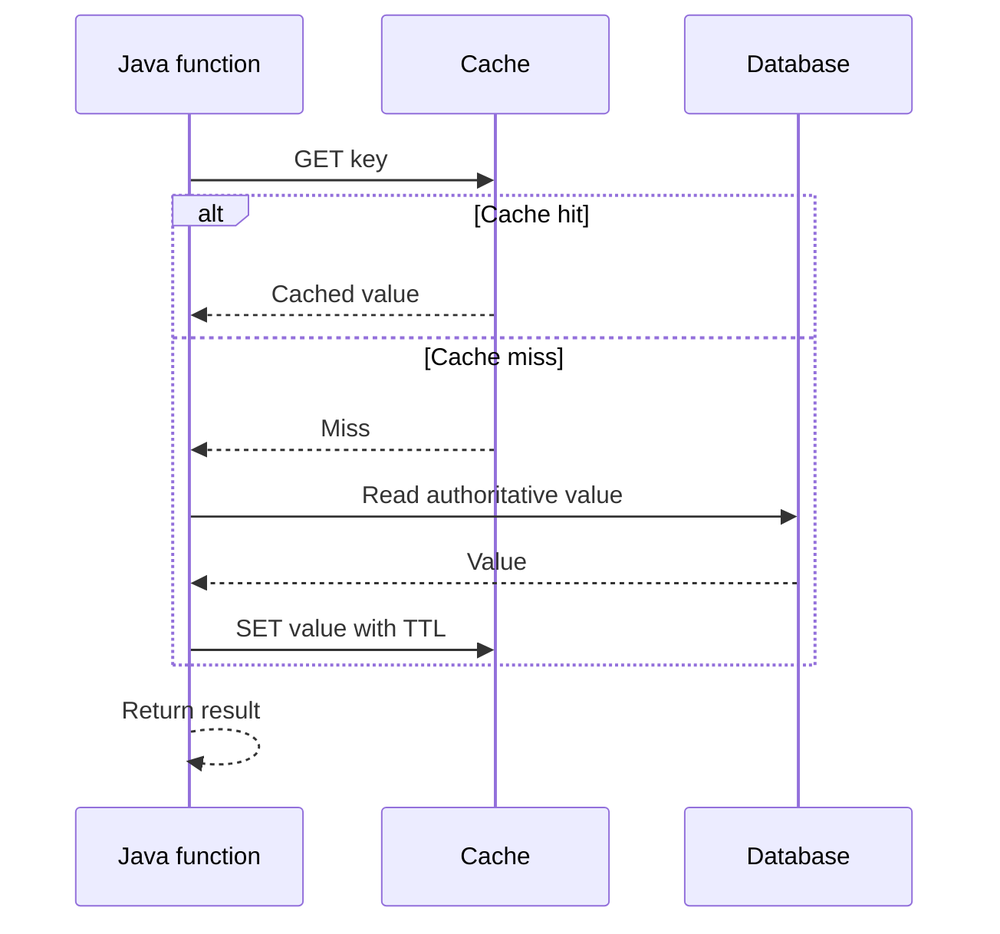
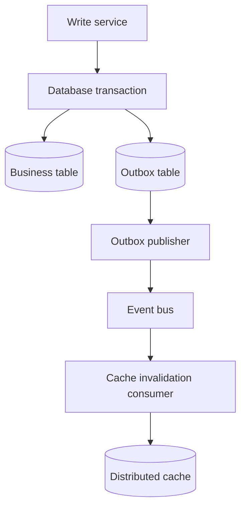
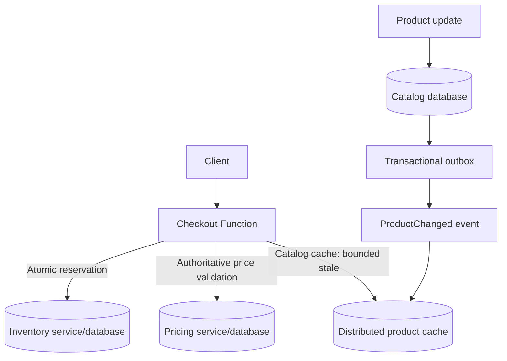

# Applying Caching According to Business Consistency Requirements

Caching can reduce latency, database query load, and external service call costs. Yet caching can also return stale data, preserve revoked permissions, or cause two functions to observe different states. Therefore, the first question when designing a cache is not "How long should the TTL be?", but **how stale can the data be, and for how long, according to the business?**

A product catalog may tolerate being a few dozen seconds behind. Account balances, payment statuses, access permissions, and inventory used to confirm orders typically need to be read from an authoritative source or use stronger consistency mechanisms. Caching should only be applied after defining the freshness/consistency contract for each data type.

## 1. Start from Business Consistency Requirements

A cache stores a copy or computed result to make subsequent reads faster. That copy may not immediately reflect the latest change in the primary data source. What is acceptable depends on the business consequence if a request reads stale data.

| Business Requirement | Examples | Appropriate Strategy |
|---|---|---|
| Must see latest state at decision time | Balance for authorizing a transfer, recently revoked permissions, payment status | Read authoritative source; cache only non-authoritative parts or use strict version/conditional validation |
| Read-your-writes | User who just updated their profile must see the new value immediately | Return the written value, update cache synchronously, or bypass cache on read-after-write flows |
| Tolerates staleness within a defined bound | Product name/image/description, CMS content | TTL aligned with staleness bound, event-driven invalidation, and background refresh |
| Nearly immutable data | Country codes, versioned tax tables, public release config | Long or indefinite versioned cache; bump version when data changes |
| Expensive aggregated results | Reports, dashboard figures, search results | Cache by key and time window; display when the data was aggregated |
| Tolerates approximate results | Recommendations, rankings, analytics not used for transactional decisions | Cache with explicit freshness and asynchronous refresh |

### 1.1. Distinguishing Freshness and Consistency

**Freshness** describes how up-to-date cached data is compared to the source. **Consistency** describes what reads are permitted to observe after a sequence of updates.

A 30-second TTL does not by itself create strong consistency. It only bounds how long an entry is retained under an expiration policy; in practice, data can remain stale longer due to delayed invalidation events, failed refreshes, cache replica lag, or a read/write race. If the requirement is "after a successful update, every subsequent read must observe the new value," you must design read-your-writes and synchronous invalidation, or remove caching from that read path.

Write requirements as testable statements, for example:

- "Display names may be stale for at most 60 seconds."
- "After updating an email successfully, the user must see the new email immediately within the current session."
- "Revoked permissions must take effect immediately on the next check."
- "Displayed inventory may be approximate, but reservation must confirm against the authoritative data source."

When staleness bounds and business consequences have not been defined, do not place a cache in that decision path.

## 2. Choosing the Right Cache Layer in Serverless

Cache layers differ in sharing scope and lifecycle. With FaaS, this distinction is especially important because functions can scale out into many execution environments, scale in, or restart at any time.

| Cache Layer | Scope | Advantages | Limitations |
|---|---|---|---|
| Request-local | Single invocation/request | No shared state across requests; easy to control | Not reused across invocations |
| Process/environment in-memory | Single Java worker or execution environment | Very fast, zero network hops | Not shared across instances; can be lost anytime; data can diverge across instances |
| Distributed cache | Accessed concurrently by multiple functions/instances | Shared, offers TTLs/atomic operations depending on service | Adds network latency, cost, quotas, and distinct failure modes |
| Database/materialized view | Multiple services per database permissions | Durable source with explicit consistency semantics | Should not be confused with a cache; requires load and transaction management |
| CDN/API edge cache | Client/region/edge per HTTP cache policy | Cuts latency and origin load for public data | Must control `Cache-Control`, `Vary`, authorization, and invalidation |

### 2.1. In-Memory Cache in Java Functions

A static cache or singleton can persist across multiple invocations when the same execution environment is reused. This is a best-effort optimization, not durable storage. When the platform spins up a new instance, the cache is empty; when an instance is reclaimed, the cache is lost. If 20 instances run, there may be 20 distinct cache copies.

In-memory caching fits infrequently changing reference data, reloadable metadata, or computed results insensitive to freshness. It is unsuitable for storing sessions, distributed locks, authoritative idempotency records, balances, or unique business state.

Example using Caffeine with size bounds and TTL:

```java
import com.github.benmanes.caffeine.cache.Cache;
import com.github.benmanes.caffeine.cache.Caffeine;
import java.time.Duration;

public final class ProductLookup {
    private final ProductRepository repository;
    private final Cache<String, ProductView> cache = Caffeine.newBuilder()
            .maximumSize(10_000)
            .expireAfterWrite(Duration.ofSeconds(30))
            .recordStats()
            .build();

    public ProductLookup(ProductRepository repository) {
        this.repository = repository;
    }

    public ProductView find(String tenantId, String productId) {
        String key = tenantId + ":product:v1:" + productId;
        return cache.get(key, ignored -> repository.findView(tenantId, productId)
                .orElseThrow(() -> new ProductNotFoundException(productId)));
    }
}
```

This example requires the Caffeine dependency and application-defined `ProductRepository`, `ProductView`, and `ProductNotFoundException` types. The cache bounds entry count to prevent unbounded memory growth. `expireAfterWrite` sets a TTL from write time; it does not automatically detect database changes. When updating a product, the application must invalidate entries or accept bounded staleness within the defined limit.

In Lambda/Azure Functions, instantiate the cache once at object/static or singleton DI scope so it is reused within the same process. Never create a new cache inside each handler execution. Likewise, never rely on a local cache to ensure correctness across multiple instances.

### 2.2. Distributed Cache

Redis or a managed distributed cache fits when multiple functions must see the same entries, or when a local cache cannot satisfy sharing needs. Distributed caches add a network hop, so measure latency and connection behavior. It is still a cache: entries can expire, be evicted, flushed, or lost during incidents depending on service configuration.

Use a distributed cache when the benefits of sharing and offloading the primary source outweigh network, operational, and synchronization costs. Do not blindly push every read into Redis; for small datasets, fast reads from a database with an existing connection pool can be cheaper and simpler.

### 2.3. CDN and HTTP Caching

CDN/HTTP caching works well for public content or responses safely cacheable by URL/headers—such as product images, JavaScript bundles, or public catalog pages. For responses containing personal data or depending on identity, use `Cache-Control: private`/`no-store` or include full authorization context in cache keys; never allow proxies to share one user's response with another.

The `Vary` header and cache keys must reflect every factor that alters the response, such as locale, content encoding, or API version. Never cache authenticated responses solely because URLs match.

## 3. Choosing a Cache Pattern for Read/Write Flows

### 3.1. Cache-Aside (Lazy Loading)

The application checks the cache first. On a miss, it reads the primary source, then writes the result to the cache. On writes, the application typically updates the primary source and then invalidates the cache.



The advantage is caching only data actually read, while the application explicitly controls when to hit the source. The drawbacks are slower first reads after a miss and potential races between cache invalidation and concurrent writes. This pattern is common for catalogs, profiles, or reference data that tolerate bounded staleness.

### 3.2. Read-Through

The application reads through a cache abstraction; the cache loads from a configured loader on misses. This simplifies caller code, though you must understand how the library/cache layer handles loaders, errors, serialization, and invalidation. Read-through does not automatically guarantee fresh data.

### 3.3. Write-Through

On writes, the application updates the primary source and the cache in the same synchronous flow. Subsequent reads can see the new value faster. However, the database and cache rarely participate in a single atomic transaction. If the database commits yet the cache write fails—or vice versa—the two stores can diverge.

Define which source is authoritative and how to recover when one step fails. For critical data, the database remains the source of truth; a cache write failure may degrade performance, but must never lose committed data.

### 3.4. Write-Behind / Write-Back

The application writes to the cache first, then updates the database asynchronously. This pattern can raise throughput, yet it increases risk of data loss if the cache fails, evicts entries, or consumers fail to drain the write queue. Use it only when the business accepts clearly designed durability/ordering semantics and the cache layer offers proper persistence/replay mechanisms. Never use write-behind casually for money, payments, permissions, or authoritative order states.

### 3.5. Refresh-Ahead and Stale-While-Revalidate

The cache can refresh an entry before its TTL expires, or return stale data while a background worker refreshes it. This cuts latency on subsequent reads, but only fits when business rules tolerate staleness. Store `fetchedAt`/version to track age and limit concurrent refreshes.

## 4. Translating Business Requirements into TTL and Freshness Policies

TTLs must derive from staleness limits, data change frequency, source read cost, and the impact of serving stale data. There is no single optimal TTL for every table or service.

| Data Type | Example Starting Policy | Notes |
|---|---|---|
| Versioned static/reference data | Long-lived cache by version | When data changes, bump version/key so old entries are no longer used |
| Catalog/metadata | Short or medium TTL, e.g., tens of seconds to minutes | Pair with invalidation events if updates must propagate quickly |
| Profile/preferences | Short TTL; invalidate after user update | Ensure read-your-writes for the current session |
| Displayed price | TTL per freshness SLA | Re-verify current price from authoritative source at checkout |
| Inventory display | Can cache approximate display counts with timestamp | Reservation/commit must check transactions or atomic conditions on primary source |
| Permissions/revocation | Avoid long caching; may require direct checks or very short TTL | Stale allow decisions can be security vulnerabilities |
| Balance/payment state | Do not use cache for final decisions | Read authoritative source and enforce transactions/idempotency |
| Search/report results | TTL per freshness requirement and computation cost | Display when the data was aggregated |

The durations in this table are starting examples for discussion, not defaults to copy directly. For every cache, specify:

- Freshness objective: how stale can data be at most?
- Invalidation objective: how quickly must the cache be cleared/updated after a change?
- Read-your-writes: must the writer see the new data immediately?
- Stale fallback: when the source fails, may stale data be returned, and for how long at most?
- Security impact: if the cache serves stale data, could it leak data or grant wrong permissions?

TTL is a fallback guardrail, not the sole mechanism ensuring freshness. With event-driven invalidation, measure delay from source commit until cache update/eviction; actual staleness can equal event delivery lag plus processing time, and up to the full TTL if an invalidation is lost.

## 5. Invalidation: Delete or Update Cache When Data Changes?

Cache invalidation is hard because data can be modified by multiple services or write paths. If you delete cache entries in one handler while another service writes to the same database, the cache can still go stale.

### 5.1. Invalidate After Primary Source Commit

With cache-aside, the basic flow is:

1. Write data to the database and commit successfully.
2. Delete the cache key or emit an event announcing the change.
3. The next read misses the cache and reloads fresh data.

Do not delete the cache before the database transaction commits if the transaction could roll back; deleting early lets another request reload the old value before commit completes.

Even "commit database then delete key" has a race: a reader may read the old value before commit, the writer commits and deletes the cache, and then the reader writes the old value back into the cache after deletion. For data with strict freshness requirements, use versioning/fencing or stronger synchronization; TTL alone may be insufficient.

### 5.2. Transactional Outbox for Invalidation Events

If database changes and event emission must stay consistent, write an outbox record inside the same transaction as the business change. A publisher reads the outbox and emits `ProductUpdated`/`ProfileChanged`; consumers invalidate or update the cache.



The outbox avoids situations where the database commits successfully but the event is lost because the process crashes before publishing. Publishers and consumers can still retry, so events need IDs/versions and consumers must be idempotent. Monitor outbox age, publish failures, and invalidation lag.

### 5.3. Versioned Keys

Instead of always using `product:123`, include a version:

```text
product:v7:tenant-42:123
```

When the product changes, increment the version or read the current version from a metadata store and use the new key. Old entries expire naturally via TTL without needing to delete every variant explicitly. This works well when multiple locales, projections, or cache entries depend on the same entity. Version metadata still requires appropriate consistency; if version lookups are cached too long, staleness merely shifts elsewhere.

### 5.4. Invalidation by Dependency Graph

A response may depend on multiple entities—for example, a product detail page depends on product, price, display inventory, and promotions. When one entity changes, determine which keys are affected. Use tags/indexes, event fan-out, or key versions to avoid scanning the entire cache. Avoid overly broad invalidations like flushing the entire cache when a single entity changes.

## 6. Java: Cache-Aside with a Distributed Cache

The following example illustrates Spring Data Redis with `StringRedisTemplate` and Jackson. Redis stores only the serialized `ProductView`; the database remains the authoritative source.

```java
import com.fasterxml.jackson.core.JsonProcessingException;
import com.fasterxml.jackson.databind.ObjectMapper;
import java.time.Duration;
import java.util.Optional;
import org.springframework.data.redis.core.StringRedisTemplate;

public final class ProductQueryService {
    private final StringRedisTemplate redis;
    private final ObjectMapper objectMapper;
    private final ProductRepository repository;

    public ProductQueryService(
            StringRedisTemplate redis,
            ObjectMapper objectMapper,
            ProductRepository repository) {
        this.redis = redis;
        this.objectMapper = objectMapper;
        this.repository = repository;
    }

    public ProductView find(String tenantId, String productId) {
        String key = "catalog:v3:" + tenantId + ":product:" + productId;
        String cached = redis.opsForValue().get(key);

        if (cached != null) {
            try {
                return objectMapper.readValue(cached, ProductView.class);
            } catch (JsonProcessingException invalidEntry) {
                redis.delete(key);
            }
        }

        ProductView value = repository.findView(tenantId, productId)
                .orElseThrow(() -> new ProductNotFoundException(productId));

        try {
            redis.opsForValue().set(
                    key,
                    objectMapper.writeValueAsString(value),
                    Duration.ofSeconds(45));
        } catch (JsonProcessingException serializationFailure) {
            // Return data from the primary source; the cache is not the source of truth.
        }

        return value;
    }
}
```

This is a simplified example; production code must handle Redis timeout/connection exceptions according to business failure policy, not only `JsonProcessingException`. When the cache fails, you can fall back to the repository for non-sensitive catalog data, provided timeouts, concurrency limits, and circuit breakers prevent a Redis outage from overloading the database.

The key includes `tenantId` to prevent two tenants from sharing entries. In multi-region systems, you may also need region/locale/currency or API schema version if they alter results. Never include emails, tokens, or personal data in keys.

### 6.1. Invalidate After Update

For catalog data accepting bounded staleness, the service can delete the key after the database commits:

```java
public void updateProduct(String tenantId, String productId, ProductUpdate update) {
    repository.updateAndCommit(tenantId, productId, update);

    String key = "catalog:v3:" + tenantId + ":product:" + productId;
    redis.delete(key);
}
```

This snippet assumes `updateAndCommit` returns only after the transaction commits. In systems with multiple writers or durable event delivery requirements, prefer a transactional outbox as shown earlier; when concurrent readers exist, evaluate stale-fill races and use versioning/CAS or an appropriate invalidation strategy.

### 6.2. Local Cache in Front of Distributed Cache

A two-tier architecture can use Caffeine as a short-lived near-cache in front of Redis. This cuts network hops yet increases the chance that instances hold diverging copies. On updates, you must invalidate all local caches or accept a defined short stale window. Pub/sub invalidations can also be missed while instances are disconnected; short TTLs act as a fallback guardrail, not an absolute guarantee.

Do not add a local cache solely to boost hit ratios. First measure whether Redis latency is genuinely a bottleneck and evaluate the cost of multi-instance invalidation.

## 7. Race Conditions and Load Problems Caused by Caching

### 7.1. Cache Stampede / Thundering Herd

When a popular key expires, hundreds of invocations may miss simultaneously and query the database together. Instead of shedding load, the cache triggers a burst on the primary source.

Mitigations:

- Request coalescing/single-flight so only one request loads the key per process.
- Distributed locks or leases with fencing/versions when coordination across instances is required.
- Stale-while-revalidate: serve bounded stale data while a single worker refreshes.
- TTL jitter so many keys do not expire at the exact same instant.
- Refresh-ahead based on popularity and generation cost.
- Concurrency limits and database protection via bulkheads/backpressure.

Single-flight in Caffeine coordinates only within one JVM; it does not lock other Lambda/Azure workers. Distributed locks need timeouts, lease renewal, and fencing tokens if tasks can run long; a simple lock without fencing can allow a stalled worker to overwrite newer results after its lease expires.

### 7.2. Cache Penetration

If requests repeatedly query nonexistent IDs, the cache always misses and the database is queried continuously. You can apply short-TTL negative caching for "not found" results, rate limiting, or identifier validation before querying.

Never cache 5xx errors, timeouts, or `AccessDenied` as if the entity did not exist. Distinguish business-meaningful `not found` from infrastructure errors.

### 7.3. Hot Keys and Cache Avalanches

A very hot key can exceed a node/partition's throughput or create lock contention. Use short-TTL local near-caches, read replicas/read scaling, sharding, or key spreading when semantics allow.

A cache avalanche occurs when many entries expire together or the entire cache is flushed. TTL jitter, controlled warm-up, and fallback load limits reduce the risk of slamming the database.

### 7.4. Concurrent Updates and Stale Fills

A reader starts reading version 10 from the database. Meanwhile, a writer commits version 11 and deletes the cache. The old reader then writes version 10 into the cache. Without controls, the freshly invalidated cache now holds stale data again.

Options:

- Conditional cache writes only when the version is not lower than the current version.
- Versioned keys so version 10 and version 11 never overwrite each other.
- Generation tokens/epochs per entity.
- For read paths needing strong consistency, bypass the cache or read the authoritative source.
- Keep TTL as a final upper bound if staleness remains acceptable.

## 8. Caching in Serverless Functions: Concurrency and Lifecycle

Serverless runtimes may execute multiple invocations on the same environment, though concurrency behavior depends on platform, runtime, and trigger. Do not assume every Java function handles only one request at a time. Local caches, clients, and connection pools must be thread-safe when shared within a process.

Key principles:

- Use bounded singleton caches/clients; never recreate them per invocation.
- Choose thread-safe cache libraries; do not share unsafe mutable objects across threads.
- Never use static caches as durable business state storage.
- Configure maximum size/weight to prevent memory leaks or OOMs as functions scale.
- Use short timeouts, sized connection pools, and lifecycle-appropriate client cleanup when needed.
- Bound function concurrency if the cache/database cannot absorb bursts.
- Watch cache warm-up after deployments; avoid having all instances load the entire dataset simultaneously.
- Never assume local caches survive cold starts, scale-in, or deployments.

If a function has 50 execution environments and each keeps a 100 MB cache, total cache memory across the fleet reaches roughly 5 GB. That is memory spread across independent instances, not a single shared 5 GB cache. For data requiring sharing or unified invalidation, use a distributed cache or the authoritative source.

## 9. Choosing a Failure Policy: Fail-Open or Fail-Closed?

A cache is an auxiliary dependency. When the cache fails, the application must decide whether to read the primary source or reject the request.

| Data/Flow | What Happens When Cache Fails? | Rationale |
|---|---|---|
| Public catalog | Can bypass cache, read database with concurrency limits | Availability may matter more than latency; data is non-sensitive |
| Images/static content | Serve from origin or CDN fallback | Cache is not the sole source |
| Permissions/entitlements | Usually fail-closed or re-verify against authoritative source | Never grant access simply because the cache is unavailable |
| Balances/payments/inventory reservations | Read authoritative source; if unreadable, do not confirm transaction | Prevent wrong decisions or double-spend/oversell |
| Dashboard analytics | May return stale snapshot with timestamp if business allows | Users know data is not real-time |

Fail-open does not mean skipping authorization or returning a default value that could cause faulty transactions. For stale fallbacks, expose `asOf`/version clearly so callers understand data freshness.

When the cache fails:

1. Use short timeouts so invocations are not held too long.
2. Trip a circuit breaker when the cache fails continuously.
3. Bound fallback requests reaching the database.
4. Return stale values only when the consistency contract permits.
5. Emit fallback/error metrics and alert when thresholds are crossed.
6. Recover cache gradually, avoiding simultaneous warm-ups that trigger stampedes.

## 10. Security and Tenant Isolation

Caches can leak data if keys omit access context or authorization scope. For instance, two tenants both have `customer:123`; if the key is only `customer:123`, tenant A may receive tenant B's data.

Security checklist:

- Include tenant/organization and all response-varying dimensions in keys.
- Authenticate/authorize requests before returning cache hits; never treat a cache key as access control.
- Never cache personalized responses in shared CDN/public caches.
- Restrict cache read/write permissions using workload identity and network policies.
- Enable TLS and encryption at rest as required by service policies.
- Avoid storing tokens, passwords, or secrets in caches unless justified with strict lifecycle controls.
- Set TTLs and purge data per retention/privacy policies.
- Avoid logging sensitive cache keys or values in logs/traces.
- Isolate namespaces or instances for tenants requiring strict isolation.

Permission or role caches require special care around revocation. If a user is locked out yet the cache still holds "allowed," subsequent requests could be authorized wrongly. TTL must reflect the maximum acceptable revocation delay; for immediate enforcement, query the authoritative permission store or use confirmed synchronous invalidation.

## 11. Observing Caches and Evaluating Effectiveness

A high hit ratio does not automatically mean a cache is well designed. A cache can hit 99% of the time while serving wrong or overly stale data. Measure both performance and freshness.

| Metric | Meaning | Question |
|---|---|---|
| Hit ratio / miss ratio | Share of requests hitting vs. missing | Is the cache offloading source queries? |
| Cache lookup latency | Time to read/write the cache | Is the cache meaningfully faster than the source? |
| Evictions / expirations | Entries evicted or expired | Are capacity and TTL well sized? |
| Entry age / freshness lag | Age or delay from update to invalidation | Does staleness exceed the contract? |
| Invalidation lag/failures | Time and errors emitting cache delete events | Is the event pipeline extending staleness? |
| Stampede/loader concurrency | Loaders concurrently populating one key | Is load piling onto the database? |
| Cache error/fallback rate | Cache failures and bypass counts | Is the cache degrading availability? |
| Memory/connection/eviction pressure | Resources consumed by the cache | Is there risk of OOM, throttling, or saturation? |
| Cost per successful read | Cache + source + compute cost per successful request | Does caching actually cut total cost? |

Tag metrics by `service`, `environment`, `cacheName`, and data type; avoid high-cardinality labels like individual user IDs. Log version/fetchedAt when investigating stale responses without logging personal data.

An effectiveness evaluation should compare an uncached baseline against the cached candidate:

- Request p50/p95/p99 latencies.
- Database query counts, CPU, and connection counts.
- Cache hit/miss rates and invalidation lag.
- Error rates, fallback rates, and stale response rates.
- Cache service, data transfer, and compute costs.

If caching shaves only a few milliseconds while adding an expensive Redis cluster and operational burden, it may not be worth it. If caching cuts database load enough to avoid heavy scaling, the overall benefit can be substantial.

## 12. Example: Choosing Policies for an Ordering System

A system has Product Catalog, Pricing, Inventory, and Checkout:



Policies might be:

- **Product description/image:** distributed cache for 2 minutes, invalidated on `ProductChanged`; if events lag, the UI may show the old copy within acceptable bounds.
- **Displayed price:** short cache for page rendering, yet Checkout must verify the current price before creating a transaction.
- **Inventory display:** cache approximate counts for product pages; reservation operations use conditional updates/transactions on the authoritative source.
- **Payment status:** never rely on cache to decide whether to charge again; read payment status and enforce idempotency keys.
- **User permissions:** never return a stale cached allow after permissions are revoked; query the permission source or invalidate with strict freshness guarantees.

A single request can combine multiple cache policies. There is no need to force all data in the system onto the same TTL or consistency model.

## 13. Business-Driven Cache Design Process

1. **Identify source of truth:** which database/service owns the data and holds final authority?
2. **Define consistency contract:** maximum staleness allowed, whether read-your-writes is required, and how fast revocations must apply?
3. **Classify consequences:** does stale data cause bad UI display, financial loss, overselling, data leaks, or improper access?
4. **Choose cache layer:** request-local, in-memory, distributed, CDN, or no cache.
5. **Choose pattern:** cache-aside, read-through, write-through, refresh-ahead, or stale-while-revalidate.
6. **Design keys/versions:** include tenant, locale, schema version, and relevant dimensions in keys.
7. **Design invalidation:** write paths, outbox/events, versioning, race handling, and TTL backstops.
8. **Design concurrency:** stampedes, hot keys, negative caching, quotas, and maximum sizes.
9. **Choose failure policy:** fallbacks, fail-open/closed, timeouts, circuit breakers, and backpressure.
10. **Design security:** identity, tenant isolation, encryption, retention, and auditing.
11. **Measure and failure-test:** latency, hit ratio, freshness lag, cache outages, delayed events, and concurrent updates.
12. **Review against SLOs:** does the cache improve user experience and cost while preserving correctness?

## 14. Common Mistakes

| Mistake | Consequence | Fix |
|---|---|---|
| Choosing TTL before understanding the business | Stale data can corrupt decisions | Write the freshness/consistency contract first |
| Caching balances or permissions without validation | Double-spending or stale allows | Read authoritative state or use an appropriate consistency protocol |
| Treating a static map in a function as a shared cache | Different instances hold different data; restarts wipe it | Use a distributed cache or the source of truth |
| Unbounded local caches | Memory grows until OOM | Set maximum size/weight and eviction policies |
| Deleting cache only before DB commit | Readers reload stale data | Commit first, then invalidate; handle races |
| Dual-writing DB/cache without recovery | Stores diverge in state | Define source of truth, outbox/versions, and repair paths |
| Using event invalidation without measuring lag | Undetected cache staleness | Track outbox/event/invalidation lag |
| Expiring all keys simultaneously | Cache stampede/avalanche | TTL jitter, refresh-ahead, and request coalescing |
| Cache keys missing tenant/locale | Data leaks or wrong content returned | Include full access/data dimensions in keys |
| Unbounded fallback during cache outages | Cascading database overload | Timeouts, circuit breakers, bulkheads, and rate limits |
| Optimizing only hit ratio | Cache hits yet serves wrong data or costs more | Measure freshness, latency, correctness, and total cost |

## 15. Pre-Enablement Cache Checklist

1. Are the data source of truth and owner clear?
2. How long can the business tolerate stale data at most?
3. Are read-your-writes, monotonic reads, or immediate revocation required?
4. Is the data used to make decisions involving money, inventory, permissions, or side effects?
5. Does the cache layer fit serverless lifecycles and scale-out?
6. Are local caches size-bounded, and is per-instance divergence acceptable?
7. Does the distributed cache have timeouts, quotas, HA, and a failure policy?
8. Do keys include tenant, locale, version, and required dimensions?
9. Are TTLs, invalidation, event lag, and stale-fill races accounted for?
10. Are stampedes, hot keys, penetration, and cache avalanches mitigated?
11. Will cache failures fail-open, fail-closed, or use stale fallbacks per data type?
12. Are secrets, personal data, and permission caches properly protected?
13. Are metrics tracked for hits/misses, latency, freshness, invalidation lag, errors, and cost?
14. Have an uncached baseline and cached candidate been benchmarked with equivalent workloads?

## Conclusion

Applying caching properly means selecting a freshness level matched to business consequences, then designing cache layers, TTLs, invalidation, and failure policies to uphold it. Display or nearly immutable data usually fits cache-aside with TTLs; permissions, balances, payments, and inventory reservations require authoritative checks or tighter consistency mechanisms. In serverless, local caches exist only on a best-effort basis per execution environment; distributed caches share state across instances yet still exhibit latency, failures, and invalidation lag. Measure hit ratios, latency, freshness, correctness, and total cost before deciding to keep caching in your architecture.
