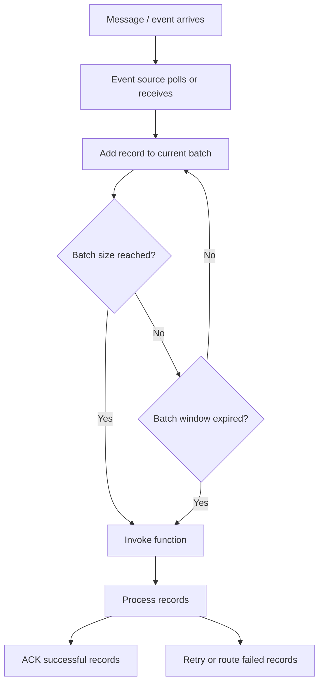

# Choosing Batch Size and Batch Window Based on Target Latency

Batching groups multiple messages or events into a single function invocation. Instead of launching a Java function per record, the event source can wait until enough records arrive or a time window expires before sending the entire batch to the handler. This reduces invocation counts, cuts repeated initialization overhead, and boosts throughput, though each individual record may wait longer before being processed.

The two key parameters are **batch size** and **batch window**. Batch size caps the maximum number of records in a single invocation; batch window caps the maximum time spent accumulating records before dispatching the batch. Choose them based on your latency objective, message arrival rate, function processing capacity, and downstream limits. Never pick the maximum batch size just to cut invocations, and never set a long batch window without factoring wait time into the SLA.

## 1. How Does Batching Work?

An event source mapping or message consumer reads records from a source, accumulates them into a batch, and then invokes the handler. A batch is typically dispatched when whichever of these occurs first:

- The maximum batch size is reached.
- The batch window expires.
- A payload/byte limit or service-specific limit is reached.
- The platform decides to flush according to its polling and scheduling mechanism.

Therefore, batch size is an upper bound rather than a guaranteed record count for every invocation. Batch window is an accumulation wait cap rather than a promise that every record will be processed after exactly that many milliseconds. At low traffic, the handler often receives small batches; at high traffic, batches can fill before the window expires.



Batching is typically performed on the consumer/event source mapping side. It differs from publisher batching: publisher batching groups multiple messages into one request sent to the broker; consumer batching groups multiple received messages into one processing invocation. Both types can coexist and must have their latencies accounted for separately.

## 2. Distinguishing Batch Size and Batch Window

| Parameter | Meaning | Primary Effect When Increased |
|---|---|---|
| `batchSize` | Maximum records in a single invocation | Fewer invocations when traffic is high enough; more work per invocation |
| `batchWindow` | Maximum wait time to accumulate records | Greater chance of filling batches under sparse traffic; higher queuing latency |
| Payload/byte limit | Total data size sent in one invocation | Can cause batches to flush smaller than max record count |
| Concurrency | Number of concurrent invocations/consumers | Raises throughput but increases pressure on dependencies |
| Prefetch/buffer | Records fetched ahead by broker/client before processing | Can boost throughput while leaving records waiting in buffers and using more memory |

Batch size and batch window are related but not interchangeable. A large batch size with a short window still yields small batches during low traffic. A long window with a small batch size will not let batches exceed the size cap. If record payloads are large, byte limits may flush batches before reaching the record count.

## 3. Start from the Latency Objective

Before configuring batching, define the business-level latency target. Examples:

- Order-accepting HTTP API: p95 response under 500 ms.
- Inventory-updating worker: p95 completion within 2 seconds.
- Analytics sync: completion within 1 minute.
- Periodic report aggregation: can wait 5 minutes to collect sufficient data.

Distinguish three time intervals:

1. **Delivery/queue wait:** record sits in the broker or waits for a consumer to receive it.
2. **Batch wait:** record has been received into a buffer and waits for the batch to flush.
3. **Processing time:** function executes the handler and side effects.

End-to-end latency can be approximated as:

\[
L_{e2e} = L_{ingress} + L_{queue} + L_{batch} + L_{handler} + L_{downstream} + L_{ack}
\]

The batch window affects only part of `L_batch`; it does not fix queue backlogs, slow handlers, or overloaded databases. If the SLA is p95/p99, allocate a budget to each component rather than taking an average across the whole pipeline.

### Example Latency Budget Allocation

Suppose a worker must meet a 2-second p95 completion target. An initial allocation could look like:

| Component | p95 Budget |
|---|---:|
| Broker delivery/queue wait | 300 ms |
| Batch accumulation | 400 ms |
| Handler | 600 ms |
| Downstream database/API | 500 ms |
| Acknowledgement and margin | 200 ms |
| **Total** | **2,000 ms** |

This is a design budget, not a guaranteed outcome. If the batch window were set to 2 seconds, accumulation time alone could blow past the entire SLA. In this example, test a maximum window of around 300–400 ms or lower to leave room for scheduling jitter and other stages.

## 4. Estimating Batch Fill Time

Let:

- \(B\): target batch size (records).
- \(\lambda\): record arrival rate, in records/second.
- \(W\): maximum batch window, in seconds.

If records arrive fairly steadily, the average time until \(B-1\) additional records arrive after the first record can be estimated as:

\[
T_{fill} \approx \frac{B-1}{\lambda}
\]

Batches typically dispatch when full or when the window expires, so accumulation time is roughly bounded by:

\[
T_{batch} \approx \min(T_{fill}, W)
\]

When batches fill due to steady traffic, the first record waits longest; the average in-batch wait time is roughly half the fill time. When the window expires before the batch fills and records arrive evenly across the window, the average wait is roughly \(W/2\), while a record arriving right at the start of the window waits nearly \(W\).

This is only an estimation model. Real traffic is often bursty, arrival rates fluctuate over time, polling has its own cadence, and brokers enforce payload limits. Never replace p95/p99 measurements in a production-like environment with this formula.

### Example 1: High Traffic

Suppose:

- \(B=20\) records.
- \(\lambda=40\) records/second.
- \(W=500\) ms.

Estimated fill time:

\[
T_{fill} \approx \frac{20-1}{40}=0.475\text{ s}
\]

The batch can reach 20 records before the 500 ms window closes. Approximate average wait for records in a full batch is around 238 ms. If the batch accumulation budget is 400 ms, this configuration is worth benchmarking.

### Example 2: Low Traffic

Suppose:

- \(B=20\) records.
- \(\lambda=5\) records/second.
- \(W=1\) second.

Estimated fill time is \(19/5=3.8\) seconds, longer than the window. Batches will normally flush with fewer than 20 records. If traffic is fairly even, a 1-second window collects roughly 5 records; average wait is approximately 500 ms. Raising batch size to 100 will not increase actual batch sizes while the window stays at 1 second and traffic stays unchanged.

### When Arrival Rates Vary

Do not use a single daily average arrival rate to pick batch settings. Traffic can be tiny overnight and surge during campaigns. Compute or measure arrival rates across relevant intervals—such as 1-minute, 5-minute, and peak bursts. Evaluate both low-traffic fill times and backlog-draining capacity during high traffic.

## 5. Choosing Batch Size

A larger batch size can boost throughput because per-invocation fixed overhead is amortized across more records. However, larger batches also raise memory usage, processing duration, payload size, and retry blast radius.

### Benefits of Increasing Batch Size

- Fewer invocations when the source has sufficient traffic.
- Lower fixed runtime/handler overhead per record.
- Potentially fewer transactions or API calls when downstream supports bulk operations.
- Higher throughput when the handler processes batches efficiently.
- Lower per-invocation charges under billing models with per-request fees.

### Risks of Increasing Batch Size

- Batch payloads can hit byte limits before reaching the max record count.
- Handlers require more memory to deserialize and hold records.
- Longer batch durations increase the risk of hitting function timeouts.
- A single failing record can cause many other records to retry if partial batch responses are unsupported.
- Large transactions may hold locks too long or exceed database limits.
- Mixed tenants/aggregates in one batch complicate authorization and ordering.
- Long processing times can outlast message visibility/lock timeouts.
- Large batches can raise tail latency for the first record while waiting to fill.

### Bounding Batch Size by Resources

Choose batch size so that:

- Total payload stays below invocation/broker limits with a safety margin.
- Memory suffices for payloads, object graphs, buffers, and results.
- p95/p99 batch processing duration fits within the timeout.
- Database/API operation counts stay within downstream capacity.
- Retrying a batch does not cause excessive cost or side effects.
- Poison records can be observed and isolated without blocking the entire flow.

If the handler processes records sequentially, batch duration approximates:

\[
T_{handler}(B) \approx T_{fixed} + B \times T_{record}
\]

If processed in parallel, duration also depends on worker pools, contention, and downstream capacity. Never increase batch size when the bottleneck is the database or a partner API.

## 6. Choosing Batch Window

The batch window directly trades wait time against the ability to accumulate more records. For latency-sensitive workloads, pick a short window or 0 when supported by the event source and invocation overhead is acceptable. For background workloads, a longer window can cut invocations and improve bulk efficiency.

### Short Window

- Records reach the handler sooner.
- Batches are typically smaller under low traffic.
- More invocations and higher fixed overhead.
- Fits APIs/events needing fast response or workers keeping queue age low.

### Long Window

- More time to gather records.
- Average batch size can grow under sparse traffic.
- Invocations drop if batches fill up.
- The first record in a batch can wait nearly the entire window.
- Queue age, end-to-end latency, and timeout risk rise.

A long window does not always cut costs. If the handler waits long yet still receives small batches, you added latency without saving significant invocations. Measure actual batch size and cost per successful record.

## 7. Separating Target Latencies by Workload Type

| Workload | Typical Priority Latency Objective | Initial Batching Direction |
|---|---|---|
| HTTP request needing immediate result | Response latency p95/p99 | Do not wait for a batch inside the request; enqueue and process async if appropriate |
| Order/payment events | Business completion time and ordering | Small batches/short windows; prioritize idempotency and safe retries |
| Notifications | Acceptable delay per delivery SLA | Moderate batches, short-to-medium windows |
| Analytics ingestion | Throughput and cost per record | Larger batches, longer windows if SLA permits |
| Stream processing | Consumer lag and per-partition/shard order | Batch per shard/partition, window aligned with lag budget |
| Scheduled aggregation | Finish before reporting deadline | Large batches or aggregate by business time window |
| File/object processing | Object processing time and invocation cost | Batch keys/object metadata; avoid holding large file payloads in memory |

For HTTP APIs, batching usually belongs behind a queue or stream. Never hold an HTTP request open waiting for a batch to fill unless the protocol and SLA explicitly allow it.

## 8. AWS Lambda with SQS Event Source Mapping

When Lambda reads from SQS, the event source mapping polls the queue, groups messages into a batch, and invokes the function. Two common properties are:

- `BatchSize`: maximum messages per invocation.
- `MaximumBatchingWindowInSeconds`: maximum wait time to gather messages before invoking.

Actual batches are also constrained by maximum invocation payload limits and queue/event source limits. Maximum values differ between Standard and FIFO queues; verify current AWS limits for your exact configuration.

### AWS SAM Example

```yaml
Resources:
  OrdersQueue:
    Type: AWS::SQS::Queue
    Properties:
      VisibilityTimeout: 70

  ProcessOrdersFunction:
    Type: AWS::Serverless::Function
    Properties:
      Runtime: java21
      Handler: com.example.orders.ProcessOrdersHandler
      Timeout: 10
      MemorySize: 1024
      Events:
        OrdersEvent:
          Type: SQS
          Properties:
            Queue: !GetAtt OrdersQueue.Arn
            BatchSize: 10
            MaximumBatchingWindowInSeconds: 1
            FunctionResponseTypes:
              - ReportBatchItemFailures
```

In this example, the function timeout is 10 seconds and the batch window is 1 second. The 70-second visibility timeout exceeds AWS's recommended minimum of six times the function timeout plus the batching window (61 seconds). Whenever you change timeout or window, recalculate visibility timeout while also accounting for retries, throttling, and batch processing time.

### Partial Batch Responses

Without `ReportBatchItemFailures`, a single failed record can cause the entire batch to be redelivered. For handlers with side effects, this reprocesses records that already succeeded. Partial batch responses let the handler return a list of failed message IDs so the event source mapping retries only those records.

With FIFO queues, to preserve ordering within a message group, the handler should stop processing subsequent records after the first failed record and return the failed record plus all unprocessed records in that group per the event source mapping contract. Never continue executing side effects after a failed record when business ordering must be preserved.

### Batching and Visibility Timeout

Visibility timeout must cover the batch window, invocation, retries, and scheduling overhead. If the timeout is too short, messages can reappear while the previous invocation is still running, creating duplicate concurrency. Consumers must still be idempotent because no timeout configuration eliminates duplicate delivery completely.

### When to Use a Small SQS Batch Size?

- Each message calls a slow API or independent transaction.
- Individual records fail often and retries are expensive.
- Low latency or strict FIFO ordering is required.
- Payloads are large or function memory is small.

### When to Use a Large SQS Batch Size?

- Consumers process each record quickly and independently.
- Downstream systems support bulk writes.
- Traffic is high enough to fill batches quickly.
- Partial batch responses and idempotency are implemented.
- The function has sufficient memory/timeout and concurrency.

## 9. AWS Lambda with Kinesis Data Streams and DynamoDB Streams

With streams, the Lambda event source mapping reads records per shard/partition and invokes the function in batches. Properties may include:

- `BatchSize` and `MaximumBatchingWindowInSeconds`.
- `ParallelizationFactor` to increase concurrent batches processed per shard within service limits.
- `FunctionResponseTypes: ReportBatchItemFailures` to report failed records.
- `BisectBatchOnFunctionError` to split batches when the function fails.
- `MaximumRetryAttempts` and `MaximumRecordAgeInSeconds` to cap retries/record age.
- `DestinationConfig` to route failed records per supported configuration.

Illustrative SAM example:

```yaml
Events:
  OrderStream:
    Type: Kinesis
    Properties:
      Stream: !GetAtt OrdersStream.Arn
      StartingPosition: LATEST
      BatchSize: 100
      MaximumBatchingWindowInSeconds: 1
      ParallelizationFactor: 2
      FunctionResponseTypes:
        - ReportBatchItemFailures
      BisectBatchOnFunctionError: true
      MaximumRetryAttempts: 3
      MaximumRecordAgeInSeconds: 3600
```

The values above are illustrative starting points, not production defaults. With streams, ordering within a shard/partition and checkpointing are critical. Raising parallelization or bisecting batches can change error handling and observed ordering; verify against your stream source semantics and key/partition design.

Track `IteratorAge` or the equivalent consumer lag. Long batch windows make records wait longer before the handler runs; overly large batch sizes lengthen handler execution and can raise iterator age if processing cannot keep up with ingestion.

## 10. Kafka and Other Event Sources

With Amazon MSK or self-managed Kafka, the Lambda event source mapping reads via consumer groups and delivers records in batches. Batch size/window must balance throughput, payloads, partition ordering, and processing time. Kafka partitions are the key unit of parallelism; increasing consumer concurrency beyond useful partition counts adds no benefit and can affect in-partition ordering.

With an EventBridge event bus, rules typically forward individual events to target Lambdas via asynchronous invocation; there is no general batch size/window like SQS event source mappings. If you need to batch events, route EventBridge to SQS and let Lambda poll the queue in batches. This adds a hop and queue retention while enabling explicit batching, backpressure, and a dedicated DLQ.

With DynamoDB Streams, Kinesis, and Kafka, batch windows also affect consumer lag and checkpoints. Do not set long windows solely to reduce invocations when a stream has near-real-time processing requirements.

## 11. Azure Functions: Service Bus and Event Hubs

Azure Functions batching configuration depends on the trigger, extension version, and function signature.

### Service Bus

Service Bus triggers can process individual messages or batches depending on the extension/binding model. In batch mode, settings such as minimum/maximum message batch size and maximum batch wait time (when supported by the extension version) control accumulation conditions. `prefetchCount`, concurrency, lock duration, and auto lock renewal also affect message wait and processing times.

Do not blindly raise prefetch to boost throughput. Prefetch buffers messages on the client side; if the function cannot process them fast enough, locks can expire or messages may be redelivered. Size prefetch/concurrency to handler speed and lock duration, enable manual completion when explicit ack control is needed, and design idempotency for redeliveries.

### Event Hubs

Event Hubs triggers typically deliver a batch of events from a partition to the function. Settings such as `maxBatchSize`, `prefetchCount`, and `batchCheckpointFrequency` govern prefetched events, batch sizes, and checkpoints. Large batches increase throughput yet can increase memory usage and processing time; infrequent checkpoints can cause many events to be re-read after failures.

Illustrative `host.json` configuring Event Hubs:

```json
{
  "version": "2.0",
  "extensions": {
    "eventHubs": {
      "maxBatchSize": 100,
      "prefetchCount": 300,
      "batchCheckpointFrequency": 1
    }
  }
}
```

Setting names and batching capabilities vary by extension version and hosting plan. Check the documentation for the exact extension you use before applying. Monitor consumer lag, partition ownership, checkpoints, and throttling to tune.

## 12. Google Cloud Pub/Sub and Cloud Run/Functions

Pub/Sub has two common consumption patterns:

- **Push subscriptions:** deliver messages to an HTTP endpoint; each delivery is normally a single request. If batching is required, place an intermediary service or internal buffer in front, ensuring explicit ack/retry design.
- **Pull/StreamingPull:** subscriber clients receive multiple messages and can batch them in the application by count, bytes, or time. Java subscribers must bound outstanding messages/bytes and manage ack deadlines appropriately.

Event-driven Cloud Functions/Cloud Run functions may receive one CloudEvent per invocation depending on the trigger. If a workload needs batching, consider a Pub/Sub pull consumer running on Cloud Run or a subscription pattern supporting batches; never assume every event trigger automatically groups multiple events into one invocation.

Publisher batching and subscriber batching are separate settings. Publishers can batch publish requests by element count, byte threshold, and delay; subscribers must manage flow control, ack deadlines, and in-flight messages. Tuning publisher batching does not automatically make consumer batches larger.

## 13. Java: Handling SQS Batches and Partial Failures

The following example processes each record independently and returns failed message IDs. In practice, enable `ReportBatchItemFailures` on the event source mapping as shown in the SAM example above.

```java
import com.amazonaws.services.lambda.runtime.Context;
import com.amazonaws.services.lambda.runtime.RequestHandler;
import com.amazonaws.services.lambda.runtime.events.SQSEvent;
import com.amazonaws.services.lambda.runtime.events.SQSBatchResponse;
import java.util.ArrayList;
import java.util.List;

public final class ProcessOrdersHandler
        implements RequestHandler<SQSEvent, SQSBatchResponse> {

    @Override
    public SQSBatchResponse handleRequest(SQSEvent event, Context context) {
        List<SQSBatchResponse.BatchItemFailure> failures = new ArrayList<>();

        for (SQSEvent.SQSMessage message : event.getRecords()) {
            try {
                OrderEvent order = OrderEvent.fromJson(message.getBody());
                OrderService.processIdempotently(order);
            } catch (RetryableException ex) {
                context.getLogger().log(
                        "Retryable failure for messageId=" + message.getMessageId());
                failures.add(new SQSBatchResponse.BatchItemFailure(
                        message.getMessageId()));
            } catch (Exception ex) {
                context.getLogger().log(
                        "Invalid or failed messageId=" + message.getMessageId());
                failures.add(new SQSBatchResponse.BatchItemFailure(
                        message.getMessageId()));
            }
        }

        return new SQSBatchResponse(failures);
    }
}
```

`OrderEvent`, `OrderService`, and the exceptions are application-defined types. For non-retryable data errors, consider routing to a quarantine/DLQ per policy instead of retrying endlessly. Do not log full message bodies if they contain PII or secrets. Consumers must be idempotent because a message can be redelivered if side effects succeed yet acknowledgment fails.

For FIFO queues, do not continue processing records after the first failed record if they belong to the same ordering scope. Return the failed and unprocessed records according to the partial batch response contract.

## 14. Sequential or Parallel Processing Within a Batch?

Batch size is the number of records in one invocation; in-handler concurrency is how many records run concurrently inside an invocation. Event source concurrency is how many invocations run concurrently. These are three distinct levels.

### Sequential Processing

Advantages:

- Easy to preserve ordering within a batch.
- Easy to bound load on databases/APIs.
- Low contention and straightforward transaction handling.

Drawbacks:

- Lower throughput if each record waits on slow I/O.
- Batch duration grows linearly with record count under sequential execution.

### Parallel Processing Within a Batch

Advantages:

- Can boost throughput when records are independent and mostly I/O-bound.
- Better utilization of function resources.

Drawbacks:

- Increases simultaneous downstream connections and requests.
- Harder to preserve ordering.
- An exception inside a future/batch can be harder to map back to the exact record.
- Requires bounding worker pools and preserving per-record context/logging.

Never spawn one thread per message. Use a bounded executor, semaphore, or bulkhead sized to downstream capacity. For stream partitions or FIFO message groups, parallelize only business work that does not break required ordering.

## 15. Batch Failures, Retries, and Poison Records

Batching increases how many records are impacted when an invocation fails. Error design must answer:

- Does the function fail the entire batch or only individual records?
- Does the broker retry the whole batch or individual records?
- Are partial batch responses supported?
- Is batch bisection or targeted retry of failed items available?
- After how many attempts is a failing record sent to a DLQ/quarantine?
- How long can one poison record block a partition/shard or FIFO message group?

### Partial Batch Responses

When supported by the platform, return the list of failed records to avoid retrying records that already succeeded. However, partial responses do not replace idempotency. A function can commit a side effect and crash before returning a response; the broker can still redeliver that record.

### Batch Bisection

Some stream event sources support splitting a batch in half on function errors. This helps isolate the offending record, though it can increase invocation counts and alter how many times a record is retried. Track retries and enforce record age limits.

### DLQ and Quarantine

A DLQ stores records that remain unprocessable after the retry policy is exhausted. For event streams, use the service's failure destination/handling mechanism. Quarantine records should preserve metadata such as event ID, source, schema version, attempt count, and error type; storing the raw payload is unnecessary if payloads are sensitive.

## 16. Concurrency, Backpressure, and Batch Window

A large batch size does not automatically raise throughput if the event source allows only a few invocations. Conversely, high concurrency with small batches can overload downstream systems. Tune simultaneously:

- Batch size and batch window.
- Function maximum/reserved concurrency.
- Event source mapping maximum concurrency or parallelization factor.
- Consumer worker pools inside the handler.
- Database connection pools and API rate limits.
- Prefetch/outstanding message limits.
- Visibility timeout, lock duration, and retry policies.

Backpressure prevents message intake from outpacing sustainable processing speed. With SQS, the queue absorbs bursts; cap concurrency so workers match database capacity. With streams, consumer lag grows when processing falls behind ingestion; scale concurrency/partitions or shorten processing time.

Never use a long batch window to mask insufficient consumer capacity. If backlogs keep growing, increase processing throughput or throttle ingestion rather than merely tweaking batch accumulation time.

## 17. Observability When Optimizing Batching

Measure both batching efficiency and latency impact:

| Metric | Meaning | How to Use |
|---|---|---|
| Actual batch size | Actual records per invocation | Check whether batches usually fill or flush early |
| Batch fill time | Time from first record until invocation | Measure wait cost introduced by batching |
| Queue age / oldest message age | Age of oldest unprocessed record | Detect backlogs and SLA breaches |
| Handler duration | Batch processing time | Spot oversized batches or slow downstream calls |
| Records per second | Actual throughput | Compare size/window/concurrency configurations |
| Invocation count | How often the function runs | Evaluate fixed overhead/cost |
| Error/retry count | Failures and retry attempts | Detect poison records or broken partial-failure handling |
| Throttles/concurrency | Capacity utilization | Tune concurrency/backpressure |
| Iterator age/consumer lag | Stream consumer delay | Assess ability to keep up with ingestion |
| Cost per successful record | Cost per completed record | Avoid optimizing invocations at the expense of retries/latency |

Not every service exposes `actual batch size` or `batch fill time` metrics directly. Emit structured logs from the handler: batch size, invocation receive time, record timestamps/ages, success/failure counts, and duration. Avoid using event IDs or message IDs as high-cardinality metric dimensions; keep them in logs/traces.

### Common AWS Metrics

- SQS: `ApproximateNumberOfMessagesVisible`, `ApproximateAgeOfOldestMessage`, messages received/deleted, and DLQ depth.
- Lambda: `Invocations`, `Duration`, `Errors`, `Throttles`, `ConcurrentExecutions`.
- Kinesis/DynamoDB Streams: `IteratorAge` and related stream/consumer metrics.
- EventBridge: matched events, failed invocations, and target DLQ metrics.

### Azure and Google Cloud Metrics

- Azure Service Bus: active messages, dead-letter messages, incoming/completed/abandoned messages, and lock-related failures.
- Azure Event Hubs: incoming events/bytes, throttling, and consumer lag/checkpoint behavior.
- Google Pub/Sub: undelivered messages, oldest unacked message age, ack deadline expirations, and subscriber throughput.

Metric names, dimensions, and visibility vary by tier, extension, and configuration; select the metrics matching your service.

## 18. Process for Selecting Batch Size and Window

Follow this sequence:

1. **Define SLAs:** p95/p99 latency, minimum throughput, backlog age, and cost per record.
2. **Measure arrival rates:** average, peak, burst, and low traffic; inspect distribution over time.
3. **Measure processing cost:** handler time/record, fixed overhead, memory, payload size, and downstream latency.
4. **Allocate batch wait budget:** take from end-to-end latency budget after subtracting queue, handler, and downstream time.
5. **Choose window:** cap it within the wait budget; start low if the SLA is latency-sensitive.
6. **Choose batch size:** large enough to amortize overhead without exceeding payload, memory, timeout, ordering, or retry budgets.
7. **Choose concurrency:** bound to downstream capacity and backlog-draining capability.
8. **Enable partial failures/DLQ:** avoid full-batch retries when the source supports granular failure handling.
9. **Benchmark a matrix:** change one parameter at a time; measure p50/p95/p99, actual batch size, throughput, retries, and cost.
10. **Canary and monitor:** roll out gradually, alert on queue age/iterator age, errors, and throttling; roll back if SLAs degrade.

### Suggested Benchmark Matrix

| Experiment | Batch size | Batch window | Goal |
|---|---:|---:|---|
| A | 1 | 0 | Low-latency, high-invocation baseline |
| B | 10 | 0 | Evaluate batch size benefit without added wait |
| C | 10 | 250 ms | Measure short-window trade-off |
| D | 25 | 500 ms | Test throughput/cost with larger batches |
| E | 50 | 1 s | Test only if SLA and payloads allow |

These are test points, not universal recommended settings. Pick values suited to your event source, payloads, and SLAs.

## 19. Example Decision Driven by a Latency Budget

Suppose a worker consumes order messages with these targets:

- p95 from message publish until database update must not exceed 2 seconds.
- Average arrival rate is 30 records/second; peak is 150 records/second.
- Sequential handler averages 20 ms/record.
- The database has connection limits and does not support overly large transactions.

An experimental configuration could be:

- Batch size 10 or 20 to bound transactions and memory.
- Batch window 200–300 ms to keep batch wait inside budget.
- Concurrency capped to match the database connection pool.
- Partial batch response enabled to retry only failed records.
- Visibility timeout long enough for function timeout plus batch window.

At 30 records/second and batch size 10, average fill time is roughly `9/30 = 300 ms`. With a 250 ms window, batches often flush before reaching 10 records during steady traffic. This may fit the latency budget, though you must measure actual batch size and p95.

At the 150 records/second peak, a batch of 10 fills in roughly `9/150 = 60 ms`; the window is no longer the limiting factor. If the handler takes around 200 ms for 10 records and concurrency suffices, the worker scales throughput cleanly. If the database starts throttling, raising batch size or concurrency further will make things worse.

## 20. Common Configuration Mistakes

| Mistake | Consequence | Fix |
|---|---|---|
| Picking the provider's maximum batch size | Memory, timeout, and retry costs climb | Size to payload, handler time, and downstream capacity |
| Setting a long window to cut invocations without checking SLA | Records wait too long; p95/p99 misses target | Allocate a batch wait budget first |
| Looking only at configured batch size | Actual batches are small due to traffic or byte limits | Record actual batch size and fill time |
| Forgetting payload limits | Batches split unexpectedly or invocations fail | Measure p95/p99 payloads and leave a margin |
| Leaving partial batch responses off | One bad record retries the whole batch | Enable granular failure responses when supported |
| Visibility/lock timeout too short | Messages redeliver while invocation is still running | Size timeout for batch window, function timeout, and retries |
| Raising concurrency without bounding downstream | Database/API overloads | Apply backpressure, connection pools, and max concurrency |
| Batching synchronous HTTP responses | Clients stall waiting for batches to fill | Move to an async queue or process individually |
| Long batch windows on real-time streams | Consumer lag increases | Keep windows short and scale to control lag |
| Not measuring cost per success | Retries/duplicates inflate total cost | Track successful records and retry overhead |

## 21. Pre-Deployment Checklist

### Latency and Traffic

- [ ] p95/p99 SLAs and end-to-end latency budgets are defined.
- [ ] Queue wait, batch wait, handler time, and downstream latency are separated.
- [ ] Average, low, peak, and burst arrival rates have been measured.
- [ ] Batch window does not exceed the accumulation latency budget.
- [ ] Actual batch size and batch fill time are observable.

### Batch Size and Payloads

- [ ] Batch size fits source, payload, and invocation limits.
- [ ] Memory accommodates the batch and deserialized object graphs.
- [ ] p95/p99 batch duration fits inside the function timeout.
- [ ] Transactions/bulk requests stay within downstream limits.
- [ ] Batch size suits retry cost, ordering, and poison record handling.

### Delivery and Failures

- [ ] Partial batch responses are enabled if supported by the trigger.
- [ ] FIFO/partition ordering is preserved per business requirements.
- [ ] Visibility timeout or message lock duration is long enough.
- [ ] Retry limits, DLQ/quarantine, and idempotent consumers are in place.
- [ ] Batch failures neither create duplicate side effects nor drop records.

### Scaling and Operations

- [ ] Concurrency, prefetch, and worker pools are bounded to downstream capacity.
- [ ] Backpressure and alerts exist for queue age/iterator age/consumer lag.
- [ ] Invocation count, throughput, errors, throttles, and cost per successful record are tracked.
- [ ] Combinations of batch size/window have been benchmarked on representative workloads.
- [ ] Canary/rollback plans exist and behavior is re-verified after traffic pattern shifts.

Batch size caps maximum records per processing run; batch window caps maximum wait time to accumulate records. Choose them from your latency budget and arrival rate, then validate payloads, handler duration, retry semantics, and downstream capacity. A good configuration hits target p95/p99 and throughput at reasonable cost—not merely the biggest batch possible. For serverless Java, measure actual batches, handle partial failures, keep consumers idempotent, and pace concurrency to optimize both latency and reliability.
