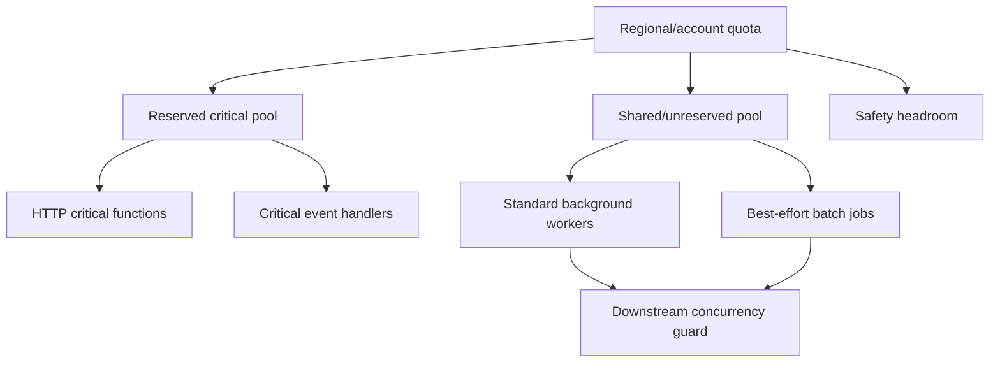
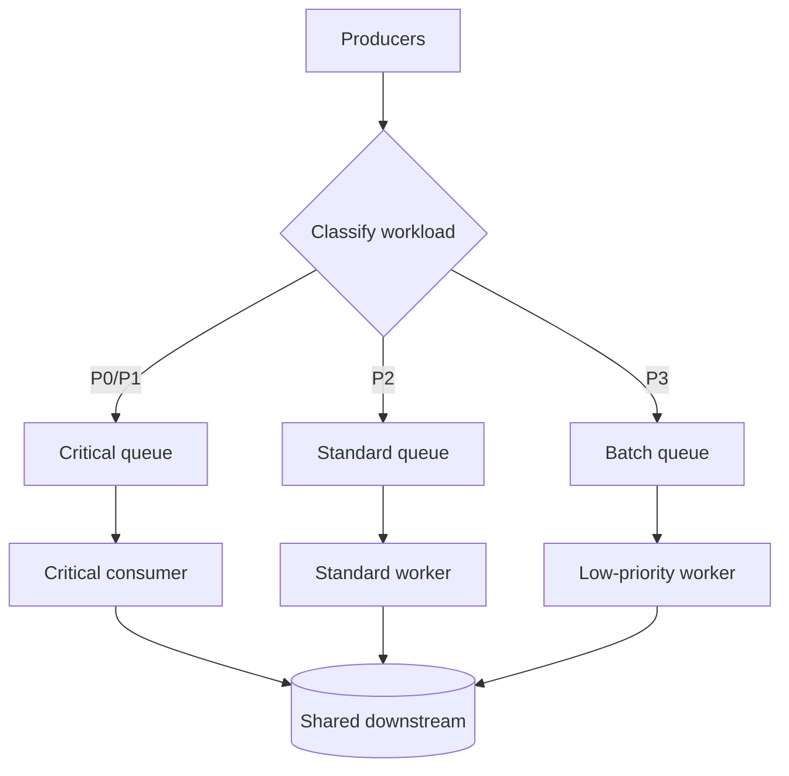

# Allocating quotas between critical functions and background tasks

## 1. Why allocate quotas?

Serverless automatically scales the number of execution environments up or down based on demand, but scaling capacity is not infinite. Every account, project, region, function app, service, event source, or dependency has resource limits. When multiple workloads surge simultaneously, they can contend for concurrency, connections, CPU, memory, throughput, and dependent service quotas.

Consider an e-commerce system with the following workloads:

- `checkout-api`: handles order creation requests, requiring low latency.
- `payment-webhook`: receives payment confirmations from partners, requiring timely processing.
- `order-events`: updates order status from a message queue.
- `invoice-worker`: generates invoices and sends notifications.
- `report-worker`: aggregates data and exports large reports.
- `data-export`: handles batch jobs, which can run slower without impacting live transactions.

If `report-worker` scales up to hundreds of invocations and consumes all concurrency or database connections, `checkout-api` may be throttled or time out even though customer requests need immediate handling. A background workload may have low priority yet still consume resources identically to a critical workload if the system lacks enforced limits.

Quota allocation is how you define which slice of capacity belongs to each workload class, which slice is shared, and which slice must be held in reserve. The goal is to protect critical paths, keep background tasks progressing fairly, bound load on dependencies, and prevent a single group of requests from starving the rest.

In the CLOUD_SERVERLESS module, quotas must be viewed across multiple layers: cloud account/region limits, function concurrency, event source concurrency, service instance limits, gateway rate limits, and external database/API capacity. A limit at one layer does not automatically protect the remaining layers.

## 2. Distinguishing quotas, rate limits, concurrency, and capacity

These concepts are related but not interchangeable.

| Concept | Meaning | Example |
| --- | --- | --- |
| Quota | Maximum amount of a resource allowed within a scope/period | Total account concurrency in a region |
| Rate limit | Limit on request or operation rate over a time interval | 200 requests/second per API key |
| Concurrency limit | Limit on the number of work items running simultaneously | Maximum 40 worker invocations |
| Per-instance concurrency | Number of requests/messages a single instance processes simultaneously | 8 messages on a Functions host instance |
| Maximum instances | Limit on the number of instances a service can scale out to | Maximum 25 container instances for a service |
| Reserved capacity | A portion of capacity dedicated to a specific workload | Reserved concurrency for the payment function |
| Provisioned/warm capacity | Pre-initialized instances or execution environments | Provisioned concurrency to reduce cold starts |
| Downstream capacity | Serving capability of a service called by the function | 100 database connections or 500 API calls/second |

**A rate limit is not the same as a concurrency limit.** An API might receive 100 requests/second yet have only 10 concurrent requests if each finishes in 100 ms. If each request takes 2 seconds, the same 100 requests/second rate can require roughly 200 concurrent requests.

**A quota does not equal available capacity.** An account with a concurrency quota of 1,000 can still bottleneck on a database that only supports 80 connections. Conversely, setting a concurrency limit too low can cause queue backlogs to grow even while the database has plenty of headroom.

## 3. Classifying workloads by criticality

### 3.1. Priority tiers

A practical classification:

| Tier | Workload type | Operational requirements | Suggested quota policy |
| --- | --- | --- | --- |
| P0 – Critical | Checkout, payment confirmation, user authentication | Low latency, high availability, direct impact on revenue/safety | Dedicated concurrency/capacity and headroom; per-client rate limiting |
| P1 – Business async | Order updates, inventory sync, webhook processing | Completes within short SLA, with retries and idempotency | Guaranteed capacity slice or separate queue; bounded by dependencies |
| P2 – Standard background | Emails, invoices, data synchronization | Can tolerate moderate delay, requires fair progress | Capped concurrency; uses queues and backpressure |
| P3 – Best effort/batch | Reports, exports, analytics, cleanup | Can be deferred or throttled when the system is busy | Uses remaining capacity, off-peak scheduling, and strict caps |

Do not mark every function as P0. If every workload is "critical," there is no basis for allocating capacity when quota is scarce. Product and operations owners must define real impact, SLAs, and priority levels.

### 3.2. Classifying by SLO and deadline

Beyond priority labels, each workload should specify:

- Availability or success rate SLO.
- Processing deadline from request/event receipt.
- Target latency and maximum timeout.
- Average, peak, and burst load levels.
- Ability to retry, pause, defer, or cancel.
- Tolerance for out-of-order or duplicate processing.
- Business impact if not processed in time.

For example, `payment-webhook` may need to finish within a few seconds to update an order, whereas `report-worker` can finish within 30 minutes. Both matter to the business, but their deadlines and capacity allocation strategies differ.

### 3.3. Never leave background work unbounded

Background tasks are often treated as "just let them autoscale." This is dangerous when queue backlogs grow: the autoscaler sees many messages and spawns more invocations, while downstreams do not scale correspondingly. The outcome can be connection exhaustion, throttling, retry storms, and rising costs.

Every consumer needs concurrency/throughput caps, retry policies, and backpressure conditions. If a backlog grows, the system must slow down in a controlled manner instead of endlessly spinning up more execution environments.

## 4. Estimating required concurrency

### 4.1. Using Little’s Law

An initial estimate for concurrent work items is:

\[
C \approx \lambda \times W
\]

Where:

- `C`: number of requests/messages processed concurrently.
- `λ`: average arrival rate, in requests/second.
- `W`: average processing time, in seconds.

For example, `checkout-api` receives 80 requests/second and has an average processing time of 250 ms (0.25 seconds):

\[
C = 80 \times 0.25 = 20
\]

The system needs roughly 20 concurrent requests to handle this average load. To leave buffer for peaks and variance, the team can test at 30–40 concurrency, then validate with load tests and real metrics.

This is a steady-state estimate. Bursts, tail latency, retries, batch sizes, dependency wait times, and autoscaling lag can drive peak demand higher. Never promote an average-based calculation to a production quota without load testing.

### 4.2. Calculating capacity from downstreams

Suppose a database allows at most 120 connections. Other workloads must retain:

- 30 connections for business APIs.
- 20 connections for admin and operational tasks.
- 10 connections reserved for migrations/monitoring.

The remaining capacity for workers is:

\[
C_{worker-db} = 120 - 30 - 20 - 10 = 60
\]

If each worker invocation holds one connection throughout processing, total concurrent workers hitting the database should not exceed roughly 60. If each invocation opens multiple connections, divide capacity by the maximum connections per invocation.

With per-instance connection pools, total connection upper bound can be estimated as:

\[
Connections_{max} = Instances_{max} \times PoolSize_{perInstance}
\]

For example, 20 instances with a pool of 10 connections each can open up to 200 connections. That can exceed the database quota even though each instance looks small.

### 4.3. Leaving headroom

Do not allocate 100% of nominal quota to normal workloads. Leave headroom for:

- Burst traffic and requests taking longer than expected.
- Retries following a dependency outage.
- Health checks, control plane activity, and operational tasks.
- Rolling deployments/canaries when two versions coexist.
- Discrepancies between configured quotas and real usable capacity.

Headroom is not wasted capacity. It lets the system absorb fluctuations and recover from incidents without scrambling to adjust quotas mid-incident.

## 5. Allocating capacity using pools

### 5.1. Separating critical and background pools

A straightforward model splits total capacity into pools:



The critical pool must cover expected load plus the defined buffer. Background work has an upper cap so it cannot consume all resources. The shared pool allows lower-priority workloads to utilize idle capacity; headroom protects the system against bursts or failure recovery.

### 5.2. Quota allocation example

Suppose a region has 600 available concurrency units under the account quota. An illustrative plan:

| Workload | Allocation/limit | Purpose |
| --- | ---: | --- |
| Checkout API | 180 | Reserve capacity for critical user requests |
| Payment webhook | 100 | Ingest payment confirmations on time |
| Order event processor | 80 | Process critical business events |
| Background invoice | 40 | Cap background load and protect database |
| Shared/unreserved pool | 120 | Other workloads and unpredicted traffic |
| Operational headroom | 80 | Buffer for bursts, deployments, and recovery |
| **Total** | **600** | Example capacity budget |

This is a planning allocation model, not an identical configuration across every cloud. On AWS Lambda, per-function reserved concurrency can dedicate a slice of the pool while capping max concurrency. On Azure Functions or Cloud Run, you need to combine plan/service limits, per-instance concurrency, and trigger-specific controls to achieve a similar effect.

If a workload has reserved concurrency that it rarely uses fully, the reserved slice cannot be used by other functions. Therefore, do not over-reserve broadly for every function. You can use event-source maximum concurrency or service-level caps to constrain background work without necessarily locking up a large dedicated pool.

### 5.3. Separating services/functions to establish resource boundaries

If a critical API and a batch worker share the same function app/service, they may share CPU, memory, thread pools, connection pools, or scaling units. Separating them into distinct functions/services lets you:

- Apply separate concurrency and instance limits.
- Use distinct identities and access permissions.
- Scale, deploy, and roll back independently.
- Maintain per-workload metrics, SLOs, and alerts.
- Prevent background workers from exhausting the API's threads/connections.

Splitting functions does not automatically provide complete isolation. Two functions can still share an account quota, database, network, or downstream API. Limits must be placed at every relevant layer.

## 6. AWS Lambda: reserved concurrency and event source limits

### 6.1. Reserved concurrency

AWS Lambda maintains an account/region-level concurrency pool. By default, functions share this pool on demand. **Reserved concurrency** guarantees a slice of concurrency for a function while simultaneously setting its maximum concurrency ceiling.

Example:

- `checkout-api` has reserved concurrency 180.
- `payment-webhook` has reserved concurrency 100.
- `report-worker` has reserved concurrency 30.

When `report-worker` reaches 30 concurrent invocations, new invocations are throttled or queued depending on event source semantics; it cannot dip into `checkout-api`'s reserved concurrency. If checkout needs its reserved capacity, background work cannot claim it.

Reserved concurrency does not pre-initialize execution environments. It is a concurrency isolation/capping mechanism, not a cold-start reduction mechanism. If you need pre-warmed environments, look at **Provisioned Concurrency**.

AWS does not charge an extra fee for configuring reserved concurrency, but reserved capacity is unavailable to other functions. Reserving excessive capacity for low-activity workloads shrinks the remaining shared pool.

### 6.2. Provisioned concurrency

Provisioned concurrency keeps a specified number of initialized execution environments ready for a version or alias. It suits APIs with tight latency requirements or predictable traffic. Provisioned concurrency incurs charges and still counts toward account concurrency. Do not use it merely to "reserve quota" for a function; its primary purpose is reducing initialization latency.

Reserved concurrency and provisioned concurrency solve two distinct problems:

| Mechanism | Protects from other functions consuming pool? | Reduces cold starts? | Caps max concurrency? |
| --- | --- | --- | --- |
| Reserved concurrency | Yes | Not by itself | Yes |
| Provisioned concurrency | Not a standalone isolation mechanism | Yes, within provisioned count | Does not replace reserved concurrency |

Provisioned concurrency must fit within the function's reserved concurrency limit when reserved concurrency is configured. Both count toward account/region concurrency quotas under current AWS rules.

### 6.3. Limiting SQS event source mappings

With SQS triggers, you can set `MaximumConcurrency` on the event source mapping to limit concurrent invocations spawned by that queue. This prevents a background queue from scaling too fast and exhausting function/account concurrency or database connections.

Conceptual configuration example:

```json
{
  "ScalingConfig": {
    "MaximumConcurrency": 20
  }
}
```

This is a scaling setting on the event source mapping, not a global property across all Lambda invocations. If a function has multiple SQS event source mappings, each mapping can have its own maximum concurrency.

When combining mapping maximum concurrency with function reserved concurrency, the sum of mapping maximums should be less than or equal to the function's reserved concurrency to avoid mappings contending with each other and getting throttled. AWS also specifies that `MaximumConcurrency` and provisioned polling mode are mutually exclusive options on the same mapping.

When an event source mapping hits maximum concurrency, the pollers throttle back and messages remain in the queue until capacity frees up. If the function hits reserved concurrency due to another invocation source or because total mapping configs exceed function capacity, Lambda may throttle invocations.

With FIFO queues, concurrency is also bounded by the number of active `MessageGroupId` values. If there are only 5 message groups, setting maximum concurrency to 20 will not make the queue process 20 groups in parallel.

### 6.4. Choosing limits by objective

| Objective | Recommended mechanism |
| --- | --- |
| Guarantee capacity for critical functions | Reserved concurrency |
| Stop background SQS workers from scaling too high | Maximum concurrency on event source mapping |
| Reduce HTTP function cold starts | Provisioned concurrency |
| Partition quota across multiple independent functions | Reserved concurrency combined with unreserved pool |
| Limit dependency throughput | Concurrency caps, rate limiters, or queue consumer controls |

Do not set reserved concurrency lower than the total concurrency required by event source mappings. If strict isolation is needed between critical and background queues, consider using separate functions for each queue.

## 7. Azure Functions: host concurrency and plan scaling

### 7.1. Trigger-level and per-instance limits

Azure Functions provides different concurrency models depending on the trigger and hosting plan. Many triggers support per-instance concurrency settings in `host.json`. For example, the Service Bus trigger has `maxConcurrentCalls` and `maxConcurrentSessions` to tune how many messages/sessions are processed concurrently on each scaled instance.

Example `host.json` for Service Bus extension 5.x+:

```json
{
  "version": "2.0",
  "extensions": {
    "serviceBus": {
      "maxConcurrentCalls": 8,
      "maxConcurrentSessions": 4,
      "maxMessageBatchSize": 100
    }
  }
}
```

These values are illustrative. Actual settings depend on the extension version, single-message/session/batch mode, and core count per instance. A per-instance limit is not an application-wide limit: if the app scales out to multiple instances, total concurrency can be a multiple of the per-instance limit.

`host.json` applies at the Function App scope; triggers of the same type within the app can share that setting. On some hosting plans/core configurations, actual callback counts may scale by core count. Calculate total concurrency across all instances and check extension versions before treating `host.json` values as global quotas.

### 7.2. Dynamic concurrency

For certain triggers, Azure Functions supports dynamic concurrency: the host automatically tunes concurrency based on instance health and load. This feature currently supports triggers such as Azure Blob Storage, Azure Queue Storage, and Service Bus; do not assume every trigger supports dynamic concurrency.

When dynamic concurrency is enabled, the runtime learns appropriate concurrency levels over time. On supported triggers, the dynamically adjusted concurrency value can override fixed concurrency settings. This helps when payloads or traffic vary, but it does not replace global downstream or plan limits.

Example enabling dynamic concurrency in `host.json`:

```json
{
  "version": "2.0",
  "concurrency": {
    "dynamicConcurrencyEnabled": true,
    "snapshotPersistenceEnabled": true
  }
}
```

Load test with representative workloads and monitor instance count, concurrency, CPU, threads, and connections before enabling in production. Dynamic concurrency protects host health; it has no awareness of checkout SLA priority relative to a report worker.

### 7.3. Hosting plans affect isolation

Azure Functions scaling behavior depends on the hosting plan. Flex Consumption offers per-function scaling for many triggers, whereas some trigger types scale together in groups; Premium/Dedicated plans follow different instance/plan models. When multiple functions share an app/plan, understand which compute and scale units they share.

For critical workloads and heavy background tasks, you can separate Function Apps or hosting plans to create distinct resource boundaries, scaling configs, and cost tracking. `host.json` tunes host/trigger behavior, but it does not replace subscription/region quotas or database limits.

## 8. Google Cloud Run and instance/concurrency limits

A Cloud Run service can cap maximum instances and concurrent requests per instance. `max instances` controls costs and bounds connections to backing services; concurrency per instance tunes how many requests execute in parallel per container.

Example CLI configuration:

```bash
gcloud run services update order-worker \
  --max 20 \
  --concurrency 8
```

In this example, the service is capped at up to 20 instances and each instance handles up to 8 concurrent requests. This is a service configuration ceiling, not a guarantee that 20 instances are always available. Cloud Run is also subject to regional CPU/memory quotas and may fail to scale fully if the project has exhausted quota.

Prefer configuring service-level maximum instances when you need to cap total instances for a service. Revision-level maximum instances apply per revision; during deployments and traffic transitions, total instances across multiple revisions can exceed the single-revision max. Cloud Run also notes that during certain traffic surges, instance counts may temporarily exceed configured limits.

If `checkout-api` and `report-worker` share one Cloud Run service, they share the service's scaling policy. Splitting them into separate services lets you configure distinct max instances and concurrency per workload. Even so, both may still share regional CPU/memory quotas and databases.

## 9. Allocating quotas at the queue and event source layer

### 9.1. Separating queues by priority

If all types of work sit in a single queue, background messages can pile up ahead of critical messages. A FIFO queue does not inherently know that a payment event is more urgent than a report-generation event.

You can separate queues:



Each queue can have:

- Its own consumer/function.
- Its own maximum concurrency.
- Its own retry/backoff policy and DLQ.
- Its own SLA and alerts.
- Different processing schedules or deadlines.

If you want a shared consumer, you need a scheduler capable of picking messages by priority with anti-starvation safeguards. Simply adding a `priority` field to a message does not make the broker prioritize it automatically.

### 9.2. Capping consumers

Capping consumer concurrency protects dependencies and stops backlogs from spawning excessive invocations. For instance, an email worker may process at most 15 messages concurrently even if the queue holds thousands of messages. While capacity is available, workers pull messages; when downstreams slow down, the backlog grows without overloading databases or APIs.

A backlog can be acceptable as long as oldest message age remains within SLA. If age breaches deadlines, increase capacity in a controlled way, split queues, optimize processing, or adjust SLAs; do not simply uncap concurrency indefinitely.

### 9.3. Batch size and concurrency

Larger batches reduce per-message overhead but increase memory usage, invocation duration, and retry blast radius. A single bad message in a batch can force the entire batch to retry if the trigger lacks partial batch response support or the handler fails to report individual item failures properly.

When allocating quotas, also account for:

\[
InFlightMessages \approx ConcurrentInvocations \times BatchSize
\]

This is a simple estimate of messages currently held inside active batch invocations. If each invocation holds substantial per-message resources, a large batch size can strain memory/databases even when invocation count stays constant.

### 9.4. Retries must not exceed quota budgets

When a dependency fails, retries can multiply load onto the very dependency experiencing an outage. Implement:

- Exponential backoff and jitter.
- Maximum retry attempts and total retry duration.
- DLQs/quarantine for persistently failing messages.
- Idempotency to handle redelivery safely.
- Concurrency limits while dependencies recover.
- Retry budgets to stop one request from triggering endless attempts.

If workers are retrying en masse, throttling down consumers may help dependencies recover faster than raising concurrency. Distinguish transient errors from data/contract errors that will never self-heal.

## 10. Fairness across tenants and workloads

### 10.1. Why fairness matters

Even after splitting quotas between critical and background work, a large tenant can still consume the entire quota of a queue or worker class. This forces smaller tenants to wait and creates a noisy-neighbor problem.

Fairness ensures every tenant or workload group receives a capacity share aligned with policy. Techniques include:

- Per-tenant rate limits.
- Per-tenant concurrency caps.
- Weighted fair queueing.
- Per-tenant token buckets.
- Round-robin scheduling across tenants with backlogs.
- Aging so long-waiting jobs gradually gain priority.

### 10.2. Token bucket

A token bucket limits rate while allowing bounded bursts. The bucket has capacity `B` and refill rate `r` tokens/second. Each request consumes one token; if tokens are unavailable, the request is delayed or rejected.

For example, a tenant has a bucket capacity of 100 tokens and a refill rate of 20 tokens/second. The tenant can send a burst of 100 requests, then sustain an average of 20 requests/second. This is a rate-limiting mechanism; it does not directly bound concurrent in-flight requests.

If you need to cap concurrency as well, use a separate semaphore/concurrency limiter. Both mechanisms can be paired: token buckets regulate arrival rate, while semaphores bound in-flight work.

### 10.3. Weighted fairness

Weights can be assigned per tenant or class:

| Group | Illustrative weight | Meaning |
| --- | ---: | --- |
| Enterprise tenant | 5 | Receives more processing turns in a shared pool |
| Standard tenant | 2 | Receives a steady capacity share |
| Trial tenant | 1 | Uses remaining capacity under strict bounds |

Weights are not hard quotas. Pair them with max caps so one tenant cannot exceed absolute bounds, and minimum shares if SLAs require them. Without a cap, an enterprise tenant could monopolize the entire pool when other tiers are quiet.

### 10.4. Preventing starvation

If P0 always has messages, P3 might never run. You can apply:

- Reserving a small minimum capacity slice for P2/P3.
- Using weighted fair queueing instead of strict absolute priority.
- Increasing priority as message age grows (aging).
- Scheduling batches when peak traffic subsides.
- Setting deadlines and expiring stale work according to business rules.

Batch jobs should not compete with P0 during peak hours, nor should they starve indefinitely if they carry deadlines.

## 11. Backpressure and controlled load shedding

### 11.1. What is backpressure?

Backpressure is how a consumer or dependency signals upstream callers to slow down when it cannot safely process more work. In serverless, autoscaling can spin up function instances faster than databases or external APIs can scale. Backpressure keeps intake rates from exceeding real processing capacity.

Common mechanisms:

- Capping function or event source concurrency.
- Capping service max instances.
- Rate limiting at the API Gateway/ingress.
- Queue buffering and consumer pull rates.
- Bounded semaphores/connection pools in Java.
- Circuit breakers when dependencies fail repeatedly.
- Returning `429 Too Many Requests` or `503 Service Unavailable` with appropriate retry guidance.

### 11.2. HTTP responses when out of capacity

If an API cannot accept more requests, establish a clear contract:

- `429` when a client exceeds its own client or tenant rate/quota.
- `503` when the service is temporarily out of capacity or a dependency is unavailable.
- `Retry-After` when the server knows when clients should retry.
- Idempotency keys for operations with side effects so retries do not create duplicate transactions.

Never return `200` and drop the request into a log if the system has not durably accepted and persisted the work. With async acceptance, persist the job/message before returning `202 Accepted`.

### 11.3. Java semaphores for local limits

A semaphore can limit concurrent operations inside a single execution environment:

```java
import java.util.concurrent.Semaphore;
import java.util.concurrent.TimeUnit;

public final class DownstreamGate {
    private final Semaphore permits = new Semaphore(8);

    public <T> T execute(CheckedSupplier<T> operation) throws Exception {
        boolean acquired = permits.tryAcquire(200, TimeUnit.MILLISECONDS);
        if (!acquired) {
            throw new CapacityExceededException("Downstream concurrency limit reached");
        }

        try {
            return operation.get();
        } finally {
            permits.release();
        }
    }

    @FunctionalInterface
    public interface CheckedSupplier<T> {
        T get() throws Exception;
    }

    public static final class CapacityExceededException extends RuntimeException {
        public CapacityExceededException(String message) {
            super(message);
        }
    }
}
```

This is a **per-process** limit. If the function scales out to 20 instances and each instance has an 8-permit semaphore, total operations can reach 160. Do not treat a local semaphore as a global quota. To enforce fleet-wide limits, combine platform max instances/concurrency, distributed limiters, or quotas at the API Gateway/downstream layer.

### 11.4. Do not build in-memory queues inside functions

A `BlockingQueue` or executor queue inside the JVM lives only within one instance and can be lost when the instance is reclaimed. It is also not shared across replicas. For work that must survive restarts, use a durable queue/broker. Local bounded queues are suitable only for short-lived coordination within an invocation, with explicit bounds and timeouts.

## 12. Protecting databases and dependent services

### 12.1. Connection budgeting

Sum potential connections across every function/service, not just a single worker. Example:

| Workload | Max instances | Pool/instance | Theoretical max connections |
| --- | ---: | ---: | ---: |
| Checkout API | 20 | 4 | 80 |
| Payment webhook | 10 | 3 | 30 |
| Invoice worker | 8 | 3 | 24 |
| Report worker | 5 | 4 | 20 |
| **Total** |  |  | **154** |

If the database only allows 120 connections, this configuration is unsafe even though each individual service looks modest. Reduce pool/instance sizes, cap max instances, adopt a suitable connection proxy/pooling layer, or route workloads to separate databases/replicas.

### 12.2. Dependency-driven concurrency caps

If a payment provider allows at most 50 concurrent requests, the payment worker should not scale to 200 concurrent invocations. You might cap concurrency at 40 to preserve headroom for retries, other traffic, and variance. If the provider enforces a requests-per-second rate limit, add a dedicated rate limiter because a concurrency cap alone does not precisely control RPS.

### 12.3. Bulkhead pattern

Bulkheads partition a system into independent resource compartments. Failure or overload in one compartment does not sink the others.

Examples:

- Separate HTTP client pools for the payment provider and analytics API.
- Separate connection pools for transactional traffic and reporting.
- Separate queues/functions for critical and batch workloads.
- Dedicated bounded thread pools for blocking tasks.
- Separate circuit breakers per dependency.

Never share a single unbounded executor or connection pool across all dependencies. A slow analytics API should never tie up threads or connections needed by checkout.

## 13. Scheduling background jobs

### 13.1. Running during off-peak hours

Batches, exports, and cleanups can often run on a schedule. Schedule them during low-traffic windows to reduce contention with synchronous requests. However, if a batch has a deadline or must finish before business hours, factor in processing duration and catch-up capacity.

### 13.2. Chunking and checkpointing

Breaking large jobs into smaller chunks helps:

- Bound the duration and memory footprint of each invocation.
- Retry partial work instead of restarting from scratch.
- Tune concurrency according to load.
- Persist checkpoints and resume after failures.
- Pause jobs safely when critical workloads need capacity.

Checkpoints must be durable and updated with idempotent semantics. Do not store offsets solely in RAM or rely on processing order not guaranteed by the broker.

### 13.3. Pause and resume

A batch worker can throttle down concurrency or pause pulling messages when:

- Critical APIs begin breaching SLOs.
- Database connection pools approach exhaustion.
- Downstreams are throttling.
- Account quota approaches its ceiling.
- An incident requires reserving capacity for transactional flows.

Pausing does not mean deleting messages. The queue holds work until workers resume, subject to the broker's retention and visibility/lock semantics.

## 14. Retry budgets and preventing retry storms

Retries are a form of additional load. When a system is already overloaded, uncontrolled retries make things worse.

A retry budget design includes:

- Maximum retry attempts.
- Exponential backoff and jitter.
- Total retry time window.
- Classification of retryable vs. non-retryable errors.
- DLQs for messages exceeding thresholds.
- Concurrency limits on retry workers.
- Idempotency for side effects.
- Stopping retries when a dependency's circuit breaker is open.

Do not let every layer retry independently without calculating total attempts. If an HTTP client retries 3 times, the function retries 3 times, and queue redelivery tries 5 times, a single operation can generate massive downstream call amplification. Establish an overall retry budget or clearly assign which layer owns retries.

## 15. Autoscaling does not replace quota governance

Autoscaling reacts to load based on platform signals, but it lacks awareness of every business constraint. Simply raising max instances to clear a backlog can breach database limits or budgets.

A safe scaling policy requires:

- Min capacity sufficient to meet latency goals when required.
- Max capacity aligned with quotas and downstream budgets.
- Per-instance concurrency suited to CPU, memory, and blocking I/O.
- Event source concurrency aligned with broker/dependency throughput.
- Scale-out signals reflecting queue age or request concurrency.
- Scale-in that avoids losing state or interrupting incomplete side effects.
- Headroom for deployments and recovery.

If max instances is set low, requests may wait, get rejected, or queue backlogs may grow. This is an intentional trade-off to protect downstreams; pair it with SLAs and queue age/latency alerts.

## 16. Observing quotas and capacity

Monitor per workload, not just at the account aggregate level:

| Metric | Operational question |
| --- | --- |
| Concurrent executions | Which workload is using how much capacity? |
| Throttles/rejected requests | Are invocations failing to acquire capacity? |
| Reserved/unreserved utilization | How much capacity headroom remains? |
| Queue depth and oldest age | How fast is work accumulating? |
| Consumer throughput | Are workers processing faster or slower than producers? |
| DB connections/pool wait | Are dependencies running out of connections? |
| API 429/503 and latency | Are downstreams throttling or degrading? |
| Retry/DLQ count | Are duplicate loads and failed messages rising? |
| Instance count and per-instance concurrency | How is autoscaling distributing load? |
| Cost per workload | Which pool is exceeding its cost plan? |

Attach labels such as `service`, `workload_class`, `environment`, `region`, `tenant_tier`, and `version` where possible. Never use user IDs or request IDs as metric labels due to high cardinality.

Alerts should tie to actionable thresholds:

- Critical functions experience throttling or rising error budget burn.
- Background queue age breaches SLA.
- Database connection pool wait exceeds threshold.
- Total concurrency approaches account/region quota.
- Retries/DLQ counts spike after a deployment.
- A tenant repeatedly exhausts its quota or the shared pool.

## 17. End-to-end design example

An order-processing platform has 400 account-level concurrency units and a database supporting 100 connections. After load testing, the team proposes:

| Workload | Concurrency cap | Other limits | Priority |
| --- | ---: | --- | --- |
| Checkout API | 100 | 60 requests/second at gateway | P0 |
| Payment webhook | 60 | 30 requests/second per provider quota | P0/P1 |
| Order event consumer | 50 | Dedicated queue, idempotency by event ID | P1 |
| Invoice worker | 20 | Max 20 concurrent messages | P2 |
| Report worker | 10 | Batch size 5, off-peak execution | P3 |
| Headroom and other workloads | 160 | Not fully allocated to background workers | Shared |

The listed workload caps sum to 240; the remaining 160 serve as headroom/shared pool. Caps act as upper ceilings rather than fully reserved capacity; exact mechanisms depend on the cloud platform.

The database connection budget is allocated separately: checkout 35, payment 20, order events 20, invoice 10, report 5, plus 10 reserve connections. Each worker must size its pool to fit its instance count and concurrency. If an invocation does not hold a connection for its entire execution, pools can be tuned smaller, provided pool wait and transaction duration are measured.

When the report worker backlog grows, the team can raise its cap from 10 to 15 if the database still has headroom and queue age breaches SLA. If checkout error rates climb or database connection wait rises, throttle report concurrency down first. This policy shields P0 paths while allowing batches to keep making progress when spare capacity exists.

## 18. Testing quota allocation

Do not test functions only in isolation; test when multiple workloads ramp up together:

1. P0 traffic reaches expected peak while P2/P3 workloads are also running.
2. Background queues spike and consumers hit max concurrency.
3. Database approaches its connection quota.
4. Dependencies return 429/503 and workers begin retrying.
5. A single tenant sends a burst exceeding its quota.
6. Critical functions scale out while account quota is nearly exhausted.
7. Deployment/canary leaves two versions running concurrently.
8. A region or dependency becomes unavailable.
9. Workers pause/resume and continue from checkpoints.
10. DLQ replay runs after dependency recovery.

Pass criteria should include:

- Critical workloads continue meeting SLOs within tested load bounds.
- Background work stays within concurrency/connection budgets.
- Queue age grows in a controlled manner and drains once load normalizes.
- No messages are lost and no duplicate side effects occur.
- Retries do not trigger storms.
- Other tenants still receive their fair capacity share.
- Costs stay within defined thresholds.

## 19. Common design mistakes

| Mistake | Consequence | Fix |
| --- | --- | --- |
| Letting all functions share quota with no caps | Background tasks can starve critical workloads | Reserve pools or cap event sources/services |
| Capping only RPS without capping concurrency | Slow requests can pile up excessive in-flight work | Combine rate limits with concurrency caps |
| Capping only per-instance concurrency | Total concurrency still grows with instance count | Set max instances or global limiters |
| Using local semaphores as fleet-wide quotas | Each instance enforces its own independent semaphore | Use platform caps or distributed limiters |
| Setting background max too high | Databases/APIs overload during autoscale | Budget downstreams and cap consumers |
| Sharing one queue across all priorities | Critical messages wait behind long batches | Separate queues or use fair/priority schedulers |
| Using strict priority alone | Low-priority workloads can starve | Weighted fairness, minimum shares, or aging |
| Retrying endlessly on dependency failures | Retry storms and rising costs | Retry budgets, backoff, jitter, DLQs, circuit breakers |
| Forgetting total connections across all functions | Database exhausts connections despite small individual pools | Sum instances × pool size across fleet |
| Raising max instances on backlog without checking downstreams | Backlog turns into a dependency outage | Scale within budgets and monitor pool wait |
| Confusing reserved concurrency with provisioned concurrency | Quota is reserved yet cold starts still happen | Use reserved to isolate, provisioned to pre-warm |
| Failing to measure per tenant/workload | Noisy neighbors hide inside aggregate metrics | Use low-cardinality labels and per-tenant quotas |

## 20. Implementation checklist

- [ ] Classify workloads by impact, SLO, and deadline.
- [ ] Measure arrival rate, duration, peak concurrency, and bursts.
- [ ] Identify account/region/project/plan quotas and trigger limits.
- [ ] Calculate capacity for databases, external APIs, connection pools, and networks.
- [ ] Reserve headroom for bursts, deployments, and recovery.
- [ ] Reserve or isolate capacity for critical functions where supported.
- [ ] Cap background consumers using max concurrency/max instances.
- [ ] Separate queues/functions/services when clear isolation is needed.
- [ ] Enforce per-tenant rate/concurrency limits and fairness.
- [ ] Apply backpressure, bounded queues, circuit breakers, and retry budgets.
- [ ] Guarantee idempotency and checkpointing for retryable messages/jobs.
- [ ] Verify total concurrency during canary/rolling deployments.
- [ ] Monitor throttling, queue age, connection wait, retries, DLQs, and cost.
- [ ] Load test multiple workloads concurrently, not just single functions in isolation.
- [ ] Maintain runbooks for load shedding, pausing workers, and draining backlogs.

## 21. Conclusion

Quota allocation helps serverless systems protect critical workloads when multiple functions and background tasks compete for resources. Start by classifying workloads by impact/SLO, estimating concurrency from arrival rates and durations, and reconciling against account, trigger, service, and downstream quotas.

Reserved concurrency, event-source maximum concurrency, per-instance concurrency, max instances, rate limiters, and queue separation address different layers of the problem. Combine them with fairness, backpressure, retry budgets, and dependent database/API capacity budgets. Proper limits do more than keep critical requests running; they keep background jobs progressing steadily without starvation or turning a backlog spike into a cascading outage.

## References

- [AWS Lambda concurrency: reserved concurrency, provisioned concurrency, and capacity planning](https://docs.aws.amazon.com/lambda/latest/dg/lambda-concurrency.html)
- [AWS Lambda: limiting concurrency for SQS event source mappings](https://docs.aws.amazon.com/lambda/latest/dg/services-sqs-scaling.html)
- [AWS Lambda: configuring SQS event source mappings](https://docs.aws.amazon.com/lambda/latest/dg/services-sqs-configure.html)
- [Azure Functions: concurrency and dynamic concurrency](https://learn.microsoft.com/en-us/azure/azure-functions/functions-concurrency)
- [Azure Functions: Service Bus trigger host.json settings](https://learn.microsoft.com/en-us/azure/azure-functions/functions-bindings-service-bus)
- [Azure Functions: hosting plans and scaling](https://learn.microsoft.com/en-us/azure/azure-functions/functions-scale)
- [Google Cloud Run: limiting instance count](https://docs.cloud.google.com/run/docs/configuring/max-instances)
- [Google Cloud Run: concurrency per instance](https://docs.cloud.google.com/run/docs/about-concurrency)
