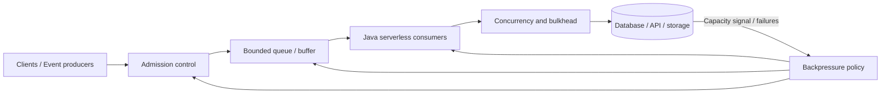
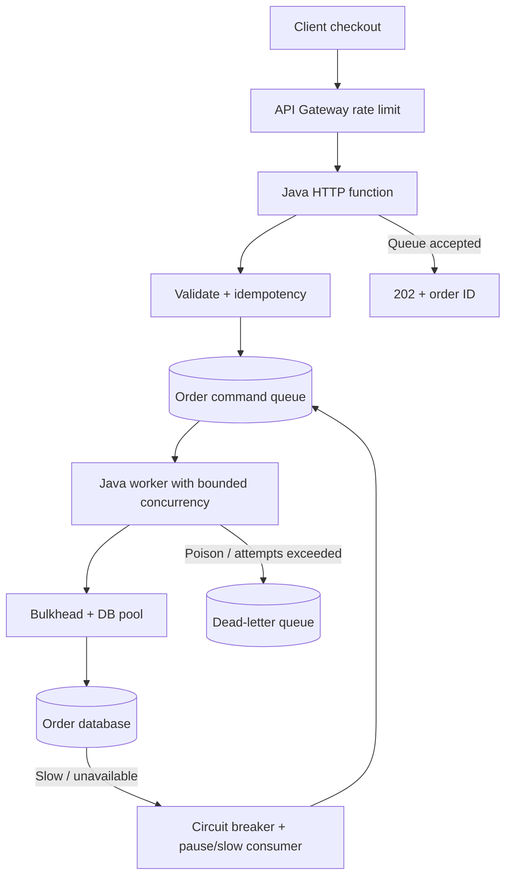

# Applying backpressure to protect downstream systems

Serverless can spin up additional function instances when request or event volume rises. This scaling capability helps applications absorb burst traffic, but it can also push load onto databases, partner APIs, caches, or message brokers faster than they can process it. A Java function may keep running fine while the database connection pool is exhausted, downstreams start returning 429/503, and retries amplify request volume even further.

**Backpressure** is the practice of regulating the rate of incoming work into a component according to the actual processing capacity of downstream components. Instead of letting producers send unbounded load and waiting for timeouts, the system creates signals to slow down, queue within bounds, reject early, or deprioritize work. The goal is to keep the system inside a stable operating zone, protect downstream data and resources, and return actionable responses to callers.

This lesson focuses on applying backpressure for Java serverless triggered by HTTP, queues, or events. Core techniques include bounded queues, admission control, rate limits, concurrency limits, bulkheads, timeout budgets, circuit breakers, controlled retries, and load shedding.

## 1. Why does serverless need backpressure?

In traditional server models, process or thread counts often cap work intake. Under overload, the server runs out of workers and naturally rejects or slows requests. Serverless, by contrast, can scale out with demand: a burst causes the platform to spin up many more instances or concurrent invocations.

This creates a problem when downstreams have fixed capacity. For example:

- API Gateway receives 2,000 requests/second.
- The Java function scales up to handle nearly all requests.
- Each invocation opens a database connection or calls a partner API.
- The database can sustain only 300 operations/second or 100 concurrent connections.
- Connection pools begin waiting, requests time out, and functions retry.
- Retries inject more load while the database is weakened, causing the incident to spread.

Function scale-out does not automatically scale the database to match. Backpressure establishes an explicit boundary between intake speed and the rate at which downstreams can complete work.



Backpressure is not just lowering concurrency. It is an end-to-end feedback mechanism: knowing incoming load, knowing capacity, deciding whether to accept/wait/reject, capping active work, and avoiding retrying faster than recovery allows.

## 2. Load model: arrival rate and service rate

To regulate load, distinguish between the rate work arrives and the rate the system completes it.

- **Arrival rate (λ):** number of requests/messages arriving per second.
- **Service rate (μ):** number of work items a consumer or consumer group completes per second.
- **Concurrency (C):** number of invocations/work items processing simultaneously.
- **Service time (S):** average processing time of one work item.
- **Queue depth (Q):** number of work items waiting.

If λ exceeds μ over a sufficiently long interval, the backlog grows. If λ is below μ, the system can work down backlogs, though bursts and memory limits still need to be accounted for.

By Little's Law, in steady state:

\[
L = \lambda W
\]

Where (L) is the average number of work items in the system (both waiting and in-progress), λ is the arrival rate, and (W) is the average time a work item spends in the system.

For a group of workers with maximum concurrency (C) and average service time (S), approximate theoretical throughput is:

\[
\mu \approx \frac{C}{S}
\]

For example, if each invocation processes a request in 200 ms and concurrency is capped at 40 concurrent invocations:

\[
\mu \approx \frac{40}{0.2} = 200\text{ requests/second}
\]

This is only an estimate when workers stay busy and processing time is relatively stable. Databases, API rate limits, networks, batch sizes, and tail latency can push actual throughput lower. Do not configure concurrency right at the theoretical maximum; leave headroom to absorb variance.

### Queue drain time

If a backlog has (Q) messages, consumers process μ messages/second, and producers continue sending λ messages/second, approximate drain time when μ is greater than λ is:

\[
T_{drain} \approx \frac{Q}{\mu - \lambda}
\]

For example, with a backlog of 12,000 messages, consumers processing 500 messages/second, and producers still sending 200 messages/second:

\[
T_{drain} \approx \frac{12,000}{500-200} = 40\text{ seconds}
\]

If μ is less than or equal to λ, the backlog cannot drain on its own. You must safely add consumer capacity, slow down producers, or drop non-essential work.

## 3. Backpressure differs from autoscaling

Autoscaling increases or decreases instances based on load signals. Backpressure controls how much work is accepted and how much work is allowed to execute. Both mechanisms must work together.

| Mechanism | Question addressed | Example |
| --- | --- | --- |
| Autoscaling | How many instances are needed to process load? | Increasing Cloud Run instances or Lambda concurrency |
| Concurrency limit | How many work items may run at the same time? | Limiting to 30 invocations hitting the database |
| Rate limit | How many requests may be accepted per unit of time? | 100 requests/second for a tenant |
| Admission control | Should new work be accepted, rejected, or queued? | Returning 429 when the queue is full |
| Queue buffering | Can producer and consumer be decoupled with a buffer? | HTTP API enqueuing into SQS/Pub/Sub |
| Load shedding | Which work can be dropped or deferred during overload? | Temporarily skipping non-critical cache refreshes |

Autoscaling should not be used to push arbitrary load straight into downstreams. If a database can handle only 200 queries/second, scaling function instances to 1,000 will crash the database faster. Scale consumers up to a safe cap and throttle load beyond capacity.

## 4. Placing backpressure at the right boundaries

An architecture can have multiple throttling points:

1. **Client/producer:** slow down upon receiving 429/503 or Retry-After.
2. **API gateway/edge:** limit requests by IP, API key, tenant, or route.
3. **Queue/broker:** absorb bursts within storage, retention, and quota limits.
4. **Function trigger:** cap batch size, concurrency, or consumer instance count.
5. **Java handler:** use semaphores/bulkheads to protect resource pools within one instance.
6. **Downstream client:** cap connections, request rates, timeouts, and retries.
7. **Database/service:** enforce quotas, connection limits, and workload priorities.

If you only place a semaphore inside the Java function, each instance has its own semaphore. When serverless scales to 50 instances, total requests can still reach 50 times the local limit. Therefore, you need a global cap at the gateway, queue consumer, platform concurrency, or downstream quota; in-process limits serve only as an extra safety layer.

## 5. Using queues as bounded buffers

Queues decouple producers from consumers. Producers can accept requests quickly, persist work durably, and return `202 Accepted`; consumers process at a configured pace.

A common flow:

1. An HTTP function authenticates the request and validates input.
2. The function records job metadata and enqueues a small message containing the job ID/reference.
3. The function returns `202 Accepted` with a status URL.
4. The queue trigger invokes Java workers according to concurrency/batch policies.
5. Workers process data, update status, and emit completion events.
6. Clients poll or receive callbacks when the job finishes.

Avoid putting large files or sensitive payloads directly into messages if you can store them in object storage and pass a reference. Queues need limits on size, retention, visibility/lock timeouts, dead-letter handling, and policies for when backlogs cross thresholds.

### Queues are not infinite memory

Queues absorb bursts, but backlogs still consume storage, increase event age, and can breach retention or SLOs. Set thresholds for:

- Maximum acceptable queue depth based on storage/quotas.
- Maximum oldest message age per business requirements.
- Target producer/consumer rates.
- Message/job retention and TTL.
- DLQ thresholds and poison-message handling procedures.
- Admission control when the backlog grows too large.

When a queue approaches thresholds, producers can be rate-limited, new jobs rejected, or the system switched to a degraded mode. Never let producers keep pushing unboundedly just because the queue API still returns success.

## 6. Admission control for HTTP functions

Admission control decides whether to accept a new request before spending processing resources. If downstreams are overloaded or queues are full, return an informative error so clients can retry later.

Common responses:

- `429 Too Many Requests`: caller exceeded its rate/quota or work limit.
- `503 Service Unavailable`: service is temporarily unable to accept additional load.
- `Retry-After`: hints when the caller should retry.
- `202 Accepted`: asynchronous work accepted for later processing; must return a job ID/status URL.

Never return `200 OK` when a request has not been persisted durably or work has not been accepted. If the API returns `202`, ensure the job has been written to a durable queue/store before sending the response.

### Java example returning 429 when local semaphore is full

```java
import java.util.concurrent.Semaphore;
import java.util.concurrent.TimeUnit;

public final class RequestGate {
    private final Semaphore permits = new Semaphore(20);

    public <T> T execute(java.util.concurrent.Callable<T> work)
            throws Exception {
        if (!permits.tryAcquire()) {
            throw new TooBusyException("Capacity is currently full");
        }
        try {
            return work.call();
        } finally {
            permits.release();
        }
    }

    public static final class TooBusyException extends RuntimeException {
        public TooBusyException(String message) {
            super(message);
        }
    }
}
```

The HTTP adapter can map `TooBusyException` to 429 or 503 and attach `Retry-After` if recovery timing is known. This example caps 20 tasks inside **one process**. It does not establish a global limit across multiple serverless instances and does not replace gateway quotas or platform concurrency.

Do not use long `tryAcquire(timeout)` waits for every request when serverless is already overloaded; holding requests open still consumes invocations, threads, and memory. If work can wait, put it in a durable queue instead of holding an HTTP connection open.

## 7. Rate limiting: capping request intake speed

Rate limits set quotas per unit of time, such as 60 requests/minute per API key or 500 messages/second per tenant. Common algorithms:

- **Fixed window:** counts requests in fixed time windows; easy to implement but susceptible to boundary bursts across adjacent windows.
- **Sliding window:** counts requests over a rolling window; more accurate but requires storing timestamps/counts.
- **Token bucket:** tokens replenish at a steady rate; requests consume tokens, and bucket capacity permits bounded bursts.
- **Leaky bucket:** queues requests and drains at a steady rate; well suited when traffic smoothing is required.

Token bucket example: refill 100 tokens/second, bucket capacity 200. The system permits an initial burst up to 200 requests, then admits an average of 100 additional requests/second under continuous consumption.

### Rate limiting by tenant and operation

A single global limit lets a large tenant consume all capacity. Quotas can be partitioned by:

- Tenant/customer/API key.
- Endpoint or operation type.
- Priority tier (critical, standard, best effort).
- Region or downstream dependency.
- Request cost/weight rather than raw request counts.

For example, exporting a report costs far more resources than a health check; the rate limiter can charge 10 tokens for an export and 1 token for a lightweight query.

### Distributed rate limiting

A static counter inside a Java process is not a global rate limiter because each instance keeps separate state. For system-wide quotas, use an API gateway, Redis/managed cache, distributed rate-limiting service, or platform quota service. Quota state needs proper atomic updates/expirations; if each instance counts locally, scaling out allows aggregate traffic to exceed the intended limit.

## 8. Concurrency limits to protect downstreams

Concurrency limits cap how many invocations/requests run simultaneously. Choose the limit based on the lowest capacity along the path, for example:

- The database has only 120 connections allocated to this workload.
- Each function instance has a max pool of 5 connections.
- Other services already use 40 connections.
- 20 connections must be reserved as headroom for operations and bursts.

Roughly 60 connections remain for the function; with 5 connections per instance, you can start testing at a max of roughly 12 instances, then re-measure under real load. This is an illustrative calculation; connection pools are not always 100% occupied, and queries hold connections for varying durations.

Limits to coordinate:

1. Platform maximum function concurrency/instances.
2. Trigger-specific maximum concurrency or consumer count.
3. Intra-instance concurrency (HTTP server/thread pool/semaphore).
4. Connection pools and rate limits of each dependency.

Set the lowest limit sufficient to protect downstreams, then raise gradually via load testing. If a function calls multiple dependencies, you may need separate bulkheads per dependency so one slow API does not tie up all workers.

## 9. Bulkheads: isolating resources per dependency

Bulkheads partition resources into independent compartments. Suppose a Java function calls two services: inventory and recommendation. If both share a single unbounded executor, slow recommendations can exhaust all threads and stall inventory requests.

You can set separate limits:

- Max 20 concurrent calls to inventory.
- Max 5 concurrent calls to recommendation.
- 300 ms timeout for recommendation, 800 ms for inventory.
- Dedicated workers/connections for critical operations.

Resilience4j Bulkhead example:

```java
import io.github.resilience4j.bulkhead.Bulkhead;
import io.github.resilience4j.bulkhead.BulkheadConfig;
import java.time.Duration;

public final class InventoryGateway {
    private final Bulkhead bulkhead = Bulkhead.of(
            "inventory",
            BulkheadConfig.custom()
                    .maxConcurrentCalls(20)
                    .maxWaitDuration(Duration.ZERO)
                    .build());

    public Inventory get(String sku) {
        return bulkhead.executeSupplier(() -> callInventoryApi(sku));
    }

    private Inventory callInventoryApi(String sku) {
        // Call HTTP client configured with timeout.
        return new Inventory(sku, 0);
    }

    public record Inventory(String sku, int available) {}
}
```

This bulkhead caps concurrency inside one JVM. Across multiple instances, total calls still equal the local limit multiplied by instance count. Pair it with platform max instances or a global dependency quota.

Do not create an unbounded executor queue to "hold" work when the bulkhead is full. If work cannot be processed immediately, reject cleanly or enqueue to a durable broker.

## 10. Timeout budgets and deadline propagation

Timeouts free resources when downstreams stop responding. However, timeouts across layers must align with one another.

Example HTTP request with a 2-second total deadline:

| Component | Illustrative time budget |
| --- | ---: |
| Gateway/authentication | 150 ms |
| Java handler logic | 200 ms |
| Database call | 700 ms |
| External API | 500 ms |
| Serialization/network margin | 250 ms |
| Total | 1,800 ms |

The remainder provides headroom for variance. Never set a 5-second database timeout inside a 2-second request timeout; the client may disconnect before the database call even finishes.

Propagate deadlines or remaining timeouts across services. Each downstream call may spend only the remaining budget. For queue workers, deadlines rely on visibility timeout/message locks and function timeouts; allow enough time to finish, renew locks if supported, or let messages retry safely.

### Timeouts do not automatically cancel side effects

A client timeout does not prove the server stopped executing. A payment request may have already succeeded at the provider while the response was lost. Retries need idempotency keys and result state checks to avoid double-charging.

## 11. Circuit breakers: stopping calls to failing dependencies

A circuit breaker tracks dependency errors/timeouts and temporarily stops sending requests when the dependency looks unhealthy. Three standard states:

- **Closed:** requests flow through; failures are recorded.
- **Open:** failure threshold breached; requests fail fast during a wait window.
- **Half-open:** allows a few probe requests; if they succeed, close the circuit; if they fail, open it again.

Circuit breakers prevent functions from piling load onto an already failing database or API. Pair them with suitable fallbacks, such as returning cached data, enqueuing jobs, or returning 503. Never fall back to fabricated data for critical write operations.

Resilience4j example:

```java
import io.github.resilience4j.circuitbreaker.CircuitBreaker;
import io.github.resilience4j.circuitbreaker.CircuitBreakerConfig;
import java.time.Duration;

public final class PartnerClient {
    private final CircuitBreaker breaker = CircuitBreaker.of(
            "partner-api",
            CircuitBreakerConfig.custom()
                    .failureRateThreshold(50)
                    .slidingWindowSize(20)
                    .minimumNumberOfCalls(10)
                    .waitDurationInOpenState(Duration.ofSeconds(10))
                    .build());

    public PartnerResult fetch(String id) {
        return breaker.executeSupplier(() -> callPartner(id));
    }

    private PartnerResult callPartner(String id) {
        // HTTP client must have separate connect/read/request timeouts.
        return new PartnerResult(id, "ok");
    }

    public record PartnerResult(String id, String status) {}
}
```

A circuit breaker inside one instance only observes errors in that instance; when serverless scales out, instances may hold different states. This is usually acceptable for local protection. If you need a global circuit/quota, use a gateway or coordination service; do not share mutable circuit state across instances via static variables because each instance runs in its own process.

## 12. Controlled retries and retry budgets

Retries help with transient failures like network resets, throttling, or temporary unavailability. Yet retries are also new traffic. If producers retry fast while functions and SDKs also retry concurrently, a single original request can multiply into many attempts.

Core principles:

- Retry only recoverable errors; do not retry malformed payloads or permanent authorization failures.
- Use exponential backoff and jitter to spread out retry attempts.
- Set maximum attempts and an overall retry deadline.
- Avoid retrying at every layer simultaneously; designate a primary retry owner.
- Use idempotency keys or deduplication for side effects.
- Separate retryable errors from poison messages/DLQs.
- Track retry counts and retry amplification.

One form of backoff:

\[
delay_n = \min(delay_{max}, delay_{base} \times 2^n) + jitter
\]

For example, base delay 200 ms, max delay 5 seconds, plus random jitter. Exact parameters depend on SLAs and platform retry policies.

### Retry budgets

A retry budget caps total retries relative to original traffic or within a time window. For example, allow retries on at most 10% of original requests in a window, or at most 3 attempts per message. Once the budget is exhausted, route failures to a DLQ/quarantine or fail back to the caller to avert a retry storm.

Do not stack retries blindly: if the API client retries 3 times, the function retries 3 times, and the HTTP SDK retries 3 times, theoretical downstream calls can explode. Document the retry owner, attempt limit, and timeout budget at each boundary.

## 13. Load shedding: dropping or deferring non-essential work

When load exceeds capacity, the system can proactively shed low-priority work to protect core capabilities.

Examples:

- Keep payment and order confirmation paths running.
- Defer notification emails, recommendation refreshes, or report generation.
- Disable expensive search endpoints or serve cached results.
- Reject new export requests when the export backlog crosses a threshold.
- Reduce telemetry/debug sampling volume during an incident.

Load shedding must follow business priority, not random dropping. When dropping work, return a clear response to the caller or record state so it can run later. Never silently discard business messages without audit trails or DLQs.

### Graceful degradation

Graceful degradation lowers the fidelity of less critical features while the system is overloaded:

- Serve cached or bounded-stale data for read content.
- Temporarily disable recommendations while still permitting checkout.
- Return a "processing" status for reports instead of holding requests open.
- Accept requests into a queue if backlog and retention remain within bounds.

Never serve stale caches for strongly consistent data such as account balances or payment status unless business rules explicitly allow it.

## 14. Batch size and flow control for event consumers

Large batches reduce per-invocation overhead, but each invocation holds more memory, connections, and execution time. When one record fails, retry behavior may force other records to reprocess. Small batches increase invocation overhead but contain the blast radius.

Choose batch size based on:

- Record size and memory per record.
- Average/p99 processing time.
- Downstream throughput and connection pools.
- Trigger retry/partial batch semantics.
- Visibility timeout/lock duration and function timeout.
- Parallel processing capability per partition/order key.

With partitioned streams, raising consumer concurrency cannot surpass source partition counts or ordering semantics. One hot partition can drive lag up even while other partitions sit idle.

### Backpressure in pull consumers

With pull subscriptions/clients, consumers can usually cap outstanding messages or bytes. When outstanding counts hit the threshold, pause pulling more messages until current ones finish/ack. This provides direct flow control and is far more predictable than pulling unboundedly into memory.

With push subscriptions, the source pushes requests to an endpoint; use autoscaling, concurrency limits, and proper response codes to regulate intake. Understand the source's retry/backoff behavior on endpoint errors so you do not trigger overly aggressive retry loops.

## 15. Protecting databases and connection pools

Databases are typically the most sensitive downstreams because connections, CPU, IOPS, and locks are all bounded.

Measures:

- Cap pool size inside each Java instance.
- Cap total function concurrency or instance count so combined pools stay within the connection budget.
- Use a proxy/pooling service where suitable (e.g., RDS Proxy or managed connection pooling).
- Set connection timeouts, query timeouts, and transaction timeouts.
- Never hold connections while waiting on HTTP APIs or long CPU work.
- Use batches/upserts to cut round-trips where appropriate.
- Use queues to smooth bursts with bounded worker concurrency.
- Separate read/write or heavy workloads onto dedicated pools/roles if needed.
- Monitor active connections, waiting threads, lock waits, slow queries, and transaction age.

A classic mistake is setting pool size to 20 per instance and letting the function scale to 100 instances: potential connections reach 2,000. Pool sizes must be calculated against maximum instances/concurrency, not a single JVM.

## 16. Protecting partner APIs and quota-bound services

If a downstream caps traffic at 100 requests/second, the function must not call it at 500 requests/second simply because serverless can scale. Implement:

- Client or gateway rate limiters matching provider quotas.
- Concurrency caps to avoid excessive waiting requests.
- Honoring HTTP 429 and `Retry-After`.
- Exponential backoff with jitter.
- Caching safe reads and request coalescing where appropriate.
- Routing non-urgent work to queues.
- Tracking quota utilization and 429 error rates.

Do not retry immediately upon receiving 429. If the provider returns `Retry-After`, respect that duration within deadline limits. If a quota is shared across multiple functions, independent local rate limiters can let aggregate traffic exceed the quota; use centralized quota enforcement or partition budgets across consumers.

## 17. Java implementation: local token bucket

The following example illustrates a simple token bucket inside a single JVM. Each request consumes one token; tokens replenish over time:

```java
public final class LocalTokenBucket {
    private final long capacity;
    private final long refillPerSecond;
    private double tokens;
    private long lastRefillNanos;

    public LocalTokenBucket(long capacity, long refillPerSecond) {
        if (capacity <= 0 || refillPerSecond <= 0) {
            throw new IllegalArgumentException("Limits must be positive");
        }
        this.capacity = capacity;
        this.refillPerSecond = refillPerSecond;
        this.tokens = capacity;
        this.lastRefillNanos = System.nanoTime();
    }

    public synchronized boolean tryAcquire() {
        long now = System.nanoTime();
        long elapsed = Math.max(0, now - lastRefillNanos);
        double elapsedSeconds = elapsed / 1_000_000_000.0;
        tokens = Math.min(capacity, tokens + elapsedSeconds * refillPerSecond);
        lastRefillNanos = now;

        if (tokens < 1.0) {
            return false;
        }
        tokens -= 1.0;
        return true;
    }
}
```

This is an educational single-process example, not a production rate-limiting library. Test concurrency, define exact burst/refill semantics, handle clock/lifecycle needs, and consider battle-tested libraries. In serverless, each instance has its own bucket; 10 instances allow an aggregate rate of roughly 10 times `refillPerSecond`. For global quotas, use a gateway or distributed store with atomic operations.

## 18. Java implementation: processing queues with bounded workers

A Java consumer managing its own thread pool needs a bounded queue and an explicit rejection policy. Example:

```java
import java.util.concurrent.ArrayBlockingQueue;
import java.util.concurrent.ThreadPoolExecutor;
import java.util.concurrent.TimeUnit;

public final class BoundedWorkPool implements AutoCloseable {
    private final ThreadPoolExecutor executor = new ThreadPoolExecutor(
            4,
            4,
            0L,
            TimeUnit.MILLISECONDS,
            new ArrayBlockingQueue<>(100),
            new ThreadPoolExecutor.AbortPolicy());

    public void submit(Runnable task) {
        executor.execute(task);
    }

    @Override
    public void close() {
        executor.shutdown();
    }
}
```

When all 4 workers are busy and 100 tasks sit in the queue, the next task is rejected instead of growing memory unboundedly. Adapters must catch `RejectedExecutionException` and respond or nack/requeue messages per contract. Never ACK a message before work is durably persisted or completed; if the function host ends an invocation while background threads remain active, the platform may freeze/terminate the process and lose work.

In FaaS, prefer letting the queue/broker manage buffering and having each invocation process one message/batch to completion. The thread pool shown here fits better in a long-lived Java service/consumer process or a controlled synchronous processing step within an invocation.

## 19. AWS Lambda: concurrency and event source backpressure

AWS Lambda provides several throttling mechanisms:

- **Reserved concurrency:** sets a concurrency limit for a function while reserving that capacity out of the account's shared pool. This protects downstreams from a single function scaling out excessively.
- **Provisioned concurrency:** pre-initializes execution environments to cut cold starts; it is not a rate-limiting tool and carries separate pricing.
- **SQS event source mapping maximum concurrency:** caps consumer concurrency on a mapping to control queue polling speed.
- **Batch size:** records per invocation; balances throughput, memory, and retry blast radius.
- **Event source scaling configuration:** source-level scaling options depending on trigger/mapping type.
- **API Gateway throttling:** caps request rates/bursts at the HTTP layer in front of Lambda.

Reserved concurrency and event source mapping maximum concurrency must be planned together. If the sum of mapping maximum concurrencies exceeds reserved concurrency, mappings may be throttled; if reserved concurrency is too high, the database can still be overloaded. Leave capacity for other invocation sources targeting the same function if applicable.

### SQS queues and visibility timeout

When Lambda polls SQS, messages stay invisible during the visibility timeout while being processed. If the function fails to complete successfully, messages can reappear after timeout and be redelivered. Visibility timeout should be long enough to cover function timeout and retry behavior; AWS recommends configuring it appropriately for execution time and event source mapping batch windows.

To protect downstreams:

1. Set event source mapping maximum concurrency according to database/API capacity.
2. Choose suitable batch size and batch window values.
3. Use partial batch responses to retry only failed records when supported by trigger/config.
4. Configure redrive policies and DLQs for poison messages.
5. Monitor `ApproximateAgeOfOldestMessage`, visible/in-flight messages, and Lambda throttles/errors.

### Kinesis and DynamoDB Streams

With streams, partitions/shards and ordering affect concurrency. Monitor iterator age/partition lag. Increase parallelization factor or consumer concurrency only when parallel execution does not break required ordering and downstreams can sustain the load. A hot partition can become a bottleneck; simply adding Lambda instances cannot bypass source limits.

## 20. Azure Functions: host concurrency and trigger controls

Azure Functions can throttle via trigger extensions, host configuration, and hosting plans. Settings in `host.json` depend on trigger type and extension version; for example, Queue Storage uses `batchSize`/`newBatchThreshold`, while Service Bus uses limits on concurrent calls/sessions or batch processing per extension.

Throttling layers:

- **HTTP/API Management:** rate limits/quotas per subscription, client, or route before requests reach the Function App.
- **Queue Storage:** batch size, dequeue/retry policies, and poison queues.
- **Service Bus:** max concurrent calls/sessions, prefetch, and lock renewal per extension/SDK.
- **Event Hubs:** batch size, partition ownership, and checkpoints; handling per-partition lag.
- **Hosting plan:** instance/scale limits per plan and Function App configuration.
- **Downstream:** connection pools, managed database limits, and service quotas.

Skeleton `host.json` example for Queue Storage:

```json
{
  "version": "2.0",
  "extensions": {
    "queues": {
      "batchSize": 8,
      "newBatchThreshold": 4,
      "maxDequeueCount": 5
    }
  }
}
```

These values are examples, not optimal defaults. `batchSize` and `newBatchThreshold` affect concurrent messages processed on a single host; multiple hosts can still scale out. Combine them with hosting plan max scale and database capacity. Check schemas, defaults, and behavior for your specific Functions runtime/extension version.

For HTTP-triggered Functions, enforce rate limits at API Management or gateway layers rather than trying to hold many requests waiting inside the function. For queue/event triggers, monitor backlog, oldest message age, delivery count, DLQs, and host scale.

## 21. Google Cloud Run/Functions: concurrency, instances, and Pub/Sub flow control

Cloud Run services expose per-instance request concurrency and maximum instances settings. Together they bound total concurrent requests:

\[
\text{Max in-flight requests} \approx \text{max instances} \times \text{concurrency per instance}
\]

This is an approximate cap on in-flight requests, not a request rate limit. If request duration drops, the same concurrency delivers higher throughput; if duration rises, backlogs/latency grow.

Cloud Run functions/Functions Framework must also configure concurrency/instances based on function type, generation, and trigger. Do not assume all functions share identical defaults or support the exact same knobs as Cloud Run services; verify runtime/plan settings and resource metrics.

### Pub/Sub subscriber flow control

With pull subscribers, clients can cap outstanding messages and outstanding bytes. Once thresholds are reached, the subscriber pauses pulling new messages until current ones are processed/acked. This creates consumer-side backpressure instead of loading everything into memory.

With push subscriptions, Pub/Sub sends requests to an endpoint and adjusts delivery based on the service's response/flow behavior. Endpoints should process quickly or enqueue work, returning success only after durable persistence. When returning errors, Pub/Sub can redeliver according to retry policies; handlers must be idempotent.

### Cloud Run Jobs

For batch jobs, limit task parallelism to protect databases and partner APIs. Task counts may be large, which does not mean all should run simultaneously. Choose parallelism according to downstream throughput, task size, and target completion time.

## 22. Backpressure for HTTP and async workflows

HTTP and messages/events respond differently:

| Workload type | Backpressure approach |
| --- | --- |
| HTTP synchronous | Gateway rate limits, 429/503, Retry-After, concurrency caps, and short timeouts |
| HTTP asynchronous | Persist job durably, return 202 + status URL, bounded queue consumers |
| Queue consumer | Limit polling/concurrency/batches; keep backlog in broker; controlled DLQ and redrive |
| Event stream | Cap consumer/partition concurrency; track lag/checkpoints; safe batch processing |
| Scheduled job | Prevent overlapping executions; cap parallelism and skip/queue delayed runs per policy |

If an HTTP request must complete within 300 ms while downstreams are slow, returning 503/429 early is far better than holding the request for 20 seconds and timing out. If work can run later, move it to async and expose status to the caller.

## 23. Retry storms and cascading failures

A retry storm occurs when many clients/workers retry together after a failure, creating a new burst right as the dependency tries to recover. One slow dependency can trigger a chain reaction:

1. Slow database drives up function duration.
2. Concurrency rises as invocations hold slots longer.
3. Function hits its concurrency limit and requests get throttled.
4. Clients retry immediately, generating additional requests.
5. Queue messages expire visibility/locks and get redelivered.
6. Multiple attempts execute side effects or tie up connections simultaneously.
7. The database gets even more overloaded and the system loses the ability to self-recover.

To break the loop:

- Cap concurrency and rates to downstream capacity.
- Use timeouts shorter than the overall deadline.
- Retry with backoff/jitter and attempt budgets.
- Open circuit breakers when dependencies fail persistently.
- Route non-urgent work to queues.
- Load shed best-effort operations.
- Retry only failed records when partial batch failure is supported.
- Use idempotency/deduplication to protect side effects.

## 24. Idempotency when using backpressure and retries

Backpressure can reject requests before acceptance; subsequent retries arrive as fresh requests. In async queues, messages can be redelivered when workers time out or ACKs are lost. Therefore, every consumer with side effects must be idempotent.

A common pattern:

1. Producer generates a stable event ID/idempotency key.
2. Consumer stores the key in an inbox/processed-event table with a unique constraint.
3. If the key is already completed, skip duplicate side effects and ACK the message.
4. If not yet processed, claim the key and execute business logic inside an appropriate transaction.
5. Mark as completed only after side effects are durably committed.

Never use the current timestamp or a fresh random UUID on each retry as an idempotency key. For external payments/emails/APIs, pass the idempotency key to the provider if supported.

## 25. Backpressure and multi-tenant fairness

A single tenant can flood requests and consume all function concurrency, slowing down other tenants. Fairness must be designed alongside total capacity.

Options:

- Per-tenant quotas/rate limits.
- Weighted fair queues or separate queues by priority.
- Maximum concurrency cap per tenant.
- Reserved capacity for critical operations.
- Round-robin or weighted scheduling across tenants.
- Admission control by estimated cost rather than raw request count.

Do not let an unauthenticated client-supplied tenant ID dictate quotas. Rate limit keys must rely on authenticated principals/tenants. For queues, validate message attributes and do not trust unsigned/unverified tenant metadata.

## 26. Backpressure for scheduled jobs and workflows

Timers/schedulers can spawn multiple concurrent executions if prior runs have not finished or schedules bunch up after an outage. Implement:

- Maximum concurrency on jobs/workflows.
- Leases/locks or execution keys to prevent duplicate runs when business rules require it.
- Limits on parallel partitions/tasks.
- Checkpoints allowing resumption after failures.
- Catch-up, coalescing, or skip policies based on business rules when schedule backlogs grow.
- Never launch thousands of executions at once when downstreams are not ready.

A job scheduled every minute that takes 10 minutes to run will overlap if the scheduler does not prevent it. Design skip, queue, or coalesce policies rather than merely raising timeouts.

## 27. Observing backpressure: metrics and alerts

To verify backpressure is working properly, monitor incoming load, completed work, and downstream signals.

| Metric | What to observe |
| --- | --- |
| Incoming rate | Requests/events arriving per second |
| Accepted/rejected rate | Work accepted vs. rejected |
| Queue depth | Current backlog |
| Oldest message age | How long the oldest work item has waited |
| Consumer throughput | Messages/records completed per second |
| In-flight/concurrency | Active invocations/tasks |
| Throttle/429/503 | Requests rate-limited or rejected |
| Retry/delivery count | Attempts per event/message |
| DLQ depth | Unprocessable work items |
| Downstream latency/error | Slow or failing databases/APIs |
| Connection pool wait | Threads waiting for connections and pool utilization |
| Circuit state | Dependency closed/open/half-open state |

Alerts should tie to business thresholds:

- Oldest message age breaches SLO.
- Queue depth rises steadily while consumer throughput trails arrival rate.
- Throttles/429s increase across multiple windows.
- Database pool wait or connection utilization hits thresholds.
- Retries and DLQs spike sharply.
- Circuit breakers stay open for an extended period.

High queue depth is not necessarily an incident if consumers drain quickly and age stays low. Conversely, small queue depth with high oldest age can indicate a stuck message or a hot partition.

## 28. Backpressure tuning workflow

1. Measure arrival rate, service time, p95/p99, and downstream throughput under normal load.
2. Identify the true bottleneck: database, API, network, CPU, memory, or quota.
3. Calculate target capacity with headroom; never use maximum capacity as the operating point.
4. Set connection pools and per-instance concurrency.
5. Set function max concurrency/instances or trigger consumer concurrency.
6. Configure queue batch/flow control and backlog/age thresholds.
7. Set admission rate limits, tenant quotas, and 429/503 behavior.
8. Configure timeouts, retry budgets, jitter, and circuit breakers.
9. Load test bursts, sustained overload, and dependency slowdowns.
10. Observe accepted/rejected rates, queue age, downstream saturation, and business outcomes.
11. Tune one knob at a time to isolate its impact.
12. Write runbooks for load shedding, scale caps, and backlog draining.

Do not tune from a single benchmark alone. Use realistic traffic mixes, payload sizes, tenant distributions, retries, and tail latencies. Test while downstreams are slowed or failing to confirm backpressure keeps the system stable.

## 29. Illustrative scenario: protecting a database during order processing

Suppose an API receives 1,000 orders/second during a flash sale. The database can stably process only 250 orders/second. The architecture can:

1. API Gateway caps bursts and enforces per-tenant rate limits.
2. HTTP function validates, persists an idempotency key, and enqueues an order command.
3. API returns 202 with an order ID once the message is durably stored.
4. Queue consumer has maximum concurrency calculated from the connection/query budget.
5. Workers use small pools, reasonable batches, and short transactions.
6. When oldest age crosses a threshold, throttle producers or return 429 for new requests.
7. Notifications/analytics go to a separate low-priority queue.
8. When the database errors, circuit breakers open and consumers stop pulling or retry within budget.
9. Poison messages route to a DLQ; never retry endlessly.
10. Dashboards track orders accepted, processed, rejected, backlog, age, DB latency, and DLQs.



In this example, the queue absorbs bursts, but it is not a place for backlogs to grow infinitely. If the database handles only 250 orders/second and the flash sale lasts a long time, you must scale database capacity, reduce business load, or reject excess requests. Backpressure only controls overload; it does not create physical capacity.

## 30. Common mistakes

1. **Relying solely on autoscaling.** Fast-scaling functions can overload downstreams.
2. **Treating unbounded queues as storage.** Backlogs and event age still require bounds.
3. **Limiting concurrency only inside the JVM.** Multiple instances multiply the local limit.
4. **Raising max instances to cut latency without checking the DB.** Can cause connection exhaustion.
5. **Holding HTTP requests open for long waits during overload.** Wastes invocations/threads and propagates timeouts.
6. **Retrying immediately on 429/503.** Triggers retry storms and further weakens dependencies.
7. **Retrying at every layer.** Attempt counts can grow exponentially.
8. **Using circuit breakers without valid fallbacks.** Requests still fail or return corrupt data.
9. **Using unbounded executor queues.** Memory grows until processes hit OOM.
10. **ACKing messages before work is durably persisted.** Work can be lost if the process terminates.
11. **Omitting idempotency.** Retries/redeliveries produce duplicate side effects.
12. **Silently dropping messages when load shedding.** Makes auditing or recovering work impossible.
13. **Rate limiting solely by IP.** NATs/proxies group many users; use authenticated principals/tenants.
14. **Failing to measure oldest message age.** Queues can hold expired work even when depth is small.

## 31. Backpressure implementation checklist

- [ ] Have arrival rates, service rates, durations, and downstream capacities been measured?
- [ ] Are bottlenecks and operating headroom identified for databases/APIs?
- [ ] Is admission control enforced before accepting new requests/work?
- [ ] Does HTTP overload return 429/503/Retry-After per a clear contract?
- [ ] Is long-running work durably persisted with 202/status URL responses?
- [ ] Do queues/brokers have retention, backlog thresholds, oldest-age alerts, and DLQs?
- [ ] Do consumers enforce concurrency caps, batch sizes, and flow control?
- [ ] Are per-instance semaphores/bulkheads paired with global/platform limits?
- [ ] Are connection pools and downstream quotas sized against max instances?
- [ ] Are timeout/deadline propagation and total request time budgets in place?
- [ ] Do retries use exponential backoff, jitter, attempt limits, and retry budgets?
- [ ] Are circuit breakers/fallbacks configured for critical dependencies?
- [ ] Is there a load-shedding/priority policy and a way to recover deferred work?
- [ ] Are consumers idempotent under duplicates/redeliveries?
- [ ] Are metrics tracked for accepted/rejected rates, queue depth/age, throughput, throttles, retries, and downstream saturation?
- [ ] Have bursts, sustained overload, dependency slowdowns, and recovery been load tested?
- [ ] Are runbooks ready to slow producers, adjust consumers, and drain backlogs?

Backpressure protects downstream systems by regulating accepted and running work to match real capacity. In Java serverless, combine gateway rate limits, bounded queues, trigger concurrency, bulkheads/connection pools, timeouts, circuit breakers, and retry budgets. Autoscaling adds workers when downstreams have spare capacity; backpressure prevents scale-out from turning a slow dependency into a system-wide outage. By tracking arrival rate, completion rate, backlog age, and downstream saturation together, engineering teams can keep systems stable even during sudden traffic spikes.

## Official references

- [AWS Lambda – Managing concurrency](https://docs.aws.amazon.com/lambda/latest/dg/lambda-concurrency.html)
- [AWS Lambda – Configuring maximum concurrency for SQS event source mappings](https://docs.aws.amazon.com/lambda/latest/dg/services-sqs-scaling.html)
- [AWS Lambda – Using Lambda with Amazon SQS](https://docs.aws.amazon.com/lambda/latest/dg/with-sqs.html)
- [Amazon SQS – Visibility timeout](https://docs.aws.amazon.com/AWSSimpleQueueService/latest/SQSDeveloperGuide/sqs-visibility-timeout.html)
- [Azure Functions – Concurrency](https://learn.microsoft.com/azure/azure-functions/functions-concurrency)
- [Azure Functions – host.json reference](https://learn.microsoft.com/azure/azure-functions/functions-host-json)
- [Azure Service Bus – Message transfers, locks and settlement](https://learn.microsoft.com/azure/service-bus-messaging/message-transfers-locks-settlement)
- [Google Cloud Run – Concurrency](https://cloud.google.com/run/docs/about-concurrency)
- [Google Cloud Run – Maximum instances](https://cloud.google.com/run/docs/configuring/max-instances)
- [Google Cloud Pub/Sub – Subscriber flow control](https://cloud.google.com/pubsub/docs/flow-control)
- [Resilience4j – Bulkhead](https://resilience4j.readme.io/docs/bulkhead)
- [Resilience4j – Circuit breaker](https://resilience4j.readme.io/docs/circuitbreaker)
