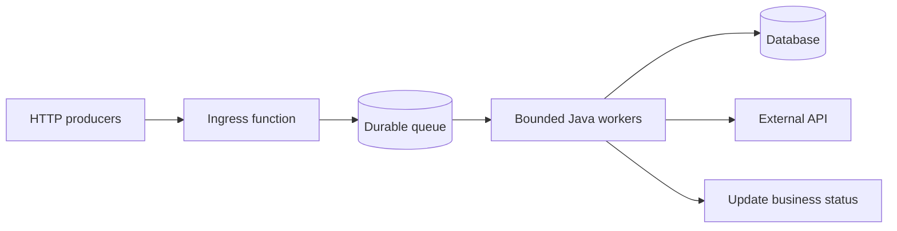
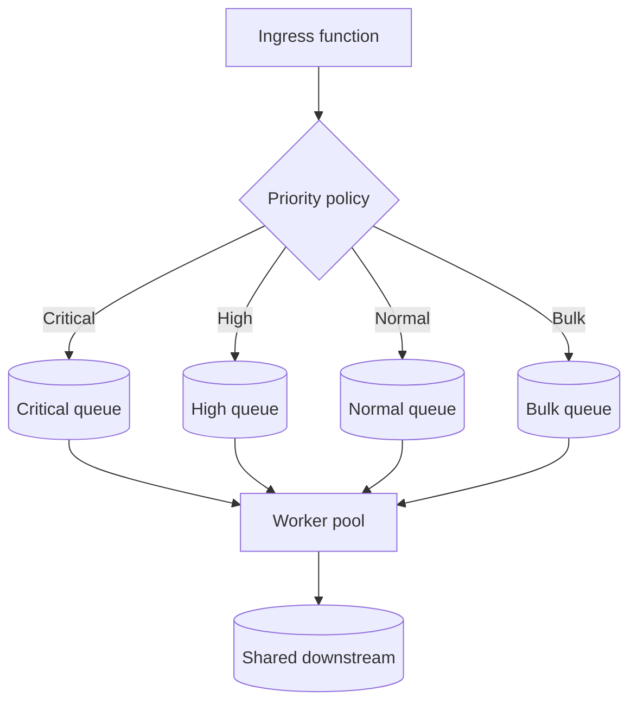

# Load leveling with queues and priority policies

Serverless can automatically spin up additional function instances when load rises, yet autoscaling does not give databases, payment APIs, or external services infinite capacity. When many requests arrive at once, if functions call dependencies directly, a brief traffic spike can open thousands of connections, exhaust connection pools, or breach downstream quotas. Queues decouple work intake speed from processing speed, absorb bursts, and allow throttling workers to match actual capacity.

Load leveling is the practice of smoothing load: producers accept work quickly and write messages to a durable queue, while consumers process them at a controlled pace. Priority policies decide which work runs first when capacity is constrained. Simply adding a queue without managing backlogs, deadlines, fairness, and retries still leaves the system vulnerable to congestion or starving a subset of work.

Within **CLOUD_SERVERLESS**, this lesson focuses on developing and deploying serverless applications—specifically Java functions triggered by HTTP, messages, or events. Learners handle triggers, state, access control, retries, idempotency, cold starts, scaling, and cost. This lesson shows how to use queues for load leveling and apply priority policies that satisfy SLAs while protecting dependencies.

## 1. What problem does load leveling solve?

Suppose an API receives 2,000 requests in 10 seconds, while downstreams can safely process only 80 jobs per second. If an HTTP function synchronously calls a database or payment provider on every request, a burst can breach connection limits and drive up timeouts. If the function simply validates, persists the job to a queue, and returns `202 Accepted`, workers can drain the work steadily within capacity.



The queue introduces an asynchronous boundary between ingress and workers. Producers do not wait for the entire business workflow to complete; workers can scale with the backlog while remaining bounded by concurrency, max instances, and dependency capacity.

Load leveling helps when:

- Traffic arrives in bursts or has scheduled surges.
- Work can run asynchronously and callers accept waiting for results.
- Downstreams have lower quotas or connection limits than request intake capacity.
- Retries are needed for transient dependency failures.
- Work must be persisted for later processing if functions are temporarily unavailable.
- Multiple job types have distinct SLAs and require priority policies.

Queues are unsuitable when every operation must return an immediate synchronous result or when business logic demands a single atomic transaction spanning the HTTP request and downstream dependency. In those cases, redesign the API contract or use synchronous processing with timeouts, bulkheads, and admission control.

## 2. Queues smooth load; they do not create capacity

Queues hold work while consumers have not yet processed it. They do not increase actual processing speed. If message arrival rates stay higher than processing rates, backlogs grow until they hit retention, storage limits, deadlines, or budgets.

Notation:

- `λ`: message arrival rate, in messages/second.
- `μ`: processing rate of a single worker, in messages/second.
- `c`: number of workers or invocations processing concurrently.
- `C = c × μ`: estimated total processing capacity.
- `B`: number of waiting messages.

To prevent unbounded backlog growth in steady state, we need:

\[
\lambda < c \times \mu
\]

If `λ` exceeds capacity over an interval, the backlog grows roughly by the gap between arrival and processing rates. Once the burst ends, consumers need spare capacity to drain the backlog.

Example: 10 workers averaging 8 messages/second each provide a theoretical total capacity of 80 messages/second. If producers send 200 messages/second for 30 seconds, the backlog grows by roughly 3,600 messages during the burst, before accounting for overhead, retries, and processing-time variance.

Do not design for continuous 100% capacity utilization. Leave headroom for slow requests, retries, cold starts, deployment rollouts, and uneven traffic. Headroom levels must be determined through load testing and system SLOs.

## 3. Using Little's Law to estimate delay

Little's Law relates the average number of items in a system, arrival rate, and average residence time:

\[
L = \lambda \times W
\]

Where `L` is the average work items in the system, `λ` is average throughput, and `W` is average time in the system. For a queue alone, it applies to waiting message count and wait time when measured over the same scope.

For example, if the system processes 50 messages/second and averages 500 waiting messages, estimated average wait time is 10 seconds. This is an average estimate; p95/p99 can be significantly higher when processing durations vary widely or priority tiers exist.

To forecast backlog drain time once traffic returns to normal:

\[
T_{drain} \approx \frac{B}{C - \lambda}
\]

This formula applies only when `C > λ`, capacity and arrival rate are relatively stable, and retries or poison messages are excluded. If arrival rate equals or exceeds capacity, the backlog will not shrink on its own.

## 4. Designing ingress functions for asynchronous responses

An ingress function should authenticate the request, check authorization, validate the payload, generate a business ID/idempotency key, persist the message durably, and then return the appropriate status code. Never return `202 Accepted` before the message has been durably written; otherwise, clients may assume work was accepted when the queue has no message.

A typical response:

```http
HTTP/1.1 202 Accepted
Content-Type: application/json
Location: /operations/op-7812

{
  "operationId": "op-7812",
  "status": "QUEUED",
  "statusUrl": "/operations/op-7812"
}
```

Clients can poll the status endpoint, receive a webhook upon completion, or use callbacks per the API contract. The API should clearly document that `202` means work has been accepted, not business completion.

If queue publishing succeeds while writing the status database fails (or vice versa), design for consistency. You can use a transactional outbox: write the business record and outbox event in the same transaction, then relay the outbox to the queue. Consumers still require idempotency because the relay may republish after a timeout.

## 5. Designing message envelopes for load control

Messages should carry enough metadata for workers to process, trace, and decide whether the work is still worth executing.

```json
{
  "messageId": "msg-90017",
  "eventId": "evt-55291",
  "eventType": "OrderSubmitted",
  "schemaVersion": 2,
  "priority": "HIGH",
  "tenantId": "tenant-42",
  "correlationId": "order-7812",
  "idempotencyKey": "order-submitted:order-7812",
  "createdAt": "2026-11-17T09:00:00Z",
  "deadlineAt": "2026-11-17T09:05:00Z",
  "data": {
    "orderId": "order-7812"
  }
}
```

Key fields:

- `messageId` or `eventId`: identifies the message/event for logging, retries, and deduplication.
- `priority`: system-validated priority level.
- `tenantId`: supports per-tenant quotas and fairness.
- `correlationId`: links steps across a business workflow.
- `idempotencyKey`: prevents duplicate execution of side effects.
- `createdAt` and `deadlineAt`: calculates message age and drops expired work per policy.
- `schemaVersion`: lets consumers handle multiple payload versions during rollouts.

Never trust client-supplied priority values directly. Ingress must verify permissions and apply server-side policies; otherwise, clients could tag every job `CRITICAL` to monopolize capacity.

## 6. What is a priority policy?

A priority policy determines processing order or capacity allocation across job classes. Example:

| Level | Example | Processing objective |
|---|---|---|
| Critical | Reversing fraudulent transactions, urgent security events | Process as early as safe limits permit |
| High | Orders needing confirmation before payment expiration | Low latency, dedicated reserve capacity |
| Normal | Standard orders and routine updates | Standard SLA |
| Low / Bulk | Reports, historical syncs, batch jobs | Run on spare capacity or on schedule |

Priority should not be an arbitrary integer. Define a small set of tiers, eligibility rules, SLAs, quotas, and actions when targets cannot be met. Each tier needs a business owner and auditing rules.

## 7. Not every queue service has native priority

Many popular queue services do not provide a priority field where high-priority messages are always dequeued ahead of low-priority ones. Typical implementations use separate queues/topics or a scheduler in front of consumers.

| Service | Common priority representation | Notes |
|---|---|---|
| Amazon SQS | Multiple queues like `critical`, `high`, `normal`, `bulk` | SQS has no native priority field to sort messages across levels; Standard does not guarantee strict ordering |
| Azure Service Bus | Multiple queues or subscriptions per priority tier | No global priority ordering across all messages in one queue; Sessions provide per-session ordering, not priority |
| Google Cloud Tasks | Multiple queues with separate dispatch rates/concurrency | Queues can regulate dispatch; a single queue should not be treated as a native priority scheduler |
| Google Cloud Pub/Sub | Multiple topics/subscriptions or a consumer scheduler | Ordering keys preserve order per key; they do not provide global priority |
| Event Hubs/Kafka-like streams | Separate topics/streams or consumer-side schedulers | Partitions and offsets govern order; there is no global priority queue |
| RabbitMQ | Priority queues via broker config such as `x-max-priority` if supported | Weigh fairness, head-of-line behavior, and broker cost |

When using multiple queues, workers need a queue-selection policy. When using multiple separate function triggers, each mapping can have its own concurrency cap; sum total concurrency so you do not exceed the downstream budget.

## 8. Multi-queue architecture by priority tier

An operationally straightforward design classifies messages at ingress and routes them to the corresponding queue:



There are two consumption approaches:

1. **Dedicated worker pools:** each queue has its own function/workers and its own concurrency cap. This cleanly isolates SLAs and capacity, though it can leave capacity idle or complicate resource sharing.
2. **Shared worker pool:** a dispatcher pulls messages from multiple queues according to a priority schedule. This improves worker utilization, but the scheduler must handle fairness, polling, and backpressure.

You can combine both: dedicate a slice of workers to Critical/High and share the rest across Normal/Bulk. This protects urgent tasks while keeping capacity available for routine work.

## 9. Strict priority can cause starvation

Strict priority always drains higher-tier messages until that queue is empty. If High continuously receives new messages, Normal and Bulk may never get processed. This is starvation.

Example:

```text
High:    H1 H2 H3 H4 H5 H6 H7 ... (continuously receiving new messages)
Normal:  N1 N2 N3
Bulk:    B1 B2

Strict priority: H1 H2 H3 H4 H5 H6 ...
                 N1 and B1 may wait indefinitely
```

Strict priority is appropriate only when lower-tier work can be deferred indefinitely or high-priority traffic has a hard cap. In most systems, pair priority with fairness, aging, or quotas to ensure normal work still makes progress.

## 10. Weighted fair scheduling

Weighted scheduling allocates processing turns by weight. For example, a cycle of 5 High messages, 3 Normal, and 1 Bulk:

```text
High, High, High, High, High,
Normal, Normal, Normal,
Bulk
```

If any queue is empty, the scheduler skips that turn and moves to the next queue. Weights are a capacity policy, not an absolute SLA guarantee; measure latency and adjust based on workload behavior.

Java example illustrating a simple scheduler:

```java
enum Priority {
    HIGH, NORMAL, BULK
}

interface MessageSource {
    Optional<Message> poll(Priority priority);
}

final class WeightedPriorityPoller {
    private static final List<Priority> CYCLE = List.of(
            Priority.HIGH, Priority.HIGH, Priority.HIGH,
            Priority.HIGH, Priority.HIGH,
            Priority.NORMAL, Priority.NORMAL, Priority.NORMAL,
            Priority.BULK);

    private final MessageSource source;
    private int cursor;

    WeightedPriorityPoller(MessageSource source) {
        this.source = source;
    }

    Optional<Message> next() {
        for (int attempt = 0; attempt < CYCLE.size(); attempt++) {
            Priority priority = CYCLE.get(cursor);
            cursor = (cursor + 1) % CYCLE.size();

            Optional<Message> message = source.poll(priority);
            if (message.isPresent()) {
                return message;
            }
        }
        return Optional.empty();
    }
}
```

This illustrates the algorithm inside a single-process dispatcher. When running many function instances in parallel, each instance maintains its own cursor, so global ratios become approximate. If exact global quotas are needed, the scheduler must share state or allocate capacity per queue at the platform layer. Polling multiple queues also requires bounding request rates, timeouts, and API costs.

## 11. Priority aging to prevent starvation

Aging raises effective priority as a message waits longer. A Bulk message might be promoted to Normal after 10 minutes and High after 30 minutes, depending on policy.

Example rules:

| Initial priority | Wait time | Effective priority |
|---|---:|---|
| Bulk | Under 10 minutes | Bulk |
| Bulk | 10+ minutes | Normal |
| Bulk | 30+ minutes | High |
| Normal | 20+ minutes | High |

You do not necessarily need to mutate the message's priority field. The scheduler can compute effective priority from `createdAt` and message age. When using separate queues, a promotion job can move or republish messages to a higher queue, though that operation requires idempotency to avoid a message existing simultaneously in two queues.

Aging needs an upper bound so old jobs cannot automatically monopolize total capacity. For work past its deadline, policy may transition it to expired/cancelled instead of promoting its priority further.

## 12. Fairness across tenants and customer groups

Priority is not a fairness policy. If one large tenant sends many High messages, smaller tenants can still be delayed even though all carry the same priority tier.

Mechanisms include:

- Dedicated queues or partitions for large tenants.
- Per-tenant token buckets or rate limits.
- Weighted fair shares across tenants.
- Maximum in-flight messages per tenant.
- Quotas by business operation type or subscription tier.
- Admission control when a tenant exceeds limits.

Avoid creating a separate queue for every tenant if tenant counts are large and hard to manage. You can use a shared queue with a tenant-keyed scheduler, or isolate only heavy/sensitive tenants onto dedicated queues.

## 13. Deadlines and useful lifetime of messages

Not every message remains valuable when processed late. For example, OTPs, instant quotes, or inventory holds may expire after a few minutes. Historical reports can wait much longer.

Workers should check `deadlineAt` before executing side effects:

```java
public ProcessingResult process(MessageEnvelope message, Clock clock) {
    if (message.deadlineAt() != null
            && clock.instant().isAfter(message.deadlineAt())) {
        return ProcessingResult.expired(message.messageId());
    }

    return orderService.process(message.data());
}
```

If a message has expired, record `EXPIRED` or `CANCELLED` status rather than silently dropping it. Some workflows require compensation or notifying the caller. Inject `Clock` for deterministic time testing.

Deadlines are not the same as queue retention. Retention governs how long the broker stores a message; deadline is the point after which business logic no longer wants the work executed. A message can remain within retention while already expired.

## 14. Admission control at producers

Queues can absorb bursts, but they should not accept unbounded work. Ingress should verify:

- Whether queue backlog or oldest message age is breaching thresholds.
- Whether the tenant has exceeded quota.
- Whether the job's deadline leaves enough time to feasibly complete.
- Whether downstreams are degraded or have open circuit breakers.
- Whether the job type can be degraded, deferred, or rejected.

During overload, return `429 Too Many Requests` or `503 Service Unavailable` with `Retry-After` if callers can retry. For requests written to the queue, return `202` and an operation ID. Never return `202` and then silently drop the message because the queue filled or the deadline became unfeasible.

Admission control should prefer rejecting low-priority or deferrable work before impacting critical transactions. Every rejection decision needs metrics and reason codes so dashboards reflect business impact.

## 15. Backpressure and worker concurrency limits

Worker concurrency must be grounded in dependency capacity, not merely the platform's ability to scale.

For example, a database accepts at most 300 connections for this workload. If each Java function instance has a max pool of 10 connections and the platform scales to 50 instances, total connections can reach 500, exceeding the budget. You may need to:

- Shrink pool size or max instances.
- Set lower concurrency if each invocation holds connections long.
- Use an appropriate database proxy/pooling layer.
- Split queues by workload to cap workers.
- Use semaphores/distributed rate limiters if global quotas are needed.
- Scale database capacity only after evaluating cost and real limits.

Backpressure is the signal telling producers/consumers to slow down when downstreams fall behind. With queues, the backlog serves as a buffer; with HTTP, backpressure can be 429/503; with streams, it can be flow control or reducing fetch record counts.

## 16. Batch size and processing speed

Batching cuts invocation and API call overhead, but large batches increase memory usage, processing duration, and retry blast radius. If a batch of 100 messages has one failing record, retry behavior depends on the service and partial batch response configuration.

When choosing batch size, weigh:

- Processing time per record and overall invocation timeout.
- Memory needed for payloads and intermediate results.
- Support for partial failure handling.
- Maximum latency tolerated by each priority tier.
- Message sizes and service payload limits.
- Idempotency when batches are redelivered.

Large batches work well for bulk processing, though they may suit Critical/High tiers poorly when low latency is needed. You can use smaller batch sizes for high-priority queues and larger batches for bulk queues.

## 17. Retries, visibility timeouts, locks, and dead-letter queues

Retries handle transient errors, but retrying too fast or endlessly can trigger retry storms and inflate backlogs. Implement exponential backoff, jitter, delivery caps, and DLQs/quarantines.

Concepts vary across services:

- **Visibility timeout** (e.g., SQS): a message being processed by one consumer stays temporarily invisible to others. If the timeout is too short, the message may be redelivered while still in flight.
- **Lock duration** (e.g., Service Bus): consumer holds a lock during processing; long tasks may need lock renewal.
- **Ack deadline** (e.g., Pub/Sub): window a consumer has to acknowledge; clients can extend it per configuration.
- **Checkpoint/offset** (e.g., Event Hubs/Kafka): processed position in a stream, not equivalent to per-message queue acks.
- **DLQ:** quarantine for messages exceeding retry/delivery policies for investigation or controlled redrive.

Do not apply a single timeout across every provider. Configure based on p99 processing duration, batch windows, lock-renewal capability, and service-specific guidance. Workers must remain idempotent because duplicate deliveries can still occur.

## 18. Implementing priority with AWS SQS and Lambda

SQS lacks native priority ordering across messages. A common pattern creates multiple queues—such as `orders-critical`, `orders-normal`, and `orders-bulk`—and attaches a separate event source mapping to each.

Lambda event source mappings can cap maximum concurrency per mapping. Functions also have reserved concurrency to protect total concurrency and dependencies. When pointing multiple mappings at one function, sum their caps and ensure reserved concurrency covers expected aggregate load.

Conceptual AWS CLI configuration example:

```bash
aws lambda create-event-source-mapping \
  --function-name orders-worker \
  --event-source-arn arn:aws:sqs:REGION:ACCOUNT:orders-critical \
  --batch-size 5 \
  --scaling-config MaximumConcurrency=20
```

This example targets a Standard queue; with FIFO queues, batch and concurrency limits must consider message groups. ARNs and queue names are placeholders. Verify API/region support for scaling configs on your event source mapping.

Set distinct caps—for example, Critical max 20 concurrent batches, Normal max 10, and Bulk max 2. These numbers are illustrative only; total concurrency must align with reserved concurrency, account quotas, and downstream budgets.

When processing SQS events, Lambda treats batches as successful per event source mapping semantics. When using partial batch responses, the function must return `batchItemFailures` accurately so only failed records retry; otherwise, the whole batch may be redelivered depending on configuration.

## 19. Implementing priority with Google Cloud Tasks and Pub/Sub

Cloud Tasks fits HTTP task dispatching that requires per-queue rate limits and concurrent dispatch limits. You can create multiple queues with different settings for `critical`, `normal`, and `bulk`, pointing to the same or separate HTTP worker endpoints.

Pub/Sub fits event/messaging fan-out and independent subscriptions. For priority, separate topics/subscriptions by tier or use consumer-side schedulers. Ordering keys preserve order per key where supported; they do not turn a subscription into a global priority queue.

For Cloud Run/Cloud Run functions receiving HTTP tasks, verify authentication between Cloud Tasks and the endpoint, concurrency/instance limits, retry policies, and deadlines. Cloud Tasks queue rate limits form one layer of backpressure; Cloud Run max instances still need bounding to match downstream capacity.

## 20. Implementing priority with Azure Service Bus

Azure Service Bus queues/topic subscriptions provide message locks, delivery counts, dead-lettering, and sessions depending on tier/configuration. Do not assume a message with a priority property will automatically be dequeued first by the broker.

One implementation pattern uses multiple queues or subscriptions by priority tier, then configures distinct processor concurrency. With the Java SDK/processor, settings like `maxConcurrentCalls`, prefetch, and lock renewal affect throughput and downstream load.

Sessions enable ordered processing by group, though session ordering can let one slow session stall subsequent messages in that same session. Do not use sessions as a priority mechanism. When both priority and ordering are needed, define partition/session keys, queue tiers, and schedulers explicitly.

## 21. Event Hubs and streams are not priority queues

Event Hubs/Kafka-like streams are organized by partitions and offsets. Consumers read events sequentially within a partition; boosting priority for an event mid-stream can break ordering and replay semantics.

If business requirements call for priority, you can:

- Separate workloads with different SLAs into distinct event hubs/topics/streams.
- Use a routing service before writing to streams.
- Handle urgent events via a dedicated queue while keeping streams for analytics/bulk events.
- Use consumer-side schedulers if reordering is acceptable.

Splitting streams increases cost and consumer group/checkpoint complexity. Keep events with mandatory business ordering on the same partition key, and never let priority policies invert the order of a single aggregate.

## 22. Controlling retries and priority during downstream incidents

When a payment provider or database fails, queues can quickly fill with retries. If High retries occupy every worker, Normal/Bulk can starve. Conversely, if all queues retry simultaneously when the dependency recovers, the system can trigger a second burst.

Measures:

- Exponential backoff and jitter.
- Maximum delivery/retry counts.
- Circuit breakers or pausing consumers during prolonged dependency outages.
- Separate retry queues or delay queues for transient errors.
- DLQs for messages unprocessable after policy limits.
- Controlled redrive in small batches with rate limits.
- Preserving original priority while capping concurrent retries.
- Separating permanent data errors from transient infrastructure errors.

Never automatically promote every retried message to Critical. Doing so turns a dependency error into a mechanism that consumes the entire system's capacity.

## 23. Idempotency during worker scale-out and replays

Multiple workers can receive the same message due to visibility timeouts, lock expirations, retries, or consumer restarts. Idempotency state must reside in a durable store.

A processing pattern:

```java
public final class OrderMessageHandler {
    private final IdempotencyRepository idempotency;
    private final OrderService orders;

    public ProcessingResult handle(OrderMessage message) {
        return idempotency.executeOnce(
                message.idempotencyKey(),
                () -> orders.process(message.orderId()));
    }
}
```

`executeOnce` must be implemented using conditional inserts/unique constraints or transactions in a shared store. Never use `synchronized`, a `static Set`, or single-instance memory as a system-wide idempotency lock.

When side effects happen in external APIs, pass idempotency keys to providers if supported. Otherwise, use outboxes, reconciliation, or saga compensation to handle timeouts after the provider succeeded before the worker received a response.

## 24. Monitoring backlogs and setting operational thresholds

Queue depth is useful but insufficient on its own. Monitor:

- Visible message count/backlog per priority tier.
- Age of oldest message and p95 queue wait time.
- Arrival rate and completion rate.
- Retry counts, in-flight/locked counts, and DLQ rates.
- Worker concurrency, throttling, and invocation duration.
- Downstream latency, error rates, and connection pool wait.
- Estimated backlog drain time.

Alert thresholds should align with SLAs. For example, if High must start processing within 30 seconds, alert when High oldest message age exceeds 20 seconds. Bulk may tolerate several hours, yet alerts should fire before retention or deadlines are hit.

Do not apply the same absolute backlog threshold to every queue. A Bulk queue holding millions of messages may be healthy if drain rate is high enough; a Critical queue with only 20 messages can already be an incident if oldest age breaches SLA.

## 25. Dashboards and alerts for load leveling

A load-leveling dashboard should include per-tier panels:

| Panel | Metrics | Question |
|---|---|---|
| Arrival vs completion | Messages/sec in and out | Are consumers keeping up with producers? |
| Backlog by priority | Visible message count | Which tier is accumulating? |
| Oldest age by priority | Seconds | Is any SLA close to breaching? |
| Worker capacity | Active concurrency, max concurrency | Are we hitting scale ceilings? |
| Retry/DLQ | Retry rate, delivery count, DLQ arrivals | Are there poison messages or retry storms? |
| Fairness | Completed count/latency by tenant/tier | Is any group starving? |
| Dependency | DB/API latency, throttling, connection count | Are downstreams limiting workers? |
| Cost | Cost per completed message/operation | Is load leveling inflating costs abnormally? |

Alerts should cover oldest age, backlog growth rate, DLQ arrivals, downstream saturation, and starvation indicators. When an alert fires, runbooks should specify whether to throttle producer admission, pause a queue tier, lower concurrency, or safely add capacity.

## 26. Costs and limits of queue-based load leveling

Queues shield downstreams from bursts, yet they introduce request, storage, message retention, polling, logging, and retry costs. Multiple separate queues increase configurations, alarms, permissions, and operational overhead.

Factors to account for:

- Message count and payload size.
- Receive/delete/ack operations and polling frequency.
- Retention duration and peak backlog size.
- Retry/redrive volume and DLQ storage.
- Worker instance counts, durations, and memory/CPU.
- Database/API costs as workers drain.
- Telemetry and audit storage costs.

Avoid storing large payloads inside queues when you can save objects in storage and pass controlled references. However, references must point to immutable objects or specific versions so workers never read altered contents.

Queues also have retention, payload size, throughput, and service/region quota limits. Designs must define behavior when queues fill, service quotas are hit, or brokers become unavailable; never assume queues are infinite buffers.

## 27. Common design mistakes

| Mistake | Consequence | Fix |
|---|---|---|
| Scaling workers unboundedly | Databases/APIs overload | Cap concurrency and max instances per downstream budget |
| Using one queue for all job types | Urgent tasks wait behind bulk backlogs | Split priority tiers or use a scheduler |
| Strict priority without aging | Normal/Bulk suffer starvation | Weighted fair scheduling, aging, or quotas |
| Letting clients set priority | Abuse exhausts High capacity | Validate and assign priority server-side |
| Having no deadlines | Processing work that lost business value | Check deadlines and expired states |
| Retrying endlessly | Backlogs and costs climb | Retry caps, backoff, DLQs, and controlled redrives |
| Missing idempotency | Duplicate side effects on replays | Durable idempotency keys and conditional writes |
| Overly large batches | High latency and large retry blast radius | Size batches by timeout, payload, and partial failure |
| Ignoring oldest age | Queues accumulate SLA breaches undetected | Alert on message age and priority |
| Treating queues as infinite | Retention/quotas hit or costs surge | Capacity planning, admission control, and expiry policies |

## 28. Load-leveling design workflow

1. **Identify async-eligible work:** decide which requests can return `202` and how clients retrieve status.
2. **Measure traffic and service time:** gather arrival rates, burst durations, p50/p95/p99 processing times, and downstream capacities.
3. **Select queue/broker:** evaluate delivery semantics, ordering, retention, payloads, retries, and quotas.
4. **Define priority tiers:** document criteria, SLAs, quotas, and owners.
5. **Select scheduler:** strict priority, weighted, aging, per-tenant fairness, or a hybrid.
6. **Set worker limits:** concurrency, max instances, batch size, and connection pools.
7. **Design retries/idempotency:** backoff, retry caps, DLQs, deduplication, and compensation.
8. **Design admission/deadlines:** reject or expire work when completing within SLA is no longer possible.
9. **Build dashboards/alerts:** backlog, oldest age, arrival/completion, retries, DLQs, fairness, and downstream health.
10. **Load test and run game days:** simulate bursts, dependency outages, poison messages, queue recovery, and priority starvation.

## 29. Production checklist

| Question | Required evidence |
|---|---|
| Are producers decoupled from workers? | Durable queues and asynchronous API contracts |
| Is `202 Accepted` returned only after durable intake? | Confirmed publish/outbox |
| Does capacity exceed long-term arrival rate? | Measured load tests and headroom |
| Do queue backlogs have operational bounds? | Retention, quotas, age thresholds, and admission control |
| Is priority assigned reliably? | Server-side policy, authorization, and audit |
| Are Normal/Bulk protected from starvation? | Weighted scheduling, aging, or reserved capacity |
| Do tenants have fairness/quotas? | Per-tenant rate/in-flight limits |
| Does worker concurrency protect downstreams? | Connection budgets, API quotas, and max instances |
| Is batch size appropriate? | Timeout, memory, partial failure, and latency tests |
| Are retries bounded? | Backoff, jitter, delivery caps, and DLQs |
| Are consumers idempotent? | Durable idempotency keys and duplicate tests |
| Are deadlines handled? | Expired states and policies for stale work |
| Are dashboards segmented by tier? | Backlog, oldest age, throughput, retries, and DLQs |
| Have bursts/outages been rehearsed? | Load test reports and recovery runbooks |
| Are costs controlled? | Cost per completed operation, retention, and worker budgets |

Load leveling lets serverless absorb bursts without forcing dependencies to keep pace with producers. Queues create durable buffers; concurrency, dispatch rates, and batch sizes govern worker speed; priority policies allocate capacity by business value. Production designs must pair fairness, aging, deadlines, admission control, bounded retries, and idempotency. When dashboards track backlogs alongside message age and final outcomes, operations teams can see not just how long queues are, but which work risks breaching SLAs and where to adjust.
