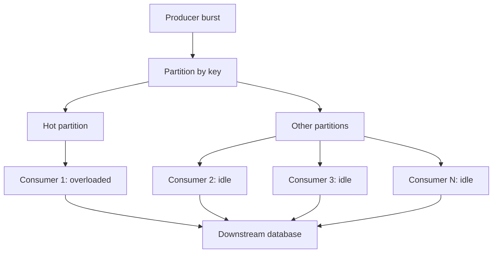
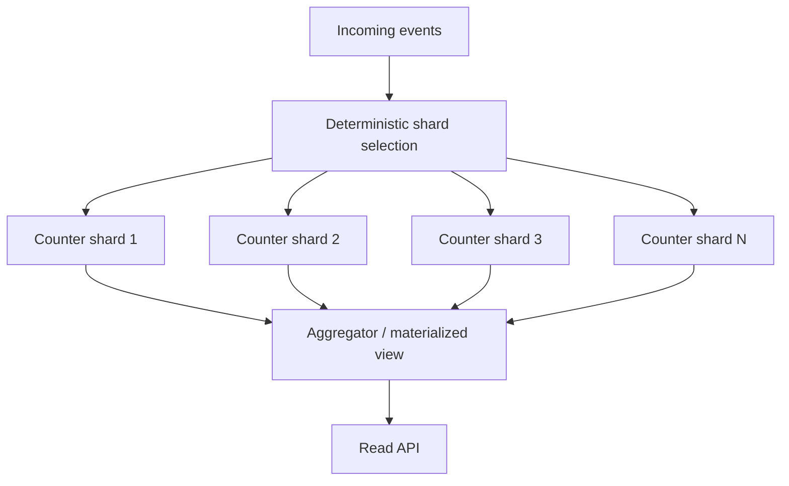

# Preventing hot partitions, hot keys, and load imbalance

Serverless can ramp up function instances very quickly, yet scaling instances does not automatically increase the capacity of every downstream component. If millions of requests hit a single partition, database row, cache key, or message group, the entire system remains bottlenecked by that hotspot. The typical outcome is rising latency, throttling, cascading retries, and higher compute costs with no improvement in business throughput.

A **hot key** is a key receiving disproportionately heavy traffic compared to other keys. A **hot partition** is a physical or logical partition receiving load beyond its serving capacity. **Load imbalance** is uneven load distribution across partitions, shards, queue consumers, or function instances. The three phenomena are related but not identical; pinpoint the exact bottleneck before choosing a remedy.

This lesson explains how to detect and mitigate hotspots in Java serverless systems using databases, caches, queues, streams, and event-driven functions. The focus is on partition key design, sharding/salting, fan-out, concurrency control, backpressure, ordering, and idempotency.

## 1. Hot keys, hot partitions, and load imbalance

### 1.1. What is a partition?

A partition is a slice of data or work split out so multiple nodes/workers can store and process it in parallel. Systems can distribute partitions by hash key, range, tenant, time window, or product-specific rules.

Examples:

- NoSQL databases distribute items by partition key.
- Kafka splits a topic into multiple partitions, each maintaining its own record ordering.
- FIFO queues group messages by message group ID.
- Distributed caches route keys to a node/shard.
- Relational databases can partition tables or indexes by range/hash.
- Worker pools distribute messages or tasks across multiple consumers.

Partitioning enables scaling by dividing load. However, if one partition receives excessive requests, that partition becomes a bottleneck even while other partitions sit idle.

### 1.2. Hot keys

A hot key occurs when a single logical key attracts the majority of traffic. Examples:

- One large tenant generates 70% of events.
- A promotional product is read/written continuously.
- Every homepage view updates the same `homepage:views` counter.
- A single user or device emits telemetry at an unusually high frequency.
- Every function writes to the same database row to increment an order counter.

A hot key can heat up an entire partition if the system routes by key. Even when partitions are well balanced, a single item can still be bottlenecked by item/row-level locks, conditional updates, transactions, or serialization.

### 1.3. Hot partitions

A hot partition occurs when a physical partition receives too many requests, bytes, or write operations. Causes include:

- A hot key hashes onto that partition.
- Many different keys happen to land on the same partition.
- Keys follow a skewed distribution.
- Range partitioning receives consecutive new keys.
- One partition holds data or index entries accessed more frequently than others.

Some databases manage physical partitioning automatically, so applications do not directly see partition IDs. Even so, key skew can still heat up a data range or a subset of storage nodes. Use provider-supported metrics and diagnostics rather than guessing exact physical partitions from key names alone.

### 1.4. Load imbalance

Load imbalance is broader than hot keys. For example, 16 consumers exist, yet one consumer processes 50% of records due to uneven partition assignment; or 10 function instances exhibit varying concurrency due to heterogeneous payload sizes or processing times.

| Phenomenon | Symptoms | Common limits |
| --- | --- | --- |
| Hot key | A few keys account for a large share of requests | Contention on a single item/tenant/entity or lock |
| Hot partition | One partition/shard shows worse throughput or latency | Partition IOPS, throughput, CPU, or network limits |
| Consumer imbalance | One consumer builds high lag while others sit idle | Partition assignment, key distribution, or uneven processing |
| Instance imbalance | Certain function instances take longer to process | Payload skew, cache locality, downstream contention |
| Range/index hotspot | Writes cluster onto the newest key/index range | Page/partition/index contention or sequential inserts |

### 1.5. Why doesn't scale-out fix this automatically?

Suppose a queue has 12 partitions and 12 consumers. If 80% of messages share the same partition key, one consumer handles most of the work while the remaining 11 sit nearly idle. Raising function concurrency to 100 still adds no parallel reads from that partition if the transport allows only one consumer in a consumer group to read a partition at a time.



Scale-out helps only when work can be divided and distributed across independent workers. If all workers contend on one lock or one key, raising concurrency can worsen contention and retries.

## 2. Identifying hotspots with data

### 2.1. Measure distributions instead of averages alone

System-wide average CPU or request rate can hide an overloaded partition. Measure along appropriate dimensions:

- Partition/shard ID where exposed by the platform.
- Tenant, entity type, or key class.
- Queue group/partition/consumer.
- Operation type: read, write, conditional update, transaction.
- Bytes, request counts, throttling, and latency.
- Function version, region, and downstream target.

Track p50/p95/p99, max, error rates, and load distribution. A single partition with sky-high p99 while the cluster average looks low can still cause request timeouts.

### 2.2. Top keys and key frequency

Compute top-N key statistics over a time window to locate keys taking disproportionate load. Avoid putting raw keys into metric labels due to high cardinality and potential data exposure. Use controlled logging, sampling, hashed/anonymized keys, or top-key reporting in a separate analytics system.

Useful indicators:

| Metric | How to read it |
| --- | --- |
| Top key share | Share of traffic hitting the single largest key or top 10 keys |
| Partition traffic ratio | Ratio of the busiest partition's requests/bytes to the average |
| Coefficient of variation | Standard deviation divided by mean across partitions; high values indicate skew |
| Consumer lag by partition | Which partition is accumulating backlog fastest |
| Throttle by key/partition | Pinpoints where capacity or quotas are exceeded |
| Lock wait / row contention | Detects hotspots in relational databases |
| Retry amplification | Average attempts per successful event |

### 2.3. Using an imbalance ratio

A simple measure is:

\[
ImbalanceRatio = \frac{MaxLoadPerPartition}{AverageLoadPerPartition}
\]

If 8 partitions average 1,000 requests/second while the hottest partition receives 6,000 requests/second, the imbalance ratio is 6. This ratio is not a universal SLO; use it to compare before and after changing a key strategy.

You can also measure the coefficient of variation:

\[
CV = \frac{StandardDeviation(PartitionLoad)}{Mean(PartitionLoad)}
\]

A CV near 0 indicates relatively uniform load; a large CV indicates skew. Interpret carefully when the mean is near 0 or partition counts are very small.

### 2.4. Distinguishing hot keys from downstream bottlenecks

If all partitions carry similar load yet database latency is high, the root cause may be database capacity or query plans. If a single key has high frequency while partition metrics stay cool, caching may be absorbing reads. If queue lag climbs on one partition while consumer CPU stays low, partition assignment or ordering may be limiting parallelism.

Trace a request from trigger to dependency:

1. How many events the trigger receives and how they distribute across keys.
2. How the event source mapping distributes records.
3. How function instances/concurrency process them.
4. Which keys are read/written and which transactions contend.
5. Whether downstream throttling/latency correlates with specific keys/partitions.

Do not change partition keys before gathering evidence on where the imbalance sits.

## 3. Designing well-distributed partition keys

### 3.1. Avoid low-cardinality keys

Keys such as `status`, `country`, `eventType`, or a constant typically have low cardinality. If millions of records share only a handful of key values, a few partitions will receive most of the data.

A good key generally has:

- Enough cardinality to spread data across partitions.
- Near-uniform distribution under real workloads.
- Stability for operations requiring the same entity on the same partition.
- Alignment with the application's primary access patterns.
- No single hot item/row even when partitions are evenly distributed.

No single partition key fits every query. Design must start from access patterns, ordering requirements, and actual skew levels.

### 3.2. Avoid raw timestamps as partition keys

If a key is solely the current date or hour, all concurrent new writes land on one partition/range. For example, using `2026-11-17` as the partition key for all telemetry on that day creates a hotspot on today's partition.

Combine with a tenant/entity hash or bucket:

```text
tenant-42#2026-11-17#bucket-07
```

The bucket spreads writes within the same time window. However, querying all data for a day requires reading multiple buckets and merging results.

### 3.3. Composite keys

Composite keys combine multiple components:

```text
<tenant>#<entity>#<time-window>
<region>#<device>#<date>#<bucket>
<account>#<ledger-shard>
```

Choose components based on access patterns. For example, to query all orders for a tenant on a given day, `tenant#date#bucket` may fit well; to preserve per-order aggregate ordering, keying by `orderId` or aggregate ID may matter more.

### 3.4. Hash partitioning

Hashing distributes input keys across multiple buckets. A stable hash ensures the same logical key always maps to the same bucket. Consider:

- Hash function and input encoding.
- Bucket count.
- Algorithm/key format versioning.
- Changing bucket counts when scaling.
- Querying/aggregating across multiple buckets.

Never use `Random` to pick a bucket if you later need to read back the exact bucket for an entity. Randomizing buckets on each write scatters an entity's data so the application cannot locate it.

### 3.5. Do not optimize distribution by breaking ordering

If all events for an order must run sequentially, partitioning by `orderId` is the natural choice. Adding a random salt to the key spreads events out, but destroys ordering for that order.

Before sharding, answer:

- Is strict ordering required?
- Is ordering required globally, per tenant, or per entity?
- Is eventual consistency acceptable?
- Can results be aggregated across multiple shards?
- Is there a single step that must be serialized?

If one entity must execute sequentially, keep a single-writer path for that entity and optimize elsewhere, rather than forcing a dependent sequence across parallel workers.

## 4. Salting and write sharding

### 4.1. What is salting?

Salting appends a bucket component to a partition key so one logical key spreads across multiple physical/logical keys. For example, counter `product-123` is split across 16 shards:

```text
product-123#00
product-123#01
...
product-123#15
```

Each write picks a deterministic shard; reads sum the shard values. Instead of every invocation updating one counter, writes are distributed.

### 4.2. Choosing a stable salt/bucket

You can hash an event ID or request ID to distribute writes:

```text
bucket = hash(eventId) mod bucketCount
key = logicalKey + "#" + bucket
```

Hashing by event ID works when each event is an independent write and all events for an entity do not need to land on the same shard. When per-entity ordering is needed, hash by entity ID so all events for that entity land on the same shard—though a hot entity can still heat up its shard.

Never use low-resolution timestamps as salts because concurrent events fall into the same bucket. Also avoid random salts if you later need to locate an event's shard for deduplication or updates.

### 4.3. Java: deterministic bucketed partition keys

Example using Java's `String.hashCode()` to illustrate deterministic bucketing across JVMs for the same string:

```java
import java.time.LocalDate;

public final class PartitionKeys {
    private PartitionKeys() {}

    public static int bucketFor(String stableId, int bucketCount) {
        if (stableId == null || stableId.isBlank()) {
            throw new IllegalArgumentException("stableId is required");
        }
        if (bucketCount <= 0) {
            throw new IllegalArgumentException("bucketCount must be positive");
        }
        return Math.floorMod(stableId.hashCode(), bucketCount);
    }

    public static String telemetryKey(
            String tenantId,
            String eventId,
            LocalDate eventDate,
            int bucketCount) {

        int bucket = bucketFor(eventId, bucketCount);
        return tenantId + "#" + eventDate + "#b" + bucket;
    }
}
```

In this example, hashing on `eventId` spreads events within a tenant/date. `String.hashCode()` is deterministic per Java's contract, though it is not a cryptographic hash; if input is attacker-controlled and hash flooding is a risk, consider a keyed/seeded hash algorithm and input bounds. For long-lived systems, record `bucketCount` and key format version in metadata; changing bucket count alters the mapping.

### 4.4. Read amplification

Write sharding reduces write contention at the cost of complicating reads. To read a total counter, the application must read all shards and sum them. With 32 shards, 1 logical read triggers 32 physical reads.

Ways to control read amplification:

- Cache aggregates briefly.
- Maintain materialized aggregates asynchronously.
- Query only necessary shards.
- Use batch reads if supported by the database.
- Accept eventual consistency for dashboards/counters.
- Maintain periodic aggregate snapshots.

Avoid write sharding for data requiring an immediate, strongly consistent single value if aggregation/coordination costs outweigh benefits.

### 4.5. Idempotency when writing across multiple shards

Events can be redelivered. If each retry picks a random shard, one event can increment counters across multiple shards. Use a deterministic bucket from the event ID plus a deduplication record/conditional write so each event applies only once.

A transaction can write an inbox/dedup record and update the shard counter atomically if the database supports transactions. Otherwise, design appropriate reconciliation or outbox/inbox patterns; never assume two separate operations are atomic.

## 5. Advanced sharding and changing shard counts

### 5.1. Fixed shard count

A fixed shard count is simple to implement and query. However, as traffic grows, a logical entity may eventually need more shards. Changing `bucketCount` from 16 to 32 maps the same event ID to a different bucket while old data remains in the original 16 buckets.

Do not just change a constant in code and deploy. Version the key schema and plan read/write strategies during the transition.

### 5.2. Versioned sharding

Keys can carry a version prefix:

```text
v1#tenant-42#bucket-03
v2#tenant-42#bucket-19
```

During migration:

1. Readers support both v1 and v2.
2. Writers switch to v2 or dual-write per plan.
3. Backfill historical data if needed.
4. Reconcile totals across versions.
5. Retire v1 once no consumers depend on it.

Dual-writes can introduce duplicates or drift if not idempotent. Use transactions/outboxes or reconciliation to guarantee correctness.

### 5.3. Virtual shards and consistent hashing

Virtual shards create more logical shards than physical nodes. Nodes own multiple virtual shards, enabling load rebalancing when adding/removing nodes without moving every key. Consistent hashing minimizes key remapping when topology changes.

These mechanisms do not solve a single hot key on their own if all requests for that key still hit the same virtual shard. To spread a single hot key, change the data model or split the key into sub-shards.

### 5.4. Hot entities cannot always be split

An account balance requiring sequential updates may be constrained by a single row/aggregate. Splitting a balance across shards forces reads to sum multiple parts and may require transactions/coordination during transfers.

Options:

- Keep a single-writer for the entity while batching multiple commands in one transaction.
- Partition by sub-entity if business domains are independent.
- Use an append-only ledger and aggregate asynchronously.
- Use reservations/escrows to pre-allocate quotas.
- Cache the read path while keeping the write path strongly consistent.
- Rate-limit the hot entity.

Choose based on business invariants. Never sacrifice balance accuracy, ordering, or auditability merely to boost throughput.

## 6. Examples by system type

### 6.1. DynamoDB or key-value databases

Partition keys dictate item placement. If every request uses one partition key such as `GLOBAL_COUNTER`, that partition can run hot. For counters/telemetry, use write sharding and aggregation. For entities queried by ID, pick keys with sufficient cardinality and sort keys matching access patterns.

Hot items can still occur even when a table spans many partitions. Conditional updates on the same item can serialize or get throttled. Adding function instances will not help; reduce update frequency, batch, shard counters, or redesign the data model.

### 6.2. Kafka and stream processing

Kafka routes records to partitions using keys/partitioners. Records with the same key typically land in the same partition to preserve per-partition order. If one key carries most traffic, one partition heats up and the consumer group cannot scale active consumers beyond assigned partitions.

Measures:

- Pick well-distributed keys that still satisfy ordering requirements.
- Increase partition counts when overall parallelism is needed, accounting for key-mapping/order impacts.
- Split hot keys into sub-keys if business logic allows.
- Batch records and optimize consumer processing.
- Monitor bytes-in, records-in, consumer lag, and skew per partition.
- Never assume adding partitions redistributes historical data or restores global order.

Increasing partitions changes mappings for new keys while older records remain in old partitions. When per-entity ordering is mandatory, plan explicit migration/coordination.

### 6.3. FIFO queues and message groups

FIFO queues typically use group IDs to guarantee ordering within a group. If every message uses one group ID, only one processing stream advances at a time per service semantics. Creating multiple groups by entity/tenant increases parallelism while preserving per-group ordering.

Never split a single aggregate's events across multiple group IDs if events depend on order. Set appropriate visibility timeouts, batch sizes, max concurrency, and DLQs; monitor oldest message age and message group backlogs.

### 6.4. Redis/caches

A cache key with heavy read traffic can become a hot key on a single node. Mitigations:

- Short-TTL local in-memory caches for data tolerating brief staleness.
- Replicated caches/read replicas if supported.
- Client-side request coalescing so concurrent misses share one fetch.
- Cache key versioning to stagger refreshes.
- Splitting a large aggregate if read semantics allow.

Local caching eases Redis load but increases memory usage, staleness, and cold-start misses. Synchronized TTL expirations can cause cache stampedes; use jitter and single-flight refreshes.

### 6.5. SQL databases

Hotspots can appear on:

- A single row updated by many transactions.
- An index receiving sequential timestamp/ID inserts.
- A shared counter row.
- Lock escalation or long-running transactions.
- Connection pools overly concentrated on one database.

Mitigations include batch updates, append-only ledgers, table/index partitioning, shortening transactions, optimistic concurrency, read caches, write-model separation, or sharding. For balances/inventory, every change must preserve invariants and transaction semantics.

## 7. Fan-out, aggregation, and read/write trade-offs

### 7.1. Fan-out writes

Fan-out writes split one logical update into multiple independent updates. For example, a view counter writes across 16 shards instead of one row.



Fan-out increases write parallelism but requires an aggregation mechanism. Aggregates can update per event, in micro-batches, or on a schedule. Updating a single aggregate on every single event just creates a new hotspot; use hierarchical aggregation or batch windows instead.

### 7.2. Fan-out reads

When a query must read many shards, fan-out reads increase latency and request volume. Run bounded parallel reads, but never launch futures for thousands of shards simultaneously.

Set concurrency limits, deadlines, partial-result policies, and caching. If queries frequently require all shards, consider materialized views or asynchronously updated read models.

### 7.3. Hierarchical aggregation

Instead of every shard updating one global total, group shards into buckets; each group maintains an intermediate aggregate, and an upper layer aggregates periodically. This reduces contention at the final tier at the cost of higher update lag and operational steps.

### 7.4. Intentional eventual consistency

Counter dashboards, analytics, and telemetry usually tolerate lag of seconds or minutes. Embracing eventual consistency enables distributed writes and batched aggregation. Payments, inventory reservations, or ledger balances, however, may need stronger consistency.

Document explicit freshness SLAs: e.g., dashboards tolerate 10-second lag; balance APIs require transactionally consistent reads. Never force a single sharding strategy across all data classes.

## 8. Load control at producers and APIs

### 8.1. Admission control

Admission control decides which requests enter the system based on current capacity. You can enforce limits by:

- Entire service.
- Tenant/API key.
- Logical entity or hot key.
- Operation type.
- Downstream dependency.
- Region or queue.

Under overload, return retryable responses (such as 429/503 per contract) with `Retry-After` when appropriate. Never accept requests only to let them queue indefinitely in memory.

### 8.2. Per-tenant rate limiting and quotas

One hot tenant can degrade experience for other tenants. Per-tenant quotas protect fairness and contain blast radius. Use token buckets or leaky buckets at the gateway, distributed rate limiters, or queue admission controls.

Rate limits should specify:

- Sustained rate.
- Burst capacity.
- Window/clock semantics.
- Key scope and TTL.
- Behavior when the rate-limit store fails.
- Response/error metrics.

If the rate-limit store itself becomes a global hot key, the load controller becomes the bottleneck. Use sharded counters or dedicated services appropriately, understanding quota accuracy and eventual consistency trade-offs.

### 8.3. Fair scheduling

One large tenant should not monopolize worker capacity when other tenants have SLAs. Fair scheduling can use per-tenant queues, weighted fair queues, per-tenant concurrency caps, or quota-sharing schedulers.

You do not need separate queues for every tenant when tenant counts are huge; use partitioned queues and application-level schedulers. Choose based on tenant count, skew severity, and isolation needs.

### 8.4. Load shedding

Load shedding proactively rejects or defers low-priority work as the system nears overload. Examples:

- Rejecting non-essential requests.
- Lowering telemetry granularity.
- Pausing background recomputations.
- Prioritizing paid/critical traffic per documented policy.
- Serving stale caches instead of calling an overloaded database.

Never shed durably acknowledged requests without tracking state or providing retry/replay paths. For events, ack only after processing or safely persisting elsewhere.

## 9. Backpressure and queue smoothing

### 9.1. Queues buffer load; they do not create infinite capacity

Queues absorb bursts and decouple producer speed from consumers. Yet if producers persistently outpace consumers, backlogs grow indefinitely. Queues delay overload; they do not eliminate it.

Monitor:

- Queue depth/backlog.
- Age of oldest message.
- Enqueue/dequeue rates.
- Processing duration.
- Retry/DLQ rates.
- Consumer concurrency.
- Downstream throttles/latency.

Set maximum backlog or maximum message age aligned with SLAs. When backlogs cross thresholds, throttle producer admission, scale consumers if downstreams allow, or apply business degradation.

### 9.2. Backpressure

Backpressure propagates signals from a slowing downstream back to producers/consumers to slow down. For instance, consumers lower concurrency as database connection pools fill; producers reduce publish rates as queue lag climbs.

Do not rely on CPU alone. Databases can overload while function CPU remains low. Backpressure should respond to actual bottleneck signals such as connection saturation, throttling, latency, and queue age.

### 9.3. Batching and micro-batching

Batching lowers per-message overhead and database/API call counts. Overly large batches raise memory, latency, retry blast radius, and timeout risk. Choose batch sizes based on payload, processing duration, memory budgets, and partial failure semantics.

Micro-batching aggregates multiple events over a short window, fitting counters/analytics well. Define max wait times so freshness SLAs are not breached.

### 9.4. Visibility timeouts and retry budgets

With queues using visibility timeouts, set timeouts longer than expected processing time and aligned with retry policies. Too short, and messages redeliver while previous invocations still run, creating duplicate concurrency. Too long, and recovery after worker crashes slows down.

Define retry budgets, exponential backoff, and jitter. Poison messages need DLQs/failure destinations so they do not block backlogs forever. Idempotency remains mandatory since retries can occur after side effects commit.

## 10. Controlling Java function concurrency

### 10.1. Concurrency must follow downstream budgets

A screening formula:

\[
MaxFunctionConcurrency \leq
\frac{DownstreamSafeCapacity}{ResourcePerInvocation}
\]

For example, if a database safely supports 400 application connections and each invocation may hold 2 connections, theoretical max concurrency is 200—before subtracting admin connections, background jobs, and headroom. Never treat this number as a substitute for load testing.

For HTTP APIs, concurrency/reserved concurrency or platform max instances can shield dependencies. For queues, cap event source mapping/consumer concurrency. Setting names vary by platform.

### 10.2. JVM semaphores are not global limits

A `Semaphore(20)` in Java caps 20 tasks inside a single execution environment. If the platform scales to 50 instances, aggregate concurrency can hit 1,000. To enforce service-wide caps, use platform-level concurrency, queue consumer caps, gateway rate limits, or distributed admission control.

Local semaphores remain useful to guard thread pools or client pools inside an instance, but they do not replace system-wide quotas.

### 10.3. Avoiding retry amplification

When a database slows down, functions time out and triggers retry; retries send even more load to the database, pushing latency higher. This is a retry storm.

Measures:

- Retry only transient failures.
- Exponential backoff with jitter.
- Cap attempt counts and total retry duration.
- Circuit breakers or concurrency limiters.
- Load shedding and queue backpressure.
- Idempotency so retries are safe.
- Avoid retrying simultaneously across multiple layers without an overall budget.

### 10.4. Java: local parallelism guard

Example using a semaphore to protect a client/worker pool inside one JVM:

```java
import java.util.concurrent.Semaphore;
import java.util.concurrent.TimeUnit;

public final class LocalConcurrencyGate {
    private final Semaphore permits;

    public LocalConcurrencyGate(int maxInFlight) {
        if (maxInFlight <= 0) {
            throw new IllegalArgumentException("maxInFlight must be positive");
        }
        this.permits = new Semaphore(maxInFlight);
    }

    public <T> T execute(
            java.util.concurrent.Callable<T> operation,
            long wait,
            TimeUnit unit) throws Exception {

        if (!permits.tryAcquire(wait, unit)) {
            throw new CapacityExceededException("Local concurrency limit reached");
        }
        try {
            return operation.call();
        } finally {
            permits.release();
        }
    }
}
```

`CapacityExceededException` is an application exception. When the gate rejects, the handler must map it to appropriate response/retry semantics; never automatically return success or ack the message. This gate bounds only a single process and does not coordinate capacity across multiple function instances.

## 11. Caching and request coalescing

### 11.1. Reducing read pressure on hot keys

If a key is read tens of thousands of times per second while data changes only every few minutes, caching slashes load dramatically. Still, a key in a distributed cache can itself become a hot key.

Options:

- Short-TTL per-instance local caches.
- Replicated caches/read replicas.
- Caching immutable/versioned values.
- Precomputing/materialized views.
- Request coalescing so only one request fetches on cache miss.

### 11.2. Cache stampedes

A cache stampede occurs when a key expires and many concurrent requests hit the database simultaneously to reload it. Mitigations:

- TTL jitter.
- Per-key single-flight/mutex.
- Stale-while-revalidate.
- Proactive refresh before expiration.
- Capping concurrent refreshes.
- Short-lived negative caching for missing results where safe.

A mutex on a hot key can itself become a bottleneck; use timeouts, leases, and dead-owner handling. Avoid distributed locks when local request coalescing and brief stale data suffice.

### 11.3. Local caches in serverless

Local caches can persist across execution environment reuse, yet they are never shared across all instances and can vanish at any time. Never use local caches as sources of truth or system-wide idempotency mechanisms.

Cache keys must include tenant/authorization scopes to avoid leaking one tenant's data to another. For sensitive data or immediate permission revocation, evaluate cache TTL and invalidation semantics carefully.

## 12. Java: distributing counters across shards

The following example illustrates a sharded counter pattern. Each event deterministically picks a shard from its event ID; the repository must perform deduplication and increment inside an appropriate transaction/atomic operation.

```java
public record CounterShardKey(String counterName, int shard) {
}

public interface ShardedCounterRepository {
    // Contract: applyOnce atomically records eventId and increments one shard.
    boolean applyOnce(String eventId, CounterShardKey key, long delta);

    long readShard(CounterShardKey key);
}

public final class ShardedCounterService {
    private final ShardedCounterRepository repository;
    private final int shardCount;

    public ShardedCounterService(
            ShardedCounterRepository repository,
            int shardCount) {
        if (shardCount <= 0) {
            throw new IllegalArgumentException("shardCount must be positive");
        }
        this.repository = repository;
        this.shardCount = shardCount;
    }

    public boolean recordView(String productId, String eventId) {
        int shard = Math.floorMod(eventId.hashCode(), shardCount);
        CounterShardKey key = new CounterShardKey(productId, shard);
        return repository.applyOnce(eventId, key, 1L);
    }

    public long totalViews(String productId) {
        long total = 0;
        for (int shard = 0; shard < shardCount; shard++) {
            total = Math.addExact(total,
                    repository.readShard(new CounterShardKey(productId, shard)));
        }
        return total;
    }
}
```

This is an application-level example, not a concrete transaction implementation. `applyOnce` must persist the event ID and increment the shard atomically; otherwise, retries after partial failures can double-count. `totalViews` issues N reads and may need batch reads, caching, or materialized aggregate views when shard counts grow large.

If `productId` is an extremely hot product, sharding by event ID distributes counter writes. If all events for that product must remain ordered, this model does not enforce order automatically; use a sequence/ledger or a dedicated ordering mechanism.

## 13. Choosing bucket counts and migration strategies

### 13.1. Start from real capacity and distribution

Do not pick bucket counts arbitrarily. Factor in:

- Max throughput per partition/shard.
- Skew ratios and bursts.
- Number of consumers/workers that can run concurrently.
- Database request/transaction limits.
- Read amplification and aggregation costs.
- Manageable/monitorable shard count.
- Projected traffic growth.

If a logical key receives 100,000 writes/second and one shard safely handles 5,000 writes/second, you need at least 20 shards by ideal division; in practice, add headroom and benchmark since distribution is imperfect and retries/aggregation consume capacity too.

### 13.2. Avoid excessive shards

Too many shards inflate:

- Metadata and partition management overhead.
- Request counts during reads/aggregation.
- Consumer/worker counts and platform costs.
- Migration, monitoring, and cleanup complexity.
- Over-fragmentation of small datasets.

Pick enough shards to cover peaks with headroom, not the maximum possible shard count.

### 13.3. Planned shard-count increases

A migration procedure can:

1. Record the current key schema version and shard count.
2. Deploy readers supporting both old and new schemas.
3. Provision new shards and verify IAM/capacity.
4. Shift writers by tenant/partition cohort.
5. Monitor load distribution and reconcile counts.
6. Backfill or dual-read if needed.
7. Cut over fully and retire the old format after a safe window.

If historical data cannot be remapped immediately, readers must know each record's shard count/version. Never compute buckets with the new shard count to look up old data stored under the old mapping.

## 14. Ordering, consistency, and idempotency

### 14.1. Ordering scope

Define at what level ordering is actually required:

- Entire system.
- Tenant.
- Aggregate/entity.
- Partition.
- Within a single batch or transaction only.

Global ordering restricts parallelism. Usually only per-entity ordering is needed, such as all events for one order. Key by entity ID to keep an entity's events on the same partition/group.

### 14.2. Idempotency with sharding/fan-out

Fan-out can trigger multiple side effects. Use unique event IDs, deduplication records, and conditional writes. When fanning out across shards, each child operation needs a stable idempotency key; parent workflows need to track completed shards so retries cover only missing parts.

### 14.3. Partial completion

Suppose 16 shards must update, yet the function times out after completing 10. Retries must know which 10 already committed. Approaches:

- Make every shard operation idempotent by event ID.
- Persist child task state.
- Use outboxes/workflow orchestration.
- Re-aggregate from an immutable event log.
- Run periodic reconciliation.

Never assume a multi-write fan-out across databases is atomic without a true distributed transaction.

### 14.4. Eventual consistency and read-your-writes

After writing a shard, aggregates may lag behind. If clients need to read back what they just wrote, return a receipt/version, read the relevant shard directly, or wait for an aggregate checkpoint. Document freshness guarantees clearly in the API.

## 15. Testing hotspots and imbalance

### 15.1. Synthetic skew tests

Load tests using only uniformly random keys miss production hotspots. Build multiple traffic profiles:

- Uniform distribution.
- 10% of keys driving 80% of traffic.
- One hot key absorbing most writes.
- One giant tenant alongside many small tenants.
- Bursts within narrow time windows.
- Heterogeneous payload sizes/processing times.
- One slowed partition or consumer.

Test read/write mixes and retries. Observe partition load, queue lag, database locks, throttling, and cost.

### 15.2. Verifying correctness after sharding

Beyond throughput, verify:

- Pre- and post-migration counter totals match.
- No events are lost or double-counted.
- Ordering within the committed scope is preserved.
- All shards are read/aggregated.
- Retries after partial failures are safe.
- Tenant isolation is not broken by new key formats.

### 15.3. Bounded chaos/failure testing

Simulate slow consumers, unavailable partitions, database throttling, or worker restarts in test environments. Measure recovery time and backlog drain. Never run unbounded hot-key load tests against production or use real customer data without strict controls.

## 16. Operations and hotspot playbook

### 16.1. When a hot partition is detected

1. Identify the hot resource and dimension: database partition, queue group, stream partition, cache key, or row lock.
2. Measure top keys, requests/bytes, p95/p99, throttles, and consumer lag.
3. Determine whether the hotspot comes from one logical key or multiple keys sharing a partition.
4. Check retry amplification and downstream capacity.
5. Apply temporary mitigation: rate limits, queue smoothing, concurrency caps, or stale caching.
6. Choose structural fixes: key/data model changes, sharding, batching, or query/index tuning.
7. Migrate by version while preserving idempotency and ordering.
8. Compare before/after metrics, verifying the hotspot did not simply move to the aggregate/read path.

### 16.2. Recommended dashboards

- Requests/bytes per partition or shard.
- Top-key share and tenant share.
- Consumer lag and oldest message age per partition.
- Function concurrency, duration, and throttles.
- Database connections, row lock waits, IOPS, and throttling.
- Cache hit/miss ratios and hot-key request rates.
- Retry attempts, DLQ counts, and idempotency duplicate counts.
- Aggregate lag and freshness.
- Cost per successful business operation.

### 16.3. Alerting

Alert when:

- Imbalance ratio stays above threshold over a sustained window.
- A partition is throttled continuously.
- Queue age breaches SLA.
- Consumer lag climbs while other consumers sit idle.
- Retry rates or duplicate rates spike sharply.
- Aggregate freshness degrades.
- Downstream connection/lock saturation rises.

Avoid alerting on single brief spikes. Use sustained durations, baselines, and multi-window alerts to cut noise.

## 17. Design and production checklist

- [ ] Partition keys have cardinality and distribution suited to real traffic.
- [ ] Single constants or raw time buckets are not used for heavy writes.
- [ ] Ordering scope is defined before adding salts/shards.
- [ ] Hot keys are distinguished from hot partitions and downstream bottlenecks.
- [ ] Metrics track load distribution by partition/consumer/tenant and top keys.
- [ ] Synthetic skew tests run alongside uniform random load tests.
- [ ] Write sharding uses deterministic buckets and stable idempotency keys.
- [ ] Read amplification and aggregate freshness are accounted for in the design.
- [ ] Shard counts/versions are explicitly recorded with a migration plan.
- [ ] Consumer concurrency stays within downstream safe capacity.
- [ ] Local semaphores are not mistaken for global concurrency limits.
- [ ] Queue backlogs, age, retries, and DLQs have operational thresholds.
- [ ] Rate limits/fair scheduling protect other tenants when one tenant runs hot.
- [ ] Backpressure triggers on real bottleneck signals, not CPU alone.
- [ ] Caches use TTL jitter/request coalescing to prevent stampedes.
- [ ] Partial fan-out completions can safely retry/reconcile.
- [ ] Tests verify ordering and consistency invariants after sharding.
- [ ] Dashboards/alerts monitor hotspots and cost per successful business operation.
- [ ] Playbooks exist for load shedding, migration, and rollback.

## Conclusion

Hot keys and hot partitions are problems of load distribution and shared-resource limits. Increasing Java function instance counts cannot solve a contended key, a capped partition, or a message group requiring sequential execution. Measure load by key/partition, pinpoint bottlenecks, and design partition keys around access patterns and ordering requirements.

Salting/write sharding spreads writes for counters or telemetry, at the cost of higher read amplification, aggregation overhead, and idempotency complexity. Queues, rate limits, fair scheduling, backpressure, and concurrency caps shield dependencies under load; place them at the right scope, because a semaphore inside one JVM does not bound the entire fleet.

Before altering key schemas or shard counts, plan migrations/versioning, maintain reader compatibility, and test duplicates, partial failures, ordering, and data totals. Monitor partition utilization, consumer lag, retries, aggregate freshness, and cost per successful operation to confirm hotspots are resolved rather than merely shifted to another bottleneck.
