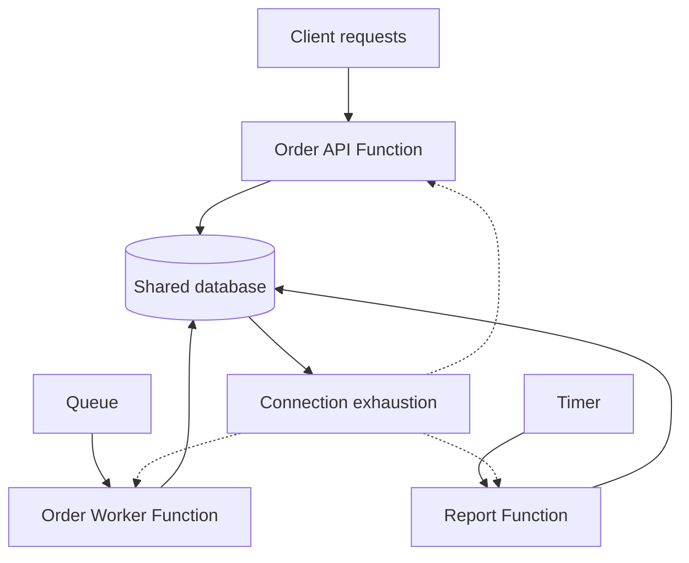
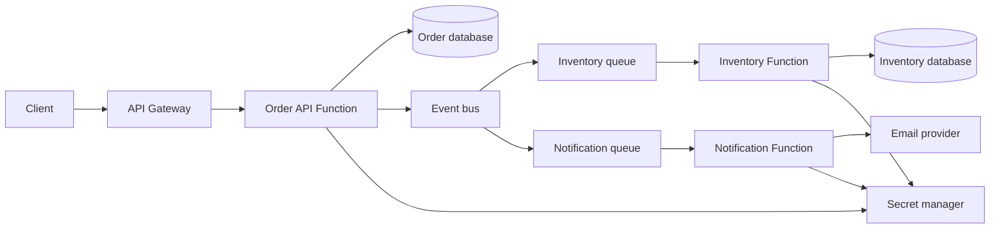
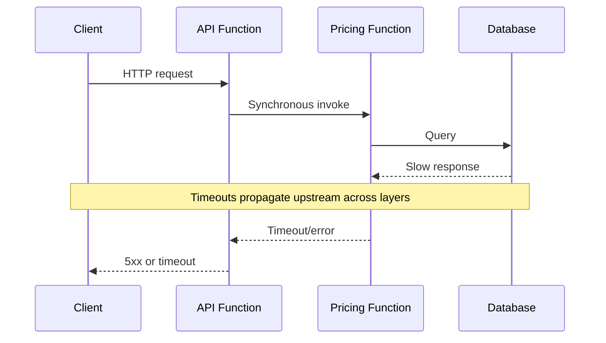
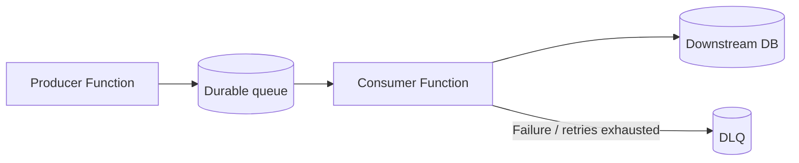

# Identifying Failure Points and Blast Radius in Serverless Architectures

A serverless system may not require managing servers, yet it still has many points that can fail: functions, triggers, queues, event buses, databases, secret stores, networks, access permissions, configurations, and external services. A failing component does not necessarily break only itself. If multiple functions share a database connection pool or depend on the same API, an incident in that dependency can propagate across multiple business workflows.

When designing for reliability, you need to identify **failure domains**, **blast radius**, and failure propagation paths before choosing how to retry, scale, or fail over. The goal is to answer: which components can fail simultaneously, which services are affected, which business operations are disrupted, and at what level the system can still operate when a dependency becomes unavailable.

## 1. Failure domains and blast radius

A **failure domain** is a boundary within which a single root cause can render multiple components inoperable at the same time. This boundary can be a function instance, a queue, a database cluster, a network zone, a cloud region, a cloud account, or an external provider.

**Blast radius** is the scope of systems and business operations affected when an incident occurs. The larger the blast radius, the more requests, tenants, services, or data are impacted. A good design aims to limit the blast radius by partitioning permissions, resources, load, and dependency paths.

For example: a Java function processing orders runs smoothly, but every function in the system shares the same database cluster. When the cluster's connection pool is exhausted, the order creation API, the inventory update worker, and the reporting function can all fail. The failure point lies in database/connection capacity; the blast radius covers multiple business flows at once.

In the diagram, the three functions can execute independently, yet the shared dependency creates a common failure domain. Looking only at the number of functions or instances is not enough to evaluate isolation.

### 1.1. Distinguishing localized failures from cascading failures

| Failure type | Examples | Initial scope | Propagation potential |
|---|---|---|---|
| Single invocation | Invalid payload, validation error | One request/event | Low if properly classified and isolated |
| Execution environment | JVM crash, memory exhaustion, static initializer failure | One process/instance | Can increase if all instances use the same faulty artifact |
| Function/version | Bug in a new release | One function or alias/slot | Increases with the proportion of traffic routed to that version |
| Trigger/source | Misconfigured event source mapping, queue not receiving messages | One trigger flow | Can cause backlog or missed processing if misconfigured |
| Shared dependency | Database, Redis, DNS, secret store failure | Multiple consumers | High if many services depend on it directly |
| Network boundary | NAT, route, firewall, private endpoint | Workloads traversing the same network path | Can affect multiple dependencies simultaneously |
| Regional/service provider | Cloud region or service incident | One region or group of services | High if there is no alternative recovery path |
| Control plane/configuration | IAM policy, DNS record, or deployment pipeline misconfiguration | Multiple resources | Can have widespread and prolonged impact |

Not every failure is a total outage. A dependency might become slow, return errors at a certain rate, throttle throughput, or lose partial functionality. These degraded states often cause propagation that is harder to detect than a complete dependency outage.

## 2. Drawing a dependency graph before evaluating reliability

A dependency graph illustrates components and their dependency directions. Draw it from actual business flows, including synchronous, asynchronous, data, identity, and network dependencies.

Example of an order placement flow:

This diagram highlights several different types of dependencies:

- API Gateway and Order API form a synchronous path: errors are typically returned immediately to the client.
- The event bus and queues establish asynchronous boundaries: the producer may already return success while consumers are still processing.
- Inventory and Notification can fail independently if they have separate queues.
- Secret manager can be a shared dependency; failures accessing secrets during initialization can prevent multiple functions from starting.
- The email provider is an external dependency; if notifications are not core to order creation, email failures should not cause the order creation API to fail.

### 2.1. Classifying dependencies

For each node/edge in the graph, document:

1. **Criticality:** Is the dependency on the critical path to complete the core business transaction?
2. **Mode:** Synchronous call, async event, poll/consume, or accessed during initialization?
3. **Ownership:** Which team owns and operates it?
4. **Failure behavior:** Timeouts, 4xx/5xx errors, throttling, corrupted data, connection loss, or stale data?
5. **Capacity:** Quotas, connections, concurrency, throughput, and payload limits.
6. **Recovery:** What retry, fallback, queue, DLQ, failover, or manual procedures are supported?
7. **Shared consumers:** Which functions/services/tenants depend on this same resource?

Do not record only cloud services. DNS, TLS certificates, identity providers, secret managers, container registries, artifact repositories, and CI/CD pipelines can also be critical dependencies. A running function might continue working when a registry experiences a temporary outage, but new deployments or scale-out events requiring a fresh image can fail.

## 3. Failure domains by layer in serverless

### 3.1. Invocation and execution environment layer

An invocation can fail due to an exception, timeout, memory limit, thread deadlock, serialization error, or slow dependency. Execution environments can be recycled, scaled in, or newly provisioned. Static state and in-memory caches are not durable state; when a process is replaced, that data is lost.

Questions to verify:

- Does the handler distinguish permanent data errors from transient errors?
- Can an oversized request or a single toxic record crash an entire batch?
- Does a static initializer make network calls or read secrets that cause every cold start to fail together?
- Can a single function exhaust the environment's memory, threads, or connection pool?
- When a function times out after writing data, will a retry produce duplicate side effects?

### 3.2. Function, version, and deployment layer

A bug in a new version can affect all invocations routed to that version. Aliases, canaries, deployment slots, and gradual rollouts help reduce the percentage of traffic exposed to a candidate, but they are only effective if metrics and rollback gates react fast enough.

Common failure modes:

- Handler or serializer incompatible with older payloads.
- Missing or misnamed environment variables.
- Overly restricted or misassigned IAM/RBAC policies.
- Runtime/architecture incompatible with the artifact or native libraries.
- Unexpected changes to timeout, memory, concurrency, or batch size.
- New version writing schemas/events that the old version cannot read during rollout.

### 3.3. Trigger, queue, and event source layer

Triggers can be HTTP, timers, object storage, event buses, queues, or streams. Each type has different delivery and acknowledgment semantics. A queue can continue accepting messages while the consumer is failing; in that case, the system has not lost data yet, but backlog grows and end-to-end business completion time stretches out.

Evaluate separately:

- Does the producer continue sending when the consumer is down?
- Does the queue/stream have sufficient retention for the recovery window?
- Do retries preserve ordering or block a partition/shard?
- Does a batch failure cause already-succeeded records to be redelivered?
- Does the DLQ have limits, alarms, and a replay procedure?
- Can a single poison message stall an entire batch or shard?

### 3.4. Shared dependency layer

Databases, caches, message brokers, secret managers, DNS, and external APIs often have multiple consumers. This is where the blast radius can easily exceed the boundary of a single function.

For example, a slow database can trigger a cascade:

1. Functions hold connections longer.
2. Connection pools fill up.
3. New invocations wait for connections and duration increases.
4. Queue consumers process slower, increasing backlog.
5. Retries and redeliveries increase the number of database calls.
6. The database experiences even higher load and slows down further.

This is **retry amplification** and a **resource exhaustion feedback loop**. Simply increasing concurrency or retry counts can make the incident worse.

### 3.5. Network, identity, and control plane layer

Private subnets, NAT Gateways, VPC/VNet routing, DNS resolvers, firewalls, security groups, and private endpoints can create shared failure domains. Functions that are completely independent in code can still lose connectivity simultaneously because they traverse the same NAT or resolver.

Identity can also be a common point of failure: an unavailable token issuer, altered roles, improperly rotated keys, or a throttled secret manager. The control plane and deployment pipeline can impair the ability to release or recover even while the data plane is still running.

## 4. Determining blast radius using an impact matrix

Do not evaluate incidents solely by the number of failing resources. Evaluate by business impact, tenant, data, duration, and recoverability.

| Evaluation dimension | Question | Scope examples |
|---|---|---|
| Service | How many services are affected? | Only notifications, or both orders and inventory? |
| Function/version | One function, one alias, or all versions? | Only the 10% canary or 100% of traffic? |
| Tenant/customer | A single tenant or all customers? | One tenant with a dedicated quota exhausted |
| Region/zone | One zone, multiple zones, or global? | A dependency present in only one region |
| Data | Is data merely delayed, lost, corrupted, or exposed? | Queue backlog versus lost events |
| Duration | How long does the outage last and how long to drain the backlog? | 5-minute outage but 2 hours to drain the queue |
| Recovery | Self-healing, retry, replay, or manual intervention? | DLQ requiring controlled redrive |
| Compliance | Does it impact audit, retention, or data residency? | Events routed to the wrong region |

### 4.1. Estimating scope with a dependency graph

For each dependency, list all direct and indirect consumers. A simple table can be used:

| Dependency | Consumers | Criticality | Failure mode | Expected scope |
|---|---|---|---|---|
| Orders DB | Order API, Order Worker | High | Connection exhaustion | Order creation and status updates slowed/failing |
| Inventory DB | Inventory Worker, Reservation API | High for checkout | Throttling | Unable to confirm/reserve inventory |
| Email provider | Notification Worker | Low for checkout | 5xx/rate limit | Emails delayed; orders still created |
| Shared secret store | Order, Inventory, Notification | Depends on secret | Throttling/permission error | Multiple functions may fail to initialize clients |
| Event bus | Order producer, multiple consumers | High | Publish failure/backlog | Consumers do not receive new events |

Dependencies with many consumers, high criticality, and few fallback paths are top candidates for isolation, capacity protection, and recovery testing.

### 4.2. Using severity levels instead of just error counts

A validation error on a single request does not carry the same severity as losing the entire event bus. An internal severity scale can be used, for example:

- **SEV 1:** Core business operations down across a wide area, data loss, or critical security risk.
- **SEV 2:** A large group of services/tenants degraded; backlog or error rates impact SLOs.
- **SEV 3:** Non-critical functionality failing, workaround exists, and data remains intact.
- **SEV 4:** Minor issue, negligible user impact, or can be handled during scheduled maintenance.

Severity definitions must align with organizational processes. Do not use severity labels as a substitute for actual measurement; define thresholds based on SLOs, affected users, data, and impact duration.

## 5. Synchronous and asynchronous dependencies create different blast radii

### 5.1. Synchronous chains

In synchronous HTTP/function-to-function chains, the caller typically waits for downstream completion. If a dependency slows down, upstream threads/requests are held open longer as well. Multi-hop chains can accumulate latency and timeouts.

Containment measures:

- Set per-dependency timeouts shorter than the overall request timeout.
- Use bulkheads/concurrency limits so one downstream does not consume all capacity.
- Use circuit breakers for dependencies exhibiting repeated errors.
- Only retry transient errors, with limits and jitter.
- Define business fallbacks when a dependency is non-essential.
- Avoid long synchronous chains for work that can be processed in the background.

### 5.2. Asynchronous flows

Queues/event buses provide buffering and decouple producer execution time from consumers. If a consumer stops working, messages can wait within the retention window; the producer can continue accepting work up to broker limits.

Asynchronous patterns do not automatically eliminate blast radius. Full queues, expired retention, an event bus losing publish capability, or excessive consumer retries can still disrupt business operations. Monitor oldest message age, backlog, consumer lag, DLQ depth, and drain rate after recovery.

### 5.3. Event fan-out

A single event can trigger multiple consumers. Fan-out helps decouple consumers, yet a shared producer or event bus remains a common failure point. A slow consumer should not block other consumers if each has its own subscription/queue. If all consumers poll the same competing queue, one consumer can pull messages intended for another.

## 6. Retry amplification and failure loops

Retries help overcome transient faults, but synchronized retries across callers can overload an already struggling dependency. If every layer retries independently, a single initial request can generate many downstream calls.

For example: the API retries 3 times, the function retries the dependency 3 times, and the HTTP client retries 3 times. A single operation can generate up to (3 \times 3 \times 3 = 27) calls to the final dependency when retries are nested. This is why you must designate a single retry owner, cap the total retry budget, and avoid retrying at every layer simultaneously.

Signs of retry amplification:

- Request rate to a dependency rises even when incoming traffic has not increased.
- Throttling/5xx responses increase alongside retry counts.
- Queue age and consumer duration increase.
- Certain messages are redelivered repeatedly or the DLQ grows rapidly.
- Connection pools and worker concurrency hit their limits.

### 6.1. Classifying errors before retrying

| Error category | Examples | Typically appropriate action |
|---|---|---|
| Transient errors | Timeout, 429, certain 5xx, connection reset | Retry with exponential backoff, jitter, and a cap |
| Permanent data errors | Invalid schema, missing required fields, unsupported event type | Do not retry indefinitely; isolate/DLQ and investigate producer |
| Permission/configuration errors | 401/403, invalid secret, wrong resource ARN | Fail fast or use minimal retries; fix configuration/permissions |
| Capacity errors | Throttling, pool exhausted, quota exceeded | Reduce concurrency/apply backpressure; controlled retry once capacity recovers |
| Uncertain outcome | Timeout after downstream may have committed | Use an idempotency key or query state before repeating side effects |

Not every HTTP 5xx is safe to retry; downstream may have already executed side effects before the connection dropped. For write operations, idempotency or a stable operation ID is required.

## 7. Identifying shared dependencies and noisy neighbors

A shared dependency introduces risk when multiple services consume capacity without separate quotas or identities. A traffic spike in one service can slow down other services even though their code did not change.

Example of a shared database cluster:

- Order Worker scales up concurrency and opens many connections.
- Report Function runs a large scan query.
- Notification Function waits on a metadata query.
- The database exhausts connections/CPU, affecting all consumers together.

To identify noisy neighbors, you need per-service/per-consumer metrics rather than just cluster-wide aggregates. You can use database roles, schemas, application names, queue names, consumer groups, or resource tags to break down telemetry.

Containment measures:

- Cap concurrency per function and per downstream.
- Use small pool sizes with explicit connection and query timeouts.
- Separate queues/subscriptions for consumers with different load profiles.
- Enforce per-tenant/per-service quotas where supported by the service.
- Separate batch/reporting workloads from online transaction paths.
- Provision physically separate resources when SLOs, security, or load profiles differ significantly.

## 8. Failure domains in identity, secrets, and networking

### 8.1. Identity and access permissions

An incorrect policy can revoke permissions for multiple functions simultaneously or grant overly broad access. Distinguish between:

- Is the caller principal allowed to invoke the function?
- Is the execution role/managed identity allowed to access downstream resources?
- Does the trigger poller have permission to read the queue/stream?
- Does the deployment identity have permission to update the function and policies?

Do not share a single administrative role across all functions. If multiple functions share the same identity and its policy changes, the blast radius widens. Prefer dedicated identities or policies scoped per service and resource.

### 8.2. Secret stores and rotation

A secret manager can be a dependency at startup or on every invocation. If a function fetches secrets synchronously on every request, a secret store outage can fail all requests and trigger retry bursts. If secrets are cached for too long, rotation or revocation may not take effect in time.

Design requires a balance:

- Cache secrets for a bounded duration and support refresh.
- Grant read permissions only to the specific secrets each workload identity needs.
- Monitor throttling, access denied events, and refresh failures.
- Use overlapping credentials during rotation if downstream supports it.
- Never place secrets in events, logs, artifacts, or responses.

### 8.3. Networking and DNS

Multiple functions can depend on the same VPC/VNet, NAT, DNS resolver, or firewall. If a NAT Gateway exhausts ports or DNS fails to resolve a database hostname, functions across unrelated groups can time out together.

When diagnosing, separate network errors from authorization errors:

- DNS failures, connect timeouts, TLS handshakes, or route failures usually point to the network path.
- 401/403 or `AccessDenied` usually points to tokens, identities, or policies.
- 429/throttling usually points to quotas/capacity, though network proxies may also return similar statuses.

Check logs on both the caller and the target resource; some services intentionally omit details to protect resources.

## 9. Evaluating failure points with FMEA

FMEA (Failure Mode and Effects Analysis) is a structured method to list failure modes, causes, consequences, detectability, and controls. You can use an internal scoring scale for severity, occurrence, and detection; no single RPN formula fits every organization.

Example matrix for a serverless system:

| Component | Failure mode | Effect | Detection | Existing control / gap |
|---|---|---|---|---|
| Order API | DB timeout | Unable to create orders | API 5xx, dependency latency | Timeout; needs pool limit and circuit breaker |
| Event bus | Publish throttled | Consumers miss new events | Publish errors, producer retries | Needs outbox and alarm |
| Inventory consumer | Poison message | Repeated retries, growing backlog | Receive count, DLQ, oldest age | Needs schema validation and DLQ runbook |
| Secret store | Access denied after rotation | Functions fail to connect downstream | 403, refresh failure | Needs rotation overlap and permission test |
| NAT/network | Port exhaustion | Multiple functions time out | Connection errors, NAT metrics | Needs capacity review and appropriate endpoints |
| Release | New version breaks schema | Old consumers fail to parse events | Deserialize errors, DLQ | Needs schema compatibility and canary |

After building the table, prioritize failure modes with high impact, many consumers, low detectability, or long recovery times. Assign each risk an owner, action, metric, and review date.

## 10. Defining business-driven SLO, RTO, and RPO

Blast radius is not just about "how many services failed." You must understand how long users are affected and how much data can be lost.

- **SLO:** Reliability/latency target over a time window, such as request success rate or message completion time.
- **RTO (Recovery Time Objective):** Target time to restore service after a disruption.
- **RPO (Recovery Point Objective):** Acceptable amount of data or time window of data loss during recovery.

For an HTTP function, RTO might tie to the time needed to revert an alias/slot to a stable version. For a queue worker, restoring the function is not enough; you must also drain the backlog within an acceptable time and ensure messages have not expired past retention. For a database, factor in restore duration and potential data loss under your backup/replication policy.

RTO/RPO must be driven by business requirements. A notification email may tolerate delay; a payment transaction or audit record may require stricter durability and recovery guarantees.

## 11. Designing to limit blast radius

You cannot eliminate all failures, but you can reduce how many components are affected at once.

### 11.1. Bulkheads and resource isolation

Partition capacity by function, tenant, or workload type. A heavy batch consumer should not consume all concurrency or database connections needed by transactional APIs. Use separate queues, concurrency limits, isolated connection pools, database roles/quotas, or dedicated resources.

### 11.2. Timeouts and deadline propagation

Every dependency call needs a timeout shorter than the remaining invocation time. Propagate deadlines and correlation IDs across services; do not allow downstream work to keep running after the caller has already timed out. Timeouts do not guarantee that side effects were canceled, so write operations must be idempotent.

### 11.3. Circuit breakers and fallbacks

Circuit breakers prevent continuous calls to a failing dependency. When the circuit opens, you can return a fallback or fail fast. Fallbacks are only valid if they do not violate consistency or security contracts. Never return stale data for authorization or account balances just to make an API appear healthy.

### 11.4. Queue buffering and backpressure

Queues absorb bursts and decouple producers from consumers. However, you must define backlog limits, retention, max receive counts, DLQs, and scaling policies. If queue age crosses a threshold, throttle the producer rate or regulate the consumer rather than scaling concurrency without bounds.

### 11.5. Canaries, aliases, and deployment isolation

Releasing to a small percentage of traffic limits how many requests hit a new version. Attach alarms and smoke tests to automatically halt or roll back. Schemas and event contracts must remain compatible while old and new versions run concurrently.

## 12. Example: analyzing a shared database incident

Suppose after a release, Order Worker concurrency increases from 20 to 200. The shared database cluster has a limit of 150 connections. Meanwhile, Report Function runs a large aggregation query.

Impact chain:

1. The worker scales out and each environment creates a connection pool.
2. Total connections exceed capacity; the database rejects or slows down connections.
3. Order Worker times out, messages are not ACKed, and they are redelivered.
4. Retries further increase query volume.
5. Report Function and the API also slow down because they share the database.
6. Queue age climbs; API clients receive elevated 5xx responses.

This incident has a blast radius larger than a single function because the database is a shared failure domain. Investigation steps:

- Correlate the release timestamp with concurrency, connection count, and DB CPU.
- Check pool size multiplied by instance count and number of consumer functions.
- Inspect query latency, lock waits, throttling, and connection errors.
- Check queue age, receive counts, retries, and DLQ depth.
- Separate reporting load from transactional workloads; cap worker concurrency.
- Curb retry amplification and verify idempotent message handling.
- Gradually restore consumers while monitoring backlog drain rate and database recovery.

After the incident, add guardrails: concurrency limits, pool sizing, connection saturation alarms, scale-out load tests, and a backlog recovery runbook.

## 13. Observability to detect failure points before propagation

Each failure domain needs detection signals. Aggregate metrics must be supplemented with dimensions by service, function, version, tenant, or consumer group.

| Failure domain | Signals to monitor | Signs of expanding blast radius |
|---|---|---|
| Function/runtime | Errors, p95/p99 duration, throttles, memory, init duration | Multiple functions/versions failing together or concurrency hitting limits |
| API/gateway | 4xx/5xx, integration latency, auth failures | Error rates rising across multiple routes or tenants |
| Queue/stream | Oldest message age, backlog, consumer lag, retries, DLQ | Backlog growing continuously or multiple consumers falling behind |
| Database | Connections, CPU, storage, lock waits, query latency | Multiple workloads timing out together or connection pools exhausted |
| Cache | Error rate, latency, evictions, memory, hit ratio | Multiple services falling back to the database at once |
| Network | DNS failures, connection resets, NAT port/throughput, TLS errors | Multiple unrelated dependencies timing out simultaneously |
| Identity/secret | Token errors, access denied, secret refresh/throttling | Multiple functions failing initialization or downstream calls |
| Deployment | Version traffic, alarm state, rollbacks, config drift | Errors concentrated on a candidate or following a config change |

Logs and traces should carry correlation ID, event ID, invocation ID, service name, and version. Do not log sensitive payloads or secrets. When multiple functions process an event, propagate trace context to reconstruct the execution path and pinpoint which node failed first.

## 14. Testing failure domains and containment

Reading dependency diagrams is not enough; validate assumptions with controlled experiments. Start in test/staging environments and define clear abort criteria.

Useful experiments:

- **Dependency timeout:** Slow down a database or mock HTTP endpoint to verify timeouts and circuit breakers trigger properly.
- **Throttling:** Simulate 429/quota errors to verify backoff, jitter, and concurrency limits.
- **Queue consumer outage:** Pause a consumer for a bounded window to test backlog growth, retention, DLQ behavior, and post-recovery draining.
- **Poison message:** Send a malformed schema event to confirm it is isolated rather than retried infinitely.
- **Secret rotation:** Rotate a secret in a sandbox and verify workers refresh credentials without causing a broad outage.
- **Network failure:** Block a test network path to observe timeout, DNS, and fallback behavior.
- **Bad release:** Intentionally deploy a faulty candidate in staging to test smoke gates, alarms, and rollback.
- **Scale-out burst:** Apply bounded load spikes to test connection pools, downstream capacity, and retry amplification.

Fault injection should never begin by severing a shared production dependency. Define the blast radius of the experiment itself, restrict target tenants/traffic, ensure active monitoring, metrics, and immediate stop/recovery commands. Expand the scope only after behavior at small scale is well understood.

## 15. Failure point identification workflow

Use the following workflow during design reviews or reliability reviews:

1. **Map the business flow:** Start from the incoming request/event and trace through to the user-facing outcome.
2. **List dependencies:** Include functions, triggers, queues, databases, networks, identities, secrets, external APIs, and the deployment/control plane.
3. **Draw the dependency graph:** Distinguish synchronous, asynchronous, shared, and optional dependencies.
4. **Mark failure domains:** Process, function/version, resource, account, region, network, and provider.
5. **Estimate blast radius:** Services, tenants, data, duration, SLO, RTO/RPO, and affected consumers.
6. **Identify propagation paths:** Timeouts, retries, queue backlogs, connection exhaustion, shared quotas, or stale state.
7. **Check detection:** Which metrics/logs/traces show where a failure started and how far it spread?
8. **Propose containment:** Bulkheads, quotas, identity isolation, dedicated queues, circuit breakers, or failover.
9. **Test recovery:** Retries/replays, restores, rollbacks, backlog draining, and handling inconsistent data.
10. **Assign owners:** Each risk gets an accountable owner, action item, metric, and due date.

## 16. Failure domain and blast radius checklist

1. Do business flows have an up-to-date dependency graph?
2. Have mandatory dependencies been distinguished from optional ones?
3. Is any shared resource a single point of failure or shared capacity bottleneck?
4. How much traffic and how many tenants does a single process/function/version failure affect?
5. Do triggers/queues have appropriate retention, retry, DLQ, and replay procedures?
6. Can retries across layers multiply into retry amplification?
7. Can scale-out exhaust connections, threads, quotas, or downstream capacity?
8. Do identity, secrets, DNS, NAT, VPC/VNet, and private endpoints share failure domains?
9. Do deployment candidates have canary/rollback mechanisms and schema/event compatibility?
10. Are per-service/per-consumer metrics available to detect noisy neighbors?
11. Have SLO, RTO, RPO, and backlog drain targets been defined?
12. Have controlled fault injection tests and recovery runbooks been executed?
13. Does each risk have an owner, severity, mitigation, and review date?

## Conclusion

Identifying failure points in serverless requires looking at the entire dependency graph, not just individual functions. Failure domains can exist in the execution environment, triggers, shared databases, queues, networks, identity, secret stores, regions, or deployment pipelines. Blast radius is determined by the number of dependent services/tenants, business criticality, propagation via timeouts/retries, and recovery time. Classify dependencies, measure signals per consumer, bound concurrency and retries, isolate resources when needed, and validate with controlled fault injection. A reliable system is not one that never fails; it is one that knows where failures start, contains their impact, and recovers within established business objectives.
