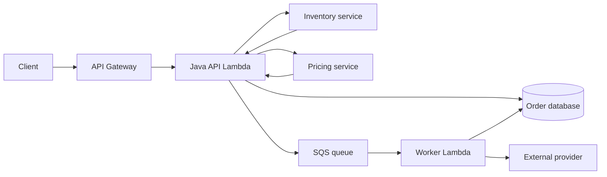

# Designing End-to-End Timeout Budgets Across Service Chains

## 1. Why is an end-to-end timeout budget needed?

A serverless request typically traverses multiple components: API Gateway, Java Lambda, an authentication service, a database, a queue, a worker, and an external provider API. Each component has its own timeout. If every component picks its timeout independently without considering an overall deadline, the total elapsed time can exceed how long the caller is willing to wait; functions keep running, holding connections, consuming concurrency, and incurring costs after the client has already given up.

A timeout budget is the maximum amount of time allocated to an operation or business journey. The end-to-end budget begins when the system receives the request and ends when it returns a result or determines a failure. Downstream components must share that budget, except for asynchronous work decoupled under a separate SLA.

For example, an order creation API has a 2.5-second response budget. The request flows through the gateway, Lambda, inventory check, pricing calculation, and database write. If every dependency is allowed to wait 2 seconds, the sequential chain can exceed 8 seconds. When the client times out at 2.5 seconds, the Lambda may still be waiting on the database or continuing to call other services. A shared budget lets each step know how much time remains and stop before exceeding the limit.

In the CLOUD_SERVERLESS module, the timeout budget must be designed alongside triggers, retries, idempotency, concurrency, queue backlog, and durable state. A timeout is not merely a configuration value on Lambda; it is a time contract across the producer, gateway, function, dependencies, and consumers.

## 2. Distinguishing timeout, deadline, and latency

Three concepts are often used interchangeably:

| Concept | Meaning | Example |
|---|---|---|
| Timeout | Wait limit for an operation or component | HTTP client stops waiting after 400 ms |
| Deadline | Absolute point in time by which the entire operation must complete | Request must finish before 10:00:02.500 UTC |
| Latency | Actual time spent | Database query takes 120 ms |
| Remaining budget | Time left before the deadline after subtracting elapsed time | 800 ms left for subsequent steps |

A timeout is typically a local limit. A deadline is a shared limit propagated throughout the chain. A request with a 2.5-second deadline might allocate 500 ms for the inventory service, 300 ms for the pricing service, and 250 ms for the database; these numbers are local limits within the total budget.

Avoid setting each hop's timeout equal to the full initial deadline. If every service waits the full 2.5 seconds, total latency grows with the number of hops. Each downstream call must use the remaining time, minus a safety reserve for post-call processing and returning the response.

## 3. Mapping the service chain and identifying the critical path

Before setting timeouts, map the synchronous and asynchronous steps of the business flow.



In this example, `Inventory` and `Pricing` can be called in parallel; `Order database` is written after receiving their results. The API can return `202 Accepted` after saving the order and enqueuing the work. The worker handles the external provider afterward under a separate asynchronous SLA.

Distinguish between:

- **Synchronous critical path:** Steps that must complete before returning the response. The budget is divided along the longest path, not by summing all parallel branches.
- **Parallel branches:** Wait time usually equals the slowest branch plus overhead, yet each branch must still have its own timeout and cancellation.
- **Asynchronous work:** The producer only commits to accepting/persisting the work; the consumer has a separate processing deadline/SLA starting upon message receipt or a business timestamp.
- **Long workflows:** If a process exceeds HTTP or function duration limits, use orchestration such as Step Functions or durable workflows instead of stretching a synchronous request.

Do not mechanically add up timeouts across every service. Calculate based on the dependency graph and actual completion path.

## 4. Setting time targets from user experience and SLOs

Timeouts should derive from business requirements and SLOs. For example:

- Order lookup API: p95 under 500 ms, total timeout 1.5 seconds.
- Order creation API: return accepted status within 2 seconds, process payment asynchronously within up to 2 minutes.
- Webhook: acknowledge event receipt within 1 second, process event in worker within 30 seconds.
- Batch worker: process batch within 45 seconds, retryable according to queue policy.

These numbers are examples only. Choose deadlines based on client timeouts, SLOs, dependency characteristics, and retry capabilities. If the client only waits 3 seconds, the server should not design an 8-second critical path and expect the client to wait.

Distinguish target latency from a hard deadline. A 500 ms p95 does not mean every request should time out at 500 ms. The deadline is the hard upper bound; the SLO is the latency distribution target for the majority of requests.

## 5. Allocating the budget and keeping a safety reserve

A total budget must account for network, gateway, function, dependencies, and response serialization. Do not allocate 100% of the time to downstream calls.

Example 2,500 ms budget for a synchronous API:

| Step | Maximum budget | Notes |
|---|---:|---|
| Client/network and API Gateway | 250 ms | DNS/TLS, gateway routing, response transfer |
| Initialization/dispatch and validation in Lambda | 200 ms | Excludes cold start if billed/counted separately by platform; measure empirically |
| Inventory API | 550 ms | HTTP connect + request/response |
| Pricing API | 400 ms | Called in parallel with inventory |
| Order database write | 350 ms | Transaction and commit |
| Serialize and return response | 150 ms | Mapping, minimal logging |
| Safety reserve | 600 ms | Network jitter, controlled retries, cleanup, and variance |
| **Total** | **2,500 ms** | Parallel branches do not add their wait times together |

In the table, Inventory and Pricing run in parallel, so the critical path only pays for the slower branch, around 550 ms. Actual steps may differ in order; this table is a planning tool, not a default configuration.

Key principles:

- Keep a reserve for error handling, persisting state, closing resources, and returning the response.
- Do not set a downstream timeout equal to the exact remaining time; leave time for the caller to process the result.
- Reserve a portion of the budget for network jitter and load fluctuations.
- For retries, deduct wait/backoff time from the same budget.
- If the remaining budget is insufficient, fail early or offload work asynchronously; never silently extend the deadline.

## 6. Propagating deadlines over HTTP

When calling another service, pass deadline information so downstream does not keep processing for too long. You can use an internal header such as `X-Request-Deadline` containing a UTC timestamp or `X-Request-Timeout-Ms` containing remaining milliseconds. For gRPC, `grpc-timeout` metadata is available; for HTTP, W3C Trace Context connects traces but does not automatically carry a business deadline.

### Absolute deadlines vs. relative timeouts

An absolute deadline can be passed across processes/machines because each side knows the expiration timestamp. However, it depends on system clocks and is susceptible to clock skew. Relative timeouts are straightforward, but if each hop receives the same value without subtracting elapsed time, the budget resets and grows unboundedly.

A practical approach:

1. The gateway or entry service determines the maximum deadline per policy.
2. Propagate the UTC deadline via an authenticated internal header.
3. Each service converts the deadline into remaining time at the moment of receipt.
4. Use a monotonic clock (`System.nanoTime`) to measure local elapsed time.
5. Cap the timeout to min(remaining budget, maximum dependency timeout).
6. Subtract the safety reserve before calling downstream.

Never trust a deadline sent directly by an external client. Edge services must validate and cap deadlines per policy so clients cannot ask a function to run indefinitely or hold resources for too long.

## 7. Building a Deadline utility in Java

`System.currentTimeMillis()` can jump due to clock synchronization. To measure elapsed time within a process, use `System.nanoTime()`. You can accept a UTC deadline at the boundary and convert it into a monotonic deadline for the remainder of execution.

```java
import java.time.Duration;
import java.time.Instant;
import java.util.Objects;

public final class Deadline {
    private static final Duration MAX_MONOTONIC_BUDGET = Duration.ofDays(1);
    private final long deadlineNanos;

    private Deadline(long deadlineNanos) {
        this.deadlineNanos = deadlineNanos;
    }

    public static Deadline after(Duration budget) {
        Objects.requireNonNull(budget, "budget");
        if (budget.isNegative() || budget.isZero()
                || budget.compareTo(MAX_MONOTONIC_BUDGET) > 0) {
            throw new IllegalArgumentException("budget must be positive and at most one day");
        }
        return new Deadline(System.nanoTime() + budget.toNanos());
    }

    public static Deadline fromUtc(Instant deadlineUtc, Duration maxAllowed) {
        Objects.requireNonNull(deadlineUtc, "deadlineUtc");
        Objects.requireNonNull(maxAllowed, "maxAllowed");
        if (maxAllowed.isNegative() || maxAllowed.isZero()
                || maxAllowed.compareTo(MAX_MONOTONIC_BUDGET) > 0) {
            throw new IllegalArgumentException("maxAllowed must be positive and at most one day");
        }

        Duration remaining = Duration.between(Instant.now(), deadlineUtc);
        if (remaining.isNegative() || remaining.isZero()) {
            throw new DeadlineExceededException("deadline already expired");
        }
        if (remaining.compareTo(maxAllowed) > 0) {
            remaining = maxAllowed;
        }
        return after(remaining);
    }

    public Duration remaining() {
        long nanos = deadlineNanos - System.nanoTime();
        return nanos <= 0 ? Duration.ZERO : Duration.ofNanos(nanos);
    }

    public Duration remainingMinus(Duration reserve) {
        Objects.requireNonNull(reserve, "reserve");
        if (reserve.isNegative()) {
            throw new IllegalArgumentException("reserve must not be negative");
        }
        Duration value = remaining().minus(reserve);
        return value.isNegative() ? Duration.ZERO : value;
    }

    public Duration cap(Duration maxTimeout, Duration reserve) {
        Objects.requireNonNull(maxTimeout, "maxTimeout");
        if (maxTimeout.isNegative() || maxTimeout.isZero()) {
            throw new IllegalArgumentException("maxTimeout must be positive");
        }
        Duration usable = remainingMinus(reserve);
        if (usable.isZero()) {
            throw new DeadlineExceededException("insufficient time remaining");
        }
        return usable.compareTo(maxTimeout) < 0 ? usable : maxTimeout;
    }

    public void throwIfExpired() {
        if (remaining().isZero()) {
            throw new DeadlineExceededException("request deadline exceeded");
        }
    }
}

class DeadlineExceededException extends RuntimeException {
    DeadlineExceededException(String message) {
        super(message);
    }
}
```

The utility above illustrates how to convert a UTC deadline to a monotonic clock and cap the budget. In production code, place exceptions in separate files, handle oversized durations/overflow, validate headers, and never allow clients to control `maxAllowed`. `Instant.now()` is only used when converting the deadline from the wire; local measurements afterward use `nanoTime()`.

## 8. Using remaining time for HTTP calls in Java

`HttpClient` provides `connectTimeout` at the client level and `HttpRequest.timeout` at the request level. Set the request timeout based on remaining time rather than a fixed value larger than the deadline.

```java
import java.net.URI;
import java.net.http.HttpClient;
import java.net.http.HttpRequest;
import java.net.http.HttpResponse;
import java.time.Duration;

public final class InventoryClient {
    private static final Duration CONNECT_TIMEOUT = Duration.ofMillis(150);
    private static final Duration MAX_REQUEST_TIMEOUT = Duration.ofMillis(550);
    private static final Duration RESPONSE_RESERVE = Duration.ofMillis(100);

    private final HttpClient client = HttpClient.newBuilder()
            .connectTimeout(CONNECT_TIMEOUT)
            .build();

    public HttpResponse<String> getStock(
            String sku,
            Deadline deadline) throws Exception {

        Duration requestTimeout = deadline.cap(
                MAX_REQUEST_TIMEOUT,
                RESPONSE_RESERVE);

        HttpRequest request = HttpRequest.newBuilder()
                .uri(URI.create("https://inventory.internal/items/" + sku))
                .timeout(requestTimeout)
                .GET()
                .build();

        return client.send(request, HttpResponse.BodyHandlers.ofString());
    }
}
```

`connectTimeout` only applies when establishing a new connection; reused connections do not need a new handshake. `HttpRequest.timeout` bounds the request exchange duration. With async `sendAsync`, manage `CompletableFuture` and cancellation when the deadline expires. Do not rely on `orTimeout` as proof that the socket and downstream have stopped; cancellation can be best effort.

In practice, also configure connection pooling, TLS handshakes, response body size, DNS, and retries. Avoid creating a new `HttpClient` per invocation; reuse clients at the execution environment scope when appropriate and close/refresh stale connections according to library guidelines.

## 9. Deadlines in AWS Lambda Java

Lambda provides `Context.getRemainingTimeInMillis()` so the handler knows how much time remains before the function timeout. Use this value to cap database/HTTP call timeouts and preserve a reserve for cleanup.

```java
import com.amazonaws.services.lambda.runtime.Context;
import com.amazonaws.services.lambda.runtime.RequestHandler;

public class OrderHandler implements RequestHandler<OrderRequest, OrderResponse> {
    @Override
    public OrderResponse handleRequest(OrderRequest input, Context context) {
        long remainingMs = context.getRemainingTimeInMillis();
        long reserveMs = 300;
        long dependencyBudgetMs = Math.min(700, remainingMs - reserveMs);

        if (dependencyBudgetMs <= 0) {
            throw new DeadlineExceededException("not enough Lambda time remaining");
        }

        // Call dependency with timeout <= dependencyBudgetMs.
        // Then check remaining time before persisting results/returning response.
        return process(input, dependencyBudgetMs, context);
    }

    private OrderResponse process(
            OrderRequest input,
            long dependencyBudgetMs,
            Context context) {
        // Application logic.
        return new OrderResponse("ACCEPTED", input.orderId());
    }
}
```

This example uses Lambda's Java runtime interface. If a framework adapter or different handler signature is used, retrieve the Lambda context via the corresponding integration mechanism. Never set a dependency timeout equal to the full `remainingTimeInMillis`; keep a reserve for logging, completing transactions, returning structured errors, or saving idempotency state.

The Lambda timeout is a hard limit per invocation. If a function times out, Lambda terminates the execution environment; code is not guaranteed a chance to run `finally` blocks or cleanup. Therefore, do not rely on the Lambda timeout as a safe transaction-closing mechanism. Set timeouts lower than the function limit and design operations to recover cleanly if the process terminates abruptly.

## 10. Aligning timeouts across client, gateway, Lambda, and dependencies

For a synchronous request, timeouts across layers should be intentionally nested. Typically, the downstream timeout is smallest; Lambda has time to handle errors and return a result; the gateway waits slightly longer than Lambda; and the client has enough time to receive the response.

```text
Downstream call timeout  < Lambda remaining/function timeout
Lambda timeout           < Gateway integration timeout
Gateway timeout          < Client total deadline
```

This is a typical design relationship, not an absolute rule for every gateway. Always check timeout limits and quotas of the specific service in use, as some gateways have hard limits or configurable timeouts that vary by API type/Region.

Example:

| Layer | Illustrative timeout |
|---|---:|
| Database query | 250 ms |
| Inventory HTTP call | 500 ms |
| Java Lambda | 1,800 ms |
| Gateway integration | 2,000 ms |
| Client total timeout | 2,500 ms |

If the gateway times out before Lambda, the client may receive an error while Lambda continues running and creating side effects. If the client times out before the gateway, the client may retry while the first request is still processing. Therefore, idempotency is a mandatory part of timeout/retry design.

## 11. Database and connection pool timeouts

Database operations typically involve several wait points:

- Waiting to acquire a connection from the pool.
- DNS/TLS or TCP connection establishment.
- Waiting on locks/transactions.
- Executing the query.
- Streaming results and committing.

Configure connection acquisition timeout, network/socket timeout, statement/query timeout, and transaction timeout separately if supported by your driver/database. A query timeout does not necessarily bound connection pool wait time or commit duration.

JDBC example:

```java
Duration usable = deadline.cap(Duration.ofSeconds(2), Duration.ofMillis(50));
if (usable.compareTo(Duration.ofSeconds(1)) < 0) {
    throw new DeadlineExceededException("less than one second remains for JDBC query");
}
int queryTimeoutSeconds = Math.min(2, Math.toIntExact(usable.toSeconds()));

try (Connection connection = dataSource.getConnection()) {
    connection.setAutoCommit(false);

    try {
        try (PreparedStatement statement = connection.prepareStatement(
                "UPDATE orders SET status = ? WHERE order_id = ?")) {
            statement.setQueryTimeout(queryTimeoutSeconds);
            statement.setString(1, "CONFIRMED");
            statement.setString(2, orderId);
            statement.executeUpdate();
        }

        connection.commit();
    } catch (SQLException | RuntimeException error) {
        try {
            connection.rollback();
        } catch (SQLException rollbackError) {
            error.addSuppressed(rollbackError);
        }
        throw error;
    }
}
```

`Statement.setQueryTimeout` takes whole seconds and driver implementations vary. This example fails fast if less than one second remains because this API cannot express sub-second timeouts. `dataSource` also requires a separate connection acquisition timeout; time spent waiting for a connection already consumes budget before the snippet above executes. For transactions, configure timeouts at the database/driver level and handle rollbacks; do not assume query timeout automatically bounds commit operations.

Connection pools must cap connections relative to Lambda concurrency and database capacity. If every invocation opens multiple connections or the pool is oversized, scale-out can exhaust database connections even when individual requests have reasonable timeouts.

## 12. Timeouts across trigger types

Not every trigger has a client waiting for a response. Each trigger has a different timeout model.

| Trigger | Who is waiting? | Budget to manage |
|---|---|---|
| HTTP/API Gateway | Client and gateway | Client deadline, integration timeout, Lambda timeout, dependency budget |
| Lambda Function URL | HTTP client | Client deadline, function timeout, dependency budget |
| Synchronous SDK invoke | Caller SDK | SDK call timeout, Lambda timeout, and caller deadline |
| Asynchronous Lambda invoke | Producer only waits for event acceptance | Producer publish timeout; function retry/age policy and separate processing SLA |
| SQS event source mapping | Queue holds messages; worker processes | Function timeout, visibility timeout, batch window, message age, and DLQ policy |
| EventBridge | Event bus delivers events | Delivery retry/retention and consumer processing SLA |
| Kinesis/DynamoDB Streams | Event source mapping polls stream | Function timeout, batch/window, checkpoint, record age, and retry policy |
| Step Functions | State machine orchestrates | Task timeout, heartbeat, execution timeout, and business deadline |

Do not apply HTTP request timeouts to the entire queue processing workload. In an async flow, the producer can return `202` in a few hundred milliseconds; the worker may process over 30 seconds or several minutes under its own SLA. Store a business deadline or `expiresAt` inside the message if the event loses validity after a certain point.

## 13. Lambda timeout and SQS visibility timeout

With SQS event source mapping, a message becomes invisible when Lambda receives it. If the function does not finish/delete the message before the visibility timeout expires, the message can reappear and be processed again.

AWS recommends setting the queue's visibility timeout to at least six times the Lambda function timeout, plus the maximum batching window if configured. This provides headroom for retries and adjustments during service throttling. <https://docs.aws.amazon.com/lambda/latest/dg/with-sqs.html>

Example:

```text
Lambda timeout:             30 seconds
Maximum batching window:     5 seconds
Minimum recommended visibility timeout: 6 × 30 + 5 = 185 seconds
```

These numbers are examples based on AWS recommendations; verify your current event source mapping and queue settings. Visibility timeout is not the message's business deadline. If a message has expired from a business standpoint, the worker must check `expiresAt` and skip it or transition it to an expired state.

With batches, a single failing record can cause the entire batch to be redelivered unless partial batch response is enabled. When `ReportBatchItemFailures` is enabled, the handler must return the exact list of failed items. A full function timeout can still cause the batch to be redelivered; idempotency remains necessary.

## 14. Deadlines for event-driven and message processing

In async flows, distinguish three milestones:

1. **Acceptance deadline:** How quickly the producer must successfully send/persist the message.
2. **Processing deadline:** When the consumer must start or finish processing.
3. **Business expiry:** Until when the event remains valid from a business perspective.

Example of a transaction notification webhook:

- The API receives the webhook and returns 2xx within 1 second.
- The message is processed within 30 seconds of being enqueued.
- Payment events can be retried for 15 minutes before moving to the DLQ.
- Past the business expiry, the event transitions to a reconciliation-needed state instead of automatically retrying a charge.

These deadlines are examples. Messages should carry `eventId`, `createdAt`, `expiresAt`, `correlationId`, and a schema version. Consumers compute their budget from the current time and the business deadline; do not reset a long timeout on every retry.

## 15. Retries must consume the same budget

Retries do not create extra time for a request. Every attempt, backoff delay, and network overhead consumes the original deadline.

Example with 900 ms remaining budget:

| Component | Time |
|---|---:|
| Attempt 1 | 250 ms |
| Backoff with jitter | 100 ms |
| Attempt 2 | 250 ms |
| Result processing and response reserve | 150 ms |
| Total | 750 ms |

If the first attempt already took 700 ms, there is not enough time left for a 250 ms retry plus the reserve; fail/time out immediately instead of starting an attempt guaranteed to miss the deadline.

### Exponential backoff with jitter

A common formula:

```text
delay = random(0, min(maxDelay, baseDelay × 2^attempt))
```

Before retrying:

- Verify the error is transient and retryable.
- Verify the operation is idempotent or carries an idempotency key.
- Verify enough deadline remains for one attempt plus reserve.
- Cap the number of retries and total retry duration.
- Do not retry simultaneously across every layer (SDK, framework, Lambda, queue, and workflow) without a shared retry budget.

Retry storms can overload dependencies further. Combine exponential backoff, jitter, circuit breakers, bulkheads, and concurrency limits.

## 16. Idempotency when the caller times out while the server keeps running

A critical scenario: the client sends `POST /orders`, the server creates the order successfully, but the response times out on the return path. The client does not know whether the transaction committed and resends the request. If the server creates the order again, the system gets a duplicate.

Solution:

- The client sends a stable idempotency key for the same business operation.
- The server stores the key, status, and result in durable storage.
- Duplicate requests return the recorded result or an in-progress status.
- The database enforces unique constraints/conditional writes to prevent race conditions.
- Workers use a stable event ID to prevent reprocessing on message redelivery.

Idempotency records need retention longer than the potential retry/replay window. Do not use the Lambda request ID as an idempotency key because retries generate different invocation IDs.

A client timeout does not mean the server rolled back. API designs should allow clients to poll status by operation ID or resend with the same idempotency key to receive a consistent outcome.

## 17. Cancellation and stopping work when the deadline expires

When the deadline expires, a service should stop initiating new work and attempt to cancel pending operations. However, cancellation is usually best effort:

- An HTTP client can cancel a request/future, but the remote server may have already processed it.
- JDBC statement cancellation may not interrupt every driver/query immediately.
- Canceling a future does not guarantee the thread or native call stops instantaneously.
- A Lambda timeout can terminate the process without running cleanup code.
- A queue message does not disappear if a worker times out; it can be redelivered.

Therefore:

- Propagate cancellation signals to async tasks and downstream clients.
- Check the deadline before starting new side effects.
- Use transactions and idempotency for side effects already started.
- Do not hold locks or connections after a request is no longer useful.
- Implement reconciliation for unknown outcomes.
- Do not rely on `finally` as your sole recovery mechanism.

## 18. Parallel calls and fan-out

If a function calls multiple services in parallel, total duration is not necessarily the sum of all branch timeouts. The critical path is the slowest branch, plus startup, join, and result-processing overhead.

Example:

```java
CompletableFuture<Inventory> inventoryFuture =
        inventoryClient.fetch(sku, inventoryTimeout);
CompletableFuture<Price> priceFuture =
        pricingClient.fetch(sku, pricingTimeout);

// Both branches share the same overall deadline but have individual caps.
CompletableFuture.allOf(inventoryFuture, priceFuture)
        .orTimeout(remaining.toMillis(), TimeUnit.MILLISECONDS)
        .join();
```

This is only an illustrative skeleton. `orTimeout` completes the future with an exception upon expiration, but it does not automatically cancel the underlying HTTP requests. Keep handles to each request/future and call the appropriate cancellation APIs. When one branch fails and the other branch's result is no longer needed, cancel the remaining branch if safe.

Large fan-outs also need concurrency caps. If one invocation fires hundreds of calls simultaneously, dependencies can be overloaded even with short per-call timeouts. Use semaphores/bulkheads and per-branch budgets.

## 19. Timeouts for long workflows with Step Functions

If a process takes several minutes or hours, do not keep an HTTP request or Lambda invocation open for the entire duration. Move the process to orchestration:

- Each task has its own timeout.
- Retry policies define backoff, attempt limits, and retryable error types.
- Catch/compensation blocks handle terminal failures.
- Wait states pause for a duration without keeping Lambda running.
- Callback task tokens support tasks waiting on external systems.
- Execution timeout bounds the entire workflow.
- Heartbeat timeouts detect stalled workers on tasks supporting heartbeats.

For example, an order workflow might validate inventory in 2 seconds, reserve stock in 30 seconds, wait up to 2 minutes for payment, and send a notification upon completion. Each task has its own deadline while the execution still honors an overall business deadline.

Do not extend Lambda timeouts as a substitute for a workflow engine. Lambda has execution time limits; workflow orchestration is better suited for long-running processes involving waits, retries, state, and compensation.

## 20. Timeouts, circuit breakers, and bulkheads

Timeouts limit how long a single call waits. Circuit breakers stop calling a failing dependency. Bulkheads cap resources allocated to a group of calls so one dependency cannot consume all threads/connections.

| Mechanism | Purpose | Interaction with deadline |
|---|---|---|
| Timeout | Stop waiting too long | Always less than or equal to remaining budget |
| Circuit breaker | Fail fast on consecutive dependency errors | Do not wait on calls if the breaker is open |
| Bulkhead | Cap concurrency/connections | Fail fast if a slot cannot be acquired before the deadline |
| Retry | Recover from transient errors | Only retry if sufficient budget remains and operation is safe |
| Rate limit | Protect service from overload | Reject early if unable to process within budget |

Do not retry when the circuit breaker is open. Do not queue indefinitely for a semaphore; waiting for a slot also consumes budget. With serverless scale-out, bulkheads must protect the dependency system-wide rather than just within a single execution environment.

## 21. Observability for timeout budgets

Logging just "request timed out" is not enough. You need to know where the timeout occurred and how the budget was consumed.

Useful log/trace fields:

- `deadline_at` or `deadline_ms` (do not use as a metric label).
- `remaining_budget_ms` before each downstream call.
- `dependency.name`, `operation.name`, and `timeout.configured_ms`.
- `elapsed_ms`, `attempt`, `retry_delay_ms`.
- `timeout.source`: client, gateway, Lambda, HTTP client, database, queue, or workflow.
- `correlation_id`, `trace_id`, `event_id`.
- `outcome`: success, timeout, cancelled, retry_exhausted, or unknown.

Metrics should have low cardinality:

- `dependency_request_duration` by service, operation, outcome.
- `dependency_timeout_total` by dependency and timeout class.
- `deadline_exceeded_total` by normalized route/operation.
- `retry_attempts_total` by dependency and error class.
- `remaining_budget_at_hop` as a histogram.
- `queue_age`, `message_processing_duration`, and `workflow_execution_duration`.

Never add request ID, order ID, or raw URLs as metric dimensions. Keep IDs in traces/logs for investigation; metrics should only use attributes with bounded cardinality.

## 22. Testing timeout budgets

Timeouts must be tested as functional and reliability behaviors, not merely by checking that configuration exists.

Recommended scenarios:

1. Dependency responds quickly: request completes within budget.
2. Dependency is slower than local timeout: caller fails on time with a clear timeout source.
3. Dependency is slow but within overall deadline: request completes normally.
4. Two parallel branches, one times out: the other branch is canceled if no longer needed.
5. Client times out while server already committed: retry with the same idempotency key does not create duplicates.
6. Lambda nearly out of remaining time: handler does not start new operations if no reserve remains.
7. SQS worker times out: message is redelivered without duplicating side effects.
8. Queue backlog: messages past business expiry are handled per policy.
9. Database pool exhausted: acquisition timeout triggers before Lambda timeout.
10. Retry storm: backoff/jitter and retry budget cap total call volume.
11. Clock skew: UTC deadline prevents services from running beyond max allowed.
12. Long workflow: task timeout, heartbeat, and execution timeout trigger as expected.

Use a test server or mock dependency configurable for latency, connection resets, and transient errors. For cloud integration tests, use isolated environments and clean up per test run; never intentionally induce timeouts on production dependencies.

## 23. Common design mistakes

| Mistake | Consequence | Fix |
|---|---|---|
| Setting every hop's timeout to the full budget | Total latency grows with hop count | Propagate deadline and use remaining budget |
| Retries reset the timeout | Requests can run indefinitely | Preserve the original deadline across all attempts |
| Client times out while server continues side effects | Client retries create duplicates | Idempotency keys and durable state |
| Gateway timeout much shorter than Lambda | Lambda keeps running after caller leaves | Align timeouts and handle cancellation |
| Lambda timeout equals downstream timeout | No time left for error handling/cleanup | Keep a reserve between dependencies and function timeout |
| Only setting JDBC query timeout | Connection pool/commit can still hang | Set acquisition, network, statement, and transaction timeouts |
| Using `Thread.sleep` for retry waits | Wastes budget and concurrency | Bounded backoff; prefer async queues/workflows |
| Creating a new HTTP client per invocation | Increases handshakes and latency | Reuse client/pool across the environment |
| Visibility timeout shorter than processing time | Messages redelivered while worker is still running | Align with Lambda timeout and batching window |
| Applying HTTP timeouts to queue workers | Ignores message age and business expiry | Set dedicated SLAs for async processing |
| Assuming canceling a future stops the remote call | Side effects may still complete | Idempotency, transactions, and reconciliation |
| No observability on remaining budget | Hard to pinpoint the slow hop | Record remaining budget and timeout source |

## 24. Timeout budget design workflow

1. **Define user/business deadline:** Maximum time the caller or business accepts.
2. **Draw the dependency graph:** Distinguish sequential, parallel, and asynchronous steps.
3. **Identify the critical path:** Calculate the duration of the longest completion path.
4. **Allocate the budget:** Set limits for gateway, function, HTTP, database, and reserve.
5. **Propagate the deadline:** Use headers/metadata/event fields with a clear contract.
6. **Cap deadlines at the edge:** Never trust clients to request unbounded timeouts.
7. **Use remaining time:** Downstream timeouts never exceed remaining budget minus reserve.
8. **Design retries:** Backoff, jitter, retryable errors, attempt limits, and idempotency.
9. **Handle cancellation:** Stop unneeded work, while preparing for unknown outcomes.
10. **Separate async SLAs:** Queues/events/workflows have dedicated processing deadlines and business expiry.
11. **Observe:** Measure per-hop latency, remaining budget, timeout source, and retries.
12. **Test failures:** Slow dependencies, timeouts, duplicates, backlogs, cancellation, and clock skew.
13. **Review periodically:** Update budgets when dependencies, traffic, runtimes, or SLOs change.

## 25. Pre-production checklist

- [ ] Overall deadline defined from SLOs and user experience.
- [ ] Dependency graph clearly separates sequential, parallel, and async steps.
- [ ] Caller, gateway, Lambda, and downstream timeouts are aligned.
- [ ] Every downstream call uses remaining budget without resetting timeouts.
- [ ] Safety reserve exists for response, transactions, and error handling.
- [ ] Deadlines propagate over HTTP/messages/events via an authenticated contract.
- [ ] Client-supplied deadlines are capped per policy.
- [ ] Java uses a monotonic clock for elapsed time and local timeouts.
- [ ] HTTP connect/request timeouts and database pool/query/transaction timeouts are configured.
- [ ] Lambda handler checks `getRemainingTimeInMillis()` before long operations.
- [ ] Retries have backoff, jitter, attempt limits, and a shared retry budget.
- [ ] Side effects have idempotency keys and durable state.
- [ ] Cancellation is treated as best effort; reconciliation exists for unknown outcomes.
- [ ] Queue visibility timeout matches Lambda timeout and batching window.
- [ ] Async processing has dedicated SLAs, message expiry, and DLQ policies.
- [ ] Long workflows use orchestration instead of holding invocations open.
- [ ] Circuit breakers, bulkheads, and rate limits protect dependencies.
- [ ] Metrics/logs/traces identify timeout source and remaining budget.
- [ ] Tests cover slow dependencies, retries, duplicates, timeouts, and backlogs.
- [ ] Alerts exist for deadline exceeded, timeout rate, queue age, and retry exhaustion.

## References

- [AWS Lambda timeout configuration](https://docs.aws.amazon.com/lambda/latest/dg/configuration-timeout.html)
- [AWS Lambda context object](https://docs.aws.amazon.com/lambda/latest/dg/java-context.html)
- [Using Lambda with Amazon SQS](https://docs.aws.amazon.com/lambda/latest/dg/with-sqs.html)
- [Lambda asynchronous invocation error handling](https://docs.aws.amazon.com/lambda/latest/dg/invocation-async-error-handling.html)
- [AWS Step Functions state/task timeouts](https://docs.aws.amazon.com/step-functions/latest/dg/sfn-states-Task.html)
- [Java HttpClient](https://docs.oracle.com/en/java/javase/21/docs/api/java.net.http/java/net/http/HttpClient.html)
- [Java HttpRequest timeout](https://docs.oracle.com/en/java/javase/21/docs/api/java.net.http/java/net/http/HttpRequest.Builder.html#timeout(java.time.Duration))
- [JDBC Statement query timeout](https://docs.oracle.com/en/java/javase/21/docs/api/java.sql/java/sql/Statement.html#setQueryTimeout(int))
- [W3C Trace Context](https://www.w3.org/TR/trace-context/)

## Conclusion

A timeout budget must follow the entire business journey. Derive deadlines from SLOs, map the critical path, split the budget across gateway/function/dependencies, and keep a reserve for the response. Each Java service propagates the deadline, uses a monotonic clock to compute remaining time, and caps HTTP/database call timeouts. Retries must consume the same budget and run only when operations are safe; idempotency handles cases where the caller times out after side effects have committed. For queues and asynchronous workflows, set dedicated processing SLAs and business expiry. Observing remaining budget at every hop and testing slow dependencies, duplicates, cancellation, and backlogs ensures serverless chains finish on time without generating extra load or unintended side effects.
