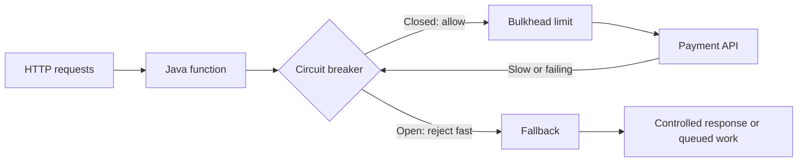
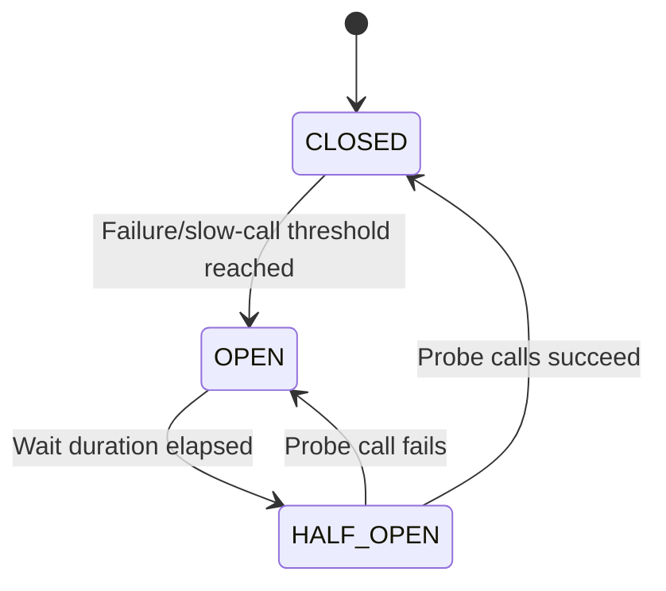
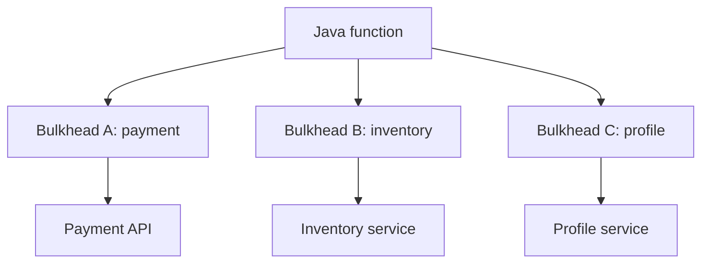

# Circuit Breakers, Bulkheads, and Fallbacks in Functions

A Java serverless function can depend on a database, payment API, identity provider, object storage, or an external HTTP service. When a dependency slows down or goes down, functions tend to hold connections and threads longer, invocation timeouts rise, queue backlogs accumulate, and compute costs keep climbing. If every invocation keeps trying to call the failing dependency, a localized fault can cascade into a system-wide outage.

Three design patterns help contain the impact: **circuit breaker**, **bulkhead**, and **fallback**. A circuit breaker temporarily stops calling a failing dependency; a bulkhead caps the number of concurrent requests allowed to consume resources; a fallback provides a defined alternative behavior when the primary path is unavailable. They complement timeouts, retries, rate limits, and idempotency rather than replacing them.

Within the scope of **CLOUD_SERVERLESS**, this lesson focuses on developing and deploying serverless applications, particularly Java functions triggered by HTTP, messages, or events. Learners handle triggers, state, access permissions, retries, idempotency, cold starts, scaling, and cost. This lesson shows how to combine circuit breakers, bulkheads, and fallbacks to protect both functions and their dependent services.

## 1. Why does a function need to protect dependencies?

Suppose a Java HTTP function calls a payment API. Normally the API responds in 100 ms. When the payment provider degrades, response time rises to 8 seconds. If the function times out after 10 seconds and there are 100 concurrent invocations, many threads and connections are held for a long time. The autoscaler may spin up additional instances, driving total requests to the payment provider even higher and worsening the incident.



Goals:

- Avoid waiting pointlessly until the function timeout expires when a dependency is failing.
- Cap how many concurrent invocations can call a dependency.
- Preserve resources for other requests and for business functionality that does not rely on the failing service.
- Return an honest response or defer work to a later processing mechanism.
- Restore traffic gradually once the dependency recovers.

## 2. What is a circuit breaker?

A circuit breaker is a stateful controller placed in front of a dependency. It observes call outcomes and decides whether subsequent calls are allowed to pass through.

A circuit breaker typically has three states:

| State | Behavior | Purpose |
|---|---|---|
| `CLOSED` | Allows requests through and records outcomes | Normal operation, monitoring failures |
| `OPEN` | Rejects new calls fast without calling the dependency | Prevents further load on a failing dependency |
| `HALF_OPEN` | Allows a small number of probe requests | Tests whether the dependency has recovered |



When the circuit is `CLOSED`, requests flow to the dependency. If the failure rate or slow-call rate crosses a threshold within the statistical window, the circuit transitions to `OPEN`. After a wait duration, it transitions to `HALF_OPEN` to test a limited number of requests. If probes succeed, the circuit closes again; if they keep failing, it opens again.

A circuit breaker is not a retry mechanism. Retries re-invoke an operation after an error; the breaker decides whether to call the dependency at all. Aggressive retries can trip a breaker faster, so the two mechanisms must be configured in coordination.

## 3. Which errors count toward the circuit breaker?

Not every exception proves the dependency is broken. For instance, an HTTP 400 caused by an invalid payload is an input error, not a reason to open the payment provider's circuit. HTTP 401/403 may indicate credential or configuration errors that require separate handling and alerting. HTTP 429 or 5xx may reflect rate limiting or a dependency-side outage.

Classify errors before configuring:

| Outcome | Should it count as a dependency failure? | Notes |
|---|---|---|
| Connection timeout/refused | Usually yes | Dependency or network is unresponsive |
| HTTP 5xx | Usually yes | Specific codes may be excluded per contract |
| HTTP 429 | Depends on contract | Usually requires backoff and honoring `Retry-After` |
| HTTP 400 from input | No | Caller or validation error |
| HTTP 401/403 | Usually handled separately | May be credential/configuration failure; requires alerting |
| Business HTTP 404 | Usually no | Non-existent resource does not necessarily mean dependency outage |
| Business decline | No | For example, a legitimate payment decline |
| Slow call exceeding threshold | Optional | Configure a separate slow-call threshold |

If the breaker counts normal business errors, the circuit can open even when the dependency is healthy. Conversely, if it only tracks thrown exceptions and ignores HTTP 5xx returned as normal responses, the breaker may fail to detect an outage. Adapters should translate responses into clearly classified results or exceptions.

## 4. Timeouts must bound each call and the total deadline

Every dependency call needs a finite timeout. Without a timeout, a request can hang indefinitely and occupy a bulkhead slot. HTTP/database clients need per-call timeouts; the entire retry chain also needs an overall deadline shorter than the invocation limit. Values are chosen based on latency distributions, SLOs, and dependency contracts.

A typical processing order:

1. Caller/function determines the overall operation deadline.
2. Bulkhead limits how many calls can occupy resources.
3. Circuit breaker decides whether calling the dependency is permitted.
4. HTTP/database client bounds each call via connect/read/request timeouts.
5. Retries only attempt transient failures and must fit within the overall deadline.
6. If unable to complete, execute fallback or return a controlled error.

The exact decorator order depends on the library and how the function is wrapped. What matters is never retrying an expired request, never holding a bulkhead permit for an unbounded wait, and never letting retries exceed the function's total timeout.

## 5. What is unique about circuit breakers in serverless environments?

Serverless instances can be created, terminated, scaled out, or reused on unpredictable schedules. A circuit breaker held in JVM memory exists only within a single instance.

This has several consequences:

- Each instance maintains its own independent breaker state.
- New instances start with a fresh breaker state, typically `CLOSED`.
- Scale-out creates many independent breakers; one instance may open its circuit while another continues calling the dependency.
- Instance recycling wipes out sliding-window statistics.
- Warm instances may serve concurrent invocations, so breaker state and metrics must be thread-safe.

Therefore, a local circuit breaker protects each instance's resources and reduces repeated calls from that instance. It does not form a global circuit breaker across the entire service. If global coordination is needed, consider an API gateway, service mesh, distributed rate limiter, or shared admission control layer. Avoid storing every breaker state in a database solely to share it if the added complexity and latency outweigh the benefits.

## 6. What is a bulkhead?

The bulkhead pattern borrows its name from watertight ship compartments: a breach in one compartment does not sink the entire ship. In software, a bulkhead isolates resources across dependencies or workload types.

Example of a function calling three dependencies:



If the payment provider slows down, only the slots allocated to payment are occupied. Requests that only need profile or inventory can continue uninterrupted if they use isolated pools/resources.

Ways to implement bulkheads:

- Semaphore bulkhead: caps the number of concurrent calls.
- Thread-pool bulkhead: uses a dedicated thread pool and bounded queue per dependency.
- Dedicated connection pools: caps database or HTTP connections per dependency.
- Separate queues/worker pools: isolates workload classes so one group cannot starve all workers.
- Platform-level concurrency caps: limits function instances or event source mapping concurrency.

## 7. Semaphore bulkheads vs. thread-pool bulkheads

| Type | How it works | Advantages | Cost/limitations |
|---|---|---|---|
| Semaphore | Allows at most N in-flight calls; caller runs on current thread | Low thread overhead, suits async or bounded synchronous I/O clients | Caller may block waiting for a permit; requires a wait timeout |
| Thread pool | Submits work to a dedicated pool with bounded threads and queue | Isolates threads and queues between dependencies | Thread/memory overhead; full queue must be handled explicitly |
| Connection pool | Caps concurrent connections to a dependency | Protects connection budget | Does not bound arbitrary work before acquiring a connection |
| Platform concurrency | Caps invocations or workers at the serverless layer | Reduces total load before entering code | Does not isolate multiple dependencies inside the same function |

In Java serverless, semaphores are often a lightweight choice for bounded blocking or async operations. Thread-pool bulkheads fit when blocking workloads must be isolated, but you must account for threads per instance multiplied by maximum scale-out instances.

## 8. Bulkheads must align with serverless concurrency

Suppose a Cloud Run instance handles 40 concurrent requests, while the payment bulkhead permits only 5 concurrent calls to the payment API. At most 5 requests call the provider; the rest fail fast or wait for a permit up to a bounded wait timeout.

If the service scales to 20 instances, total payment calls can reach roughly 100, even though each instance permits only 5. A local bulkhead does not cap global service-wide concurrency.

To protect downstream systems, calculate:

\[
Global\ calls \approx Instances \times Local\ bulkhead\ permits
\]

If a dependency can only sustain 60 concurrent calls and max instances is 20, each instance may need an average cap of at most 3 slots, or you need an additional global quota/rate limit. Remember to account for other services calling the same dependency.

Do not rely solely on `max instances`; a single instance can open multiple threads, requests, or connections. Conversely, setting a local bulkhead too low can cause internal queueing inside the function and increase timeouts. Benchmark alongside concurrency and connection pool settings.

## 9. What is a fallback?

A fallback is an alternative behavior when the primary call fails, is blocked by a circuit breaker, or lacks resources to execute. A fallback must accurately reflect business semantics.

Valid fallback examples:

- Return cached/stale data clearly marked with its last updated timestamp.
- Return `PENDING` status and an operation ID for later asynchronous processing.
- Enqueue work into a retry queue if the queue write succeeds and the caller is accurately informed.
- Route to a tested backup provider with compatible data consistency guarantees.
- Skip an optional enrichment while still completing the core business action.

Dangerous fallbacks:

- Returning `SUCCESS` even though payment has not been confirmed.
- Returning fabricated data or default values that alter business decisions.
- Writing a message to a non-durable queue and claiming it was accepted.
- Calling an already overloaded fallback dependency without bounds.
- Swallowing exceptions without recording the degraded state.

A fallback does not have to mean success. A `503` response, `202 PENDING`, or stale-labeled cache data may be far more accurate than returning a wrong result.

## 10. Choosing fallbacks by business nature

| Dependency | Potentially suitable fallback | What to avoid |
|---|---|---|
| Product/catalog read | Most recent cache, with timestamp or stale flag | Presenting cached stock/prices as real-time data |
| Profile enrichment | Skip non-essential enrichment | Fabricating user profile data or permissions |
| Payment authorization | Return `PENDING`, enqueue reconciliation if design permits | Pretending payment succeeded |
| Inventory reservation | Return pending status or temporary rejection | Confirming stock availability without reserving |
| Email notification | Store in outbox and send later | Reporting sent before provider accepted |
| Risk/fraud check | Fail closed or pending per risk policy | Failing open if skipping checks risks financial loss |
| Analytics/telemetry | Buffer or drop in a controlled manner | Breaking the core business flow over telemetry errors |

Whether to fail open or fail closed must be decided by business and security owners. For authorization, payment, fraud, and sensitive operations, defaulting to skipping a dependency is rarely safe.

## 11. Java example with Resilience4j CircuitBreaker

Resilience4j provides circuit breaker, bulkhead, retry, rate limiter, and time limiter modules for Java. The example below demonstrates configuring a circuit breaker for a payment client.

Maven dependency (manage versions via your project's BOM):

```xml
<dependency>
  <groupId>io.github.resilience4j</groupId>
  <artifactId>resilience4j-circuitbreaker</artifactId>
</dependency>
```

Creating the configuration and breaker:

```java
CircuitBreakerConfig config = CircuitBreakerConfig.custom()
        .failureRateThreshold(50)
        .slowCallRateThreshold(60)
        .slowCallDurationThreshold(Duration.ofSeconds(2))
        .slidingWindowType(CircuitBreakerConfig.SlidingWindowType.COUNT_BASED)
        .slidingWindowSize(20)
        .minimumNumberOfCalls(10)
        .waitDurationInOpenState(Duration.ofSeconds(15))
        .permittedNumberOfCallsInHalfOpenState(3)
        .automaticTransitionFromOpenToHalfOpenEnabled(true)
        .build();

CircuitBreaker breaker = CircuitBreaker.of("payment", config);
```

Set `minimumNumberOfCalls` to prevent opening the circuit on just a handful of initial calls. A count-based window fits steady traffic; a time-based window can fit traffic that varies heavily over time. Base thresholds on dependency baselines and SLAs.

Wrapping the call:

```java
Supplier<PaymentResult> protectedCall = CircuitBreaker
        .decorateSupplier(breaker, () -> paymentClient.authorize(command));

PaymentResult result = Try.ofSupplier(protectedCall)
        .recover(CallNotPermittedException.class,
                ignored -> PaymentResult.pending(command.orderId()))
        .get();
```

Using `Try` requires the Vavr dependency, or it can be replaced with plain Java `try/catch`. Only treat `CallNotPermittedException` as the circuit-open fallback; other business errors must be classified and handled separately. Never turn every exception into `pending` when the payment provider already returned a definitive outcome.

## 12. Java example with SemaphoreBulkhead

Dependency:

```xml
<dependency>
  <groupId>io.github.resilience4j</groupId>
  <artifactId>resilience4j-bulkhead</artifactId>
</dependency>
```

Configuring a semaphore bulkhead:

```java
BulkheadConfig bulkheadConfig = BulkheadConfig.custom()
        .maxConcurrentCalls(8)
        .maxWaitDuration(Duration.ofMillis(50))
        .build();

Bulkhead paymentBulkhead = Bulkhead.of("payment", bulkheadConfig);

Supplier<PaymentResult> limitedCall = Bulkhead.decorateSupplier(
        paymentBulkhead,
        () -> paymentClient.authorize(command));
```

If a permit cannot be acquired within the allowed wait duration, Resilience4j throws `BulkheadFullException`. The application must handle this per contract, such as returning `503`/`429` or offloading to a queue if a fallback is designed. Avoid waiting indefinitely for a permit.

## 13. Combining circuit breakers, bulkheads, timeouts, and retries

Patterns can be combined via decorators or annotations. Wrapping order affects behavior, so write tests verifying what happens when the circuit is open, the bulkhead is full, or retries trigger.

A synchronous example where per-call timeouts are configured on the HTTP client:

```java
Supplier<PaymentResult> call = () -> paymentClient.authorize(command);

Supplier<PaymentResult> withCircuitBreaker = CircuitBreaker.decorateSupplier(
        paymentCircuitBreaker, call);

Supplier<PaymentResult> protectedCall = Bulkhead.decorateSupplier(
        paymentBulkhead, withCircuitBreaker);

try {
    return protectedCall.get();
} catch (CallNotPermittedException circuitOpen) {
    return PaymentResult.pending(command.orderId());
} catch (BulkheadFullException overloaded) {
    throw new DependencyCapacityException("Payment capacity is full", overloaded);
}
```

In this example, the bulkhead wraps outside the circuit breaker so rejections caused by permit exhaustion are not miscounted as payment provider failures. `paymentClient` must enforce a finite timeout per request. If using `TimeLimiter` with futures or an async HTTP client, preserve the `CompletionStage` chain and pick a bulkhead compatible with async operations; a semaphore bulkhead wrapping a supplier that returns a future may release its permit as soon as the future is created, before I/O finishes. For blocking network calls, avoid the default common pool; use a dedicated executor with bounded threads and queue capacity.

Retries should only wrap operations that are safe to retry and only target transient errors. A payment request needs an idempotency key; if a timeout happens after the provider charged the card but the response was lost, retrying without idempotency can double-charge.

## 14. Configuring Resilience4j with YAML

Configuration example for Spring Boot:

```yaml
resilience4j:
  circuitbreaker:
    instances:
      payment:
        registerHealthIndicator: true
        slidingWindowType: COUNT_BASED
        slidingWindowSize: 20
        minimumNumberOfCalls: 10
        failureRateThreshold: 50
        slowCallRateThreshold: 60
        slowCallDurationThreshold: 2s
        waitDurationInOpenState: 15s
        permittedNumberOfCallsInHalfOpenState: 3
  bulkhead:
    instances:
      payment:
        maxConcurrentCalls: 8
        maxWaitDuration: 50ms
  timelimiter:
    instances:
      payment:
        timeoutDuration: 1500ms
        cancelRunningFuture: true
```

These values are illustrative starting points. `timeoutDuration` must align with HTTP client timeouts, function timeouts, and business deadlines. With blocking clients, canceling a future does not guarantee the underlying socket operation stops if the client does not support proper cancellation.

In serverless, avoid configuring oversized thread pools. If each instance spawns 40 threads and the platform scales to 30 instances, the system can create up to 1,200 threads. Calculate total resource budgets against maximum instance counts.

## 15. Should circuit breaker state be shared across instances?

A local breaker is simple and often sufficient to stop an instance from hammering a failing dependency. However, with many instances, each breaker observes only a slice of traffic, so states can diverge.

There are three options:

| Approach | When appropriate | Trade-offs |
|---|---|---|
| Local breaker in JVM | Per-instance protection, fast reaction | Distributed state; new instances lack history |
| Gateway/service mesh breaker | Need centralized policy across multiple functions/services | Adds operational components and platform coupling |
| Distributed coordinator | Need tightly controlled global quota/state | Adds latency, cost, and a new dependency |

Sharing breaker state globally is not necessary in every case. If a dependency has a global rate limit, a distributed rate limiter or queue dispatch cap may fit better than continuously synchronizing breaker state.

## 16. Warm instances and thread safety

A warm JVM can handle multiple concurrent invocations. Resilience4j's `CircuitBreaker`, `Bulkhead`, and registries are designed for concurrent use, yet surrounding application code must also be thread-safe.

Best practices:

- Initialize registries and clients at the instance scope to reuse connections and local state.
- Never store request-specific data in shared fields.
- Never use unsynchronized mutable collections for fallback caches.
- Cap HTTP connection pools and executors.
- Never assume an instance will live long enough to retain circuit state or caches.
- Expect new instances to start with fresh breaker state and monitor cold-start behavior.

Even if a function has concurrency set to 1, timeouts and breakers are still necessary; a single hung invocation can tie up the instance and grow queues. With high concurrency, bulkheads become even more critical so one dependency cannot monopolize all resources.

## 17. Fallback caches and stale data

Fallback caches are useful for slowly changing read data such as catalogs or display configuration. However, the fallback must indicate how old the data is and whether business rules still allow its use.

Example response:

```json
{
  "status": "DEGRADED",
  "source": "CACHE",
  "asOf": "2026-11-17T08:55:00Z",
  "data": {
    "currency": "USD",
    "displayRate": 1.08
  }
}
```

Serve stale data only when the domain permits it. Live inventory counts, settlement exchange rates, or access permissions may require fresh data; stale caches are not valid substitutes there.

A local cache inside a function instance is not shared across instances and disappears on instance recycle. If a shared cache is needed, choose one with explicit TTL and invalidation policies. Remember that a shared cache is itself a dependency requiring its own timeout, circuit breaker, or fallback.

## 18. Falling back to a queue or asynchronous processing

When a dependency is slow, you can offload work to a queue if the business allows deferral. For instance, an API receiving a report generation request can enqueue a job and return an operation ID instead of waiting on a busy aggregation service.

Prerequisites:

- The queue is durable and publish confirmation is received before acknowledging acceptance.
- The message carries an idempotency key and deadline.
- The client understands the status is `PENDING`, not `COMPLETED`.
- Worker retries, DLQs, and reconciliation are in place.
- Admission control protects the queue from unbounded backlog growth.

You cannot use a queue fallback to simulate success for operations needing immediate results, such as payment authorization before order confirmation. In those cases, return a transient error or pending state per the business contract.

## 19. Bulkheads by dependency type

Each dependency should have its own resource budget. For example:

| Dependency | Resources to cap | Rationale |
|---|---|---|
| Payment API | Concurrent requests, request rate, timeout | Provider quotas and transaction correctness |
| Database | Connection pool, query timeout, transaction duration | Connection limits and lock contention |
| Identity provider | Concurrent token requests, cache, timeout | Prevent auth outages from exhausting all requests |
| Object storage | Concurrent uploads/downloads, payload size | Protect network/memory and request quotas |
| Email provider | Send rate, queue depth | Avoid exceeding quotas or spamming during retries |
| Telemetry exporter | Buffer size, export timeout, drop policy | Telemetry failures must not break business operations |

Place bulkheads close to the dependency adapter so every use case routing through the adapter is protected. Still, enforce quotas at ingress/platform layers to cap aggregate load across many instances.

## 20. Distinguishing transient errors from permanent errors

Circuit breakers suit dependency outages or recurring slow calls. They are not a catch-all for every exception.

| Error type | Typically appropriate behavior |
|---|---|
| Network timeout | Bounded retry, breaker records failure, safe fallback if applicable |
| HTTP 503 | Backoff, breaker, fallback, or queue |
| HTTP 429 | Honor `Retry-After`, caller-side rate limit, breaker per policy |
| Invalid request 400 | Return validation error, do not retry, usually exclude from breaker |
| Unauthorized 401/403 | Alert on credentials/policy; do not retry continuously |
| Business decline | Return business result; do not open breaker |
| Serialization/schema error | Quarantine message or route to DLQ; fix contract |
| Bulkhead full | Fail fast/queue per contract; do not call dependency |
| Circuit open | Fallback or return degraded status without calling dependency |

If exception mapping is ambiguous, breakers can trip falsely or fail to open when needed. Adapters should translate technical errors into dedicated exception types while preserving business outcomes intact.

## 21. Coordinating circuit breakers with retries

Retries and breakers can form a harmful loop if misconfigured. For example, if each invocation retries 5 times while the outer client also retries 3 times, a single original request can trigger 15 dependency calls. If a queue also redelivers, attempts climb even higher.

Principles:

- Retry only errors likely to be transient.
- Bound total retry time within the deadline.
- Use exponential backoff and jitter.
- Avoid retrying across multiple layers simultaneously without a shared budget.
- Enforce idempotency for operations with side effects.
- Breakers must observe actual call outcomes; explicitly decide whether bulkhead/circuit-open rejections count as dependency failures.
- Exclude validation/caller errors from the dependency's failure rate.

An `OPEN` circuit should generally fail fast instead of retrying. When `HALF_OPEN`, only a small number of probes should be allowed to verify dependency recovery.

## 22. HTTP responses and message settlement during fallbacks

For HTTP triggers:

- `503 Service Unavailable` is appropriate when the function temporarily cannot accept or process the request.
- `429 Too Many Requests` is appropriate when the caller exceeds quotas or bulkhead/admission limits; optionally include `Retry-After`.
- `202 Accepted` is appropriate only when work has been durably persisted for later processing.
- Degraded/cached responses must expose source and staleness metadata if clients need to know.

For message triggers:

- If a fallback wrote the work into another durable queue, acknowledge the original message only after fallback publish confirmation and with idempotency in place.
- If the dependency failed transiently and the message needs retry, do not ack/complete the message per broker semantics.
- If the payload is permanently invalid, send it to a DLQ/quarantine per policy.
- Never ack a message simply because the circuit is open; doing so can silently drop work.

Each provider has distinct ack, lock, visibility timeout, and checkpoint semantics. Design around the actual trigger in use.

## 23. Observing circuit breakers and bulkheads

You cannot operate effectively with only the function error rate. Track the state and impact of each pattern:

| Metric | Meaning |
|---|---|
| Circuit state | CLOSED, OPEN, or HALF_OPEN per dependency |
| Circuit transitions | Count of breaker open/close transitions over time |
| Failure rate | Error percentage tracked in the sliding window |
| Slow-call rate | Percentage of calls exceeding the duration threshold |
| Not-permitted calls | Calls rejected because the circuit is OPEN |
| Bulkhead available permits | Remaining free slots |
| Bulkhead rejected calls | Calls rejected due to permit exhaustion |
| Bulkhead wait duration | Time spent waiting to acquire a permit |
| Fallback count | Fallback invocations by fallback type |
| Dependency latency | Dependency p50/p95/p99 and error rate |

Resilience4j integrates with Micrometer to export metrics. Use bounded-cardinality labels such as `dependency`, `operation`, and `outcome`; never attach request ID or customer ID to metrics.

Useful alerts:

- Circuit remains `OPEN` longer than an operational threshold.
- Breaker rapidly oscillates between `OPEN` and `CLOSED` (flapping).
- Bulkhead rejections spike sharply.
- Fallback rate rises above baseline.
- Dependency latency and error rate climb together.
- Function timeouts, queue age, or DLQ depth rise after a breaker opens.

## 24. Testing circuit breakers

Unit tests should verify state transitions using controllable clocks/schedulers or short test durations:

1. When the dependency succeeds, the breaker stays `CLOSED`.
2. Once minimum calls and failure thresholds are met, the breaker transitions to `OPEN`.
3. When `OPEN`, calls fail fast and the dependency mock is not invoked.
4. After the wait duration, the breaker transitions to `HALF_OPEN` as configured.
5. Successful probes return the breaker to `CLOSED`.
6. Failed probes return the breaker to `OPEN`.
7. Validation errors or business declines do not raise the failure rate when excluded by policy.

Bulkhead tests should confirm no more than N operations run concurrently, excess calls reject/time out properly, and permits are released whether the operation succeeds or throws an exception.

Fallback tests should verify responses never fake success, stale data includes timestamps, and messages are acknowledged only after durable fallbacks are persisted.

## 25. Testing on real serverless runtimes

Local JVM tests cannot prove how serverless instances behave under shared scale-out or real concurrency. In cloud staging, verify:

- Multiple instances spawn during bursts, each maintaining independent breaker state.
- Aggregate requests to dependencies stay within expected capacity.
- Max instances, function concurrency, and local bulkheads interact as intended.
- Cold starts do not trigger probe bursts or skew thresholds.
- Instance recycling does not lose business state or idempotency guarantees.
- Trigger retry/ack/DLQ behavior works properly when the breaker is `OPEN`.
- Queue fallbacks do not create circular loops between queues.
- Dependency recovery does not trigger a thundering herd when all instances enter `HALF_OPEN` simultaneously.

For critical dependencies, run fault injection tests in staging: inject latency, return 5xx errors, refuse connections, and step through recovery. Never inject faults into production without an approved chaos testing procedure.

## 26. Avoiding thundering herds during circuit recovery

If hundreds of instances transition to `HALF_OPEN` after the exact same wait interval, they can probe the dependency in unison. Just as the dependency recovers, that probe burst can knock it down again.

Mitigations:

- Randomize or jitter probe timing if supported by the library/architecture.
- Cap the number of probes per instance.
- Enforce rate limits/gateway controls at a shared layer.
- Ramp traffic back up gradually after health checks stabilize.
- Avoid synchronizing retries to a single timestamp.
- Use queues to drain backlogs at a controlled rate.

Local breakers only see per-instance traffic. For high-scale services, a shared admission controller or gateway manages aggregate probes and dispatch rates more effectively.

## 27. Common mistakes

| Mistake | Consequence | Fix |
|---|---|---|
| No timeouts set | Threads/connections held indefinitely | Set timeouts aligned with deadlines and dependency SLOs |
| Excessive retries | Amplifies load while dependency is failing | Retry caps, backoff, jitter, and breakers |
| Breaker counts 400 errors | Circuit opens while dependency is healthy | Separate business from technical failures |
| Treating per-instance breakers as global | Aggregate traffic still exceeds quota | Calculate instances × local permits; add global quota if needed |
| Unbounded bulkhead queues | Memory spikes and latency balloons | Bound queues or use fail-fast semaphores |
| Fallback fakes success | Corrupted business state | Return PENDING/degraded/error per semantics |
| Acking messages when breaker is open | Lost work | Keep retryable or persist durable fallback before ack |
| Using common ForkJoinPool for blocking calls | Thread starvation affecting other workloads | Use a dedicated bounded executor or async client |
| Not measuring fallbacks/rejections | Degradation goes unnoticed | Per-dependency metrics and alerts |
| All instances probe simultaneously | Thundering herd | Jitter, rate limiting, and gradual recovery |

## 28. Implementation workflow for Java functions

1. **Inventory dependencies:** Identify operations, latencies, quotas, failure modes, and criticality.
2. **Set timeouts:** Configure connect/read/request timeouts and overall deadlines.
3. **Classify errors:** Separate technical failures, slow calls, caller errors, and business outcomes.
4. **Choose breaker policies:** Sliding window, minimum calls, failure/slow thresholds, open wait, and half-open probes.
5. **Configure bulkheads:** Semaphores/thread pools/connection pools bounded per dependency.
6. **Design fallbacks:** Stale cache, queue, pending status, or rejection aligned with business semantics.
7. **Coordinate retries:** Retry transient errors within the deadline budget, with jitter and idempotency.
8. **Calculate aggregate capacity:** Instances × local permits plus other workloads sharing the dependency.
9. **Instrument:** Breaker state, transitions, rejections, fallbacks, dependency latency, and queue age.
10. **Test failure/recovery:** Fault injection, scale-out, cold starts, replays, and dependency recovery.

## 29. Production checklist

| Question | Required evidence |
|---|---|
| Does every critical dependency have timeouts? | Connect/read/request timeouts smaller than invocation deadline |
| Does the breaker count only appropriate errors? | Tested exception/HTTP status classification |
| Does the sliding window have enough samples? | Minimum calls and thresholds calibrated to real traffic |
| Are half-open probes bounded? | Configured probe count and wait duration |
| Is local vs. global breaker scope clear? | Capacity sized across instances with global quota if needed |
| Is the bulkhead bounded? | Max concurrent calls, wait timeout, and queue size |
| Are executors bounded? | No unbounded queues or common pool for blocking work |
| Are fallbacks business-accurate? | No fake success; stale/pending states clearly labeled |
| Are queue fallbacks durable? | Publish confirmation, idempotency, and proper ack ordering |
| Do retries have a budget? | Retry cap, backoff, jitter, and deadline |
| Are side effects idempotent? | Durable keys/transactions/provider idempotency |
| Are metrics and alerts in place? | Circuit state, rejections, fallbacks, and dependency health |
| Has serverless scale-out been tested? | Multiple instances, cold starts, and aggregate concurrency verified |
| Has dependency recovery been tested? | Probes, jitter, and thundering herd protection verified |
| Is there a runbook? | Clear owner, thresholds, pause/resume steps, and fallback actions |

Circuit breakers stop functions from repeatedly calling a failing dependency; bulkheads cap the resources that dependency can consume; fallbacks ensure controlled business behavior when the primary path is unavailable. In serverless, remember that breaker state usually lives inside each JVM instance, so local limits must be sized alongside max instances and global quotas. Combined with timeouts, bounded retries, idempotency, queues, and observability, Java functions isolate incidents effectively and prevent a slow dependency from bringing down the entire pipeline.
