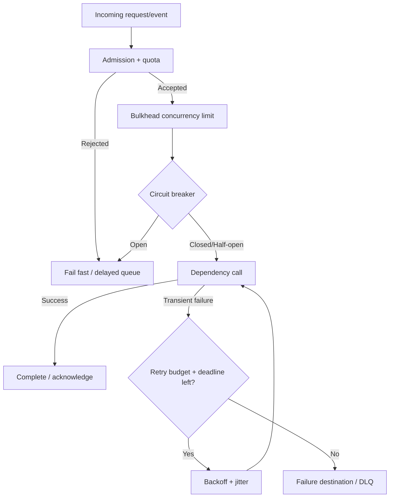
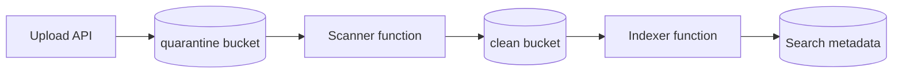

# Preventing Retry Storms and Infinite Event Loops

In serverless systems, a transient error can quickly escalate into a widespread incident. A function's database call times out, the trigger redelivers the event, a new invocation calls the database again, while the HTTP client or workflow also retries on its own. Call volume grows exponentially, pushing an already slow dependency deeper into overload. Another misconfiguration can create an event loop: a function receives an event, writes a new object into the exact path being watched, and continuously triggers itself.

A **retry storm** occurs when multiple layers retry the same operation within a short window, amplifying load and degrading recoverability. An **event loop** is a chain of events producing new events that repeatedly re-trigger one or more consumers without reaching a terminal state. Both can drive up cost, backlogs, duplicate side effects, and impact on other tenants.

This lesson focuses on designing bounded retries and preventing feedback loops in Java FaaS. The emphasis is on error classification, retry budgets, exponential backoff with jitter, deadlines, concurrency limits, circuit breakers, DLQ/redrive, idempotency, and controlling event topology/filters.

## 1. How do retry storms and event loops differ?

### 1.1. Retry storms

A retry storm typically begins with a failing dependency or a traffic burst exceeding capacity:

1. The database slows down or returns throttling errors.
2. The function fails to complete within its timeout.
3. The queue/event source redelivers the message or the caller resends the request.
4. Each invocation retries the dependency multiple times.
5. Request volume climbs while dependency capacity drops.
6. Queue backlog, timeouts, and retries keep compounding.

A small fault can spill over into other services because retries tie up threads, connections, concurrency, and quotas. When multiple services retry on fixed intervals, they can form synchronized waves of load.

### 1.2. Infinite event loops

An event loop arises when the output of a handler satisfies the trigger condition of that same handler or a chain of handlers cycles back to the starting point.

Examples:

- A function is triggered when an object is created in a bucket, then writes its output file into the same bucket/prefix.
- A function processes a database stream and updates the same record, causing the stream to emit another event.
- An event bus rule matches all events from a source while the consumer publishes events with the same source/type.
- Function A reads from queue A and writes to queue B; function B reads from queue B and writes back to queue A.
- A webhook receives a change, updates the source system, and the source system emits a new webhook.

### 1.3. Comparison table

| Phenomenon | Primary driver | Symptoms | Primary mitigations |
| --- | --- | --- | --- |
| Retry storm | Retrying the same operation while a dependency fails/overloads | Requests, invocations, timeouts, and retries surge together | Retry budget, backoff, jitter, deadlines, circuit breakers, concurrency caps |
| Duplicate delivery | Trigger delivers the same event multiple times under at-least-once semantics | Same event ID processed repeatedly | Idempotency and durable deduplication |
| Event loop | Handler produces a new event that re-triggers itself or a handler chain | Event count climbs continuously with the same entity/source repeating | Separate input/output, filters, causation/hop limits, and state transition guards |
| Backlog growth | Producer consistently outpaces consumer | Queue age and depth grow | Backpressure, admission control, bounded scaling, throttling producers |

Idempotency handles duplicate delivery, but it will not stop an event loop if each cycle mints a new event ID. A retry budget curbs retry storms, but it will not fix a self-triggering event topology. Apply the right mitigation for each failure mode.

## 2. Identifying every layer capable of retrying

### 2.1. Retries can happen in many places

Within a single serverless request, retries can occur in:

- The caller's HTTP client or SDK;
- The API gateway, proxy, or service mesh via policy;
- Java application code calling HTTP/database SDKs;
- The function platform during asynchronous invocations;
- The queue/event source mapping when a message is unacknowledged;
- The stream consumer when a batch/checkpoint fails;
- The workflow orchestrator at each task step;
- Downstream services retrying their own sub-operations.

Map retries for every dependency. Without knowing which layer owns retries, it is easy to accidentally enable retries everywhere.

### 2.2. Nested retries multiply call counts

Suppose an HTTP client tries up to 3 times per invocation, the function platform delivers up to 3 times, and a workflow invokes the function up to 3 times. In the worst case, a single business operation can generate up to:

\[
Attempts_{total} = 3 \times 3 \times 3 = 27
\]

Here each number represents total attempts including the first call. If each layer is configured as 3 retries plus the initial attempt, total attempts can reach:

\[
(3+1) \times (3+1) \times (3+1) = 64
\]

This illustrates nested retries rather than a universal formula across all platforms; queues, workflows, and HTTP can have different semantics. What matters is defining a total retry budget for a business operation instead of inspecting each SDK's retry count in isolation.

### 2.3. Choosing a retry owner

For each boundary, explicitly document which component owns retries:

| Boundary | Typically suitable retry owner | What must be specified |
| --- | --- | --- |
| HTTP caller → API | Caller or one designated client/gateway layer | Idempotency key, retryable statuses, total deadline |
| Function → HTTP dependency | Single HTTP client policy | Timeout, retryable statuses/exceptions, attempt budget |
| Async function invocation | Platform async delivery policy | Retry window/count, failure destination |
| Queue → function | Queue/event source | Visibility/lease, receive count, DLQ, batch failure behavior |
| Stream → function | Event source/checkpoint policy | Batch retry, poison records, ordering/partition impact |
| Workflow → task | Workflow orchestrator | Retry/Catch, backoff, timeout, compensation |
| Function → database | Driver/client at an appropriate level | Transaction retries, deadlock/serialization handling |

Never let function code, SDKs, queues, and workflows all retry the same failure unboundedly. When one layer already manages delivery retries, inner code should generally perform at most minimal retries for brief transient faults and fit within the overall deadline.

## 3. Classifying errors before retrying

### 3.1. Transient errors

Transient errors are likely to resolve after a short wait:

- Connection resets or network timeouts;
- Throttling/rate limits with retry guidance;
- Service unavailable or dependency undergoing failover;
- Transaction serialization/deadlock errors where retrying the full transaction is safe;
- Temporary DNS or endpoint unavailability.

Bounded retries with backoff may be appropriate. Verify the operation is safe to re-run.

### 3.2. Permanent errors or business rejections

Cases that generally should not be retried:

- Invalid schema payloads or missing required fields;
- Data violating business rules;
- Non-existent resources per contract;
- Invalid credentials or IAM denials caused by misconfiguration;
- Requests exceeding business quotas;
- Unsupported event versions;
- Policy-violating data.

Retrying these errors only adds load and delays routing faulty messages to the failure path. Return a clear error, reject, quarantine, or route to a DLQ depending on the trigger.

### 3.3. Unknown outcomes

A difficult case is timing out after downstream committed a side effect but before the caller received the response. The caller does not know whether the operation succeeded.

For example, a payment provider charged the card, but the connection reset before the response arrived. Retrying the charge with a new request can double-charge the customer. For unknown outcomes:

- Query status by idempotency key or operation ID;
- Use provider-supported idempotency keys;
- Reconcile before resending;
- Never blindly retry a non-idempotent side effect.

### 3.4. Error classifier

Separate retry decisions from operation execution code. For example:

```java
public enum FailureKind {
    TRANSIENT,
    THROTTLED,
    PERMANENT,
    CONFIGURATION,
    UNKNOWN_OUTCOME
}

public final class RetryClassifier {
    private RetryClassifier() {}

    public static boolean shouldRetry(FailureKind kind) {
        return kind == FailureKind.TRANSIENT
                || kind == FailureKind.THROTTLED;
    }
}
```

`UNKNOWN_OUTCOME` must not automatically be treated as transient. The application needs reconciliation/idempotency before deciding to retry.

## 4. Bounded retries: attempts, deadlines, and budgets

### 4.1. Limiting attempt counts

Every retry policy needs:

- Maximum attempts, clearly specifying whether it includes the first attempt or retries only;
- Maximum total elapsed duration;
- Per-attempt timeout;
- Retryable error types;
- Minimum/maximum delay bounds;
- Stopping conditions when the caller's deadline expires or the invocation nears timeout.

Never configure infinite retries for synchronous requests. For queues, deliveries can span retention windows, but you still need receive limits, DLQs or failure destinations, and a redrive policy.

### 4.2. Exponential backoff

Exponential backoff increases the wait interval after each failure:

\[
Delay_n = \min(MaxDelay, BaseDelay \times 2^n)
\]

Where `n` is the number of retries already attempted. Backoff slows the request rate hitting a struggling dependency.

### 4.3. Jitter

If all clients retry after exactly 1, 2, 4, and 8 seconds, they can stay synchronized and produce new traffic spikes. Jitter adds randomness to wait durations.

A popular choice is full jitter:

\[
Delay_n = Random(0, \min(MaxDelay, BaseDelay \times 2^n))
\]

Jitter spreads retries over time, reducing the chance that many functions hit the dependency at the exact same instant.

### 4.4. Java: computing exponential backoff with full jitter

```java
import java.util.concurrent.ThreadLocalRandom;

public final class RetryDelay {
    private RetryDelay() {}

    public static long fullJitterMillis(
            int retryNumber,
            long baseDelayMillis,
            long maxDelayMillis) {

        if (retryNumber < 0 || baseDelayMillis <= 0
                || maxDelayMillis < baseDelayMillis) {
            throw new IllegalArgumentException("Invalid retry delay settings");
        }

        long cap = baseDelayMillis;
        for (int i = 0; i < retryNumber && cap < maxDelayMillis; i++) {
            cap = cap > maxDelayMillis / 2
                    ? maxDelayMillis
                    : Math.min(maxDelayMillis, cap * 2);
        }

        // maxDelayMillis should be bounded well below Long.MAX_VALUE.
        return ThreadLocalRandom.current().nextLong(cap + 1);
    }
}
```

For instance, with a 200 ms base and 10,000 ms max, retry 0 picks a random delay from 0 to 200 ms; retry 4 has a 3,200 ms cap. In tests, inject a random source or separate cap calculation from randomness for deterministic verification; never use `Thread.sleep()` to test the algorithm.

### 4.5. Overall retry budgets

A retry budget caps the total retry volume allowed over a time window or group of requests. For example, allow retries up to a maximum ratio of original requests, or allow a fixed pool of retry tokens per window.

A retry budget can be scoped:

- Per request/business operation;
- Per function/service;
- Per tenant;
- Per dependency;
- System-wide via gateway or platform controls.

A local budget inside one JVM is not a service-wide budget. When global bounds are needed, use a gateway, queue, distributed limiter, or suitable control plane. Once the budget is exhausted, fail fast or route events to delayed retry/failure paths per contract; stop generating extra load.

## 5. Deadline and timeout propagation

### 5.1. Total deadline matters more than individual timeouts

Suppose an HTTP request has a 3-second deadline. If the function spends 2 seconds on the initial attempt and then retries 3 more times with 2-second timeouts each, the caller gave up long ago while the function keeps burning resources.

Propagate the deadline or remaining time across layers. Before each attempt:

1. Compute remaining time;
2. Subtract reserve needed for serialization/response/cleanup;
3. Set the dependency timeout below remaining time;
4. Do not start a retry if insufficient time remains for a meaningful attempt.

### 5.2. Java: checking remaining deadline

```java
import java.time.Duration;
import java.time.Instant;

public final class Deadline {
    private final Instant expiresAt;

    public Deadline(Instant expiresAt) {
        this.expiresAt = expiresAt;
    }

    public Duration remaining(Instant now) {
        Duration value = Duration.between(now, expiresAt);
        return value.isNegative() ? Duration.ZERO : value;
    }

    public boolean canStart(Duration minimumAttemptBudget, Instant now) {
        return remaining(now).compareTo(minimumAttemptBudget) >= 0;
    }
}
```

In production, inject a `Clock` for testability; for internal timeout measurement within a single process, a monotonic clock like `System.nanoTime()` is preferable to wall clock because system clocks can jump. When propagating deadlines over the network, transmit expiration timestamps/remaining budgets per contract and account for clock skew.

### 5.3. Never let inner timeouts exceed outer timeouts

HTTP client, database statement, function runtime, gateway, and workflow timeouts must be ordered sensibly. If the gateway times out before the function, the caller may retry while the old function is still running. If the function times out after the queue visibility timeout expires, the message can be redelivered while the earlier invocation is still active.

Design timeouts around the ordering and semantics of each platform. No single number fits every trigger.

## 6. Circuit breakers, bulkheads, and load shedding

### 6.1. Circuit breakers

A circuit breaker stops repeated calls to a failing dependency. Three standard states:

- **Closed:** Allows requests; monitors failures.
- **Open:** Fails fast for a configured wait duration.
- **Half-open:** Allows a limited number of probes to determine whether the dependency has recovered.

Circuit breakers let functions fail fast instead of tying up connections/threads on requests destined to fail. They do not replace retry policies; combine both so retries stay within budget and the breaker opens when failures climb.

### 6.2. Bulkheads

Bulkheads partition resources by dependency or workload class. For example, the payment API uses a separate pool/concurrency budget from report generation. When one dependency slows down, it cannot starve threads or connections needed by unrelated business flows.

In FaaS, bulkheads can be implemented via dedicated concurrency limits, separate queues, separate functions, or isolated connection pools. A semaphore inside one JVM only protects a single execution environment; system-wide quotas must be enforced at the platform/gateway/queue layer.

### 6.3. Load shedding

When the system nears overload, shed low-priority work or requests that cannot complete within the deadline early. Over HTTP, return 429/503 per the API contract with `Retry-After` when appropriate. With queues, never ack unpersisted messages; instead reduce consumer concurrency to apply backpressure.

Never shed load by silently dropping events. If work cannot be processed immediately, hold events in a queue/durable store or route to a failure path.

### 6.4. Combining mechanisms

A dependency protection flow might look like:



## 7. Retries by serverless trigger type

### 7.1. Synchronous HTTP

HTTP callers expect an immediate response within the request. If a client retries on timeout, the prior request may still be executing. Therefore:

- APIs should support idempotency keys for operations creating side effects;
- Retry only errors defined as retryable;
- Enforce an overall deadline and jitter;
- Return status/error codes distinguishing validation, throttling, and transient failures;
- Never retry non-idempotent POST requests merely because the client received no response.

### 7.2. Asynchronous invocation

Platforms can retry when a function throws an error or fails to complete, governed by service policy. Configure retry counts/windows, maximum event age, and failure destinations/DLQs per platform capabilities.

Functions must be idempotent because the same event can be redelivered. Never assume an event runs exactly once. Monitor event age, retry counts, and failure destinations.

### 7.3. Queue triggers

Queues typically deliver messages at least once. If a consumer fails to acknowledge/delete before the visibility/lease expires, the message can be redelivered. Ensure:

- Visibility timeout aligns with processing duration and function timeout;
- Receive count/max delivery limits are configured;
- DLQ and redrive policies are configured;
- Batch failure semantics and partial batch responses are handled if supported;
- Idempotency is enforced at the persistence boundary;
- Concurrency caps match downstream capacity.

If one record in a batch fails, the platform may redeliver the entire batch unless partial failure responses are supported. Test the exact semantics of your trigger.

### 7.4. Stream triggers

In stream partitions/shards, a failure on a single record can stall checkpoint advancement and block subsequent records. Infinite retries can pin a shard and drive up lag. Define:

- Maximum retries or maximum record age;
- Batch bisection or partial batch failure handling if supported;
- Failure destination for unprocessable records;
- Ordering requirements;
- Strategies to isolate poison records without skipping valid data.

Never send a failing record to a DLQ and advance the checkpoint when business rules demand strict ordering/consistency without a replay and reconciliation procedure.

### 7.5. Workflow orchestrators

Workflows typically define per-task retry policies alongside Catch/compensation branches. Do not let a workflow retry 5 times while an SDK inside the task also retries 5 times without accounting for the combined total. Every task needs clear timeouts, error classification, retry counts, and compensation semantics.

### 7.6. Failure path selection table

| Error type | HTTP | Queue/event | Workflow |
| --- | --- | --- | --- |
| Validation/permanent | Return 4xx per contract | Reject/DLQ/quarantine | Catch and terminate error branch |
| Throttling/transient | 429/503 or retryable error | Delay/backoff or withhold ack per policy | Bounded retry |
| Permission/configuration | Alert operations, do not hammer with retries | DLQ/disable consumer if needed | Fail fast and alert |
| Unknown side-effect outcome | Query by idempotency key | Reconcile before redelivery | Reconcile/compensate before retry |
| Retry budget exhausted | Return error/operation status | DLQ/failure destination | Catch/compensation/manual intervention |

## 8. Dead-letter queues and safe redrive

### 8.1. A DLQ is not a trash can

A DLQ holds events that could not be processed after policy retries. Every message needs sufficient metadata for investigation:

- Event/message ID;
- Source queue/topic and event type/version;
- Last delivery/attempt count if available;
- Error category and timestamp;
- Correlation/causation IDs;
- Consumer/function version;
- Schema version and idempotency key.

Never write credentials, signed URLs, or full sensitive payloads into logs/alerts. Payloads inside a DLQ still require encryption, retention policies, and access controls.

### 8.2. Redrives must not trigger a new retry storm

Before redriving:

1. Classify the root cause of failure;
2. Fix code/config/dependency or verify the transient issue has cleared;
3. Inspect event schemas and data age;
4. Confirm consumers are idempotent;
5. Start with a small batch or rate-limited replay;
6. Monitor success, retries, and downstream capacity;
7. Halt redrive if error rates or backlogs spike.

Never set up an infinite auto-redrive loop from a DLQ back to the source queue. For permanent errors, redriving only increases cost and duplicate processing.

### 8.3. Controlled replay

Replays can run via dedicated jobs, queue replay tools, or workflows. Preserve original event IDs for deduplication, and attach a replay run ID/attempt metadata for tracing. If a new business action requires generating a new event ID, clearly distinguish it from redelivering an old event.

Throttle replay rates below the safe capacity of consumers and dependencies. Partition replays by tenant or time range to minimize blast radius.

## 9. Idempotency: safe retries

### 9.1. Why do retries require idempotency?

At-least-once delivery can invoke a handler multiple times. A timeout also does not prove that side effects did not occur. Idempotency guarantees that the same logical operation never produces duplicate business outcomes.

Idempotency keys should derive from stable event IDs or business operation IDs—never invocation IDs or trace IDs. Define the exact scope: tenant, operation type, and key.

### 9.2. Inbox/deduplication records

Consumers can insert the event ID into an inbox table enforced by a unique constraint. Within the same transaction, mark the event processed and apply business changes. On duplicate delivery, the transaction skips re-applying side effects.

```java
public interface InboxRepository {
    // Returns true only when this event is inserted for the first time.
    boolean insertIfAbsent(String consumerName, String eventId);
}

public interface TransactionRunner {
    void execute(Runnable work);
}

public final class PaymentEventHandler {
    private final TransactionRunner transactions;
    private final InboxRepository inbox;
    private final PaymentRepository payments;
    private final OutboxRepository outbox;

    public PaymentEventHandler(
            TransactionRunner transactions,
            InboxRepository inbox,
            PaymentRepository payments,
            OutboxRepository outbox) {
        this.transactions = transactions;
        this.inbox = inbox;
        this.payments = payments;
        this.outbox = outbox;
    }

    public void handle(PaymentCaptured event) {
        transactions.execute(() -> {
            boolean firstDelivery = inbox.insertIfAbsent(
                    "payment-captured-consumer", event.eventId());
            if (!firstDelivery) {
                return;
            }

            payments.markCaptured(event.paymentId(), event.amount());
            outbox.append(new ReceiptRequested(
                    "receipt:" + event.eventId(), event.paymentId()));
        });
    }
}
```

This example assumes the inbox, payment state, and outbox reside in the same transactional database. `insertIfAbsent` must be protected by a unique constraint and participate in the same transaction; performing a non-atomic check followed by an insert allows two concurrent invocations to process simultaneously. The outbox publisher emits events post-commit and may publish duplicates, so downstream consumers must also be idempotent.

### 9.3. Side effects outside the database

If a function calls a payment provider, sends an email, or invokes an external API, a database transaction cannot automatically roll back those side effects. Options include:

- Provider-supported idempotency keys;
- Transactional outbox to record the send intent in the DB for a worker to execute;
- A state machine tracking `PENDING`, `SENT`, `CONFIRMED`, and `UNKNOWN`;
- Reconciliation queries by operation ID;
- Compensation when business rules permit.

Never hold a database transaction open while waiting on a long HTTP call. Decoupling state transitions and external side effects via workflows/outboxes is much safer.

### 9.4. TTL of idempotency records

TTL must outlast the real-world retry/redelivery/replay window. Expiring records too early allows an older replayed event to trigger side effects again. For payments or ledgers, keys may need long-term retention or permanent business history per retention policy.

## 10. Preventing event feedback loops

### 10.1. Design unidirectional topologies whenever possible

Name resources by their input/output roles and keep them separate:



Scanner only receives events from quarantine and writes to clean. Indexer only receives events from clean and writes metadata to the database. Never let Scanner listen to the clean bucket or let Indexer listen to its own status table without explicit filtering.

### 10.2. Separate input and output resources

Strong isolation relies on dedicated resources:

- Separate buckets/prefixes for uploads and outputs;
- Separate queues/topics for commands and results;
- Separate tables for event logs and projections;
- Distinct event types for inputs and outputs;
- Dedicated subscriptions scoped by consumer responsibility.

If sharing a resource is unavoidable, apply strict prefix/attribute filters and test events emitted by the function itself.

### 10.3. Filter by source, type, and state

Event rules should filter on:

- `source` identifying valid producers;
- `detail-type`/event type specifying handled events;
- Specific resources/prefixes;
- Actual state transitions requiring handling;
- Operation/event names such as `INSERT` or a specific update kind;
- Metadata tagging output/internal events.

Never subscribe to every event and filter only inside the handler when the broker/router can drop irrelevant events upfront. Filtering at the routing layer cuts invocations, cost, and loop risk.

### 10.4. Guards for database streams

If a function reads a table stream and updates that same table, the update can emit a new stream record. Process only necessary events:

- Filter by operation type;
- Trigger only when target business fields change;
- Ignore updates caused by the consumer's own projection/metadata writes;
- Write projections to a separate table when appropriate;
- Use conditional updates to avoid emitting events when state has not changed.

For example, a consumer handles `ORDER_CREATED` and updates `status=PROCESSING`. If the stream also emits events on status updates and the handler triggers on every `MODIFY`, it can form a loop. Filter on explicit transitions and inspect old/new images where supported by the platform.

### 10.5. Guards for object storage

A function triggered by object-created events should not write outputs into the same prefix watched by the trigger. Options:

- Use separate input and output buckets;
- Use `incoming/` prefix for triggers and `processed/` for outputs;
- Filter by suffix or metadata where appropriate;
- Ensure temporary/manifest files do not match trigger rules.

If outputs must live in the same bucket, scope event notifications strictly to the input prefix. Never rely on obscure temporary filenames to prevent loops.

## 11. Causation ID, hop count, and event lineage

### 11.1. Event envelopes with clear lineage

An internal event envelope can carry:

```json
{
  "eventId": "evt-1002",
  "source": "orders-service",
  "type": "OrderPaid",
  "occurredAt": "2026-11-17T10:15:30Z",
  "correlationId": "checkout-77",
  "causationId": "evt-1001",
  "hopCount": 2,
  "data": {
    "orderId": "order-42"
  }
}
```

Where:

- `eventId` uniquely identifies the current event;
- `correlationId` ties together a workflow/business operation;
- `causationId` identifies the event that directly caused the current event;
- `hopCount` counts steps along the event chain by internal convention;
- `source` and `type` describe the origin and event kind.

Trace IDs serve observability; correlation/causation serve business lineage. Do not collapse everything into a single ID.

### 11.2. Hop/depth limits

For internal event chains, enforce a maximum hop count or maximum workflow depth. When exceeded:

- Stop publishing downstream events;
- Record a `LOOP_SUSPECTED` status or failure record;
- Fire an alert containing event lineage;
- Quarantine/persist the payload in a failure store for investigation.

Hop count is a secondary guard, not a replacement for proper routing/filters. If every cycle generates a new envelope and resets the hop count, the loop continues. Trust hop metadata only when created by authenticated internal producers; validate/normalize metadata from external callers.

### 11.3. Java: creating child events with lineage

```java
import java.time.Instant;
import java.util.UUID;

public record EventEnvelope<T>(
        String eventId,
        String source,
        String type,
        Instant occurredAt,
        String correlationId,
        String causationId,
        int hopCount,
        T data) {
}

public final class EventFactory {
    private static final int MAX_HOPS = 8;

    private EventFactory() {}

    public static <T> EventEnvelope<T> childOf(
            EventEnvelope<?> parent,
            String source,
            String type,
            T data) {

        if (parent.hopCount() >= MAX_HOPS) {
            throw new EventLoopSuspectedException(
                    "Maximum event chain depth exceeded");
        }

        return new EventEnvelope<>(
                UUID.randomUUID().toString(),
                source,
                type,
                Instant.now(),
                parent.correlationId(),
                parent.eventId(),
                parent.hopCount() + 1,
                data);
    }
}
```

`EventLoopSuspectedException` is an application exception. In production, inject `Clock` and an ID generator for deterministic testing. `MAX_HOPS` must match real workflows; avoid setting a threshold so low that legitimate chains get blocked. Hop count must also be preserved across brokers and never reset inside adapters.

### 11.4. Loop guards do not replace sound topology

If event A generates B, B generates C, and C generates a new A, hop counts will catch the chain only after burning resources. It is far better to block cycles upfront via rules/filters and ensure consumers never subscribe to their own outputs.

## 12. Breaking loops via state and business transitions

### 12.1. Emit events only when state actually changes

Repeating an update with the exact same value should not blindly emit a new event. Use conditional updates or compare-and-set:

```sql
UPDATE orders
SET status = 'PROCESSING', updated_at = CURRENT_TIMESTAMP
WHERE order_id = :orderId
  AND status = 'CREATED';
```

Only when the updated row count equals 1 has the transition taken place, allowing `OrderProcessingStarted` to be emitted. If zero rows were updated, the event was already processed or the state is invalid; do not publish another identical event.

### 12.2. Event types must express transitions

Prefer events describing concrete facts (`OrderPaid`, `InventoryReserved`) over generic events (`OrderUpdated`). Generic events force consumers to guess which field changed and easily cause loops when consumers write metadata back.

### 12.3. Commands and events are distinct

A command asks a service to perform an action; an event announces a fact that already happened. If a consumer receives an event and dispatches a command back to the original producer without a state guard, a feedback loop can form. Separate command and event channels, assign clear ownership, and never subscribe to your own output.

## 13. Transactional outbox and avoiding duplicate publishing

### 13.1. The dual-write problem

If a function writes to a database and publishes an event in two separate operations, two failure modes arise:

- Database commit succeeds while publish fails: state changed without an event;
- Publish succeeds while database rolls back/fails: consumers receive an event for uncommitted state.

A transactional outbox writes business changes and the event record in the same database transaction. A publisher reads the outbox and dispatches events; because the publisher may retry on lost acknowledgements, downstream consumers still need idempotency.

### 13.2. Outbox alone does not stop event loops

An outbox ensures events are not lost between database commit and publish, yet if a business handler creates a new state transition/event every time it receives an event, the outbox will faithfully publish the loop. Combine the outbox with:

- Transition guards;
- Explicit event types/filters;
- Idempotency;
- Causation lineage;
- Hop/depth limits;
- Alerts on anomalous event rates.

## 14. Detecting retry storms and event loops in production

### 14.1. Metrics for retry storms

Monitor:

- Attempts per business operation;
- Retry rate by dependency and error class;
- Timeout/throttle/5xx rates;
- Circuit breaker states and rejected calls;
- Queue depth and oldest message age;
- DLQ depth;
- Function concurrency, duration, and throttles;
- Downstream connections/CPU/latency;
- Retry budget exhaustion.

A useful ratio:

\[
RetryAmplification = \frac{TotalAttempts}{OriginalOperations}
\]

If each business operation averages 4 downstream calls, retry amplification is 4. Track this over time and per dependency to spot retry storms early.

### 14.2. Metrics for event loops

Monitor:

- Event counts by source/type/resource;
- Event generation rate relative to business operation rate;
- Hop count distribution;
- Number of events generated per correlation ID/causation chain;
- Event age and number of returns to the same consumer;
- Function invocation rate and cost by trigger;
- Repeated state transitions;
- DLQ and loop-suspected counts.

If a business action normally emits 2 events and suddenly produces thousands under the same correlation ID, alert immediately.

### 14.3. Structured lineage logging

Log fields:

- `eventId`, `correlationId`, `causationId`;
- `source`, `eventType`, `consumerName`;
- `hopCount`, `deliveryAttempt`, `replayRunId`;
- `functionVersion`, `requestId`, `traceId`;
- `result`, `errorCategory`, `retryDecision`.

Do not attach all these high-cardinality IDs as metric labels. Use logs/traces to investigate individual events; keep metric labels low-cardinality such as source, type, result, and dependency.

## 15. Kill switches and incident response procedures

### 15.1. Preparing kill switches

For consumers at risk of feedback loops, prepare safe shutoff controls:

- Disable the event source mapping/subscription;
- Pause the rule/route causing the loop;
- Lower concurrency or pause the consumer;
- Enable a feature flag blocking publication of suspected event types;
- Route events to quarantine instead of continuing processing.

Kill switches must be guarded by operational permissions, audit logging, and recovery procedures. Never purge queues or event data to "clear" a loop before assessing data loss implications.

### 15.2. Retry storm playbook

1. Identify the overloaded dependency and retry owners across layers.
2. Reduce concurrency/admission rates to relieve load.
3. Trip circuit breakers or disable redundant retry layers per runbook.
4. Inspect timeouts, connection pools, and error classification.
5. Keep messages durable; never ack unprocessed work.
6. Route poison/permanent failures to the DLQ.
7. Restore retries only after the dependency stabilizes and budgets align.
8. Redrive in small batches while monitoring queue age and downstream capacity.

### 15.3. Event loop playbook

1. Use event ID/correlation/causation IDs to trace the event generation chain.
2. Pinpoint which trigger/rule/consumer first re-emitted the event.
3. Disable the route/subscription or activate a minimal-blast-radius kill switch.
4. Hold events in the queue/quarantine and preserve evidence.
5. Fix filters, separate input/output resources, or add state transition guards.
6. Add idempotency and hop limits as defense-in-depth.
7. Verify that events emitted by the function do not unintentionally re-trigger consumers.
8. Resume at a throttled rate and replay valid data.

## 16. Testing retries and event loops

### 16.1. Unit-testing retry policies

Verify:

- Transient errors retry; permanent errors do not;
- Attempt counts never exceed the max;
- Delays follow the exponential cap;
- Jitter stays within valid bounds;
- Expired deadlines prevent starting new attempts;
- Exhausted retry budgets halt retries;
- Unknown outcomes trigger reconciliation.

Inject `Clock`, random sources, and sleeper abstractions. Never rely on real wall-clock waiting in unit tests.

### 16.2. Integration-testing duplicates and partial failures

Simulate:

- Side effect committed but acknowledgement failed;
- Identical message delivered twice;
- Two invocations with the same event ID running concurrently;
- Batch containing a failing record;
- Worker timing out after processing part of a batch;
- Redrive from a DLQ hours or days later.

Assert final business side-effect counts, not just mock invocation counts.

### 16.3. Testing event loops

Build a test graph containing input and output events. Verify:

- Output prefixes/topics do not match input filters;
- Function-emitted event types do not match input rules;
- Metadata updates do not trigger new business transitions;
- Exceeding hop count is blocked and fires an alert;
- Duplicate identical events produce no repeated side effects;
- Legitimate multi-step chains still run end-to-end.

Tests must never create real infinite loops. Use step-bounded simulators or short timeouts in isolated environments.

### 16.4. Failure injection

In staging, simulate dependency timeouts, throttling, network resets, queue delays, and consumer crashes. Confirm retries throttle down, circuit breakers open, backlogs remain durable, and recovery does not trigger a second retry storm.

Never run unbounded chaos tests in production. Define blast radius, traffic caps, duration, and abort conditions beforehand.

## 17. Example business-aligned retry policy configuration

A policy can be expressed in secret-free configuration:

```yaml
retryPolicy:
  maxAttempts: 4 # includes the initial attempt
  baseDelay: 200ms
  maxDelay: 5s
  strategy: exponential-full-jitter
  totalDeadline: 12s
  retryableErrors:
    - THROTTLED
    - TRANSIENT_NETWORK
    - TEMPORARY_UNAVAILABLE
  nonRetryableErrors:
    - VALIDATION
    - AUTHORIZATION
    - BUSINESS_REJECTED
  unknownOutcome:
    action: RECONCILE_BEFORE_RETRY
```

This is an illustrative schema, not a standard cloud provider format. Adapters must map it to SDK/platform policies and verify total attempts across layers. Here `maxAttempts` includes the initial call.

## 18. Production checklist

- [ ] Mapped every layer capable of retrying from caller to dependency.
- [ ] Each boundary has a clear retry owner and overall budget.
- [ ] Classified transient, throttled, permanent, configuration, and unknown outcomes.
- [ ] Retries enforce max attempts, max delay, and total deadline.
- [ ] Exponential backoff includes jitter.
- [ ] Per-attempt timeouts never exceed remaining deadline.
- [ ] Non-idempotent side effects are never retried when outcome is unknown.
- [ ] Critical dependencies are protected by circuit breakers, bulkheads, or concurrency caps.
- [ ] Queues have appropriate visibility/leases, receive limits, DLQs, and redrive policies.
- [ ] Stream poison records do not stall partitions indefinitely beyond policy.
- [ ] Batch partial failures are handled per trigger semantics.
- [ ] Consumers are idempotent at persistence boundaries.
- [ ] Outbox/inbox or reconciliation protects dual writes and external side effects.
- [ ] Input and output event resources or prefixes are clearly separated.
- [ ] Event rules filter by source, type, resource, and state transition.
- [ ] Database streams ignore consumer-generated updates that are not business events.
- [ ] Events include event ID, correlation ID, causation ID, and hop/depth metadata.
- [ ] Hop count is preserved across producers/consumers and never arbitrarily reset.
- [ ] Kill switches and runbooks exist for retry storms and event loops.
- [ ] Metrics track retry amplification, queue age, event rates, and hop counts.
- [ ] DLQ replays are rate-limited and checked for idempotency.
- [ ] Unit/integration tests cover retries, duplicates, partial failures, and loop guards.
- [ ] Failure injection runs in isolated environments with bounded blast radius.

## Conclusion

Retries are a recovery mechanism, yet unbounded retries or simultaneous retries across multiple layers amplify incidents. Classify errors, designate a retry owner, cap max attempts and total deadlines, apply exponential backoff with jitter, limit concurrency, and open circuit breakers when dependencies cannot serve traffic. For queues and streams, configure visibility/leases, batch failures, DLQs, and redrives according to real trigger semantics.

Event loops are topology or routing errors where outputs become inputs. Separate input and output resources, filter by source/type/prefix/state transitions, and emit events only on genuine business state changes. Causation IDs, hop counts, idempotency, and kill switches provide defense-in-depth; they do not replace a directed event topology with strict filters.

In Java FaaS, retry handling must honor remaining deadlines and enforce idempotency where side effects commit. Monitor retry amplification, queue age, event lineage, and downstream saturation for early detection. Test duplicates, partial failures, retry storms, and event loops in isolated environments before deploying configurations to production.
