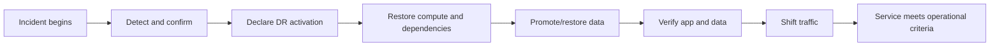
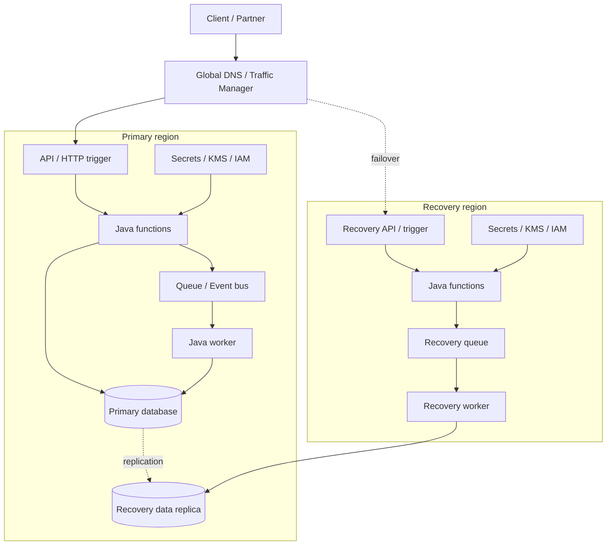

# Designing Disaster Recovery Around RTO and RPO

Serverless makes redeploying compute fast and reduces server management, yet it does not automatically guarantee your application can recover when a region, database, queue, identity provider, or downstream service fails. A Java function can be re-created in minutes, whereas data may take hours to restore, secrets may be missing in the standby region, queues may not be switched over, or DNS may still point at the failing endpoint.

Disaster recovery (DR) is the capability to restore services and data after a major disruption. The two most critical targets for designing and measuring DR are **Recovery Time Objective (RTO)** and **Recovery Point Objective (RPO)**. RTO bounds how long the service may remain disrupted; RPO bounds how much data can be lost measured in time. Both objectives must derive from business impact before choosing backup, replication, failover, and serverless architecture strategies.

This lesson covers defining RTO/RPO, classifying workloads, choosing DR strategies, designing multi-region Java serverless architectures, protecting data and events, orchestrating failover/failback, writing runbooks, and running measurable recovery tests.

## 1. What are RTO and RPO?

**RTO (Recovery Time Objective)** is the maximum target duration to restore a service after a disruption. It answers: *From the moment an incident starts, how long can we tolerate losing service availability?*

**RPO (Recovery Point Objective)** is the maximum time window of data loss an organization accepts during recovery. It answers: *After recovery, how far back in time can data revert relative to when the incident occurred?*

For example, an order processing service has:

- Target RTO: 60 minutes.
- Target RPO: 5 minutes.

If the primary region goes down at 10:00, the service must resume operations by 11:00 at the latest. Recovered data may miss at most 5 minutes of the newest transactions, meaning the recovery point must reach at least 09:55. These are design targets, not proof that the system meets them automatically. You must measure them via replication lag, restore duration, traffic cutover time, and business validation testing.

### How do RTO and RPO differ?

| Attribute | RTO | RPO |
|---|---|---|
| Focuses on | Service downtime duration | Data loss measured in time |
| Common units | Minutes, hours | Seconds, minutes, hours |
| Measured by | Incident start until service meets recovery acceptance criteria | Latest consistent recoverable data timestamp relative to incident start |
| Driven by | Detection, decision, deployment, restore, failover, verification, and traffic cutover | Backup frequency, replication lag, transaction durability, and recoverability |
| Example | Recover within 30 minutes | Tolerate at most 2 minutes of data loss |

RTO is not just how long a deploy command takes. Nor is RPO simply backup frequency. A backup job running every 5 minutes does not guarantee a 5-minute RPO if the backup takes 10 minutes to finish, captures inconsistent state, or fails to restore.

### Milestones to measure



The span from A to H is the actual recovery time compared against RTO. The recovery point is determined by the latest consistent, usable data after step E; comparing it to incident start yields actual RPO. Align the calculation with business stakeholders, because an endpoint returning HTTP 200 does not mean the system has recovered if orders cannot yet process or data is missing.

## 2. Deriving RTO/RPO from business impact

Never choose RTO/RPO merely because a cloud service offers a configurable replication setting. Start from business processes and the impact of disruption.

For each capability, ask:

- Who is affected if the service goes down: end users, staff, partners, or internal systems?
- What revenue loss, processing delay, SLA penalty, or safety risk does one minute of outage cause?
- Which data can be reconstructed from other sources, and which cannot?
- Can operations temporarily fall back to manual handling?
- Is read-only mode or degraded processing acceptable?
- During recovery, must the entire history be restored or only recent transactions?
- Who holds authority to declare an incident and trigger failover?

### Service tiering example

| Capability | Impact level | Example target RTO | Example target RPO | Potentially suitable design direction |
|---|---|---|---|---|
| Payment intake | Very high | 15 minutes | Near 0 or per ledger requirements | Multi-region data strategy, rehearsed failover, audit, and reconciliation |
| Order creation | High | 30 minutes | 1 minute | Frequent replication, queue/event recovery, and idempotency |
| Catalog lookup | Medium | 4 hours | 1 hour | Backup/restore or rebuildable replica |
| Internal reporting | Low | 24 hours | 24 hours | Scheduled backups and on-demand restore |

These figures are illustrative examples, not universal industry standards. An application's RTO/RPO is typically governed by its most critical capability and its mandatory dependencies.

### BIA and dependency mapping

A Business Impact Analysis (BIA) identifies which processes are critical, tolerable outage durations, and losses incurred when thresholds are breached. Following the BIA, map dependencies for every function:

- API Gateway/ingress, DNS, and certificates.
- Java functions, runtime configuration, artifacts, and layers/extensions.
- Databases, object storage, caches, and search indexes.
- Queues, event buses, streams, schedulers, and DLQs.
- IAM roles/service accounts, KMS keys, secrets, and identity providers.
- VPC/VNet, subnets, routes, NAT, firewalls, and private endpoints.
- Observability backends, alerting, and deployment pipelines.

A function cannot recover if its mandatory dependencies remain unreachable. Mark which dependencies must recover first, which have temporary substitutes, and which can be rebuilt afterward.

## 3. Choosing a disaster recovery strategy

DR strategies trade off ongoing cost, complexity, and achievable RTO/RPO. Naming varies across cloud providers, yet four standard patterns prevail: backup and restore, pilot light, warm standby, and active-active.

| Strategy | Description | Relative RTO | Relative RPO | Cost/complexity |
|---|---|---|---|---|
| Backup and restore | Back up data/configs; rebuild infrastructure during incidents | Higher | Depends on backup interval and restore | Lower steady-state cost, but restores take time |
| Pilot light | Core foundational dependencies/data stay live in standby region; compute scales on failover | Medium | Depends on replication/backups | Moderate |
| Warm standby | Scaled-down system runs continuously in standby region with synchronized data | Low to medium | Usually lower than backup-only | Higher due to continuous compute and data path |
| Active-active | Multiple regions serve traffic and accept writes under a designed model | Potentially very low | Potentially low, depending on consistency/conflict handling | Highest in design and operations |

No strategy guarantees RTO/RPO by itself. Warm standby can still recover slowly if database promotion stalls, secrets are missing, or DNS caches have not expired. Active-active can still lose data if writes have not replicated or unresolvable conflicts arise.

### Backup and restore

Fits when the organization accepts hour-scale RTO and RPO tied to backup schedules. Data is backed up periodically; IaC, artifacts, and configuration live in version control and artifact repositories. During an incident, teams provision resources, restore data, configure triggers, and shift traffic.

The advantage is lower ongoing cost because duplicate compute is not running continuously. Downsides include lengthy restores, potentially corrupt backups or missing dependencies, and more manual steps. Always test real restores rather than only verifying backup job success.

### Pilot light

Core foundations such as data replicas, registries, networking, or keys are pre-provisioned in the recovery region. Serverless compute, API routes, and workers are deployed or scaled up when DR activates.

Pilot light fits when you want lower idle costs while shortening rebuild time. RTO depends on deployment speed, quotas, dependency startup, and traffic cutover. Pipelines and IaC must be ready and authorized to deploy into the recovery region.

### Warm standby

A scaled-down copy of the system runs continuously in the recovery region. Data replication and critical dependencies stay active. During failover, teams raise concurrency/instances, scale the database, or shift traffic.

Warm standby cuts infrastructure spin-up time, though scale-up must be tested. A worker running at 10% capacity does not prove it can handle 100% of traffic when scaled; verify quotas, downstream connections, and scaling speed.

### Active-active

Multiple regions accept live traffic concurrently. Routing can use geography, latency, or health. Active-active reduces single-region dependence while raising requirements around consistency, idempotency, conflict resolution, global rate limiting, and operations.

If two regions write to data with uniqueness constraints or business ordering rules, define where write authority resides. Never simply duplicate functions and let two regions write independently to two databases without a data reconciliation model.

## 4. DR architecture for Java serverless applications

A serverless system typically combines stateless compute with stateful data and event infrastructure. Compute can be redeployed relatively quickly; data, identity, networking, event sources, and external dependencies usually dictate DR difficulty.



This diagram is a conceptual template. Database replication does not automatically synchronize queues, secrets, IAM policies, or function configurations. Every dependency needs its own plan and must be tested together.

### Separating stateless compute from durable state

Java functions must keep business state in databases, object storage, or durable storage services. Local files, `/tmp`, static caches, and execution environment memory are not DR-safe data. They vanish when environments recycle or a region becomes unavailable.

Java artifacts must reside somewhere reachable from the recovery region with explicit versions and checksums. Never rely on artifacts sitting only on a local build agent or a registry inside the lost region.

### Components to prepare in the recovery region

- Function packages, runtimes, layers/extensions, and compatible configurations.
- API routes, authorizers, domains/certificates, and throttling policies.
- Queues, event buses, streams, DLQs, schedulers, and subscriptions.
- Database replicas/restore targets, buckets, and encryption keys.
- Execution roles/service accounts, resource policies, and secrets.
- Networking, endpoints, DNS, and firewalls.
- Log/metric/trace pipelines, dashboards, and alerts.
- Deployment pipelines, artifacts, IaC state, and quotas.

Do not merely test whether functions deploy. Verify end-to-end that triggers invoke functions and functions have the permissions and network paths to read data, write outputs, emit events, and ship telemetry.

## 5. Designing data protection for RPO

RPO depends on when data is durably persisted and recoverable elsewhere. Distinguish backups, snapshots, synchronous replication, and asynchronous replication.

| Mechanism | Characteristics | Impact on RPO |
|---|---|---|
| Scheduled backups | Creates recovery points at fixed intervals | Can lose changes between last backup and incident |
| Snapshots | Captures storage/database state per service mechanics | Depends on snapshot schedule and consistency |
| Asynchronous replication | Commits on primary then ships changes to replica | RPO tracks replication lag; unshipped transactions can be lost |
| Synchronous replication | Confirms writes only after persistence across multiple sites per service semantics | Can achieve very low RPO, at the cost of latency/availability and distance limits |
| Event log/CDC | Persists changes or events for replay | RPO depends on durability, replication, and ordered replayability |

Never claim RPO = 0 simply because replication is enabled. Know when writes are acknowledged, whether replicas received the data, whether transactions are consistent, and to which checkpoint you can recover.

### Choosing RPO by data class

- **Ledgers/payments:** Usually require near-zero RPO, full audit trails, and reconciliation; may need synchronous/quorum semantics or specialized ledger storage.
- **Orders:** Must preserve events and transaction states; async replication may fit if a small loss window is acceptable and reconcilable.
- **Catalogs/caches:** Rebuildable from canonical sources; RPO can be wider.
- **Logs/analytics:** Partial telemetry loss may be acceptable, but keep separated from mandatory audit records.

### Backups must be restorable

A backup plan should document:

1. Resources and datasets backed up.
2. Frequency, retention, and storage locations.
3. Encryption and keys required for decryption.
4. Read/restore permissions and owners.
5. Expected restore duration and dataset size.
6. Integrity and consistency verification methods.
7. How events after the recovery point are replayed.
8. Evidence of the most recent restore test.

A backup encrypted with a deleted or inaccessible KMS key has zero recovery value. Manage keys, secrets, and backups as a unified dependency set.

## 6. Cross-region data replication and consistency

Replication can be synchronous or asynchronous, unidirectional or bidirectional, operating at the block, snapshot, transaction, or event level. Select a model based on consistency requirements and conflict-handling capabilities.

### Asynchronous replication

Primary acknowledges writes first, then replicates changes to the recovery region. Benefits include lower write latency and looser coupling to inter-region links. Trade-offs include replica lag; if primary fails abruptly, un-replicated writes can be lost.

Monitor replication lag continuously. Alert before incidents occur if lag exceeds RPO. During failover, record the selected recovery point and communicate any potential data gap to business stakeholders.

### Synchronous replication

The system confirms writes only after durability/replication conditions are satisfied per service semantics. This lowers data loss at the expense of higher write latency and dependence on participating regions' availability. Over large geographic distances, inter-region round trips impact latency significantly.

### Multi-writer and conflict resolution

Active-active setups may allow multiple regions to write simultaneously. Determine:

- Can two regions update the exact same record?
- Are conflicts resolved via versions, timestamps, compare-and-set, or business rules?
- Clocks across regions can drift; are you relying on wall-clock time to order writes?
- Are any operations required to execute strictly once from a business perspective?
- When conflicts cannot auto-resolve, who handles manual resolution?

Last-write-wins is rarely valid for financial or inventory workflows. You may need single-writer-per-entity, partition ownership, or routing commands to an authoritative write region.

## 7. Queues, events, and streams in DR

Compute and databases may be ready in the recovery region while work remains stuck inside queues in the primary region. Queue and event infrastructure requires its own DR plan.

Questions to answer:

- Are messages replicated to the standby region or stored only in primary?
- Can producers publish to recovery endpoints?
- Which consumers are permitted to run in each region?
- How do you stop two regions from processing the same event during failover?
- How are message ordering and partition/shard ownership restored?
- How are DLQs, retry policies, and visibility/retention configured?
- Can events be replayed from an event archive or canonical store?

### At-least-once delivery and idempotency

Many event/queue systems provide at-least-once delivery. During DR, events can be replayed after failover or resent when producers miss acknowledgements. A message may process in primary prior to the outage and get replayed in the recovery region.

Consumers need idempotency anchored on stable event IDs or business operation IDs. Never use trace IDs or invocation IDs as idempotency keys because they change across retries.

Example idempotency table in a database:

```sql
CREATE TABLE processed_event (
    event_id       VARCHAR(128) PRIMARY KEY,
    processed_at   TIMESTAMP NOT NULL,
    result_ref     VARCHAR(256)
);
```

Java consumers must record the event and its side effects within the same transaction or use an appropriate transaction/outbox pattern. Pseudocode:

```java
public ProcessResult handle(OrderEvent event) {
    return transactionTemplate.execute(status -> {
        boolean firstDelivery = processedEventRepository.insertIfAbsent(
                event.eventId(), Instant.now());

        if (!firstDelivery) {
            return ProcessResult.duplicate(event.eventId());
        }

        orderRepository.apply(event);
        outboxRepository.append(OrderUpdated.from(event));
        return ProcessResult.success(event.eventId());
    });
}
```

`insertIfAbsent` must use an atomic database operation/unique constraint. If side effects call external APIs, HTTP calls cannot participate in the same database transaction; use an outbox, partner-side idempotency keys, or stateful workflows with reconciliation. Marking an event processed before external side effects complete risks dropping work if a crash occurs mid-flight.

### Preventing split-brain consumers

When primary experiences partial connectivity loss, consumers in both regions may run simultaneously. If both process events or write the same records, duplicate side effects and conflicts occur.

Mitigations:

- Start recovery-region consumers only after failover activation is confirmed.
- Use leases, leader election, or ownership with fencing tokens for single-writer workloads.
- Enforce idempotency and unique constraints at the data layer.
- Route producers to a single explicit writer region or partition owner.
- Include epoch/fencing tokens on writes to reject stale writers after cutover.

Idempotency mitigates duplicate impact but does not prevent split-brain or two regions overwriting each other's state.

## 8. Recovering Java functions and runtime configuration

Java functions can be redeployed from immutable artifacts. For fast, repeatable recovery, preserve:

- JAR/container images and checksums/versions.
- Java runtime, architecture, handler, and layers/extensions.
- Memory/CPU, timeout, concurrency, and environment configuration.
- IAM roles/service accounts and resource policies.
- Trigger mappings, filters, batch sizes, retries, DLQs, and schedules.
- VPC/VNet, subnets, routes, security groups/firewalls, and endpoints.
- Secret references, KMS key ARNs/aliases, and certificates.
- Observability exporters, sampling, log retention, and alerts.

Infrastructure as Code reproduces configuration in the standby region. However, provider resources can vary across regions/accounts, quotas may be lower, and some resources do not replicate automatically. Pipelines must deploy to the recovery region without depending on a control plane or artifact registry available only in primary.

### Checking quotas before an incident

The recovery region may have lower concurrency quotas, API rate quotas, database capacity, or IP/subnet availability than primary. Never wait until an outage to request quota increases. Include required quotas in DR readiness reviews and test scaling up in the standby region.

### Secrets, KMS, and certificates

Secrets must be replicated or safely regenerable in the recovery region. KMS keys are typically regional; if data was encrypted with a primary-region key, the recovery region needs a valid decryption path, an appropriate multi-Region key, or a re-encryption procedure. Certificates, private endpoints, and trust chains must also be ready.

Never copy plaintext secrets into config files or pipeline logs to "recover quickly." Use secret managers and least-privilege identities.

## 9. Traffic cutover and failover

Failover shifts users or producers from primary to the recovery region. Mechanisms include DNS failover, global load balancers, traffic managers, API gateway endpoint switches, or service discovery.

The failover sequence must define:

1. Incident detection and scope assessment.
2. DR activation decision by authorized personnel.
3. Fencing old writers/consumers if split-brain risk exists.
4. Selecting and verifying the data recovery point.
5. Promoting databases/replicas or restoring backups.
6. Enabling queue/event consumers and updating producers in the recovery region.
7. Verifying secrets, IAM, KMS, networking, and quotas.
8. Deploying/scaling Java functions and API routes.
9. Running smoke tests and business validation.
10. Shifting traffic gradually or fully per runbook.
11. Monitoring error rates, latency, backlogs, data consistency, and replication.

DNS failover is not instantaneous for every client. Resolvers, browsers, JVMs, and proxies may cache DNS past TTL or keep existing connections open. Setting low TTLs ahead of time helps, yet never guarantees immediate cutover across all clients. Test real client behavior and prepare alternative endpoint/service discovery paths if RTO demands it.

### Health checks must test at the right depth

Overly shallow health checks only verify a function returns 200 while the database or queue is down. Overly deep checks can mark an entire region unhealthy when a non-critical dependency fails.

Include:

- **Liveness:** Is the process/function able to run?
- **Readiness:** Can the instance/region accept the intended traffic?
- **Dependency health:** Are the database, queue, secrets, and external APIs meeting requirements?
- **Business synthetic checks:** Can a safe end-to-end test transaction complete?

Never let health checks trigger real side effects or heavy load. Some dependencies can degrade gracefully; readiness policies should reflect true operational capability rather than simply requiring "all dependencies green."

## 10. Failback: returning to the primary region

Failback shifts workloads from the recovery region back to primary after primary is repaired. Failback is never as simple as pointing DNS back to the old endpoint.

Before failback:

- Confirm the recovery region holds the authoritative latest data.
- Replicate data created during DR back to primary.
- Verify replication lag and consistency.
- Bring primary to a clean state ready for traffic without conflicts.
- Sequence the transition of writers, consumers, and producers.
- Execute smoke tests and data reconciliation.
- Shift traffic in increments, monitor closely, then complete cutover.

During DR, primary may have become a stale replica. Shifting traffic back before synchronizing risks overwriting or losing newer data. In active-active setups, failback may adjust traffic policies and partition ownership; in single-writer setups, transfer write authority with proper fencing.

## 11. Example DR runbook for a Java order service

Suppose a system consists of API Gateway, Java Lambda HTTP functions, SQS workers, and a database. The primary region suffers a broad outage; the recovery region has functions/queues deployed via IaC and a database replica receiving asynchronous replication.

### Activation criteria

- Primary API is unavailable beyond the defined threshold duration.
- Primary database cannot recover within RTO.
- Incident commander and data owner approve regional cutover.
- Replication lag/recovery point is recorded and either within RPO or explicitly accepted.

### Operational steps

| Step | Action | Evidence to record |
|---|---|---|
| 1 | Open incident, identify affected primary region and dependencies | Incident ID, detection timestamp |
| 2 | Pause producers/consumers risking concurrent writes | Queue states, consumer status, fencing epoch |
| 3 | Determine recovery point and promote database replica | Replication lag, checkpoint, promotion outcome |
| 4 | Verify KMS, secrets, IAM, networking, and quotas in recovery region | Access test, secret retrieval, endpoint health |
| 5 | Deploy/scale Java functions and API resources | Artifact checksums, IaC plan/apply ID |
| 6 | Enable recovery consumers and inspect DLQs/queues | Queue depth, sample message result |
| 7 | Run order creation/read smoke tests with test data | Transaction ID, response, database record |
| 8 | Shift traffic in increasing increments | Traffic split, error rates, latency |
| 9 | Reconcile data and monitor backlogs | Missing/duplicate event report, queue age |
| 10 | Declare service recovered and continue monitoring | Actual RTO achieved, actual RPO |

Never store credentials or sensitive production data inside runbooks. Runbooks should link to secret managers, dashboards, and access-controlled operational tools.

### Post-failover business verification

- Create a test order and confirm exactly one record exists.
- Send the same event twice and confirm idempotency.
- Read order states created prior to the recovery point.
- Verify events after the recovery point are replayed or reconciled.
- Confirm queue backlogs drain and DLQs do not spike abnormally.
- Check payment/inventory partners did not receive duplicate side effects.
- Verify logs, traces, alerts, and audits continue flowing.

## 12. Java example: idempotent recovery and replay

Following failover, messages may be redelivered from queues or event archives. Consumers must use stable event IDs to prevent duplicate business execution.

Simple interfaces:

```java
public record OrderEvent(
        String eventId,
        String orderId,
        long eventVersion,
        String eventType,
        String payload) {}

public interface ProcessedEventRepository {
    boolean claim(String eventId, Instant processedAt);
}

public interface OrderRepository {
    void applyIfNewer(String orderId, long eventVersion, OrderEvent event);
}
```

Consumer:

```java
import java.time.Instant;

public final class OrderEventConsumer {
    private final TransactionRunner transactions;
    private final ProcessedEventRepository processedEvents;
    private final OrderRepository orders;
    private final OutboxRepository outbox;

    public OrderEventConsumer(
            TransactionRunner transactions,
            ProcessedEventRepository processedEvents,
            OrderRepository orders,
            OutboxRepository outbox) {
        this.transactions = transactions;
        this.processedEvents = processedEvents;
        this.orders = orders;
        this.outbox = outbox;
    }

    public void handle(OrderEvent event) {
        transactions.inTransaction(() -> {
            if (!processedEvents.claim(event.eventId(), Instant.now())) {
                return; // Event already processed or atomically claimed.
            }

            orders.applyIfNewer(event.orderId(), event.eventVersion(), event);
            outbox.append(OrderUpdated.from(event));
        });
    }
}
```

This is a skeleton; `claim` must use an atomic unique constraint/insert inside the same transaction as order and outbox updates. If two regions maintain independent databases, a unique constraint in one region alone cannot prevent global duplicates. You need a shared idempotency store, single-writer ownership, or deterministic merge rules. `eventVersion` rejects stale events when the domain supports monotonic versions; never substitute system timestamps for business versions when clocks can drift.

### Controlled replay

When replaying events:

- Scope a clear time window or partition range.
- Record the replay run ID and replayed event IDs.
- Throttle replay rate so downstream services are not overloaded.
- Replay only unconfirmed events or events permitted by business rules to re-run.
- Enforce idempotency and version checks.
- Track counts of events read, succeeded, duplicated, failed, and DLQ'd.
- Provide pause/stop controls if error rates or downstream latency cross thresholds.

Never blindly replay an entire event log after failover without determining which events already processed before the outage. Replays must reconcile against current state and idempotency stores.

## 13. DR across serverless trigger types

Each trigger recovers differently:

| Trigger | What to prepare | Failover issues |
|---|---|---|
| HTTP/API | API routes, domains, authorizers, certificates, DNS/global routing | DNS caching, client retries, duplicate POSTs, and auth configuration |
| Queue | Queues, DLQs, redrive policies, producer endpoints, and consumer mappings | Un-replicated messages, duplicate delivery, visibility, and ordering |
| Event bus | Event rules, targets, archive/replay, and permissions | Missing rules/targets in new region; events sent twice |
| Stream | Streams/consumers, checkpoints, and source data | Partition ownership, offsets/checkpoints, and ordering |
| Object storage | Buckets/containers, replication, notifications, and encryption keys | Un-replicated objects/metadata; notifications may stay regional |
| Scheduler | Schedules, timezones, targets, and permissions | Schedules may fire in both regions, creating duplicate jobs |

For schedulers, enforce a mechanism determining a single active region per job or idempotency keyed by business time window. Never leave identical cron schedules active in two regions if the job must not run twice.

## 14. Infrastructure as Code and deployment readiness

IaC rebuilds compute and resource configuration. To support DR:

- Modules must parameterize regions, accounts, or projects cleanly.
- Artifact and module versions must be pinned rather than tracking mutable branches.
- State backends and deployment credentials must stay reachable when primary is down.
- Secret references and KMS keys must be provisioned/replicated per policy.
- Resource names/ARNs and endpoints must be parameterized by region.
- Quotas and service availability in the recovery region must be verified.
- Plans must be generated/tested periodically to catch drift.
- Stateful resources must never be accidentally destroyed/recreated during regional switches.

Some resources require import/restore or manual promotion rather than a plain `terraform apply`. Runbooks must distinguish newly IaC-created resources, service-replicated resources, and resources requiring explicit promotion.

### Pipelines must survive primary outages

Host source code, artifacts, IaC modules, and deployment runbooks in locations accessible independently of the primary region. If pipeline runners, registries, secrets, or remote state reside solely in the failed region, operators cannot deploy the recovery stack. Mirror artifacts/configs and test running pipelines from the recovery environment.

## 15. DR testing and game days

DR is trustworthy only when practiced. A green backup job does not prove restore meets RTO; a healthy replica does not prove failover works; a clean IaC plan does not prove the app serves business traffic.

Testing tiers:

| Test type | Scope | Risk level |
|---|---|---|
| Tabletop exercise | Walk through runbooks, assign roles, and step through hypothetical decisions | Low |
| Backup restore test | Restore data into an isolated environment and check consistency | Low to medium |
| Component failover | Shift a single dependency or function to the recovery region | Medium |
| Traffic failover drill | Shift test traffic or a controlled slice of traffic | Medium to high |
| Regional game day | Simulate losing a region/network path under an approved plan | High |
| Failback exercise | Synchronize and return active operations to primary | High |

### Minimum test scenarios

1. Primary API ingress fails while the database remains healthy.
2. Primary database stops accepting writes; recovery replica must be promoted.
3. Primary queue becomes unreachable; producers switch regions and consumers replay.
4. KMS/secrets/network dependencies missing in recovery region.
5. Replication lag exceeds RPO right before failover.
6. Two regions receive events simultaneously risking duplicate processing.
7. Recovery region lacks quota to scale to peak concurrency.
8. Primary recovers and requires failback without overwriting newer data.

Every test needs a defined scope, facilitator, abort conditions, test data, stakeholder notifications, pass/fail criteria, and a rollback plan.

### Measuring actual RTO and RPO

Record clock-synchronized timestamps for:

- `incident_detected_at`.
- `dr_declared_at`.
- `recovery_started_at`.
- `data_promoted_at` or `restore_completed_at`.
- `smoke_test_passed_at`.
- `traffic_switched_at`.
- `service_recovered_at`.

Actual RTO spans from organizational incident start to the moment service meets recovery acceptance criteria. Actual RPO relies on the timestamp of the newest consistent recoverable data, not merely backup file timestamps. Record milestones and evidence in the incident/drill report to compare against targets.

## 16. Observability during DR

During failover, telemetry must reveal which region is serving traffic, what recovery point the data holds, and whether backlogs are draining.

Key signals to track:

- Request rate, p95/p99 latency, error rate, and throttling per region.
- Function concurrency, duration, cold starts, and invocation errors.
- Database replication lag, connection counts, promotion state, and transaction errors.
- Queue depth, oldest-message age, retry counts, and DLQ depth.
- Event replay progress and duplicate/idempotency hit rates.
- Secret/KMS access failures and network connectivity.
- DNS/traffic routing state and traffic split across regions.
- Timestamp when business synthetic transactions succeed.

Traces and logs should carry resource attributes such as `cloud.region`, `service.name`, `service.version`, and correlation IDs. Never rely on a telemetry backend hosted exclusively in primary if it can go down with the region; export or store critical audit trails independently.

## 17. Common DR mistakes

| Mistake | Consequence | Fix |
|---|---|---|
| Guessing RTO/RPO arbitrarily | Excessive cost or unachievable targets | Base on BIA and dependency mapping |
| Backing up code without data/configs | Compute recovers without business state | Back up/replicate data, secrets, keys, triggers, and configs |
| Assuming serverless is automatically multi-region | Functions lack routes, queues, roles, or data elsewhere | Architect the recovery region and test end-to-end |
| Treating backup schedules as proof of RPO | Backups may be inconsistent or unrestorable | Measure recovery points and test restores |
| Not monitoring replication lag | Failover uses data older than RPO | Alert on lag and define failover decision thresholds |
| Running consumers in both regions | Duplicate side effects or split-brain | Single-writer/fencing, idempotency, and ownership |
| Deploying functions while forgetting quotas | Recovery region fails to scale | Check/raise quotas ahead of time and load-test |
| Low DNS TTL without testing clients | Clients retain stale DNS/connections | Test resolvers, client caches, and connection behavior |
| Deleting old KMS keys too early | Backups/ciphertext cannot be decrypted | Align key retention with backups and test restores |
| Uncontrolled full event replay | Duplicate processing, load bursts, and dependency overload | Checkpoint replays, rate-limit, and enforce idempotency |
| Never rehearsing failback | Switching back to primary loses newer data | Test reverse sync and controlled writer handoff |
| Hosting dashboards only in primary | Blind during regional outage | Use independent or multi-region telemetry |

## 18. Workflow for designing DR around RTO/RPO

1. **Classify capabilities.** Use BIA to rank criticality and tolerable outage windows.
2. **Set RTO/RPO.** Agree on measurement definitions, start/end milestones, and recovery points with business owners.
3. **Map dependencies.** Inventory functions, triggers, data, queues, identity, KMS, networking, DNS, and observability.
4. **Select strategy.** Backup/restore, pilot light, warm standby, or active-active aligned with goals and budget.
5. **Design data protection.** Backups, snapshots, replication, event archives, consistency, and conflict handling.
6. **Design event recovery.** Idempotency, replay, DLQs, ordering, consumer ownership, and split-brain prevention.
7. **Prepare the recovery region.** IaC, artifacts, quotas, IAM, secrets, keys, networking, and triggers.
8. **Write runbooks.** Activation triggers, decision makers, execution sequence, smoke tests, and rollback.
9. **Test.** Restores, failovers, scaling, replays, failbacks, and dependency failures.
10. **Measure actuals.** Calculate RTO/RPO from timestamps and recovery points; document gaps against targets.
11. **Improve.** Automate repetitive steps, increase replication frequency, or adjust strategies as needed.
12. **Repeat periodically.** Run game days after major architecture, data volume, runtime, or dependency changes.

## 19. Pre-production checklist

- [ ] RTO/RPO approved by business owners with concrete measurement criteria.
- [ ] BIA and dependency map include data, events, identity, networking, and observability.
- [ ] DR strategy matches RTO/RPO targets and budget.
- [ ] Backups enforce retention, encryption, access controls, and tested restores.
- [ ] Replication lag is monitored and stays within target RPO.
- [ ] Recovery region has IaC, artifacts, quotas, roles, secrets, KMS keys, and networking ready.
- [ ] Functions can reach data/queues and emit telemetry after failover.
- [ ] Queue/event replays enforce checkpoints, rate limits, idempotency, and DLQs.
- [ ] Controls prevent split-brain or incompatible concurrent writers.
- [ ] DNS/global routing, certificates, and client retries are tested.
- [ ] Runbooks name decision makers, activation triggers, smoke tests, and rollback steps.
- [ ] Both failover and failback have been rehearsed.
- [ ] Actual RTO/RPO are recorded after every drill or incident.
- [ ] Alerts fire when replication lag, backlogs, quotas, or recovery readiness drift out of bounds.

## Conclusion

Disaster recovery design starts from business impact, translates into measurable RTO and RPO targets, and only then selects backup, replication, and multi-region strategies. In Java serverless, compute is typically easier to redeploy than stateful data and supporting dependencies; therefore, prepare databases, queues/events, KMS, secrets, IAM, networking, quotas, DNS, and observability alongside functions. Idempotency, controlled replay, and writer fencing protect business integrity when messages redeliver or multiple regions operate. Ultimately, only rehearsed restore, failover, and failback drills measured with real data prove a system can meet its committed RTO and RPO.
