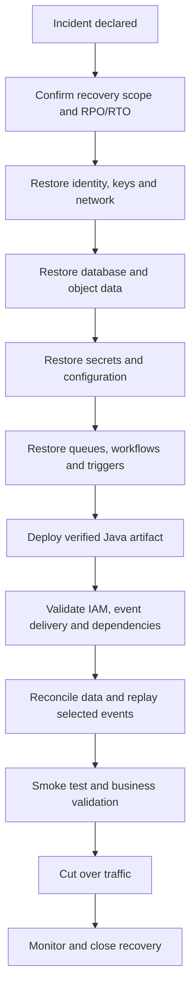

# Backing Up State, Configuration, and Data for Recovery

Java serverless functions are typically designed to process a single request or event and finish. Instances can scale down, restart, or be replaced at any moment. Consequently, business state must never depend on heap memory, `static` fields, the local filesystem, or an instance-local cache. Any data that must outlive an invocation must be persisted in a database, object storage, queue/event store, or another durable storage service.

However, externalizing state only solves persistence. To recover from human error, bad deployments, accidental deletion, data corruption, regional outages, or account incidents, the system must also back up data, configuration, secrets, encryption keys, artifacts, and trigger definitions. Backups must remain accessible during an incident, be consistent, and have undergone restore testing.

This lesson covers designing a backup/recovery strategy for Java serverless applications triggered by HTTP, messages, or events. The focus is on identifying what data needs protection, setting RPO/RTO, choosing snapshots/PITR/versioning, protecting backup copies, restoring in dependency order, and rehearsing recovery across AWS, Azure, and Google Cloud.

## 1. Distinguishing in-function state from durable state

A serverless execution environment may be reused across multiple invocations, yet there is no guarantee an instance will stay alive long-term. The runtime can freeze, restart, scale to zero, or spin up new instances under load spikes. Therefore:

- Local variables, heap objects, and `static` fields are only transient in-process state.
- `/tmp` or writable filesystems, where present, are strictly scratch space—not durable long-term business storage.
- In-memory caches disappear when instances terminate and diverge across instances.
- Connection pools/clients can be reused to cut overhead, yet they are not recoverable state.
- Databases, object storage, durable queues, event stores, and persistent workflow state are the actual sources of truth requiring policy-driven backups.

For example, an order-processing Java function must never store `orderStatus` solely in a static `ConcurrentHashMap`. If the instance recycles, state disappears; during scale-out, two instances can hold conflicting copies. Persist order status in a database and use caches strictly for acceleration.

| State type | Examples | Needs backup? | Protection method |
| --- | --- | --- | --- |
| In-memory state | Static variables, JVM object caches | Not backed up as authoritative data | Reconstructible from durable sources |
| Temporary state | Temp files, scratch data, local `/tmp` | Usually no; if valuable, copy to durable storage | Lifecycle cleanup and output uploads |
| Business state | Orders, payments, job statuses, user profiles | Yes | Database snapshots, PITR, exports/replicas |
| Object data | Uploaded files, reports, attachments | Yes | Versioning, soft delete, replication, backups |
| Workflow state | Step statuses, retry counts, checkpoints | Yes if resumability/reconciliation is required | Durable workflow stores, database backups |
| Queue/event data | Pending commands, event logs, DLQs | Depends on source role | Retention, archives, replays, DLQ exports |
| Configuration | Runtime settings, routing, triggers, IAM, networking | Yes | IaC, version control, config exports |
| Secrets/keys | API keys, DB passwords, signing/encryption keys | Requires dedicated recovery plan | Secret versioning, key recovery, rotation logs |
| Release artifacts | JAR/ZIP, image digests, SBOMs | Yes | Artifact registries/repositories, retention, provenance |

## 2. Scoping backups before choosing tools

A serverless system spans multiple services. Backing up the database while forgetting object storage breaks file references; backing up data while forgetting encryption keys leaves copies undecryptable; restoring functions while forgetting triggers/IAM leaves the app unable to receive events.

Build an inventory grouped by category:

1. **Application data:** Databases, objects, files, metadata tables, and tenant data.
2. **Operational state:** Job statuses, checkpoints, idempotency records, workflow executions, and DLQs.
3. **Event sources:** Queues/topics, streams, event archives, and retention settings.
4. **Configuration:** Environment settings, routing, runtimes/handlers, timeouts, memory, concurrency, triggers, and networking.
5. **Identity and security:** IAM/RBAC, service accounts, managed identities, resource policies, secret references, and KMS/key vault keys.
6. **Code and artifacts:** Source commits, build artifacts, container digests, dependency metadata, SBOMs, and deploy manifests.
7. **Observability:** Logs, traces, and metrics needed for investigation, auditing, and proving recovery.

For each component, document its owner, authoritative source, backup method, frequency, retention, encryption, storage location, RPO, RTO, restore permissions, and accountable person. Not every log or cache needs the same protection level; classify by business value, compliance, and rebuildability.

## 3. RPO and RTO drive the strategy

The two primary metrics in recovery design:

- **RPO (Recovery Point Objective):** Maximum acceptable data loss, usually expressed in time. A 15-minute RPO means post-incident recovery aims to restore data to a point no older than roughly 15 minutes before the outage.
- **RTO (Recovery Time Objective):** Maximum target duration to restore service to an operational state. A 2-hour RTO means the system must be ready again within 2 hours per service definition.

RPO/RTO are business targets that must be measured in drills. Enabling daily backups does not automatically achieve a 24-hour RPO if snapshots fail, backups are inconsistent, or restores take 8 hours.

| Workload | Illustrative RPO | Illustrative RTO | Potentially suitable strategy |
| --- | ---: | ---: | --- |
| Rebuildable catalog read API | 24 hours | 8 hours | Periodic snapshots, rebuild from source |
| Orders/payments | 1–5 minutes or lower | 30–60 minutes | PITR, multi-zone, transaction logs/replication, runbooks |
| User-uploaded files | 15 minutes | 2 hours | Versioning, replication, and independent backups |
| Rerunnable batch reports | 24 hours | 8 hours | Persist inputs, manifests, and checkpoints; rerun jobs |
| In-flight shipping workflows | 1–5 minutes | 30 minutes | Durable state, event archives, idempotent replays |

These numbers are discussion examples, not universal defaults. RPO/RTO vary across datasets and business flows; one application may have multiple recovery tiers.

### RPO and backup frequency

With snapshots taken once every 24 hours, actual RPO can approach or exceed 24 hours if a snapshot fails. PITR/log backups can narrow the data loss window to minutes or less depending on the service. Evaluate backup completion times, replication lag, and exact timestamp recoverability.

### RTO and total recovery duration

RTO is never just database restore time. Total duration can include:

- Incident detection and confirmation.
- Failover/restore decision.
- Granting access and preparing the target region/account.
- Restoring databases/objects and verifying consistency.
- Restoring keys, secrets, configs, and IAM.
- Deploying functions and triggers.
- Replaying events or draining queue backlogs.
- Smoke testing, business validation, and traffic cutover.

Measure the entire timeline from incident start until users can successfully complete critical business transactions.

## 4. Choosing backups, replication, versioning, and PITR

These mechanisms solve different problems:

| Mechanism | Purpose | Limitations to understand |
| --- | --- | --- |
| Snapshot/backup | Point-in-time copy | Changes after snapshot can be lost; restores take time |
| Point-in-time recovery (PITR) | Restore database to a specific timestamp within retention | Bound by log retention and service limits |
| Object versioning | Retain prior object versions | Accidental deletion/misconfigured lifecycle policies can still lose data; increases storage cost |
| Soft delete/recycle bin | Recover from delete operations | Bounded retention window; does not replace independent backups |
| Replication | Maintain copies in another region/account | Accidental deletes or corrupt writes replicate too |
| Archive/event retention | Retain events for replay/investigation | Not a database state snapshot; replays can trigger side effects |
| Export/dump | Portable logical copy across environments | Must manage consistency, schemas, and export/restore duration |

Never rely on a single mechanism alone. For instance, pair database PITR with object storage versioning/replication, IaC for configuration, secret manager versioning, and event archives for workflow replay.

## 5. The 3-2-1 rule and backup independence

The 3-2-1 rule serves as a common baseline:

- Keep at least 3 copies of data (production plus backup copies).
- Store on at least 2 distinct media types or failure domains.
- Keep at least 1 copy in a separate location (offsite/off-account/off-region) aligned with your threat model.

In the cloud, "another region" is not truly independent if the same account, admin role, or automation script can wipe both. Consider:

- Separate backup accounts/projects/subscriptions or independently governed vaults.
- Separating backup deletion privileges from workload operations privileges.
- Immutable retention/WORM or object locks where required.
- Cross-region copies/replication for regional disasters.
- Encryption keys and recovery permissions that do not depend solely on the compromised workload.
- Storing backup catalogs/manifests somewhere reachable if the primary control plane fails.

Replication protects availability, not necessarily accidental deletion or ransomware. If a deletion replicates immediately, both primary and replica lose the data. Pair replication with versioning, immutable backups, or PITR to recover pre-incident state.

## 6. Database backups: snapshots, PITR, and consistency

Databases typically hold the most critical business state. Pick mechanisms suited to your engine and managed database service.

### Snapshots

Snapshots create database copies at a point in time or using service consistency guarantees. Pros include simple management and restoring into fresh instances. Cons include potential loss of post-snapshot changes and time/cost for large datasets.

### Point-in-time recovery

PITR combines snapshots with transaction/change logs to restore a database to any timestamp within the retention window. It excels when:

- A developer executes an accidental `DELETE` or `UPDATE`.
- A bad deployment writes corrupt data over a known window.
- A function bug creates duplicate or corrupted records.
- Data must be recovered close to the moment of an incident.

PITR cannot selectively distinguish good data from bad. If a bug corrupted records for several hours, restoring the entire database discards legitimate transactions written afterward. Restore into an isolated instance, extract affected records, and reconcile them back into live production.

### Consistency between databases and object storage

When a database stores metadata pointing to objects in a bucket, database snapshots and object backups must align consistently. For example:

1. Database holds row `document_id=123` pointing to `s3://bucket/123.pdf`.
2. The object is uploaded after the database snapshot.
3. Restoring the database to before the upload leaves an orphan object in the bucket.
4. Conversely, if the database keeps the row while the object is missing from backup, you get a broken reference.

Solutions include object versioning, immutable object IDs, manifests/checkpoints, coordinated snapshots, or post-restore reconciliation jobs. Never assume two separate storage services share an atomic transaction.

## 7. Object storage backup and recovery

Object storage holds uploads, reports, images, documents, and artifacts. Controls to consider:

- Versioning to retain prior versions before overwrites.
- Soft delete/retention to recover deleted objects or containers/buckets.
- Cross-region or cross-account replication.
- Lifecycle rules transitioning older objects to cost-appropriate storage classes.
- Object Lock/immutable retention when tamper/delete protection is required.
- Inventories and checksums to validate completeness and integrity.
- Backing up metadata, tags, ACL/IAM policies, and encryption settings needed for accurate recreation.

Versioning increases storage costs because every overwrite adds a version. Use lifecycle rules to expire/archive old versions per compliance and RPO, while ensuring automated expiration never deletes the last recoverable version.

### Verifying integrity

When restoring files, verify:

- Object counts and total byte sizes against the manifest.
- Checksums/hashes or ETags per service semantics.
- Content types, metadata, encryption keys, and object versions.
- Referential integrity between objects and database rows.
- Read permissions for the function runtime and access rights for end users.

ETags are not always plain MD5 hashes; multipart uploads and encryption change ETag semantics. Rely on service-native checksums or application-computed hashes recorded during upload.

## 8. Backing up queues, events, and workflow state

Queues are transport mechanisms for pending work, not the sole backup of business data. Messages disappear once ACKed, after retention expires, or when routed to DLQs. Distinguish clearly:

- **Source of truth:** Durable business state in databases/object stores.
- **Queues:** Work awaiting consumer execution.
- **DLQs:** Messages unprocessable after retry policies; useful for triage and replay.
- **Event archives:** Retained events for replay or auditing where supported.
- **Workflow state/checkpoints:** Step progress needed to resume after faults.

If a queue is lost, messages can be regenerated from the source of truth or an event archive if designed with sufficient context. Never treat a DLQ as a complete backup; it holds only messages routed there under failure conditions.

### Replays must be idempotent

Replaying events after recovery can re-trigger side effects already completed prior to the outage. Consumers need idempotency keys, inbox/processed-event records, unique constraints, or downstream idempotency support. Before replaying:

1. Determine the exact event range and timestamps to replay.
2. Verify event schemas and consumer version compatibility.
3. Reconcile against business state to skip already-completed events.
4. Choose a replay rate that will not overload downstream services.
5. Monitor duplicates, failures, DLQs, and event age.

Never replay an entire event archive straight into production without dry runs, filters, and rate limits.

## 9. Backing up configuration and infrastructure

A function is more than its JAR or container image. To recover, you must recreate:

- Runtime/language version, handler/entry point, and architecture.
- Non-sensitive environment variables and secret references.
- Memory/CPU, timeouts, concurrency, min/max instances, and retries.
- HTTP routes, API gateway integrations, auth levels, and custom domain mappings.
- Queues/topics, event subscriptions, event filters, schedulers, and DLQs.
- IAM roles/service accounts/managed identities and resource policies.
- VPC/subnets/security groups/private endpoints/DNS/egress.
- Databases/buckets/secret managers/registries and encryption settings.
- Log groups, metrics, alerts, dashboards, and retention settings.

### Infrastructure as Code

Terraform, CloudFormation/SAM, Bicep/ARM, or equivalent IaC tools keep infrastructure configuration version-controlled. Configuration backups should include:

- IaC source and pinned module/provider versions.
- Protected, backed-up, and locked state backends.
- Variable/parameter names and per-environment settings.
- Deployment manifests, release versions, and image digests.
- Policy/role definitions and resource dependency graphs.
- Bootstrap instructions for provisioning into a blank account/project/region.

Never commit plaintext secrets into IaC. Store secret references and metadata; manage values inside a secret manager. Note that Terraform or deployment state files can contain sensitive values depending on providers/resources—encrypt state backends, restrict read permissions, and manage state retention.

### Configuration drift

If operators edit settings directly in the cloud console, IaC may no longer reflect reality. Drift detection uncovers discrepancies. Once drift is spotted, verify whether the change was intentional, then either update IaC or revert the setting. Never blindly run IaC apply to wipe out unfamiliar production changes.

## 10. Backing up secrets, certificates, and encryption keys

Backing up data without the corresponding keys can leave backups permanently unreadable. For every secret/key, record:

- Secret name/ID and version metadata.
- Owner, consumers, rotation schedule, and expiration.
- Secret manager/vault and region/account/project.
- KMS/Key Vault/Cloud KMS key ID, key policy, and rotation status.
- Procedure to restore access if production identities are lost.
- Certificate chains, issuers, renewal workflows, and private key handling.

Never export plaintext secrets into the same backup bucket as the database. Use provider-supported secret manager versioning/backups with separated admin privileges and auditing. For encryption keys, verify whether key material is exportable; many managed KMS keys forbid exporting plaintext key material. Recovery may depend on preserving key resources, policies, accounts, and active states rather than exporting key files.

### Key dependencies

If a database backup is encrypted with a customer-managed key, restoring requires the key to be enabled and the restoring principal to hold decrypt permission. If the key is disabled, scheduled for deletion, or restricted by policy, the backup exists yet cannot be restored. Include key availability, key policies, and deletion protection in DR tests.

### Rotation and recovery

Secret rotation can leave newer applications using credentials different from older backups. After restoring, you should not automatically revert to revoked passwords. Provision secret versions matching the restored target or issue fresh credentials and update consumers. Keep audit/version metadata to trace which secrets were active when.

## 11. Backing up code, artifacts, and release metadata

Recovering a function requires the exact tested source and binary. Preserve:

- Git commits/tags and repository mirrors/backups.
- JAR/ZIP packages or OCI images referenced by immutable digest.
- SBOMs, vulnerability scan reports, and provenance/attestations.
- Runtime versions, build toolchains, and dependency locks/metadata.
- The IaC commit paired with each release.
- Deployment records: region, function version, alias/revision, and trigger mappings.
- Migration versions and compatibility notes.

Do not merely store source code and assume you can rebuild identically months later. Upstream dependency repositories may purge versions, base images can vanish, or build toolchains shift. Retain immutable release artifacts with appropriate retention policies.

## 12. Disaster recovery patterns

DR patterns vary in cost, complexity, and RTO:

| Strategy | How it works | Relative RTO/RPO | Cost/complexity |
| --- | --- | --- | --- |
| Backup and restore | Periodic backups; provision resources and restore on incident | Higher RTO; RPO depends on backups/PITR | Lower cost, slower restore |
| Pilot light | Keep minimal core components live, scale up on incident | Medium RTO; RPO depends on replication | Moderate |
| Warm standby | DR environment runs at low capacity with replicated data | Lower RTO; lower RPO depending on replication lag | Higher |
| Active-active | Two regions serve traffic and synchronize data concurrently | Potentially lowest RTO; RPO depends on consistency/replication | Highest cost and complexity |

No single pattern fits every function. A background report worker may suit backup-and-restore; a payments API may require warm standby or multi-region architecture. Balance cost, data consistency, operational complexity, and testability.

### Multi-region alone is not a backup

Cross-region replication sustains availability during a regional outage, yet accidental deletes and corrupt writes replicate too. A secondary region may also share the same account/IAM control plane. Pair replication with point-in-time backups, versioning, immutable retention, and independent restore permissions.

## 13. AWS: backup and recovery for Lambda workloads

AWS Lambda code/config and backing data services follow separate backup lifecycles. A Lambda function does not automatically back up RDS or S3 simply because it uses them.

### Lambda code and configuration

- Store source in Git and JAR/ZIP artifacts or ECR images by digest.
- Store IaC defining functions, execution roles, environment variables, VPCs, event source mappings, aliases, and reserved concurrency.
- Retain published Lambda versions/aliases per release policy; versions do not replace database backups.
- Keep deployment packages outside the function lifecycle if account/region recovery is needed.

### RDS/Aurora and DynamoDB

- Amazon RDS/Aurora supports automated backups, manual snapshots, and PITR depending on engine, retention, and configuration.
- DynamoDB supports point-in-time recovery and on-demand backup/restore.
- Verify backup retention, cross-region copies, KMS keys, and restore permissions.
- Practice restoring into a new resource and verifying schemas, indexes, encryption, and connectivity.

### S3

- Enable versioning on buckets holding important files.
- Consider Object Lock, replication, and lifecycle policies.
- Use AWS Backup or native backup mechanisms where supported.
- Back up bucket policies, lifecycles, encryption, and access point configurations in IaC.

### SQS, SNS, and EventBridge

Queues, topics, and event buses do not replace sources of truth. Store original payloads or event archives if replay is required; configure DLQs, retention, and redrive policies. With EventBridge archives/replays, define the event bus, filters, retention, and consumer duplicate handling. Never replay payment/order events before verifying idempotency.

### Example controlled restore command

Example restoring an RDS snapshot into a new instance:

```bash
aws rds restore-db-instance-from-db-snapshot \
  --db-instance-identifier orders-restore-test \
  --db-snapshot-identifier orders-backup-snapshot
```

Illustrative command; specify the appropriate engine, instance class, subnet group, security groups, parameter groups, and KMS keys. Never overwrite production on the first step. Restore to a fresh instance, validate data, and only then decide on cutover.

## 14. Azure: backup and recovery for Functions workloads

### Function App and configuration

- Store source and deployment packages in repositories/artifact storage.
- Use Bicep/ARM/Terraform to recreate Function Apps, hosting plans, managed identities, networking, app settings, triggers, and diagnostic settings.
- Never treat `local.settings.json` as a production configuration backup.
- Record runtime stacks, Functions host versions, extension bundles, and deployment slot settings.
- Retain packages/images by release version for rollbacks.

### Azure SQL and databases

Azure SQL provides automated backups, point-in-time restore, and geo-restore depending on tier, region, and features. Azure Database for PostgreSQL/MySQL supports backups/PITR per service configuration. Verify retention, geo-redundancy, restore targets, and encryption/key dependencies.

Restores typically create a new database or target; verify firewalls/private endpoints, managed identity permissions, connection strings/secret references, and schemas before cutover.

### Azure Storage

- Enable blob versioning and soft delete where appropriate.
- Use container/blob restore or point-in-time restore as supported by the account type and features.
- Consider object replication and Backup Vault policies for critical data.
- Back up storage account configs, lifecycles, networking, encryption, and RBAC in IaC.

### Key Vault and configuration

Maintain secret versions and design separate recovery permissions. Key Vault soft delete and purge protection guard vaults/secrets against accidental deletion within retention. Backup/restore of secrets/keys/certificates carries object-type and tenant/region constraints; check vault documentation before relying on export/import. Azure App Configuration supports snapshots/version labels for restoring application configuration.

## 15. Google Cloud: backup and recovery for Cloud Run/Functions

### Cloud Run/Functions configuration

- Store source, Dockerfiles/build configs, Functions Framework entry points, and artifact/image digests.
- Use Terraform or IaC to recreate services, jobs, functions, service accounts, IAM, Eventarc triggers, environment variables, VPC egress, and scaling limits.
- Record revisions, traffic splits, job tasks/parallelism, and trigger filters.
- Store secret references and version IDs; never embed a service account key file inside an artifact.

### Cloud SQL, Firestore, and databases

Cloud SQL supports automated backups, on-demand backups, and PITR per engine/configuration. Firestore offers backups/scheduled backups and restores per supported features/database modes. Bigtable/Spanner provide dedicated backup or export/restore strategies. Verify retention, regions, encryption, and restore constraints for each service.

### Cloud Storage

- Use object versioning or soft delete as required.
- Consider bucket replication/dual-region storage and retention policies.
- Store metadata, IAM policies, lifecycles, and encryption settings in IaC.
- Verify restore permissions and location constraints.

### Secret Manager and KMS

Secret Manager stores immutable versions and supports policy-controlled disable/destroy operations. Retain secret version metadata and recovery steps; for keys, manage Cloud KMS key rings/locations, IAM, and rotation. Never delete key versions or key rings needed to decrypt existing backups.

## 16. Restoring in dependency order

Restoring resources out of order can cause functions to start before dependencies are ready. A reference order:

1. **Identity/control plane:** Verify account/project/subscription, admin access, break-glass identities, and restore permissions.
2. **Encryption/keys:** Restore or verify KMS/Key Vault/Cloud KMS keys, policies, and enabled states.
3. **Network foundation:** VPC/VNet, subnets, routes, DNS, firewalls, private endpoints, and connectivity.
4. **Data stores:** Restore databases, object storage, and durable state; verify consistency.
5. **Secrets/config:** Restore matching secret versions, app configs, connection references, and feature flags.
6. **Messaging/workflow:** Provision queues/topics/subscriptions, DLQs, event archives, and workflow state.
7. **Application artifacts:** Deploy JAR/ZIP/images with verified digests and provenance.
8. **IAM/triggers:** Attach runtime identities, resource policies, invoke permissions, and event source mappings.
9. **Observability:** Restore logs, metrics, alerts, dashboards, and audit sinks.
10. **Validation/cutover:** Run smoke tests, business reconciliation, controlled replays, and traffic cutover.

Actual ordering depends on your dependency graph. Some resources must exist first to receive backups; certain secrets should only be published once the restored database is ready. Runbooks should state completion criteria and sign-off owners per step.



## 17. Recovering from bad data and accidental deletion

Not every incident warrants restoring the entire system. If a function bug corrupts 500 rows, you can restore the database into a temporary instance at a pre-bug timestamp, extract the affected records, and repair/reconcile them into production.

Workflow:

1. Identify the affected time window and data scope.
2. Pause or throttle the faulty function to stop further corruption.
3. Pick a recovery point prior to the bad writes.
4. Restore the backup/PITR into an isolated environment.
5. Compare before/after records and pinpoint recoverable data.
6. Verify relationships with objects, events, payments, and downstream systems.
7. Author an idempotent, peer-reviewed repair/migration script.
8. Apply fixes in checkpointed transactions/batches.
9. Verify business invariants and audit logs.
10. Re-enable traffic gradually and monitor closely.

If side effects already escaped to external systems (e.g., emails sent or cards charged), restoring the database will not undo them. Execute compensation/reconciliation via provider APIs or business workflows.

## 18. Replaying queues and events after recovery

Once a database is restored, queues/events may contain messages from both before and after the recovery point. Never replay blindly.

Before replaying, verify:

- Event IDs, sequence numbers, timestamps, or partition offsets.
- Which events were already applied before the outage.
- Which events were lost inside the RPO window.
- Consumer version and schema compatibility.
- Whether side effects are idempotent or have compensation paths.
- Maximum replay rate to protect databases and APIs.
- Abort triggers if error rates, backlog age, or duplicate counts climb.

One strategy is replaying from an event archive into a dedicated recovery queue, running consumers in dry-run/validation mode first, then switching to apply mode. For streams, restore checkpoints/offsets accurately and avoid skipping unprocessed records.

DLQs help redrive poison messages after bug fixes, yet each error class must be reviewed first. Never redrive invalid payloads without updating either the consumer or the input data.

## 19. Recovering workflow and job state

Long-running workflows can halt mid-flight. Persist enough state to know:

- Workflow/job ID and business key.
- Completed steps, currently active step, and next step.
- Input/output references and schema versions.
- Retry counts, error reasons, and next attempt timestamps.
- Completed checkpoints/partitions.
- Side effects already committed or needing reconciliation.

Avoid storing oversized payloads directly inside workflow state if platform limits apply; store object references and checksums instead. On restore, confirm checkpoints align with database/object state. If a checkpoint is ahead of committed data or vice versa, records may be skipped or duplicated.

For Cloud Run Jobs, Lambda async workflows, or Azure Durable Functions, back up state machine/workflow history using service-native mechanisms and keep application data separate. Never assume a function package contains execution history.

## 20. Protecting backups from accidental deletion and ransomware

Backups can be deleted or encrypted if an attacker compromises admin privileges in the same account. Reduce the chance that one leaked credential destroys both production and backups:

- Separate backup accounts/projects/subscriptions or vaults by failure domain.
- Separate backup roles from restore roles; runtime functions must never hold delete-backup permissions.
- Enforce immutable retention/Object Lock/WORM where required.
- Enable deletion protection, soft delete, and purge protection on relevant resources and keys.
- Require MFA/approvals or break-glass workflows to delete critical backups.
- Ship audit logs to an independent log store and alert on retention changes.
- Encrypt backups and protect keys/policies independently.
- Verify backup copies cannot be deleted by standard production principals.
- Test restoring when access to the primary account/region is lost.

Never grant backup vault admin privileges to a Java function. Function runtimes typically need only read/write access to business data; backup/restore belongs to the control plane or dedicated automation identities.

## 21. Backup encryption and data residency

Backups contain data just as sensitive as production. Enforce:

- Encryption at rest using provider-managed or customer-managed keys per policy.
- TLS for cross-network copies and restores.
- Least-privilege read/restore access controls.
- Regional/country storage boundaries and data residency compliance.
- Retention schedules, deletion workflows, and legal holds.
- Masking/tokenization if copies are used for testing.
- Auditing across backup, export, restore, and download actions.

Never restore production data into dev/test environments without controls. Use synthetic data or masking to prevent PII exposure.

## 22. Automated backup verification

A green backup job in the control plane does not prove data is recoverable. Verify:

- Backups completed with a fresh recovery point inside SLA.
- Sizes, object counts, or row counts look normal.
- Encryption/keys remain active and usable.
- Copies replicated to independent locations per policy.
- Retention settings were not unexpectedly altered.
- Restore tests successfully provision a new resource.
- Applications can connect and read/write restored data.
- Checksums/integrity checks and business invariants pass.
- RPO/RTO metrics are measured during drills.

Maintain a backup catalog or manifest recording resource IDs, recovery points, timestamps, regions, key IDs, checksums, and statuses. Never place secret values inside manifests.

## 23. Restore testing and disaster recovery drills

An untested backup is merely an assumption. Schedule regular drills:

1. Select a target database/object set or recovery environment.
2. Pick a recovery point matching target RPO.
3. Restore into an isolated account/project/region or namespace.
4. Restore keys/secrets/configs and deploy the verified artifact.
5. Verify triggers, IAM, networking, and dependency connectivity.
6. Run smoke tests and business reconciliation.
7. Time every phase and compute total RTO.
8. Compare restored data against checksums/manifests/sources of truth.
9. Document failures, missing permissions, quota gaps, and manual steps.
10. Update runbooks, automation, and owners.

Drills must include scenarios where operators cannot access the primary account or primary region. If all documentation and recovery credentials reside inside the lost account, the DR plan is unrealistic.

### Backup/recovery metrics

| Metric | Meaning |
| --- | --- |
| Backup success rate | Percentage of backups completing on schedule |
| Backup age | Elapsed time since the latest recovery point |
| Replication lag | Lag of cross-region/cross-account replicas |
| Restore success rate | Percentage of restore tests passing |
| Measured RPO | Actual data window lost during a drill |
| Measured RTO | Total end-to-end service recovery time |
| Backup coverage | Share of critical resources covered by backup policies |
| Immutable coverage | Share of backups protected against modification/deletion |
| Restore validation errors | Checksum, schema, permission, or business invariant failures |

Alert when backup age breaches RPO, backup jobs fail consecutively, replication lag climbs, or retention policies change. Do not alert only on failed backup tasks; a backup task can report success while failing to copy offsite.

## 24. Recovery runbook for Java serverless

Runbooks should be written for on-call operators working under incident pressure. Minimum contents:

### Pre-incident

- Contact list, service owners, backup owners, and approvers.
- Links to IaC, artifact repositories, backup vaults, and dashboards.
- Primary and DR account/project/subscription/region identifiers.
- RPO/RTO by data tier.
- Break-glass access and approval instructions.
- Pre-tested restore commands, parameter placeholders, and resource names.
- Verification steps for keys, IAM, networking, and secrets.
- Steps to disable triggers or throttle concurrency to stop bad writes.

### During incident

1. Confirm incident scope and type: accidental delete, corruption, regional outage, credential compromise, or deployment bug.
2. Pause or throttle corrupting writers/triggers if needed.
3. Select recovery point and confirm RPO/RTO targets.
4. Restore keys/networking/identity and data stores in dependency order.
5. Deploy verified artifacts and versioned configuration.
6. Re-enable triggers/queues in a controlled manner.
7. Reconcile/replay events and job states.
8. Execute smoke tests and business validation.
9. Shift traffic, monitor errors/backlogs/duplicates, and log timestamps.

### Post-incident

- Preserve audit logs and forensic evidence.
- Reconcile data/transactions with downstream providers.
- Identify root cause and any exposed/lost data.
- Update backup policies, retention, IAM, and automation.
- Re-drill any steps that failed during execution.
- Record actual RPO/RTO and issue required notifications.

## 25. Example: backup manifest for a release

A manifest can capture everything needed to reproduce a release and tie it to a recovery point:

```yaml
service: orders-api
environment: production
release:
  version: 2.4.1
  commit: 7a3f1c9
  image: registry.example.com/orders@sha256:abc123...
  sbom: orders-api-2.4.1.cdx.json
infrastructure:
  iacCommit: 9f2d8a1
  region: ap-southeast-1
  runtimeIdentity: orders-api-runtime
data:
  database:
    resource: orders-prod
    recoveryPoint: 2026-11-17T10:00:00Z
    backupId: backup-20261117-1000
  objectStore:
    bucket: orders-prod-files
    versioning: enabled
security:
  secretReferences:
    - name: orders-db-credentials
      version: 18
  encryptionKeyReference: orders-data-key
```

This is an illustrative manifest, not a direct deployment config file. Never place secret values, access keys, or private keys inside manifests. Resource names, secret versions, and key references must still be protected because they reveal topology that could aid an attacker in mapping the system.

## 26. Practical scenario: function writing corrupted data

Suppose a new release of `invoice-worker` introduces a bug that doubles invoice amounts. Triggered by SQS, the function runs for 20 minutes before detection.

A sound remediation sequence:

1. Disable or throttle event source mapping concurrency to stop writing corrupt records.
2. Record the release ID, message IDs, time window, and affected invoice set.
3. Identify the database recovery point right before the faulty release began writing.
4. Restore the database snapshot/PITR into an isolated instance.
5. Diff invoices in the restored instance against live production to isolate corrupted records.
6. Check the payment provider: were any customers actually overcharged?
7. Build an idempotent repair script keyed by invoice ID and validate it on a staging copy.
8. Apply corrections/compensations to live production; avoid full database restores if valid transactions occurred afterward.
9. Deploy the fixed worker version and verify queue consumers and triggers.
10. Selectively replay incomplete messages while watching duplicates and DLQs.
11. Reconcile invoices/payments and gradually restore concurrency.

Key takeaway: restoring a database does not reverse payments already submitted to an external provider. Perform reconciliation and compensation via provider APIs. ACKed messages do not automatically return to queues either; rely on event archives or canonical sources to recreate pending work.

## 27. Practical scenario: regional outage

Suppose the primary region becomes unreachable. A warm standby DR plan might execute:

1. Declare incident and verify the DR region is operational.
2. Check replication lag and recovery points for databases and object stores.
3. Verify KMS/keys, secret versions, IAM/service accounts, and networking in the DR region.
4. Provision or scale Cloud Run/Lambda/Azure Functions runtimes to required capacity.
5. Deploy verified artifact digests using DR IaC and configuration.
6. Create triggers/event source mappings or switch endpoints/API gateways.
7. Verify database connections, DNS, private endpoints, and downstream quotas.
8. Execute synthetic transactions and business validation.
9. Shift traffic via DNS/traffic manager/API gateway.
10. Monitor error rates, latency, event age, queue backlogs, and duplicates.
11. When the primary region recovers, do not automatically fail back immediately; reconcile both sides and designate the authoritative source.

Failback is itself a data and traffic migration. If both regions accepted writes during the incident, apply conflict resolution or a single-writer strategy. Never bounce traffic back and forth purely via DNS without checking data consistency.

## 28. Common mistakes

1. **Treating warm instances as state stores.** Instances can terminate at any moment.
2. **Backing up only the database.** Misses objects, secrets, keys, queues, workflow state, and configs.
3. **Treating replication as backup.** Accidental deletes and corruption replicate straight to replicas.
4. **Skipping RPO/RTO targets.** Leaves no way to verify whether backup intervals and restore speeds meet business needs.
5. **Untested backups.** May be missing keys, permissions, networking, or metadata.
6. **Storing backups in the same account/admin boundary.** One compromised credential wipes both production and backups.
7. **Forgetting encryption keys.** Backups exist yet cannot be decrypted.
8. **Restoring databases without object storage.** Leaves dangling pointers to missing objects or vice versa.
9. **Non-idempotent event replays.** Executes side effects twice.
10. **Restoring code without triggers/IAM/config.** Function deploys cleanly yet processes zero requests or events.
11. **Full production restores for minor data corruption.** Discards valid transactions committed after the recovery point.
12. **Not preserving artifacts and dependencies.** Cannot rebuild tested code later.
13. **Rushing failback after regional outages.** Both sides may be out of sync or conflicted.
14. **Restoring unmasked production data into test environments.** Turns backups into a data-leakage vector.

## 29. Backup and recovery design workflow

1. **Inventory:** Catalog data, state, configs, secrets/keys, artifacts, triggers, and logs.
2. **Classify:** Rank by business criticality, sensitivity, and rebuildability.
3. **Set objectives:** Agree on RPO/RTO and retention per tier.
4. **Choose controls:** Select snapshots, PITR, versioning, replication, archives, IaC, and artifact retention.
5. **Isolate:** Separate backup accounts/vaults, identities, and keys; apply immutability where needed.
6. **Automate:** Schedule backups, verify completion, replicate offsite, and maintain catalogs/manifests.
7. **Validate:** Verify checksums, consistency, restore drills, smoke tests, and business invariants.
8. **Document:** Write dependency-ordered runbooks with owners, commands, and approvals.
9. **Drill:** Rehearse accidental deletes, corruption, regional outages, and lost credentials.
10. **Improve:** Update measured RPO/RTO, policies, quotas, permissions, and automation after every drill or incident.

## 30. Pre-production checklist

- [ ] Business state never relies on function heap, `static` variables, local filesystems, or instance caches.
- [ ] Inventoried databases, objects, queues, workflows, configs, secrets/keys, and artifacts.
- [ ] Each data tier has an owner, RPO, RTO, retention, and recovery procedure.
- [ ] Databases have snapshots/PITR aligned with target RPO.
- [ ] Object storage enforces versioning/soft delete/replication or appropriate backups.
- [ ] Queues/events have retention, DLQs, and archive/replay strategies where needed.
- [ ] Workflow state/checkpoints and idempotency records are protected.
- [ ] IaC, state backends, and environment configurations are backed up and version-controlled.
- [ ] JAR/ZIP/image digests, SBOMs, provenance, and release metadata are stored immutably.
- [ ] Secret versions, certificates, and encryption keys have documented recovery plans.
- [ ] Backups reside in sufficiently isolated failure domains with separated delete/restore permissions.
- [ ] Backups are encrypted, audited, and guarded by retention and deletion protection.
- [ ] A manifest/catalog tracks recovery points and dependencies.
- [ ] Restore drills have executed and measured actual RPO/RTO.
- [ ] Runbooks document restore ordering across identity/keys/network/data/config/functions/triggers.
- [ ] Event replays enforce filters, rate limits, idempotency, and reconciliation.
- [ ] Procedures exist to fix localized bad data without full production restores.
- [ ] Failover/failback plans exist with clear single-writer/conflict policies.
- [ ] Backup/restore monitoring alerts on stale backups, failures, or rising replication lag.
- [ ] Production data used in non-prod testing is masked/protected per policy.

Backup and recovery for Java serverless goes far beyond taking database snapshots. Protect every dependency required for functions to resume work: business data, objects, workflow state, events/queues, configurations, identities, secrets, encryption keys, and artifacts. Let RPO/RTO guide snapshot, PITR, and replication choices; use isolated accounts and immutability to defend against accidental deletion and ransomware; and prove recoverability through regular restore drills. Only when runbooks span function redeployment, trigger restoration, event replay, and side-effect reconciliation is the system truly recoverable end-to-end.

## Official references

- [AWS Backup – Developer Guide](https://docs.aws.amazon.com/aws-backup/latest/devguide/whatisbackup.html)
- [Amazon RDS – Backing up and restoring](https://docs.aws.amazon.com/AmazonRDS/latest/UserGuide/CHAP_CommonTasks.BackupRestore.html)
- [Amazon DynamoDB – Point-in-time recovery](https://docs.aws.amazon.com/amazondynamodb/latest/developerguide/PointInTimeRecovery.html)
- [Amazon S3 – Versioning](https://docs.aws.amazon.com/AmazonS3/latest/userguide/Versioning.html)
- [Amazon S3 – Object Lock](https://docs.aws.amazon.com/AmazonS3/latest/userguide/object-lock.html)
- [AWS Lambda – Versions and aliases](https://docs.aws.amazon.com/lambda/latest/dg/configuration-versions.html)
- [Azure Backup documentation](https://learn.microsoft.com/azure/backup/backup-overview)
- [Azure SQL – Automated backups](https://learn.microsoft.com/azure/azure-sql/database/automated-backups-overview)
- [Azure Blob Storage – Versioning](https://learn.microsoft.com/azure/storage/blobs/versioning-overview)
- [Azure Key Vault – Soft delete and purge protection](https://learn.microsoft.com/azure/key-vault/general/soft-delete-overview)
- [Google Cloud Backup and DR](https://cloud.google.com/backup-disaster-recovery/docs/concepts/backup-dr)
- [Cloud SQL – Backup and restore](https://cloud.google.com/sql/docs/mysql/backup-recovery/backups)
- [Cloud Storage – Object Versioning](https://cloud.google.com/storage/docs/object-versioning)
- [Google Secret Manager – Best practices](https://cloud.google.com/secret-manager/docs/best-practices)
