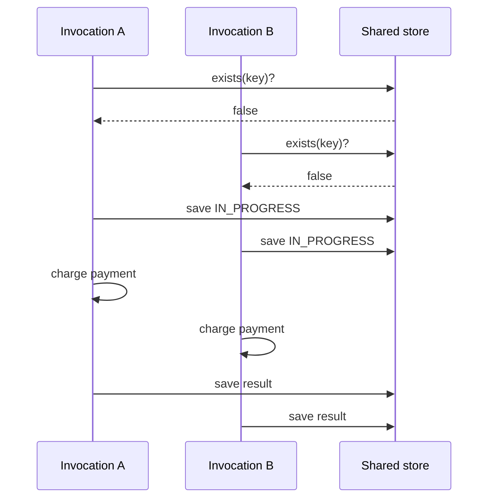
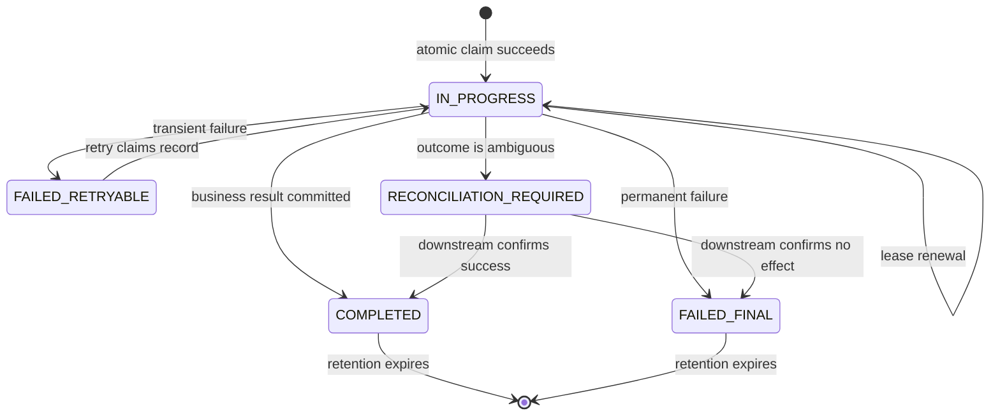
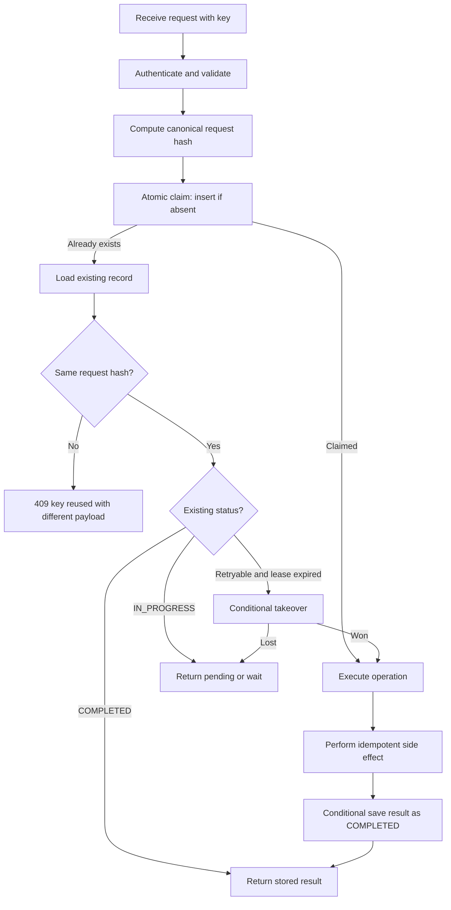
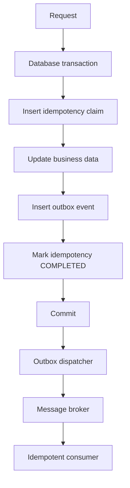

# Handling Two Concurrent Invocations with the Same Idempotency Key

## 1. The Problem in Serverless Systems

Idempotency guarantees that a single logical operation produces only one business outcome, even when a request or message is sent multiple times. This is especially critical for order creation APIs, payments, invoice issuance, inventory updates, and event consumers that may receive redelivered messages.

In serverless architectures, the same request can trigger two nearly simultaneous invocations. For example, a client sends `POST /payments` with `Idempotency-Key: pay-2026-0042`. The gateway times out before receiving a response, so the client retries. While the first request is still running, the second request lands on a different execution environment. Both function instances can see the same key.

If each invocation checks "does the key already exist?" and then writes, both may read that the key does not exist and both execute the payment operation. That is a race condition. Storing keys in a `static Map`, `ConcurrentHashMap`, or local cache does not solve this because invocations can run across different instances, and instances can be recycled or restarted at any time.

To handle this correctly, the system needs an **atomic claim** operation in a shared data store. Only one invocation is granted ownership of the operation; all other invocations must read the state and follow a consistent policy: return the completed result, wait, return an in-progress status, or report a conflict.

## 2. An Idempotency Key Represents a Logical Operation

An idempotency key is an identifier generated by the client or producer for one logical operation. When retrying the same operation, the sender must preserve the same key. When starting a new operation, the sender generates a new key, even if the payload is identical to a previous operation.

Example:

| Submission | Idempotency key | Payload | Meaning |
| --- | --- | --- | --- |
| Initial request | `order-42-charge` | Charge 120,000 VND for order 42 | New payment operation |
| Retry after timeout | `order-42-charge` | Same payload | Same operation; should receive prior result or in-progress status |
| Different operation | `order-42-refund` | Refund order 42 | A different logical operation; requires a different key |

Do not mechanically use a payload hash as the key. Two legitimate purchases can have identical payloads while still being two separate operations. Clients should generate a sufficiently random key, persist it alongside the operation, and reuse it across retries.

### 2.1. Choosing the Uniqueness Scope of a Key

Keys must be namespaced to avoid collisions across tenants, clients, and operations. A unique key is typically a composite of:

```text
(tenant_id, operation, idempotency_key)
```

Example:

```text
(tenant-17, POST:/v1/payments, pay-2026-0042)
```

If you only use a global `idempotency_key`, two customers might accidentally or intentionally pick the same string. If you namespace only by tenant and omit the operation, reusing a key across two different endpoints could return the wrong result.

Key scope must be specified in the API contract. Enforce length and character limits, authenticate the tenant/principal before lookup, and never allow one tenant to read another tenant's result by guessing a key.

### 2.2. Key Retention Duration

Idempotency records must remain at least as long as clients, gateways, brokers, or partners can retry the same operation. This duration depends on business requirements: a payment API may need longer retention than a transient lookup API; an event consumer may need retention aligned with the broker's retention and replay windows.

Do not delete records too early. If a key has been removed while the client still retries, the operation could be executed a second time. Database/cache TTLs are typically asynchronous cleanup mechanisms, not guarantees that a record disappears at the exact second of expiration. At request-handling time, check `expires_at` against the server clock and published policy.

Prefer not reusing expired keys: clients generate a new key for a new operation and old records are purged after retention. If an API allows the same key string to be reused after expiry, reclaiming it must be an atomic conditional update on the expired row that increments `generation`, replaces the fingerprint, and sets a new owner; never wait for TTL deletion and assume the key slot is empty. Moreover, never allow reuse while the prior operation is still running or still requires reconciliation.

The Java example in this lesson adopts a safe, straightforward policy: if the row still exists but `expires_at` has passed, throw `IdempotencyKeyExpiredException` and require the client to generate a new key for a new operation. The API can map this error to `409` or `410` per its contract.

## 3. How Two Concurrent Invocations Create a Race Condition

An incorrect implementation often looks like this:

```java
if (!repository.exists(key)) {
    repository.save(key, "IN_PROGRESS");
    Payment payment = paymentService.charge(request);
    repository.saveResult(key, payment);
}
```

Two invocations can interleave as follows:



This is a check-then-act bug. Because "checking" and "marking" are two separate steps, neither establishes exclusive ownership. A Java `synchronized` block also fails to prevent races across two execution environments or two separate containers.

The solution is to combine checking and claiming into a single atomic operation guaranteed by the storage engine, such as:

- An insert backed by a unique constraint in a relational database.
- A conditional `PutItem` with `attribute_not_exists` in DynamoDB.
- Redis `SET key value NX EX` when Redis is configured appropriately for your durability/consistency requirements.
- Compare-and-set / conditional create in a store supporting equivalent semantics.

## 4. State Machine for Idempotency Records

Do not store just a single `processed` boolean. An operation may be running, completed, transiently failed, or permanently failed. A state machine lets invocations coordinate and helps the system recover after crashes.

### 4.1. Recommended States

| State | Meaning | Behavior for Same-Key Invocations |
| --- | --- | --- |
| `IN_PROGRESS` | One invocation claimed the key and is executing | Do not execute side effects again; return in-progress status or wait per contract |
| `COMPLETED` | Business outcome and response have been persisted | Return the stored result |
| `FAILED_RETRYABLE` | Transient failure, eligible for retry per policy | Reclaim according to retry and lease rules |
| `FAILED_FINAL` | Failure that should not be retried with the same request | Return the stored error |
| `RECONCILIATION_REQUIRED` | Side effect may have occurred, but outcome is unknown | Do not blindly rerun; reconcile with downstream |
| `EXPIRED` | Record has passed its idempotency retention window | Usually a logical state derived from `expires_at`, not necessarily a stored row state |

Not every application needs every state. A simple API might only use `IN_PROGRESS` and `COMPLETED`; a long-running workflow or one with external dependencies should persist failure states and explicit recovery metadata.

### 4.2. Valid State Transitions



Only the invocation holding the current claim may complete or update the record. State transitions must be conditioned on owner token/generation so a stale invocation cannot overwrite a newer invocation's outcome after lease expiration.

### 4.3. Fields to Store

An idempotency record can contain:

| Field | Purpose |
| --- | --- |
| `tenant_id` | Namespace by tenant/client |
| `operation` | Endpoint or business operation name |
| `idempotency_key` | Key provided by the sender |
| `request_hash` | Fingerprint of the canonicalized payload/operation |
| `status` | `IN_PROGRESS`, `COMPLETED`, ... |
| `owner_token` | Random token of the invocation currently holding the claim |
| `generation` | Fencing/version number incremented on takeover |
| `lease_until` | Timestamp when the active claim expires if not renewed |
| `retry_after` | Earliest allowed retry timestamp after a transient failure |
| `response_status` | HTTP status returned for the completed operation |
| `response_body` | Result replayed on retries, if appropriate |
| `resource_id` | ID of the created resource/transaction |
| `reconciliation_ref` | Reference used to look up ambiguous side effects |
| `created_at`, `updated_at` | Timing tracking and investigation |
| `expires_at` | Idempotency expiration timestamp per policy |

You do not always need to store the full response body. You can store a resource ID or result reference and reconstruct the response. If storing the response, consider PII, secrets, storage size, encryption, and access controls.

## 5. Standard Processing Flow

A request carrying an idempotency key should follow these steps:

1. Authenticate the caller and resolve the tenant/principal.
2. Validate the key, operation, and payload.
3. Canonicalize the business data and compute `request_hash`.
4. Generate a random `owner_token` for the current invocation.
5. Perform an atomic claim with the unique key and status `IN_PROGRESS`.
6. If the claim succeeds, the current invocation is the owner and proceeds with execution.
7. If the claim fails because the record already exists, read the record with appropriate consistency.
8. Compare `request_hash`; the same key with a different payload must be rejected.
9. If `COMPLETED`, return the stored result.
10. If `IN_PROGRESS`, do not run the side effect again; return an in-progress status or wait per the API contract.
11. If the lease has expired or the record is retryable, take over only via an atomic conditional update.
12. Execute the side effect using a stable idempotency key on the downstream system if supported.
13. Persist the outcome and transition the record to `COMPLETED` via a conditional update matching owner/generation.
14. Emit metrics/logs and return the response.



The critical decision points are steps 5 and 11, which must be atomic in storage. Never read `IN_PROGRESS` and assume another invocation can rerun simply after waiting briefly; you need a conditional takeover so only one invocation wins.

## 6. Request Fingerprinting: Same Key Must Mean Same Intent

An idempotency key must not be reused for a different payload. If the same key is sent with a different amount or target resource, returning the old result can cause confusion or business logic vulnerabilities.

Compute the fingerprint from the fields that determine the operation's semantics, for example:

```text
operation = POST:/v1/payments
tenant = tenant-17
orderId = order-42
amountMinor = 120000
currency = VND
paymentMethodRef = pm-88
```

After canonicalizing according to stable rules, compute a SHA-256 or HMAC over the canonical string/bytes. Do not include transport timestamps, trace IDs, or per-retry headers in the fingerprint if they do not change business semantics.

### 6.1. Canonicalization

When payloads are JSON, two requests can differ in whitespace or key ordering while sharing the exact same meaning. You can parse into a DTO, validate, and serialize in a canonical representation before hashing. Clearly define:

- Which fields belong to the business request.
- Which fields are ignored or defaulted.
- How `null` is treated compared to an omitted field.
- Numeric types, currency precision, and timezones.
- Array ordering when order is semantically meaningful.
- Unicode normalization and character encoding.

Do not use `Object.toString()` or an unconfigured serializer to compute fingerprints. If hashing raw request bodies, explicitly stipulate in the contract that byte-identical bodies are required.

### 6.2. Same Key, Different Payload

Example:

- First request: key `pay-42`, amount `120000`.
- Second request: key `pay-42`, amount `150000`.

The second request must receive a conflict error (typically HTTP `409 Conflict`) because the key is already bound to an operation with a different fingerprint. Never return the old response as if 150,000 had been processed, and never run a new operation under the old key.

## 7. Atomic Claim with a Relational Database

A relational database fits well when idempotency records need to participate in transactions alongside business data or require explicit unique constraints.

### 7.1. Example Schema

```sql
CREATE TABLE idempotency_record (
    tenant_id          VARCHAR(100) NOT NULL,
    operation          VARCHAR(160) NOT NULL,
    idempotency_key    VARCHAR(200) NOT NULL,
    request_hash       CHAR(64) NOT NULL,
    status             VARCHAR(24) NOT NULL,
    owner_token        UUID,
    generation         BIGINT NOT NULL DEFAULT 1,
    lease_until        TIMESTAMPTZ,
    retry_after        TIMESTAMPTZ,
    response_status    INTEGER,
    response_body      JSONB,
    resource_id        VARCHAR(200),
    reconciliation_ref VARCHAR(240),
    created_at         TIMESTAMPTZ NOT NULL DEFAULT now(),
    updated_at         TIMESTAMPTZ NOT NULL DEFAULT now(),
    expires_at         TIMESTAMPTZ NOT NULL,
    PRIMARY KEY (tenant_id, operation, idempotency_key),
    CHECK (status IN (
        'IN_PROGRESS', 'COMPLETED', 'FAILED_RETRYABLE', 'FAILED_FINAL',
        'RECONCILIATION_REQUIRED'
    ))
);

CREATE INDEX idx_idempotency_expiry
    ON idempotency_record (expires_at);
```

The primary key enforces a unique constraint across tenant, operation, and key. Every invocation with the same key contends on the same row identity.

### 7.2. Insert-if-Absent

With PostgreSQL, you can use `INSERT ... ON CONFLICT DO NOTHING RETURNING`:

```sql
INSERT INTO idempotency_record (
    tenant_id,
    operation,
    idempotency_key,
    request_hash,
    status,
    owner_token,
    generation,
    lease_until,
    expires_at
)
VALUES (
    :tenant_id,
    :operation,
    :idempotency_key,
    :request_hash,
    'IN_PROGRESS',
    :owner_token,
    1,
    now() + interval '30 seconds',
    now() + interval '24 hours'
)
ON CONFLICT (tenant_id, operation, idempotency_key) DO NOTHING
RETURNING tenant_id, operation, idempotency_key, owner_token, generation;
```

If the statement returns a row, the invocation successfully claimed the key. If no row is returned, a record already existed or another transaction just created it; the invocation must read the current state and follow the state machine.

The unique constraint is the ultimate safeguard. Never replace it with an unconstrained `SELECT` followed by an `INSERT`.

### 7.3. Reading the Record After Claim Failure

```sql
SELECT request_hash,
       status,
       owner_token,
       generation,
       lease_until,
       retry_after,
       response_status,
       response_body,
       resource_id,
       reconciliation_ref,
       expires_at
FROM idempotency_record
WHERE tenant_id = :tenant_id
  AND operation = :operation
  AND idempotency_key = :idempotency_key;
```

If reading from an eventually consistent read replica, an invocation may fail to see a newly written row and falsely conclude the key does not exist. Read idempotency state from the primary or use consistency settings that guarantee seeing recently committed claims.

### 7.4. Conditional Completion

```sql
UPDATE idempotency_record
SET status = 'COMPLETED',
    response_status = :response_status,
    response_body = CAST(:response_body AS JSONB),
    resource_id = :resource_id,
    updated_at = now(),
    lease_until = NULL
WHERE tenant_id = :tenant_id
  AND operation = :operation
  AND idempotency_key = :idempotency_key
  AND status = 'IN_PROGRESS'
  AND owner_token = :owner_token
  AND generation = :generation;
```

Verify that the updated row count equals 1. If it is 0, the invocation no longer owns the claim or the record transitioned state; it must not overwrite a newer outcome. Emit warnings/logs to investigate takeovers or stale owners.

## 8. Transactions When Side Effects Live in the Same Database

If the business action only updates the same relational database, the strongest approach is typically executing claim, business mutation, and result persistence in **a single transaction**:

1. Begin transaction.
2. Insert the idempotency row protected by a unique constraint.
3. If the insert fails, read the existing record and handle the duplicate.
4. If the insert succeeds, write order/payment state in the same database.
5. Update the idempotency record to `COMPLETED` and save the result.
6. Commit the transaction.

If the function dies before commit, both the idempotency row and business mutation roll back. A retrying invocation can claim again. If commit succeeds but the response is lost over the network, the retrying invocation reads `COMPLETED` and returns the stored result.

Do not hold a database transaction open while waiting on slow HTTP calls to payment providers or external services. Long transactions hold locks/connections and can cause contention. For side effects outside the database, a different coordination pattern is required.

## 9. External Side Effects: Idempotency Store Alone Does Not Guarantee Exactly-Once

A difficult scenario:

1. Invocation A successfully claims the key.
2. A calls the payment provider; the provider captures the payment.
3. A times out or is terminated before saving `COMPLETED`.
4. The lease expires; invocation B takes over.
5. B does not know the provider already charged the card and calls capture again.

Your idempotency store only coordinates invocations inside your system. It does not automatically create a distributed transaction with the payment provider. Safeguards include:

- Sending the same idempotency key to the payment provider if supported.
- Using a stable downstream operation ID across all retries.
- Querying transaction status by merchant reference before retrying if the provider API supports it.
- Persisting durable intent/outbox records before dispatching side effects.
- Reconciling when the outcome is unknown.
- Using sagas/compensation for sequences of side effects that cannot share a transaction.

If the downstream system supports neither idempotency nor status queries, design an explicit process for handling unknown outcomes. You cannot guarantee end-to-end "exactly-once" solely with a lock or a local idempotency table.

### 9.1. Passing the Same Key Downstream

Derive a stable downstream key from the claimed operation, for example:

```text
payment-provider-key = tenant-17:POST:/v1/payments:pay-2026-0042
```

When invocation B takes over after a timeout, B sends the same key to the provider. If the provider already completed the first attempt, it returns the stored result instead of charging again. Always check the provider's key scope and retention policy; never assume every API behaves identically.

### 9.2. Transactional Outbox

If the business operation must update the database and emit an event, write the business row, idempotency completion, and outbox event in the same transaction. A separate dispatcher reads the outbox and publishes the event; if publishing succeeds before marking sent, the dispatcher may republish, so consumers still require idempotency by event ID.



The outbox closes the gap between committing business data and publishing events, but it does not eliminate duplicate delivery. Consumers must still deduplicate and handle retries safely.

## 10. Leases, Timeouts, and Safe Takeovers

For operations lasting longer than a single invocation or requiring crash recovery, an `IN_PROGRESS` record can carry a lease. The lease specifies until when the current owner is permitted to continue if actively renewing.

### 10.1. A Lease Does Not Prove the Old Invocation Is Dead

Lease expiration only means the owner failed to renew on time. The old owner might still be running due to a long GC/VM pause, network partition, or clock skew. If a new invocation takes over while the old owner is still executing side effects, two owners may be active simultaneously.

Therefore:

- Use the server/storage clock for lease comparisons.
- Condition lease renewals on the current owner token/generation.
- Increment a monotonic fencing token on takeover.
- Allow only the current owner to commit completion.
- Downstream systems require idempotency or fencing support if side effects can be invoked again.

Leases enable recovery, but they do not replace idempotency at the target system receiving side effects.

### 10.2. Conditional Takeover

PostgreSQL example:

```sql
UPDATE idempotency_record
SET status = 'IN_PROGRESS',
    owner_token = :new_owner_token,
    generation = generation + 1,
    lease_until = now() + interval '30 seconds',
    retry_after = NULL,
    updated_at = now()
WHERE tenant_id = :tenant_id
  AND operation = :operation
  AND idempotency_key = :idempotency_key
  AND request_hash = :request_hash
  AND (
      (status = 'IN_PROGRESS' AND lease_until < now())
      OR
      (status = 'FAILED_RETRYABLE' AND (retry_after IS NULL OR retry_after <= now()))
  )
RETURNING owner_token, generation, lease_until;
```

Only one invocation can update the row when the expired-lease condition holds. The winning invocation receives the new generation. Losing invocations re-read the state and do not execute side effects.

When an owner encounters a transient error while knowing for certain the side effect has not occurred, transition to `FAILED_RETRYABLE` via a conditional update matching owner/generation, set `retry_after` per backoff, and clear `lease_until`. Example:

```sql
UPDATE idempotency_record
SET status = 'FAILED_RETRYABLE',
    retry_after = :retry_after,
    lease_until = NULL,
    updated_at = now()
WHERE tenant_id = :tenant_id
  AND operation = :operation
  AND idempotency_key = :idempotency_key
  AND status = 'IN_PROGRESS'
  AND owner_token = :owner_token
  AND generation = :generation;
```

If an error leaves it ambiguous whether the side effect occurred, transition to `RECONCILIATION_REQUIRED` and store `reconciliation_ref`; never mark ambiguous cases as `FAILED_RETRYABLE`.

### 10.3. Fencing Tokens

A fencing token is a generation number incremented monotonically each time ownership changes. A downstream resource can reject commands carrying a generation older than the highest generation it has seen. This prevents a stale owner from mutating data after a takeover if the downstream participates in fencing checks.

If the downstream does not understand fencing tokens, checking `owner_token` in your idempotency store only prevents the stale owner from overwriting the record; it does not stop the stale owner from calling an external HTTP API. In that case, downstream idempotency keys and reconciliation remain essential.

## 11. HTTP Behavior While a Key Is In Progress

APIs must explicitly specify what happens when the same key arrives while the first invocation has not finished. Options include:

| Record State | Possible Behavior | When Appropriate |
| --- | --- | --- |
| `COMPLETED` | Return stored status/body/headers | Retry after the initial response was lost |
| `IN_PROGRESS` | Return `202 Accepted` with operation/status URL | Client can poll for status |
| `IN_PROGRESS` | Return `409 Conflict` or `425 Too Early` per contract | Client should wait and retry; avoid holding the second request open |
| `IN_PROGRESS` | Wait boundedly and return result if completed | Short requests that fit within timeout budget |
| `FAILED_FINAL` | Return the stored terminal error | Same request cannot succeed without changing input/key |
| `FAILED_RETRYABLE` | Allow takeover/retry per policy | Transient failure and lease expired |

No single status code fits every API. If using `202`, include `Location` or an operation URL and document polling behavior. If using `409`, include a stable error code like `IDEMPOTENCY_IN_PROGRESS` and retry guidance. Avoid tight-loop retries every few milliseconds; consider providing `Retry-After`.

### 11.1. Returning the Stored Response

When `COMPLETED`, APIs typically return the status code and body saved from the first execution. Certain headers such as `Date` or `X-Request-Id` may be regenerated, while business content should not change. Document which headers are replayed and which are generated fresh.

If the response contains sensitive data, authenticate the caller and verify current access permissions before returning it. Never let someone who learns an idempotency key retrieve another user's response.

## 12. Java Example: Service Orchestrating Idempotency

The example below illustrates application structure. The repository must implement atomic claims using unique constraints/conditional writes as shown in the SQL section; never implement `claimIfAbsent` using separate `exists()` then `insert()` calls.

```java
import java.time.Duration;
import java.time.Clock;
import java.time.Instant;
import java.util.UUID;

public final class IdempotentPaymentService {
    private final IdempotencyRepository repository;
    private final PaymentGateway gateway;
    private final RequestFingerprint fingerprint;
    private final Clock clock;

    public IdempotentPaymentService(
            IdempotencyRepository repository,
            PaymentGateway gateway,
            RequestFingerprint fingerprint,
            Clock clock) {
        this.repository = repository;
        this.gateway = gateway;
        this.fingerprint = fingerprint;
        this.clock = clock;
    }

    public PaymentResult charge(
            String tenantId,
            String idempotencyKey,
            CreatePaymentRequest request) {

        String operation = "POST:/v1/payments";
        String requestHash = fingerprint.sha256(tenantId, operation, request);
        String ownerToken = UUID.randomUUID().toString();
        Instant now = clock.instant();
        Instant leaseUntil = now.plus(Duration.ofSeconds(30));

        ClaimResult claim = repository.claimIfAbsent(
                tenantId,
                operation,
                idempotencyKey,
                requestHash,
                ownerToken,
                leaseUntil);

        if (!claim.acquired()) {
            IdempotencyRecord existing = repository.findStronglyConsistent(
                    tenantId, operation, idempotencyKey)
                    .orElseThrow(() -> new IllegalStateException(
                            "Claim conflict without visible record"));

            if (!existing.expiresAt().isAfter(now)) {
                throw new IdempotencyKeyExpiredException();
            }

            if (!existing.requestHash().equals(requestHash)) {
                throw new IdempotencyConflictException(
                        "Key was already used with a different request");
            }

            switch (existing.status()) {
                case COMPLETED -> {
                    return existing.toPaymentResult();
                }
                case FAILED_FINAL -> throw existing.toStoredFailure();
                case RECONCILIATION_REQUIRED -> throw new ReconciliationRequiredException(
                        existing.reconciliationRef());
                case IN_PROGRESS, FAILED_RETRYABLE -> {
                    if (existing.status() == Status.IN_PROGRESS
                            && (existing.leaseUntil() == null
                                || existing.leaseUntil().isAfter(now))) {
                        throw new OperationInProgressException(
                                existing.resourceId(), existing.leaseUntil());
                    }
                    if (existing.status() == Status.FAILED_RETRYABLE
                            && existing.retryAfter() != null
                            && existing.retryAfter().isAfter(now)) {
                        throw new RetryNotYetAllowedException(existing.retryAfter());
                    }

                    // Conditional takeover increments generation atomically.
                    claim = repository.takeoverIfEligible(
                            tenantId, operation, idempotencyKey, requestHash,
                            ownerToken, now, leaseUntil);
                    if (!claim.acquired()) {
                        IdempotencyRecord latest = repository.findStronglyConsistent(
                                tenantId, operation, idempotencyKey)
                                .orElseThrow(() -> new IllegalStateException(
                                        "Record disappeared during takeover"));
                        if (latest.status() == Status.COMPLETED) {
                            return latest.toPaymentResult();
                        }
                        throw new OperationInProgressException(
                                latest.resourceId(), latest.leaseUntil());
                    }
                }
            }
        }

        try {
            // Gateway must pass the same idempotency key downstream to the payment provider.
            PaymentResult result = gateway.charge(
                    request,
                    downstreamKey(tenantId, operation, idempotencyKey));

            boolean completed = repository.completeIfOwner(
                    tenantId,
                    operation,
                    idempotencyKey,
                    ownerToken,
                    claim.generation(),
                    result);

            if (!completed) {
                throw new LostIdempotencyOwnershipException();
            }
            return result;
        } catch (PermanentPaymentException ex) {
            repository.failFinalIfOwner(
                    tenantId, operation, idempotencyKey,
                    ownerToken, claim.generation(), ex.toPublicFailure());
            throw ex;
        } catch (AmbiguousPaymentOutcomeException ex) {
            repository.markReconciliationRequiredIfOwner(
                    tenantId, operation, idempotencyKey,
                    ownerToken, claim.generation(), ex.reference());
            throw ex;
        } catch (RetryableBeforeSideEffectException ex) {
            repository.failRetryableIfOwner(
                    tenantId, operation, idempotencyKey,
                    ownerToken, claim.generation(), ex.retryAfter(), ex.getMessage());
            throw ex;
        }
    }

    private String downstreamKey(String tenant, String operation, String key) {
        return tenant + ":" + operation + ":" + key;
    }
}
```

This skeleton illustrates orchestration rather than a copy-paste-ready class: types such as `IdempotencyRepository`, `ClaimResult`, `IdempotencyRecord`, `PaymentGateway`, exceptions, and `RequestFingerprint` must be defined for your application. The example uses Java 17 switch syntax. `takeoverIfEligible` must be an atomic conditional update like the SQL query above; it must not be implemented by reading the lease and writing separately. `Clock` is injected for time testing; in production, expiry and lease checks should rely on the storage/DB clock or a synchronized time source so instances do not disagree.

`RetryableBeforeSideEffectException` is strictly for errors where the gateway can confirm the request has not produced a side effect. Timeouts after sending the request, dropped connections while awaiting a response, or errors where it is unclear whether the provider committed must raise `AmbiguousPaymentOutcomeException`; keep the operation in a reconciliation state rather than arbitrarily marking it retryable.

If the gateway times out after the provider completed the operation but before `completeIfOwner`, the retry must call the provider using the stable downstream key or look up the outcome. Never treat an `IN_PROGRESS` record as proof that payment has not occurred.

## 13. Repository Contract Must Guarantee Atomicity

The repository interface should state semantics explicitly rather than leaving callers to compose primitives:

```java
public interface IdempotencyRepository {
    ClaimResult claimIfAbsent(
            String tenantId,
            String operation,
            String key,
            String requestHash,
            String ownerToken,
            Instant leaseUntil);

    ClaimResult takeoverIfEligible(
            String tenantId,
            String operation,
            String key,
            String requestHash,
            String newOwnerToken,
            Instant now,
            Instant newLeaseUntil);

    Optional<IdempotencyRecord> findStronglyConsistent(
            String tenantId,
            String operation,
            String key);

    boolean completeIfOwner(
            String tenantId,
            String operation,
            String key,
            String ownerToken,
            long generation,
            PaymentResult result);

    boolean failRetryableIfOwner(
            String tenantId,
            String operation,
            String key,
            String ownerToken,
            long generation,
            Instant retryAfter,
            String reason);

    boolean failFinalIfOwner(
            String tenantId,
            String operation,
            String key,
            String ownerToken,
            long generation,
            PublicFailure failure);

    boolean markReconciliationRequiredIfOwner(
            String tenantId,
            String operation,
            String key,
            String ownerToken,
            long generation,
            String reconciliationRef);
}
```

The `claimIfAbsent` contract must guarantee that at most one caller receives `acquired=true` for a given key. The `completeIfOwner` contract must guarantee the update succeeds only if status is still `IN_PROGRESS` and both owner token and generation still match. These are correctness requirements, not performance optimizations.

`takeoverIfEligible` reclaims only when state and timing permit: `IN_PROGRESS` with an expired lease or `FAILED_RETRYABLE` past `retry_after`. It must increment `generation` in the same conditional update. `failRetryableIfOwner` stores `retry_after` and clears/resets the lease per schema; `markReconciliationRequiredIfOwner` preserves the reference so a reconciliation worker knows what to query downstream.

## 14. DynamoDB: Conditional Writes

With AWS Lambda, DynamoDB is frequently used as an idempotency store because it supports conditional writes and TTL. Items can use a composite partition key across tenant/operation/key or a stable hashed key.

Example item:

```json
{
  "pk": "TENANT#tenant-17#OP#POST_PAYMENTS#KEY#pay-2026-0042",
  "requestHash": "e3b0c44298fc1c149afbf4c8996fb924...",
  "status": "IN_PROGRESS",
  "ownerToken": "7a6c...",
  "generation": 1,
  "leaseUntil": 1794927600,
  "expiresAt": 1795014000
}
```

Claiming uses `PutItem` with the condition expression `attribute_not_exists(pk)`. Only one invocation creates the item successfully; others receive `ConditionalCheckFailedException` and read the existing item.

Upon completion, use `UpdateItem` with a condition checking `status = IN_PROGRESS`, `ownerToken`, and `generation`. The TTL attribute only lets DynamoDB clean up items after expiration; TTL deletion is not instantaneous. The application must still enforce expiration and retention policies.

For operations requiring multiple writes to commit together, consider `TransactWriteItems` to update the idempotency record and business data in the same transaction if all data resides in DynamoDB within transaction limits. Transactions do not cover side effects in external HTTP providers or brokers.

## 15. Redis: `SET NX` and Limitations to Understand

Redis supports short-lived claims via:

```text
SET idempotency:<scope>:<key> <owner-token> NX EX 60
```

- `NX`: write only if the key does not exist.
- `EX 60`: set a 60-second TTL.
- The owner token value identifies the current owner.

If Redis returns `OK`, the invocation acquired the claim; otherwise the key already exists. However, storing only a lock key is insufficient to replay `COMPLETED` results. The application must store status, fingerprint, and outcome in a suitably durable record.

When releasing the lock, never run `DEL` unconditionally because the lease may have expired and been claimed by another invocation. Delete only if the owner token still matches, via a Lua script / atomic compare-and-delete. Similarly, lease extensions must compare the owner token.

Redis replication/failover, persistence, and eviction policies affect correctness guarantees. Losing keys during failover can allow operations to run again; do not use a best-effort cache as the source of truth for payments or non-repeatable actions. Choose configurations and storage services matching your durability/consistency requirements.

## 16. Message Consumers and Event Idempotency

Queues and event streams commonly provide at-least-once delivery. The same event can arrive again due to consumer timeouts, failed acknowledgments, expired visibility timeouts, or broker retries.

For consumers, keys should usually be based on:

```text
(consumer_name, tenant_id, event_id)
```

Do not use the message delivery attempt or invocation ID as the key, since each redelivery can have a new attempt/invocation ID. The event ID must be stable per the producer contract. If an event can be handled by multiple consumers for different purposes, namespace by consumer so one consumer does not suppress another consumer's work.

Consumer flow:

1. Parse the envelope and validate event type/schema version.
2. Construct the key from consumer + event ID.
3. Claim atomically.
4. If already `COMPLETED`, acknowledge the message without rerunning side effects.
5. If `IN_PROGRESS`, do not execute concurrently; let the broker retry later or wait per semantics.
6. If the claim succeeds, process the event and persist the result/side effect.
7. Mark `COMPLETED` before acknowledgment/checkpointing in a way that guarantees no event loss.

If you mark `COMPLETED` and the process crashes before acknowledgment, the broker may redeliver; next time the consumer reads `COMPLETED` and acks. If you ack before saving `COMPLETED`, the process may crash and the event is lost from the queue without recording business work. Commit and ack ordering must follow your transaction/outbox design or broker semantics.

## 17. Error Handling and Recovery

### 17.1. Invocation Dies Before Side Effects Begin

The record may remain `IN_PROGRESS`. Once the lease expires, a new invocation can take over via conditional update. If the operation is safe to rerun and no side effect occurred, proceed.

### 17.2. Invocation Dies While Side Effect Outcome Is Ambiguous

This is the hardest case. You do not know whether downstream committed. You must not simply set the record to `FAILED_RETRYABLE` and re-invoke the side effect if downstream is not idempotent. Look up by operation ID, send the same downstream idempotency key, or place the operation into `RECONCILIATION_REQUIRED` for reconciliation.

### 17.3. Invocation Dies After Side Effect Succeeds but Before Saving Outcome

Retries must retrieve the outcome from downstream using the same key/reference. Once verified, write `COMPLETED`. If there is no lookup mechanism or downstream idempotency, you need a manual reconciliation/compensation procedure; you cannot infer side-effect failure merely from a function timeout.

### 17.4. Invocation Dies After Saving `COMPLETED` but Before Responding

Idempotency handles this cleanly: the client retries with the same key, the server reads the stored result, and returns it. Business logic does not rerun.

### 17.5. Failure Writing `COMPLETED`

If the business side effect already occurred but updating the record fails, preserve the uncertain state and run reconciliation. Never delete the record to "let it retry from scratch." An `IN_PROGRESS` record may be forensic evidence requiring investigation, not garbage.

## 18. Returning Errors and Retry Policies

Classify errors before allowing a key to run again:

| Error | Suggested State | Behavior |
| --- | --- | --- |
| Invalid payload / authorization denied before side effect | `FAILED_FINAL` or do not claim | Return error; fixing the request requires a new key per contract |
| Same key, different fingerprint | Leave existing record unchanged | `409 Conflict` |
| Active owner with valid lease | `IN_PROGRESS` | Return pending/`Retry-After`; do not run side effect |
| Dependency timeout, unknown outcome | `RECONCILIATION_REQUIRED` | Query downstream before retrying; do not auto-takeover to rerun side effect |
| Transient failure guaranteed before any side effect | `FAILED_RETRYABLE` | Retry after backoff and conditional takeover |
| Business error unrecoverable by retry | `FAILED_FINAL` | Replay stored error |
| Idempotency storage unavailable | Cannot safely claim | Fail closed for sensitive operations; return transient error |

Do not treat every exception as retryable. If idempotency storage fails, running business logic unchecked sacrifices uniqueness guarantees. For payments or critical data mutations, typically fail closed and return `503`/transient error so the client retries with the same key once the store recovers.

## 19. Common Implementation Mistakes

| Mistake | Consequence | Fix |
| --- | --- | --- |
| Separate `exists()` then `insert()` | Two invocations both pass the check | Unique constraint / conditional create |
| Storing keys in a static map | Not shared across instances and lost on restart | Shared durable store |
| Locking without storing results | Retries cannot retrieve the business response | Persist status, fingerprint, and result/reference |
| Same key without comparing request hash | Wrong result returned for a different payload | Canonical fingerprint and `409` on mismatch |
| Rerunning immediately when lease expires | Old owner may still be executing the side effect | Conditional takeover, fencing, and downstream idempotency |
| Unconditional lock deletion | Old owner deletes the new owner's claim | Compare owner token when releasing |
| Marking completed before business commit | Business data can be lost while retries think it succeeded | Shared transaction or outbox/state machine |
| Persisting after side effect without downstream key | Crashes risk duplicate side effects | Downstream idempotency, lookup/reconcile |
| Using message attempt ID as the key | Redeliveries are treated as new operations | Use a stable event ID and namespace by consumer |
| TTL shorter than retry/retention window | Old keys get reprocessed | Choose retention aligned with contract and broker replay policy |
| Reading from eventually consistent replica | Newly created claim is missed | Strongly consistent read or primary |
| Failing open when idempotency store errors | Two invocations can execute concurrently | Fail closed for critical side effects |

## 20. Testing Race Conditions

Sequential unit tests are not enough to prove atomic claims. Test concurrently against real storage or an environment with production-equivalent semantics.

Minimum test scenarios:

| Scenario | Expected Outcome |
| --- | --- |
| Two concurrent invocations, same key and payload | Only one claim succeeds; side effect executes once |
| 20 concurrent invocations with the same key | One owner; others read pending/completed |
| Same key, different payload | One request claims; the other receives conflict |
| First invocation completes, response lost | Retry returns the stored response |
| First invocation crashes before side effect | Safe lease takeover after expiry |
| Crash after side effect, before completion | Downstream key/lookup/reconciliation prevents duplicate side effect |
| Slow old owner resumes after takeover | Stale owner cannot overwrite newer record; downstream prevents duplicates |
| Idempotency store unavailable | No side effect executes under fail-closed policy |
| Record expired | Behavior matches retention contract |
| Two regions receive the same key | Storage/partitioning strategy still permits only one global claim if required |
| Queue redelivery with same event ID | Consumer does not repeat side effect |

### 20.1. Java Concurrency Test Example

This test illustrates the idea: spawn multiple threads calling the service concurrently with one key and count gateway invocations. The test repository should connect to a real test database to verify the actual unique constraint.

```java
import static org.junit.jupiter.api.Assertions.assertEquals;

import java.util.ArrayList;
import java.util.List;
import java.util.concurrent.CountDownLatch;
import java.util.concurrent.ExecutorService;
import java.util.concurrent.Executors;
import java.util.concurrent.TimeUnit;
import java.util.concurrent.atomic.AtomicInteger;
import org.junit.jupiter.api.Test;

class IdempotencyConcurrencyTest {
    @Test
    void onlyOneInvocationCallsGatewayForSameKey() throws Exception {
        int callers = 20;
        CountDownLatch ready = new CountDownLatch(callers);
        CountDownLatch start = new CountDownLatch(1);
        AtomicInteger gatewayCalls = new AtomicInteger();
        ExecutorService pool = Executors.newFixedThreadPool(callers);

        IdempotentPaymentService service = testService(() -> {
            gatewayCalls.incrementAndGet();
            return successfulPayment();
        });

        List<java.util.concurrent.Future<?>> futures = new ArrayList<>();
        for (int i = 0; i < callers; i++) {
            futures.add(pool.submit(() -> {
                ready.countDown();
                start.await();
                try {
                    service.charge("tenant-17", "pay-42", sampleRequest());
                } catch (OperationInProgressException expected) {
                    // Concurrent requests may see the owner still processing.
                }
                return null;
            }));
        }

        ready.await(5, TimeUnit.SECONDS);
        start.countDown();
        for (var future : futures) {
            future.get(10, TimeUnit.SECONDS);
        }
        pool.shutdown();

        assertEquals(1, gatewayCalls.get());
    }
}
```

`testService`, `sampleRequest`, and `successfulPayment` are project fixtures. To make the test reliable, all threads must share the same database repository while having separate request contexts. Run the test repeatedly and add multi-process/multi-container tests when distributed behavior must be verified.

Do not use a mock repository for primary race tests: a mock might always return `acquired=true` or synchronize unintentionally, passing tests even when the database implementation is broken.

## 21. Observing and Securing Idempotency Records

Track:

- Successful claims and claim conflicts.
- Rate of requests hitting `IN_PROGRESS`.
- `IN_PROGRESS` records exceeding lease duration.
- Takeovers and fencing conflicts.
- Replay rate from `COMPLETED`.
- Keys reused with mismatched fingerprints.
- Latency and error rate of the idempotency store.
- Operations requiring reconciliation.
- Rate of downstream duplicates prevented.

Logs should include operation, validated tenant, status, and correlation ID. Never place raw idempotency keys, payment tokens, or sensitive payloads into metric labels. Truncated fingerprints may be logged if permitted by security policy, while avoiding high cardinality.

An idempotency key is not a credential. Never use it in place of authentication/authorization. When reading an existing record, always verify the caller is authorized to access the resource and response. Encrypt stored data, restrict IAM/database permissions, configure appropriate TTL/retention, and avoid storing sensitive responses unnecessarily.

## 22. Production Implementation Checklist

- [ ] Define key scope by tenant/client and operation.
- [ ] Clients preserve the key across retries and generate a new key for a new operation.
- [ ] Validate keys and enforce length/format limits.
- [ ] Generate a stable canonical request fingerprint.
- [ ] Enforce a unique constraint or conditional write for atomic claims.
- [ ] Persist `IN_PROGRESS` state and `COMPLETED` outcome durably.
- [ ] Return conflict when the same key has a different fingerprint.
- [ ] Duplicate invocations do not execute side effects while the record is `IN_PROGRESS`.
- [ ] Responses for completed operations are stored or safely reconstructible.
- [ ] Condition state updates on owner token/generation.
- [ ] Configure bounded leases, renewals, and atomic takeovers for long operations.
- [ ] Downstream receives the same idempotency key or supports query/reconciliation.
- [ ] Use transactions/outbox when business writes and event publishing must remain consistent.
- [ ] Retention exceeds the committed retry/replay window.
- [ ] Apply intentional fail-open/fail-closed behavior when storage errors occur.
- [ ] Test two concurrent invocations and high concurrency against real storage.
- [ ] Test crashes before/after side effects and before/after commits.
- [ ] Monitor duplicates, overdue in-progress records, takeovers, and reconciliation.
- [ ] Authenticate/authorize callers before returning stored results.

## 23. Conclusion

Two serverless invocations carrying the same idempotency key must coordinate through a shared state store. The foundation is an atomic claim: unique constraints, conditional writes, or compare-and-set ensure at most one invocation becomes the owner. Other invocations inspect the fingerprint and state, then return the stored result, an in-progress status, or a conflict error per contract.

For short operations whose side effects reside in the same database, a transaction can combine claim, business mutation, and completion. For external side effects, the idempotency store alone does not guarantee exactly-once execution; you must propagate the same key downstream, use outboxes, fencing, status queries, or reconciliation. Leases aid recovery when an owner crashes, but they do not prove the old owner has stopped.

In Java serverless systems, never rely on static memory as the source of idempotency. Test races with concurrent invocations on real storage, define clear retention and retry policies, monitor stuck records, and protect stored outcomes. When atomicity and recovery are designed properly, retries become a routine part of distributed systems rather than a source of duplicate transactions.

## References

- [AWS Lambda Powertools for Java – Idempotency](https://docs.powertools.aws.dev/lambda/java/latest/utilities/idempotency/)
- [Amazon DynamoDB – Conditional writes](https://docs.aws.amazon.com/amazondynamodb/latest/developerguide/Expressions.ConditionExpressions.html)
- [Amazon DynamoDB – Transactions](https://docs.aws.amazon.com/amazondynamodb/latest/developerguide/transactions.html)
- [PostgreSQL – INSERT / ON CONFLICT](https://www.postgresql.org/docs/current/sql-insert.html)
- [Redis – SET command and NX option](https://redis.io/docs/latest/commands/set/)
- [AWS Prescriptive Guidance – Transactional outbox pattern](https://docs.aws.amazon.com/prescriptive-guidance/latest/cloud-design-patterns/transactional-outbox.html)
