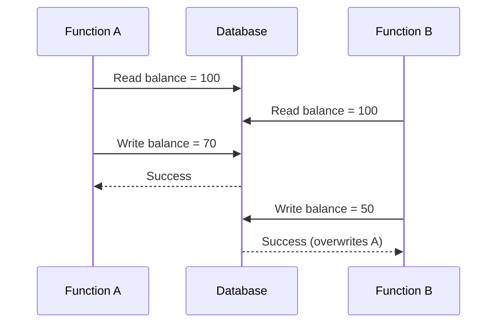

# Conditional Writes, Optimistic Locking, and Versioning

Java serverless functions routinely handle many requests or messages concurrently. Two invocations can read the same record, compute from stale values, and write results back in arbitrary order. When the later write overwrites the earlier write, the system suffers a **lost update**: a valid modification is silently lost even though both functions returned success.

Conditional writes and optimistic locking ensure data is written only when the current state still satisfies the observed condition. Versioning enables detecting stale data, protecting concurrent updates, and letting APIs and events identify the exact state version a client or consumer is acting upon. These mechanisms are critical in serverless environments because multiple instances run in parallel, retry, and reprocess the same events.

Within the scope of **CLOUD_SERVERLESS**, this lesson focuses on developing and deploying serverless applications—particularly Java functions triggered by HTTP, messages, or events. Learners handle triggers, state, access permissions, retries, idempotency, cold starts, scaling, and cost. This lesson covers protecting data correctness via conditional writes, optimistic locking, and versioning across databases, APIs, object storage, and event contracts.

## 1. The Concurrent Update Problem

Suppose an account has a balance of 100. Two HTTP requests arrive nearly simultaneously:

1. Function A reads balance 100.
2. Function B also reads balance 100.
3. A subtracts 30 and writes 70.
4. B subtracts 50 and writes 50.

The final balance is 50, whereas if both transactions were applied sequentially, the balance should be 20. A's update was overwritten by B.



This is a lost update. Another race condition occurs when two workers both check that inventory has 1 item remaining and both confirm an order. Separating the check from the update creates a window where state changes between the two operations.

## 2. Why Are Serverless Systems Prone to Race Conditions?

Serverless platforms can spin up multiple instances of the same function to handle bursts. With message triggers, the same business entity may receive events from multiple producers or redeliveries. With HTTP triggers, clients can send two concurrent requests or retry a request after a timeout.

Common causes:

- Two invocations read the same version and both write back.
- A queue redelivers a message when a consumer fails to ack or a lock expires.
- A client retries because the response was lost even though the server committed.
- Multiple functions update the same aggregate or record.
- A batch contains multiple records affecting the same entity.
- Scheduled jobs and online requests mutate the same state concurrently.

Never assume a function instance usually runs sequentially. Scale-out, warm instance concurrency, retries, and independent triggers make concurrent updates the norm.

## 3. What Is a Conditional Write?

A conditional write is a write operation that executes only if a predicate on the current state holds true. The condition is evaluated atomically with the write by the database or storage service.

Examples:

- Create an order only if `orderId` does not already exist.
- Update a record only if `version` still equals 7.
- Deduct inventory only if `availableQuantity >= requestedQuantity`.
- Write an object only if it does not exist yet or its ETag/generation matches.
- Transition state from `PENDING` to `CONFIRMED` only if the current state is still `PENDING`.

The key is that checking and writing must happen in one atomic operation. A pattern that reads first, checks in Java, and writes unconditionally still has a race condition:

```java
Inventory item = repository.findBySku(sku);
if (item.available() >= quantity) {
    repository.save(item.withAvailable(item.available() - quantity));
}
```

Between `findBySku` and `save`, another invocation can modify inventory. The condition must be pushed down into the database update statement or a transaction with appropriate isolation.

## 4. Compare-and-Set (CAS)

Compare-and-set compares the current value against an expected value and writes the new value only if the comparison succeeds.

```text
compare currentVersion with expectedVersion
if equal:
    write newValue and nextVersion
else:
    report conflict
```

CAS typically uses a version number, sequence, or ETag. If one worker reads version 12 and another worker updates it to version 13, the first worker's write must fail because the current version is no longer 12.

CAS does not resolve business conflicts on its own. The application must decide whether to re-read and recompute, return `409 Conflict`/`412 Precondition Failed`, ignore a stale event, or requeue the message for retry. Never blindly overwrite the newer version just to make the request succeed.

## 5. What Is Optimistic Locking?

Optimistic locking assumes conflicts are relatively infrequent. Each record carries a version or revision. When reading, the application retains the observed version. When writing, the database accepts the update only if the current version still matches; on success, the version increments.

Example record:

| id | status | version |
|---|---|---:|
| order-42 | PENDING | 7 |

A function reads version 7 and submits an update conditioned on `version = 7`. If the update succeeds, the record becomes version 8. Another function still holding version 7 cannot overwrite version 8.

Optimistic locking works well when:

- Conflicts are relatively rare.
- Transactions are short.
- You want to avoid holding database locks while executing logic or calling external APIs.
- Returning a conflict or re-reading and recomputing is acceptable.
- Multiple instances run concurrently and need safe coordination.

If conflicts occur continuously, optimistic locking can trigger excessive retries and waste CPU/database capacity. In that case, revisit partitioning, ownership, command serialization, or use appropriate locking/queueing.

## 6. How Does Pessimistic Locking Differ?

Pessimistic locking locks a record or data range before updating, assuming contention is likely and concurrent edits must be blocked.

| Criterion | Optimistic locking | Pessimistic locking |
|---|---|---|
| Mechanism | Checks version on write | Locks data inside a transaction |
| On conflict | One transaction fails; caller handles it | Other workers wait or time out |
| Best suited for | Low contention, short transactions | High contention requiring serialized updates |
| Risk | Retry storms under sustained contention | Deadlocks, lock waits, and long-held connections |
| Serverless fit | Usually fits short invocations well | Requires extra care around timeouts and scale-out |

Pessimistic locks should not be held while a function calls a payment API or waits on network I/O. Long-running transactions hold connections and locks too long, hurting other invocations.

## 7. Conditional Updates in SQL

A common way to update inventory is placing the condition directly inside the `UPDATE` statement:

```sql
UPDATE inventory
SET available_quantity = available_quantity - :quantity,
    version = version + 1
WHERE sku = :sku
  AND version = :expected_version
  AND available_quantity >= :quantity;
```

The application checks the affected row count:

- `1 row`: update succeeded; version incremented.
- `0 rows`: record does not exist, version changed, or inventory was insufficient.

If you need to distinguish those causes, re-read the record in a follow-up query and return the appropriate business error. Do not split `available_quantity >= quantity` into a separate `SELECT` followed by an unconditional `UPDATE`.

In databases supporting transactions, multiple conditional updates can be combined in a single transaction to protect multi-table invariants. Choose isolation levels and retry policies appropriate for your specific database.

## 8. Optimistic Locking Example with JPA `@Version`

JPA supports optimistic locking via the `@Version` annotation:

```java
@Entity
@Table(name = "orders")
public class OrderEntity {
    @Id
    private String id;

    @Enumerated(EnumType.STRING)
    private OrderStatus status;

    @Version
    private long version;

    // getters and domain methods
}
```

When an entity is loaded and updated, the JPA provider includes the version in the update predicate. Conceptually, the SQL resembles:

```sql
UPDATE orders
SET status = ?, version = version + 1
WHERE id = ? AND version = ?;
```

If zero rows are updated because the version changed, JPA typically throws `OptimisticLockException` or a framework-translated exception such as `ObjectOptimisticLockingFailureException` in Spring. Catch this at the transaction boundary and decide whether to return a conflict or retry the entire transaction.

Do not catch the exception and keep using the failed persistence context. The transaction is usually marked rollback-only; end the transaction, reload the entity in a fresh transaction, and recompute if possible.

## 9. Conditional Writes with DynamoDB

DynamoDB supports condition expressions on `PutItem`, `UpdateItem`, and `DeleteItem`. Conditions are evaluated atomically on the item.

Example creating an item only if the partition key does not exist:

```java
PutItemRequest request = PutItemRequest.builder()
        .tableName("Orders")
        .item(Map.of(
                "orderId", AttributeValue.fromS("order-42"),
                "status", AttributeValue.fromS("PENDING"),
                "version", AttributeValue.fromN("1")))
        .conditionExpression("attribute_not_exists(orderId)")
        .build();

dynamoDb.putItem(request);
```

This condition fits create-only semantics when `orderId` is the item's key. If the condition fails, the SDK throws `ConditionalCheckFailedException`. Do not treat every conditional failure as an infrastructure error; it is usually an expected conflict or duplicate.

Example updating only if the version still matches:

```java
long expectedVersion = 7;
long nextVersion = expectedVersion + 1;

UpdateItemRequest request = UpdateItemRequest.builder()
        .tableName("Orders")
        .key(Map.of(
                "orderId", AttributeValue.fromS("order-42")))
        .updateExpression("SET #status = :status, #version = :nextVersion")
        .conditionExpression("#version = :expectedVersion")
        .expressionAttributeNames(Map.of(
                "#status", "status",
                "#version", "version"))
        .expressionAttributeValues(Map.of(
                ":status", AttributeValue.fromS("CONFIRMED"),
                ":expectedVersion", AttributeValue.fromN("7"),
                ":nextVersion", AttributeValue.fromN("8")))
        .build();

dynamoDb.updateItem(request);
```

If the version changed, DynamoDB rejects the update. In real applications, `expectedVersion` must come from the item just read rather than being hard-coded as in the example. To increment version without computing the next value client-side, use `SET version = version + :one` alongside condition `version = :expected`.

## 10. Atomic Conditions for Business Invariants

Version checks prevent overwriting stale records, but they do not express every invariant automatically. For example, deducting inventory must ensure quantity never becomes negative. The condition must directly check the relevant value:

```text
Condition: availableQuantity >= requestedQuantity
Update:    availableQuantity = availableQuantity - requestedQuantity
```

In SQL, put the condition inside the `UPDATE`. In DynamoDB, use a condition expression such as `availableQuantity >= :requested`. When an operation must update multiple related items, use the database's transaction API with per-item conditions.

An invariant like "total reserved seats never exceeds capacity" may require a centralized counter/record or a transaction. Reading individual reservations and summing them in Java will not guarantee correctness across concurrent invocations.

## 11. How Do Conditional Writes Differ from Transactions?

Conditional writes guard a single write operation with a predicate. Transactions group multiple operations into one atomic unit according to the database's capabilities.

| Need | Appropriate Mechanism |
|---|---|
| Create record only if absent | Conditional insert/put |
| Update record only if version unchanged | Optimistic locking / CAS |
| Deduct inventory if sufficient | Conditional update |
| Update order and write ledger in the same database | Transaction with conditions |
| Update database and send message to broker | Transactional outbox or supported integrated mechanism |
| Update two independent systems | Saga/compensation; do not assume distributed transactions |

A transaction does not automatically protect logic if conditions are missing. A transaction can run serially and still corrupt state if code overwrites values without checking versions or invariants.

## 12. Handling Optimistic Locking Conflicts

When a conditional write fails, the application must classify the conflict:

1. Re-read the record and its new version.
2. Check whether the current state still permits the command.
3. If the command can be applied to the new state, recompute the outcome.
4. If the command was already applied by another invocation, return the idempotent result or ignore the duplicate.
5. If business rules are no longer satisfied, return a conflict or business rejection.

Not every conflict should be retried. For instance, two requests trying to buy the last item in stock: one succeeds, and the other must receive `OUT_OF_STOCK` rather than retrying indefinitely.

For commutative additive updates, you can use atomic increments instead of read-modify-write. For example, executing `counter = counter + 1` directly in the database avoids lost updates compared to reading `counter` and writing `counter + 1`.

## 13. Bounded Retries After Conflict

Some conflicts are transient and can be resolved by re-reading and retrying. Use bounded retries with backoff and jitter so multiple workers do not contend in lockstep.

```java
int maxAttempts = 3;

for (int attempt = 1; attempt <= maxAttempts; attempt++) {
    Order current = repository.findById(orderId)
            .orElseThrow(OrderNotFoundException::new);

    if (current.isConfirmed()) {
        return current; // already achieved the requested state
    }

    try {
        return repository.confirmIfVersionMatches(
                orderId, current.version());
    } catch (OptimisticConflictException conflict) {
        if (attempt == maxAttempts) {
            throw conflict;
        }
        backoffWithJitter(attempt);
    }
}

throw new IllegalStateException("Unreachable");
```

This is an illustrative skeleton. `backoffWithJitter` should not sleep long inside a serverless invocation because it consumes billed duration and concurrency slots. If conflicts happen frequently, return a retryable response, enqueue commands keyed by entity, or redesign ownership to serialize updates per aggregate.

## 14. Versioning HTTP APIs with ETag and `If-Match`

HTTP APIs can use ETags as validators for resource representations. A client reads a resource, receives an ETag, and sends it back in the `If-Match` header when updating. The server performs the update only if the current representation still matches the validator.

Example response:

```http
HTTP/1.1 200 OK
ETag: "order-42-v7"
Content-Type: application/json

{
  "id": "order-42",
  "status": "PENDING",
  "version": 7
}
```

Client submits update:

```http
PATCH /orders/order-42
If-Match: "order-42-v7"
Content-Type: application/json

{"status":"CONFIRMED"}
```

If the current version is still 7, the server performs the conditional update and returns the new ETag, e.g. `"order-42-v8"`. If the resource has changed, the server returns `412 Precondition Failed`. If the API requires clients to always include a precondition and the header is missing, you can return `428 Precondition Required`.

`If-Match` uses strong comparison; weak ETags (`W/"..."`) are unsuitable for conditional updates. ETags must stably represent the stored version or representation. Never use an arbitrary ETag disconnected from persisted state.

## 15. Distinguishing `409 Conflict` and `412 Precondition Failed`

These two HTTP status codes are common but carry distinct meanings:

- `412 Precondition Failed`: an HTTP precondition such as `If-Match` was not met; the client can `GET` the latest resource and decide whether to resubmit.
- `409 Conflict`: the command conflicts with current business state, e.g. an order cannot transition from `CANCELLED` to `CONFIRMED`.

Do not return 200 for an update lost due to a version conflict. The response should tell the client whether to re-read, revise the command, or stop.

## 16. Versioning in Object Storage

Object stores commonly provide version IDs, generations, or ETag/precondition headers to prevent unintended overwrites.

| Platform | Common Mechanism | Use Case |
|---|---|---|
| Amazon S3 | Versioning, version IDs, and conditional request headers supported on specific operations | Retain multiple object versions, read the exact version, or create an object only if absent |
| Google Cloud Storage | Generation numbers and generation-match preconditions | Update/delete only if the object is still at the expected generation |
| Azure Blob Storage | ETags and conditional headers such as `If-Match` | Write/delete only when the ETag still matches |

Do not assume ETags across all object stores are MD5 hashes or share identical semantics across providers. Use the provider's supported precondition APIs and preserve the necessary generation/version ID.

When a function processes object uploads asynchronously, the event should carry the bucket/container, object key, and exact version/generation when provided by the platform. Storing only the key risks the object being overwritten before the worker reads it, causing the worker to process different contents than what triggered the event.

## 17. Versioning Events and Message Contracts

Entity version and event schema version are two separate concepts:

- Entity version indicates how many times a record or aggregate has changed.
- Schema version indicates which contract version the payload structure follows.
- Event sequence/version indicates an aggregate's event order if defined by the domain.

Example event:

```json
{
  "eventId": "evt-9001",
  "eventType": "OrderConfirmed",
  "schemaVersion": 2,
  "aggregateId": "order-42",
  "aggregateVersion": 8,
  "occurredAt": "2026-11-17T09:30:00Z",
  "data": {
    "status": "CONFIRMED"
  }
}
```

Consumers can use `aggregateVersion` to detect stale events, missing events, or out-of-order deliveries. However, skipping an event with a lower version is valid only when the consumer knows a newer state has already been applied and the event carries no independent side effect that must execute.

Schema versions require a compatibility policy. Adding optional fields is usually more backward-compatible than changing types or removing fields. For breaking changes, publish a new version, dual-read, or migrate consumers in phases.

## 18. Protecting Consumers from Stale and Out-of-Order Events

Message brokers can guarantee ordering within a bounded scope, such as a FIFO group, session, or partition key. Ordering is usually not guaranteed globally across the system or across multiple queues.

A consumer can store `lastAppliedVersion` per aggregate:

```text
if event.aggregateVersion <= storedVersion:
    classify as duplicate or stale
else if event.aggregateVersion == storedVersion + 1:
    apply event and advance version atomically
else:
    detect gap; defer, retry or reconcile
```

Checking the version and updating the projection must be atomic. If a consumer reads `storedVersion` and then writes the projection and version in two separate steps, two invocations can still race. Use a transaction or conditional update to protect both state and cursor.

If the event version jumps from 8 to 10, the consumer must know whether event 9 is missing or skippable under domain rules. Never blindly apply event 10 if invariants require sequential processing.

## 19. Versioning Does Not Replace Idempotency

Versioning detects that state has changed; idempotency ensures a command or event is applied at most once for a given key within a defined business scope. Both mechanisms are often needed together.

For example, when the same `OrderConfirmed` event is redelivered twice:

- The idempotency key identifies an already-processed event.
- The aggregate version ensures an event never overwrites newer state.
- A transaction ensures the projection update and processed-event marker commit together.

With versioning alone, a duplicate event could trigger external side effects before a version conflict is caught. With an idempotency marker alone updated non-atomically with business state, a crash can leave inconsistent state.

## 20. Conditional Create and Idempotency Keys

For HTTP order creation requests, you can store the idempotency key alongside the outcome so clients can retry safely. Create the key record using a unique constraint or conditional put:

```sql
CREATE TABLE idempotency_records (
    idempotency_key VARCHAR(200) PRIMARY KEY,
    request_hash VARCHAR(128) NOT NULL,
    response_body JSON NOT NULL,
    created_at TIMESTAMP NOT NULL
);
```

When a request arrives:

1. Look up any existing key.
2. If absent, create the record and execute the business logic within an appropriate transaction.
3. If the key exists with the same request hash, return the saved result.
4. If the key exists with a different payload, return a conflict; do not reuse an old key for a different command.

For asynchronous workflows, the idempotency record can store an operation ID and `PENDING` status, then update upon completion. Define a key retention policy so data neither grows unboundedly nor gets purged while clients can still retry.

## 21. Combining Conditional Writes with Transactional Outbox

If a request updates a database and then publishes an event, several failures can occur:

- Database commit succeeds, but publishing fails.
- Publishing succeeds, but the response is lost and the producer republishes.
- The function times out between the two steps.

The transactional outbox writes business state and an outbox row in the same database transaction. A relay reads the outbox and publishes the event; idempotent consumers handle duplicates.

Conditional writes can protect the state transition:

```sql
BEGIN;

UPDATE orders
SET status = 'CONFIRMED', version = version + 1
WHERE id = :order_id
  AND status = 'PENDING'
  AND version = :expected_version;

-- Only if exactly one row was updated:
INSERT INTO outbox_events(event_id, aggregate_id, aggregate_version, payload)
VALUES (:event_id, :order_id, :next_version, :payload);

COMMIT;
```

The application must verify the updated row count before inserting into the outbox. If the update failed, roll back the transaction and handle the conflict. This illustrative SQL must be implemented in a stored procedure or transaction code so the row-count check runs before the insert.

## 22. Handling Conflicts in Java Serverless

A function should distinguish client conflicts, duplicate conflicts, and internal race conflicts:

| Context | Handling Strategy |
|---|---|
| HTTP `If-Match` mismatch | Return 412; client re-reads and decides |
| Command invalid for current state | Return 409 / business rejection |
| Duplicate idempotency key, same payload | Return prior result or current operation ID |
| Duplicate key, different payload | Return conflict and log audit record |
| Transient optimistic lock | Re-read and perform bounded retry if command remains valid |
| Stale event | Skip with logging if version/state proves it was already applied |
| Event version gap | Retry/defer or reconcile per ordering contract |
| Insufficient inventory | Return business rejection; do not retry indefinitely |

Do not return 500 for every conditional failure. Conflicts are often normal contention and should be observed separately from database or network errors.

## 23. Where Should the Version Field Be Incremented?

The version must be incremented by the write mechanism that arbitrates update ordering. Options include:

- The database increments version inside the update statement.
- The JPA provider increments `@Version` on flush.
- The application computes `nextVersion` while conditioning the update on `expectedVersion`.
- An event store assigns a sequence/version to each event for an aggregate.

Never let multiple writers increment versions non-atomically. If two functions both read version 7 and both write version 8 without a condition, the version fails to detect conflicts.

A version number is typically a monotonically increasing integer per entity. Timestamps are rarely reliable versions due to clock skew, time resolution limits, and concurrent updates sharing the same timestamp. When distinguishing distributed writers, use storage-assigned sequences or well-defined version tokens.

## 24. Schema Migration and Version Compatibility

When changing a database schema or event payload, old and new code may run concurrently during rollout. This is especially common with serverless scale-out and revision/canary deployments.

Practices:

1. Add new fields in a backward-compatible way.
2. Deploy consumers capable of reading both old and new schemas.
3. Have producers start writing the new field after consumers are ready.
4. Backfill data if necessary.
5. Monitor how many records/events still use the old schema.
6. Remove old fields only in a subsequent release once no old consumers remain.

Do not share the same `version` field for entity concurrency and schema migration. A record can be at entity version 42 while its payload still adheres to schema version 2.

## 25. Testing Conditional Writes and Optimistic Locking

Unit tests with mocks can verify that an application service passes the expected version, but they do not prove the database actually enforces atomic conditions. Write integration tests against the real database engine or an equivalent emulator.

Essential tests:

- Two transactions read version N; only one update succeeds.
- Updates with a stale version are rejected.
- Create-only does not overwrite an existing record.
- Inventory never goes negative under concurrent order requests.
- Two requests with the same idempotency key create only one business effect.
- Duplicate events produce no second side effect.
- Event version gaps are deferred or handled per contract.
- Matching HTTP `If-Match` returns success and a new ETag; mismatch returns 412.
- Object updates with a stale generation/ETag are rejected.

Concurrency tests should use a barrier/latch to synchronize two workers reading the same version before both attempt to write. Sequential tests rarely reproduce lost updates.

## 26. Observability for Conflicts and Versions

Track conflicts separately so you know whether optimistic locking is working as designed or overloaded:

- Conditional check failure count by operation/table.
- Optimistic lock exception count.
- Conflict retry count and average attempts.
- Rate of commands rejected due to invalid state.
- Duplicate event / idempotency suppression count.
- Stale/gap event count.
- Version lag across producer, consumer, and projection.
- Transaction duration and lock wait time.

Do not attach entity IDs or idempotency keys as metric labels because cardinality explodes. Use structured logs and traces to inspect individual records. Log before/after versions and operation IDs, while avoiding sensitive payloads.

If conflict rates spike suddenly, one aggregate may be receiving too many concurrent updates, partition keys may be skewed, or multiple consumers may own the same record. Raising retry counts usually does not fix the root cause.

## 27. Common Mistakes

| Mistake | Consequence | Fix |
|---|---|---|
| Read then unconditional write | Lost updates | Conditional updates or transactions |
| Having a version field without checking it on write | Stale writes go undetected | CAS / `WHERE version = expected` |
| Non-atomic version increment in application code | Two writers write the same next version | Increment version inside the conditional update |
| Unbounded conflict retries | Wastes resources and worsens contention | Bound retries, add backoff, review ownership |
| Catching optimistic lock exceptions and continuing in the failed transaction | Uses an invalidated persistence context/transaction | Roll back and retry in a fresh transaction |
| Using timestamps as versions without safeguards | Collisions or reordering from clock skew | Use atomic sequences or version tokens |
| Idempotency without a transaction covering business state | Marker and business data can diverge | Write atomically or use outbox/state machine |
| Using entity version as schema version | Consumers misread contracts | Separate entity, event sequence, and schema versions |
| Object events containing only a mutable key | Workers read the wrong object version | Include version ID/generation in the event |
| Treating every conditional failure as a server error | False alerts and unnecessary retries | Classify conflicts and business rejections |

## 28. Adoption Process for Java Functions

1. **Identify invariants:** state clearly what must never happen, such as negative balances or invalid order transitions.
2. **Identify writers:** list all HTTP handlers, queue workers, scheduled jobs, and services updating the data.
3. **Choose an atomic mechanism:** conditional update, CAS, transaction, or pessimistic lock as appropriate.
4. **Add versioning:** entity version, aggregate sequence, or storage generation as needed.
5. **Design conflict responses:** 409, 412, business rejection, retry, or defer.
6. **Combine with idempotency:** protect against duplicate deliveries and client retries.
7. **Keep side effects consistent:** use transactions/outbox or compensation.
8. **Version contracts:** keep schema versions independent of entity versions.
9. **Test concurrency:** force two workers to contend on the same version and verify only one writer wins.
10. **Monitor conflicts:** measure conditional failures, retries, stale events, and version lag.

## 29. Production Checklist

| Question | Required Evidence |
|---|---|
| Are business invariants defined? | Explicit rules and corresponding tests |
| Do all writers share the same protection? | HTTP, queue, scheduler, and admin paths reviewed |
| Are conditional checks atomic? | Condition lives inside the storage update/transaction |
| Is the version checked on write? | CAS / `WHERE version = expected` or `@Version` |
| Is the version incremented atomically? | Database/provider controls the next version |
| Are conflicts classified? | Duplicate, stale, business, and transient conflicts handled distinctly |
| Are retries bounded? | Max attempts, deadline, and backoff/jitter |
| Is idempotency durable? | Unique key/conditional put and retention policy |
| Are side effects protected? | Transactional outbox, provider idempotency, or compensation |
| Does the HTTP API enforce preconditions? | ETag/`If-Match` and 412/428 per contract |
| Do object events specify exact versions? | Version ID/generation or immutable object reference |
| Are event schema and entity versions separate? | Contract registry/schema policy and aggregate sequence |
| Have concurrency tests run? | Two writers on the same version; only one update succeeds |
| Are conflict/version lag metrics tracked? | Dashboards and alerts by operation |
| Is there a contention runbook? | Steps to reduce concurrent writers, defer events, and reconcile data |

Conditional writes guard predicates at write time; optimistic locking detects when a worker acts on stale versions; versioning lets APIs, events, and object storage identify the exact state they reference. In Java serverless systems, these mechanisms must execute atomically in storage or transactions because multiple invocations can run concurrently and retry at any moment. Combining them with idempotency, event ordering, and observability prevents lost updates, duplicate side effects, and inconsistent business state during scale-out.
