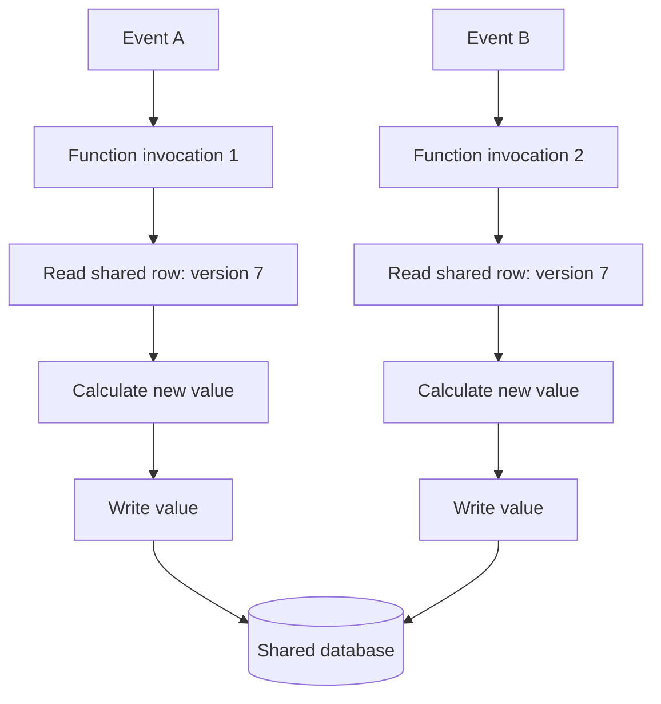
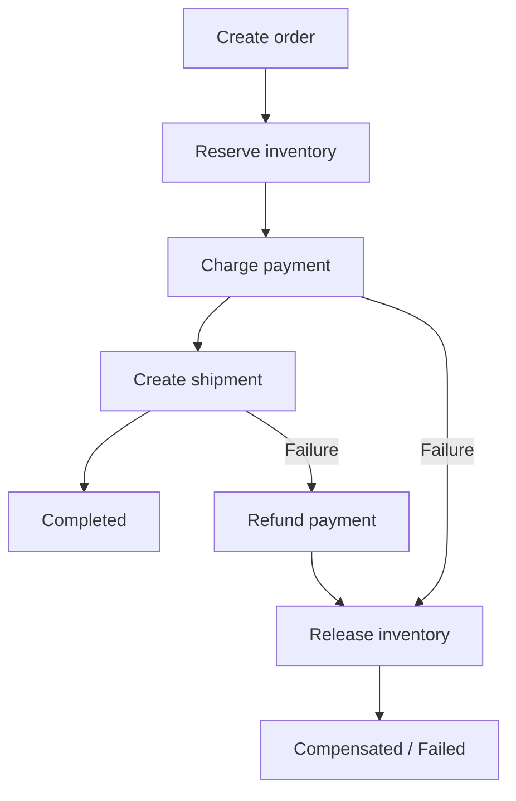

# Handling Data Contention and Lost Updates Across Functions

In serverless environments, multiple invocations of the same Java function can run concurrently on different execution environments. These invocations can read the same value, compute independently, and write results back. If read-modify-write operations are unprotected, a later write can overwrite an earlier write. The final data then fails to reflect all accepted operations.

This phenomenon is called a **lost update**. It is a form of race condition: the outcome depends on the interleaving order of concurrent operations. In serverless systems, increased concurrency, retries, queue redeliveries, and multiple distinct functions updating the same aggregate make this risk appear much more frequently.

This lesson explains how to identify and handle data contention across functions. Key techniques include atomic updates, transactions, optimistic locking, pessimistic locking, versions/CAS, unique constraints, and conditional writes. We also examine event ordering, idempotency, distributed locks, limitations of in-JVM state, and testing race conditions in Java.

## 1. Why Are Serverless Systems Prone to Data Contention?

### 1.1. One Function Can Have Many Concurrent Invocations

A function is an execution unit, not a single process guaranteed to run sequentially. As traffic grows, the platform spawns multiple execution environments. Two invocations of the same handler can execute simultaneously on two separate JVMs and access the same database row or document.



Two invocations do not share a heap, monitors, or `synchronized` locks. Shared data resides in databases, object storage, caches, queues, or external services. Therefore, synchronization within a single JVM cannot protect data from other invocations.

### 1.2. Common Sources of Concurrency

- Two HTTP requests updating the same account or order.
- Two message consumers receiving events for the same aggregate.
- A queue redelivering a message when the prior invocation wrote to the database but failed to acknowledge.
- Two different functions updating the same record: one handles payments, another handles refunds.
- A workflow executing two parallel branches that write back to the same state.
- A scheduled function and a request-driven function running reconciliation concurrently.
- A client resending a request while the first request is still processing.

It is not only identical functions that race. Any producer or consumer writing to the same data can contend.

### 1.3. Lost Update Example

Suppose an account balance is 100. Two invocations both execute an add-10 operation:

| Time | Invocation A | Invocation B | Balance in DB |
| --- | --- | --- | ---: |
| T1 | Read 100 |  | 100 |
| T2 |  | Read 100 | 100 |
| T3 | Compute 100 + 10 = 110 |  | 100 |
| T4 |  | Compute 100 + 10 = 110 | 100 |
| T5 | Write 110 |  | 110 |
| T6 |  | Write 110 | 110 |

The correct result should be 120, yet the database ends up with 110. One update was lost.

Error-prone code:

```java
Account account = repository.findById(accountId);
account.setBalance(account.getBalance() + amount);
repository.save(account);
```

This snippet may work for a single request, but it is unsafe when multiple invocations run concurrently if the repository performs separate read and write operations without proper transactions or locking.

### 1.4. Lost Updates Are Not Duplicate Deliveries

Two concepts must be separated:

- **Duplicate delivery:** the same event or request is delivered multiple times.
- **Lost update:** two legitimate operations—possibly with distinct event IDs—both read from stale state and overwrite each other.

Idempotency prevents a repeated operation from creating duplicate side effects. It does not by itself resolve two different operations concurrently updating the same value. Conversely, optimistic locking detects conflicts, but it does not automatically recognize a redelivered event. Systems typically need both.

## 2. Related Data Anomalies

### 2.1. Dirty Read

One transaction reads data written by another transaction that has not yet committed. If the writing transaction later rolls back, the reading transaction may have acted upon data that never became official state.

### 2.2. Non-Repeatable Read

A transaction reads the same row twice and gets different values because another transaction committed an update between the two reads.

### 2.3. Phantom Read

A transaction executes the same query predicate twice and sees additional or missing rows the second time because another transaction inserted or deleted matching rows.

### 2.4. Write Skew

Two transactions read the same dataset and update different rows. Each transaction individually appears valid, yet their combined outcome violates an invariant. For example, a system requires at least one on-call doctor at all times: two transactions both read that two doctors are on call, and each turns off a different doctor's status. Both committing can leave zero doctors on call.

### 2.5. Summary of Anomalies

| Anomaly | Description | Common Mitigation |
| --- | --- | --- |
| Lost update | A new write based on stale data overwrites another update | Atomic updates, version/CAS, locks, or suitable isolation |
| Dirty read | Reading uncommitted data | Isolation level preventing dirty reads |
| Non-repeatable read | Same row yields different results within one transaction | Repeatable read or suitable snapshot semantics |
| Phantom read | Set of rows matching a predicate changes | Serializable, predicate/range locking depending on DB |
| Write skew | Disjoint row changes violate a shared invariant | Serializable or locks/constraints guarding the invariant |
| Duplicate side effect | One logical operation executes multiple times | Idempotency keys, inbox/deduplication, unique constraints |

Identical isolation level names do not guarantee identical semantics across all databases. Consult your engine's documentation and verify via integration tests on the production database engine.

## 3. Choosing a Data Protection Strategy

### 3.1. Prefer Atomic Operations for Simple Arithmetic

When adding or subtracting a value, use an atomic database statement instead of reading and writing from Java:

```sql
UPDATE account
SET balance = balance + :amount
WHERE account_id = :accountId;
```

The database executes the update with built-in concurrency control. Two add-10 commands yield 120 if both succeed.

If the same row is also updated via optimistic locking, every write path must increment the version atomically as well. If an atomic SQL statement modifies data without incrementing the version, a transaction holding an older snapshot could still update using the stale version and overwrite newer changes.

### 3.2. Use Conditional Updates to Enforce Invariants

If balances must never go negative:

```sql
UPDATE account
SET balance = balance - :amount,
    version = version + 1
WHERE account_id = :accountId
  AND balance >= :amount;
```

Check the updated row count. If 1, the operation succeeded; if 0, the account does not exist or lacked sufficient balance at update time. In production, distinguish those two cases as required by business rules while avoiding unprotected read-then-write sequences.

### 3.3. Optimistic Locking

Use a version to detect whether a row changed since it was read. The update succeeds only if the version still equals the observed value. If another invocation committed first, the current update affects 0 rows and must handle the conflict.

This fits when contention is infrequent, transactions are short, and business logic can retry after reading the fresh state.

### 3.4. Pessimistic Locking

Lock the row/resource before reading and modifying so competing transactions wait or fail on lock timeout. This fits high-contention scenarios with short critical sections, though it can reduce throughput, cause deadlocks, or hold connections longer.

### 3.5. Constraints and Transactions

Unique constraints, foreign keys, check constraints, and transactions enforce invariants right at the persistence boundary. Validation in Java is useful for early feedback, but it never replaces constraints when multiple invocations run concurrently.

### 3.6. Selection Matrix

| Scenario | Starting Strategy |
| --- | --- |
| Simple counter increment | Atomic increment, or sharded counters if one row is too hot |
| Versioned document edits | Optimistic locking / CAS |
| Conditional inventory/balance deduction | Conditional atomic update in a transaction |
| Multi-step reads and updates across a group of rows | Transaction with appropriate isolation/locking |
| Creating a non-duplicable resource | Unique constraint + conflict/idempotency handling |
| Very high contention on one aggregate | Single-writer, keyed queue, or bounded pessimistic lock |
| Multi-service updates across a long process | State machine / Saga; never hold DB transactions over the network |

## 4. Atomic Updates in SQL

### 4.1. Direct Arithmetic in the Database

For counters, perform the arithmetic in the database:

```sql
UPDATE product_counter
SET view_count = view_count + 1
WHERE product_id = :productId;
```

The database prevents the application from reading a stale value and writing it back. However, a very hot row can still become a contention/serialization bottleneck. Atomic does not mean infinite throughput.

### 4.2. Conditional Updates for Inventory

```sql
UPDATE inventory
SET available_quantity = available_quantity - :quantity,
    version = version + 1
WHERE sku = :sku
  AND available_quantity >= :quantity;
```

If two orders both buy 4 items when 5 are available, only one update can succeed. The second update sees `available_quantity >= 4` is no longer true after the first transaction commits.

### 4.3. Create-Only via Unique Constraints

Do not rely on the pattern:

```text
if record does not exist:
    insert record
```

as a uniqueness guarantee when checking and inserting are two separate steps. Two invocations can both observe the record missing and both insert.

Define a unique constraint:

```sql
CREATE UNIQUE INDEX uq_payment_provider_ref
ON payment(provider_reference);
```

Then insert and handle unique violations as normal contention outcomes. If it is a duplicate of the same operation, return the prior result; if it is a different business conflict, return an appropriate error.

### 4.4. Upserts Do Not Automatically Solve Every Race

`INSERT ... ON CONFLICT DO UPDATE` or similar upserts protect creating/updating a single row. Still, the update expression must preserve invariants. For example, an upsert overwriting `balance = excluded.balance` can cause lost updates if `excluded.balance` was computed from a stale snapshot. Use atomic additions or version conditions as appropriate.

## 5. Optimistic Locking with Version/CAS

### 5.1. Compare-and-Set

CAS (compare-and-set) updates a value only when the current state still matches the expected value/version:

```sql
UPDATE orders
SET status = :newStatus,
    version = version + 1
WHERE order_id = :orderId
  AND version = :expectedVersion;
```

If the update count is 1, the caller won the race. If 0, the data changed or the record does not exist. The caller must re-read and decide whether the command still applies to the new state.

### 5.2. Java Repository with Versioning

```java
import java.util.ConcurrentModificationException;

public record VersionedAccount(
        String accountId,
        long balance,
        long version) {
}

public interface AccountRepository {
    VersionedAccount find(String accountId);

    boolean updateBalance(
            String accountId,
            long expectedVersion,
            long newBalance);
}

public final class AccountService {
    private final AccountRepository repository;

    public AccountService(AccountRepository repository) {
        this.repository = repository;
    }

    public void deposit(String accountId, long amount) {
        if (amount <= 0) {
            throw new IllegalArgumentException("amount must be positive");
        }

        VersionedAccount current = repository.find(accountId);
        long nextBalance = Math.addExact(current.balance(), amount);

        boolean updated = repository.updateBalance(
                accountId,
                current.version(),
                nextBalance);

        if (!updated) {
            throw new ConcurrentModificationException(
                    "Account changed; reload and retry the operation");
        }
    }
}
```

The repository implementation must execute a conditional SQL update and increment the version atomically. Never implement `updateBalance` by reading the version and running two unconditional statements.

### 5.3. Handling Conflicts

On a version mismatch:

1. Do not keep writing values computed from the stale snapshot.
2. Read the fresh state in a new transaction.
3. Verify the command is still valid against the fresh state.
4. Recompute the result.
5. Retry with bounded attempts and backoff if business rules allow.
6. If conflicts persist, return a conflict or shift to a queue/single-writer model.

Do not blindly retry the exact same `UPDATE ... WHERE version = oldVersion`; it will continue affecting 0 rows.

### 5.4. Retries Must Create a New Transaction

In many ORMs/databases, a transaction that encountered an optimistic locking exception may be marked rollback-only. Never catch the exception and continue querying/updating inside the same transaction as if it were still valid. Roll back, start a new transaction, reload the data, and reapply the command.

### 5.5. JPA `@Version`

JPA supports optimistic locking via the `@Version` field:

```java
import jakarta.persistence.Entity;
import jakarta.persistence.Id;
import jakarta.persistence.Version;

@Entity
public class InventoryItem {
    @Id
    private String sku;

    private int availableQuantity;

    @Version
    private long version;

    protected InventoryItem() {}

    public void reserve(int quantity) {
        if (quantity <= 0 || availableQuantity < quantity) {
            throw new InsufficientInventoryException(sku);
        }
        availableQuantity -= quantity;
    }
}
```

When the ORM flushes/updates, it includes the old version in the update predicate and increments the version. If another transaction already updated the row, the ORM throws an optimistic locking exception (the exact exception class depends on the JPA provider/framework).

`@Version` works only if every relevant write path respects versions. Native SQL, bulk updates, or another service bypassing versions can defeat the mechanism. When writing bulk updates, explicitly include the version predicate and increment the version properly.

## 6. Pessimistic Locking and Transactions

### 6.1. `SELECT ... FOR UPDATE`

When updates on a row must be serialized, lock the row inside a transaction:

```sql
BEGIN;

SELECT available_quantity
FROM inventory
WHERE sku = :sku
FOR UPDATE;

UPDATE inventory
SET available_quantity = available_quantity - :quantity
WHERE sku = :sku;

COMMIT;
```

Other transactions attempting to lock the same row will wait or fail with a lock timeout/deadlock depending on the database and configuration. Exact syntax and semantics of `FOR UPDATE` vary across engines; verify on your actual database.

### 6.2. Keep Critical Sections Short

Never hold row locks while:

- calling a payment provider;
- calling another HTTP service;
- waiting on queues or workflows;
- uploading/downloading objects;
- running long computations;
- sleeping for retries.

Keep transactions short: read/write only the required data and commit. If a process spans multiple services, use a state machine/Saga and compensation instead of holding a database lock across network calls.

### 6.3. Deadlocks

Deadlocks occur when transaction A locks row 1 and waits for row 2, while transaction B locks row 2 and waits for row 1. Reduce risk by acquiring locks in a consistent order, keeping transactions short, indexing properly, and bounding full-transaction retries after deadlocks.

Never retry just a single statement inside a rolled-back transaction. Replay the entire unit of work in a new transaction and ensure external side effects were not duplicated.

### 6.4. Connection Pools in Serverless

Many execution environments create many connection pools. If each instance holds a large pool, total database connections can exceed limits even when each individual pool looks small.

Size total connections using maximum concurrency, pool size per instance, background jobs, and headroom. Consider a database proxy/pooling service, concurrency limits, and smaller per-function pools. Pessimistic locking combined with high invocation concurrency can hold connections longer and exhaust pools.

## 7. Isolation Levels and Transaction Boundaries

### 7.1. Common Isolation Levels

| Isolation Level | General Meaning | Notes |
| --- | --- | --- |
| Read Uncommitted | May observe uncommitted changes in engines that support it | Many engines do not actually implement it this way |
| Read Committed | Each statement reads committed data | Two reads within one transaction may differ |
| Repeatable Read | Preserves snapshot/repeatable reads depending on engine | Phantom and write-skew handling differ across DBs |
| Serializable | Outcome equivalent to some valid serial execution | May abort transactions, requiring full-transaction retries |

Do not choose an isolation level by name alone. PostgreSQL, MySQL/InnoDB, SQL Server, and other databases have distinct implementation details. Review engine documentation, actual isolation anomalies, and test concurrent transactions.

### 7.2. Transactions Must Cover the Invariant

If an invariant spans two rows, the transaction must protect both. For example, a money transfer needs debit and credit in the same transaction or an explicitly designed ledger/compensation workflow. Locking only the debit row without protecting the credit can leave unbalanced state.

### 7.3. Never Span a Transaction Across Invocations

Do not hold a database transaction open between two invocations or while waiting for an event. Functions can be frozen or terminated; long transactions hold locks and connections, and there is no guarantee the workflow will return to the same execution environment.

For long-running processes:

- persist state transitions durably;
- commit short individual steps;
- use an outbox to emit commands/events;
- use a Saga/workflow orchestrator;
- provide compensation/reconciliation for non-rollbackable steps.

## 8. Conditional Writes in NoSQL

### 8.1. Version Conditions

NoSQL databases commonly provide conditional writes or compare-and-set. General pattern:

```text
Update item:
  SET value = :newValue,
      version = version + 1
  CONDITION version = :expectedVersion
```

If the condition fails, the application knows another writer updated the item. Re-read and decide whether to reapply the command.

### 8.2. Atomic Counters

If you only need to increment a counter, use the database's atomic increment/update expression instead of read-modify-write in Java. A single-item atomic update still faces per-item/partition throughput limits; extremely hot counters may require sharding.

### 8.3. Multi-Item Transactions

When an invariant spans multiple items, use the database's transaction API if supported, keeping size and duration limits in mind. Never assume two separate conditional writes are atomic together.

### 8.4. DynamoDB-Style Conditional Updates

Java SDK v2 pseudo-code example:

```java
UpdateItemRequest request = UpdateItemRequest.builder()
        .tableName("Inventory")
        .key(Map.of("sku", AttributeValue.fromS("SKU-42")))
        .updateExpression("SET available = available - :qty, version = version + :one")
        .conditionExpression("available >= :qty AND version = :expected")
        .expressionAttributeValues(Map.of(
                ":qty", AttributeValue.fromN("2"),
                ":one", AttributeValue.fromN("1"),
                ":expected", AttributeValue.fromN("7")))
        .build();

dynamoDb.updateItem(request);
```

This illustrates AWS SDK for Java v2; import the corresponding model/client types and handle conditional-check failures. If no version check is needed and you only need non-negative inventory deduction, `available >= :qty` paired with the update expression already enforces the invariant for this operation. Add the version condition when you need to detect stale reads or control transitions.

### 8.5. Single-Document Atomicity Does Not Mean Multi-Document Transactions

Some document databases guarantee atomic updates on a single document without defaulting to multi-document transactions. If an invariant spans multiple documents, use supported transactions or remodel data so the aggregate fits within one consistency boundary.

## 9. Event Ordering and Multiple Functions Updating an Aggregate

### 9.1. Ordering Is Not Automatically Global

Queues and streams usually guarantee ordering only within a bounded scope, such as a message group or partition. Two events for the same order can be processed in parallel if the producer chose different partition keys or multiple consumers update the database simultaneously.

When business rules require per-aggregate sequentiality:

- partition/group by aggregate ID;
- allow only one consumer to process sequentially within that scope;
- carry sequence numbers/versions inside events;
- reject or defer late stale events;
- still guard the database with conditional updates because retries and multiple producers can break ordering assumptions.

### 9.2. Version Guards for Events

Events can carry `aggregateVersion` or a sequence number. Consumers apply the next event only when the version matches:

```sql
UPDATE orders
SET status = :newStatus,
    version = :eventVersion
WHERE order_id = :orderId
  AND version = :eventVersion - 1;
```

If the update count is 0, the event may be a duplicate, stale, or ahead of an earlier event. Distinguish these cases: read the current version, check processed event IDs, and route out-of-order events to retry/defer/reconciliation paths.

Do not blindly drop every older-looking event; a valid earlier event might actually be missing. Use inbox/sequence tracking to detect gaps.

### 9.3. Idempotency and Concurrency Control Complement Each Other

| Mechanism | Solves | Does Not Solve by Itself |
| --- | --- | --- |
| Idempotency key | Same logical operation redelivered | Two different operations concurrently updating stale state |
| Optimistic version | Detects another writer modified the row | Duplicate events if operations lack identity |
| Atomic increment | Lost updates on simple additions | Complex multi-row business invariants |
| Pessimistic lock | Serializes the locked critical section | External side effects and locks across multiple services |
| Queue ordering | Preserves order within a group/partition | Other writers or HTTP requests directly updating the same row |

Usually you need to combine event ID/inbox tracking, version guards, and transactions.

## 10. Idempotency Under Concurrent Invocations

### 10.1. Check-Then-Act Is Unsafe

The following pattern has a race:

```java
if (!repository.exists(eventId)) {
    repository.save(eventId);
    applyBusinessChange(event);
}
```

Two invocations can both observe `exists=false` before either inserts. Use a unique constraint / atomic insert-if-absent and apply business changes inside the same transaction.

### 10.2. Inbox with a Unique Key

The schema can use a composite key:

```sql
CREATE TABLE processed_event (
    consumer_name VARCHAR(120) NOT NULL,
    event_id VARCHAR(200) NOT NULL,
    processed_at TIMESTAMP NOT NULL,
    PRIMARY KEY (consumer_name, event_id)
);
```

The transaction inserts the event ID; only the invocation whose insert succeeds executes side effects in the same transaction. An invocation hitting the unique constraint recognizes the duplicate and finishes successfully per contract.

### 10.3. Idempotency Records and In-Progress State

For long-running or external side effects, a state machine may be needed:

```text
ABSENT → IN_PROGRESS → SUCCEEDED
                   ↘ FAILED_RETRYABLE
                   ↘ UNKNOWN → RECONCILING
```

`IN_PROGRESS` claims require leases/expiry and owner tokens to recover from worker crashes. However, lease expiration does not prove the old worker stopped; fencing/version tokens must prevent the old worker from overwriting state after lease ownership transfers to a new owner.

## 11. Distributed Locks: Use Correctly and Cautiously

### 11.1. When Is a Distributed Lock Needed?

A distributed lock can be useful when multiple workers must elect a leader or execute an exclusive task. However, if the goal is merely protecting a database row, conditional updates or database transactions are usually simpler and stronger.

### 11.2. A Lease Can Expire While a Worker Is Still Running

Suppose worker A acquires a 30-second lock lease but pauses for 40 seconds. The lease expires and worker B acquires a new lock. Worker A resumes after the pause; now both A and B could write data concurrently.

Therefore, TTL-based distributed locks are insufficient if the target resource does not check fencing tokens.

### 11.3. Fencing Tokens

The lock service issues a monotonically increasing token each time a lock is granted. The target resource accepts operations only with a token greater than any previously observed token. An old worker carrying a smaller token is rejected even if it wakes up after its lease expired.

Fencing tokens must be validated where data is written. Storing a token in Redis without checking it in the database does not stop a stale owner from writing.

### 11.4. What Not to Do

- Using `synchronized` or `ReentrantLock` inside a function for system-wide protection.
- Using local caches/flags as distributed locks.
- Holding a lock across slow HTTP calls.
- Using short TTLs without fencing tokens.
- Assuming locks solve duplicate events or idempotency.
- Omitting release/recovery mechanisms when a function is terminated.

## 12. Limitations of State in Java FaaS

### 12.1. Static Fields Are Not Shared State

Static fields exist only inside a single JVM execution environment. Invocations running on other environments do not see changes. Environments can be frozen, scaled down, or replaced at any time.

### 12.2. Local Synchronization Only Protects One Instance

```java
public synchronized void updateBalance(...) {
    // This lock protects only callers using this object in this JVM.
}
```

Even if every invocation inside one JVM goes through a `synchronized` method, invocations on another JVM can still update the same row. Proper coordination must live at the shared persistence boundary or an explicitly designed single-writer service/queue.

### 12.3. Warm Environments Are Not a Contract

Do not rely on functions usually running sequentially on a single environment. During bursts, the platform creates additional instances; when idle, instances can be destroyed. Local caches can boost performance, but must never be used to guarantee correctness, global locking, or idempotency.

### 12.4. Connection Pools and Transaction Scope

Creating overly large pools in each JVM can push total connections past database capacity. Transactions must be short and never cross invocation boundaries. Use proxies/poolers and concurrency controls when workloads span many execution environments.

## 13. Multiple Services and Long Processes: Sagas Instead of Distributed Transactions

### 13.1. Why Not Hold Transactions Across Functions?

A workflow may include reserving inventory, charging payment, and creating a shipment. Each step executes in a different function with independent timeouts and retries. You cannot hold a JDBC transaction open across invocations waiting minutes for events.

### 13.2. Sagas

Sagas split a process into local transactions and define compensations when a later step fails:



Compensation is not a physical rollback. For instance, a refund is a new transaction that can fail and requires its own retries and reconciliation. Every step needs an idempotency key and durable state.

### 13.3. State Machines and Conditional Transitions

Every transition should guard on state/version:

```sql
UPDATE orders
SET status = 'PAYMENT_PENDING', version = version + 1
WHERE order_id = :id
  AND status = 'INVENTORY_RESERVED'
  AND version = :expectedVersion;
```

If the transition fails, the workflow reads the new state and decides whether to resume, compensate, or terminate. Never allow two workflow branches to transition the same order from a stale state nondeterministically.

## 14. Read Replicas, Caches, and Stale Reads

### 14.1. Read-After-Write

A function writing to the primary followed by another function reading from a lagging replica can see stale data. If that function writes back based on stale values, it can cause lost updates or wrong business decisions.

For operations requiring strong correctness:

- read and perform conditional updates on the primary / appropriate consistency boundary;
- use versions/ETags to detect stale state;
- never use caches as the source of truth for critical invariants;
- accept eventual consistency only where business rules allow.

### 14.2. ETag and `If-Match`

HTTP APIs can return an ETag representing the version. Clients pass `If-Match` on updates; the server updates only if the version still matches. Otherwise, return `412 Precondition Failed` or `409 Conflict` per API contract.

This provides optimistic concurrency control at the API boundary. The database must still perform the conditional update atomically; never compare ETags in Java and then issue an unconditional write.

## 15. Testing Data Contention

### 15.1. Unit Tests Are Not Enough

Mock repositories can verify that a service handles conflicts, but they do not prove the real database enforces atomic updates, unique constraints, isolation, or locking as expected. Write integration tests against the same database engine used in production.

### 15.2. Writing Controlled Concurrency Tests

Use `CountDownLatch`, `CyclicBarrier`, or an executor to start multiple workers from the same initial state. Verify invariants after all finish.

Example test harness for atomic increments:

```java
import static org.junit.jupiter.api.Assertions.assertEquals;

import java.util.concurrent.CountDownLatch;
import java.util.concurrent.ExecutorService;
import java.util.concurrent.Executors;
import java.util.concurrent.Future;
import java.util.concurrent.TimeUnit;
import java.util.ArrayList;
import java.util.List;
import org.junit.jupiter.api.Test;

class ConcurrentCounterIT {
    private final CounterRepository repository = createRealTestRepository();

    @Test
    void concurrentIncrementsAreNotLost() throws Exception {
        int workers = 20;
        int incrementsPerWorker = 100;
        CountDownLatch ready = new CountDownLatch(workers);
        CountDownLatch start = new CountDownLatch(1);
        ExecutorService pool = Executors.newFixedThreadPool(workers);
        List<Future<?>> tasks = new ArrayList<>();

        repository.reset("counter-1", 0);

        try {
            for (int worker = 0; worker < workers; worker++) {
                tasks.add(pool.submit(() -> {
                    ready.countDown();
                    start.await();
                    for (int i = 0; i < incrementsPerWorker; i++) {
                        repository.atomicIncrement("counter-1", 1);
                    }
                    return null;
                }));
            }

            assertEquals(true, ready.await(10, TimeUnit.SECONDS));
            start.countDown();
            pool.shutdown();
            assertEquals(true, pool.awaitTermination(30, TimeUnit.SECONDS));
            for (Future<?> task : tasks) {
                task.get(); // Propagate worker exceptions to the test thread.
            }

            assertEquals((long) workers * incrementsPerWorker,
                    repository.read("counter-1"));
        } finally {
            pool.shutdownNow();
        }
    }
}
```

`createRealTestRepository()` is a fixture connecting to a real test database, e.g. via Testcontainers; `CounterRepository` must execute atomic SQL updates. In production-grade tests, collect and check each task's `Future` so worker exceptions are not silently ignored; the example above illustrates synchronized start-barrier coordination. Never run this test against a production database.

### 15.3. Deliberately Testing Lost Updates

Create a test repository with separate read and write steps, using a barrier to force two workers to read the same version before writing. Verify that an unprotected read-modify-write implementation loses updates, then re-run with atomic updates or version/CAS to confirm the invariant holds.

### 15.4. Testing Optimistic Conflicts

Verify:

- two transactions read version N;
- transaction A commits version N+1;
- transaction B updating with version N is rejected;
- transaction B rolls back, reloads, and recomputes in a fresh transaction;
- no external side effects are duplicated during retries.

### 15.5. Testing Locks and Deadlocks

Test lock timeouts, transaction rollbacks, deadlock victims, and full-transaction retries. Confirm functions do not hold connections indefinitely while waiting on locks and total retries stay within deadlines.

### 15.6. Testing Event Ordering and Duplicates

Send event version N+1 before N, duplicate event N, and two distinct events updating the same aggregate concurrently. Confirm the consumer handles gaps/stale/duplicate events per policy and final invariants remain intact.

## 16. Monitoring and Operations

### 16.1. Metrics

Track:

- optimistic lock/version conflict rate;
- conditional write failure rate;
- unique constraint violations by constraint;
- row lock wait times and deadlock counts;
- transaction retry/rollback rates;
- database connection pool saturation;
- stale event/version gap counts;
- duplicate event/idempotency hit rates;
- transaction duration and query latency;
- business invariant violations / reconciliation discrepancies.

Do not use account IDs or order IDs as metric labels because cardinality explodes and they may contain sensitive data. Use controlled logs/traces to investigate individual aggregates.

### 16.2. Structured Logs

Useful fields:

- `operationId`, `eventId`, `correlationId`;
- `aggregateType`, redacted/hashed identifier if needed;
- `expectedVersion`, `actualVersion`;
- `conflictType`, `retryAttempt`;
- `transactionDuration`, `lockWaitMs`;
- `functionVersion`, `requestId`, `traceId`;
- `result` and error category.

Never log full financial payloads or personal data. Log enough context to distinguish normal concurrency conflicts from configuration errors or bugs.

### 16.3. Alerts

Alert when:

- optimistic conflict rate spikes abruptly;
- deadlocks/lock waits exceed baseline;
- connection pools approach exhaustion;
- conditional updates fail abnormally;
- version gaps or stale events climb;
- reconciliation detects imbalances;
- post-conflict retries push latency past SLA.

Conflicts are not necessarily system failures; a low rate can be normal. Base alerts on baselines, duration, and business impact.

## 17. Solution Selection Process

1. Identify business invariants: what must never be wrong?
2. Find every writer: functions, APIs, scheduled jobs, admin tools, and consumers.
3. Determine the consistency boundary: one row, multiple rows, one aggregate, or multiple services.
4. For simple arithmetic, prefer atomic updates.
5. When stale states must be detected, use version/CAS or ETag.
6. If critical sections are short and contention is high, consider pessimistic locks or single-writer serialization.
7. When invariants span multiple rows, pick appropriate transactions, isolation, and constraints.
8. When workflows span multiple services, use Sagas/state machines and compensation.
9. Guard against duplicate deliveries using inbox/idempotency independently of concurrency control.
10. Test against a real database with concurrent invocations.
11. Monitor conflicts, lock waits, retries, and business reconciliation after deployment.

## 18. Production Checklist

- [ ] All critical shared state lives in durable storage with clear consistency semantics.
- [ ] Static fields, local caches, or `synchronized` are never used as system-wide locks.
- [ ] Read-modify-write sequences are replaced with atomic updates, CAS, or appropriate transactions/locks.
- [ ] Business invariants are enforced in the database via conditions/constraints wherever possible.
- [ ] Version columns/ETags exist for data requiring optimistic concurrency.
- [ ] Conflicts are resolved by re-reading and recomputing, never by writing stale values.
- [ ] Optimistic conflict retries start a new transaction and are bounded.
- [ ] Pessimistic locks have timeouts, short transactions, and consistent lock ordering.
- [ ] Deadlock retries replay the entire transaction rather than a single statement.
- [ ] Isolation levels are chosen according to actual database semantics.
- [ ] Unique constraints protect create-if-absent operations.
- [ ] NoSQL conditional writes/transactions match the true consistency boundary.
- [ ] Event ordering is scoped by aggregate/partition/group with sequence/version guards.
- [ ] Idempotency keys/inboxes handle duplicates independently of optimistic locking.
- [ ] External side effects are protected by provider idempotency, outboxes, or reconciliation.
- [ ] Distributed locks, if used, include leases, fencing tokens, and resource-side validation.
- [ ] Function concurrency and connection pools fit within downstream capacity budgets.
- [ ] Transactions/locks are never held across network calls or invocation boundaries.
- [ ] Concurrency integration tests run against a production-compatible engine.
- [ ] Metrics/alerts monitor conflicts, deadlocks, lock waits, retries, and invariant discrepancies.

## Conclusion

Lost updates happen when multiple invocations read the same stale state and overwrite each other's results. Serverless architectures make this common because a single function can run concurrently across many execution environments; local locks or static state cannot protect shared databases.

Prefer atomic updates for simple arithmetic, conditional writes/versions/CAS when detecting stale state, and transactions/locking/constraints for richer invariants. Optimistic locking requires re-reading and recomputing in a new transaction; pessimistic locking requires short critical sections, timeouts, and deadlock handling. In NoSQL, use conditional expressions and atomic updates aligned with the consistency boundaries the database actually guarantees.

Idempotency, event ordering, and concurrency control solve different problems and usually must be combined. For workflows spanning multiple services, use state machines/Sagas and compensation rather than trying to hold transactions across functions. Finally, test with concurrent invocations against a real database and monitor conflict/lock/retry metrics to prove invariants hold as load grows.
