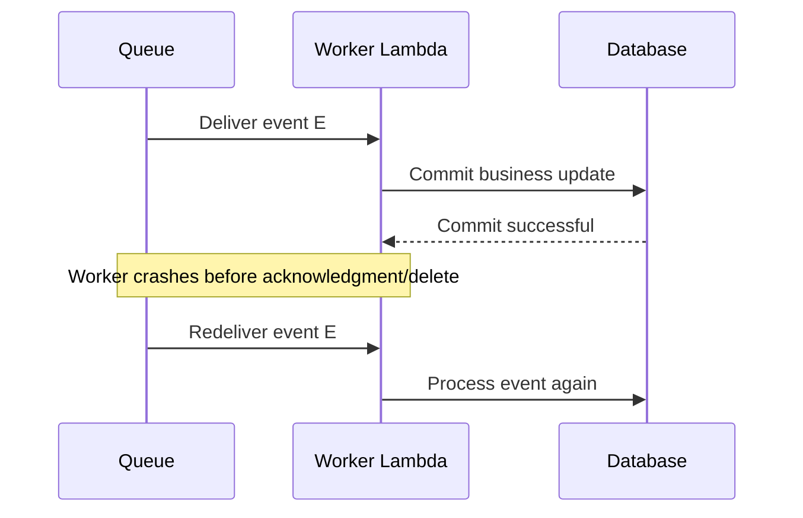
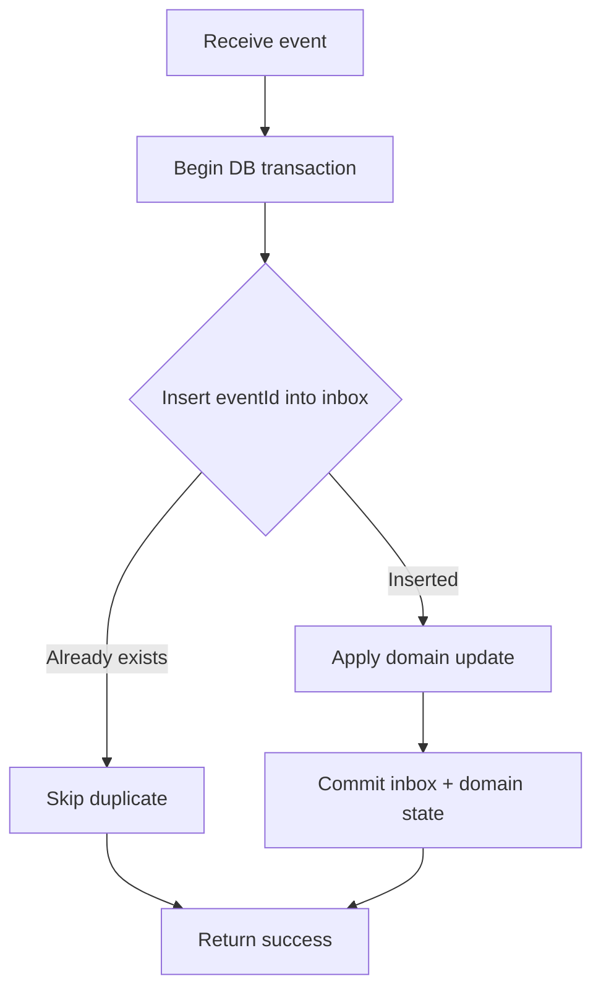
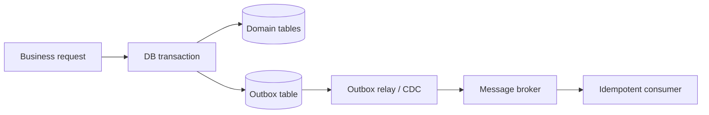

# Identifying End-to-End Exactly-Once Guarantee Boundaries

## 1. Why Is "Exactly-Once" Easily Misunderstood?

In a serverless application, an event can traverse API Gateway, a Java Lambda function, SQS, a worker Lambda, a database, and an external provider's API. Each component has its own retry, timeout, acknowledgment, and state persistence mechanisms. A message can be delivered multiple times even when the producer sends it only once; a function can re-execute after writing data; a payment API can complete a transaction while the response is lost on the return path.

Therefore, saying "the system processes exactly once" is meaningful only when you specify **at which scope, for which operation, over what time window, and under what failure assumptions**. A queue with deduplication does not automatically ensure a database updates only once. A workflow engine recording one state transition does not automatically ensure an external email or payment executes only once.

Within the `CLOUD_SERVERLESS` module, it is important to understand HTTP/message/event triggers, delivery semantics, retries, idempotency, state, and side effects. The practical goal is usually achieving **one observable business effect** even when an event is redelivered or a function runs multiple times.

## 2. Separating Concepts: Delivery, Invocation, Processing, and Effect

"Once" can refer to several distinct things. Distinguish them clearly:

| Concept | Question | Example |
|---|---|---|
| Delivery | How many times does the broker deliver the message to a consumer? | SQS redelivers a message after its visibility timeout |
| Invocation | How many times does the platform invoke the function? | Lambda retries an asynchronous event |
| Processing attempt | How many times does the handler start processing? | A worker reads the same `eventId` again after a crash |
| State transition | How many times does business data change state? | Order transitions from `PENDING` to `PAID` |
| Side effect | How many times does an external action happen? | Sending an email, charging a card, or creating a shipment |
| Observation | How many times does the client/producer observe the outcome? | Client retries `POST` because the initial response was lost |

A system can deliver a message multiple times and invoke a function multiple times while still committing only one state transition. That is a common and achievable goal when idempotency is properly designed.

Conversely, the platform may invoke a function only once while the handler executes a side effect twice due to repeated API calls in code, or a producer may emit two distinct events for the same business action. Counting invocations is insufficient to prove data correctness.

## 3. Why End-to-End Exactly-Once Cannot Be Assumed by Default

Suppose a worker receives a message, writes an order to the database, and then acknowledges the message as processed. A gap exists between committing and acknowledging.



If the worker commits to the database and dies before deleting the message, the broker does not know the transaction succeeded and redelivers it. If the worker acknowledges the message before committing to the database, the worker can die after acknowledgment and the data will never be written.

These are the two fundamental failure windows:

- **Commit first, acknowledge second:** risks duplicate processing if a crash occurs in between.
- **Acknowledge first, commit second:** risks lost processing if a crash occurs in between.

When the database and broker do not participate in a supported distributed transaction, you cannot merge two operations into one atomic commit simply by reordering calls. Timeouts do not eliminate uncertainty either: a caller missing a response does not mean the remote operation failed to commit.

Consequently, most systems choose at-least-once delivery paired with idempotent consumers, or use transactional mechanisms within a narrow scope to achieve an exactly-once effect in a specific state store.

## 4. Three Common Delivery Semantics

| Semantics | Meaning | Trade-off |
|---|---|---|
| At-most-once | Events are delivered/processed at most once; loss is possible | No retries, or drop on failure |
| At-least-once | Events are redelivered until acknowledged or policy expires; duplicates possible | Requires idempotency / deduplication |
| Exactly-once | An effect is committed exactly once within a guaranteed scope | Requires transactions/deduplication and explicit boundary definitions |

At-least-once does not mean every event is guaranteed to process successfully. Messages can expire past retention, move to a DLQ, be manually deleted, or exhaust retry policies. At-most-once does not mean a function cannot run twice if a producer sends two separate events; it describes only the semantics of a specific delivery path.

Exactly-once typically refers to **an effect within a single transaction boundary** or a pipeline that can atomically commit outputs alongside read progress. Do not stretch that claim into "every side effect across the entire system happens only once."

## 5. Sources of Duplicates in Serverless

Duplicates can arise from many places:

- A producer resends because it did not receive a confirmation response.
- Lambda asynchronous invocations retry after a function or runtime error.
- SQS messages redeliver after visibility timeout expiration or function errors.
- Event source mappings re-read records when checkpoints have not advanced.
- A consumer commits successfully but crashes before acknowledgment/checkpointing.
- Clients retry HTTP requests when gateways or networks time out.
- DLQ redrives inject older messages back into the main flow.
- Operators replay events for data recovery.
- Two independent producers emit events for the same business action.
- Schedulers rerun a schedule or workflows are started multiple times.

Duplicates are an expected property of distributed systems. Good designs tolerate the same event arriving again, even hours or days later if replays are permitted.

## 6. Semantics of Common AWS Triggers

AWS services have distinct characteristics. Read each trigger's contract accurately rather than applying one blanket notion of exactly-once to every service.

| Source / Trigger | Behavior to Watch | Consumer Design |
|---|---|---|
| API Gateway → Lambda synchronous | Caller awaits response; clients or upstream proxies may retry when outcomes are unclear | Idempotency keys for operations with side effects |
| Lambda asynchronous invocation | Events enter an internal queue and retry per policy on function errors; duplicates can occur | Idempotent handlers, failure destinations/DLQs, and replay policies |
| SQS Standard → Lambda | At-least-once; messages can be delivered multiple times | Idempotent consumers, visibility timeouts, partial batch responses |
| SQS FIFO | Deduplication ID and ordering per message group; send deduplication has a finite window | Still handle redeliveries and side-effect idempotency |
| EventBridge → target | Delivery retries and can duplicate; events may be re-sent per policy | Stable event IDs, idempotent consumers, and DLQs |
| Kinesis / DynamoDB Streams → Lambda | Event source mappings can reprocess records/batches on errors or unadvanced checkpoints | Idempotent record processing, proper checkpointing/partial failure handling |
| SNS Standard → SQS/Lambda | At-least-once delivery under standard topics; duplicates may occur | Deduplicate by event identity at the consumer |
| Kafka consumer | Offset commits and output writes have a failure window; Kafka transactions give guarantees within Kafka's boundary | Distinguish Kafka-to-Kafka EOS from database/API side effects |

Exact retry, retention, batching, and failure destination details depend on configuration. This table is a conceptual map, not a substitute for trigger-specific documentation.

## 7. SQS Standard: At-Least-Once and Visibility Timeouts

SQS Standard is built for scale and can deliver a message more than once. A consumer can receive a message, take longer than the visibility timeout, and see the message become visible again. Another consumer can then process the same message while the first invocation is still running.

Safeguards:

- Size the visibility timeout appropriately relative to processing time and Lambda timeout.
- Carry a stable idempotency key inside the message.
- Update business state and the processed-event marker in the same transaction when possible.
- Enable partial batch responses where appropriate to report only failed records.
- Configure a DLQ/redrive policy and monitor `ApproximateAgeOfOldestMessage`.
- Never treat a message disappearing from the queue as proof of an exactly-once side effect.

If a handler processes a 10-record batch where 9 succeed and 1 fails, improper batch failure handling can cause all 10 records to redeliver. Consumers must tolerate duplicates of the 9 already-committed records.

## 8. SQS FIFO: Deduplication Is Not System-Wide Exactly-Once

SQS FIFO supports ordering by `MessageGroupId` and deduplication via `MessageDeduplicationId` or content-based deduplication. Deduplication IDs are tracked for a finite window (currently 5 minutes per SQS documentation). Resending the same ID within that window avoids enqueuing a duplicate message.

However, that does not prove consumers create side effects only once:

- A consumer can receive a message, commit to the database, and crash before deleting the message.
- A message can redeliver after the visibility timeout expires.
- The same business action might be sent by producers with two different deduplication IDs.
- DLQ redrives or replays after the deduplication window can reintroduce old events.
- The database and queue do not share a transaction merely because the queue is FIFO.

FIFO addresses part of enqueue-time deduplication and per-group ordering. Business state still needs durable idempotency.

## 9. Lambda Asynchronous Invocations

When invoking Lambda asynchronously, the producer receives confirmation that Lambda accepted the event—not confirmation that the business operation finished. Lambda queues the event internally for later processing. On function errors, the platform retries per configuration; events can also be delivered more than once in certain delivery scenarios.

Distinguish these milestones:

- Async invoke API returns success: the event entered the asynchronous invocation queue.
- Handler returns success: the invocation finished from the runtime's perspective.
- Business transaction commits: business state is persisted.
- External side effects complete: external systems executed the action.

These milestones are not equivalent. Configure `MaximumRetryAttempts`, `MaximumEventAgeInSeconds`, on-failure destinations, or DLQs as needed; monitor event age and failures. Handlers must be idempotent because retries re-invoke with the same event.

## 10. EventBridge, Streams, and Kafka

### EventBridge

EventBridge routes events to targets and applies delivery retry policies. Targets can receive events multiple times, especially when responses/acks are lost or deliveries retry. EventBridge's event ID helps with correlation, while consumers should rely on a producer-generated stable business event ID when deduplicating across multiple publishes or replays.

### Kinesis and DynamoDB Streams

Lambda event source mappings read records by shard/batch. On function failure, records or batches can be reprocessed depending on checkpoints, retry settings, and partial batch response configuration. Consumers must never assume a record is seen by a handler only once. Use event identities, conditional writes, and idempotent state transitions.

### Kafka

Kafka can provide exactly-once semantics for certain read-process-write pipelines using producer transactions and committing offsets within the same Kafka transaction. That guarantee holds within Kafka's transactional boundary. If a consumer calls a payment API or writes to a database outside Kafka, those side effects do not participate in the Kafka transaction.

For example, a consumer reading `orders`, writing to `order-enriched`, and committing offsets in one Kafka transaction avoids duplicate Kafka outputs under supported models. If that same consumer calls Stripe and then commits Kafka offsets, crashing after payment but before offset commit can repeat the payment call.

## 11. Exactly-Once Within a Single Transaction Boundary

An exactly-once effect is achievable when the "already processed" marker and the business update commit atomically inside the same transaction.

Example in a relational database:

```sql
BEGIN;

WITH claimed AS (
    INSERT INTO processed_events(event_id, processed_at)
    VALUES (:event_id, CURRENT_TIMESTAMP)
    ON CONFLICT (event_id) DO NOTHING
    RETURNING event_id
), updated AS (
    UPDATE accounts
    SET balance = balance - :amount
    WHERE account_id = :account_id
      AND EXISTS (SELECT 1 FROM claimed)
    RETURNING account_id
)
SELECT
    (SELECT COUNT(*) FROM claimed) AS claimed_count,
    (SELECT COUNT(*) FROM updated) AS updated_count;

COMMIT;
```

In this PostgreSQL example, the CTE allows the business update only when inserting the marker created a new row. The application reads both counts before deciding whether to commit: `claimed_count=0` means the event was claimed previously (duplicate); `claimed_count=1` and `updated_count=1` means both operations succeeded; `claimed_count=1` and `updated_count=0` indicates a business error (e.g., account missing or insufficient balance) and must `ROLLBACK` rather than committing the marker. Both operations must share the same transaction. If the marker commits separately before or after the business update, the failure window returns.

Within that transaction boundary, the database guarantees one event ID produces at most one business transition. Yet that guarantee does not cover sending emails, publishing to another broker, or calling external APIs.

## 12. Idempotency: Turning Repeated Processing into One Outcome

An operation is idempotent if executing it once or multiple times with the same identity/input produces the same final state without multiplying side effects.

Examples:

- `PUT /orders/123/status = PAID` can be idempotent with conditional status updates.
- `POST /payments` is usually not idempotent if each call creates a new charge.
- `increment balance by 100` is not idempotent when repeated.
- `set balance to 500` can be idempotent if context/versions are controlled.

Idempotency does not mean a handler never runs twice. It means reruns are detected and create no additional business effects.

An idempotency record typically stores:

| Field | Meaning |
|---|---|
| `idempotencyKey` | Unique key of the business operation |
| `payloadHash` | Detects same key with a different payload |
| `status` | `IN_PROGRESS`, `SUCCEEDED`, `FAILED`, or an appropriate domain state |
| `resultRef` | ID/result that can be returned to the caller |
| `createdAt`, `updatedAt` | Auditing and lease handling |
| `expiresAt` | Record expiration timestamp per deduplication policy |

If the same key arrives with a different payload, return a conflict instead of treating it as a valid duplicate. If the record is `IN_PROGRESS`, callers can receive an in-progress status or wait within a deadline; do not launch parallel side effects.

## 13. Choosing Stable Idempotency Keys

A key must represent the same business intent across retries, not a single message transport attempt.

Example keys:

```text
tenant-42:order-created:order-9381:v1
payment:merchant-7:checkout-5519:capture
shipment:order-9381:fulfillment-request:v2
```

Keys to avoid:

- Lambda `awsRequestId`: changes on every invocation.
- SQS receipt handle: changes whenever a message is received again.
- Current timestamp or a fresh random UUID generated on each retry.
- Bare payload hashes when two legitimate business actions can share identical payloads.

A good key should:

- Remain stable across retries, redrives, and replays of the same operation.
- Distinguish tenants, business types, and operations where needed.
- Avoid collisions across different domains.
- Include a version if event semantics change.
- Omit secrets or unnecessary personal data.

If a producer cannot supply a natural business ID, generate an event ID before the first publish and persist it durably alongside producer state. Never generate a new ID each time the same event is resent.

## 14. Inbox Pattern for Consumers

The inbox pattern records received/processed events in the same database as business state. Inside one transaction, the consumer:

1. Inserts `eventId` into an `inbox` table protected by a unique constraint.
2. If the key already exists, treats the event as a duplicate and skips business updates.
3. If newly inserted, updates domain tables.
4. Commits both the inbox marker and business state together.
5. After commit, returns success so the broker can acknowledge/delete the message.



If the process crashes before commit, the transaction rolls back and the broker redelivers; next time the consumer starts fresh. If it crashes after commit but before acknowledgment, the broker redelivers, yet the unique inbox key blocks repeating the business update. That produces a single effect within the database boundary even though delivery remains at-least-once.

Inbox records must be retained long enough relative to retry, retention, DLQ, and replay policies. Deleting markers too early lets old events trigger side effects again.

## 15. Outbox Pattern for Producers

A producer often needs to both update a database and publish an event. If the database write succeeds and publishing fails, the system has new state without an event. If publishing succeeds and the database transaction rolls back, consumers receive an event for state that never existed.

The outbox pattern solves dual-writes by writing business state and the outbox record in the same database transaction:



A relay reads the outbox and publishes events. The relay may publish duplicates if the broker accepted the message before the relay crashed prior to marking the record sent. Consumers still need an inbox/idempotency. The outbox guarantees business state and publish intent are persisted atomically; it does not turn network delivery into exactly-once.

Outbox records should include a stable event ID, aggregate ID, event type, schema version, creation timestamp, and payload. Relays need retries, backoff, an ordering strategy, and metrics for outbox age/backlog.

## 16. Java and DynamoDB: Transactions for Inbox Markers and Business Updates

With DynamoDB, `TransactWriteItems` can write the processed-event marker and update a business item in one transaction. Condition expressions prevent two concurrent consumers from committing the same event ID.

Abbreviated AWS SDK for Java 2.x example:

```java
import software.amazon.awssdk.services.dynamodb.DynamoDbClient;
import software.amazon.awssdk.services.dynamodb.model.*;

import java.util.Map;

public final class OrderEventConsumer {
    private final DynamoDbClient dynamo;

    public OrderEventConsumer(DynamoDbClient dynamo) {
        this.dynamo = dynamo;
    }

    public void markPaidOnce(String eventId, String orderId) {
        Map<String, AttributeValue> inboxItem = Map.of(
                "eventId", AttributeValue.fromS(eventId),
                "status", AttributeValue.fromS("PROCESSED"));

        Map<String, AttributeValue> orderKey = Map.of(
                "orderId", AttributeValue.fromS(orderId));

        TransactWriteItemsRequest request = TransactWriteItemsRequest.builder()
                .transactItems(
                        TransactWriteItem.builder()
                                .put(Put.builder()
                                        .tableName("ProcessedEvents")
                                        .item(inboxItem)
                                        .conditionExpression("attribute_not_exists(eventId)")
                                        .build())
                                .build(),
                        TransactWriteItem.builder()
                                .update(Update.builder()
                                        .tableName("Orders")
                                        .key(orderKey)
                                        .updateExpression("SET #status = :paid")
                                        .conditionExpression("attribute_exists(orderId)")
                                        .expressionAttributeNames(Map.of("#status", "status"))
                                        .expressionAttributeValues(Map.of(
                                                ":paid", AttributeValue.fromS("PAID")))
                                        .build())
                                .build())
                .build();

        dynamo.transactWriteItems(request);
    }
}
```

This illustrates a transaction boundary within the same DynamoDB Region/account. The `ProcessedEvents` table needs a partition key matching `eventId`; real schemas may use composite keys and add TTL. Business updates and markers commit or roll back together.

If `transactWriteItems` fails due to a condition conflict, the event may already be processed. Read the inbox item with a strongly consistent read to confirm status before returning success. If the request times out and transaction outcome is unknown, do not guess failure: retry with the same event ID, then read the marker to verify whether the prior commit succeeded.

In production, distinguish condition failures caused by duplicates from throttling, validation, transaction conflicts, or access denied. Never swallow every `TransactionCanceledException` and return success. Include a payload hash if you must detect the same `eventId` with a different payload; validate legal domain transitions and persist results/references so replays return accurate outcomes.

## 17. External Side Effects: Payments, Emails, and Third-Party APIs

This is the hardest boundary for exactly-once guarantees. Your application's database transaction cannot atomically commit alongside a payment provider, email provider, or external API unless both sides share a transaction protocol.

Example:

1. Worker sends a payment capture request with key `payment:order-9381:capture`.
2. Provider executes the charge.
3. Provider sends a success response, but the network drops before the worker receives it.
4. Worker does not know whether the charge succeeded.
5. Calling again with a new key risks charging the customer twice.

Safeguards:

- Send a stable idempotency key if the provider supports it.
- Reuse the exact same key across every retry of that operation.
- Persist `PENDING` before calling the provider and update to `SUCCEEDED` after confirmation.
- On timeouts or unknown outcomes, query the provider by operation ID / idempotency key before creating a new operation.
- Handle provider webhooks as events that can arrive duplicated and out of order.
- Run reconciliation jobs to compare provider state against internal database state.
- Provide compensation or manual review when a provider supports neither idempotency nor status queries.

Provider idempotency typically has its own scope and retention. Check whether keys apply per account, endpoint, or operation; how long keys are retained; and how mismatched payloads for the same key behave. Never assume providers retain keys indefinitely.

Emails/SMS can also duplicate if the provider accepted the request but the response was lost. If the provider lacks an idempotent API, you can only reduce duplicate probability via outboxes, delivery state tracking, and reconciliation; do not claim exactly-once delivery.

## 18. Sagas and Compensation Are Not Global Rollbacks

When a business flow spans multiple services and databases, distributed transactions rarely fit. Sagas divide the workflow into local transactions; if a later step fails, the system runs compensating actions for previously completed steps.

Order placement example:

1. Create order `PENDING`.
2. Reserve inventory.
3. Authorize payment.
4. Confirm order.
5. If payment fails, release inventory and mark order `CANCELLED`.

Compensation is a new business action, not rewinding time as if the step never happened. A refund can fail or require retries; releasing inventory can be delayed. Every forward step and compensation needs its own idempotency key, conditional state transitions, and timeout/retry policies.

Step Functions can orchestrate steps, `Retry`, and `Catch`, but a state machine does not by itself make external side effects exactly-once. Tasks can retry or workflows can be redriven; task handlers must remain idempotent.

## 19. Ordering Does Not Mean Exactly-Once

A FIFO queue or Kafka partition can preserve ordering within a defined scope. Ordering does not prevent duplicates and does not guarantee side effects execute only once.

For example, a consumer receives `OrderCreated` then `OrderCancelled`, yet a retry delivers `OrderCreated` again after the order is already cancelled. If the consumer applies events purely in arrival order without checking versions/state, state can regress.

Mitigations:

- Attach aggregate IDs and sequences/versions to events.
- Use conditional updates: apply an event only if the current version matches the expected version.
- Skip already-applied stale events or route them to reconciliation.
- Partition messages by aggregate ID when ordering is required.
- Handle out-of-order events according to the business state machine.

FIFO ordering applies only within a message group; Kafka ordering applies within a partition; there is no automatic global ordering across all consumers and partitions.

## 20. DLQs, Redrives, and Replays Can Defeat Short-Lived Deduplication

Dead-letter queues retain failed messages for investigation or reprocessing. When redriven, old events can return hours or days later. If deduplication records live only 5 minutes or TTL has already deleted markers, those events can be processed as brand new.

Before replaying:

- Determine whether the event ID and business effect were already applied.
- Preserve the original idempotency key across DLQ/redrive.
- Check schema versions and compatibility.
- Decide whether the replay should re-run side effects or only rebuild projections/read models.
- Bound the time range/partition and throttle replay rate.
- Monitor suppressed duplicates, replay counts, and final outcomes.
- Establish a procedure for expired or no-longer-valid events.

Never mint a new event ID simply because a message moves from a DLQ back to the main queue. When an intentionally new business operation is needed, issue a new operation ID explicitly with an audit trail.

## 21. Retention of Idempotency Records and Deduplication Windows

TTLs must exceed every window over which the system can retry or replay the same event. Account for:

- Producer and SDK retries.
- Lambda / event source mapping retries.
- Queue retention and DLQ retention.
- Operator redrive/replay windows.
- Provider idempotency key retention.
- Reconciliation windows that may re-trigger operations.

For instance, if messages can sit in a DLQ for 14 days and be replayed within 30 days, inbox markers must not expire after one day. For financial business data, retain idempotency/audit records per compliance retention policies rather than short TTLs.

TTL expiration is generally an asynchronous cleanup mechanism, not a precision second-by-second clock. Never rely on TTL-expiring items as an instant synchronization lock without accounting for actual deletion timing.

## 22. `IN_PROGRESS` State, Leases, and Crash Handling

For long-running operations, a `PROCESSED` marker alone is insufficient. Two workers can pick up the same event before either writes the marker. A worker can also die while the record is `IN_PROGRESS`.

A common state model:

```text
ABSENT
  └── conditional create ──> IN_PROGRESS
                               ├── commit effect ──> SUCCEEDED
                               ├── permanent error ─> FAILED_FINAL
                               └── lease expires ───> RECOVERABLE
```

An `IN_PROGRESS` record can store an owner token, lease expiry, and attempt count. Another worker may take over only after the lease expires, using conditional updates/fencing tokens so the stale worker cannot overwrite results later.

Leases do not by themselves guarantee exactly-once execution. The old worker may still be running after its lease expires; fencing tokens/versions must be validated where side effects commit. If an external side-effect system does not validate tokens, provider idempotency or reconciliation is still required.

Do not set a lease shorter than normal processing time without heartbeats/renewals. Overly long leases slow recovery; overly short leases cause concurrent duplicates.

## 23. Java HTTP APIs: Idempotency for Request Retries

For `POST` endpoints with side effects, APIs can require an `Idempotency-Key`. The server scopes the key by tenant/operation and stores the payload hash and status. Retries with the same key and payload receive the prior result; the same key with a different payload returns `409 Conflict`.

A contract might look like:

```http
POST /payments
Idempotency-Key: payment:order-9381:capture
Content-Type: application/json

{"orderId":"order-9381","amount":12500,"currency":"VND"}
```

Initial response:

```http
HTTP/1.1 201 Created
Idempotency-Replayed: false
Content-Type: application/json

{"paymentId":"pay-771","status":"CAPTURED"}
```

Retry responses with the same key return the same `paymentId` and status with `Idempotency-Replayed: true`. If the operation is still `IN_PROGRESS`, the API can return `202 Accepted` with an operation URL or `409`/`425` per contract; what matters is never creating a second payment.

Never expose another tenant's result simply because a caller guessed a key. Idempotency lookups must be bound to the authenticated principal/tenant and operation scope.

## 24. Checking Same Key with Different Payloads

A key represents a single intent. If a client reuses a key for a different payload, the server must not silently return the old result.

Steps:

1. Canonicalize business-meaningful fields.
2. Compute a payload hash (e.g., SHA-256) over the canonical representation.
3. Conditionally create the idempotency record containing key and hash.
4. If the record already exists, read it.
5. Compare hashes: if matching, return the stored result/status; if mismatched, return conflict.
6. Avoid storing raw secrets or sensitive data in idempotency records unnecessarily.

Canonicalization must be deterministic: JSON key order, decimal representation, Unicode normalization, and defaults can alter hashes even when payloads carry identical meaning. Define explicitly which fields enter the hash and version the algorithm.

## 25. Exactly-Once and Kafka Transactions

Kafka supports idempotent producers and transactions to write multiple output records while committing consumer offsets in one transaction. When consumers use `read_committed`, downstream consumers see only committed transactional records.

However, Kafka transactions do not encompass external databases or HTTP APIs. When writing to a database, use an inbox/outbox or a connector with documented semantics and transaction boundaries. Never assume enabling `enable.idempotence=true` means external business logic executes only once.

When consuming from Kafka, understand when offsets commit. Committing before business writes risks losing processing; writing business state before committing offsets risks duplicates after a crash. Use transactional consume-transform-produce when both input and output live within Kafka's boundary, or an idempotent sink/inbox when writing to databases.

## 26. Observing and Measuring Duplicates

Do not merely log "duplicate ignored." Measure duplicates by source and verify they are safely suppressed.

Suggested metrics:

- `consumer_events_received_total` by service/event type.
- `consumer_duplicate_suppressed_total` by consumer/event type.
- `idempotency_conflict_total` by operation.
- `idempotency_in_progress_age` as a histogram.
- `event_processing_attempts` by source and outcome.
- `outbox_oldest_event_age` and `outbox_publish_failures`.
- `dlq_messages_visible` and `redrive_count`.
- `external_operation_unknown_outcome_total` by provider/operation.

Logs/traces can carry `eventId`, protected `idempotencyKey`, `attempt`, `deliverySource`, `correlationId`, and state transitions. Never use event IDs, order IDs, or idempotency keys as high-cardinality metric labels.

Alert on abnormal duplicate spikes, aging inbox/outbox backlogs, `IN_PROGRESS` records past lease duration, growing DLQs, or prolonged unknown outcomes on external operations.

## 27. Testing Failure Windows

To prove idempotency, test crash points and retries—not just sending one event twice in a row.

| Failure Point | Scenario | Expected Outcome |
|---|---|---|
| Before transaction | Worker dies before writing marker | Event retries and processes normally |
| Inside transaction | Transaction rolls back | No partial business update or inbox marker |
| After commit, before ack | Worker dies after database commit | Redelivery is blocked by inbox/unique key |
| After publish, before marking outbox | Relay dies after broker receives event | Publish may repeat; consumer deduplicates |
| After provider effect, before response | Payment/email provider executed, response lost | Retries use same provider idempotency key or reconcile |
| During lease | Worker A stalls, Worker B takes over | Fencing/version prevents stale worker overwrite |
| After TTL expiry | Old event replayed | Retention policy prevents unwanted side effects |
| DLQ redrive | Event returns to main queue | Preserves event identity and deduplicates |
| Concurrent duplicate | Two workers receive same event nearly simultaneously | Only one conditional transaction commit succeeds |
| Payload mismatch | Same key, different content | Rejects with conflict and records audit entry |

Tests should assert final business state, actual sandbox ledger/payment/email counts, inbox markers, and retry behavior. Counting Lambda invocations is not a sufficient assertion.

## 28. Exactly-Once Promises to Avoid

| Inaccurate Claim | Scoped Phrasing |
|---|---|
| "SQS FIFO guarantees the system processes everything exactly once." | "SQS FIFO deduplicates enqueues by ID over a finite window and preserves per-group ordering; consumers still need idempotency for side effects." |
| "Lambda runs only once per event." | "Triggers can retry or redeliver; handlers must tolerate duplicate invocations per the delivery contract." |
| "Kafka is exactly-once, so the database never sees duplicates." | "Kafka transactions can guarantee consume-transform-produce within Kafka's boundary; database sinks need their own transactions/idempotency." |
| "Step Functions workflows do not retry tasks." | "Workflows can retry or redrive tasks; task side effects must be idempotent." |
| "Receiving HTTP 200 means business logic ran only once." | "The HTTP response confirms per endpoint contract; idempotency keys and durable state govern request retries." |
| "Adding a deduplication cache is enough." | "Deduplication requires proper retention, concurrency control, payload validation, and crash recovery." |

Any credible guarantee must specify: the identity key, transaction boundary, protected store, retention window, replay policy, and behavior when outcomes are unknown.

## 29. Process for Designing Data Correctness in Event-Driven Flows

1. **Identify business effects:** which state changes or actions must never repeat?
2. **Choose event identities:** generate stable IDs at the producer and preserve them across retries/replays.
3. **Define delivery semantics:** at-most-once, at-least-once, or a specific transaction boundary.
4. **Choose idempotency storage:** inbox table, DynamoDB item, unique constraints, or provider keys.
5. **Pair marker and business update:** share one transaction when the same data store supports it.
6. **Handle producer dual-writes:** use an outbox/CDC when updating a DB and publishing events.
7. **Protect external side effects:** provider idempotency keys, status queries, reconciliation, or compensation.
8. **Size retention:** exceed retry, queue, DLQ, and replay windows.
9. **Handle concurrency:** conditional writes, unique constraints, leases, and fencing tokens.
10. **Handle ordering/versioning:** prevent stale events from overwriting newer state.
11. **Design DLQ/replays:** preserve identities and throttle replay rates.
12. **Measure:** suppressed duplicates, unknown outcomes, outbox age, and DLQ depth.
13. **Test crash points:** after commit, before ack, after provider effect, and before response.
14. **Document guarantees accurately:** state boundaries and assumptions rather than blanket exactly-once claims.

## 30. Pre-Production Checklist

- [ ] Distinguished delivery, invocation, processing, state transitions, and side effects.
- [ ] Verified delivery semantics of every trigger from official service docs.
- [ ] Consumers tolerate duplicates and retries.
- [ ] Event IDs / idempotency keys remain stable across retries, redrives, and replays.
- [ ] Same key with a different payload is detected and rejected.
- [ ] Business updates and inbox markers share one transaction whenever possible.
- [ ] Producers use outbox/CDC when dual-writing to a database and broker.
- [ ] External provider idempotency scope and retention are verified.
- [ ] Unknown outcomes have status queries, reconciliation, or manual review.
- [ ] Inbox/idempotency retention exceeds retry and replay windows.
- [ ] Concurrent duplicates are handled via conditional writes / unique constraints.
- [ ] Leases include fencing/versioning whenever takeover is possible.
- [ ] Aggregate ordering/versioning is enforced.
- [ ] DLQ redrives preserve event identity and are rate-limited.
- [ ] Kafka exactly-once is claimed only within its supported boundary.
- [ ] Metrics track duplicate suppression, outbox age, DLQs, and unknown outcomes.
- [ ] Tested crashes after commit but before acknowledgment.
- [ ] Tested provider executing side effects while the response is lost.
- [ ] Guarantee documentation explicitly states boundaries, retention, replays, and failure assumptions.

## References

- [Amazon SQS at-least-once delivery](https://docs.aws.amazon.com/AWSSimpleQueueService/latest/SQSDeveloperGuide/standard-queues-at-least-once-delivery.html)
- [Amazon SQS FIFO deduplication](https://docs.aws.amazon.com/AWSSimpleQueueService/latest/SQSDeveloperGuide/FIFO-queues-exactly-once-processing.html)
- [Using Lambda with Amazon SQS](https://docs.aws.amazon.com/lambda/latest/dg/with-sqs.html)
- [Lambda asynchronous invocation](https://docs.aws.amazon.com/lambda/latest/dg/invocation-async.html)
- [Lambda asynchronous error handling](https://docs.aws.amazon.com/lambda/latest/dg/invocation-async-error-handling.html)
- [EventBridge retry policy and DLQ](https://docs.aws.amazon.com/eventbridge/latest/userguide/eb-rule-retry-policy.html)
- [DynamoDB transactions](https://docs.aws.amazon.com/amazondynamodb/latest/developerguide/transaction-apis.html)
- [Transactional outbox pattern](https://microservices.io/patterns/data/transactional-outbox.html)
- [Idempotent consumer pattern](https://microservices.io/post/microservices/patterns/2020/10/16/idempotent-consumer.html)
- [Apache Kafka delivery semantics](https://kafka.apache.org/documentation/#semantics)
- [AWS Step Functions error handling](https://docs.aws.amazon.com/step-functions/latest/dg/concepts-error-handling.html)

## Conclusion

Exactly-once is not an automatic property of an entire serverless chain. Brokers can redeliver, Lambda can retry, workers can crash after committing, and external providers can complete side effects even when responses are lost. Explicitly define delivery semantics and transaction boundaries; combine stable event identities, inbox/outbox patterns, conditional writes, and idempotency to produce a single business effect within your controllable scope. For external side effects, rely on provider idempotency, status queries, and reconciliation. A guarantee is trustworthy only when it specifies its scope, retention, replay policy, and failure assumptions.
