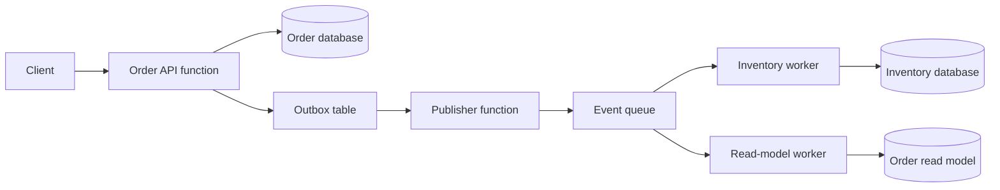
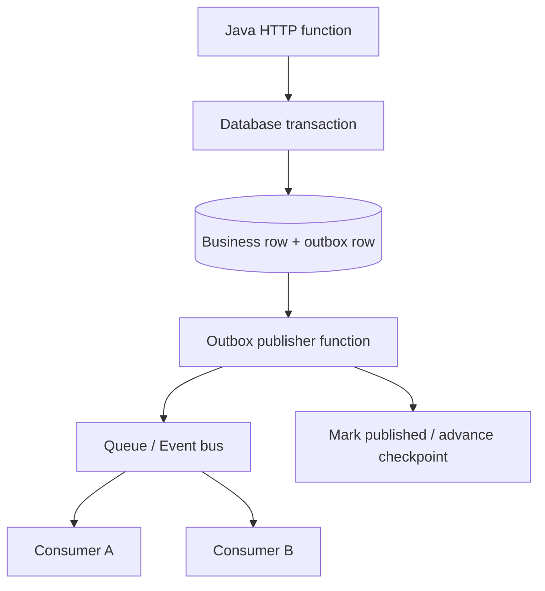
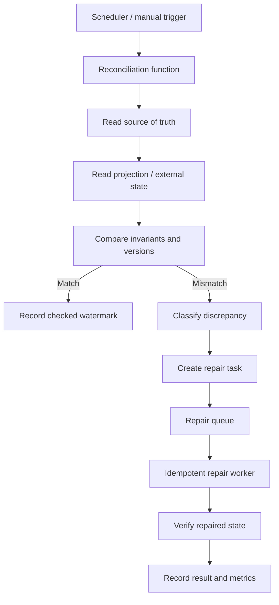
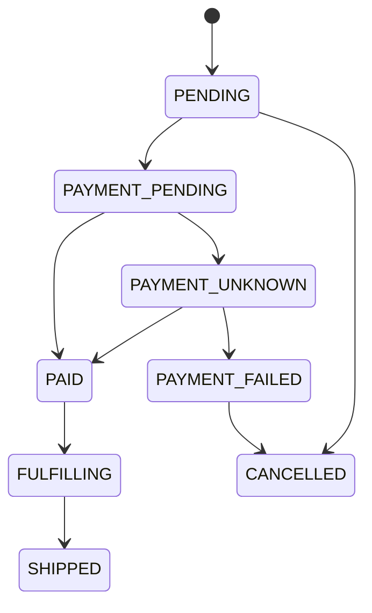

# Designing Eventual Consistency and State Reconciliation

In serverless applications, a single business operation often spans multiple functions and services: an HTTP function writes an order, emits an event to a queue, a worker updates inventory, another function sends notifications, and a consumer builds a read model for UI screens. These steps do not necessarily finish inside one transaction. Consequently, for some period, different systems may display different states even though they must eventually converge on the same business outcome.

**Eventual consistency** is a model in which replicas or projections may temporarily diverge, but if no further updates arrive and changes are successfully propagated, processed, and repaired, they converge to a consistent state. It fits many asynchronous flows well, yet it does not mean you can ignore errors, duplicates, out-of-order events, or lost data.

**State reconciliation** is the process of comparing actual state against an authoritative source of truth or business invariants, detecting discrepancies, and bringing the system back to the right state. In serverless systems, reconciliation typically runs periodically via scheduler- or queue-triggered functions, processes small batches, and can be rerun safely.

This lesson explains how to define consistency boundaries, design events and projections, handle ordering and versions, build reconciliation and anti-entropy loops, implement Java patterns, and measure and test system convergence.

## 1. What Is Eventual Consistency?

An eventually consistent system allows data replicas or read models to lag behind the write source. If a service marks an order `PAID`, pushes an event onto a queue, and a consumer updates the lookup view a few seconds later, read APIs may still return `PENDING` during that window.

This is not necessarily a bug. It is valid as long as the business tolerates that delay, users understand transient states, and the system guarantees events are eventually processed or reconciled to correct discrepancies.

### Order Flow Example



After the API records the order, the source database reflects the new state while inventory and read models have not updated yet. The system must explicitly define which store is the source of truth for each piece of data, which stores are rebuildable projections, and which states may be displayed temporarily.

### Eventual Consistency Does Not Mean "Data Will Fix Itself"

Convergence requires specific conditions:

- Changes are durably persisted before confirming success to the caller.
- Events are published or discoverable for republishing.
- Consumers can safely reprocess duplicates.
- Stale or out-of-order events cannot overwrite newer state.
- Transient failures undergo bounded retries; persistent failures move to a DLQ or repair queue.
- Reconciliation detects lost events, drifted projections, or incomplete side effects.
- The system has sufficient capacity to drain backlogs and recover from outages.

If events are dropped, consumers stop permanently, or errors are silently ignored without a repair path, the system may never converge. Eventual consistency is an engineered and operated property, not an automatic guarantee of a queue.

## 2. Choosing Consistency Models by Business Requirement

Not all data needs the same consistency guarantees. An application can use strong transactions for account balances while accepting a few seconds of lag on a search read model.

| Model / Property | Meaning | Example Use Case |
|---|---|---|
| Strong consistency | After a successful write, subsequent appropriate reads observe the new value per store semantics | Checking balance before debiting |
| Eventual consistency | Replicas/projections can lag, but converge once all updates are processed | Search indexes, dashboards, email notification status |
| Read-your-writes | Users see changes they themselves just wrote on subsequent reads | Screen right after placing an order |
| Monotonic reads | A reader never regresses to an older version than one it already observed | Tracking order status |
| Causal consistency | Causally related operations are observed in proper order | Creating an order before updating payment status |
| Bounded staleness | Lag is accepted within a bounded time or version window | Near-real-time catalogs or reports |

These properties are supported differently across databases, caches, replicas, and APIs. Never assume a system provides read-your-writes merely because the primary database has strong consistency; the very next request might be routed to a read replica or an asynchronous projection.

### Classify Data Before Choosing a Model

Classify data by the impact of stale or conflicting values:

- **Transaction-deciding data:** balances, credit limits, payment status, ownership. Typically requires transactions, conditional writes, or strong consistency at the decision point.
- **Workflow control data:** processing states, leases, retry counts, checkpoints. Requires versions, valid state transitions, and atomic updates.
- **Read models:** summary views, search indexes, dashboards. Can be eventual if lag indicators and refresh paths exist.
- **Notifications / analytics:** emails, metrics, reports. Can process asynchronously, provided duplicate side effects are prevented or reconcilable.
- **Caches:** data may go stale within a defined TTL; requires invalidation or tolerance for delayed refresh.

A useful rule of thumb: enforce strong consistency where business decisions are irreversible; permit eventual consistency where data is aggregated or presented, provided users and downstream consumers understand those semantics.

## 3. Defining Sources of Truth and Consistency Boundaries

When multiple services store copies of the same information, designate which service/database owns the authoritative state. Otherwise, each service may mutate its own copy with no rule for conflict resolution.

Example with an order system:

- The order database is the source of truth for order status.
- The inventory service owns stock counts and reservations.
- The payment service owns authorize/capture/refund outcomes.
- Search indexes and dashboards are rebuildable projections.
- Notification logs track delivery status, not authoritative order status.

### Data Ownership Map

| Data | Owner / Source of Truth | Consumers / Projections | Update Authority |
|---|---|---|---|
| Order status | Order service | Read model, notifications | Only the order workflow updates via state machine |
| Inventory quantity | Inventory service | Product page, availability cache | Inventory service manages reserve/commit/release |
| Payment status | Payment service / provider ledger | Order projection, finance reports | Payment workflow verifies provider outcomes |
| Search document | Search projection | Search API | Can be wiped and rebuilt from source/events |
| Customer notification status | Notification service | Support dashboard | Updated by notification workers and reconciliation |

Do not let multiple services write directly to the same table simply for speed. Communicating via commands/events and letting the owner enforce invariants keeps ownership clean.

### Consistency Boundaries

A consistency boundary is the scope within which the system can enforce an invariant via a transaction or atomic operation. For example, order status and an outbox record can be written inside one database transaction. Publishing to the queue and updating inventory typically fall outside that transaction.

Explicitly document:

1. Which invariants must hold immediately inside one transaction?
2. Which updates are allowed to happen asynchronously?
3. Which data is authoritative and which is a projection?
4. If an asynchronous step fails, who owns retrying or compensating?
5. When is the system allowed to report completion to the caller?

## 4. Designing Events So Services Can Converge

An event announces that a business fact occurred. Events should describe what happened (`OrderPlaced`, `PaymentCaptured`) rather than instructing consumers to perform vague actions (`DoSomething`). Commands and events carry different semantics: commands ask a service to do work; events broadcast a recorded state change.

An event envelope typically includes:

| Field | Purpose |
|---|---|
| `eventId` | Unique ID for event identification and deduplication |
| `eventType` | Business event category |
| `schemaVersion` | Payload schema version |
| `aggregateId` | ID of the entity/aggregate described by the event |
| `aggregateVersion` | Monotonically increasing aggregate version |
| `occurredAt` | Business occurrence timestamp from the emitter |
| `publishedAt` | Publish timestamp if available |
| `correlationId` | Correlates steps of a workflow/request |
| `causationId` | Event/command that directly caused this event |
| `payload` | Data needed by consumers |

JSON example:

```json
{
  "eventId": "evt-01J8ORDER42",
  "eventType": "OrderPlaced",
  "schemaVersion": 2,
  "aggregateType": "Order",
  "aggregateId": "ord-4821",
  "aggregateVersion": 7,
  "occurredAt": "2026-11-17T10:15:30Z",
  "correlationId": "workflow-8f2c",
  "causationId": "cmd-place-order-31",
  "payload": {
    "orderId": "ord-4821",
    "customerRef": "cust-104",
    "totalMinor": 259900,
    "currency": "VND"
  }
}
```

IDs and values in this example are synthetic. Never include tokens, passwords, payment card data, or unnecessary PII in events. Events may reside long-term in queues/archives and be read by many consumers.

### Events Must Have Immutable Semantics

A published event should never be retroactively altered. If information changes, emit a new event with a newer version. Consumers must know whether an event carries a full snapshot or a delta:

- **Snapshot events:** contain enough state for consumers to update projections directly.
- **Delta events:** contain changes, such as `quantityReserved=2`; consumers must apply them in strict order/version.

Snapshots are easier to handle when events arrive late because consumers can compare versions and replace with newer state. Deltas save payload size, yet are sensitive to lost events, duplicates, and reordering. If using deltas, build sequence gap detection and replay/rebuild mechanisms.

## 5. Transactional Outbox: Never Lose Events Between Database and Queue

A common mistake is writing to the database and publishing an event to a queue as two separate operations:

1. Database commit succeeds.
2. Function times out before sending the event.

As a result, source state changed while consumers never received the event. Reversing the order is also risky: the event publishes, then the database transaction rolls back, leaving consumers acting on a change that never existed.

The transactional outbox closes this gap by writing business data and the outbox record in one database transaction. A separate publisher reads the outbox and delivers events to the broker.



The publisher may send an event multiple times if publishing succeeds before crashing prior to marking the outbox sent. Therefore, consumers must still be idempotent. The outbox ensures events can be republished from durable data; it does not by itself guarantee exactly-once delivery.

### Example Outbox Schema

```sql
CREATE TABLE outbox_event (
    event_id          VARCHAR(128) PRIMARY KEY,
    aggregate_type    VARCHAR(80) NOT NULL,
    aggregate_id      VARCHAR(128) NOT NULL,
    aggregate_version BIGINT NOT NULL,
    event_type        VARCHAR(120) NOT NULL,
    schema_version    INTEGER NOT NULL,
    payload           JSON NOT NULL,
    occurred_at       TIMESTAMP NOT NULL,
    created_at        TIMESTAMP NOT NULL DEFAULT CURRENT_TIMESTAMP,
    published_at      TIMESTAMP NULL,
    publish_attempts INTEGER NOT NULL DEFAULT 0
);

CREATE INDEX idx_outbox_unpublished
    ON outbox_event (created_at)
    WHERE published_at IS NULL;
```

Exact `JSON`, partial index, and timestamp syntax depend on the database; the example uses a generic JSON type, while PostgreSQL typically uses `JSONB`. With multiple publishers, use safe row claiming such as `FOR UPDATE SKIP LOCKED`, leases, or partitioning to prevent two publishers from processing the same row. Never keep a database transaction open while calling the broker over the network.

### Publishing Order from the Outbox

`ORDER BY created_at` alone does not guarantee business ordering when multiple publishers claim rows in parallel. If consumers require per-aggregate order:

- Write `aggregate_version` in the outbox inside the same transaction as the aggregate update.
- Partition publishers by `aggregate_id` or a stable partition key.
- Ensure only one publish stream per aggregate is active at a time, or have consumers check versions and gaps.
- Use broker ordering per partition/message group if available, without assuming global ordering.

Even when publishers preserve order, retries of an older event can still arrive after a newer event. Consumer version guards remain essential.

### Writing Business Rows and Outbox in the Same Transaction

```java
public Order placeOrder(PlaceOrderCommand command) {
    return transactionTemplate.execute(status -> {
        Order order = orderRepository.create(command);

        OrderPlaced event = new OrderPlaced(
                eventIdGenerator.next(),
                order.id(),
                order.version(),
                order.customerRef(),
                order.totalMinor(),
                order.currency());

        outboxRepository.insert(event);
        return order;
    });
}
```

`orderRepository.create` and `outboxRepository.insert` must share the same transaction manager and connection. Never invoke the queue publisher directly inside the transaction. The publisher reads committed rows, sends events, and updates `published_at` via an idempotent, retryable loop.

## 6. Handling Duplicate and Out-of-Order Events

Most queue/event integrations in serverless systems should assume an event can be delivered multiple times. Duplicates occur when a consumer applies side effects before losing its acknowledgment, a function times out, or a publisher retries.

Events can also arrive out of order when:

- Multiple publishers run in parallel.
- The queue does not guarantee global ordering.
- Retries of an older event finish after a newer event.
- Multiple regions or partitions emit events concurrently.
- Consumers process batches with varying processing times.

### Idempotent Consumers

Consumers record processed event IDs via unique constraints or atomic operations. If an event redelivers, the consumer recognizes it and skips repeating side effects.

```sql
CREATE TABLE consumer_inbox (
    consumer_name VARCHAR(120) NOT NULL,
    event_id       VARCHAR(128) NOT NULL,
    processed_at   TIMESTAMP NOT NULL,
    PRIMARY KEY (consumer_name, event_id)
);
```

The primary key includes both consumer name and event ID because independent consumers may each need to process the same event. Inserting the inbox record and updating the projection should share the same transaction.

```java
public void consume(OrderPlaced event) {
    transactionTemplate.executeWithoutResult(status -> {
        boolean firstDelivery = inboxRepository.insertIfAbsent(
                "order-read-model", event.eventId());

        if (!firstDelivery) {
            return;
        }

        projectionRepository.apply(event);
    });
}
```

`insertIfAbsent` must rely on a unique constraint or atomic insert; never use separate `SELECT` then `INSERT` without race protection. If the projection update fails, the transaction must roll back the inbox record too so the event can be retried.

### Version Guards

For each aggregate, producers should assign monotonically increasing versions on every state update. Consumers apply an event only if it is newer than the current version.

```sql
UPDATE order_projection
SET status = :new_status,
    aggregate_version = :incoming_version,
    updated_at = :occurred_at
WHERE order_id = :order_id
  AND aggregate_version < :incoming_version;
```

If the update affects 0 rows, distinguish duplicates/stale events from missing records or version gaps. Never automatically treat every 0-row result as success.

### Detecting Version Gaps

If a projection is at version 7 and receives a delta event for version 9, version 8 may be missing. Never apply delta 9 as if the full history were intact. Options include:

- Buffer event 9 and request replay of version 8.
- Read the latest snapshot from the source of truth and update the projection.
- Route the event to a repair queue and continue processing other aggregates.
- Use full snapshot events if the contract permits state replacement.

With FIFO queues or partitioned streams, ordering is generally guaranteed only within a message group/partition, not globally. Choose partition keys by aggregate ID when per-entity ordering is needed.

## 7. Designing Read Models and Displaying Transient States

In CQRS, the command model processes business mutations while the query model provides query-optimized views. Because read models update asynchronously from events, represent lag explicitly.

Order creation API example:

```http
POST /orders
Idempotency-Key: create-order-4b92
Content-Type: application/json

{ "items": [{ "sku": "BOOK-01", "quantity": 2 }] }
```

The API can return:

```http
HTTP/1.1 202 Accepted
Location: /operations/op-8231
Retry-After: 2
```

Clients understand the request was accepted, while projections or side effects may not be finished yet. Clients can poll operation status or rely on notifications/callbacks. If an API returns `201 Created`, define clearly what completed: only writing the order to the source of truth, or also reserving inventory and capturing payment?

### Read-Your-Writes

When a user creates an order and immediately reads it back, the system can:

- Return a snapshot in the command response so the UI renders immediately.
- Route the subsequent read to the source of truth until the projection catches up.
- Return an `aggregateVersion` / consistency token so the query service waits until that version arrives.
- Display a `PROCESSING` or `UPDATING` state instead of silently showing stale data.

Do not hold HTTP requests open for long periods waiting on an entire workflow when the API can return `202` with an operation resource. Set explicit timeouts for eventual completion and inform users when manual action is required.

### Monotonic Reads and Stale Replicas

A client might read version 8 and have its next request routed to a replica still at version 6. That causes the UI to "step backward." Avoid this with session consistency tokens, short-lived sticky routing, querying the primary, or refusing to serve versions older than what the client has already observed.

Do not assume sticky sessions always exist in serverless environments. Pass tokens/versions in requests or store them in a suitable client/session store.

## 8. What Is Reconciliation and Why Is It Needed?

Reconciliation compares expected state against actual state, detects discrepancies, and runs controlled corrective actions. It complements event-driven processing because event paths can still suffer prolonged outages, misconfigurations, bugs, or legacy data predating instrumentation.

Examples:

- An order is `PAID`, yet the read model still shows `PENDING` after 15 minutes.
- A payment provider captured funds, yet the internal database missed it due to a timeout.
- An inventory reservation remains active even though its order was cancelled.
- A notification was sent twice or never sent despite the order completing.
- A projection is missing aggregates due to a prolonged consumer outage.

Reconciliation should not blindly run "copy data from A to B." First define the source of truth, invariants, discrepancy classifications, and appropriate repair actions.

### Reconciliation Loop



Reconciliation functions should chunk work by page, partition, or time window, persist checkpoints, and resume cleanly after timeouts. Never scan an entire large table inside a single long invocation.

## 9. Defining Invariants for Reconciliation

An invariant is a condition that must hold in any valid state. Examples:

- Total active reservations for a SKU never exceed sellable quantity.
- A payment capture reference maps to only one order and is never captured twice.
- An order with `status=SHIPPED` must have a valid shipment reference.
- A projection must never hold an aggregate version higher than the source when the source owns versioning.
- Every committed outbox event must eventually reach `published` or have an active repair task.
- A terminal operation must never regress to `processing` due to a late event.

Invariants should be expressible as executable queries or code assertions, not vague statements like "data must be right."

### Distinguishing Hard Invariants from Consistency Expectations

| Category | Example | Handling |
|---|---|---|
| Hard invariant | Never capture payment more than once per operation | Enforce via unique constraints / idempotency at the write boundary |
| Eventual invariant | Projection catches up to source within 2 minutes | Monitor lag, reconcile, and repair |
| Business SLA | Notification sent within 5 minutes | Monitor age, retries, DLQs, and escalation |
| Heuristic | Cache typically refreshes within seconds | Measure freshness and refresh/invalidate as needed |

Never wait for periodic reconciliation to protect critical financial invariants. Hard invariants must be enforced right at the write boundary; reconciliation is an additional detection and repair layer.

## 10. Classifying Discrepancies and Choosing Repair Actions

| Discrepancy Type | Example | Potential Repair Action |
|---|---|---|
| Missing | Source has order, projection lacks it | Rebuild projection or replay snapshot/event |
| Stale | Projection lags behind source version | Replay missing events or refresh from snapshot |
| Duplicate | Projection has two rows for one business key | Deduplicate per business rules, preserving audit trail |
| Divergent | Two systems hold different values at the same version | Route to manual review or apply owner rules; never guess arbitrarily |
| Orphan | Reservation exists without a corresponding order | Inspect workflow, then release/compensate if valid |
| Out of order | Event version 9 arrived before version 8 | Buffer/replay or refresh snapshot |
| Invalid transition | Order is `CANCELLED`, yet old event sets `PAID` | Enforce state machine/version guard and review payment evidence |
| Missing side effect | Payment provider captured, order not updated | Query provider by idempotency key/reference and reconcile |

Repair actions need an owner, reason code, correlation ID, run ID, and recorded outcome. When safe automated repair is impossible, route the discrepancy to manual review rather than guessing the right value.

## 11. Building Paginated, Checkpointed Reconciliation

A reconciliation job should:

1. Select a bounded scope, such as an `updated_at` window or hash partition.
2. Fetch source data using keyset pagination, avoiding large offsets.
3. Fetch corresponding projections via key batches or batch queries.
4. Compare versions/invariants and classify mismatches.
5. Persist repair tasks idempotently.
6. Save a checkpoint after a page is durably processed.
7. Resume from the checkpoint on the next invocation.

### Checkpoints Must Never Advance Past Unsaved Work

If a function saves a checkpoint before persisting repair tasks, a crash could cause a page to be skipped forever. Persist discrepancies/repair tasks and checkpoints inside the same transaction when sharing a database; across separate systems, use an outbox or replayable page states. When replaying a page, operations must be idempotent.

### Example Repair Task Table

```sql
CREATE TABLE reconciliation_task (
    task_id          VARCHAR(128) PRIMARY KEY,
    check_type       VARCHAR(80) NOT NULL,
    aggregate_id     VARCHAR(128) NOT NULL,
    source_version   BIGINT NOT NULL,
    observed_version BIGINT,
    reason_code      VARCHAR(80) NOT NULL,
    status           VARCHAR(24) NOT NULL,
    attempts         INTEGER NOT NULL DEFAULT 0,
    next_attempt_at  TIMESTAMP,
    created_at       TIMESTAMP NOT NULL,
    updated_at       TIMESTAMP NOT NULL,
    UNIQUE (check_type, aggregate_id, reason_code, source_version)
);
```

This unique key is illustrative; real designs must decide whether a discrepancy can reopen when `source_version` changes. `source_version` is required because each task captures an observed source version; `observed_version` can use a sentinel or be nullable per schema. You can derive deterministic task IDs from check type + aggregate + version, or maintain a separate task history table alongside a current-state table.

## 12. Java Example: Detecting Stale Projections

Suppose the order database is the source of truth and the search/read model stores `aggregateVersion`. Reconciliation can identify orders whose source version exceeds the projection version.

```java
public record OrderSnapshot(
        String orderId,
        long version,
        String status,
        Instant updatedAt) {}

public record ProjectionSnapshot(
        String orderId,
        long version,
        String status) {}

public record Discrepancy(
        String orderId,
        long sourceVersion,
        long projectionVersion,
        String reason) {}
```

Batch comparison service:

```java
public final class OrderReconciliationService {
    private final OrderSourceRepository source;
    private final OrderProjectionRepository projection;
    private final RepairTaskRepository repairs;

    public OrderReconciliationService(
            OrderSourceRepository source,
            OrderProjectionRepository projection,
            RepairTaskRepository repairs) {
        this.source = source;
        this.projection = projection;
        this.repairs = repairs;
    }

    public ReconciliationPageResult reconcilePage(PageCursor cursor, int pageSize) {
        List<OrderSnapshot> orders = source.findPage(cursor, pageSize);
        if (orders.isEmpty()) {
            return ReconciliationPageResult.completed(cursor);
        }

        Map<String, ProjectionSnapshot> projections = projection.findByOrderIds(
                orders.stream().map(OrderSnapshot::orderId).toList());

        List<Discrepancy> discrepancies = new ArrayList<>();
        for (OrderSnapshot order : orders) {
            ProjectionSnapshot view = projections.get(order.orderId());
            if (view == null) {
                discrepancies.add(new Discrepancy(
                        order.orderId(), order.version(), -1, "PROJECTION_MISSING"));
            } else if (view.version() < order.version()) {
                discrepancies.add(new Discrepancy(
                        order.orderId(), order.version(), view.version(), "PROJECTION_STALE"));
            } else if (view.version() > order.version()) {
                discrepancies.add(new Discrepancy(
                        order.orderId(), order.version(), view.version(), "VERSION_AHEAD_OF_SOURCE"));
            } else if (!Objects.equals(view.status(), order.status())) {
                discrepancies.add(new Discrepancy(
                        order.orderId(), order.version(), view.version(), "VALUE_DIVERGENCE"));
            }
        }

        repairs.insertIfAbsent(discrepancies);
        PageCursor next = PageCursor.after(orders.get(orders.size() - 1));
        return ReconciliationPageResult.processed(next, orders.size(), discrepancies.size());
    }
}
```

This skeleton illustrates version comparison. `findPage` should use a stable keyset cursor; `insertIfAbsent` must be idempotent. Persisting repair tasks and checkpoints must be coordinated durably as described earlier. When a projection version exceeds the source version, never overwrite blindly; the source read might be hitting a lagging replica, ownership may be misconfigured, or data may have been corrupted—investigate before repairing.

### Repair Worker Performing Conditional Projection Updates

When a discrepancy is simply a stale or missing projection, fetch the latest snapshot from the source and upsert conditioned on version:

```sql
INSERT INTO order_projection (order_id, status, aggregate_version, updated_at)
VALUES (:order_id, :status, :version, :updated_at)
ON CONFLICT (order_id) DO UPDATE
SET status = EXCLUDED.status,
    aggregate_version = EXCLUDED.aggregate_version,
    updated_at = EXCLUDED.updated_at
WHERE order_projection.aggregate_version < EXCLUDED.aggregate_version;
```

This syntax follows PostgreSQL. The conditional upsert prevents an old repair task from overwriting a projection that already advanced to a newer version. If versions match while payloads differ, do not silently overwrite; record a `VALUE_DIVERGENCE` discrepancy to check schema mappings or logic bugs.

## 13. Reconciling Against External Systems

Some authoritative state lives outside your system, such as payment providers, shipping carriers, or identity services. When an HTTP call times out, the client does not know whether the partner executed the side effect.

Example:

1. A payment function sends a capture command.
2. The provider captures successfully.
3. The response is lost before the function receives it.
4. The function times out and the order remains `PAYMENT_PENDING`.

Do not send a brand-new capture command with a different ID. Reconciliation must query the provider using the original operation's idempotency key or merchant reference, then update the order with the verified outcome.

### Payment Reconciliation

A workflow can:

- Fetch payment operations stuck in `PENDING`/`UNKNOWN` past their SLA.
- Query the provider by merchant reference / idempotency key.
- Verify amount, currency, merchant account, and status.
- If the provider confirms captured, transition internal state via conditional update.
- If the provider confirms not processed, retry with the same idempotency key per policy.
- If the provider cannot determine the outcome, keep `UNKNOWN` and escalate to manual review past a threshold.
- Record an audit entry for every query and repair.

Never infer payment success solely from an HTTP timeout or an old log entry. Reconcile against authoritative provider references and records.

### State Machines and Valid Transitions

Example order workflow:



State machines must explicitly define valid transitions, guards, and side effects. Never allow a stale event to move an order from `SHIPPED` back to `PENDING`. If business rules allow refunds after `PAID`, model them as new transitions (`REFUND_PENDING`, `REFUNDED`), not by rewriting history backward.

## 14. Anti-Entropy and Detecting Lost Events

Anti-entropy is the periodic comparison of replicas or states to detect and heal divergence even when event propagation reported no errors. Reconciliation is an application-level implementation of anti-entropy.

Common techniques:

- Compare `aggregateVersion` between source and projection.
- Scan `updated_at` windows with overlap to avoid missing boundary updates.
- Persist high-watermarks/checkpoints and re-scan a safe overlap window.
- Compare counts or checksums by partition or time bucket.
- Rebuild projections from event archives or CDC.
- Reconcile records by business key against external providers.
- Emit repair tasks rather than mutating directly inside a scan job.

### Watermarks and Overlap Windows

If reconciliation scans records with `updated_at > last_checked_at`, records can be missed due to equal timestamps, clock skew, or late-committing transactions. Use a composite cursor `(updated_at, primary_key)` with a time overlap window, deduplicating via task keys.

Example cursor:

```sql
SELECT order_id, status, version, updated_at
FROM orders
WHERE (updated_at, order_id) > (:last_updated_at, :last_order_id)
  AND updated_at <= :upper_bound
ORDER BY updated_at, order_id
LIMIT :page_size;
```

In databases supporting row comparisons like PostgreSQL, this query yields stable keyset pagination when sort keys are immutable. If `updated_at` can mutate during a scan, choose an appropriate upper bound, overlap, or snapshot isolation to prevent gaps. Never rely purely on wall-clock timestamps across regions; source-issued versions/sequences are far more reliable for business ordering.

### Partition Checksums

For large datasets, compare counts or checksums per partition first to locate divergent regions before comparing individual records. Checksums require deterministic canonicalization: identical encoding, field ordering, null semantics, and normalization. Never hash unstable JSON serializations if key ordering or numeric formatting can vary.

Checksums only detect divergence; they do not tell you which copy is right. The source of truth and ownership rules still govern repair direction.

## 15. Safe Repair Workflows

Repairs mutate real data and require the same rigor as business commands. A repair worker should:

1. Read the repair task and claim it via lease/atomic status transition.
2. Re-read the latest source of truth, not just the stale snapshot captured in the task.
3. Validate version/state transitions and authorization to repair.
4. Select the action: replay, refresh snapshot, recompute, compensate, or manual review.
5. Execute a conditional write / idempotent operation.
6. Re-read state after repair to verify invariants.
7. Record outcome, attempt count, reason, and audit trail.
8. Mark completed or schedule retry with backoff.

### Avoiding Repairs Overwriting Newer Data

Between discrepancy detection and repair execution, the source may have changed. Therefore, tasks can record the observed version, while workers must read the latest version before updating. Use optimistic locking or conditional updates:

```sql
UPDATE order_projection
SET status = :status,
    aggregate_version = :new_version
WHERE order_id = :order_id
  AND aggregate_version = :expected_projection_version;
```

If the update fails, data changed since it was read; the worker must reload and re-evaluate rather than retrying the same statement with stale values indefinitely.

### Manual Review Is a Valid Outcome

Not every discrepancy can be repaired automatically. If a payment provider and internal ledger hold irreconcilable states, or two regions had conflicting writes, route the task to `MANUAL_REVIEW` with complete evidence. Blindly picking "latest by timestamp" can cause severe data corruption.

## 16. Retries, DLQs, and Poison Events

Consumers must distinguish transient failures from data/schema/logic errors:

| Error Type | Recommended Handling |
|---|---|
| Network timeout, transient throttling | Retry with backoff/jitter and attempt limits |
| Database unavailable | Retry within budget; keep events durable and cap concurrency |
| Unsupported schema | Quarantine/DLQ, alert, and resolve compatibility |
| Validation / business rule failure | Do not retry indefinitely; log reason and route to manual/compensation path |
| Version gap | Buffer, replay missing event, or refresh snapshot |
| Repeated poison event | Move to DLQ after threshold, preserve payload/audit securely, and avoid blocking the whole partition if semantics permit |

A DLQ is not the end of responsibility. Maintain alarms, owners, retention, authorized payload inspection/decryption tooling, data/schema repair procedures, and a replay runbook. When redriving, preserve original event IDs and idempotency semantics; never mint new event IDs merely because messages are resent.

## 17. Schema Evolution and Consumer Compatibility

Events often outlive individual code releases. New consumers may read old events from queues/archives; old consumers may receive new events mid-rollout. Therefore, schemas must be versioned and evolved compatibly.

Common principles:

- Adding optional fields with sensible defaults is usually safer than changing existing field meanings.
- Never change a field's unit or semantics while keeping the same name.
- Never repurpose an existing enum value.
- Consumers ignore unknown fields when contracts allow.
- Producers do not drop fields while active older consumers still need them.
- Use a schema registry or contract tests when multiple producers/consumers exist.
- Carry schema versions in event envelopes and keep decoders for events still within retention.

For breaking changes, emit a new event type/version, dual-publish during migration, or deploy consumers supporting both old and new schemas first. Never let historical event replays fail simply because an old schema decoder was deleted from code.

## 18. Measuring Consistency and Reconciliation

Without measuring lag and discrepancies, operators cannot tell whether eventual consistency is operating within bounds or has escalated into a data correctness incident.

Useful metrics:

| Metric | Meaning |
|---|---|
| `event_processing_lag_seconds` | Time from event occurred/published to consumer processing |
| `projection_version_lag` | Version delta between source and projection |
| `oldest_unpublished_outbox_age_seconds` | Age of the oldest unpublished outbox event |
| `consumer_backlog` | Number of events awaiting processing |
| `reconciliation_mismatch_total` | Discrepancy count by reason type |
| `reconciliation_last_success_timestamp` | Timestamp of the last completed reconciliation run |
| `repair_task_age_seconds` | Age of unresolved repair tasks |
| `repair_success_total` / `repair_failure_total` | Repair outcomes |
| `duplicate_event_total` | Count of suppressed duplicates |
| `dlq_message_count` | Number of events requiring investigation |

Never place unbounded `eventId`, `aggregateId`, `orderId`, or tenant IDs into metric labels due to cardinality explosion. Use bounded dimensions like `consumer_name`, `event_type`, `reason_code`, `region`, and environment. Keep specific IDs in logs and traces with proper access controls and retention.

### Defining Freshness SLOs

Example SLOs for an order read model:

- 99% of `OrderStatusChanged` events are reflected in the projection within 30 seconds.
- 99.9% of projections match source versions within 5 minutes.
- Zero critical repair tasks remain unowned for more than 10 minutes.

Choose thresholds from business needs. Track p50/p95/p99 event lag and oldest event age—not just averages. A tiny backlog containing one hours-old event can still impact a critical transaction.

### Symptom-Based Alerting

Alerts should reflect operational impact:

- Projection lag exceeds the freshness SLO across consecutive windows.
- Outbox age climbs while the publisher fails to advance checkpoints.
- New messages appear in the DLQ or grow abnormally.
- Reconciliation mismatch rates rise.
- Critical tasks in the repair queue exceed age thresholds.
- Payment/order invariants are violated.

Avoid paging on brief, minor metric blips lasting a few seconds. Tune durations, rates, and severities to prevent alert fatigue.

## 19. Testing Eventual Consistency

Unit testing a single handler is insufficient to prove system convergence. Write integration tests with real queues/databases simulating imperfect event delivery.

### Scenarios to Test

1. Consumer processes normal events and projection reaches source version.
2. Same event is delivered twice; side effect occurs only once.
3. Event version 9 arrives before version 8; projection does not regress.
4. Delta event is dropped; system detects version gap and repairs.
5. Publisher crashes after sending an event but before marking outbox sent.
6. Consumer crashes after database commit but before acknowledgment.
7. Projection update rolls back; inbox record also rolls back so the event retries.
8. Reconciliation function times out mid-pagination; checkpoints skip zero records.
9. Source mutates during repair; conditional write does not overwrite newer version.
10. Payment provider succeeds while HTTP response is lost; reconciliation resolves the operation.
11. DLQ redrive preserves event IDs and creates no duplicate side effects.
12. Old schemas are read by new consumers and new schemas by compatible consumers.
13. Two regions receive the same event; fencing/idempotency blocks duplicate writes.
14. Two reconciliation workers run concurrently; repair tasks are claimed safely.
15. Backlog spikes and drains; freshness SLO recovers.

### Property-Based Convergence Tests

Instead of only asserting state after a fixed delay, test convergence properties:

- Once producers stop and backlogs drain, final projection versions match source versions.
- Delivering an event with the same ID repeatedly causes no business change after the first execution.
- Applying an older event after a newer event never rolls back projection versions.
- Running reconciliation repeatedly produces no additional side effects.
- Once repair tasks finish, invariants verify cleanly again.

Tests should use explicit deadlines and condition polling rather than fixed `sleep(30s)` calls that assume convergence happened. On deadline expiration, fail with lag/backlog and task status diagnostics.

## 20. Operating Reconciliation in Serverless

Serverless schedulers and queue triggers fit reconciliation well because work splits neatly into short invocations. Still, you must manage concurrency, checkpoints, and cost.

A common architecture:

- Scheduler triggers a `reconciliation_run` on a schedule or manually.
- Dispatcher splits scope into partitions or time windows.
- Queue distributes partitions to workers.
- Workers scan a page, emit repair tasks, and save checkpoints.
- Repair workers execute idempotent repairs.
- A summary function aggregates results and emits alerts.

### Avoid Overly Frequent Full Reconciliation

Scanning entire datasets every minute can load the database more heavily than core business traffic. Prefer incremental watermark scans with overlap windows, paired with less frequent periodic full audits. Cap concurrency and query rates; consider read replicas where appropriate while accounting for replica lag during comparisons.

### Leases and Handling Invocation Timeouts

If a worker claims a partition and times out, its lease must expire so another worker can resume. Leases should carry an owner token/generation so a stale worker cannot write checkpoints after ownership transferred to a new worker. That is fencing: each claim increments generation, and every update checks the current generation.

Never use a permanent `locked=true` flag; crashes would leave partitions wedged. Use lease expirations, heartbeats if needed, and observable recovery logic.

## 21. Common Mistakes

| Mistake | Consequence | Fix |
|---|---|---|
| Undefined source of truth | Services overwrite each other's data | Assign explicit owners and consistency boundaries |
| Assuming eventual consistency self-heals | Dropped events or errors stay broken indefinitely | Use outbox, retries, DLQs, reconciliation, and repair |
| Publishing outside transactions without an outbox | Database commits while events vanish | Transactional outbox or CDC with equivalent guarantees |
| Non-idempotent consumers | Duplicate deliveries duplicate side effects | Inbox/unique constraints and idempotency keys |
| Missing aggregate versions | Stale events overwrite newer state | Version guards and sequence/gap detection |
| Ordering solely by timestamps | Clock skew corrupts ordering | Source-assigned versions/sequences |
| Using delta events without gap checks | Projections corrupt when events are lost | Buffer/replay or refresh snapshots |
| Reconciliation comparing only row counts | Different datasets can share identical counts | Compare business keys, versions, checksums, and invariants |
| Saving checkpoints before repair tasks | Crashes silently skip discrepancies | Persist tasks and checkpoints safely/idempotently |
| Repairing from stale snapshots | Overwrites recent updates | Re-read latest source and use conditional writes |
| Auto-fixing every mismatch | Corrupts data when ownership is ambiguous | Classify and route conflicts to manual review |
| Using unique IDs as metric labels | Explodes cardinality and costs | Bounded dimensions; keep IDs in logs/traces |
| Ignoring DLQs | Failed events are forgotten | Alarms, owners, retention, and redrive runbooks |
| Unbounded full replays | Duplicate side effects and overload | Checkpointed, rate-limited, idempotent replays |

## 22. Process for Designing Eventual Consistency and Reconciliation

1. **Classify data.** Identify which data needs strong consistency and which tolerates eventual consistency.
2. **Designate sources of truth.** Assign clear owners to each aggregate and business state.
3. **Define invariants.** Write testable conditions and specify where they are enforced.
4. **Design event contracts.** Include event IDs, aggregate IDs/versions, schema versions, causation/correlation, and minimal payloads.
5. **Guarantee publishing.** Write business state and outbox records in the same transaction.
6. **Design consumers.** Add idempotency, version guards, ordering/gap handling, and retries/DLQs.
7. **Design read models.** Define freshness SLOs, read-your-writes strategies, and pending-state UX.
8. **Build reconciliation.** Incremental scans, checkpoints, mismatch classification, and repair queues.
9. **Protect repairs.** Re-read latest source, conditional updates, leases/fencing, and audits.
10. **Measure.** Event lag, outbox age, projection version lag, mismatches, repair age, and DLQs.
11. **Test failures.** Duplicates, reordering, lost events, timeouts, schema changes, split-brain, and replays.
12. **Operate by SLOs.** Alerts, manual review queues, backlog capacity management, and freshness reporting.

## 23. Pre-Production Checklist

- [ ] Source of truth and owner defined for every piece of data.
- [ ] Hard invariants enforced at transaction/write boundaries.
- [ ] Events include event IDs, aggregate versions, and schema versions.
- [ ] Business updates and outbox records commit in the same transaction.
- [ ] Publishers have retries/checkpoints and tolerate sending duplicates safely.
- [ ] Consumers have inboxes/idempotency and atomic updates.
- [ ] Old events cannot overwrite newer versions; version gaps are detected.
- [ ] Read models have freshness SLOs and read-your-writes support.
- [ ] Reconciliation paginates/partitions with durable checkpoints.
- [ ] Repair tasks are idempotent, conditional, and audited.
- [ ] Unresolvable conflicts route to manual review.
- [ ] DLQs have alarms, owners, retention, and redrive procedures.
- [ ] Schema evolution maintains compatibility for events within retention.
- [ ] Metrics omit unique IDs from labels and alert on symptoms.
- [ ] Tested duplicates, reordering, lost events, timeouts, replays, and concurrent repairs.
- [ ] Backlogs can drain within freshness/SLA budgets.

## Conclusion

Eventual consistency lets Java serverless architectures break workflows into asynchronous steps, but it demands clear sources of truth, consistency boundaries, event contracts, and versioning. The transactional outbox prevents losing events after business transactions commit; idempotent consumers and version guards handle duplicates and reordering; read models require freshness SLOs and read-your-writes semantics. Reconciliation and anti-entropy detect discrepancies missed along event paths, while repair workers restore correctness using conditional updates, checkpoints, and audits. A system is genuinely eventually consistent only when you can prove backlogs drain, mismatches are detected, and data converges within committed business bounds.
