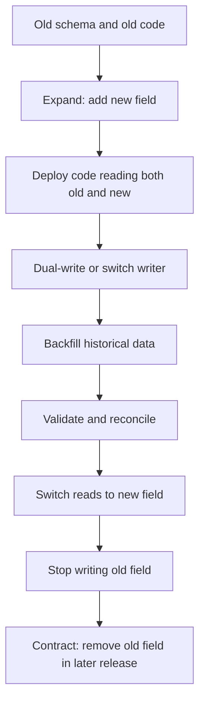

# Backfills, Replays, and Historical Data Compatibility

A Java serverless function may process new data flawlessly yet fail when reading records created years ago, replaying old events, or migrating millions of rows to a new schema. Historical data is rarely uniform: fields were once missing, enums were renamed, timestamps used different timezones, monetary amounts used different units, or events were emitted by older application versions.

**Backfill** is the process of populating or recomputing data for existing records. **Replay** is re-emitting stored requests, messages, or events for reprocessing by current consumers. Both can trigger side effects, consume substantial resources, and run concurrently with live traffic. Therefore, you need a schema compatibility plan, durable checkpoints, idempotent processing, rate limits, outcome reconciliation, and pause/resume controls.

This lesson focuses on performing safe backfills and replays for Java serverless workloads triggered by HTTP, queues, or events. The goal is updating historical data without losing new transactions, creating duplicate side effects, or overloading downstream systems.

## 1. Distinguishing Backfill, Replay, Reprocessing, and Migration

These terms are related but represent different operations:

| Concept | Input | Work Performed | Example |
| --- | --- | --- | --- |
| Backfill | Existing records in database/object store | Populate fields, recompute values, or normalize data | Compute `normalizedEmail` for legacy users |
| Replay | Stored events/messages in queues, archives, or event logs | Resend events through consumers to re-execute processing | Replay `OrderCreated` over a time window |
| Reprocessing | Previously processed data or events | Re-run logic with updated code/models | Re-run fraud scoring on historical transactions |
| Schema migration | Existing storage structure | Alter schema or data representation | Convert `amount` from floating-point to integer minor units |
| Reconciliation | Multiple state sources | Compare and fix discrepancies | Reconcile payment database against provider |
| Restore | Backup / recovery point | Restore data to an earlier state | Database PITR before an accidental write |

Backfills typically update records directly. Replays typically flow through consumer logic and can trigger new side effects. Reconciliation compares actual outcomes against an authoritative source. Restores roll back to a recovery point and risk losing valid changes made afterward. Picking the wrong mechanism can duplicate or overwrite data.

### Examples of Choosing the Right Operation

- A new `search_key` column must be populated for 5 million existing users: use backfill.
- An `InvoiceIssued` event was archived while a consumer had a bug: replay the event after fixing the consumer.
- A payment provider charged a card but the response timed out: reconcile with the provider rather than blindly replaying the charge command.
- A deployment wrote bad values over a specific window: identify affected records, restore from reference copies, or perform targeted repair.

## 2. Why Does Historical Data Differ from New Data?

Data does not automatically become uniform when schemas or code change. A long-lived system can hold many valid shapes depending on when records were written:

- New fields did not exist in older records.
- Fields used to be `null`, empty strings, or different defaults.
- New enums did not exist in older consumers.
- Timestamps were stored in UTC, local time, or without timezone info.
- Monetary values were stored in major units, minor units, or floating-point types.
- JSON events carry different schemas/versions.
- IDs used legacy formats or lacked tenant prefixes.
- Records were soft-deleted, anonymized, or past retention.
- Links between databases and object storage are incomplete.

New functions must understand every variant permitted to exist. Never assume every record in the database was written by the currently deployed code version.

### Backward and Forward Compatibility

- **Backward compatibility:** new code can read data created by older schemas/code.
- **Forward compatibility:** older consumers can ignore or safely handle new fields/enums from newer producers within contract bounds.
- **Replay compatibility:** current consumers can process historical events, or an adapter/upcaster translates old events into the new internal model.

A safe rollout typically requires new code to read both old and new data during the transition window.

## 3. Designing Schema Evolution with Expand-and-Contract

Never change a schema in a way that immediately breaks old code or old events. Use the expand-and-contract workflow:

1. **Expand:** add new fields/tables/indexes compatibly; new fields are usually nullable or carry safe defaults.
2. **Deploy reader-compatible code:** new code reads both old and new fields.
3. **Dual-write or switch writers:** write new data to the new field while optionally maintaining the old field during transition.
4. **Backfill:** populate the new field for historical records in batches.
5. **Validate:** measure migrated record percentage and check invariants and discrepancies.
6. **Switch reads:** gradually move read logic to the new field once data is complete.
7. **Stop old writes:** stop writing the old field once all producers/consumers are compatible.
8. **Contract:** drop the old field in a later release once no code or messages depend on it.



During dual-write, two fields can diverge if one write succeeds and the other fails. Within the same database transaction, update both together. When data spans multiple systems, use outbox/CDC or reconciliation; never assume two independent HTTP calls are atomic.

### Avoiding Breaking Migrations in a Single Deployment

For example, renaming `customer_name` to `display_name`:

- Release A adds nullable `display_name` and code reads `display_name` if present, otherwise falling back to `customer_name`.
- Release B writes both fields inside the transaction.
- Backfill `display_name` from `customer_name` for historical records.
- Verify all records hold valid values.
- Release C reads/writes only `display_name`.
- Release D finally removes `customer_name` after confirming older consumers have drained.

Never drop an old column in the same deployment as new code. In serverless systems, multiple revisions can run concurrently, queues can hold older messages, and retries can invoke older code for some time.

## 4. Planning a Backfill Before Running It

Before running a job that updates historical data, answer:

1. Which records are in scope? Are there tenant, time, status, or version filters?
2. Which data source is authoritative for recomputing values?
3. Is the transformation deterministic and idempotent?
4. Are new records arriving during the backfill handled by dual-writes or a follow-up backfill pass?
5. If a record is updated concurrently, how do you avoid overwriting newer data?
6. Based on what capacity are batch size, concurrency, and rate limits chosen?
7. Where are checkpoints stored and how do they commit alongside data?
8. Can the job be paused, resumed, and canceled without losing progress?
9. How will completeness, correctness, and business impact be measured?
10. Is there a rollback or repair plan if the transformation has a bug?

Never run a production backfill immediately after writing an `UPDATE` query without a dry-run, sample validation, and bounded scope.

### Defining the Dataset Scope

A job should have a well-defined scope, such as:

- A specific tenant or partition.
- An ID range or high-water mark.
- A record creation time range.
- `schema_version` below the target version.
- Records missing the new field or needing repair.
- Only records not deleted/anonymized under policy.

Record expected row counts before starting. If you cannot estimate counts or scope, run an inventory query before mutating any data.

## 5. Batch Backfills Without Loading Everything into Heap

Java functions have bounded execution time, memory, and concurrency. Never load millions of records into a `List` and process them in one invocation. Break work into small chunks with durable checkpoints.

Common patterns:

- A scheduler creates a job manifest and enqueues partitions/ranges.
- Each invocation processes a batch bounded by record count or elapsed time.
- After a batch commits successfully, persist the next checkpoint.
- When approaching timeout, stop accepting new batches and exit cleanly.
- An orchestrator or queue triggers the next batch.
- Multiple partitions can run in parallel if doing so preserves ordering/consistency and downstream has capacity.

### Keyset Pagination Instead of Large `OFFSET`

On large tables, `OFFSET 5000000 LIMIT 1000` slows down progressively because the database must scan past millions of rows. Keyset pagination uses a stable sort key:

```sql
SELECT id, legacy_value, schema_version, row_version
FROM customer
WHERE id > :last_id
  AND id <= :high_water_id
ORDER BY id
LIMIT :batch_size;
```

After processing a batch successfully, advance `last_id` to the last committed ID. `high_water_id` is the upper bound captured when the job starts to bound the initial dataset. New records with higher IDs are handled by dual-writes or a subsequent backfill pass.

Keyset pagination requires a stable, indexed, uniquely ordered sort column. If IDs are non-monotonic or data is partitioned, use a composite cursor like `(partition_key, id)` or an appropriate snapshot/CDC offset.

### Why Is `OFFSET` Problematic?

When rows are inserted or deleted during pagination, offset positions shift, causing skipped or duplicated rows. Keyset pagination anchors on the last processed key and stays stable. Even so, keyset pagination does not solve concurrent updates by itself; you still need optimistic locking or version predicates when writing.

## 6. Checkpoints Must Be Durable and Consistent with Batches

A checkpoint records how far a job has progressed. Never store checkpoints solely in Java variables or `/tmp`; instances can terminate and lose track of where to resume.

A checkpoint record can contain:

| Field | Meaning |
| --- | --- |
| `job_id` | Backfill/replay run ID |
| `partition_id` | Assigned partition or range |
| `last_cursor` | Last key successfully processed |
| `high_water_mark` | Upper bound of the dataset |
| `status` | `PENDING`, `RUNNING`, `PAUSED`, `COMPLETED`, `FAILED` |
| `attempt` | Retry count for the batch/job |
| `lease_owner` / `lease_until` | Active worker and lease expiration |
| `updated_at` | Timestamp of last checkpoint update |
| `version` | Optimistic lock / fencing generation |

When data and checkpoints live in the same database, update them in the same transaction:

1. Read the batch after the cursor.
2. Transform and update records.
3. Update the checkpoint to the batch's ending cursor.
4. Commit the single transaction.

If the transaction fails, both data and checkpoint roll back; the batch can rerun. If the checkpoint commits before the data, the job risks skipping un-updated records. If data commits before the checkpoint, the batch may rerun; hence transformations must be idempotent.

When data and checkpoints live in separate systems, there is no atomic transaction across them. Design for at-least-once execution: write data idempotently, advance checkpoints only after confirming writes, and tolerate batch reruns.

## 7. Avoiding Overwriting Newer Changes During Backfill

Backfills often run concurrently with live traffic. If a job reads a record at 10:00, a user updates it at 10:01, and the job writes back stale values at 10:02, new data is lost.

Safeguards:

- Update only the fields owned by the backfill; never rewrite the entire entity from a stale object.
- Use optimistic locking with `row_version` or `updated_at`.
- Include conditions like `WHERE schema_version < :target_version` or `WHERE new_field IS NULL`.
- When a version mismatch occurs, re-read and recompute or send the record to a conflict queue.
- Use transactions with appropriate isolation and avoid long locks across big batches.
- Where possible, capture concurrent changes via source-of-truth events or CDC.

Example conditional update:

```sql
UPDATE customer
SET normalized_email = :normalized_email,
    schema_version = :target_schema_version,
    row_version = row_version + 1
WHERE id = :id
  AND row_version = :observed_row_version
  AND schema_version < :target_schema_version;
```

If 0 rows update, the record changed or was already processed by another worker. Do not treat 0 rows as unconditional success; re-read and classify as already-completed, concurrent-update, or conflict.

## 8. Java Example: Keyset and Checkpointed Backfill

The example below shows the structure of a batch processor. The repository executes queries, updates, and checkpoints inside one transaction; `transform` is deterministic and computes only the derived field.

```java
public record CustomerRow(
        long id,
        String email,
        long rowVersion,
        int schemaVersion
) {}

public record BackfillBatchResult(
        long lastProcessedId,
        int processed,
        int conflicts,
        boolean hasMore
) {}

public final class CustomerBackfillService {
    private static final int TARGET_SCHEMA_VERSION = 3;
    private final CustomerBackfillRepository repository;

    public CustomerBackfillService(CustomerBackfillRepository repository) {
        this.repository = repository;
    }

    public BackfillBatchResult processBatch(
            String jobId,
            long lastId,
            long highWaterId,
            int batchSize
    ) {
        if (batchSize < 1 || batchSize > 500) {
            throw new IllegalArgumentException("Invalid batch size");
        }

        return repository.inTransaction(tx -> {
            var rows = tx.findNextBatch(
                    lastId, highWaterId, batchSize);
            if (rows.isEmpty()) {
                tx.markCompleted(jobId);
                return new BackfillBatchResult(lastId, 0, 0, false);
            }

            int processed = 0;
            int conflicts = 0;
            long cursor = lastId;

            for (CustomerRow row : rows) {
                String normalized = normalizeEmail(row.email());
                boolean updated = tx.updateIfVersionMatches(
                        row.id(),
                        row.rowVersion(),
                        normalized,
                        TARGET_SCHEMA_VERSION);

                if (updated) {
                    processed++;
                } else {
                    conflicts++;
                }
                cursor = row.id();
            }

            tx.saveCheckpoint(jobId, cursor);
            return new BackfillBatchResult(
                    cursor, processed, conflicts, rows.size() == batchSize);
        });
    }

    private static String normalizeEmail(String email) {
        return email == null ? null : email.trim().toLowerCase(java.util.Locale.ROOT);
    }
}
```

This is a structural illustration rather than a complete repository implementation. Define conflict policies explicitly: for example, conflicted records should be queued for a follow-up check rather than permanently skipped past the cursor. If `saveCheckpoint` and `updateIfVersionMatches` are not in the same transaction, redesign around at-least-once execution and idempotency. `normalizeEmail` is merely an illustrative transformation; real email normalization must follow business rules without altering address semantics.

### Coordinating Batches in Serverless

Each invocation should process only a bounded number of batches or run for a short duration. When work remains, enqueue the next task or advance the workflow. Job manifests and checkpoints enable resuming cleanly when invocations time out, get throttled, or terminate.

Do not enqueue the next batch before the current batch commits if ordering is required. If partitions are independent, run them in parallel with per-partition leases.

## 9. Multi-Worker Backfills: Leases and Fencing

If two invocations process the same partition simultaneously, both can read the same cursor and duplicate work. Idempotent updates reduce side effects but still waste resources and increase conflicts.

Use leases:

1. A worker claims a partition via conditional update when unleased or lease-expired.
2. The lease records owner ID and expiration.
3. The worker renews the lease while work continues.
4. When committing checkpoints, verify owner/generation still matches.
5. An old worker must not write after a lease transfers to a new worker.

Increment a fencing token/generation each time a lease is granted. Every critical checkpoint or write must validate the current generation so a stale worker cannot overwrite newer work after a long pause or network partition.

Leases do not replace idempotency. A worker may lose its lease after executing a side effect but before persisting the checkpoint; the next worker will rerun that batch. Transformations must be deterministic and non-idempotent operations must be deduplicated.

## 10. Large-Scale Backfills and Work Partitioning

With tens of millions of records, a single job easily times out or creates bottlenecks. Split work into well-defined partitions:

- ID ranges: `1–1,000,000`, `1,000,001–2,000,000`.
- Tenant ranges or hash partitions.
- Record creation date/month.
- Database shard/partition keys.
- Object prefixes or manifest files.

Each partition owns its own checkpoint and retries independently. Avoid partitioning on unindexed keys or skewed distributions. One huge tenant can create a hot partition while others finish quickly.

### Choosing Batch Sizes

Large batches cut per-invocation/query overhead but increase memory usage, transaction duration, lock contention, and failure blast radius. Small batches resume easily and bound runtime, yet increase database/queue round trips.

Start with small batches and measure:

- Batch processing time p50/p95.
- Rows/sec and bytes/sec.
- Database CPU, IOPS, lock wait, and connection pools.
- Function memory, duration, throttling, and timeouts.
- Conflict counts and retry counts.

Scale batch sizes and concurrency incrementally while downstream headroom remains. Never size batches by row count alone when record payload sizes vary widely.

## 11. Backpressure and Backfill Rate Limiting

Backfills compete with production traffic for shared resources. Build rate limiting and pause controls:

- Cap records/sec or batches/min.
- Cap concurrent workers/partitions.
- Isolate connection pools or workload quotas.
- Throttle down when database latency, CPU, or replication lag rises.
- Pause automatically if error rates or conflicts exceed thresholds.
- Schedule heavy runs during off-peak hours when business permits.
- Provide a kill switch to stop enqueueing new batches.
- Prioritize interactive traffic over best-effort batch work.

A backfill finishing in 3 hours while multiplying API p99 latency by 10 is an operational failure. Set production SLO guardrails and resource caps before optimizing job speed.

## 12. Dry-Runs, Canaries, and Backfill Rollouts

Before updating the entire dataset:

1. **Inventory-only:** count records and classify states without writing.
2. **Dry-run:** execute transformation on a sample, log before/after values without committing.
3. **Canary:** update one partition or small percentage and verify business invariants.
4. **Ramp-up:** increase partitions/batches step by step.
5. **Full run:** progress by checkpoints while watching metrics and alerts.
6. **Verification:** run reconciliation queries across the full scope.
7. **Cleanup:** remove old fields/code only after confirming data completeness and zero remaining legacy consumers.

Dry-runs should execute the exact same transformation code as the production path whenever possible. Maintaining two separate implementations risks dry-run results diverging from real updates.

### Backfill Manifests

Every run should have a manifest:

| Field | Example |
| --- | --- |
| `job_id` | `customer-email-normalize-v3-20261117` |
| `target_schema_version` | `3` |
| `source_commit` | Commit containing the transformation |
| `scope` | Tenant / range / time window |
| `high_water_mark` | Ending ID of the initial dataset |
| `batch_size` | `250` |
| `max_concurrency` | `4` |
| `started_at` | Start timestamp |
| `status` | `DRY_RUN`, `RUNNING`, `PAUSED`, `COMPLETED` |
| `expected_count` | Expected record count |

Manifests need versions and owners. Never silently mutate a running job's scope; stop the job and create a new manifest/version to preserve the audit trail.

## 13. Replaying Events: Preserve Original Event Identity

Replays typically occur when:

- A consumer had a bug and must reprocess events after a fix.
- A downstream service recovers and needs stored events re-emitted.
- A new projection or search index is built from event history.
- Events are migrated to a new schema/model.
- A queue or stream is restored from an archive/checkpoint.

Event envelopes should carry enough metadata for consumers to recognize source and version:

```json
{
  "eventId": "evt-01J8...",
  "eventType": "OrderCreated",
  "schemaVersion": 2,
  "aggregateId": "order-8451",
  "sequence": 18,
  "occurredAt": "2026-05-12T09:30:00Z",
  "producer": "orders-api",
  "correlationId": "req-9a2...",
  "data": {
    "orderId": "order-8451",
    "currency": "VND",
    "amountMinor": 12500000
  }
}
```

During replay, preserve the original `eventId`, `aggregateId`, `sequence`, and `occurredAt`. You may attach replay-specific metadata such as `replayRunId`, `replayedAt`, and `replayReason`, without overwriting original business timestamps. Minting a new event ID per replay defeats consumer deduplication and risks repeating side effects.

### Replaying Is Not Emitting a New Event

A new event describes something that just happened. A replay re-delivers an old event for reprocessing. Preserving event identity lets tracing and deduplication recognize it as the same event. When a new business action is intended, emit a new command/event with a fresh ID and semantics.

## 14. Historical Event Schema Compatibility

Producers and consumers deploy independently. Event archives can hold schemas spanning years. Three main strategies exist:

1. **Multi-version consumers:** parse the envelope and select a DTO/parser by `schemaVersion`.
2. **Upcasters / adapters:** translate historical events into a canonical internal model before business logic runs.
3. **Versioned topics / contracts:** retain old schemas for older consumers while emitting new schemas on versioned topics/contracts during migration.

Never infer schema version solely from Java class names or JSON field order. Carry explicit `schemaVersion` fields and document compatibility rules.

### Versioned DTO Example

```java
public sealed interface OrderCreatedEvent
        permits OrderCreatedV1, OrderCreatedV2 {}

public record OrderCreatedV1(
        String orderId,
        long amount
) implements OrderCreatedEvent {}

public record OrderCreatedV2(
        String orderId,
        long amountMinor,
        String currency
) implements OrderCreatedEvent {}

public record CanonicalOrderCreated(
        String orderId,
        long amountMinor,
        String currency
) {}
```

Adapters can translate V1 and V2 into `CanonicalOrderCreated`. However, you cannot accurately infer V1's currency or unit if the old event never stored it. Use documented contract conventions from when the event was created, producer metadata, or reconciliation against the source of truth—never guess a default currency just to make parsing pass.

## 15. Upcasting and Normalization Before Business Logic

An upcaster translates older events/schemas into the current internal model. Keep upcasters deterministic, versioned, and tested against historical fixtures.

Example:

```java
public final class OrderEventUpcaster {
    public CanonicalOrderCreated upcastV1(OrderCreatedV1 oldEvent) {
        // Valid only if the V1 contract defines amount in minor units
        // and the default currency is explicitly established in metadata.
        return new CanonicalOrderCreated(
                oldEvent.orderId(),
                oldEvent.amount(),
                "VND");
    }

    public CanonicalOrderCreated upcastV2(OrderCreatedV2 event) {
        return new CanonicalOrderCreated(
                event.orderId(),
                event.amountMinor(),
                event.currency());
    }
}
```

The V1 mapping is valid only when the legacy schema contract explicitly confirms units and currency. Otherwise, the upcaster must emit `UNKNOWN`/`NEEDS_RECONCILIATION` or quarantine the event rather than fabricating plausible-looking wrong data.

Never overwrite original events in the archive when upcasting. Keep raw payloads for auditing and re-running with corrected upcasters if mapping bugs are found.

## 16. Ordered Replays and Duplicate Handling

Some domains require per-aggregate ordering—for example, `OrderCreated` must precede `OrderPaid`, or account balances must apply in sequence. Replaying multiple partitions in parallel can deliver events out of order.

Protections:

- Partition by `aggregateId` so events for the same aggregate follow the same lane.
- Include `sequence`/version on events and validate sequences when applying.
- Have consumers reject or buffer events whose sequence jumps ahead.
- Replay per aggregate or per partition with bounded concurrency.
- Align snapshots/checkpoints with event offsets.

If sequence 18 arrives before sequence 17, the consumer can hold event 18 while awaiting event 17, or request an ordered replay. Never ignore sequence gaps simply because the handler parses the event cleanly.

### Idempotency During Replays

Consumers should store processed `eventId`s or business keys in an inbox/processed-events table with a unique constraint. Applying side effects and marking completion should share one transaction when targeting the same database.

For external side effects, use provider idempotency keys, outbox/reconciliation, or state machines for unknown outcomes. Replays are never safe merely because a handler wraps calls in `try/catch`.

## 17. Controlled Replays by Time Range or Offset

Do not replay an entire archive when only a narrow slice of events was affected. Scope replays using:

- Business timestamps (`occurredAt`) or receipt timestamps (`receivedAt`).
- Partitions and offsets/sequences.
- Event types / schema versions.
- Aggregate IDs or tenants.
- Event ID ranges or manifests.
- Prior processing outcomes and business states.

Distinguish event time from processing time. An event created at 09:00 might reach the consumer at 09:15; use `occurredAt` to replay a business window, and `receivedAt`/broker timestamps when investigating delivery delays.

### Replay in an Isolated Environment First

Before replaying into production:

1. Copy a sample of events into a dedicated replay topic/queue.
2. Run the consumer in dry-run mode or write to an isolated test projection.
3. Compare outputs against current data / expected results.
4. Verify ordering, deduplication, schema upcasting, and throughput.
5. Select the production event slice and enforce a bounded replay rate.

Never replay directly into a production topic if producers and consumers share subscriptions in a way that creates event loops. Ensure replay outputs are not re-archived or re-triggered as brand-new source events unless intended.

## 18. Java Example: Replay Consumer with Schema Adapter and Deduplication

The example below illustrates handler structure: parse envelope, upcast payload, check processed status, and apply within a transaction. The repository must enforce a unique constraint on event IDs.

```java
public final class OrderReplayHandler {
    private final EventParser parser;
    private final OrderEventUpcaster upcaster;
    private final OrderEventRepository repository;

    public OrderReplayHandler(
            EventParser parser,
            OrderEventUpcaster upcaster,
            OrderEventRepository repository
    ) {
        this.parser = parser;
        this.upcaster = upcaster;
        this.repository = repository;
    }

    public void handle(byte[] rawMessage) {
        EventEnvelope envelope = parser.parseEnvelope(rawMessage);
        CanonicalOrderCreated event = switch (envelope.schemaVersion()) {
            case 1 -> upcaster.upcastV1(parser.parseV1(envelope.data()));
            case 2 -> upcaster.upcastV2(parser.parseV2(envelope.data()));
            default -> throw new UnsupportedEventVersionException(
                    envelope.schemaVersion());
        };

        repository.inTransaction(tx -> {
            if (tx.wasProcessed(envelope.eventId())) {
                return;
            }
            tx.applyOrderCreated(event, envelope.sequence());
            tx.markProcessed(envelope.eventId(), envelope.aggregateId());
        });
    }
}
```

This is Java-like pseudocode; `EventEnvelope`, parsers, transaction APIs, and repositories must be implemented for your framework/database. Unique constraints are the final safeguard preventing two concurrent invocations from processing the same event. If `applyOrderCreated` calls an external API, the database transaction cannot cover the HTTP call; use an outbox, provider idempotency, or dedicated workflow state.

## 19. Backfills and Replays Alongside Concurrent New Data

A major challenge is live traffic continuing to write new records during a backfill or replay. Scanning strictly from first ID to last ID risks missing records created after the high-water mark. Broken dual-writes can leave new records in the old schema after the backfill already passed them.

Strategies:

### Dual-Write

Producers write both old and new fields/schemas inside the same database transaction. The backfill handles only historical gaps. Once validation passes, stop writing the old field.

### Change Capture / CDC

Take a snapshot/high-water mark, then stream subsequent changes via Change Data Capture (CDC) or an outbox. Stitching snapshot and change stream requires watermarks/offsets to avoid gaps or out-of-order application.

### Overlapping Backfill

Backfill a window overlapping newly written data and use idempotent/version-conditioned updates to reprocess safely. This is simpler when transformations are deterministic and side-effect-free.

### Re-Run Verification Pass

After the primary pass, run a sweep for remaining missing or invalid rows. A second pass catches concurrent conflicts or mid-run inserts, though it does not replace CDC when strict consistency is required.

## 20. CDC and Transactional Outbox for Continuous Changes

CDC reads changes from database transaction logs or change streams, keeping live updates synchronized during a backfill. You must still address:

- Where the snapshot aligns in the log/offset stream.
- How snapshot and change stream stitch together without losing events.
- Ordering by table/partition/key.
- Duplicate events and checkpoints.
- Source schema changes.
- Deletes/tombstones and soft deletes.
- Lag and replaying from older offsets.

The transactional outbox is an application pattern writing business changes and outbox events in the same database transaction. A relay/CDC publisher emits events post-commit, avoiding non-atomic dual-writes between databases and brokers.

When a backfill generates events for historical data, distinguish `HistoricalProjectionRebuilt` events from original business events. Never pretend an old event just happened now; keep the original `occurredAt` and attach `replayRunId`/`backfillJobId`.

## 21. Reconciliation After Backfills and Replays

Never declare a job finished merely because every batch returned success. Verify converted data:

- Total record count in scope.
- Counts of processed, skipped, conflicted, and failed records.
- Count of records still missing target fields/versions.
- Count of records outside valid value domains.
- Before/after business aggregates such as total monetary amounts, order counts, and user counts.
- Checksums/hashes or sample comparisons against authoritative sources.
- Integrity of links between database rows and object/event references.
- Processed events and corresponding side effects.

### Invariant-Based Reconciliation

Example checks after backfilling monetary values:

- No negative `amountMinor` unless business rules permit.
- Every `currency` belongs to the supported currency set.
- Invoice counts by status match the source of truth.
- Total amounts per currency match within rounding tolerances.
- Invoice IDs remain unique and tenant ownership is unchanged.

Aggregate comparisons catch macro drift but do not prove every row is right. Combine counts, invariants, detailed sampling, and exception queries.

## 22. Handling Failed or Unconvertible Records

Never let one bad record trap the entire job in an infinite batch retry loop. Classify errors:

| Category | Action |
| --- | --- |
| Transient DB/network | Bounded retry with backoff |
| Concurrent update | Re-read, recompute, or route to conflict queue |
| Invalid historical value | Quarantine, record reason code, and escalate for business decision |
| Missing source data | Cross-check alternate sources or mark unresolved |
| Unsupported schema version | Route to compatibility handler or quarantine |
| Permission/config error | Stop the job and fix configuration; do not retry indefinitely |
| Data retention / legal delete | Respect deletion/retention policies; never resurrect deleted data |

Quarantine records should store record ID, job ID, schema version, error code, and reference location; avoid copying sensitive payloads into logs unnecessarily. Establish a dedicated review, data-fix, and single-record retry workflow.

## 23. Historical Edge Cases That Corrupt Data

### Timestamps and Timezones

Store timestamps consistently in UTC or epoch with explicit units. When reading historical records, verify whether values are UTC or local time; never blindly append `Z` to timezone-naive timestamps. Distinguish:

- `occurredAt`: when the business event happened.
- `createdAt`: when the record was inserted.
- `receivedAt`: when the broker/service received the event.
- `processedAt`: when the consumer processed it.
- `updatedAt`: when the record changed.

Never overwrite `occurredAt` with the replay timestamp. Preserve original timestamps for reporting, SLAs, and business ordering.

### Money and Decimals

Never use `double` for money. Specify currency, scale, and rounding rules. When converting from major to minor units, verify currencies with different decimal places and check whether legacy records were rounded. Use `BigDecimal` or integer minor units under an explicit contract.

### Enums and Unknown Values

Unfamiliar enum values can appear in legacy events or from newer producers. Parsers should handle unknown values explicitly by policy: preserve raw strings, map to `UNKNOWN`, or quarantine. Never treat all unknown enums as retryable errors; retrying will not make a new enum disappear.

### Null, Missing, and Empty

JSON `null`, absent fields, and empty strings can carry distinct meanings. Schema adapters must distinguish them. Never blindly substitute `0` or `false` for missing fields if `0` or `false` are valid business values.

### Deleted and Anonymized Records

Backfills must respect tombstones, soft deletes, privacy deletions, and retention policies. Never resurrect personal data that was erased or anonymized just because backups or event archives still contain older copies. Apply suppression lists or deletion markers so replays/backfills never restore deleted data.

## 24. Rebuilding Projections and Materialized Views

A common replay use case is rebuilding search indexes, read models, or materialized views from event history. Because projections are derived and rebuildable, you can typically:

1. Create a new projection/index alongside the live one.
2. Replay event history into the new projection by partition/offset.
3. Monitor lag and verify counts/aggregates.
4. Stream ongoing live events via CDC or dual subscription.
5. Catch up to the current watermark.
6. Cut read traffic over to the new projection.
7. Retain the old projection for a rollback window before deleting it.

Never rebuild in place over a serving projection if wiping/recreating exposes empty or inconsistent views to users. Use blue/green projections or versioned indexes whenever possible.

## 25. Compatibility Across Multiple Consumer Versions

In serverless systems, multiple revisions can execute simultaneously during rollouts. Queues may hold messages from old producers after new consumers deploy.

Guidelines:

- New consumers should read old schemas throughout the retention/replay window.
- New producers emit new required fields only after consumers are ready.
- Add optional fields first with meaningful defaults and intact legacy semantics.
- Never alter field data types or units without versioning.
- Maintain clear policies for unknown enums and unknown fields.
- Keep adapters/upcasters for every schema still present in event archives.
- Decide when to retire old schema support based on queue retention, archive retention, and replay windows.

Do not delete the V1 parser merely because V1 producers stopped deploying. If V1 events sit in a 3-year archive and remain replayable, consumers or migration tools still need to read them.

## 26. Rolling Back Broken Backfills or Replays

Not every transformation is reversible. Before running, classify it:

- **Reversible:** old values can be restored from backups or preserved legacy fields.
- **Compensatable:** cannot be undone directly, but compensating actions can be issued.
- **Irreversible:** loses information or triggers non-undoable external side effects.

For example, populating `normalized_email` is reversible if the original `email` column remains intact. Sending emails or charging cards are external side effects; you cannot "roll them back" by deleting rows—they require compensation/reconciliation.

Safeguards:

- Keep legacy fields or snapshots throughout migration.
- Record manifests, transformation versions, and job checkpoints.
- Run canaries before full rollouts.
- Isolate new projections/indexes from live serving ones.
- Use transactions, unique constraints, and idempotency.
- Maintain a kill switch to halt batches/replays.
- Define repair scripts and rollback criteria before starting.

If bugs appear, halt the job, preserve manifests/checkpoints/logs, identify affected records, and apply targeted repairs. Never blindly run a reverse transformation across all records if users have updated some records after the backfill.

## 27. Security and Privacy in Backfills and Replays

Historical jobs typically hold broader read permissions than normal request handlers. Restrict access tightly:

- Use a dedicated workload identity for backfill/replay jobs.
- Grant read/write permissions only on the required tables, buckets, queues, and partitions.
- Separate privileges for creating jobs, running jobs, and deleting/restoring data.
- Keep payloads/PII out of logs and DLQs beyond policy.
- Encrypt exports, manifests, and archives.
- Restrict who can trigger replays for a tenant or event range.
- Audit job IDs, operators, reasons, scopes, and timestamps.
- Enforce retention, legal holds, and deletion requests.

Replays can reintroduce old PII into downstream systems that already erased it. Before replaying, consult suppression/deletion ledgers and enforce redaction or skip policies. Backups retained for legal compliance do not imply permission to reuse that data operationally.

## 28. Orchestrating Backfills and Replays with Serverless Workflows

Never keep a single invocation alive for hours to process an entire dataset. Break jobs into short steps with durable state:

1. Admin/API request creates a `jobId` and manifest.
2. Orchestrator splits the scope into partitions/ranges.
3. Queue dispatches individual batches to Java workers.
4. Workers claim leases, process batches, and commit data/checkpoints.
5. Workers emit completion events or enqueue next batches.
6. Orchestrator aggregates counts/errors/conflicts and throttles concurrency.
7. Once all partitions finish, run reconciliation.
8. Mark the job `COMPLETED` only after validation passes.

Use AWS Step Functions, Azure Durable Functions, Google Workflows, or an equivalent orchestrator. Workflow engines manage orchestration state; large datasets belong in databases/object storage rather than stuffed into workflow execution histories.

### Pause, Resume, and Cancel

Jobs need explicit states and transition semantics:

- `PAUSE_REQUESTED`: stop enqueueing new batches; in-flight batches may finish.
- `PAUSED`: all workers stopped cleanly at safe checkpoints.
- `RESUME`: continue from committed checkpoints.
- `CANCEL_REQUESTED`: stop taking new batches and finish or abort in-flight batches per policy.
- `CANCELLED`: zero workers hold leases; processed scope is recorded.
- `FAILED`: error requires operator intervention; checkpoints preserved for post-fix resume.

Never mark `CANCELLED` merely because an API requested cancellation; confirm all workers stopped and no batches remain committing.

## 29. Monitoring Progress and Data Quality

Track both operational and correctness metrics:

| Metric | Meaning |
| --- | --- |
| `backfill.records.scanned` | Records read |
| `backfill.records.updated` | Records updated successfully |
| `backfill.records.skipped` | Records already at target version or out of scope |
| `backfill.records.conflict` | Concurrent modifications or version mismatches |
| `backfill.records.failed` | Records that failed processing |
| `backfill.records.per_second` | Processing throughput |
| `backfill.checkpoint.age` | Time since the last checkpoint |
| `replay.events.published` | Events injected into replay stream/queue |
| `replay.events.applied` | Events applied by consumers |
| `replay.events.duplicate` | Events skipped as already processed |
| `replay.events.quarantined` | Events quarantined for schema/data issues |
| `replay.event.age` | Age of events when processed |
| `reconciliation.mismatch` | Discrepancies between source and target |

Filter dashboards by `jobId`, partition, schema version, environment, and tenant group where safe. Never use record IDs or customer IDs as metric labels due to high cardinality; use controlled logs/traces for drill-down.

Alert when:

- Jobs stall or checkpoint age climbs excessively.
- Conflicts, failures, or quarantined items exceed thresholds.
- Database latency, replication lag, or API 429s rise.
- Queue age or DLQ depth grows during replay.
- The share of records at the target schema version stops increasing.
- Reconciliation mismatches exceed tolerances.
- Jobs exceed deadlines or cost budgets.

## 30. Example Workflow: Adding a Field for 20 Million Customers

Suppose an application needs `normalized_email` for search. The customer table holds 20 million rows while the API serves continuous writes.

1. Add nullable `normalized_email` and `schema_version` columns.
2. Deploy code reading `normalized_email` if populated, falling back to `email`.
3. Update the API to write both `email` and `normalized_email` in one transaction.
4. Capture `high_water_id` and create the backfill manifest.
5. Split ID ranges into partitions; each Java invocation processes batches of 250 records.
6. Use keyset pagination and optimistic version checks to avoid overwriting new writes.
7. Save checkpoints in the same transaction as record updates.
8. Cap worker concurrency to protect production API SLOs.
9. Count records still missing `normalized_email`, conflicts, and invalid values.
10. Run a second pass for conflicts and records created mid-migration.
11. Compare old vs. new search results on samples and business metrics.
12. Gradually switch the read path to the new field.
13. After a stabilization window, stop writing the old field and drop the fallback in a later release.

No API downtime is needed across 20 million records, provided dual-write/CDC covers new writes and the backfill uses checkpoints and explicit conflict policies.

## 31. Example Workflow: Replaying Events to Rebuild a Read Model

An order service keeps an 18-month event archive. A search index is corrupted and needs rebuilding:

1. Create a brand-new `orders-v2` index without deleting the live index.
2. Select the event range and offsets/partitions in the archive.
3. Use upcasters to read V1/V2 event schemas into the canonical model.
4. Replay partitioned by aggregate to preserve sequence order.
5. Have the projection consumer deduplicate by `eventId`/aggregate sequence.
6. Rate-limit throughput to match database/index capacity.
7. Monitor event age, failed/quarantined counts, and projection lag.
8. Stream concurrent live events via CDC or dual subscription during replay.
9. Compare document counts, aggregates, and query results against the source of truth.
10. Cut read traffic over once the new index catches up to the watermark.
11. Retain the old index for a rollback window before cleanup.

If replaying `OrderPaid` sends emails or charges cards again, the design is broken. Projection consumers should only rebuild read models; business side effects require deduplication and consumer separation.

## 32. Testing Historical Data and Migrations

Unit tests using freshly constructed objects cannot validate legacy schemas. Maintain historical fixtures and test across versions:

- Masked production-like JSON events for V1/V2/V3.
- Records with missing fields, `null`s, empty strings, and unknown enums.
- Timestamps across timezones and daylight saving boundaries where relevant.
- Large monetary values, rounding edge cases, multiple currencies, negatives, and zeros.
- Soft-deleted and anonymized records.
- Records updated concurrently during backfill.
- Duplicate events, out-of-order events, and sequence gaps.
- Mid-batch timeouts verifying checkpoint commit/rollback.
- Expired worker leases with stale workers returning.
- Rate-limited replays, DLQs, and post-outage resumes.

### Testing Invariants

Do not merely assert no exceptions were thrown. Verify invariants:

- Before/after total record counts in scope.
- Intact tenant ownership.
- Unchanged IDs and unique constraints.
- Matching monetary totals and units.
- No unexpected gaps in event sequences.
- At most one business side effect per event.
- Privacy-deleted records remain deleted and unresurrected.
- Running the backfill a second time does not alter already-valid results.

## 33. Common Mistakes

1. **Running one invocation for the entire dataset.** Risks timeouts, OOMs, and no resume support.
2. **Using large `OFFSET`s on mutating tables.** Slows down and skips or duplicates rows.
3. **Committing checkpoints before data.** Jobs risk skipping un-updated records on crash.
4. **Backfills overwriting fresh updates.** Caused by missing row versions / conditional updates.
5. **Omitting high-water marks.** Scope shifts continuously as new records arrive.
6. **Non-atomic dual-writes.** Two schemas diverge if failures happen between writes.
7. **Replays minting new event IDs.** Deduplication fails to recognize historical events.
8. **Unordered replays.** Events for the same aggregate apply out of order.
9. **Dropping legacy schema support.** New consumers fail on archived historical events.
10. **Arbitrary defaults for missing fields.** Data looks valid while carrying wrong business semantics.
11. **Replaying non-idempotent side effects.** Emails, payments, or notifications fire repeatedly.
12. **No rate limiting.** Backfills saturate databases or downstream services.
13. **Ignoring tombstones/deletion requests.** Replays resurrect erased user data.
14. **Marking jobs complete after batches finish without reconciliation.** Missing or corrupted rows go undetected.
15. **Contracting old schemas too early.** Active consumers or replay windows still depend on legacy fields/parsers.

## 34. Backfill and Replay Design Process

1. **Classify:** decide whether the task is backfill, replay, reprocessing, reconciliation, or restore.
2. **Define scope:** specify tenants, ranges, time windows, schema/event versions, and high-water marks.
3. **Design compatibility:** expand-and-contract, upcasters, and historical schema readers.
4. **Guarantee safety:** deterministic transformations, idempotency, optimistic locking, and ordering.
5. **Plan execution:** partitions, batch sizes, checkpoints, leases, concurrency, and retry budgets.
6. **Protect production:** rate limits, backpressure, pause/cancel controls, and load shedding.
7. **Dry-run / canary:** verify samples, expected counts, and business invariants.
8. **Execute:** process in batches while logging progress and audit metadata.
9. **Reconcile:** verify counts, aggregates, checksums, event outcomes, and conflict records.
10. **Cut over:** switch read paths, consumers, or indexes once validation passes.
11. **Retain compatibility:** keep legacy parsers/fields while queues, archives, and replay windows still need them.
12. **Cleanup:** contract schemas and remove old artifacts after the rollback window closes.

## 35. Pre-Production Checklist

- [ ] Clearly distinguished backfill, replay, reprocessing, reconciliation, and restore?
- [ ] Inventoried schemas/versions and historical data variants?
- [ ] Defined an expand-and-contract plan so old and new code coexist?
- [ ] Confirmed transformations are deterministic and idempotent?
- [ ] Defined explicit scope, high-water mark, and expected counts?
- [ ] Used keyset/partitioned batches instead of loading everything into heap?
- [ ] Made checkpoints durable and consistent with data commits?
- [ ] Added optimistic locking / conditional updates to avoid overwriting concurrent changes?
- [ ] Added leases/fencing when multiple workers can claim the same partition?
- [ ] Configured rate limits, concurrency caps, timeouts, and pause/cancel controls?
- [ ] Preserved `eventId`, `occurredAt`, aggregate sequences, and `schemaVersion` in replays?
- [ ] Added consumer deduplication/idempotency and ordering policies?
- [ ] Built parsers, upcasters, and fixture tests for legacy event schemas?
- [ ] Handled `null`, missing fields, unknown enums, timezones, money, tombstones, and privacy deletions?
- [ ] Built quarantine workflows for unconvertible records/events?
- [ ] Prepared dry-run, canary, and rollback/repair plans?
- [ ] Planned reconciliation by counts, checksums, and business invariants?
- [ ] Monitored checkpoint age, throughput, conflicts, DLQs, and downstream saturation?
- [ ] Recorded manifests, job IDs, source commits, operators, and audit reasons?
- [ ] Deferred contracting/removing old schemas until all consumers and replay windows are compatible?

Backfills and replays are broad data-mutating operations and should be operated with the discipline of a controlled release. Schema evolution must let old and new code coexist during transitions; batches need durable checkpoints and optimistic locking; replays must preserve event identity, ordering, and idempotency; and throughput must be throttled within production capacity. Afterward, invariant-based reconciliation confirms historical data is truly sound. Combining these principles lets Java serverless systems update millions of records or replay long event histories while protecting live requests and preserving resumability and auditability.

## Official References

- [AWS Database Blog – Backfill and migration patterns](https://aws.amazon.com/blogs/database/)
- [AWS Lambda – Using Lambda with Amazon SQS](https://docs.aws.amazon.com/lambda/latest/dg/with-sqs.html)
- [AWS Lambda – Partial batch response](https://docs.aws.amazon.com/lambda/latest/dg/services-sqs-errorhandling.html)
- [Amazon EventBridge – Archive and replay events](https://docs.aws.amazon.com/eventbridge/latest/userguide/eb-archive.html)
- [Amazon DynamoDB – Streams and change data capture](https://docs.aws.amazon.com/amazondynamodb/latest/developerguide/Streams.html)
- [Azure Functions – Queue trigger](https://learn.microsoft.com/azure/azure-functions/functions-bindings-storage-queue-trigger)
- [Azure Event Hubs – Capture and replay patterns](https://learn.microsoft.com/azure/event-hubs/event-hubs-capture-overview)
- [Azure Service Bus – Message settlement and dead-letter queues](https://learn.microsoft.com/azure/service-bus-messaging/message-transfers-locks-settlement)
- [Google Cloud Pub/Sub – Replay and seek](https://cloud.google.com/pubsub/docs/replay-message)
- [Google Cloud Pub/Sub – Subscriber flow control](https://cloud.google.com/pubsub/docs/flow-control)
- [Google Cloud Datastream – Change data capture](https://cloud.google.com/datastream/docs/overview)
- [Martin Fowler – Parallel Change](https://martinfowler.com/bliki/ParallelChange.html)
- [Debezium documentation](https://debezium.io/documentation/reference/stable/)
