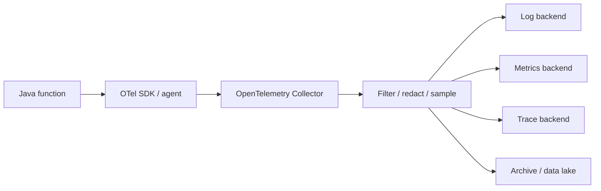

# Evaluating Log, Metric, and Distributed Tracing Costs

Observability helps development teams see how Java functions process requests/events, which dependencies cause slowdowns, and whether business operations succeed. However, logs, metrics, and distributed traces all generate data that must be collected, transmitted, stored, indexed, and queried. In serverless systems with variable traffic, telemetry costs can climb rapidly with invocation counts, span counts, metric cardinality, and retention periods.

Evaluating observability costs does not mean cutting telemetry until incidents become impossible to investigate. The goal is collecting the right data for operational decisions, keeping required evidence for security/auditing, and limiting duplicate or low-value data. Telemetry should be treated as part of the cost of each request or business operation, while ensuring cost controls do not drop critical signals.

Within the scope of **CLOUD_SERVERLESS**, the curriculum focuses on developing and deploying applications using the serverless model, particularly Java functions triggered by HTTP, messages, or events. Learners handle triggers, state, access permissions, retries, idempotency, cold starts, scaling, and costs. This lesson guides you through analyzing log, metric, and distributed tracing costs, designing retention/sampling, allocating costs, and optimizing telemetry for serverless workloads.

## 1. Why Can Telemetry Become a Major Expense?

A single invocation can generate multiple log records, metric samples, and trace spans. When functions scale out, telemetry grows with traffic; when retries or errors occur, record counts can grow even faster because every attempt is recorded. A small log statement in code can generate billions of records per month if it sits on a hot processing path.

Costs depend on the provider and configuration, typically falling into these categories:

| Category | Cost Drivers |
|---|---|
| Logs | Ingestion/collection, indexing, storage, queries, exports, and retention |
| Metrics | Time series count, sample volume, custom metric/API ingestion, retention, and queries |
| Traces | Spans ingested, storage, indexing/search, queries, and exports |
| Pipeline | Collector/agent compute, network transfer, buffering, and retries |
| Cross-region/export | Egress, inter-region transfers, and destination storage systems |
| Operations | Dashboard/query frequency, alert evaluation, and data processing |

Not all providers charge by the same units. Some services bill by GB ingested, metric series count, samples, spans, API requests, retention tiers, or query scans. Therefore, verify the pricing model for the exact service, region, edition, and contract before budgeting; you cannot apply one universal unit price across all platforms.

## 2. Building an Overall Cost Model

You can start with a conceptual formula:

\[
C_{telemetry} = C_{logs} + C_{metrics} + C_{traces} + C_{pipeline} + C_{transfer} + C_{query}
\]

Where each component may include ingestion, storage, indexing, retention, and querying. If using multiple platforms or exporting to a data lake/SIEM, be careful not to undercount costs at the destination system.

Track two perspectives:

- **Total cost over time:** daily/monthly telemetry spend by service, environment, region, and team.
- **Unit cost:** telemetry cost per successful request, processed message, or completed business transaction.

Example:

\[
Cost\ per\ completed\ order = \frac{Telemetry\ cost\ allocated\ to\ orders}{Orders\ confirmed}
\]

Unit cost helps detect when a new release emits more logs or spans even though total traffic is unchanged. Total cost remains essential for budgeting and spotting absolute growth.

## 3. Factors Driving Log Costs

Log costs are typically influenced by:

- Number of log events per invocation.
- Average size of each event after serialization.
- Frequency of invocations and retries.
- Level of indexing, parsing, and enrichment.
- Duration logs are kept in hot storage vs. archive.
- Query frequency, time range, and volume of data scanned.
- Number of copies sent to multiple systems.

Estimating ingestion volume:

\[
Log\ volume/day \approx Events/sec \times AvgBytes/event \times 86,400
\]

Illustrative example: a workload emits 250 log events/second, each averaging 1.2 KB. Raw volume is roughly 25.9 GB/day in decimal units, before compression, filtering, or platform overhead. This is not a price quote; it demonstrates that logs on hot paths can produce large volumes even when each record is small.

When budgeting, measure actual log sizes after serialization and actual events per request. Do not just count log lines in source code, as a single line may execute repeatedly inside loops or retries.

## 4. Designing Structured and Purposeful Logs

JSON/structured log fields make filtering and analysis more effective than free-text logs, yet you should not log every available field. An operational event should focus on the information needed to understand outcome, latency, and dependencies.

Example:

```json
{
  "timestamp": "2026-11-17T10:15:00Z",
  "severity": "INFO",
  "service": "orders-worker",
  "function": "processOrder",
  "release": "orders-2026.11.17.3",
  "correlation_id": "order-7812",
  "event_id": "evt-90017",
  "operation": "confirm-order",
  "outcome": "success",
  "duration_ms": 182
}
```

Commonly useful fields include `service`, `function`, `environment`, `release`, `operation`, `outcome`, `duration_ms`, `correlation_id`, and `event_id`. Do not log full request bodies, response bodies, or domain objects at every log level.

Each log event should have a clear purpose:

- `INFO`: significant business events or lifecycle events requiring traceability.
- `WARN`: abnormal conditions the system still handles, such as retries or fallbacks.
- `ERROR`: failed operations requiring investigation or remediation.
- `DEBUG/TRACE`: development details; enable only under strict controls and for short windows.

Do not use `ERROR` for routine validation failures or normal business rejections. Inaccurate severity inflates alert noise and causes operators to overlook real errors.

## 5. Reducing Duplicate and Wasteful Logs

Common sources of log bloat:

- Logging `start`, `end`, and full payloads for every tiny helper method.
- Logging the same exception at every layer and again in the top-level handler.
- Printing full stack traces for predictable business errors.
- Logging every record in a batch, then logging the entire batch containing those records.
- Leaving SDK/HTTP client wire logging enabled in production.
- Health checks and readiness probes emitting high-frequency logs.
- Retries emitting an ERROR log on every attempt even when the operation eventually succeeds.

Best practices:

1. Emit one outcome log at the processing boundary, including attempt count and outcome.
2. Log exception details at the layer with full context, avoiding repeated stack traces across layers.
3. Use metrics to count common events and logs for cases needing investigation.
4. Disable payload/wire logging in production unless conducting a time-boxed investigation.
5. Use dynamic log levels with expiration or controlled feature flags.
6. Drop low-value health-check logs or route them to a cheaper sink.

Do not drop mandatory audit logs, security events, or transaction evidence just to shrink the bill. Separate operational debug logs from audit/security records that carry distinct retention mandates.

## 6. Log Sampling and Its Limitations

Log sampling reduces volume by keeping only a fraction of high-frequency log records. However, random sampling can miss rare errors or critical security events.

You can apply:

- Keep 100% of diagnostically valuable ERROR logs, while avoiding duplicate stack traces.
- Keep a small percentage of repetitive INFO logs on hot processing paths.
- Keep all audit/security events per policy.
- Keep logs for a selected cohort of requests using deterministic sampling by trace ID or operation ID.
- Temporarily raise sampling during incidents, then automatically revert to baseline.

Sampling must occur where sufficient context exists. If each function independently samples the same workflow without sharing the decision, some steps retain logs while others drop them, breaking traceability. With distributed traces, use a consistent trace-based decision across the entire trace.

## 7. Metric Costs: Time Series Count Matters

Metrics are usually stored as time series. Every combination of metric name and labels/dimensions can create a separate series. Series count grows as the product of label value counts.

For example, a metric `http_requests_total` has labels:

- `service`: 8 values.
- `route`: 12 values.
- `method`: 4 values.
- `status_class`: 5 values.
- `region`: 3 values.

Maximum theoretical cardinality by product is:

\[
8 \times 12 \times 4 \times 5 \times 3 = 5,760\ series
\]

Adding `customerId` with 100,000 values could theoretically produce hundreds of millions of combinations. In practice, observed combinations may be lower, yet there is still high risk of hitting limits and driving costs up rapidly.

Do not use high-cardinality values as metric labels:

- `userId`, `customerId`, `orderId`.
- `requestId`, `correlationId`, `traceId`.
- Emails, full URLs with query strings, or raw exception messages.
- File names, object keys, or message IDs.

Put these identifiers into controlled logs/traces for per-transaction lookup. Metrics should use dimensions with bounded value sets such as service, operation, outcome, region, and error category.

## 8. Histograms and Buckets Also Increase Series Counts

Histograms store buckets counting observations by threshold, typically alongside `_sum` and `_count`. Series count scales with bucket count and label combinations. With 20 buckets and 100 label combinations, one histogram can generate thousands of series depending on the backend/representation.

Select only buckets serving actual SLOs and latency ranges. For instance, if an API targets p95 under 500 ms, buckets need sufficient resolution around that range; you do not need hundreds of buckets spanning microseconds to hours without a use case.

Native histograms, summaries, and distribution metrics carry different cost/aggregation trade-offs depending on the backend. Check how your metrics system stores and bills them before choosing a type. Client-calculated summaries typically cannot aggregate percentiles accurately across instances the way shared-bucket histograms can.

## 9. Collection Frequency and Metric Resolution

Shorter scrape or export intervals yield finer-grained data, but increase sample volume and cost. Choose intervals based on rate of change and alerting goals.

Example with 2,000 time series:

| Interval | Samples/series/day | Total samples/day |
|---:|---:|---:|
| 60 seconds | 1,440 | 2.88 million |
| 30 seconds | 2,880 | 5.76 million |
| 15 seconds | 5,760 | 11.52 million |

This is a sample calculation excluding histogram buckets, metadata, or overhead. Not all serverless metrics rely on scraping; some platforms ingest metrics via push/export. Regardless of mechanism, frequency and series count drive volume.

You do not need 1-second resolution metrics for every business KPI. Keep fine-grained infrastructure metrics for short periods and use rollups/downsampling for long-term trends if the backend supports it.

## 10. Distributed Tracing Costs

A trace comprises multiple spans. An HTTP request can create spans for gateway, function, database, queue publish, consumer, payment API, and notification. Costs usually scale with:

- Number of traced requests/events.
- Average spans per trace.
- Size of span attributes/events/links.
- Sampling rate.
- Share of traces indexed for search.
- Retention and query workload.
- Copies exported to external systems.

Estimating span volume:

\[
Spans/sec \approx Requests/sec \times AvgSpans/trace \times SamplingRate
\]

For example, 250 requests/second with 10 spans/request at 10% sampling produces about 250 spans/second, before adding extra spans from retries or batches. Keeping 100% yields roughly 2,500 spans/second. 10% sampling does not mean every backend bills strictly in that proportion; this is an ingestion estimate.

Span attributes should be short, stable, and diagnostically useful. Do not attach full JSON payloads, long stack traces, or personal data to every span.

## 11. Head-Based Sampling vs. Tail-Based Sampling

Two common strategies:

| Strategy | Decision Point | Pros | Trade-offs |
|---|---|---|---|
| Head-based | Keep/drop decided at trace start, before final outcome is known | Simple, reduces data early, low collector resource usage | May drop traces that later encounter errors or high latency |
| Tail-based | Collector buffers trace and decides after seeing its spans | Can prioritize error/slow traces and keep complete related traces | Requires buffering, memory, trace-ID routing, and collector capacity |

Head-based sampling fits simple volume control. Tail-based sampling fits keeping 100% of error/slow traces while sampling healthy traces lower, though the collector must receive all spans of a trace to make a consistent decision.

A common approach is parent-based trace ID ratio sampling: child spans inherit the sampling decision from their parent. This prevents service A from keeping a trace while service B independently drops it.

## 12. OpenTelemetry Java Sampling Configuration Example

Example creating a tracer provider with a parent-based ratio sampler and batch span processor:

```java
import java.util.concurrent.TimeUnit;
import io.opentelemetry.sdk.trace.SdkTracerProvider;
import io.opentelemetry.sdk.trace.samplers.Sampler;
import io.opentelemetry.sdk.trace.export.BatchSpanProcessor;
import io.opentelemetry.sdk.trace.export.SpanExporter;

SdkTracerProvider tracerProvider = SdkTracerProvider.builder()
        .setSampler(Sampler.parentBased(
                Sampler.traceIdRatioBased(0.10)))
        .addSpanProcessor(
                BatchSpanProcessor.builder(spanExporter)
                        .setMaxQueueSize(2048)
                        .setMaxExportBatchSize(512)
                        .setScheduleDelay(5, TimeUnit.SECONDS)
                        .build())
        .build();
```

This example keeps roughly 10% of new traces via head-based sampling, while child traces follow the parent's decision. `spanExporter` is a pre-configured exporter; close `tracerProvider` cleanly per lifecycle rules and ensure telemetry flushes according to runtime guidance.

Do not hard-code the same sampling rate across every environment. Use lower baseline rates in production, higher rates in staging, or temporarily boost sampling during incidents. If you must retain all error traces, tail-based sampling at the collector or conditional retention works better than relying solely on SDK ratio sampling.

## 13. Tail Sampling Requires Collector Capacity

Tail sampling typically requires the collector to receive spans, hold traces in memory for a window, wait for enough spans or a timeout, and then decide whether to export. This adds cost and operational requirements:

- Route spans of the same trace to the same tail-sampling collector/decision point.
- Set a decision wait aligned with trace completion time.
- Configure memory limiters and cap the number of pending traces.
- Monitor dropped spans, late spans, and buffer pressure.
- Scale collectors by throughput and memory footprint.
- Define fallback policies when collectors overload or become unavailable.

If the collector drops spans before deciding, the tail sampler may misjudge the trace. If the decision wait is too short, late-arriving spans are omitted from the decided trace. Do not adopt tail sampling just to keep error traces; factor in collector costs and test against long traces, batches, and asynchronous messaging.

## 14. Sampling Does Not Apply Identically to All Telemetry

Logs, metrics, and traces have different semantics:

- **Logs:** repetitive logs can be sampled, but audit/security events and valuable errors should be kept.
- **Metrics:** aggregate counts/rates usually must be preserved to reflect trends; sampling individual metric points can distort counters/rates without proper statistical adjustment.
- **Traces:** trace-level sampling reduces the fraction of requests captured in detail while preserving a representative distribution or prioritizing error traces.

Do not apply a blanket 10% rate to all telemetry. For instance, keep 100% of aggregate metrics, sample 10% of successful traces, keep error traces via tail policy, and retain audit logs per legal/security requirements.

## 15. Retention and Storage Tiering

Not all data needs the same retention period. A retention policy should be based on usage purpose, investigation SLOs, audit requirements, and data regulations.

| Data | Hot Retention | Long-Term Storage |
|---|---|---|
| Debug logs | Short, e.g., a few days | Usually unnecessary without active investigation needs |
| Application operational logs | Aligned with incident handling and operational trends | Archive if needed for audits or long-term analysis |
| Security/audit logs | Per security and legal policy | May require immutable archives, access controls, and separate retention |
| High-resolution metrics | Short to medium term | Rollup/downsample for long-term trends |
| Business KPI aggregates | Per reporting needs | Can be stored in a warehouse/analytics store |
| Traces | Often shorter than logs/metrics due to high volume | Archive only selected traces if required |

Exact day counts in a retention table must be set by the organization; there is no single right period for every system. Distinguish telemetry retention from business data retention. Never delete audit records or investigation-critical data simply because ingestion costs rose.

## 16. Using Tiering and Downsampling

A storage model can consist of:

1. **Hot:** near-real-time data, indexed for fast on-call queries.
2. **Warm:** less frequently queried data, lower indexing/compute cost.
3. **Cold/archive:** data for audits or rare investigations, lower storage cost but slower retrieval.

For metrics, downsampling can preserve min/max/avg/count or histogram aggregates over wider windows. Do not keep only averages if you need to investigate tail latency; consider preserving percentiles/buckets or appropriate distributions.

For logs, old raw logs can move to compressed object storage while preserving schemas, timestamps, partition keys, and queryability upon restore. For traces, typically only a selected subset such as error, slow, or incident traces is kept longer.

## 17. Telemetry Pipelines and the OpenTelemetry Collector

A collector can receive telemetry, batch, filter, enrich, sample, and export to one or more backends. A pipeline can reduce outbound data, though the collector itself consumes CPU, memory, and network.



Collectors centralize policies and keep every function from needing multiple exporters. However, do not export the same logs/traces to multiple backends without a clear use case and budget. Compression and batching reduce network overhead, yet overly large queues raise memory usage or risk data loss on collector restarts.

Monitor the collector itself: accepted/refused/dropped telemetry, export failures, queue sizes, memory limiter activations, retries, and exporter latency. A choked telemetry pipeline can drop data right when an incident strikes.

## 18. Serverless Runtime and Telemetry Lifecycle

Function instances can be frozen, recycled, or terminated after an invocation. Background exporters may not finish sending telemetry before the runtime suspends or exits the process.

Considerations:

- Prefer batch processors/exporters designed for the specific runtime and extension model.
- Do not block business responses too long just to export telemetry.
- When flushing synchronously at invocation end, set short timeouts and understand the latency/cost impact.
- If the platform supports a sidecar collector/extension or standalone agent, evaluate how it handles shutdown and retries.
- Do not assume background threads always get time to run after the handler returns a response.
- Measure cold start overhead from SDKs, exporters, and auto-instrumentation.
- Ensure exporters do not retry indefinitely when the telemetry backend is unreachable.

In Java, initializing shared SDK/clients at the instance level reduces startup overhead, but never store request context in global mutable state. Trace context and log fields must bind cleanly to each invocation to prevent mixing data across concurrent requests.

## 19. Telemetry Costs During Retries and Scale-Out

Retries spawn extra invocations and usually extra logs/traces. An event attempted 5 times can emit 5 sets of logs/spans even though only the final attempt succeeded. During a dependency outage, a retry storm can simultaneously spike function, queue, and observability costs.

FinOps dashboards should distinguish:

- Telemetry per invocation.
- Telemetry per original event.
- Telemetry per completed business operation.
- Average attempts/retries.
- Log/span volume while dependencies are degraded.
- Telemetry cost by release and environment.

Do not blindly slash sampling when errors climb; errors are when you need visibility most. Instead, eliminate duplicate logs, keep error/slow traces, cap payload sizes, and apply prioritized sampling.

## 20. Cost Allocation by Service and Environment

FinOps needs to know which team or workload generates costs. Standardize resource attributes and tags such as:

- `service.name`.
- `deployment.environment`.
- `cloud.region`.
- `team` or `owner`.
- `cost_center` or `product`, if used by the organization.
- `service.version`, where appropriate.

Use consistent conventions across logs, metrics, traces, and billing exports for reconciliation. Do not put customer IDs, order IDs, or trace IDs into high-cardinality cost allocation dimensions.

In serverless, telemetry costs may not appear directly on the function bill. Allocation may rely on resource tags, projects/accounts, log groups, metric namespaces, collector pipelines, or per-service volume ratios. Clearly separate direct costs from shared platform allocations.

## 21. Measuring Observability Unit Economics

Useful unit metrics:

| Metric | Formula | Meaning |
|---|---|---|
| Log bytes/request | Ingested log bytes / request count | How much log data a request produces |
| Spans/trace | Span count / sampled trace count | How detailed traces are |
| Metric series/service | Active series / service | Service metric cardinality |
| Telemetry cost/request | Telemetry cost / request count | Observability cost per request |
| Telemetry cost/completed operation | Telemetry cost / completed business operations | Observability cost per real outcome |
| Query cost/incident | Query/scan cost / incident investigation | Investigation cost |

Tracking these metrics across releases helps catch new instrumentation that abnormally inflates volume. When traffic doubles while cost/request holds steady, higher total spend is expected. When cost/request climbs faster than traffic, look for new logs/metrics/spans or abnormal retries.

## 22. Rules for Controlling Cardinality and Payload Size

To keep telemetry operable and cost-predictable:

- Enforce size limits on log events and span attributes.
- Do not log full HTTP bodies or message payloads by default.
- Redact tokens, passwords, secrets, PII, and payment data before export.
- Normalize routes into templates like `/orders/{id}` instead of URLs containing IDs.
- Use error categories instead of free-form exception messages as labels.
- Limit the number of metric labels and allowed values per label.
- Enforce event/span attribute and link limits via SDK/collector policies.
- Avoid creating per-tenant or per-release metrics unnecessarily.

High cardinality not only raises costs; it slows queries, exhausts quotas, and makes dashboards unwieldy. Detailed identifiers belong in logs/traces governed by proper access controls and retention.

## 23. Security, Access Control, and Compliance

Telemetry can contain sensitive data even when intended purely for debugging. A log body or span attribute can inadvertently capture tokens, emails, addresses, or payment details.

Required controls:

- Data classification for each telemetry type.
- Redaction/masking before data leaves the function or at a controlled collector.
- RBAC/SSO for logs, metrics, traces, and archives.
- Auditing of data access and exports.
- Retention/deletion policies matching legal and contractual obligations.
- Encryption in transit and at rest.
- Separation of audit/security telemetry from debug telemetry.
- Never using logs as storage for secrets or complete business records.

Do not ship sensitive data to another vendor or region solely for query convenience. Data residency and access controls must be evaluated alongside cost.

## 24. Cloud Platforms and Pricing Models

Service names and billing units can change by region, tier, edition, and over time. Use official pricing calculators/billing exports for actual workloads; the table below highlights components to inspect.

| Platform | Logs | Metrics | Traces |
|---|---|---|---|
| AWS | CloudWatch Logs ingestion, storage, queries, and exports; also check active log class/tier | CloudWatch metrics, custom metrics, dimensions, and API/query usage | AWS X-Ray trace ingestion/retrieval or integrated tracing backend |
| Google Cloud | Cloud Logging ingestion, retention, routing, and queries | Cloud Monitoring metric ingestion/series and API/query usage | Cloud Trace ingestion, retention, and queries per current configuration |
| Azure | Azure Monitor Logs/Log Analytics ingestion, retention, search, and workspace tier | Azure Monitor Metrics/custom metrics and dimensions | Application Insights distributed tracing/transaction data and sampling |
| Self-managed | Collector/agent compute, storage, indexing, replication, and backups | TSDB storage, cardinality, compaction, and query compute | Trace backend storage/indexing, collectors, and query compute |

Do not compare platforms solely on ingest/GB price. Include retention, indexing, queries, egress, API calls, archive retrieval, and operational overhead. An option with cheaper ingestion can cost more if it requires indexing every field or keeping data hot for long periods.

## 25. Worked Example: Estimating Volume Before Deployment

Suppose a Java worker receives an average of 250 messages/second during peak hours, each message emits 4 log events, and each event is 1 KB. Running continuously at that rate:

\[
250 \times 4 \times 1\ KB \times 86,400 = 86.4\ GB/day
\]

This is illustrative raw volume before compression, sampling, or filtering. Keeping only 1 summary log per message at 1 KB yields roughly 21.6 GB/day. If the other 3 logs are repetitive debug lines, removing them can cut raw log volume by around 75% while preserving the primary outcome record.

For tracing, assume 250 messages/second, an average of 8 spans/message, and 5% sampling:

\[
250 \times 8 \times 0.05 = 100\ spans/sec
\]

Increasing to 100% sampling raises span rate to 2,000/second. Before selecting a rate, determine whether all error/slow traces must be kept and whether producer/consumer spans link consistently.

For metrics, assume 3,000 series at a 30-second interval, yielding 8.64 million samples/day. If a histogram creates many series via buckets and labels, the actual count can be much higher. These figures serve to model volume; measure actual telemetry and reconcile with billing reports.

## 26. Process for Evaluating and Optimizing Telemetry Costs

1. **Measure baseline:** collect log bytes, active metric series, samples, spans, retention, and query volume by service.
2. **Calculate unit economics:** log bytes/request, spans/trace, series/service, and cost/completed operation.
3. **Find growth drivers:** analyze top log events, metric names/labels, span operations, and highest-volume services.
4. **Classify data:** operational, debug, audit/security, and business analytics.
5. **Set retention:** hot/warm/archive tiers matched to purpose and compliance mandates.
6. **Reduce duplicates/noise:** eliminate repeated logs, oversized payloads, SDK wire logs, and health-check noise.
7. **Control cardinality:** remove unique IDs from metric labels and bound histogram buckets.
8. **Design sampling:** retain error/slow traces and audit events; sample successes via trace-level policy.
9. **Optimize the pipeline:** batch, compress, filter/redact, and export only to necessary backends.
10. **Monitor post-change:** compare volume, cost, incident diagnostic quality, and SLOs.

Never roll out major sampling/retention changes without verifying diagnostic capability. Test in staging or on a subset of workload, verify trace context and audit requirements still hold, and only then expand.

## 27. FinOps Dashboard for Observability

A dashboard should include these panels:

| Panel | Metrics to Display |
|---|---|
| Telemetry spend | Daily/monthly costs for logs, metrics, traces, collectors, and exports |
| Ingestion volume | Log GB, metric samples, spans by service/environment |
| Cardinality | Active series, top metrics by series count, churn |
| Log efficiency | Bytes/request, events/invocation, top log templates |
| Trace efficiency | Spans/trace, sampling rate, error/slow trace retention |
| Retention | Hot/warm/archive data by age and type |
| Query usage | Query counts, bytes scanned, expensive dashboards/queries |
| Unit cost | Telemetry cost/request and cost/completed operation |
| Data loss | Dropped logs/spans/metrics, exporter failures, and collector queues |

Configure alerts when ingestion spikes abnormally, active series exceed budgets, collectors drop data, query scans surge, or unit cost exceeds baseline. Cost alerts should distinguish legitimate traffic growth from abnormal instrumentation or retry spikes.

## 28. Common Mistakes

| Mistake | Consequence | Fix |
|---|---|---|
| Logging full payloads every invocation | Spikes ingestion, storage, and PII risk | Log summaries, pick required fields, and redact |
| Using request/customer IDs as metric labels | Cardinality explosion | Move IDs to logs/traces |
| Histograms with too many buckets | Inflates series and query costs | Choose buckets aligned with SLOs |
| Sampling traces independently per service | Broken traces | Consistent parent-based or trace-level sampling |
| Sampling errors the same as successes | Loses incident evidence | Keep error/slow traces via tail policy or priority |
| Keeping all data hot too long | High storage/index costs | Retention tiering and archiving |
| Exporting identical telemetry to multiple backends | Double billing and governance overhead | Export only per clear use case; audit routing |
| Unbounded collector queues | Memory pressure and data loss on restarts | Queue/memory limiters, retry caps, and alerts |
| Disabling telemetry to shrink the bill | Blind to incidents and root causes | Targeted optimization while measuring diagnostic quality |
| Not measuring cost per business outcome | Cannot assess telemetry ROI | Track cost/request and cost/completed operation |

## 29. Production Checklist

| Question | Required Evidence |
|---|---|
| Are each backend's cost drivers known? | Pricing models, billing exports, and cost breakdowns |
| Are logs structured and purposeful? | Stable schemas, proper log levels, and no redundant payloads |
| Are audit/security logs preserved? | Separate retention and access policies |
| Is metric cardinality bounded? | Label allowlists and series budgets |
| Do histogram buckets fit SLOs? | Bucket design and series estimates |
| Is trace sampling consistent? | Tested parent-based/head policy or tail collector |
| Are error/slow traces retained? | Sampling policy and incident tests |
| Is retention tiered? | Hot/warm/archive rules by data class |
| Are collectors bounded? | Memory limiters, batching, queue caps, and dropped-data alerts |
| Is serverless flush/lifecycle handled? | Export tests across invocation end and instance recycling |
| Is telemetry allocated to owners? | Resource attributes/tags and cost centers |
| Is unit economics tracked? | Cost per request/message/completed operation |
| Is sensitive data protected? | Redaction, RBAC, encryption, and auditing |
| Are queries and dashboards governed? | Query budgets, retention, and owners |
| Is there post-optimization verification? | Comparisons of cost, data loss, SLOs, and diagnostic quality |

Evaluating log, metric, and distributed tracing costs requires balancing three pillars: observability, budget, and security/compliance requirements. Logs should record meaningful events, metrics should use bounded-cardinality dimensions, and traces should be sampled consistently end to end. Retention tiering, collector policies, and allocation by business outcome help FinOps teams understand how much telemetry costs per delivered result. For serverless Java, measure volume against actual invocations and retries, as scale-out and dependency incidents can drive telemetry up faster than expected.
