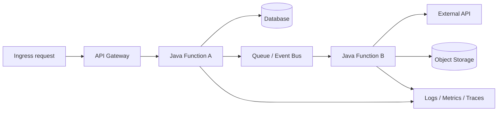

# Measuring Cost per Request and Cost per Business Transaction

Serverless removes most server management work, but it does not automatically make costs low or easy to understand. One HTTP request can trigger multiple functions, publish multiple messages, read/write databases, call external services, and generate logs/traces. One business transaction can involve multiple requests, retries, and asynchronous steps. If you simply divide the function bill by invocation count, you can miss most of the actual cost.

FinOps must connect billing/usage data with telemetry and business outcomes to answer two questions: **how much does one request cost** and **how much does one successful business transaction cost**. The two metrics have different denominators and serve different decisions.

This lesson explains how to build unit economics for serverless Java: defining cost boundaries, measuring requests/invocations/events/business transactions, allocating shared costs, calculating full costs, reconciling with billing, and using results to improve architecture while preserving SLAs, reliability, and correctness.

## 1. Distinguishing Requests, Invocations, and Business Transactions

### 1.1. One Request Does Not Equal One Invocation

With HTTP functions, one request may invoke one function exactly once in a simple flow. In practice, however, there may be:

- an API Gateway/proxy handling the request;
- a function calling another function;
- an SDK retrying a dependency;
- a workflow executing multiple tasks;
- a function publishing a message with a consumer running afterward;
- a timeout causing the caller to resend the request;
- a request duplicated or rejected before reaching the function.

Therefore, distinguish between measurement units:

| Unit | Meaning | Example |
| --- | --- | --- |
| Ingress request | A request arriving at the API/edge | An HTTP POST `/orders` |
| Function invocation | One runtime execution of a handler | One Java Lambda/function run |
| Attempt | One attempt to call a dependency or process an event | 2nd HTTP retry |
| Message/event delivery | One broker delivery of an event to a consumer | Redelivered message |
| Workflow execution | One run of a multi-step process | Checkout workflow |
| Business transaction | A business unit with a stable identity | An order/payment/claim |
| Successful business transaction | A business transaction reaching its defined completion state | Order transitions to `COMPLETED` |

Do not use invocation count as a proxy for business transactions. One transaction can spawn many invocations; one batch invocation can process many transactions.

### 1.2. Clearly Defining a Business Transaction

Before calculating unit cost, agree on what "a successful transaction" means. For ordering, for example:

- Receiving a request at the API does not mean the order succeeded.
- Saving a draft order does not mean payment succeeded.
- Publishing `OrderCreated` does not mean fulfillment steps have completed.
- Only when the order reaches `COMPLETED` in the state machine is it counted in the successful orders denominator.

For payments, success might be defined as the provider confirming capture and the ledger recording it. This definition must stay consistent across dashboards, billing allocations, and financial reports.

### 1.3. Identity Must Stay Stable Across Retries

Use a stable `businessTransactionId`, `orderId`, `paymentId`, or operation ID to link steps. Do not use invocation ID, trace ID, or request ID as the business identity because retries can generate new request/invocation/trace IDs for the same transaction.

One business transaction can carry multiple request IDs, invocation IDs, and trace IDs. Logs/traces should record correlation/causation IDs for traceability; metrics should not use transaction IDs as labels because cardinality will explode rapidly.

## 2. Cost Boundary: Which Costs Are Included?

### 2.1. Direct Function Costs

Depending on the platform and configuration, function costs can depend on:

- number of invocations/requests;
- billable execution duration;
- memory/CPU or resource configuration;
- CPU architecture/runtime;
- concurrency/provisioned capacity;
- compute billed separately for initialization vs. execution;
- retries, timeouts, and failed invocations.

A conceptual formula for GB-second-style compute:

\[
ComputeCost = \sum_{i=1}^{N} MemoryGB_i \times BilledDurationSeconds_i \times Rate
\]

Request costs may be billed separately:

\[
InvocationCost = InvocationCount \times RequestRate
\]

This is a conceptual model; rounding units, free allowances, memory/CPU calculation, architecture, provisioned concurrency, and specific rates depend on the provider, region, and time. Use actual usage/billing exports to calculate rather than inferring invoices solely from log durations.

### 2.2. Supporting Service Costs

A Java function commonly uses many other services:

| Cost Category | Example Billing Factors |
| --- | --- |
| API/edge | Request counts, data processing, caching, gateway tier |
| Queue/event bus/stream | API requests, message size, throughput units, partitions/shards, retention |
| Database | Read/write request units, IOPS, storage, backups, provisioned capacity, connection proxy |
| Object storage | Stored GB-months, PUT/GET, lifecycle, replication |
| Network | Egress, cross-zone/region transfer, NAT processing, private endpoints |
| Observability | Log ingestion/retention, metric series, trace ingestion/indexing, alerting |
| Workflow/orchestration | State transitions, task executions, workflow duration |
| Security/configuration | Secret access, key operations, audit events, certificate services |
| Shared platform | Monitoring cluster, registry, CI/CD, networking, support allocation |

If you only count function compute, unit cost can look artificially low. For database-heavy workloads, database costs can be many times larger than function costs.

### 2.3. Fixed, Variable, and Shared Costs

Classify costs into:

- **Direct variable cost:** scales closely with requests/usage, such as invocations, message requests, or data transfer.
- **Capacity/reserved cost:** pays for reserved capacity, such as provisioned concurrency, provisioned database capacity, or always-on workers.
- **Shared overhead:** shared across services/tenants, such as NAT gateways, logging platforms, clusters, or support.
- **One-time/change cost:** migrations, initial data transfers, builds/releases, or major rollout changes.

Reports should distinguish marginal cost (incremental cost of processing one extra unit) from fully-loaded cost (including allocated capacity/shared overhead). The two metrics answer different questions.

## 3. Defining Unit Economics Metrics

### 3.1. Cost per Request

A common calculation:

\[
CostPerRequest = \frac{AllocatedCost}{IngressRequestCount}
\]

Clearly state what request count includes: all requests hitting the gateway, valid requests, requests received by the function, or only successful requests. For API operations, track at least:

- cost per ingress request;
- cost per accepted request;
- cost per successful HTTP response;
- cost per failed/rejected request.

If the denominator includes only successful requests, name it explicitly `CostPerSuccessfulRequest`. Do not mix definitions on dashboards.

### 3.2. Cost per Successful Business Transaction

The primary metric for understanding business efficiency:

\[
CostPerSuccessfulTransaction =
\frac{AllocatedEndToEndCost}{UniqueCompletedBusinessTransactions}
\]

`UniqueCompletedBusinessTransactions` is the number of unique business transaction IDs reaching completion in the period. All costs from failed attempts, retries, duplicates, workflows, and related dependencies remain in the numerator if they fall within the same cost boundary.

If the system receives 100,000 order requests but completes only 92,000 orders, do not divide total cost by 100,000 and call it cost per successful order. Doing so hides the cost of the 8,000 incomplete orders.

### 3.3. Cost per Attempt and Cost per Failure

Supplementary metrics:

\[
CostPerAttempt = \frac{AllocatedCost}{TotalAttempts}
\]

\[
CostPerFailedTransaction =
\frac{CostAllocatedToFailedTransactions}{UniqueFailedTransactions}
\]

Cost per attempt helps explain execution/retry costs. Cost per failed transaction reveals how much spend is burned on incomplete operations. Define terminal failures and the measurement window clearly; a transaction still `PENDING` is not necessarily a failure.

### 3.4. Success Rate and Retry Amplification

\[
SuccessRate = \frac{CompletedTransactions}{AcceptedTransactions}
\]

\[
RetryAmplification = \frac{TotalAttempts}{OriginalOperations}
\]

If success rate drops while retry amplification rises, cost per successful transaction usually climbs sharply. This can signal an unstable dependency, a retry storm, or poor input data quality.

### 3.5. Do Not Compare Non-Equivalent Denominators

Comparing cost per request between two services is only meaningful when request definitions, cost boundaries, measurement windows, and outcome quality are comparable. A simple lookup API and a multi-step payment workflow have very different costs/request because they deliver different business value.

## 4. Allocating Costs to a Request or Business Transaction

### 4.1. Direct Attribution

When usage ties directly to a service or operation, assign costs directly:

- which service owns a function invocation;
- which service owns a queue/topic;
- which workload owns a dedicated bucket/table;
- which product owns an API route;
- which service owns a log group/resource.

Direct attribution has higher fidelity than broad proportional splits.

### 4.2. Shared Cost Allocation

Some resources are shared across multiple services. Choose drivers reflecting actual consumption:

| Shared Resource | Suggested Allocation Driver |
| --- | --- |
| Log platform | Bytes ingested or GB-months by service |
| Trace backend | Span/trace bytes or ingestion volume |
| Shared database | Query units, CPU time, I/O, bytes, or connection-time by workload |
| NAT/network gateway | Bytes/GB processed by source workload |
| Shared queue/event bus | Message count weighted by size or throughput |
| Provisioned capacity | Peak/concurrency reservation or committed capacity share |
| Cluster/platform overhead | Resource requests/CPU/memory time or published ownership ratios |

Sufficiently precise metrics are not always available. If you must use a proxy such as request count, document the assumption clearly and treat it as an estimate rather than direct metering.

### 4.3. Allocation Formula

For a shared pool:

\[
AllocatedCost_s = SharedPoolCost \times
\frac{UsageWeight_s}{\sum_j UsageWeight_j}
\]

Where `UsageWeight_s` is the usage driver of service `s` over the same period. Total allocated cost must equal the shared pool cost, except for any portion retained as unallocated overhead and reported separately.

### 4.4. Database Allocation Example

Suppose a shared database costs 4,000 USD per month. Workload A generates 60% of query units, B generates 30%, and C generates 10%. If query units are the accepted driver:

| Workload | Usage Share | Allocated Cost |
| --- | ---: | ---: |
| A | 60% | 2,400 USD |
| B | 30% | 1,200 USD |
| C | 10% | 400 USD |
| **Total** | **100%** | **4,000 USD** |

If A runs lightweight queries while B runs heavy scans, raw query count can misallocate costs. Whenever possible, use I/O/compute units or a weighted driver reflecting resource consumption.

### 4.5. Per-Tenant Allocation

To measure cost per tenant, you do not necessarily need to create separate cloud resources for each tenant. You can record usage dimensions in application telemetry or a usage ledger with protected tenant fields, then aggregate by tenant in a separate analytics system.

Avoid putting raw tenant IDs into metric labels if tenant counts are large. Use logs/events or a governed usage table; keep metrics on tier/plan/region groups or low-cardinality dimensions.

## 5. Joining Billing Data with Telemetry

### 5.1. Billing Is the Source of Cost; Telemetry Is the Source of Cause

Billing exports show resources/usage/costs along provider-supplied dimensions. Application telemetry shows which request, which operation, how many retries, and whether the business transaction completed.

Do not treat trace duration as exact billable duration. Runtimes may round duration, bill initialization, memory, or provisioned capacity under specific rules. Billing exports/usage APIs are the authoritative source for cost reconciliation.

### 5.2. Dimensions to Standardize

At the resource/billing layer, standardize dimensions:

- account/subscription/project;
- service/application;
- environment;
- owner/team/cost center;
- region;
- resource type;
- product/workload.

At the application layer, standardize:

- service and operation name;
- business transaction type;
- outcome (`SUCCEEDED`, `FAILED`, `REJECTED`, `PENDING`);
- attempt/retry count;
- event source/trigger;
- deployment version;
- tenant tier or customer segment, if policy permits.

Service/environment names must match or have an explicit mapping across cloud tags, deployment metadata, and application telemetry.

### 5.3. Tagging Strategy

Apply resource tags/labels per organizational convention, for example:

```text
service       = orders-api
environment   = production
team          = commerce
cost-center   = CC-042
owner         = platform-orders
managed-by    = terraform
```

Do not put secrets, emails, customer IDs, or sensitive data in resource tags. Tag coverage should be checked automatically via CI/IaC policies. Resources missing tags should land in an `unallocated` bucket rather than being dropped from reports.

### 5.4. Periodic Reconciliation

Billing can be adjusted by credits, discounts, taxes, reservations, commitments, or corrections. Application telemetry usually arrives in real time. Therefore:

1. Collect usage/billing exports on a consistent period and timezone.
2. Normalize currencies, regions, services, and resource IDs.
3. Aggregate telemetry over the exact same time window.
4. Join direct costs by resource/service.
5. Allocate shared costs using agreed drivers.
6. Reconcile allocated + unallocated totals against the invoice/export.
7. Record the allocation rule version so reports are reproducible.

Do not expect application-level daily estimates to match invoices down to the cent; account for lag, rounding, and adjustments. Monthly closes must use the official billing source.

## 6. End-to-End Cost Model

### 6.1. Total Cost of a Business Transaction

A business transaction can span:



End-to-end cost must capture the share of resources consumed across the entire chain. Do not add the full monthly database cost to every request; first allocate database cost to the workload/service, then divide by completed business transactions or usage weights within that service.

### 6.2. Operation-Level Cost Ledger

An internal usage ledger can store:

| Field | Purpose |
| --- | --- |
| `period` | Aggregation period |
| `service` | Owning service |
| `operation` | Operation type |
| `transaction_type` | Order/payment/report... |
| `ingress_request_count` | Requests arriving at the chosen API boundary |
| `accepted_count` | Accepted operations |
| `completed_count` | Unique completed operations |
| `failed_count` | Terminal failed operations |
| `invocation_count` | Total function invocations |
| `attempt_count` | Total attempts |
| `direct_cost` | Directly attributed cost |
| `allocated_shared_cost` | Allocated shared cost |
| `currency` | Currency unit |
| `allocation_version` | Allocation rule version |

You do not need to write one row per request when volume is high. Aggregate by time bucket/service/operation and store transaction-level events elsewhere for investigation.

### 6.3. Computing Unit Costs from the Ledger

```sql
SELECT
    service,
    operation,
    SUM(direct_cost + allocated_shared_cost)
        / NULLIF(SUM(ingress_request_count), 0) AS cost_per_request,
    SUM(direct_cost + allocated_shared_cost)
        / NULLIF(SUM(completed_transaction_count), 0)
        AS cost_per_successful_transaction
FROM service_cost_daily
WHERE period >= :fromDate
  AND period < :toDate
GROUP BY service, operation;
```

`NULLIF` prevents division by zero. If there are zero completed transactions in the period, unit cost should display `N/A` or undefined; do not display 0 when costs were incurred without any successful transactions.

## 7. Example Calculating Cost per Request and Cost per Transaction

### 7.1. Hypothetical Monthly Data

Suppose the `orders` workload has the following metrics. All dollar figures below are solely for illustrating the math, not cloud provider pricing.

| Component | Monthly Cost |
| --- | ---: |
| Java function compute + invocations | 720 USD |
| API Gateway/edge | 300 USD |
| Queue/event bus | 180 USD |
| Database | 4,800 USD |
| Object storage | 600 USD |
| Network/data transfer | 900 USD |
| Logs/metrics/traces | 1,500 USD |
| Shared platform allocation | 3,000 USD |
| **Total allocated cost** | **12,000 USD** |

Monthly usage:

- 2,000,000 ingress requests;
- 2,800,000 function invocations;
- 150,000 unique completed business transactions;
- 10,000 terminal failed business transactions.

### 7.2. Cost per Request

\[
\frac{12.000}{2.000.000} = 0,006\ USD/request
\]

That is 0.6 cents per ingress request. This figure includes requests that did not result in completed transactions.

### 7.3. Cost per Successful Transaction

\[
\frac{12.000}{150.000} = 0,08\ USD/transaction
\]

That is 8 cents per completed transaction. This metric reflects the cost to deliver one business outcome per the chosen definition.

### 7.4. Why Do the Two Numbers Differ?

One transaction can generate multiple requests/invocations, and a portion of operations fail. Looking only at cost per request might make the workload look cheap, whereas cost per successful transaction is higher because:

- many requests do not yield a business outcome;
- retries increase invocations and dependency usage;
- multi-step workflows consume database/queue/network resources;
- shared overhead is fully allocated to the service.

### 7.5. Sensitivity Analysis

If total cost stays at 12,000 USD while only 120,000 transactions complete, cost per successful transaction rises to 0.10 USD. If optimizing retries/DB brings total cost down to 10,800 USD while completing 150,000 transactions, unit cost drops to 0.072 USD.

```text
Scenario A: 12,000 / 150,000 = $0.080 per success
Scenario B: 12,000 / 120,000 = $0.100 per success
Scenario C: 10,800 / 150,000 = $0.072 per success
```

Do not evaluate optimizations by total bill alone. Examine unit cost, success rate, latency, error rate, and service quality together.

## 8. Measuring Business Outcomes in Java

### 8.1. Placing Metrics at Business Boundaries

Platform-provided function invocation metrics do not tell you whether an order completed. The application must emit metrics when business state transitions succeed or fail terminally.

Suggested metrics:

- `business_transactions_accepted_total`;
- `business_transactions_completed_total`;
- `business_transactions_failed_total`;
- `business_transaction_duration`;
- `business_operation_attempts_total`;
- `business_operation_retries_total`.

Specific metric names can follow your system's naming conventions. What matters is emitting the metric only once per valid state transition, avoiding incrementing the completed counter every time a duplicate message is redelivered.

### 8.2. Java with Micrometer

Example using Micrometer's `MeterRegistry`:

```java
import io.micrometer.core.instrument.MeterRegistry;
import io.micrometer.core.instrument.Timer;

import java.util.concurrent.TimeUnit;

public final class BusinessMetrics {
    private final MeterRegistry registry;

    public BusinessMetrics(MeterRegistry registry) {
        this.registry = registry;
    }

    public void accepted(String operation) {
        registry.counter("business.transactions.accepted",
                "operation", operation).increment();
    }

    public void completed(String operation) {
        registry.counter("business.transactions.completed",
                "operation", operation).increment();
    }

    public void failed(String operation, String category) {
        registry.counter("business.transactions.failed",
                "operation", operation,
                "category", category).increment();
    }

    public void recordDuration(String operation, long nanos) {
        Timer.builder("business.transaction.duration")
                .tag("operation", operation)
                .register(registry)
                .record(nanos, TimeUnit.NANOSECONDS);
    }
}
```

Use only low-cardinality tags such as operation, outcome, region, or tier. Do not attach `orderId`, `paymentId`, emails, request IDs, or trace IDs as metric tags. Specific IDs belong in structured logs/traces or a governed usage ledger.

### 8.3. Metrics Must Align with Successful Commits

If you increment `completed` before the database transaction commits, the metric may record success even if the transaction rolls back. If you increment after commit and the function crashes before exporting metrics, the count may be missed.

For figures requiring exact reconciliation, write business outcomes to an outbox/table within the same transaction, then aggregate into metrics/reports. Streaming metrics serve near-real-time dashboards well, though they are not necessarily an official financial ledger.

### 8.4. Recording Attempts and Retries

Count attempts at the dependency boundary or middleware owning the retry policy. Each retry increments the attempt counter; event/message IDs and operation IDs belong in logs/traces to correlate attempts with transactions. Never emit business transaction completed again when a consumer merely acknowledges a duplicate.

## 9. Attaching Cost Dimensions to Traces and Logs

### 9.1. Useful Span Attributes

Record low-sensitivity attributes on spans:

- `service.name`, `deployment.environment`;
- `business.operation`;
- `business.transaction.type`;
- `business.outcome`;
- `retry.attempt`;
- `messaging.destination` or trigger type;
- resource class/tier.

Traces help map the chain of invocations and dependencies for a transaction. However, do not rely on a tracing backend as the sole billing engine because sampling drops spans and retention/indexing may not suit reconciliation.

### 9.2. Correlation IDs and Privacy

Use correlation/transaction IDs to stitch logs across a workflow. Enforce access controls and retention; never record sensitive payloads or PII in trace attributes. For tenant analysis, use tenant tiers/segments or pseudonymous identifiers per policy.

### 9.3. Sampling Must Not Distort Business Denominators

Do not compute successful transaction counts by counting sampled traces. Trace sampling is strictly for observability. Denominators must come from a business outcome ledger or unsampled metrics with clear semantics.

## 10. Costs of Retries, Failures, and Duplicates

### 10.1. Retries Cost Across Multiple Layers

One retry can generate:

- additional invocation compute;
- additional API/DB requests;
- additional queue receive/delete or stream processing;
- additional network transfer;
- additional logs/traces;
- longer workflows holding capacity;
- higher DLQ storage/retention.

Retry costs belong to the transaction that triggered the retry. If a retry eventually succeeds, cost per successful transaction still includes all prior failed attempts.

### 10.2. Failed Requests Still Consume Resources

A validation failure can be cheap if rejected at the gateway; a timeout after running a function for 20 seconds and calling three dependencies costs far more. Classify failures by stage and category to pinpoint where spend occurs.

Measure:

- rejected before compute;
- function validation failure;
- dependency failure;
- timeout;
- retry exhausted/DLQ;
- business rejection after consuming resources.

### 10.3. Duplicate Delivery

Duplicate events may cause no business side effects when idempotency works, yet they still consume compute, queue requests, and database reads/dedup checks. Track duplicate delivery rates and cost overhead; never assume safely handled duplicates are free.

### 10.4. Retry Storms Cause Non-Linear Unit Cost Growth

When a dependency slows down, retries pile more load onto the dependency and lengthen executions. As successful throughput falls, the numerator climbs while the successful transactions denominator fails to keep pace. Cost per success therefore surges faster than cost per invocation.

## 11. Async Workflows and Batch Processing Costs

### 11.1. One Transaction Emits Multiple Events

An order might emit `OrderCreated`, `InventoryReserved`, `PaymentCaptured`, and `ShipmentRequested`. Each event has producer, queue, and consumer costs. Link them via correlation/causation IDs for end-to-end analysis.

### 11.2. Batching Changes the Denominator

One batch invocation might process 100 messages. Dividing function cost by invocation count makes cost/invocation look high, whereas cost/message is lower. If 10 messages in a batch fail and the entire batch retries, track both attempts and unique completed business transactions.

Measure separately:

- messages received;
- unique messages processed;
- records succeeded/failed per batch;
- batch retry count;
- partial batch failure count;
- business transactions completed.

### 11.3. Workflow State Transitions

Workflow orchestrators may bill per state transition/task execution. A multi-step workflow or retry loop can generate many transitions for a single business transaction. Track transition count per completed transaction and wait durations between steps.

## 12. Capacity, Idle, and Provisioned Concurrency Costs

### 12.1. On-Demand vs. Provisioned Capacity

On-demand compute fits bursty or sparsely used workloads well. Provisioned concurrency/capacity reduces cold starts and improves latency, yet incurs fixed charges for reserved capacity even with zero requests.

When comparing, factor in:

- on-demand compute/requests;
- capacity reservations/provisioned concurrency;
- hourly utilization;
- peak concurrency and headroom;
- latency/SLO benefits;
- cost per successful transaction during off-peak and peak hours.

Do not compare per-invocation price alone. A provisioned setup may cost more monthly while cutting timeouts/retries and raising success rates; conversely, reserved capacity may sit wasted most of the time.

### 12.2. Java Memory Sizing

Increasing memory can boost CPU/network throughput on certain FaaS platforms. Faster execution can partially offset the higher resource tier price. Benchmark multiple memory sizes on the same workload and compare:

- p50/p95/p99 duration;
- billed duration;
- timeout/error rates;
- cold start/init duration;
- cost per invocation;
- cost per successful transaction.

Pick the optimal point based on SLOs and unit economics rather than defaulting to the smallest memory size out of habit.

### 12.3. Scale-to-Zero and Baseline Services

Functions may scale to zero, yet provisioned databases, NAT gateways, cache clusters, provisioned stream capacity, or observability platforms can still bill while idle. Measure baseline cost during zero-traffic hours to isolate fixed costs.

### 12.4. Connection Pools and Concurrency

Raising function concurrency can scale up database connections, proxy capacity, NAT, downstream APIs, and log volume. Cost models must reflect downstream limits; unbounded scale-out can inflate bills while depressing success rates.

## 13. Observability Costs

### 13.1. Log Volume

Logging every request with large payloads creates substantial ingestion and retention costs. Use structured logs, environment-appropriate log levels, sampling for debug details, and avoid logging the same exception at every layer.

Do not drop required audit/business records just to cut log bills. Separate audit logs needing proper retention/immutability from diagnostic logs that can use sampling/shorter TTLs.

### 13.2. Trace Volume and Sampling

Trace sampling reduces ingestion/indexing costs at the expense of discarding some traces. Prioritize keeping error/slow traces via tail sampling if the pipeline supports it. Never use sampled traces to compute transaction counts or chargebacks.

### 13.3. Metric Cardinality

Metric labels using order ID, user ID, or request ID continuously create new time series, raising costs and slowing queries. Stick to bounded-cardinality dimensions; use logs/traces/warehouses for granular analysis.

### 13.4. Retention Tiers

Choose retention by purpose:

- short-term for diagnostic logs;
- policy-driven for security/audit logs;
- financial-period compliant for billing exports and usage ledgers;
- long enough for incident investigation on traces;
- longer for aggregate metrics than raw high-cardinality data.

Lifecycle policies must be tested to avoid accidentally deleting records needed for audits or reconciliation.

## 14. Cost Dashboards and the FinOps Operating Model

### 14.1. Minimum Dashboard

Track by service, environment, operation, and period:

| Metric | Question Answered |
| --- | --- |
| Total cost | How much is the service spending? |
| Cost per ingress request | How much does an average request cost? |
| Cost per successful transaction | How much does it cost to deliver one business outcome? |
| Success rate | What share of operations complete? |
| Retry amplification | How many attempts does each operation generate? |
| Cost by component | Are functions, DB, queues, network, or observability dominating? |
| Idle/baseline cost | How much cost persists at low traffic? |
| Forecast vs. budget | Is spend exceeding plan? |
| Unallocated cost | How much cost lacks an owner/driver? |

Plot daily/weekly/monthly trends and annotate releases/incidents to spot post-deploy shifts.

### 14.2. Showback and Chargeback

- **Showback:** reports costs to teams/service owners so they understand their consumption.
- **Chargeback:** allocates or bills costs to cost centers or budget-owning units.

Start with showback using transparent allocation rules. Move to chargeback only once ownership, drivers, currency, adjustments, and dispute processes are clear. Avoid perverse incentives from splitting all shared costs by request count when workloads consume vastly different resources.

### 14.3. Budgets and Anomaly Alerts

Set budgets per service/environment and alert on:

- actual vs. forecast;
- daily spend spikes;
- cost per successful transaction above baseline;
- rising retry amplification;
- abnormal log/trace ingestion;
- resources missing owners/tags;
- prolonged idle capacity.

Pair cost alerts with reliability metrics. A cost spike may reflect healthy traffic growth—or a retry storm or event loop. Diagnose the root cause before cutting capacity.

### 14.4. Forecasting

A simple forecast can use:

\[
ForecastCost = ForecastVolume \times ExpectedUnitCost + FixedCapacityCost
\]

Unit cost should reflect recent workloads and assumptions around success rates, retries, payloads, regions, and service mix. Where tiered pricing/discounts apply, use step models rather than assuming linear costs.

## 15. Optimizing Cost per Successful Transaction

### 15.1. Target the Right Bottleneck

Prioritize based on the cost breakdown:

- High function compute: benchmark memory/runtime, trim initialization and wait times.
- High database cost: optimize queries/indexes, batching, read caching, reduce scans and connection churn.
- High queue/workflow cost: batch appropriately, drop unnecessary events, eliminate redundant state transitions.
- High network/NAT cost: cut cross-zone/region traffic, coalesce requests, and pick better topology.
- High observability cost: trim log volume/cardinality, adjust retention/sampling.
- High retry cost: classify errors, add backoff+jitter, idempotency, circuit breakers, and fix dependencies.

### 15.2. Batching and Coalescing

Batching similar operations cuts request overhead, though oversized batches raise latency, memory, retry blast radius, and partial-failure complexity. Measure cost per record and cost per completed transaction before and after.

Request coalescing/caching reduces read load on hot keys. Account for cache cost, stale data, invalidation, and correctness.

### 15.3. Reduce Retries Instead of Only Trimming Memory

If 30% of invocations are retries caused by database throttling, lowering function memory might shave compute cost per attempt without fixing the root cause. Tuning concurrency, connection pools, backoff, and database capacity reduces both retries and cost per success.

### 15.4. Optimizing Java Startup and Dependencies

Trimming the classpath, avoiding unnecessary client initialization, reusing thread-safe clients in warm environments, and choosing the right runtime can reduce init duration. Always measure platform billing behavior: cold starts/init may be billed differently across runtimes and services.

### 15.5. Weighing FaaS vs. Always-On Containers/Workers

For continuous workloads with steady concurrency and high utilization, always-on services/containers can be cheaper than on-demand functions plus overhead. For bursty, uneven, or event-driven workloads, FaaS may fit better. Compare across identical SLOs, redundancy, operations, idle capacity, and fully-loaded costs.

Never decide based on a single invocation price figure; calculate end-to-end cost per successful business transaction.

## 16. Java: Recording Business Outcomes and Attempts

Example service recording outcomes after the persistence layer confirms a state transition. `BusinessMetrics` is telemetry only; when an exact financial denominator is needed, write outcome events to a transactional outbox/ledger and aggregate from there.

```java
public final class OrderApplicationService {
    private final OrderRepository orders;
    private final BusinessMetrics metrics;

    public OrderApplicationService(
            OrderRepository orders,
            BusinessMetrics metrics) {
        this.orders = orders;
        this.metrics = metrics;
    }

    public OrderResult complete(String orderId) {
        long startedNanos = System.nanoTime();

        try {
            // Repository performs an idempotent, conditional state transition.
            boolean transitioned = orders.markCompletedIfEligible(orderId);
            if (transitioned) {
                metrics.completed("complete_order");
            }
            return transitioned
                    ? OrderResult.completed(orderId)
                    : OrderResult.alreadyCompletedOrNotEligible(orderId);
        } catch (PermanentBusinessException error) {
            metrics.failed("complete_order", "business_rejected");
            throw error;
        } finally {
            metrics.recordDuration("complete_order",
                    Math.max(0, System.nanoTime() - startedNanos));
        }
    }
}
```

This illustrates instrumentation placement, not a complete ledger implementation. In production code:

- `accepted` should fire at the exact acceptance boundary and avoid re-counting on internal retries;
- `completed` should fire only on the first successful transition;
- duplicates/already-completed items must not increment completed counts;
- failure metrics should increment only for defined failure categories;
- use a monotonic clock (`System.nanoTime()` or an equivalent abstraction) to measure duration;
- if metrics can be lost when processes exit, use an outbox/usage ledger as the reconciliation source.

## 17. Data Quality and Variance Control

### 17.1. Common Errors

- Counting invocations instead of business transactions.
- Counting duplicate events multiple times as new transactions.
- Excluding retry/failure costs from the numerator.
- Using sampled traces as the denominator.
- Allocating database/network costs by request count despite wildly different workloads.
- Forgetting provisioned capacity or idle baselines.
- Mixing staging/test traffic with production.
- Applying credits/discounts/taxes/commitments inconsistently.
- Using mismatched timezones between billing and telemetry.

### 17.2. Reconciliation Checks

Verify periodically:

- total cost by resource/service matches billing exports after adjustments;
- total allocated shared cost does not exceed the shared pool;
- allocated + unallocated = total cost in the allocation model;
- completed business transactions do not exceed accepted transactions unless semantics allow;
- event/outbox completion counts match the ledger;
- invocation/attempt counts explain variances relative to request counts;
- no transaction is counted as completed more than once.

### 17.3. Versioning Allocation Rules

Whenever changing a shared cost allocation driver, record the allocation rule version and effective date. Do not silently recalculate history under new rules without documentation; if restatements are required, publish traceable adjustment reports.

## 18. FinOps Rollout Process for a Serverless Java Service

1. Identify service owner, cost center, environment, and cost boundary.
2. Define requests, invocations, attempts, and business transactions.
3. Choose the business success state and a stable identity.
4. Enable billing/usage exports and standardize resource tags.
5. Collect request, invocation, message, retry, and business outcome metrics.
6. Allocate direct costs; choose drivers for shared costs and document assumptions.
7. Compute cost per request, cost per successful transaction, cost per failure, and retry amplification.
8. Reconcile totals against billing periodically and record the allocation version.
9. Build dashboards by service/operation/environment and anomaly alerts.
10. Rank cost drivers by share and impact on unit cost.
11. Test one optimization change in staging/canary; re-measure cost alongside SLOs.
12. Track post-release trends and update forecasts/budgets.

## 19. Production and FinOps Checklist

- [ ] Clearly defined ingress requests, invocations, attempts, and business transactions.
- [ ] Business transactions carry a stable ID across retries/workflows.
- [ ] Defined which state counts as a successful transaction.
- [ ] Cost boundary includes functions, APIs, queues, DBs, storage, networking, and observability.
- [ ] Distinguished direct, variable, reserved/capacity, and shared overhead costs.
- [ ] Cost per request clearly states denominator and request scope.
- [ ] Cost per successful transaction uses unique completed transactions.
- [ ] Retries, duplicates, failures, and workflow steps are included in the numerator.
- [ ] Shared costs have allocation drivers and unallocated portions are disclosed.
- [ ] Resource tags/labels include service, environment, owner, and cost center.
- [ ] Billing exports are the official cost source; telemetry is the cause/outcome source.
- [ ] Sampled traces or high-cardinality metrics are never used as the financial ledger.
- [ ] Business outcomes are recorded post-commit or via transactional outbox.
- [ ] Dashboards display success rate, retry amplification, and unit cost.
- [ ] Provisioned/idle capacity and cold starts are accounted for in the model.
- [ ] Databases/network/logging/queues are tracked as distinct cost drivers.
- [ ] Budgets, forecasts, and anomaly alerts have owners/runbooks.
- [ ] Cost optimizations do not violate SLOs, security, or data correctness.
- [ ] Allocation rules are versioned and reconciled against billing.

## Conclusion

Cost per request measures the efficiency of one unit of traffic at a chosen boundary. Cost per successful business transaction measures the cost to deliver one completed business outcome. In serverless, the two metrics can diverge widely because one transaction often triggers multiple invocations, messages, workflow steps, dependency calls, and retries.

To measure accurately, combine billing/usage exports with application telemetry and a business outcome ledger. Allocate shared costs with transparent drivers, include failed/retried work in the numerator, and count each completed business transaction only once in the denominator. Use low-cardinality metrics for dashboards, logs/traces for investigation, and outboxes/ledgers for figures requiring reconciliation.

Effective FinOps optimizes cost per successful transaction alongside success rate, latency, reliability, and correctness. Once the cost breakdown is clear, teams can pick the right levers: cutting retries, optimizing databases, batching sensibly, tuning memory/concurrency, curbing idle capacity, or trimming observability noise. Every change must be re-measured under the same workload and SLOs to prove unit economics truly improved.
