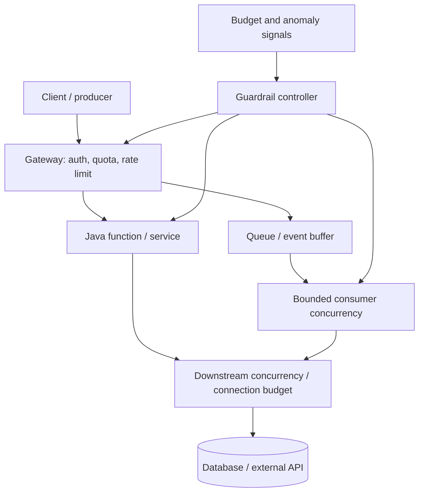

# Setting Budgets, Anomaly Alerts, and Guardrails

## 1. FinOps Goals for Serverless Applications

Serverless relieves development teams from managing servers, yet that does not make costs automatically low or automatically within budget. Functions can scale rapidly with traffic, queue backlogs, retries, or misconfigurations. An event loop, an abused public endpoint, or overly verbose logging can drive costs up before the team notices.

FinOps combines finance, engineering, and operations to make data-driven cost decisions. For serverless Java applications, the goal is not merely shrinking the end-of-month invoice. The team needs to know:

- Which workloads generate costs and which teams own them.
- How much one request or one successful business outcome costs.
- Whether actual spend tracks budget and forecast.
- Whether an increase comes from healthy growth, an architectural change, or an incident.
- Which guardrails prevent a workload from causing excessive damage.
- Whether cost-cutting actions risk violating SLAs/SLOs, losing data, or disrupting business operations.

A sound FinOps program needs three complementary capabilities:

1. **Plan and allocate:** set budgets, forecast, and allocate costs to services/teams/tenants.
2. **Detect and explain:** monitor actual spend, forecasts, and anomalies; trace root causes by workload.
3. **Protect and optimize:** cap consumption, automate controlled responses, and optimize cost per business outcome.

A budget is a governance target. Quotas, concurrency, rate limits, and spend caps are consumption controls. Cost alerts detect drift; they do not replace runtime limits.

## 2. Understanding the Full Serverless Cost Model

### 2.1. It Is Not Just Function Execution Costs

An HTTP request or message can trigger charges across multiple services. Total cost should be viewed across the entire workload path:

\[
C_{total} = C_{compute} + C_{requests} + C_{warm} + C_{network} + C_{observability} + C_{storage} + C_{events} + C_{dependencies}
\]

Common components:

| Component | Cost Examples |
| --- | --- |
| Function compute | Execution duration multiplied by allocated memory/CPU |
| Invocations/requests | Number of function calls or requests processed |
| Warm/provisioned capacity | Provisioned concurrency, always-ready/min instances, idle instances per billing mode |
| Network | Internet egress, cross-region transfers, NAT, VPC connectors, private endpoints, or load balancers |
| Observability | Log ingestion/retention, metrics, traces, alerting, and data exports |
| Messaging/events | Queue operations, event deliveries, stream throughput, retries, DLQs, and polling |
| Storage | Objects, databases, caches, backups, snapshots, and read/write requests |
| Workflow/orchestration | State transitions, activities, history, polling, and durable storage |
| Build/release | Artifact registries, image storage, build minutes, and preview environments |
| Dependencies | Databases, API gateways, identity providers, payment APIs, or SaaS services |

If you only look at the "Lambda" or "Functions" line item on the invoice, your team can miss most of the costs driven by functions across databases, logs, networking, and message brokers.

### 2.2. Cost Drivers of Java Functions

Compute costs typically depend on:

- Invocation count.
- Allocated memory/CPU.
- Billable execution duration.
- Region and CPU architecture.
- Billing mode and hosting plan type.
- Provisioned/warm instances and how long they are held.
- Retries, timeouts, and repeated invocations.

For Java functions, runtime startup, class loading, dependency injection, JIT warm-up, and dependency connections can lengthen duration. Cold starts are not always a separate line item, yet billable initialization time can affect duration and user experience depending on the platform/billing model.

Higher memory is not always more expensive per outcome. If raising memory also boosts CPU and makes the function finish significantly faster, total GB-seconds can drop. Benchmark using representative workloads rather than guessing the smallest memory size.

### 2.3. Costs Can Amplify via Retries and Fan-Out

A failing message may be retried multiple times. One event can trigger multiple functions; each function in turn calls databases, logs, and publishes downstream events. Without idempotency, retry policies, and fan-out caps, a small fault can unleash huge invocation volumes.

Metrics to distinguish:

- **Logical operations:** actual business operations submitted.
- **Attempts:** total execution attempts, including retries and redeliveries.
- **Successful outcomes:** completed business results.
- **Wasted executions:** executions producing no useful outcome, such as repeated retries, timeouts, or duplicate processing.

Retry amplification can be estimated as:

\[
Retry\ amplification = \frac{Total\ attempts}{Logical\ operations}
\]

If 10,000 events spawn 14,000 invocation attempts, the system has a factor of 1.4. This is not automatically an error since some retries are expected, yet a rapidly rising trend warrants investigation.

## 3. Measuring Unit Economics Instead of Watching Only the Total Bill

### 3.1. Cost per Successful Outcome

Monthly total spend can rise because the product is growing. Watching only the total invoice fails to separate healthy growth from poor efficiency. Measure cost per business outcome:

\[
Cost\ per\ outcome = \frac{Total\ allocated\ cost}{Successful\ business\ outcomes}
\]

Example:

| Metric | Month A | Month B |
| --- | ---: | ---: |
| Cost allocated to order service | 1,000 USD | 1,200 USD |
| Successful orders created | 100,000 | 150,000 |
| Cost/order | 0.010 USD | 0.008 USD |

Total cost rose 20%, yet cost/order dropped 20%. This may reflect efficient growth. If cost rose 20% while order volume stayed flat, the team needs to find why.

### 3.2. Suitable Unit Metrics

| Workload | Cost Measurement Unit |
| --- | --- |
| HTTP API | Cost per 1,000 successful requests, or cost per transaction |
| Payment webhook | Cost per webhook processed exactly once |
| Queue consumer | Cost per 1,000 completed messages |
| Workflow | Cost per workflow completed within SLA |
| Image/document processing | Cost per successfully processed file/page |
| Report/export | Cost per completed report or per GB of exported data |
| Notification | Cost per notification delivered |
| Multi-tenant SaaS | Cost per tenant/seat/usage unit by tier |

Do not use invocation count as the sole denominator when many invocations fail or duplicate work. For multi-step workflows, calculate cost across the entire workflow rather than summing individual functions and omitting orchestration/storage.

### 3.3. Measuring Trade-Offs Across Cost, Latency, and Reliability

Cost optimization does not always mean slashing memory, concurrency, or warm capacity. If lowering memory doubles execution time, GB-seconds and timeouts/retries can climb. If turning off provisioned/warm capacity trims baseline spend, cold starts may breach latency SLOs.

A change qualifies as an optimization only when comparing at least:

- Cost per successful outcome.
- p50/p95/p99 latency.
- Error/timeout rates.
- Retry and DLQ rates.
- Queue age or workflow completion time.
- Capacity headroom and dependency load.

## 4. Consumption-Based Cost Calculation Examples

### 4.1. General Function Formula

Under a request-plus-compute-duration billing model:

\[
C_{function} = N_{billable\ requests} \times P_{request} + GBs \times P_{GBs}
\]

Where:

\[
GBs = Memory_{GB} \times BillableDuration_{seconds}
\]

This is a conceptual formula. Providers may apply duration rounding, free grants, CPU architectures, regional tiers, billing modes, provisioned/warm capacity, ephemeral storage, or other meters. Always use pricing calculators and invoice exports for your actual region/plan.

### 4.2. Hypothetical Numerical Example

Suppose a Java function has:

- 2,000,000 billable invocations per month.
- 1 GB memory allocated per execution.
- 0.4 seconds average billable duration.
- Excluding free grants, discounts, request fees, logs, and networking.

Estimated compute usage:

\[
2.000.000 \times 1\ GB \times 0,4\ s = 800.000\ GBs
\]

If benchmarking another configuration using 2 GB that runs in 0.15 seconds:

\[
2.000.000 \times 2\ GB \times 0,15\ s = 600.000\ GBs
\]

The 2 GB configuration has higher memory yet lower compute usage in this example. You cannot conclude the total bill is lower until adding request fees, warm capacity, and other charges. Measure latency and error rates alongside it.

### 4.3. AWS Lambda

Lambda costs typically include requests and duration; additional meters may apply for provisioned concurrency, ephemeral storage, and integrated services. Duration depends on configured memory and execution time. Free tiers/discounts and rates vary by region, architecture, and over time.

When building a cost model, separate:

- Requests/invocations.
- GB-seconds by memory and billed duration.
- Provisioned concurrency baseline and execution duration.
- Ephemeral storage above the included allowance.
- Data transfer, NAT, and services called from the function.
- CloudWatch Logs, metrics, tracing, and retention.
- SQS/SNS/EventBridge, Step Functions, and databases.

### 4.4. Azure Functions

Consumption and Flex Consumption have execution and resource consumption meters; Flex Consumption further distinguishes On Demand and Always Ready. Premium plans bill for allocated instance resources, carry baseline capacity, and do not bill executions the same way as Consumption. Storage accounts, networking, and binding services can incur separate fees.

Do not apply one formula to every hosting plan. When moving from Consumption to Premium/Always Ready, compare the idle baseline against compute savings, latency SLOs, and traffic steadiness.

### 4.5. Google Cloud Run and Cloud Run Functions

Cloud Run offers request-based and instance-based billing. Request-based suits intermittent traffic better; instance-based can suit steady loads or continuous background work. Minimum instances, CPU/memory allocation, request counts, instance lifetimes, egress, and regions all shape the bill.

Higher concurrency lets multiple requests share an instance's CPU/memory and lowers instance counts, yet if requests are CPU-bound or hold long connections, throughput/latency can degrade. Benchmark against real workloads.

### 4.6. Avoid Hard-Coding Prices in Application Code

Never embed USD/GB-second or request prices into business code. Prices depend on region, plan, discounts, currency, free tiers, and time. Applications should emit usage telemetry; FinOps pipelines pull rates from pricing catalogs, billing exports, or invoices to calculate costs.

## 5. Setting Actionable Budgets

### 5.1. Defining Budget Scope

Every budget needs an owner, scope, and period. Scopes can align by:

- Billing account or organization.
- Subscription/project/account.
- Product/service or workload.
- Environment: production, staging, development.
- Team/cost center.
- Tenant tier or data product, when reliable attribution exists.

Maintain both umbrella budgets and child budgets. Umbrella budgets protect the organization; service/team budgets pinpoint who acts. Avoid creating too many tiny budgets lacking owners or clear actions when breached.

### 5.2. Distinguishing Budgets, Forecasts, Quotas, and Spend Caps

| Mechanism | Question Answered | Impact |
| --- | --- | --- |
| Budget | How much do we plan to spend? | Period financial target |
| Forecast | At current trends, how much will we spend by period end? | Early warning before actuals breach |
| Quota | How much of a resource may the workload consume at most? | Blocks or caps consumption of a resource type |
| Rate limit | How many requests/operations may a workload send over time? | Throttles consumption velocity |
| Concurrency/instance cap | How many executions may run simultaneously? | Caps compute scale-out and dependency pressure |
| Spend cap | When reached, which services pause? | Financial guardrail with direct availability impact |

Budgets are usually not hard caps. Quotas are not dollar budgets either: a workload can burn heavy CPU time or egress before hitting an invocation quota. Combine multiple layers.

### 5.3. Establishing Baselines and Forecasts

Baselines should draw on historical usage, release plans, and growth projections. Separate:

- Fixed/committed costs: always-on resources, support, commitments.
- Variable costs: invocations, duration, messages, storage operations, egress.
- One-off costs: migrations, backfills, load tests, data imports.
- Seasonal costs: campaigns, month-end spikes, peak seasons.

Forecasts must document assumptions: request volume, conversion rates, payload sizes, duration, memory, retry rates, retention, traffic growth, and discounts. When assumptions change, update the forecast.

### 5.4. Per-Service Budget Example

| Scope | Hypothetical Monthly Budget | Owner | Purpose |
| --- | ---: | --- | --- |
| Production checkout | 2,500 USD | Commerce team | Core transaction flow |
| Payment integration | 1,200 USD | Payments team | Webhooks and payment workflows |
| Background processing | 800 USD | Platform team | Invoices, emails, event consumers |
| Analytics/export | 500 USD | Data team | Batches and reports |
| Non-production | 400 USD | Engineering leads | Dev/test/staging with TTLs |
| Shared platform/observability | 600 USD | Platform/FinOps | Gateways, logs, traces, shared services |

The figures above merely illustrate an allocation structure, not cloud provider reference prices. Build budgets from your organization's real usage and pricing.

## 6. Cost Allocation: Knowing Who Generates Spend

### 6.1. Standardizing Tags/Labels

Resources can carry standardized metadata:

| Tag/Label | Example | Purpose |
| --- | --- | --- |
| `service` | `order-api` | Service-level analysis |
| `team` | `commerce-platform` | Owner identification |
| `cost_center` | `CC-042` | Financial accounting |
| `environment` | `production` | Environment separation |
| `workload` | `http`, `queue`, `batch` | Consumption pattern classification |
| `product` | `checkout` | Product-level allocation |
| `criticality` | `tier-1` | Linking cost to SLO/priority |

Never put emails, user IDs, payment tokens, or personal information into tags. Tags need a governed vocabulary; if every team invents names, reports fragment across near-duplicate values.

### 6.2. Tag Policies and Automated Checks

Mandate tags in templates/IaC and enforce them in CI. Resources missing `service`, `team`, or `environment` can be blocked in non-production or require an exception with an owner and expiration. Never auto-delete production resources solely for missing tags.

Tags/labels must be activated as cost allocation dimensions if the provider requires explicit activation. Activation may not backfill all historical data; verify when cost data begins appearing.

### 6.3. Allocating Shared Resource Costs

An API Gateway, NAT Gateway, logging workspace, or database may serve multiple functions. Three allocation approaches exist:

1. **Direct attribution:** bind a resource to a single service.
2. **Measured allocation:** allocate by request counts, GB-seconds, bytes, query units, or message counts.
3. **Shared pool:** hold in a shared platform pool and distribute by an agreed ratio.

For instance, log ingestion can be allocated by log bytes per service; shared database costs can split by storage and query workload; platform fixed costs can split by usage ratios or tenant counts. Document the method so recipients understand the numbers.

Do not force all shared costs onto one service by arbitrary percentages. Keep an `unallocated` bucket to expose data gaps and prioritize attribution improvements.

### 6.4. Per-Invocation Cost Allocation

Billing exports rarely provide a separate invoice line per invocation. You can estimate cost allocation using telemetry:

- Service/function/version.
- Memory and billable duration or execution units.
- Request/event type and message counts.
- Region and environment.
- Retry attempts and outcomes.
- Tenant tier or product category, if permitted.

Join usage with time- and region-specific pricing. The output is an estimate/showback; invoices remain the final reconciliation source. Never claim per-invocation costs are exact to the penny when shared overhead, free grants, and discounts apply at higher scopes.

## 7. Budget and Forecast Alerts

### 7.1. Phased Thresholds

A budget can configure multiple thresholds:

| Illustrative Threshold | Meaning | Action |
| --- | --- | --- |
| 50% actual | Early spend-pace check | Notify owner/FinOps channel |
| 75% actual | Evaluate trend and workload growth | Open ticket if forecast exceeds budget |
| 90% forecast | Risk of period-end overrun | Review capacity, deployments, and batch schedules |
| 100% actual | Budget threshold reached | Escalate and trigger approved policy |
| Anomaly exceeding absolute delta | Material spend jump | Investigate immediately by service/region/usage type |

Tune thresholds to billing cycles, reporting lag, and criticality. Do not page on-call for every 50% actual breach if that represents normal mid-month burn.

### 7.2. Actuals and Forecasts Are Distinct Signals

Actuals show spend already recorded in the billing system. Forecasts project period-end spend if current trends hold. If 80% of the monthly budget is spent by day 10, the forecast can breach budget even though actuals have not hit 100%.

Do not rely on simple `actual / elapsed days` division in every scenario. Traffic has seasonality, campaigns, holidays, and batch schedules. Use provider forecasts or internal models incorporating seasonality and explicit assumptions.

### 7.3. Billing Data Latency

Cost data is rarely real-time. Usage passes through metering, rating, aggregation, and export pipelines. AWS Cost Anomaly Detection can receive Cost Explorer data with up to 24-hour latency and runs evaluations multiple times daily. Google Cloud budgets use estimated billing data that can adjust before invoices finalize. Azure also ingests usage on varying cadences across services.

Accordingly, budget alerts are delayed financial signals. Against runaway loops or traffic abuse, rely on runtime metrics and immediate guardrails such as max concurrency, rate limits, max instances, and retry caps.

## 8. Cost Anomaly Detection

### 8.1. Budget Thresholds vs. Anomaly Detection

Budget alerts answer: "Has spend crossed a preset threshold?" Anomaly detection answers: "Is spend deviating abnormally from typical behavior?"

| Situation | Budget Alert | Anomaly Detection |
| --- | --- | --- |
| Steady growth projected to exceed budget | Detects well | May not classify as an anomaly |
| Function stuck in a loop for a few hours | Detects once spend/data accumulates enough | Detects if it diverges from baseline |
| Expected campaign traffic surge | Raises actual/forecast | Needs seasonal baseline to avoid false positives |
| New service ramping from 0 | Can hit budget | May lack history to learn baseline |
| Small but sustained cost creep | Forecast can warn | May be missed if delta is small |

Use both. Budgets govern commitments; anomaly detection catches unexpected behavior.

### 8.2. Anomaly Analysis Dimensions

Slice anomalies by:

- Cloud service/function and usage type.
- Account/subscription/project.
- Region and environment.
- Cost allocation tag/cost category.
- Request/invocation counts.
- Duration, memory, concurrency, and retries.
- Network egress, log ingestion, and storage operations.
- Tenant tier or product, where attribution permits.

An anomaly in `CloudWatch Logs` or Log Analytics may stem from debug logging left on after a release rather than higher function compute. An anomaly in NAT/networking may come from functions repeatedly downloading data or calling cross-region endpoints by mistake.

### 8.3. Supplementary Application-Layer Detection Rules

Beyond cloud provider anomaly detection, add workload-level rules:

- Estimated cost per 1,000 successful requests rises above baseline.
- Attempts/logical events exceed the retry budget.
- p95 duration jumps after a deployment.
- Log bytes per invocation surge abruptly.
- One tenant consumes a disproportionate share of shared capacity.
- Queue depth and age climb alongside retry counts.
- Invocations climb while business outcomes stay flat.

For example, if invocation counts double while completed orders stay flat, inspect retry loops, duplicate deliveries, health checks, bot traffic, or recursive function triggers.

## 9. FinOps Integration on AWS

### 9.1. AWS Budgets

AWS Budgets tracks cost/usage against actual and forecasted thresholds. Notifications can route to email or SNS to integrate with alerting systems. Scope budgets by linked account, service, cost allocation tag, or cost category to bind them to owners.

Cost allocation tags must be activated before serving as dimensions in applicable reports/budgets. Standardize tags in IaC and verify data appears in Cost Explorer and Cost and Usage Reports.

### 9.2. AWS Cost Anomaly Detection

Cost Anomaly Detection applies machine learning models to spot unusual spend patterns. Monitors can be scoped by AWS service, linked account, cost allocation tag, or cost category and send alerts via email/SNS.

Note the latency: evaluations run roughly three times daily after billing data is processed; Cost Explorer can lag up to 24 hours. New services may require historical usage before anomalies are flagged. Never treat this feature as a real-time kill switch to stop a Lambda loop.

### 9.3. AWS Budgets Actions and Limitations

AWS Budgets Actions can apply IAM policies/SCPs automatically or after approval; actions can target specific EC2 or RDS instances. That does not mean AWS Budgets directly imposes a hard spend cap on every Lambda function.

To protect serverless workloads, design explicit guardrails:

- Reserved concurrency to reserve/cap function concurrency.
- Event source mapping maximum concurrency to cap queue consumers.
- API Gateway usage plans/throttling or WAF/rate limits for HTTP ingress.
- Approved automation to disable/pause triggers or throttle consumer concurrency.
- IAM/SCP controls governing deploy and quota-increase permissions.
- SNS/EventBridge/automation functions receiving alerts and running tested actions.

Automation must be idempotent, service-allowlisted, dry-run capable, audit-logged, owned, and reversible. Never auto-delete queues, databases, or data solely because a budget threshold fired.

### 9.4. Lambda Costs to Reconcile

Track Lambda requests/duration, provisioned concurrency, ephemeral storage, throttles, retries, async event age/dropped events, and supporting services. Include CloudWatch Logs, X-Ray/telemetry, SQS, EventBridge, Step Functions, API Gateway, NAT, and databases in the cost model.

## 10. FinOps Integration on Azure

### 10.1. Cost Management Budgets

Azure Cost Management supports budgets at scopes such as subscriptions and resource groups; budget alerts can track actuals or forecasts. Notifications can target contact emails/roles and, at supported scopes, Action Groups to trigger automation.

Cost Management also provides anomaly alerts, scheduled alerts, tag inheritance, and cost allocation rules for shared costs. Usage arrives on different cadences across services; displayed costs can adjust as the billing pipeline applies rating, discounts, and credits.

### 10.2. Action Groups and Automated Responses

Subscription/resource-group budgets can notify Action Groups. Action Groups can invoke webhooks/automation to throttle or stop cost-generating activities. Verify supported actions at the target scope, RBAC permissions, and specific resources.

For Azure Functions, guardrails can include:

- Capping plan/instance scale per hosting model.
- Tuning trigger concurrency in `host.json` where appropriate.
- Capping Service Bus/Storage Queue consumer concurrency.
- Rate limiting at API Management/Front Door or ingress layers.
- Pausing triggers/background workers per policy.
- Isolating critical and batch workloads onto separate Function Apps/plans.

Do not shut down an entire Function App because one background job breached budget if that app also handles webhooks or critical transaction flows. Isolate scopes so actions impact only the targeted workload.

### 10.3. Cost Model by Hosting Plan

Consumption/Flex Consumption requires tracking execution counts, execution units/GB-s, and Always Ready baselines if enabled. Premium/Dedicated requires tracking allocated instance/CPU/memory resources while held. Storage accounts, Application Insights, networking, and binding services bill separately.

## 11. FinOps Integration on Google Cloud

### 11.1. Cloud Billing Budgets and Pub/Sub

Cloud Billing budgets can send email and Pub/Sub notifications. Pub/Sub lets a Cloud Run function or service receive budget updates and run custom logic—such as posting to chat, throttling consumer capacity, or starting an approval workflow.

Budget notifications rely on estimated cost data and may fire multiple times per day. Treat them as orchestration signals rather than real-time invoice figures.

### 11.2. Alerts-Only Budgets vs. Spend Caps

Alerts-only budgets merely notify when thresholds are crossed; they do not automatically restrict usage or spend.

Google Cloud brought spend cap budgets for a set of eligible services to General Availability on October 12, 2026. Under current documentation, eligible services include Gemini API, Agent Platform, Cloud Run, and Cloud Run functions. Spend caps are configured per project and per eligible service; once reached, new usage of that service is paused for the budget period.

For Cloud Run, when a cap is enforced, services may return `5xx`, new jobs will not start, and worker pools stop processing. In-flight requests follow service semantics; costs can still exceed the cap due to reporting latency. Spend caps do not halt all fixed costs of persistent resources. This is a financial safeguard with major availability impact, requiring an owner, early warnings, and a lift-cap procedure.

### 11.3. Cloud Run Runtime Guardrails

Even with spend caps enabled, set service-level maximum instances, select request-based vs. instance-based billing to match traffic, configure sensible concurrency, validate ingress, and monitor egress/logging. Maximum instances provide a safety ceiling against traffic spikes or misconfigurations.

## 12. Runtime Guardrails for Serverless Java

### 12.1. Defense Layers Along the Request Path



Budget controllers can request load shedding, yet runtime guardrails must operate independently to protect the system before billing data catches up.

### 12.2. Limits to Configure

| Layer | Guardrail | Effect |
| --- | --- | --- |
| API ingress | Authentication, per-client quotas, rate limits | Blocks invalid or over-quota requests |
| Function | Reserved/max concurrency, timeouts, memory ceiling | Caps compute and execution duration |
| Queue | Max consumer concurrency, batch size, retry limits, DLQs | Prevents backlogs from sparking retry/scale storms |
| Workflow | Max parallel branches, state transition budgets, execution timeouts | Curbs fan-out and runaway workflows |
| JVM | Bounded thread pools, connection pools, semaphores | Protects dependencies inside each instance |
| Service | Max instances, min/warm instances | Caps scale and idle spend |
| Observability | Log levels, sampling, retention, metric cardinality | Controls telemetry spend |
| Network | Egress policies, region locality, endpoint strategies | Curbs expensive data transfers |

A local semaphore in the JVM bounds only one instance. When a function scales to multiple instances, total concurrency is the sum across all instances. Combine with platform-level caps or distributed limiters when fleet-wide caps are required.

### 12.3. Java Admission Control by Budget State

Applications can consume a policy published by FinOps/platform teams via a config service or control plane. The policy can indicate whether a workload is `NORMAL`, `THROTTLED`, or `PAUSED`. The example below illustrates applying policy to background tasks; policies must originate from an audited control plane rather than being inferred from invoices per request.

```java
import java.util.Optional;
import java.util.concurrent.atomic.AtomicBoolean;
import java.util.concurrent.atomic.AtomicInteger;

public final class BackgroundAdmissionController {
    public enum WorkloadMode { NORMAL, THROTTLED, PAUSED }

    public record WorkloadPolicy(
            WorkloadMode mode,
            int maxConcurrent,
            int throttledMaxConcurrent,
            int maxBatchSize) { }

    @FunctionalInterface
    public interface PolicyProvider {
        WorkloadPolicy current();
    }

    private final PolicyProvider policies;
    private final AtomicInteger active = new AtomicInteger();

    public BackgroundAdmissionController(
            PolicyProvider policies) {
        this.policies = policies;
    }

    public Optional<Permit> tryStartBatch(int batchSize) {
        WorkloadPolicy policy = policies.current();
        if (policy.mode() == WorkloadMode.PAUSED) {
            return Optional.empty();
        }
        if (batchSize > policy.maxBatchSize()) {
            return Optional.empty();
        }
        int limit = policy.mode() == WorkloadMode.NORMAL
                ? policy.maxConcurrent()
                : Math.min(policy.maxConcurrent(), policy.throttledMaxConcurrent());
        if (!tryAcquire(limit)) {
            return Optional.empty();
        }
        return Optional.of(new Permit(this));
    }

    private boolean tryAcquire(int limit) {
        if (limit <= 0) {
            return false;
        }
        while (true) {
            int current = active.get();
            if (current >= limit) {
                return false;
            }
            if (active.compareAndSet(current, current + 1)) {
                return true;
            }
        }
    }

    private void release() {
        active.decrementAndGet();
    }

    public static final class Permit implements AutoCloseable {
        private final BackgroundAdmissionController controller;
        private final AtomicBoolean closed = new AtomicBoolean();

        private Permit(BackgroundAdmissionController controller) {
            this.controller = controller;
        }

        @Override
        public void close() {
            if (closed.compareAndSet(false, true)) {
                controller.release();
            }
        }
    }
}
```

This snippet is a skeleton; `PolicyProvider` must supply validated policies. Callers should wrap permits in `try-with-resources` so slots always release:

```java
Optional<BackgroundAdmissionController.Permit> permit =
        controller.tryStartBatch(messages.size());
if (permit.isEmpty()) {
    return; // Do not acknowledge batch; let broker retain/retry per semantics.
}
try (BackgroundAdmissionController.Permit ignored = permit.get()) {
    process(messages);
}
```

The atomic counter in this example caps only one JVM/instance. When policy updates, subsequent acquires apply the new limit; in-flight work may briefly exceed the new limit until it finishes. For fleet-wide limits, platform-level caps or distributed limiters remain necessary. Never instantiate a fresh counter/limiter per request, or the limit ceases to be shared within the instance.

## 13. Response Process for Cost Alerts

### 13.1. Verify the Signal

When a budget/anomaly alert fires:

1. Confirm account/project/subscription, service, region, and time window.
2. Check actuals, forecast, estimated costs, and reporting lag.
3. Quantify the absolute delta and percentage over baseline.
4. Check recent releases, traffic shifts, campaigns, or batch jobs near the onset.
5. Break spend down by compute, requests, logs, networking, storage, and dependencies.
6. Compare invocations against successful business outcomes.

Do not shut down workloads over an unverified alert if severity does not warrant emergency action. However, if a runaway loop or abuse is confirmed, apply runtime guardrails immediately while reconciling billing.

### 13.2. Investigating Common Root Causes

| Symptom | Possible Cause | Checks |
| --- | --- | --- |
| Invocation spike | Bots, retry loops, recursive triggers, buggy client retries | Gateway logs, event graph, invocation sources |
| Duration increase | Cold starts, slow dependencies, connection pool waits, lock contention | p95/p99, traces, JVM/DB metrics |
| Log surge | Debug logging, repeated stack traces, huge payloads | Log bytes, deployment config, sampling |
| Egress/NAT spike | Cross-region calls, repeated file downloads, misrouted endpoints | Network flows, destinations, bytes per request |
| Queue operations surge | Redeliveries, short visibility timeouts, batch failures | Retry counts, DLQ, consumer duration |
| Storage/database growth | Table scans, polling, missing indexes, long retention | Read/write units, query plans, storage growth |
| Provisioned/warm cost increase | Min instances/concurrency set too high | Idle duration, utilization, traffic patterns |
| Cost/outcome increase | Many executions yielding zero business results | Error rates, duplicate counts, success counters |

### 13.3. Tiered Mitigation Actions

Prioritize reversible, data-preserving actions:

- Lower rate limits or background consumer concurrency.
- Pause non-urgent batch/export jobs.
- Roll back releases introducing retry/latency regressions.
- Disable debug logging and tune sampling/retention.
- Block abusive clients/tenants under an owner-approved policy.
- Disable specific triggers if recursive event loops are proven.
- Trim unnecessary max instances or provisioned/warm capacity.
- Freeze new resource creation via approved policies/permissions.

Never delete queues/DLQs, databases, investigation logs, or data objects just to shrink an immediate bill. Never disable account-wide billing while critical services still need to run. Actions risking lost transactions require approval and a recovery plan.

### 13.4. Post-Containment Verification

- Have spend and usage rates dropped?
- Do critical APIs still meet SLOs?
- Are queue age and backlogs within SLAs?
- Were any messages/events lost or expired past retention?
- Are there duplicate side effects needing reconciliation?
- Can guardrails be relaxed incrementally?
- Have budgets/forecasts and anomaly alerts returned to healthy states?

## 14. Cost Guardrails in CI/CD and Non-Production Environments

### 14.1. Checking Cost-Sensitive Configuration

Pipelines can inspect changes before deployment:

- Did memory, CPU, or timeout change significantly?
- Did max instances, concurrency, or provisioned/warm capacity increase?
- Did retry counts, batch sizes, or event fan-out change?
- Were log levels, retention, or sampling increased?
- Were new network egress paths or cross-region dependencies introduced?
- Do new resources specify an owner, cost center, and TTL?
- Does forecasted cost per successful outcome exceed review thresholds?

You do not need to block every cost-increasing change. Pipelines should require estimates and approvals above guardrail thresholds, paired with justification around availability/latency or product growth.

### 14.2. Automated Non-Production Cleanup

Development, preview, and test environments need:

- TTL/expiration on ephemeral resources.
- Auto-shutdown or scale-to-zero when idle.
- Dedicated budgets per team/project.
- Capped log retention and data volumes.
- No production-sized provisioned capacity by default.
- Automated cleanup of artifacts, snapshots, and test data per retention.

Maintain owner-approved, time-bound exceptions for performance tests, migrations, or release rehearsals. Never leave preview environments running indefinitely.

### 14.3. Cost Regression Testing

Run load tests with representative profiles and measure:

- Estimated cost per 1,000 successful operations.
- GB-seconds or instance-seconds per outcome.
- Message attempts per completed event.
- Log bytes per invocation.
- Egress bytes per operation.
- p95/p99 latency and error rates.

Compare against the stable version's baseline. If cost drops while latency/errors breach SLOs, do not count it as a passing regression check.

## 15. Example Configuration-Style Budget Policy

This is a provider-agnostic pseudoconfiguration. The `budget` fields drive monitoring; `runtimeGuardrails` enforce execution limits; `actions` describe reviewed responses.

```yaml
service: order-api
owner: commerce-platform
environment: production
costCenter: CC-042
period: monthly
budget:
  amount: 2500
  currency: USD
  thresholds:
    - type: actual
      percent: 50
      severity: info
      route: finops-channel
    - type: forecast
      percent: 90
      severity: warning
      route: service-owner
    - type: actual
      percent: 100
      severity: high
      route: finops-and-owner
  anomaly:
    enabled: true
    minAbsoluteDelta: 100
    route: on-call-if-runtime-impact
runtimeGuardrails:
  maxInstances: 20
  maxConcurrentRequestsPerInstance: 8
  maxBackgroundConcurrency: 10
  maxRetryAttempts: 3
  maxBatchSize: 10
  requestRatePerTenant: 50
actions:
  forecast90:
    - createReviewTicket
    - pauseNonCriticalBatchSchedule
  actual100:
    - notifyFinOps
    - requireApprovalForCapacityIncrease
  anomaly:
    - inspectInvocationAndLogMetrics
    - reduceBackgroundConcurrencyIfRunawayConfirmed
```

Values in this example are illustrative. `maxInstances` and concurrency must map to real provider settings; budget thresholds do not enforce `runtimeGuardrails` automatically. Policy tooling must validate schemas, verify owners, and audit every change.

## 16. Actionable Cost Alert Template

```text
[COST-ANOMALY] order-api / production / asia-southeast1

Signal: estimated daily spend is 2.4x the weekday baseline.
Impact: cost estimate increased by 180 USD; successful orders are flat.
Likely drivers: invocation attempts +95%, log ingestion +140%.
First checks: retry rate, recursive event source, recent deployment, log level.
Guardrail: background concurrency is capped at 10; do not pause checkout traffic.
Owner: commerce-platform
Cost view: ${COST_ANALYSIS_URL}
Runbook: ${COST_ANOMALY_RUNBOOK_URL}
```

Good alerts state scope, absolute/relative delta, business outcome, suspected drivers, owner, dashboard, and runbook. Avoid vague "Budget exceeded" alerts that omit which service is affected and what to do next.

## 17. Measuring FinOps Effectiveness

Track a concise scorecard per service:

| Metric | Meaning |
| --- | --- |
| Actual vs. budget | Spend relative to plan |
| Forecast vs. budget | Risk of period-end overrun |
| Cost per successful outcome | Economic efficiency of the workload |
| Retry amplification | Spend driven by retries/redeliveries |
| Wasted execution ratio | Executions producing no useful outcome |
| Unallocated cost share | Percentage of spend lacking an owner |
| Anomaly time to detect | Elapsed time from abnormal surge to detection |
| Anomaly time to contain | Elapsed time to curb excess consumption |
| Guardrail action success | Share of automated actions executing cleanly and reversibly |
| SLO during cost containment | Availability/latency maintained during throttling |

Never incentivize teams to cut costs by dropping needed logs, removing redundancy, or turning away valuable customers. Cost optimization must stay balanced with SLOs, data correctness, security, and user experience.

## 18. Testing Budget Alerts and Guardrails

Before production, test:

1. Actual and forecast budget alerts reach the right owners/channels.
2. Anomaly alerts distinguish real spikes from seasonal traffic.
3. Billing lag is clearly reflected in dashboards/runbooks.
4. Pub/Sub/SNS/Action Group notifications are received and handled idempotently.
5. Guardrails throttle concurrency without dropping messages.
6. Pausing batch jobs never halts critical functions.
7. Rate limits return contract-compliant responses so clients retry safely.
8. Automation never deletes resources or data outside the allowlist.
9. Manual approval/escalation works for high-risk actions.
10. Rollback/lift-cap procedures and accountable owners are verified.
11. Load tests verify SLOs while guardrails are active.
12. Cost allocations reconcile against billing exports/invoices.

Run game days simulating recursive triggers, retry storms, log floods, and traffic bursts. Verify the entire alert → owner → containment → recovery path, not merely that alert rules exist.

## 19. FinOps Implementation Checklist

- [ ] Owners assigned for every critical budget and workload.
- [ ] Cost model covers compute, requests, warm capacity, networking, logs, storage, events, and dependencies.
- [ ] Cost per successful business outcome is measured.
- [ ] Logical operations, attempts, and successful outcomes are tracked distinctly.
- [ ] Tags/labels standardized across service, team, environment, and cost center.
- [ ] Shared costs have allocation methods plus an explicit unallocated bucket.
- [ ] Actual budgets and forecasts configured at appropriate scopes.
- [ ] Anomaly detection enabled alongside budget thresholds.
- [ ] Alerts specify owner, scope, delta, and next steps.
- [ ] Runbooks detail how to inspect compute/logs/network/retries.
- [ ] Runtime guardrails operate independently of billing alerts.
- [ ] Caps configured on max concurrency, max instances, retries, batch sizes, and rate limits.
- [ ] Guardrail actions enforce allowlists, auditing, approvals, and rollbacks where needed.
- [ ] Never blindly delete queues/DLQs/data to cut bills.
- [ ] Non-production resources enforce TTLs and auto-cleanup.
- [ ] CI/CD checks cost-impacting configuration changes.
- [ ] Load tests measure cost, latency, reliability, and retry amplification.
- [ ] Budget alerts and automation are tested regularly.
- [ ] Billing data latency and spend cap limits are documented in runbooks.

## 20. Conclusion

Serverless FinOps starts with full visibility into the cost model and tying spend to business outcomes. Establish budgets by service/team, standardize tags/labels, measure cost per successful outcome, and pair budget thresholds with anomaly detection to catch both plan overruns and abnormal behavior.

Budget alerts lag behind real time and do not stop runaway functions on their own. Protect workloads with runtime guardrails: rate limits, concurrency caps, max instances, retry budgets, queue controls, and telemetry caps. Providers offer native controls such as AWS Budgets/Cost Anomaly Detection, Azure Cost Management/Action Groups, and Google Cloud Billing notifications/spend caps; each has distinct scopes and side effects that must be verified before automating.

When an anomaly strikes, confirm the cost driver, protect critical paths, throttle background workloads reversibly, and reconcile data after containment. The goal is sustaining healthy cost per outcome while meeting SLOs, preserving data integrity, and protecting user experience.

## References

- [AWS Well-Architected – Monitor cost proactively](https://docs.aws.amazon.com/wellarchitected/latest/framework/cost02-bp03.html)
- [AWS Budgets – Configuring budget actions](https://docs.aws.amazon.com/cost-management/latest/userguide/budgets-controls.html)
- [AWS Cost Anomaly Detection](https://docs.aws.amazon.com/cost-management/latest/userguide/manage-ad.html)
- [AWS Lambda pricing](https://aws.amazon.com/lambda/pricing/)
- [Microsoft Cost Management overview](https://learn.microsoft.com/en-us/azure/cost-management-billing/costs/overview-cost-management)
- [Azure Cost Management alerts](https://learn.microsoft.com/en-us/azure/cost-management-billing/costs/cost-mgt-alerts-monitor-usage-spending)
- [Azure Functions pricing](https://learn.microsoft.com/en-us/azure/azure-functions/pricing)
- [Google Cloud – Programmatic budget notifications](https://docs.cloud.google.com/billing/docs/how-to/budgets-programmatic-notifications)
- [Google Cloud – Manage spend cap budgets](https://docs.cloud.google.com/billing/docs/how-to/budgets-spend-caps)
- [Cloud Run billing settings](https://docs.cloud.google.com/run/docs/configuring/billing-settings)
- [Cloud Run cost optimization](https://docs.cloud.google.com/run/docs/tips/services-cost-optimization)
