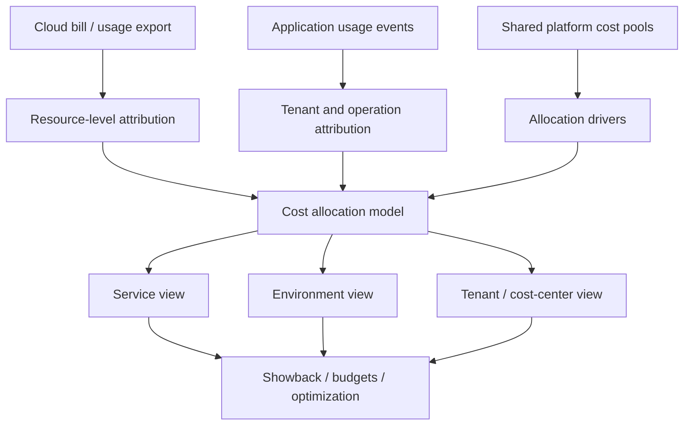
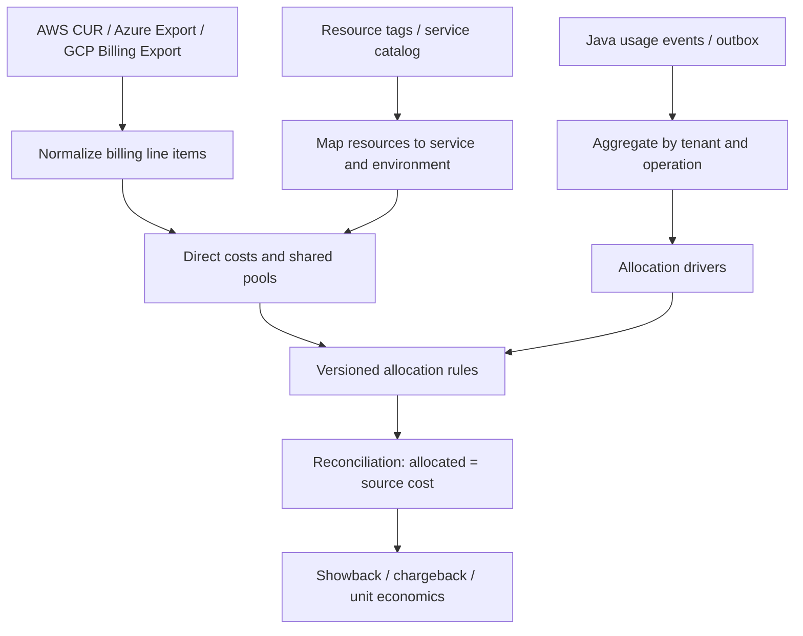

# Cost Allocation by Service, Environment, and Tenant

Serverless spares development teams from managing persistent servers, yet that does not make costs automatically transparent. A Java function can generate charges in many places: requests and compute duration, memory/CPU, provisioned or minimum instances, API gateways, queues/event buses, databases, object storage, network egress, NAT, logs, metrics, traces, and artifact builds. When multiple services or tenants share these resources, the cloud bill usually does not tell you how much each tenant consumed.

**Cost allocation** is the process of attributing cloud costs to the responsible service, environment, team, cost center, or tenant. The goal is knowing where costs arise, who uses the resources, which business units drive spend, and whether allocation is fair and consistent. Cost allocation is the foundation for showback, chargeback, budgeting, and unit economics optimization.

This lesson focuses on designing cost allocation for serverless Java across three core dimensions: **service**, **environment**, and **tenant**. It covers distinguishing direct costs from shared costs, resource tags/labels from application usage metering, AWS/Azure/Google Cloud billing exports, building allocation drivers, and controlling unallocated spend.

## 1. Why Allocate Costs?

A consolidated cloud invoice only tells you how much the organization spent overall. To manage products effectively, you also need to answer:

- Which service drives most of the spend?
- How much do production and non-production consume?
- Which team or cost center is accountable?
- Which tenants consume heavy compute, storage, requests, or network?
- Did costs rise due to traffic, retries, cold starts, log volume, or configuration changes?
- What is the cost-to-serve of one order, transaction, or workflow?
- Which driver should split shared resources?

For example, three Java functions may share one serverless database, one API gateway, and one logging workspace. The invoice can separate some charges by resource/function, yet it cannot automatically attribute exact database capacity or log ingestion to each function. If those functions serve multiple tenants, the cloud provider does not necessarily know tenant IDs at the billing layer either.

Cost allocation turns aggregate spend into actionable intelligence. Service-owning teams can optimize code/configs; platform teams can optimize shared infrastructure; product teams can refine tenant pricing or quotas.

## 2. Three Foundational Allocation Dimensions

### By Service

A service is a business or technical unit with a clear owner and purpose, such as `orders-api`, `invoice-worker`, `notification-service`, or `reporting-job`. One service may comprise multiple functions, queues, databases, buckets, and dashboards.

### By Environment

Environments distinguish where workloads run:

- `production`: serves live customer traffic.
- `staging`: pre-production verification.
- `development`: active development and integration.
- `test` or `qa`: automated/manual testing.
- `sandbox`: experimentation or proofs of concept.

Environment tracking exposes non-production spend, forgotten resources, continuously running tests, and oversized staging configs.

### By Tenant

A tenant is a customer, organization, or unit sharing a multi-tenant service. Tenant costs can span requests, compute, storage, database operations, networking, events, and dedicated resources. Tenant allocation usually requires application-level metering because cloud billing does not see which business tenant sits inside a shared invocation.



Not every cost can be attributed directly across all three dimensions. Clearly indicate precision levels: direct attribution, measured usage, estimated allocation, or unallocated.

## 3. Designing a Consistent Taxonomy and Tag Schema

Before enabling billing exports, the organization must standardize how services, environments, owners, and cost centers are named. If each team invents its own tags, reports fragment across synonymous values like `prod`, `production`, `prd`, or `live`.

A baseline taxonomy:

| Standardized Key | Meaning | Example |
| --- | --- | --- |
| `service` | Accountable service name | `orders-api` |
| `environment` | Runtime environment | `production` |
| `team` | Owning engineering team | `commerce-platform` |
| `owner` | Contact alias or group | `team-orders` |
| `cost_center` | Accounting/cost center code | `CC-042` |
| `product` | Product or business domain | `commerce` |
| `criticality` | Criticality tier | `tier-1` |
| `data_classification` | Data sensitivity class | `confidential` |
| `managed_by` | Resource management tool | `terraform` |

The keys above are examples. Choose a small key set with owners, allowed-value rules, and a change process. Standardize on lowercase and hyphens/underscores when supporting multiple clouds; note that each provider enforces its own tag/label rules.

### Tags Are Not Arbitrary Metadata

A tag is only useful if:

- It has a clear definition and an accountable owner.
- Values come from an allowed set or pass automated validation.
- It is applied at resource creation time rather than relying on operators to add it later.
- Child resources inherit or receive propagated tags cleanly.
- It feeds into billing exports or cost reports.
- Tag coverage is checked and untagged resources trigger alerts.

Never put emails, personal names, tokens, customer names, or PII into tags. Tags surface in billing exports, inventories, and internal tools; treat them as widely visible metadata.

## 4. Resource Tags and Tenant Metadata Are Two Different Things

Resource tags/labels describe cloud resources. A Lambda function may carry `service=orders-api`, `environment=production`; a Cloud Run service carries similar labels. Yet if a single function serves 10,000 tenants, the function's tag cannot carry each individual request's tenant ID.

Distinguish:

| Metadata | Attached Where? | Used For |
| --- | --- | --- |
| Resource tag/label | Function, service, database, bucket, queue, gateway | Allocating costs at resource/service/environment/team level |
| Deployment metadata | Release, revision, alias, IaC stack | Comparing costs across versions and deployments |
| Application usage event | Invocations/operations/tenants at application layer | Allocating usage to tenants and business operations |
| Billing line item | Provider billing export | Actual costs/discounts/credits by resource, SKU, project/account, and time |

Do not provision a separate cloud resource per tenant solely to attach tags when the architecture does not need that isolation. That inflates resource counts, deployment complexity, and operational overhead. For shared functions, meter usage at the application layer and allocate compute/shared costs via drivers.

## 5. Serverless Costs Have Multiple Components

Do not treat Lambda/Functions/Cloud Run compute as the entire cost of a service. One request can traverse many services:

| Component | Common Cost Drivers |
| --- | --- |
| Function compute | Request/invocation counts, duration, memory/CPU, architecture |
| Provisioned/minimum capacity | Duration keeping execution environments/instances ready |
| API gateway/ingress | Request counts, payload size, data processing, tier/features |
| Queue/topic/event bus | Request/operation counts, payload size, delivery/fan-out, retention |
| Database | Compute capacity, request units/operations, storage, I/O, backups, replication |
| Object storage | GB-months, PUT/GET/LIST, retrieval, replication, lifecycle, and egress |
| Network | Internet egress, inter-region/inter-zone transfer, NAT gateway, private connectivity |
| Observability | Log ingestion/retention, metrics, traces, queries/analytics |
| Build/release | CI minutes, build workers, artifact registries, image storage, and vulnerability scans |
| Security/shared platform | KMS/key operations, secret access, policy scanning, shared gateways |

A service with few invocations that keeps provisioned capacity, databases, or NAT gateways running continuously can still incur heavy baseline costs. Conversely, a function with many short invocations and few dependencies can cost far less.

### Direct and Indirect Costs

- **Direct cost:** cleanly attributable to a service/resource/environment, such as a service's own Lambda function or bucket.
- **Shared/indirect cost:** shared across multiple services, such as NAT gateways, shared databases, logging workspaces, shared API gateways, monitoring platforms, or network transit.
- **Unallocated cost:** lacks sufficiently reliable metadata/usage to allocate.

Keeping an intentional `unallocated` bucket is better than forcing arbitrary splits that create false precision.

## 6. Direct Attribution and Shared Cost Allocation

### Direct Attribution

When a resource serves only one service/environment, assign 100% of its cost to that service. Examples:

- A function belonging strictly to `invoice-worker`.
- A dedicated bucket for `invoice-worker`.
- A dedicated database instance for a production service.
- A dedicated queue for `notification-service`.

This is the easiest method to audit and typically the most accurate when resource tags/billing data are complete.

### Shared Cost Allocation

When a resource serves multiple services, choose an allocation driver reflecting actual usage. Common drivers:

| Shared Resource | Potential Drivers |
| --- | --- |
| Shared API gateway | Request counts, request sizes, or weighted route units |
| Shared database | Query/transaction counts, DB CPU time, I/O, storage, or connection time |
| Shared object storage | Byte-hours, object counts, operation counts, and egress bytes |
| Shared log workspace | Ingested bytes by service/source or log category |
| Shared NAT/network | Bytes transferred by workload/route where measurable |
| Shared queue/event bus | Published/delivered message counts, payload bytes, fan-out |
| Shared monitoring platform | Metrics/traces/log volume or agreed fixed shares |

Not every driver is directly measurable. When only request count is available, use it as a proxy and document the assumption explicitly. Heavy requests or large payloads consume more than simple requests.

### Shared Cost Allocation Formula

Given a shared cost pool (C_s), service (i)'s usage driver (u_i), and total usage Σu:

\[
\text{AllocatedCost}_i = C_s \times \frac{u_i}{\sum_j u_j}
\]

For example, a shared log workspace costs 12,000 USD/month. Three services ingest 60,000, 30,000, and 10,000 GB respectively:

| Service | Usage | Share | Allocated Cost |
| --- | ---: | ---: | ---: |
| `orders-api` | 60,000 GB | 60% | 7,200 USD |
| `invoice-worker` | 30,000 GB | 30% | 3,600 USD |
| `notification-service` | 10,000 GB | 10% | 1,200 USD |
| **Total** | **100,000 GB** | **100%** | **12,000 USD** |

Allocated amounts must sum back to the shared pool before rolling up into total costs. Never count the full shared pool under the platform team and also add allocated shares to services, or you double-count.

## 7. Allocation by Service

Service is the primary dimension showing teams the cost-to-serve of a capability. To allocate accurately:

1. Define service boundaries: which functions, queues, databases, and buckets belong.
2. Apply `service` tags/labels to directly taggable resources.
3. Apply `team`, `owner`, and `cost_center` for accountability.
4. Group shared resources into dedicated pools and select allocation drivers.
5. Link billing resource IDs to a service catalog/IaC stack.
6. Route unmapped resources to `unallocated` and remediate within a deadline.

One service often spans many cloud resources, so never rely solely on function names. For instance, `orders-api` may include API Gateway, Lambda, DynamoDB, SQS, S3, CloudWatch Logs, and KMS. Service reporting must sum all related components plus driver-allocated shares of shared gateways/logs/networking.

### Service Catalog Mapping

Maintain a mapping table linking cloud resources to services:

| Resource ID | Resource Type | Service | Environment | Owner | Allocation Type |
| --- | --- | --- | --- | --- | --- |
| `function/orders-prod` | Function | `orders-api` | production | `team-orders` | Direct |
| `queue/orders-events` | Queue | `orders-api` | production | `team-orders` | Direct |
| `db/shared-prod` | Database | `platform-data` | production | `team-data` | Shared pool |
| `logs/prod-workspace` | Log workspace | `platform-observability` | production | `team-platform` | Shared pool |

Mappings must be versioned because resources can be renamed, moved across accounts/projects, or replaced. Use immutable resource IDs/ARNs/full names rather than unstable display names.

## 8. Allocation by Environment

Environment tracking separates customer-serving spend from development, testing, and experimentation spend. This dimension helps catch:

- Staging sized like production despite tiny traffic.
- Dev functions or databases not scaling to zero when idle.
- CI integration tests leaving behind temporary queues, log groups, buckets, or databases.
- Preview environments lacking TTLs and left orphaned.
- Load tests running too long or generating huge datasets.
- Excessively long non-production log retention.

### Environment Rules

- Enforce fixed allowed values such as `production`, `staging`, `development`, `test`, `sandbox`.
- Apply tags/labels automatically via IaC/deployment pipelines.
- Separate production into dedicated accounts/subscriptions/projects when governance models allow.
- Set dedicated budgets for non-production.
- Auto-clean preview resources by TTL/owner.
- Use scheduled scale-down or scale-to-zero for environments that do not need 24/7 uptime.
- Set shorter retention for logs/test data where policies permit.
- Never use environment tags as a substitute for data/security classification.

### Comparing Costs Across Environments

Compare staging against production relative to traffic/throughput, not just total USD. If production processes 1 million orders for 1,000 USD while staging processes 10,000 orders for 200 USD, staging's cost per order is far higher. That can be normal due to minimum capacity or fixed infrastructure; separate fixed costs from variable costs.

## 9. Allocation by Tenant in Multi-Tenant Architectures

A single Java function can receive requests from multiple tenants within the same execution environment. Cloud billing providers usually see only resources/functions and aggregate usage, without knowing which tenant ID triggered a request. Therefore, tenant cost allocation requires application-level metering.

Principles:

- Derive the tenant from the authenticated principal; never trust an arbitrary `tenantId` in the request body.
- Meter usage at the business operation or handler boundary.
- Record service, environment, tenant, operation, quantity, unit, and timestamp.
- Never put PII or credentials in metering events.
- Emit metering events durably or aggregate periodically so you do not break the request path.
- Keep unit definitions identical across billing, product analytics, and quotas.
- Separate tenant-dedicated resource costs from shared costs.

### Illustrative Metering Event

```json
{
  "eventId": "usage-01JQ...",
  "occurredAt": "2026-11-17T10:15:30Z",
  "service": "orders-api",
  "environment": "production",
  "tenantId": "tenant-4821",
  "operation": "create-order",
  "quantity": 1,
  "unit": "order",
  "requestClass": "standard",
  "region": "ap-southeast-1"
}
```

This is a usage event, not a cloud billing line item. It must be joined with billing periods and allocation models to derive costs. `tenantId` should be an internal identifier containing no company name or personal info.

### Do Not Create Metric Time Series for Every Tenant

Tenant IDs have high cardinality. Adding tenant ID as a label/tag on every metric explodes time series counts and drives up observability bills. Instead:

- Use usage events/tables or a data warehouse for tenant-level analytics.
- Aggregate by tenant/time/operation in batch.
- Keep real-time metrics on low-cardinality labels such as service, environment, operation class, and outcome.
- Reserve tenant-level metrics only for small tenant sets or systems with strict cardinality controls.
- Sample logs/traces per policy and avoid logging sensitive payloads.

## 10. Selecting Allocation Drivers for Tenants

No single driver fits every workload. Choose drivers closely tied to the resources tenants consume:

| Workload/Cost | Suggested Driver | Limitations |
| --- | --- | --- |
| HTTP API | Request count by route/operation | Simple requests and heavy requests do not cost the same |
| Java function compute | Invocation duration × allocated memory/CPU, or measured CPU time | Shared/batched invocations must split usage across tenants |
| Queue worker | Records processed, payload bytes, or processing time | Individual records can vary widely in complexity |
| Database | Query count/weighted query units, rows/bytes, CPU/IO if measurable | Raw query count does not reflect query cost |
| Object storage | Byte-hours, object count, PUT/GET, and egress bytes | One object may be shared by multiple tenants |
| Network | Egress bytes by tenant/operation | Hard to measure accurately when traffic is multiplexed or traverses shared NAT |
| Logs/traces | Ingested bytes or event volume by service/tenant class | Do not attach tenant IDs to every log label |
| Workflow | Step count, execution time, or weighted task units | Steps carry different costs |

### Weighted Usage Units

When operations vary in cost, define weighted units:

- `read-small` = 1 unit.
- `create-order` = 3 units.
- `generate-report` = 20 units.
- `bulk-export` = 50 units.

Weights must be calibrated from measured resource consumption or cost models rather than guesswork. If used for customer billing, publish/define them clearly in contracts and review with legal/finance.

### Compute Allocation for Multi-Tenant Invocations

If each invocation serves one tenant, duration and memory map directly to that tenant. If one invocation processes a batch spanning multiple tenants, allocate by:

- Processing time measured per record/tenant.
- CPU time or weighted processing units.
- Payload bytes/record count when workloads are relatively uniform.
- A validated composite driver.

Do not split invocation costs evenly across every tenant in a batch if records vary dramatically in size or complexity. When exact metering is unavailable, mark the result clearly as an estimate.

## 11. Allocating Shared Costs to Tenants

After attributing direct costs, tenants still rely on shared resources like gateways, database clusters, logging, support, and control planes.

A general formula:

\[
\text{TenantCost}_t = \text{DirectCost}_t + \sum_k \left(C_k \times \frac{u_{t,k}}{\sum_j u_{j,k}}\right)
\]

Where:

- `DirectCost_t` is the cost of resources dedicated to tenant t.
- `C_k` is the k-th shared cost pool.
- `u_{t,k}` is tenant t's usage driver for pool k.

For example, tenant A uses 5,000 query units out of 10,000 total query units on a shared database costing 2,000 USD. Tenant A receives 1,000 USD of the database pool. If tenant A also has a dedicated bucket costing 150 USD, total allocated cost is 1,150 USD before other pools.

### When the Usage Driver Is Zero

If a tenant has zero usage during a period yet retains dedicated resources, fixed costs still arise. Distinguish between:

- Dedicated resource reservations/minimum capacity: tenant bears the fixed contractual cost.
- Shared platform baseline: allocate across active tenants, subscription tiers, or via a fixed rule.
- Usage-based costs: allocate only when measurable usage occurs.

Do not divide a shared pool across tenants with zero usage using a usage-proportion formula. Route unallocated baseline pools to fixed allocations or a platform cost center per published policy.

## 12. Showback and Chargeback

**Showback** provides cost reports to services/teams/tenants so they see consumption, without necessarily transferring charges into their budgets/accounting.

**Chargeback** formally allocates costs into cost centers, business units, or tenant invoices. Chargeback demands clear definitions, high accuracy, close windows, credit/discount/tax handling, and formal dispute processes.

| Aspect | Showback | Chargeback |
| --- | --- | --- |
| Goal | Transparency and behavior change | Formal financial accountability |
| Precision | Can use annotated estimates | Requires strict controls/reconciliation |
| Shared costs | Can display separate pools | Requires approved allocation rules |
| Model changes | Open to experimentation | Requires versioning, effective dates, and approvals |
| Audience | Teams/service owners | Cost centers, finance, customer billing |

Start with showback, measure coverage, and validate drivers before using figures for chargeback. When billing tenants by usage, ensure metering events are reliable, auditable, deduplicated, and governed for late arrivals.

## 13. AWS: Cost Allocation Tags and Billing Exports

AWS provides resource tags and cost allocation tags to group spend. General workflow:

1. Apply tags such as `service`, `environment`, `team`, `cost_center` to supported resources.
2. Activate user-defined cost allocation tags in Billing and Cost Management.
3. Wait for tag data to propagate through the billing pipeline.
4. Use Cost Explorer, Cost and Usage Reports (CUR), or AWS Data Exports to group costs.
5. Use Cost Categories to organize accounts, tags, or charge types into internal structures.
6. Match resource IDs/usage types against your service catalog and allocation model.

Having a tag on a resource does not automatically make it appear in cost reports immediately. Tags must be activated in the billing console, and you must verify whether each resource/usage type supports tag allocation. Tags do not apply retroactively to all past spend, and billing data has latency.

### Lambda and Related Costs

For Lambda, inspect line items for invocations/requests, duration/compute, architecture, provisioned concurrency, and enabled features. Beyond Lambda itself, a service can generate charges in API Gateway, SQS, SNS, EventBridge, DynamoDB, S3, CloudWatch Logs, X-Ray, NAT, and data transfer.

Resource tags on Lambda identify which service/environment owns a function. However, shared databases, API gateways, or log groups need separate tags/mappings or belong in shared pools. Tenant-level costs still require application metering when functions serve multiple tenants.

### Cost Explorer and CUR/Data Exports

- Cost Explorer works well for fast analysis by service, linked account, region, usage type, and activated tags.
- CUR/Data Exports deliver granular data into S3 for analysis with Athena or a data warehouse.
- Cost Categories group multiple accounts/tags into business categories.
- Resource-level detail may need explicit enablement and carries data-type conditions/limits.

Pick your cost basis explicitly: unblended, amortized, or net amortized depending on the question. Reservations/Savings Plans/discounts/credits make costs look different. Showback reports must standardize on one basis rather than mixing bases within a period.

## 14. Azure: Resource Tags, Cost Management, and Exports

Azure supports tags across many resources, resource groups, and subscriptions. Cost Management analyzes spend by subscription, resource group, resource, service, meter, and tag where supported by underlying data.

General workflow:

1. Define a tag schema: `service`, `environment`, `team`, `cost_center`.
2. Enforce tags in Bicep/ARM/Terraform or deployment pipelines.
3. Use Azure Policy to audit/deny untagged resources per organizational policy.
4. Enable Cost Management exports to store scheduled cost/usage data.
5. Analyze exports in Storage/Power BI/data warehouses.
6. Verify tag inheritance if enabled by the organization; never assume every resource or charge type inherits tags identically.

### Azure Functions and Related Costs

Azure Functions spend depends on hosting plan and usage: Consumption, Flex Consumption, Premium, and Dedicated bill differently. Beyond function executions, include App Service plans/minimum instances, Storage accounts, Application Insights/Log Analytics, API Management, Service Bus/Event Hubs, databases, networking, and egress.

One Function App can host multiple functions sharing a plan and telemetry resources. When billing line items arrive at the plan/resource-group level, allocate using execution counts, execution duration, memory/CPU usage, or app-level usage events. Never split plan costs evenly across functions if loads differ.

### Cost Allocation Rules

Azure Cost Management supports rule-based allocation for certain shared costs across eligible scopes. Verify availability, scope, and billing agreement compatibility for your tenant/subscription. If unsupported or custom drivers are needed, run allocation in your data warehouse and retain both raw and allocated costs for auditing.

## 15. Google Cloud: Labels, Billing Exports, and Cost Allocation

Google Cloud uses labels to categorize many resources; Resource Manager tags serve governance/policy roles distinct from labels. Labels are generally effective for cost reporting on supported resources, though not every SKU/charge or resource carries full labels.

Workflow:

1. Standardize lowercase label keys/values, such as `service=orders-api`, `environment=production`.
2. Attach labels via Terraform/gcloud/deployment pipelines on supported resources.
3. Enable Cloud Billing export to BigQuery (standard or detailed usage cost export as appropriate).
4. Inspect fields for project, service/SKU, resource, labels, system labels, cost, credits, and usage.
5. Use BigQuery/Looker Studio or FinOps tooling to group by labels.
6. Route unlabeled spend and shared resources into unallocated/shared pools.

### Cloud Run/Functions and Related Costs

Cloud Run incurs charges by requests, CPU/memory allocation, and instance time per billing/instance configuration; minimum instances or instance-based billing create baseline costs. Different Cloud Functions generations use different pricing models and metrics. Beyond compute, account for API Gateway/Load Balancing, Pub/Sub/Eventarc, Cloud SQL/Firestore, Cloud Storage, Cloud Logging/Monitoring, Artifact Registry, Cloud Build, VPC connectors/NAT, and egress.

Cloud Billing exports enable slicing by project, service, SKU, and labels where supported. Shared VPCs or log buckets may lack tenant labels; use mappings/usage metering to allocate them.

### BigQuery Query Example

Billing export schemas can vary by export type and version. The example below merely illustrates grouping by labels; adjust dataset/table names and fields to match your actual schema:

```sql
SELECT
  service.description AS cloud_service,
  sku.description AS sku,
  (SELECT value FROM UNNEST(labels) WHERE key = 'service') AS service_tag,
  (SELECT value FROM UNNEST(labels) WHERE key = 'environment') AS environment,
  SUM(cost) AS gross_cost
FROM `billing_project.billing_dataset.gcp_billing_export_v1_*`
WHERE usage_start_time >= TIMESTAMP('2026-11-01')
  AND usage_start_time < TIMESTAMP('2026-12-01')
GROUP BY cloud_service, sku, service_tag, environment
ORDER BY gross_cost DESC;
```

When using detailed exports or handling credits, process credits/adjustments consistently with your chosen cost basis. Do not treat `SUM(cost)` in this example as net payable invoice amount before accounting for credits, taxes, adjustments, and billing account rules.

## 16. Building Application-Level Usage Metering in Java

Billing exports provide actual costs by resource/SKU. Application metering provides usage by tenant/operation. Both join inside a data warehouse or allocation service.

A Java service can emit a usage event once an operation completes:

```java
public record UsageEvent(
        String eventId,
        String service,
        String environment,
        String tenantId,
        String operation,
        long quantity,
        String unit,
        java.time.Instant occurredAt
) {}

public interface UsageEventPublisher {
    void publish(UsageEvent event);
}

public final class UsageMeter {
    private final UsageEventPublisher publisher;

    public UsageMeter(UsageEventPublisher publisher) {
        this.publisher = publisher;
    }

    public void recordOrderCreated(
            String authenticatedTenantId,
            String environment
    ) {
        var event = new UsageEvent(
                java.util.UUID.randomUUID().toString(),
                "orders-api",
                environment,
                authenticatedTenantId,
                "create-order",
                1,
                "order",
                java.time.Instant.now());
        publisher.publish(event);
    }
}
```

This is a simple example. In production, telemetry failures must never fail business transactions or double-record usage. Write usage events to a transactional outbox in the same transaction as business state changes, then relay asynchronously. Events require unique IDs, schema versions, authenticated tenant identities, and retry/deduplication support.

### Do Not Meter Usage with Free-Text Log Messages

Free-text logs are hard to aggregate, prone to format drift, and can leak PII. Use versioned event schemas with standardized fields. Logs serve diagnostics; metering events serve usage/cost accounting. Both streams can share a broker while maintaining appropriate retention, access controls, and schema governance.

## 17. Linking Billing Data and Usage Metering

A cost allocation pipeline can include:

1. Exporting billing line items from the cloud provider daily/hourly.
2. Ingesting application usage events from functions/workers.
3. Normalizing resource IDs, services, environments, regions, currencies, and timestamps.
4. Mapping billing resources to the service catalog.
5. Separating direct costs from shared pools.
6. Computing tenant usage drivers over the matching billing period.
7. Applying versioned allocation rules.
8. Reconciling total allocated cost against billing cost.
9. Publishing service/environment/tenant reports.
10. Snapshotting rules and data so prior-period reports are reproducible.



Billing exports carry reporting latency and can be restated by credits/refunds/taxes or late usage. Never treat today's numbers as the final invoice. Define close windows, late-adjustment policies, and procedures for reopening periods when source data shifts.

## 18. Unit Economics: Cost per Business Unit

Total spend shows spending scale; unit economics shows efficiency. Examples:

\[
\text{Cost per order} = \frac{\text{Total allocated orders-service cost}}{\text{Successful orders}}
\]

\[
\text{Cost per 1,000 invocations} = \frac{\text{Function cost}}{\text{Invocations}} \times 1.000
\]

\[
\text{Cost per active tenant} = \frac{\text{Tenant-attributed cost}}{\text{Active tenants in period}}
\]

Denominators must be clearly defined. `Successful orders` differs from `orders received`; invocation retries raise compute without raising completed orders. A batch function may process 100 records per invocation, so cost per invocation does not reflect cost per record.

### Unit Economics Example

Suppose `orders-api` has 3,000 USD/month in allocated cost and completes 150,000 orders:

\[
\text{Cost per order} = \frac{3.000}{150.000} = 0,02\text{ USD}
\]

If next month costs rise to 3,600 USD while orders rise to 240,000:

\[
\frac{3.600}{240.000} = 0,015\text{ USD/order}
\]

Total spend rose 20%, yet cost per order fell 25%. Read total spend and unit cost together; rising total spend can reflect efficient scaling.

## 19. Costs of Retries, Fan-Out, and Non-Value Traffic

Serverless can bill per invocation or per processing unit. Retries, duplicate events, polling, webhook redeliveries, and fan-out can generate costs without producing business outcomes.

Track:

- Invocation attempts vs. unique business requests/events.
- Retry counts by error class.
- Duplicate message/event rates.
- Batch partial failures and retried record counts.
- Event fan-out delivery counts.
- Queue poll/receive operations and empty polls, if billed.
- DLQ/redrive volumes.
- Function duration caused by downstream timeouts.

Cost attribution should separate necessary usage from waste caused by retry storms, duplicates, or bugs. Do not automatically bill tenants for retries caused by platform/provider faults; chargeback rules must be fair and transparent.

## 20. Shared Infrastructure and Baseline Costs

Certain resources incur costs even during low traffic:

- Provisioned concurrency or minimum instances.
- Dedicated/Premium hosting plans or minimum database capacity.
- NAT gateways, private endpoints, or network appliances.
- Shared databases, cache clusters, and message brokers.
- Log workspaces/monitoring retention.
- Backup storage and cross-region replication.
- Shared API gateways/load balancers.

Splitting these purely by usage can be unfair when part of the capacity is reserved for availability. Split pools into:

1. **Baseline platform cost:** split by fixed share, active services, or tenant tiers.
2. **Variable usage cost:** split by measured requests/bytes/compute/IO.
3. **Dedicated capacity cost:** assign directly to the requesting service/tenant.
4. **Unallocated investment:** hold in a platform/product cost center until a suitable driver exists.

Do not force all shared costs through a single request-count ratio. Drivers should match cost causation.

## 21. Cost Allocation for Non-Production Environments

Non-production environments require dedicated governance:

- Attach owners and TTLs to preview/test environments.
- Auto-scale to zero or stop resources off-hours where supported by the service.
- Use smaller databases and synthetic/masked datasets.
- Configure shorter log retention and lower sampling per policy.
- Avoid provisioned/minimum capacity unless testing cold starts.
- Auto-delete temporary queues, buckets, image tags, and test resources post-run.
- Set separate budgets and alerts for dev/staging/sandbox.
- Isolate load-testing spend from routine operational spend.

Do not downsize staging so far that it stops representing production when the goal is performance/capacity testing. Categorize test environments by purpose and document when staging intentionally mirrors production sizing.

## 22. Budgets, Forecasts, and Cost Anomalies

Once costs are allocated, set budgets by service/environment/team or cost center. Budgets can include:

- Total monthly budget.
- Separate production and non-production budgets.
- Shared platform budget.
- Project/tenant-tier budgets where contracts exist.
- Unit cost targets such as cost per order or cost per 1,000 invocations.

Cost anomaly detection spots abnormal shifts relative to baselines—such as 5x log ingestion jumps, retry storms, egress surges, or unexpectedly enabled provisioned capacity.

### Alert Thresholds

A workflow might use:

- 50% budget: notify owner.
- 80% budget: alert team and check forecast.
- 100% budget: escalate per policy.
- Anomaly exceeding absolute/percentage delta: open incident or ticket.

These thresholds are examples. For critical services, never auto-disable functions on budget breach if doing so disrupts business or loses data. Budget alerts are governance signals; responses must follow runbooks and business priorities.

## 23. Governance: Tag Coverage and Unallocated Spend

An allocation report is only trustworthy when most spend is accurately mapped. Track:

- Percentage of spend carrying a service tag/label.
- Percentage of spend carrying an environment.
- Percentage of spend carrying an owner/cost center.
- Share of shared pools covered by an allocation driver.
- Unallocated spend broken down by cloud service/SKU.
- Resources missing owners or absent from the service catalog.
- Percentage of usage events missing tenant/service/environment.
- Variance between billing totals and allocated totals.

Governance targets might aim for 95% of direct spend mapped to service/environment and 100% of shared pools assigned a rule or owner. Tailor targets to maturity; never slap fake tags onto resources just to hit coverage numbers.

### Tag Enforcement

Validate tags in IaC/CI pre-deploy and use cloud policies to audit/deny untagged resources. Provide exceptions for resources/providers that do not support tags, along with a process for un-taggable charges. Do not block all production deployments because a provider-managed resource lacks tag support; use a mapping table instead.

## 24. Data Quality and Reconciliation

Billing exports and application metering come from separate systems. Reconcile:

- Billing totals by invoice/cost basis.
- Direct costs mapped to service/environment.
- Shared pools before and after allocation.
- Allocated costs by tenant.
- Unallocated costs.
- Credit/refund/tax/discount/commitment adjustments.
- Late-arriving usage events and duplicate events.

A basic check:

\[
\text{Source cloud cost} = \text{Direct allocated} + \text{Shared allocated} + \text{Unallocated} + \text{Adjustments}
\]

Define buckets so nothing is double-counted. Once a shared pool is 100% allocated out, never add that pool again to another service. For discounts/credits, decide whether to allocate gross usage or net cost and apply that rule consistently.

### Late Data and Accounting Periods

Billing exports can update after usage occurs. Application usage events can also arrive late due to retries or offline buffering. Maintain:

- Event IDs and deduplication.
- Event timestamps and ingestion timestamps.
- Billing periods and allocation rule versions.
- Close windows (e.g., waiting a few days after month-end).
- Rules for handling adjustments after a period closes.
- Snapshots of finalized reports for auditability.

Never overwrite prior-month reports without preserving change history. When adjusting, record the reason, source, and approver.

## 25. Security and Privacy in Tenant Metering

Tenant usage data can reveal product adoption, behavior, and business scale. Ensure you:

- Use internal/pseudonymous tenant IDs instead of company names or emails.
- Keep payloads, request bodies, and credentials out of usage events.
- Restrict access to tenant cost reports by tenant/finance roles.
- Separate metering data from public logs or broad-audience dashboards.
- Encrypt usage stores and billing warehouses.
- Audit queries/exports of tenant-level data.
- Define retention and deletion policies.
- Expose another tenant's costs only with valid purpose and authorization.

When metering feeds customer billing, protect data integrity: unique event IDs, authenticated sources, outbox/retries, deduplication, auditing, and reconciliation against usage summaries.

## 26. Data Warehouse Allocation Model Example

A data warehouse can maintain three logical tables:

| Table | Contents |
| --- | --- |
| `cloud_cost_line_items` | Raw billing line items, resources, SKUs, costs, credits, usage, and tags/labels |
| `application_usage` | Service/environment/tenant/operation, quantities, units, and event times |
| `allocation_rules` | Pools, drivers, scopes, effective dates, versions, and owners |

From these, generate an `allocated_cost` output table with dimensions `billing_period`, `service`, `environment`, `tenant`, `cost_category`, `allocation_type`, and `rule_version`.

Pseudo-SQL example allocating a shared pool by usage units:

```sql
WITH tenant_usage AS (
  SELECT
    service,
    environment,
    tenant_id,
    SUM(weighted_units) AS units
  FROM application_usage
  WHERE event_date >= DATE '2026-11-01'
    AND event_date < DATE '2026-12-01'
  GROUP BY service, environment, tenant_id
),
usage_totals AS (
  SELECT
    service,
    environment,
    SUM(units) AS total_units
  FROM tenant_usage
  GROUP BY service, environment
)
SELECT
  u.service,
  u.environment,
  u.tenant_id,
  p.shared_cost * SAFE_DIVIDE(u.units, t.total_units) AS allocated_cost
FROM tenant_usage u
JOIN usage_totals t
  USING (service, environment)
JOIN shared_cost_pools p
  USING (service, environment);
```

This is an illustrative example; add currency, cost category, zero-usage policy, effective dates, credits, direct costs, and rule versions. When a pool spans multiple services, aggregate across the pool's entire scope before allocating. Grouping by the wrong scope can cause total allocated cost to exceed the shared pool.

## 27. End-to-End Example: Allocating Costs Across Three Tenants

Suppose production `orders-api` costs 6,000 USD/month in total:

- Direct function/API: 2,400 USD.
- Database shared pool: 2,000 USD.
- Logs/monitoring shared pool: 600 USD.
- Network/shared gateway pool: 1,000 USD.

Monthly usage drivers:

| Tenant | Order Units | DB Query Units | Log GB | Network GB |
| --- | ---: | ---: | ---: | ---: |
| A | 5,000 | 5,000 | 300 | 500 |
| B | 3,000 | 3,000 | 200 | 300 |
| C | 2,000 | 2,000 | 100 | 200 |
| **Total** | **10,000** | **10,000** | **600** | **1,000** |

Splitting direct function/API costs by order units, DB by query units, logs by GB, and network by GB:

| Tenant | Direct 2,400 | DB 2,000 | Logs 600 | Network 1,000 | Total |
| --- | ---: | ---: | ---: | ---: | ---: |
| A | 1,200 | 1,000 | 300 | 500 | 3,000 USD |
| B | 720 | 600 | 200 | 300 | 1,820 USD |
| C | 480 | 400 | 100 | 200 | 1,180 USD |
| **Total** | **2,400** | **2,000** | **600** | **1,000** | **6,000 USD** |

This model assumes each driver represents its pool well enough. If tenant A submits very heavy orders, raw order count understates cost; weighted units or measured duration are needed. Reports must state assumptions and allow versioned rule updates in future periods.

## 28. Distinguishing Cost Allocation and Pricing

Cost allocation tells you internal cost or cost-to-serve per tenant. Pricing determines what you charge customers. The two concepts relate, yet are distinct:

- Cost allocation may distribute shared infrastructure using accounting drivers.
- Pricing may rely on subscription plans, tiers, minimum commitments, or usage units.
- Margins must also cover support, sales, taxes, discounts, payment fees, and non-cloud overhead.
- A high-cost tenant does not automatically pay more if under a fixed subscription contract.

When metering drives customer billing, obtain product/legal/finance approval, clear unit definitions, rounding rules, dispute handling, and audit trails. Never treat an unverified internal allocation estimate as invoice truth.

## 29. FinOps Workflow for Serverless Java

A cost governance cycle can run monthly or per sprint:

1. **Plan:** set budgets, unit economics targets, and owners by service/environment.
2. **Tag:** apply resource tags/labels via IaC and verify coverage.
3. **Measure:** ingest billing exports and application usage metering.
4. **Allocate:** separate direct/shared/unallocated and apply versioned rules.
5. **Reconcile:** match allocated totals against billing sources and handle late adjustments.
6. **Report:** deliver showback to teams/services/tenants per access controls.
7. **Explain:** analyze variances across traffic, duration, retries, storage, networking, logs, and capacity.
8. **Optimize:** trim waste and tune memory/concurrency, batching, retention, min instances, and architecture.
9. **Govern:** update taxonomies, budgets, policies, and owners.
10. **Learn:** re-measure cost per business unit post-optimization.

## 30. Common Mistakes

1. **Allocating only function compute.** Misses gateways, queues, databases, logs, NAT, and egress.
2. **Assuming resource tags automatically allocate to tenants.** Shared functions carry no tenant dimension in cloud billing.
3. **Using tenant ID as a label on every metric.** Cardinality and telemetry costs can surge sharply.
4. **Using one request-count driver for every shared pool.** Databases, logs, and networks have different cost drivers.
5. **Splitting shared costs evenly across all services.** Ignores usage and creates perverse incentives.
6. **Having no unallocated bucket.** Reports look 100% covered while hiding bad mappings.
7. **Double-counting shared costs.** Counting both the original pool and the allocated shares.
8. **Mixing gross, net, amortized, and invoice costs.** Reports fail reconciliation.
9. **Ignoring retries/duplicates/fan-out.** Traffic generating zero business outcomes still burns money.
10. **Failing to separate fixed costs from variable costs.** Unit costs look distorted when traffic shifts.
11. **Treating showback estimates as invoices.** Chargeback demands stricter data, rules, and governance.
12. **Tagging with PII or customer names.** Metadata leaks into billing exports and internal tools.
13. **Not versioning allocation rules.** Prior-month reports cannot be reproduced once drivers change.
14. **Ignoring late billing/usage data.** Unfinalized monthly numbers get mistaken for final.
15. **Assigning no owner to shared resources.** Nobody owns rising baseline spend.

## 31. Cost Allocation Implementation Checklist

- [ ] Defined taxonomy for `service`, `environment`, `team`, `owner`, `cost_center`?
- [ ] Are tags/labels applied automatically via IaC/deployment pipelines?
- [ ] Checked provider tag/label support for every resource/SKU?
- [ ] Is there a service catalog mapping resource IDs to service/environment/owner?
- [ ] Are direct costs, shared pools, and unallocated costs separated?
- [ ] Does every shared pool have an allocation driver, owner, and rule version?
- [ ] Enabled appropriate AWS CUR/Data Exports, Azure Cost Management exports, or GCP Billing exports?
- [ ] Standardized cost basis, currency, discounts/credits/taxes, and close windows?
- [ ] Does application usage metering derive tenants from authenticated identities?
- [ ] Do usage events include event IDs, schemas, deduplication, and outbox/retries?
- [ ] Is tenant metering free of PII/secrets and excessive metric cardinality?
- [ ] Are batch invocations allocated by processing time/weighted units rather than split evenly?
- [ ] Are unit economics tracked (cost per order/transaction/1,000 invocations)?
- [ ] Are budgets and anomaly alerts set by service/environment/team?
- [ ] Are tag coverage and unallocated spend monitored?
- [ ] Do allocated costs reconcile to billing sources without double counting?
- [ ] Do showback and chargeback have distinct, properly approved rules?
- [ ] Are retention/auditing and versioned snapshots maintained for allocation reports?
- [ ] Are procedures in place for late adjustments, credits, and disputes?

## 32. Phased Rollout Process

1. **Standardize dimensions:** align on service/environment/team/cost center and internal tenant IDs.
2. **Apply resource metadata:** automate tags/labels and track coverage.
3. **Enable billing exports:** configure detailed cloud cost exports into a data warehouse.
4. **Map resources:** link resource IDs, SKUs, accounts/projects/subscriptions to the service catalog.
5. **Separate direct/shared:** identify dedicated resources and shared cost pools.
6. **Meter tenant usage:** emit usage events by operation/tenant using an outbox or metering pipeline.
7. **Choose drivers:** tie drivers to cost causation and document assumptions.
8. **Run showback:** test allocations over several periods, review with owners, and investigate variances.
9. **Reconcile:** ensure direct + shared + unallocated + adjustments match billing sources.
10. **Govern:** configure budgets, anomaly alerts, rule owners, and period-close procedures.
11. **Enable chargeback when ready:** use only models approved by finance/product/legal.
12. **Optimize:** track unit economics and tune architectures/configs based on data.

Allocating costs by service, environment, and tenant requires combining two data sources: billing exports for actual cloud costs and application metering for business consumption. Resource tags/labels establish service/environment/owner; allocation drivers split shared pools; tenant usage events add the tenant dimension invisible to billing providers. Separating direct/shared/unallocated costs, standardizing cost bases, versioning rules, and reconciling allocated totals against billing sources enables organizations to build trustworthy showback/chargeback and measure unit economics for serverless Java.

## Official References

- [AWS Cost allocation tags](https://docs.aws.amazon.com/awsaccountbilling/latest/aboutv2/cost-alloc-tags.html)
- [AWS Cost and Usage Reports](https://docs.aws.amazon.com/cur/latest/userguide/what-is-cur.html)
- [AWS Data Exports](https://docs.aws.amazon.com/cur/latest/userguide/dataexports.html)
- [AWS Cost Categories](https://docs.aws.amazon.com/awsaccountbilling/latest/aboutv2/manage-cost-categories.html)
- [AWS Lambda pricing](https://aws.amazon.com/lambda/pricing/)
- [Azure Cost Management and billing](https://learn.microsoft.com/azure/cost-management-billing/costs/overview-cost-management)
- [Azure Cost Management exports](https://learn.microsoft.com/azure/cost-management-billing/costs/tutorial-export-acm-data)
- [Azure resource tags](https://learn.microsoft.com/azure/azure-resource-manager/management/tag-resources)
- [Azure Functions pricing](https://azure.microsoft.com/pricing/details/functions/)
- [Google Cloud Billing export to BigQuery](https://cloud.google.com/billing/docs/how-to/export-data-bigquery)
- [Google Cloud labels](https://cloud.google.com/resource-manager/docs/creating-managing-labels)
- [Google Cloud Run pricing](https://cloud.google.com/run/pricing)
- [Google Cloud FinOps](https://cloud.google.com/architecture/framework/cost-optimization)
- [FinOps Foundation – FinOps Framework](https://www.finops.org/framework/)
