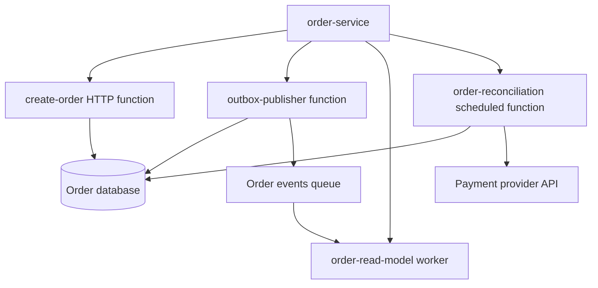
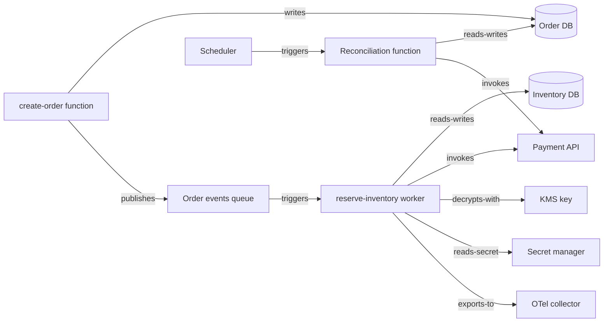
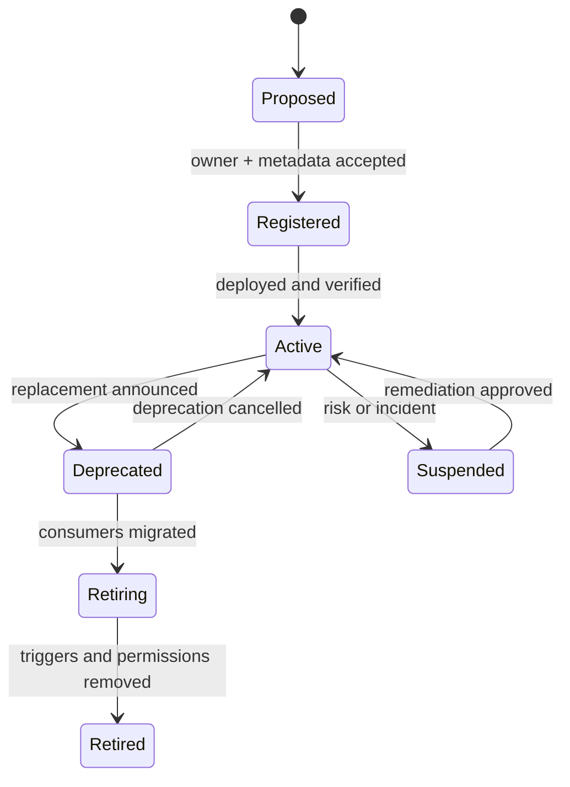

# Building a Function, Owner, and Service Dependency Catalog

In a serverless platform, the number of functions can grow rapidly because each API route, queue consumer, scheduled job, or event handler is typically deployed independently. Over time, an organization can lose the ability to answer basic questions: which functions are running in production, who is responsible when one fails, what data flows through it, which services it calls, and what would be impacted if a dependency goes down.

A function and service catalog is a structured source of information about deployed workloads. The catalog connects **functions to their owners, business purpose, environment, triggers, data, dependencies, criticality, and lifecycle state**. It gives operations, security, architecture, and compliance teams a consistent shared view.

A catalog is only useful when kept up to date throughout the deployment lifecycle. A manually maintained spreadsheet can quickly become stale; therefore, you should combine declarative metadata in the repository/IaC, information from cloud inventory, and an owner confirmation process. This lesson presents how to design a catalog for Java serverless, an ownership model, dependency graphs, governance metadata, automation, and how to use the catalog in operations.

## 1. Why Do We Need a Function Catalog?

A serverless application is rarely a single standalone function. An order placement flow might include:

- An HTTP function that receives order creation requests.
- A publisher function that reads from a transactional outbox and emits events.
- A queue worker that reserves inventory.
- A function that processes payment results from a webhook.
- A scheduled function that reconciles incomplete transactions.
- A function that builds a read model for lookup screens.
- A function that sends notifications or writes analytics data.

Functions may live across multiple repositories, accounts/projects, regions, and teams. When an API key is about to expire, a dependency changes its schema, or a region experiences an outage, teams need to know exactly which workloads are affected and who has the authority to act.

### Questions the Catalog Must Answer

| Question | Required Metadata |
|---|---|
| What does this function do? | Name, business description, capability/domain, documentation link |
| Who is responsible? | Business owner, technical owner, team, contact/on-call |
| Where does it run? | Cloud account/project, region, environment, runtime, resource identifier |
| What triggers it? | HTTP route, queue/topic, event rule, schedule, stream |
| What does it depend on? | Database, queue, API, secret, KMS key, identity provider, network |
| What data does it process? | Data classification, residency, retention, PII/sensitive-data flags |
| How critical is it? | Criticality tier, RTO/RPO, SLO, outage impact |
| What stage is it in? | Proposed, active, deprecated, retiring, retired |
| Is there control evidence? | IaC, CI/CD, scan, access review, backup/DR test, audit record |

The catalog does not replace source code, IaC, IAM policies, or a CMDB. It is the linking and discovery layer that helps locate the right detailed source, the right owner, and the right dependencies.

## 2. Distinguishing Service, Function, and Deployment Instance

A common mistake is treating the cloud function name as the service name. In practice, a business service can consist of multiple functions; the same function definition can be deployed as multiple instances across regions or environments.

| Entity | Meaning | Example |
|---|---|---|
| Business capability | A business capability delivered by the organization | Order management |
| Service | Ownership boundary for APIs, data, and contracts | `order-service` |
| Function/workload | A processing unit with its own trigger and runtime | `create-order`, `reserve-inventory-worker` |
| Deployment | A specific deployment of a function to an environment/region/account | `reserve-inventory-worker` in `prod/ap-southeast-1` |
| Dependency | A resource or service that the workload requires | SQS queue, PostgreSQL, Payment API |

Example of a service with multiple functions:



The catalog should have stable IDs for services and functions, and then link deployment instances. Do not use display names as unique keys because cloud resource names can change when switching accounts, regions, or frameworks.

### Stable IDs

One possible convention is:

- Service ID: `orders`.
- Function ID: `orders.create-http`, `orders.outbox-publisher`.
- Deployment ID: `orders.create-http/prod/ap-southeast-1`.

IDs should remain stable across deployments and be namespaced to avoid collisions across teams. Cloud ARNs/resource IDs should be stored as deployment identifiers rather than replacing logical IDs in the catalog.

## 3. Designing the Function Catalog Schema

A catalog needs enough metadata for governance without forcing developers to enter hundreds of fields that duplicate IaC or cloud APIs. Organize it into groups: identity, ownership, deployment, trigger, dependency, data/compliance, reliability, and lifecycle.

### Core Field Groups

| Group | Suggested Fields | Purpose |
|---|---|---|
| Identity | `service_id`, `function_id`, `name`, `description`, `domain` | Identification and description |
| Ownership | `business_owner`, `technical_owner`, `team`, `on_call` | Identifying accountable parties |
| Source | `repository`, `path`, `codeowners`, `runbook` | Tracing back to code ownership and operational guides |
| Deployment | `provider`, `account`, `region`, `environment`, `resource_id` | Identifying the running workload |
| Runtime | `language`, `runtime_version`, `architecture`, `memory`, `timeout` | Managing runtime and configuration |
| Trigger | `trigger_type`, `source_id`, `route_or_event`, `auth_mode` | Understanding how the workload is invoked |
| Dependency | `dependency_id`, `dependency_type`, `relationship`, `criticality` | Building the dependency graph |
| Data | `classification`, `data_categories`, `residency`, `retention` | Assessing data and compliance |
| Reliability | `criticality_tier`, `slo`, `rto`, `rpo`, `dr_strategy` | Connecting to operations and DR |
| Security | `execution_role`, `secret_refs`, `kms_key_refs`, `network_zone` | Controlling access and secrets |
| Lifecycle | `status`, `created_at`, `last_deployed_at`, `reviewed_at`, `sunset_date` | Managing lifecycle state |

Some fields can be generated automatically from deployments; others are declared by the owner. Clearly document the data source, sync timing, and which field is authoritative when conflicts arise.

### Example Catalog Entry in YAML

```yaml
apiVersion: platform.example/v1
kind: ServerlessFunction
metadata:
  id: orders.reserve-inventory
  name: reserve-inventory-worker
  description: Reserve stock after an order has been accepted
  domain: commerce.orders
  tags:
    environment: production
    criticality: tier-2
    data-classification: confidential
    managed-by: terraform
spec:
  serviceId: orders
  owner:
    business: commerce-operations
    technical: team-orders-platform
    onCall: orders-oncall
  source:
    repository: https://git.example.internal/commerce/orders
    path: functions/reserve-inventory
    runbook: https://docs.example.internal/runbooks/orders
  runtime:
    language: java
    version: "21"
    architecture: arm64
  trigger:
    type: queue
    sourceId: order-events
    delivery: at-least-once
  deployment:
    provider: aws
    environment: production
    accountRef: commerce-production
    region: ap-southeast-1
    resourceRef: arn:aws:lambda:ap-southeast-1:111122223333:function:reserve-inventory
  data:
    categories: [order-reference, sku, quantity]
    classification: confidential
    residency: vn
    retentionPolicy: order-processing-7y
  dependencies:
    - id: order-events
      type: queue
      relationship: consumes
      criticality: required
    - id: inventory-db
      type: database
      relationship: reads-writes
      criticality: required
  reliability:
    tier: 2
    slo: orders-worker-availability
    rto: 60m
    rpo: 5m
  lifecycle:
    status: active
    reviewedAt: "2026-10-15"
```

The URLs, ARNs, owners, and policies in the example are illustrative values only. Do not put credentials, secret values, or customer data into the catalog. The catalog should store references to a secret manager, not secret contents.

In the example, `spec.deployment.environment` and `spec.data.classification` are the canonical fields for policy checks; `metadata.tags` is a convenience copy for search/inventory. The pipeline should verify that the two locations do not conflict or simply generate tags from `spec` to prevent drift.

### Schema Versioning and Validation

The catalog needs an `apiVersion` or schema version so fields can be added without breaking older readers. Validation should check that:

- Required fields are non-empty.
- IDs follow the naming pattern and are unique.
- The owner/team exists in the organization directory.
- Dependency IDs reference registered resources/services or are marked as external.
- Region/environment values are allowed by policy.
- The runtime version is still supported.
- Data classification and retention policy have recognized values.
- Production functions have a runbook, on-call rotation, and criticality tier.

If the catalog uses YAML/JSON in a repository, validate the schema in CI. Do not wait until production deployment to discover a missing owner or dependency.

## 4. Defining Owners and Operational Responsibilities

Every production function must have an owner accountable for its correctness, security, reliability, and lifecycle. An owner does not have to be an individual; it is usually a team with an on-call rotation and permission to change the workload.

### Roles to Distinguish

| Role | Responsibility |
|---|---|
| Business owner | Defines business objectives, impact level, and recovery priorities |
| Technical/service owner | Accountable for service architecture, code, SLOs, and dependencies |
| Function maintainer | Maintains implementation, runtime, tests, and function deployments |
| On-call team | Receives alerts, investigates, and recovers from incidents |
| Data owner/steward | Defines data classification, retention, access, and data quality |
| Security/compliance | Defines controls, assesses risk, and verifies evidence |
| Platform team | Provides shared runtime, deployment, catalog automation, and guardrails |

One team may hold multiple roles, but it must be clear who makes decisions and who is contacted during an incident. Avoid a generic `owner: platform-team` for every function if the platform team does not actually own the business logic.

### RACI for Significant Changes

RACI helps distinguish who executes (Responsible), who has final accountability (Accountable), who is consulted (Consulted), and who is informed (Informed).

| Activity | Business Owner | Service Owner | Platform | Security/Data Owner |
|---|---|---|---|---|
| Register new function | C | A/R | C | C |
| Set SLO and criticality | A | R | C | C |
| Change IAM/runtime | I | A/R | C | C |
| Change data classification | C | R | I | A |
| Handle incident | I | A/R | R when platform-related | C |
| Retire function | A | R | C | C |

RACI must be adapted to the organization. Each activity should have only one accountable role to avoid unowned decisions.

### Owners Must Be Actionable

An owner record is only valuable when that team has:

- Access to the repository, deployment pipeline, and required telemetry.
- Runbooks and rollback instructions.
- A maintained on-call rotation and contact details.
- Authority to request changes to quotas, secrets, IAM, or dependencies through the appropriate workflow.
- Understanding of business impact and recovery priorities.

If a team disbands or transfers ownership, the catalog needs a handover workflow before deleting the team or repository.

## 5. Building a Dependency Inventory

A dependency is any resource, service, API, identity system, or control plane that a function needs to do its job. Listing only databases and HTTP APIs is not enough; serverless functions also depend on triggers, queues, secrets, KMS keys, networks, and observability.

### Dependency Categories

| Category | Examples | Questions to Answer |
|---|---|---|
| Trigger/source | API Gateway, SQS, Pub/Sub, EventBridge, scheduler | Who can invoke it? Can events be lost or duplicated? |
| Data store | PostgreSQL, DynamoDB, S3, Blob Storage | Who owns the data? How are backup and replication handled? |
| External API | Payment, shipping, identity provider | What are the quotas, SLA, auth, timeouts, and fallbacks? |
| Identity/security | IAM role, service account, KMS, secret manager | What is the function allowed to do and where does it fetch secrets? |
| Network | VPC, subnet, NAT, private endpoint, DNS | Which network paths are mandatory? |
| Platform/runtime | Java runtime, layer, extension, container registry | How are runtime version and lifecycle managed? |
| Observability | Log, metric, trace backend, alert route | Who receives alerts? Does telemetry depend on the same region? |
| Delivery/control plane | CI/CD, artifact registry, IaC backend | Can we deploy or restore if the primary region fails? |

### Relationship Types Between Functions and Dependencies

Do not just record "depends on". Use explicit relationship types:

- `invokes`: the function calls another API/service.
- `consumes`: the function receives messages/events from a queue/topic.
- `publishes`: the function emits messages/events.
- `reads`: reads data.
- `writes`: writes data.
- `authenticates-with`: depends on an identity provider.
- `decrypts-with`: uses a KMS key for decryption.
- `exports-to`: sends telemetry to a collector/backend.
- `scheduled-by`: triggered by a scheduler.
- `deployed-by`: deployed by a pipeline/platform.

Directed relationships enable impact queries. If `inventory-db` goes down, the catalog can find functions with `reads-writes` edges pointing to that database, then trace backward to the APIs/queues they serve.

### Dependency Graph



The graph should store edges separately from nodes so you can attach relationship attributes such as `criticality`, `timeout`, `data_flow`, `protocol`, `owner`, and `last_verified_at`.

## 6. Classifying Dependencies by Criticality

Not every dependency carries the same impact. A function may continue serving read-only traffic when an analytics backend fails, but cannot accept new orders if the primary database is unavailable.

Suggested classification:

- **Required:** without this dependency, the function cannot fulfill its core business logic.
- **Degraded:** the function can run with reduced features or quality.
- **Optional:** failure of this dependency does not affect the primary outcome.
- **Build/deploy-time:** needed for deployment but not at runtime.
- **Recovery-only:** needed only during backup restore, failover, or incident investigation.

Example:

| Function | Dependency | Criticality | Fallback/Degraded Mode |
|---|---|---|---|
| `create-order` | Order DB | Required | Reject order creation when durable write is unavailable |
| `create-order` | Product cache | Degraded | Read from catalog source with timeout and rate cap |
| `order-worker` | Payment API | Required for payment step | Keep operation pending and retry/reconcile |
| `order-worker` | Analytics endpoint | Optional | Route analytics event to a separate queue or drop per policy |
| `reconcile-payments` | Payment API | Required | Pause run and retry later; do not infer outcomes |

Fallbacks must be defined by business rules. Never use `catch (Exception) { return success; }` to turn a dependency failure into a fake success.

## 7. Data Flow and Data Classification

The catalog should describe what kinds of data a function reads, writes, or emits through events. This supports evaluating access permissions, data residency, retention, encryption, logging, and third-party sharing.

A simple taxonomy might include:

| Level | Conceptual Examples | Controls Typically Considered |
|---|---|---|
| Public | Content approved for public release | Integrity, availability, and change control |
| Internal | Internal operational metadata | Authentication, role-based access, retention |
| Confidential | Orders, internal customer information, contracts | Least privilege, encryption, audit, retention, and export restrictions |
| Restricted | Authentication secrets, special financial/identity data per org policy | Secret manager, access approval, masking, key control, and enhanced auditing |

Classification names must match the organization's actual policy. The table above is an illustrative taxonomy and does not replace legal classification or assessment by the data owner.

### Describing Data Flow

For each function, document:

- Data categories received from the trigger.
- Which fields are stored, transformed, or stripped.
- Which data stores/regions receive the data.
- Which events carry data to other services.
- Whether data is sent to external providers.
- What data logs/traces might contain.
- Where retention and deletion policies apply.

Do not just attach a `PII=true` label. Identify which specific data flows through which components, whether it is persisted in DLQs/archives/logs, and who has read access.

### Data Lineage

Data lineage describes the origin and path of data. For example, `customerRef` from an API request is saved to the order DB, included in an `OrderPlaced` event, read by the inventory worker, and eventually surfaces in analytics. The catalog can link data fields/categories to services/edges to determine impact scope when retention or access policies change.

## 8. Security Ownership and Access Permissions

The function catalog should indicate which runtime identity is used and its high-level permission scope. Policy details remain in IAM/IaC, while the catalog helps locate owners and dependencies when an access review is needed.

Fields to track:

- Execution role / service account ID.
- Granted resource groups or permission profiles.
- Secret references and secret owners.
- KMS key references and purpose.
- Network zone / private endpoint.
- Trigger authorization mode and principals allowed to invoke.
- Last access review and reviewer.

### Separating Code Owner from Data Owner

The team developing a function is not automatically the owner of the data the function reads. The data owner decides classification, purpose, retention, and access policy. The service owner is responsible for ensuring the implementation complies with policy.

For example, `order-worker` may belong to the Orders team while reading payment results owned by the Payment service. Changes to fields or access permissions require consulting both owners.

### Dependency Permission Review

An access review can verify:

1. Does the function truly still need this dependency?
2. Is the permission read, write, invoke, or administer?
3. Can permissions be scoped down to specific resource ARNs, queues, buckets, tables, or keys?
4. Were administrative permissions such as delete, policy update, or key rotation mistakenly granted to the runtime role?
5. Are the secret/KMS references still in use?
6. Does the trigger allow unexpected principals to invoke it?
7. Are permissions provisioned automatically via IaC and audited?

The catalog helps scope the review; final decisions must be based on actual policies and usage logs, not just declared metadata.

## 9. Criticality, SLOs, and Recovery Mapping

Criticality tiers help the organization decide investment levels for reliability, on-call, backups, and DR. Avoid assigning a single tier to an entire service if its functions have different impacts.

Example tiering:

| Tier | Meaning | Example Operational Expectations |
|---|---|---|
| Tier 0 | Core process, severe impact | 24/7 on-call, rehearsed DR, strict change control |
| Tier 1 | Important service for core operations | Clear SLOs, alerting, tested backup/restore |
| Tier 2 | Tolerates brief interruption or degradation | Business-hours support as appropriate, recovery runbook |
| Tier 3 | Low impact, reproducible | Best-effort recovery, on-demand backups |

Tiers are only labels. They must be tied to SLOs, RTO/RPO, support hours, change approvals, and testing frequency. A scheduled reconciliation function may receive no direct user traffic yet be critical for detecting payment discrepancies; do not judge criticality based solely on RPS.

### Function-Level Criticality

The catalog should allow a function to have a different criticality from its parent service if their roles differ. For example, a read-only API can be a lower tier than a payment authorization worker, even if both belong to `commerce-service`.

### Dependency Criticality

For each dependency, record the impact if it fails:

- Required with no fallback.
- Required but can be retried/queued.
- Degraded with bounded cached/stale data.
- Optional and can be skipped.

This information helps determine blast radius and recovery ordering during incidents and DR.

## 10. Lifecycle Governance: From Creation to Retirement

The catalog must track a function's lifecycle, not just its initial deployment.



### Proposed/Registered

Before deployment, developers declare the service/function ID, owner, trigger, dependencies, data classification, and criticality. CI validates the schema and baseline policies.

### Active

The function is deployed and verified. The catalog receives deployment metadata from the pipeline/cloud inventory: resource ID, runtime version, region, artifact version, last deployed time, and telemetry links.

### Deprecated/Retiring

When replacing a function, the owner announces a sunset date, consumers migrate, route/event triggers are updated, and old dependencies are evaluated. Do not delete a function just because zero invocations were seen over a few days; it may be a periodic job or a rarely used emergency path.

### Retired

Retirement requires verifying that:

- No triggers, routes, or schedules still invoke the function.
- No producers or consumers still depend on the old contract.
- No permissions, secrets, KMS grants, or network rules exist solely for the function.
- Data/logs/archives subject to retention are preserved per policy.
- Dashboards, alerts, and runbooks are updated.
- Cloud resources are deleted or marked retained with justification.
- The catalog records the `retired` status and end timestamp.

Retiring a function without removing event mappings or IAM permissions can leave behind an attack surface and unnecessary costs.

## 11. Automating Catalog Metadata Collection

A good catalog combines three sources:

1. **Declared metadata:** YAML/JSON files in the repository or annotations in IaC, declared by the owning team.
2. **Deployment metadata:** pipelines provide artifact version, deployment ID, environment, commit, and timestamp.
3. **Observed cloud inventory:** cloud APIs discover actual functions, triggers, roles, queues, databases, and resources.

The three sources complement one another. Declared metadata captures purpose and ownership; deployment metadata captures what version was released; cloud inventory shows what real resources exist.

### Merge Rules

| Field | Suggested Authoritative Source |
|---|---|
| Business description/domain | Repository/catalog owner |
| Technical owner/on-call | Catalog with team confirmation |
| Runtime/resource ID/region | Cloud inventory/deployment pipeline |
| Artifact version/commit | CI/CD pipeline |
| Trigger mapping | Cloud inventory, reconciled against IaC |
| Declared dependencies | Repository/IaC |
| Observed dependencies | Tracing/network inventory where available and permitted |
| Data classification/retention | Data owner/policy registry |
| Last deployed time | Deployment pipeline/cloud metadata |

Do not automatically overwrite owner or data classification from an inferred source. When two sources conflict, flag `needs_review` and require owner confirmation.

### Detecting Drift

Compare the declared catalog against cloud inventory to detect:

- Production functions without a catalog entry.
- Catalog entries pointing to resources that no longer exist.
- Actual triggers differing from declared configurations.
- Function runtime versions that have reached end-of-support.
- Resources created manually outside IaC.
- Owners/teams that no longer exist.
- New dependencies appearing without prior review.

Drift reports need severity, owner, evidence, first-seen/last-seen timestamps, and a due date. Do not automatically delete resources just because the catalog does not recognize them; first identify the owner and impact.

## 12. Governance in CI/CD

The catalog should be validated in pull requests and updated alongside deployments so metadata never drifts away from code.

A pipeline can include:

1. Validate catalog schema and IDs.
2. Check owner, on-call, and repository links.
3. Check trigger/dependency declarations.
4. Check data classification, region, and retention policy.
5. Check runtime version, memory, timeout, and concurrency against guardrails.
6. Check IaC policies, IAM least privilege, and secret references.
7. Build/test/scan artifacts.
8. Deploy to the environment.
9. Publish deployment metadata to the catalog.
10. Reconcile cloud inventory post-deploy and raise drift findings if needed.

### Policy-as-Code

Guardrails can be enforced with schema validation, OPA/Rego, Conftest, or cloud policy tools. Conceptual rule example:

```rego
package serverless.catalog

deny[msg] {
  input.spec.deployment.environment == "production"
  not input.spec.owner.technical
  msg := "Production function must declare a technical owner"
}

deny[msg] {
  input.spec.deployment.environment == "production"
  not input.spec.source.runbook
  msg := "Production function must link an operational runbook"
}

deny[msg] {
  input.spec.data.classification == "restricted"
  not input.spec.data.retentionPolicy
  msg := "Restricted data must declare a retention policy"
}
```

This is a conceptual policy example; schema paths must match your actual catalog. Production policies should have an exception workflow with an owner, justification, expiration date, and approver. Do not turn every warning into a hard block if the organization needs a phased rollout; distinguish `deny`, `warn`, and `needs_review`.

### Never Store Secrets in Metadata

Catalogs and pipeline artifacts typically have broader read access than secret stores. Store only references such as `secretRef: payment-api-key`; actual secret values must stay in Secrets Manager, Key Vault, or Secret Manager. CI logs must never print environment variables containing credentials.

## 13. Using the Catalog for Incident Management

During an incident, the catalog helps quickly answer:

- Which functions/services are directly affected?
- Which dependency is failing and which consumers depend on it?
- Which team/on-call engineer is responsible?
- Which functions can switch to degraded mode?
- What are the service's SLO/RTO/RPO and runbook?
- What data could be affected or exposed?
- Can triggers be disabled or concurrency throttled without losing data?

### Blast Radius Analysis

With a directed dependency graph, you can query all workloads pointing to a node. If `payment-api` fails, find functions with `invokes` edges to that API, their parent services, related queues, and affected business capabilities.

The graph should distinguish direct dependencies from transitive dependencies. A function that does not call a database directly, but depends on another service that uses that database, is still indirectly affected.

### Example Incident Workflow

1. Alert fires from `payment-api` or consumer error rates.
2. Locate the dependency node and related functions/services in the catalog.
3. Identify the technical owner/on-call contact and runbook.
4. Check criticality, SLOs, and degraded behavior.
5. Decide whether to pause consumers, reduce concurrency, or place operations in pending state.
6. Monitor backlog/DLQ and transaction states.
7. Once the dependency recovers, replay/reconcile per policy.
8. Update incident findings and dependency metadata if the graph was incomplete.

The catalog accelerates discovery, but mitigation decisions must still rely on live telemetry and actual runtime state.

## 14. Using the Catalog for Change Management

Changing a dependency can affect many functions. Before upgrading a database version, altering an event schema, rotating a KMS key, or changing an API endpoint, query affected consumers/producers and their owners.

A change record should contain:

- The dependency/resource being changed.
- Directly and indirectly affected functions/services.
- Contract/schema version and compatibility window.
- Data classification and region/residency impact.
- Consulted owners.
- Test, rollout, rollback, and monitoring plans.
- Effective date and removal date for legacy compatibility.

### Dependency Contracts

For HTTP APIs, store the OpenAPI/contract version and authentication method. For events, store the schema registry reference, event type, and delivery semantics. For databases, store the logical database/table group and access mode, without necessarily putting sensitive full schemas into the catalog.

Contracts help identify breaking changes. A consumer might keep running yet misparse an event field after a producer changes semantics; the catalog links producers and consumers to show who needs to coordinate.

## 15. Governance and Compliance

The catalog helps demonstrate that the organization knows which workloads process which data, who is accountable, and which dependencies are used. However, having a catalog does not automatically equal compliance. Metadata must be paired with real evidence.

Common governance topics:

- Data classification, purpose, and retention.
- Data residency and cross-region/cross-border flows.
- Encryption at rest/in transit and key ownership.
- IAM least privilege and access reviews.
- Secret rotation and certificate expiry.
- Vulnerabilities/SBOMs and runtime support lifecycles.
- Audit logs, deployment records, and change approvals.
- Backup, DR, RTO/RPO, and recovery exercises.
- Third-party dependencies, vendors/SLAs, and exit plans.

### Control Evidence

Each control should link to verifiable evidence:

| Control | Evidence to Store/Reference |
|---|---|
| Owner assignment | Catalog approval, team directory, on-call rotation |
| Least privilege | IAM policy/IaC plan, access review result |
| Encryption | Storage/KMS configuration, key policy reference |
| Secret management | Secret reference, rotation timestamp, access log |
| Vulnerability management | SBOM, dependency scan, image/JAR scan report |
| Change management | Pull request, approval, deployment ID, rollback record |
| Backup/DR | Backup job evidence, restore test, DR drill report |
| Data retention | Policy ID, lifecycle configuration, deletion evidence |
| Observability | Dashboard, alert route, SLO report |

Do not copy all audit evidence into the catalog. Store links/references, timestamps, statuses, and owners; primary evidence remains in the system of record with appropriate access control and retention.

### Periodic Reviews

Review frequency should scale with criticality and risk. A function handling restricted data or payments needs more frequent reviews than a reproducible reporting job. Reviews can verify owners, dependencies, permissions, data classification, runtime support, SLOs, and retirement status.

## 16. Managing Third-Party Dependencies

Serverless functions may call SaaS APIs or external libraries. The catalog should record the vendor, purpose, shared data, authentication method, quotas, SLA/support contacts, and contingency plan if the vendor goes down.

For Java libraries, an SBOM (Software Bill of Materials) and dependency scans show which packages/versions are used. The catalog can link to the SBOM by artifact version rather than storing the entire dependency tree in core metadata.

Questions to answer:

- What data does the function send to the vendor?
- In which region does the vendor store data, and what is the retention policy?
- Are there SLAs, quotas, or maintenance windows?
- Does the API support idempotency, retries, and webhook contracts?
- Can the vendor be replaced or data exported upon contract termination?
- Who receives alerts when certificates or API keys expire?

Never put vendor secrets into the catalog. Store only the secret reference and credential owner.

## 17. Java Serverless: Metadata Alongside Code and Deployment

Catalog descriptors can live next to source code so developers review them together with implementation changes.

Example descriptor:

```yaml
service:
  id: orders
  owner: team-orders-platform
  domain: commerce

function:
  id: orders.create-http
  entrypoint: com.example.orders.CreateOrderHandler
  runtime: java21
  trigger:
    type: http
    route: POST /orders
    auth: jwt-authorizer
  data:
    classification: confidential
    categories: [customer-reference, order-items]
  dependencies:
    - id: orders-db
      relationship: reads-writes
    - id: inventory-reservation-api
      relationship: invokes
    - id: orders-events
      relationship: publishes
  operations:
    runbook: docs/runbooks/create-order.md
    slo: orders-api-availability
    onCall: orders-oncall
```

The pipeline can read the descriptor, validate it, and publish metadata to the catalog API. Resource ARNs, deployed versions, and timestamps are added from deployment outputs, removing the need for developers to hard-code ARNs in source.

### Attaching Metadata via IaC

With Terraform, tags/labels can carry catalog IDs, owner, environment, data classification, and cost center:

```hcl
locals {
  common_tags = {
    service_id          = "orders"
    function_id         = "orders.reserve-inventory"
    owner_team          = "team-orders-platform"
    environment         = var.environment
    data_classification = "confidential"
    managed_by          = "terraform"
  }
}

resource "aws_lambda_function" "reserve_inventory" {
  function_name = "reserve-inventory-${var.environment}"
  role          = aws_iam_role.lambda_execution.arn
  runtime       = "java21"
  handler       = "com.example.orders.ReserveInventoryHandler::handleRequest"
  filename      = var.artifact_path

  tags = local.common_tags
}
```

Illustrative example; provider/resource versions and runtime availability must match your deployment environment. Tags support inventory, cost tracking, and governance, but do not replace a catalog entry or policy validation. A resource carrying an `owner_team` tag does not prove that team has accepted ownership.

### Correlating Functions with Telemetry

Include stable resource attributes such as `service.name`, `service.version`, `deployment.environment`, `cloud.region`, and `catalog.function_id` in logs, traces, and metrics when supported by the backend. This lets responders jump from an alert straight to the catalog entry to find the owner and runbook.

Do not put invocation IDs, request IDs, or customer IDs into resource attributes because they change per invocation and cause high cardinality. Use span/log context for per-request details with appropriate redaction.

## 18. Catalog API and Discovery Tools

As workload volume grows, the catalog can provide an API and search UI to find services by owner, domain, region, data classification, dependency, or criticality.

Useful queries:

- All production functions without an owner/on-call contact.
- Java functions running on a runtime approaching end-of-support.
- Workloads processing confidential data in a specific region.
- Consumers depending on an event schema version about to change.
- Functions calling a vendor/API currently experiencing an incident.
- Resources with cloud tags but no catalog entry.
- Active functions with no deployments over an extended period.
- Which workloads reference a given secret or KMS key.
- Tier-0 services without a recent DR test.

### Search Does Not Replace Authorization

The catalog may display resource names and dependencies, but must not inadvertently expose sensitive secret references or restricted data lineage to unauthorized users. Apply RBAC/ABAC to the catalog, restrict visible fields, and audit sensitive queries when necessary.

## 19. Common Mistakes When Building a Catalog

| Mistake | Consequence | Fix |
|---|---|---|
| Recording only cloud function names | Purpose, owner, and dependencies are unknown | Use service/function/deployment IDs and business metadata |
| One generic owner for every function | Incidents lack an accountable team | Assign a specific technical owner and on-call rotation |
| Owner is a single individual | Ownership is lost when the person leaves or switches teams | Use a team owner, contact role, and backup contact |
| Declaring dependencies manually only | Catalog does not reflect actual resources | Reconcile against IaC, pipelines, and cloud inventory |
| Relying on cloud inventory only | Business purpose and data classification are missing | Supplement with owner-declared metadata |
| Not separating direct and transitive dependencies | Impact analysis is incomplete or wrong | Use a directed graph and traversal |
| Omitting trigger semantics | Retries, ordering, and invoking principals are unclear | Record trigger type, delivery, auth, and consumer mapping |
| Storing secret values in the catalog | Credential leakage | Store secret references only |
| Not updating on retirement | Orphaned resources/permissions and rising costs | Enforce lifecycle states and a retirement checklist |
| Treating tags as proof of ownership | Resource has a tag even though the team never accepted it | Require owner approval and on-call confirmation |
| Metadata lacks schema versioning | Tooling breaks when fields change | Version the schema and support migrations |
| Running policies manually only | Drift persists | Integrate validation into CI/CD and inventory scans |
| Turning the catalog into a dump for all data | Duplicated, sensitive, hard-to-maintain data | Store references to sources of truth and evidence |

## 20. Process for Building and Operating a Function Catalog

1. **Define the entity model.** Distinguish capability, service, function, deployment, and dependency.
2. **Define the schema.** Choose required fields, schema versioning, IDs, and a shared taxonomy.
3. **Establish ownership.** Assign business owner, technical owner, team, and on-call rotation.
4. **Declare triggers, data, and dependencies.** Describe relationships and criticality for each dependency.
5. **Attach lifecycle and criticality.** Define status, SLOs, RTO/RPO, and review frequency.
6. **Store metadata alongside code/IaC.** Let owners review metadata within pull requests.
7. **Validate in CI.** Check schema, owner, region, classification, runbook, and policies.
8. **Sync deployments.** Add resource ID, artifact version, region, and timestamp after deployment.
9. **Reconcile cloud inventory.** Detect unregistered resources, dependency drift, and invalid owners.
10. **Use the catalog in incidents, changes, and DR.** Query blast radius, owners, runbooks, and evidence.
11. **Conduct periodic reviews.** Verify metadata, permissions, runtimes, data flows, and dependencies.
12. **Retire under control.** Remove triggers, permissions, and resources once consumers have migrated.

## 21. Pre-Production Checklist

- [ ] Services, functions, and deployments have stable IDs independent of cloud resource names.
- [ ] Functions have a business description, domain, and repository/path.
- [ ] Business owner, technical owner, team, and on-call contact are assigned.
- [ ] Runbook and telemetry/dashboard links are present.
- [ ] Triggers, invoking principals, and delivery semantics are declared.
- [ ] Dependencies include ID, relationship type, owner, and criticality.
- [ ] Data classification, categories, region/residency, and retention are confirmed.
- [ ] Runtime, version, architecture, and deployment resources are synchronized.
- [ ] IAM roles, secret references, KMS keys, and network dependencies are linked.
- [ ] Criticality, SLOs, RTO/RPO, and DR strategy have appropriate values.
- [ ] The catalog schema is versioned and validated in CI/CD.
- [ ] Cloud inventory is reconciled to detect drift and unregistered resources.
- [ ] Metadata contains no secrets or sensitive payloads.
- [ ] Access reviews and evidence have owners and timestamps.
- [ ] Lifecycle retirement has a checklist to remove triggers, permissions, and dependencies.
- [ ] Incident and change processes use the catalog to determine blast radius and owners.

## Conclusion

A function catalog turns a scattered collection of Java serverless functions into a discoverable and governable system of workloads. Each function needs a stable ID, purpose, owner, trigger, deployment, data classification, dependencies, criticality, and lifecycle state. The dependency graph reveals blast radius; ownership/RACI defines who acts; metadata and evidence support security and compliance; and CI/CD together with cloud inventory keep the catalog aligned with reality. Treat the catalog as part of the development and operational lifecycle: declared alongside code/IaC, updated at deploy time, reconciled periodically, and retired alongside the resource. When the catalog accurately reflects the running system, the organization can investigate incidents, evaluate changes, and demonstrate accountability far more clearly.
