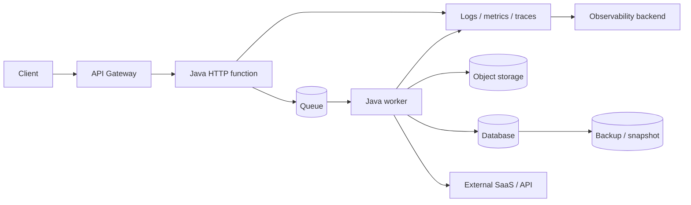
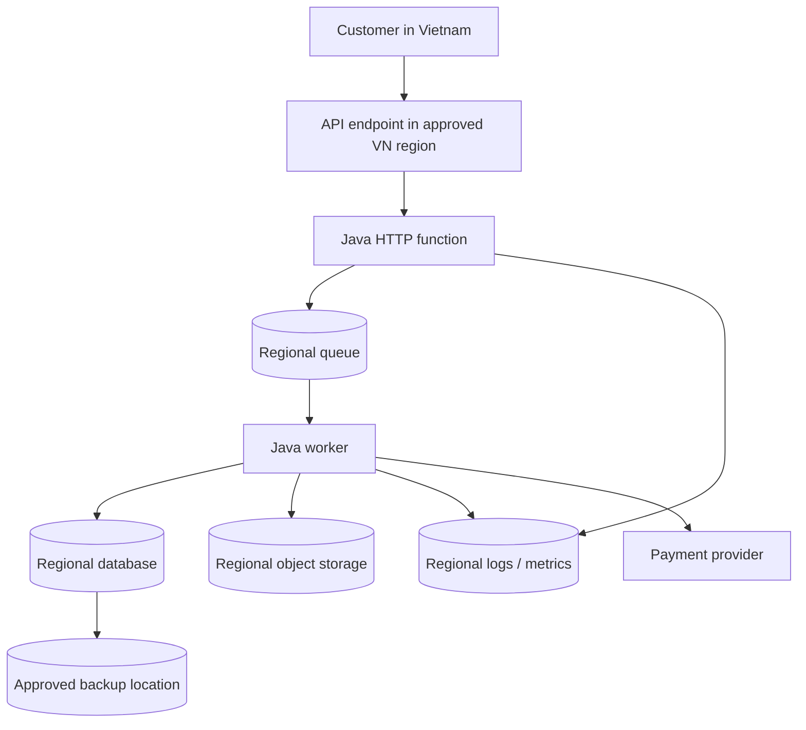

# Region Selection and Data Residency Regulations

Choosing a region when deploying a Java serverless function is an architectural, latency, resilience, and compliance decision. A function might run in one region while its database, queue, object storage, backups, logs, or tracing backend live in another. Therefore, looking only at the function's region or picking a region whose name is close to the users' country is not enough to conclude that data is stored and processed in the right location.

**Data residency** describes where data is stored or processed. **Data sovereignty** concerns the laws and jurisdictions that may apply to the data, the provider, and processing activities. **Data localization** is a legal or contractual requirement mandating that a specific category of data be stored within a given country or territory. These three concepts are related, not synonymous.

Within the scope of **CLOUD_SERVERLESS**, this lesson focuses on developing and deploying applications using the serverless model, particularly Java functions triggered by HTTP, messages, or events. Learners deal with triggers, state, access permissions, retries, idempotency, cold starts, scaling, and cost. This lesson guides you through identifying which regions data traverses, evaluating legal obligations, and configuring serverless architecture to control where data is stored, processed, backed up, and accessed.

> **Legal Scope:** The Vietnamese legal section below is compiled from instruments issued and in effect up to 17/11/2026. This is technical learning material, not legal advice. Specific obligations depend on data types, the organization's role, industry sector, services, data subjects, contracts, and currently effective implementing regulations; they must be confirmed by legal/compliance teams before taking a system to production.

## 1. Regions, Availability Zones, and Legal Jurisdictions

A region is a geographic area defined by a cloud provider for deploying resources. A region typically contains multiple availability zones or independent fault domains. Availability zones improve availability within a region; they do not automatically establish a new legal boundary.

| Concept | Meaning | Questions to Answer |
|---|---|---|
| Region | Cloud geographic area where resources are deployed | Which region are the services and data located in? |
| Availability zone | Independent fault domain within a region | Can the workload tolerate a single zone outage and stay available? |
| Data residency | Where data is stored/processed by design or commitment | Where are primaries, replicas, backups, and telemetry located? |
| Data sovereignty | Laws/jurisdictions applicable to data or providers | Who can compel access and under which laws? |
| Data localization | Obligation to store certain data inside a country/region | Which data categories must be stored domestically and under what conditions? |
| Cross-border transfer | Transferring or processing data across borders as defined by applicable law | Are any activities sending, storing, or processing data abroad? |

Do not assume that a region named after a country satisfies every requirement. Verify the actual physical region, whether required services are available there, secondary storage locations, service terms, and legal obligations.

## 2. Distinguishing Storage, Processing, and Access

A system might store data in Vietnam yet still send copies or allow processing abroad. Conversely, a service might run compute abroad while receiving only de-identified data or data outside restricted scope. The assessment must rely on actual data flows and definitions in the applicable laws.

Three questions to separate:

1. **Where is it stored?** Where are databases, objects, queues, caches, snapshots, backups, and archives placed?
2. **Where is it processed?** Where do functions, analytics, search, fraud detection, APM, support tooling, or SaaS platforms process data?
3. **Who can access it from where?** In which locations do provider personnel, support engineers, subprocessors, administrators, and automated systems have access to the data?

Encryption in transit and at rest is an important safeguard, but it does not automatically make cross-border processing cease to be a data transfer. Pseudonymization likewise does not automatically turn data into anonymous data. You must evaluate re-identifiability, accompanying data, and relevant regulations.

## 3. Inventorying and Classifying Data Before Choosing a Region

Do not start with the question "which region should we put the application in?" Start by identifying what data is collected, the processing purpose, who owns/controls it, who processes it, and its sensitivity level.

A data inventory may include:

| Data Category | Serverless Application Examples | Considerations |
|---|---|---|
| Basic personal data | Name, email, phone number, account identifier | Purpose, legal basis, storage location, and recipients |
| Sensitive personal data | Health data, biometrics, or sensitive categories defined by law | Access controls, encryption, retention, and transfer assessments |
| Financial data | Transactions, payment details, invoice history | Sector regulations, payment provider contracts, and PCI scope if applicable |
| Business data | Orders, inventory, workflow state | Classification by criticality and contractual requirements |
| Core data / important data | Data meeting statutory classification criteria under data laws | Assess under the Law on Data and implementing regulations |
| Trade secrets | Pricing, algorithms, contracts, business plans | Access permissions, processing location, confidentiality, and contractual obligations |
| Logs and telemetry | IP, user ID, request ID, trace attributes, exception payloads | May contain personal data or secrets; requires separate classification |
| Metadata and configuration | Resource IDs, key metadata, tenant mappings, secret references | Can reveal system topology or identifiers |

Data classification does not rely solely on column names. A trace containing emails, IP addresses, or request bodies still contains personal data even if stored in an observability backend rather than a business database.

## 4. Mapping the End-to-End Serverless Data Flow

An HTTP request can pass through an API Gateway, Java function, queue, worker, database, object storage, and telemetry systems. For every step, document the region, data type, purpose, processor, and outbound paths.



For each arrow, ask:

- Does the payload contain personal data, important data, or secrets?
- To which region, country, or provider is the data transmitted?
- Are copies, retry messages, dead-letter messages, or trace attributes retained?
- Can subprocessors or support teams in other countries access it?
- Are appropriate data processing agreements and transfer mechanisms in place?

This diagram must be updated whenever functions, triggers, SaaS tools, DR regions, log exporters, or new services are added.

## 5. Where Data Can Leave the Primary Region

In serverless, risks often hide in secondary resources or flows enabled by default:

| Component | Data Examples | Location Checks |
|---|---|---|
| Function runtime | Request/event payloads, environment variables, memory snapshots if platform supports them | Deployment region, runtime execution location, and support access |
| API Gateway / CDN / WAF | URLs, headers, IPs, cookies, cached objects | Edge locations, log destinations, and cache policies |
| Queue / topic / event bus | Message bodies, attributes, event metadata | Broker region, subscriptions, replication, and DLQs |
| Database | Records, indexes, transaction logs | Primary, read replicas, backups, and snapshots |
| Object storage | Uploaded files, exports, archives | Bucket/container, versioning, replication, and archive tiers |
| Cache / search | Sessions, profiles, indexed documents | Cluster region, snapshots, and backups |
| Logs | Request metadata, exceptions, extracted payloads | Log group/workspace, archives, exports, and query services |
| Metrics / tracing | Labels, spans, baggage, event attributes | Telemetry backend, collectors, tail samplers, and exports |
| Secrets / KMS | Secret values, key metadata, cryptographic operations | Secret/key region and remote access permissions |
| CI/CD and artifact registry | Build logs, test fixtures, packages, deployment manifests | Runners, registries, caches, and log retention |
| Support / ticketing | Diagnostic bundles, screenshots, incident payloads | SaaS support platform, recipients, and subprocessors |

Not all metadata is personal data, yet it still requires classification. A deployment manifest can expose customer names, accounts, internal endpoints, or security posture.

## 6. Legal Obligations Can Arise from Multiple Grounds

A single system may fall under several regulatory regimes simultaneously:

- Personal data protection laws based on where data subjects reside, where the organization operates, or statutory territorial scope.
- Data laws and requirements governing core data and important data.
- Cybersecurity laws and implementing regulations covering service types, data categories, and domestic storage.
- Sector-specific rules such as finance, banking, insurance, healthcare, or public sector.
- Contracts with customers, partners, vendors, and data processing agreement clauses.
- Obligations tied to standards/certifications or internal organizational policies.

A region meeting a contractual requirement does not mean it satisfies every applicable law. Conversely, a law lacking a blanket localization mandate for all data does not mean an organization can freely transfer every data type abroad.

## 7. Vietnamese Legal Framework to Include in Assessments

The instruments below are especially relevant to serverless systems processing data in Vietnam. Before real-world deployment, verify the latest consolidated texts, amendments, implementing decrees, and sector-specific rules.

### Law on Personal Data Protection No. 91/2025/QH15 and Decree 356/2025/NĐ-CP

The Law on Personal Data Protection No. 91/2025/QH15 took effect on 01/01/2026. Decree 356/2025/NĐ-CP also took effect on 01/01/2026 and replaced Decree 13/2023/NĐ-CP from that date. The Law defines personal data to include basic personal data and sensitive personal data, and sets principles for processing within the stated purpose, necessary scope, and appropriate retention period.

Article 20 of the Law defines cross-border personal data transfer cases, including:

1. Transferring personal data stored in Vietnam to a storage system located outside Vietnam.
2. An organization/individual in Vietnam transferring personal data to an organization/individual abroad.
3. Using a platform located outside Vietnam to process personal data collected in Vietnam.

Under Article 20, applicable organizations/individuals must prepare a cross-border personal data transfer impact assessment dossier and submit it to the specialized authority within 60 days from the first transfer, except for statutory exemptions. Article 22 governs updating the dossier when changes occur under statutory conditions and timelines. Decree 356/2025/NĐ-CP details the dossier contents, procedures, and related cases.

This has direct cloud implications: using APM, log analytics, customer support SaaS, or processing platforms hosted abroad may need to be assessed as a cross-border transfer/processing activity, even when the primary database remains in Vietnam. The Law provides specific exemptions, such as storing employee personal data on cloud computing services; such exemptions must not be misread as waiving all personal data protection obligations.

### Law on Data No. 60/2024/QH15 and Implementing Regulations

The Law on Data No. 60/2024/QH15 took effect on 01/07/2025. The Law requires classifying data by importance, including core data, important data, and other data. Article 14 governs data storage; non-state data owners have the right to decide storage for data they collect/create/own, but core data and important data must comply with corresponding protection requirements.

Article 23 governs cross-border data transfer and processing, including transferring core/important data stored in Vietnam to foreign systems, transferring to foreign organizations/individuals, or using platforms outside Vietnam for processing. Decree 165/2025/NĐ-CP details impact assessments for these activities and has been amended; always use the currently effective version during assessments.

Do not label all enterprise data as "important data" indiscriminately. Classification must follow statutory criteria and guidance, industry context, and data context.

### Law on Cybersecurity No. 116/2025/QH15 and Decree 333/2026/NĐ-CP

The Law on Cybersecurity No. 116/2025/QH15 took effect on 01/07/2026. Article 25 sets responsibilities for enterprises providing specified telecommunications, Internet, and cyberspace value-added services, including storing certain user personal information and user-generated data within the scope prescribed by law.

Decree 333/2026/NĐ-CP took effect on 19/08/2026 and details data groups, covered enterprises, conditions, and procedures for storage in Vietnam. Data listed in Article 19 includes personal information of service users in Vietnam and certain user-generated data, such as account name, service usage time, payment card info, email, most recent login/logout IP, and phone number linked to the account. Under Article 19, covered domestic enterprises store this data group in Vietnam. The regulation distinguishes domestic enterprises from foreign enterprises. For foreign enterprises in the listed service categories, the requirement to store data and establish a branch/representative office is tied to specific conditions in Article 19, including cases where the service is exploited to commit violations and the specialized authority has issued written cooperation requests 03 times over a maximum period of 06 months without the enterprise remediating, fully complying, or where it obstructs cybersecurity protection measures. Article 20 specifies that the mandatory retention period starts when the enterprise receives the request and has a minimum duration of 24 months; the exact period must follow the request and the decree. This should not be interpreted to mean every foreign SaaS provider or every cloud-hosted application automatically faces the same localization mandate.

During assessment, determine whether the organization falls within the covered enterprise/service types, which data belongs to the regulated list, whether triggering conditions have arisen, and the specific retention period under the decree.

## 8. Legal Screening Matrix by Data Type and Activity

| Scenario | Legal/Technical Questions to Answer |
|---|---|
| Vietnamese personal data stored in a database in Vietnam | Are purpose, legal basis, retention, and access permissions appropriate? |
| Personal data sent to logs/APM abroad | Is this cross-border transfer/processing under Law 91? What assessment dossier or exemption applies? |
| Database replica in a foreign region | Does this constitute transferring data stored in Vietnam abroad? |
| Backup snapshots stored abroad | Do they contain regulated data? Are transfer/processing assessments and contracts in place? |
| Core/important data processed on a foreign platform | Has it been properly classified and assessed under the Law on Data / Decree 165? |
| Online service within Law on Cybersecurity scope | How do Article 25 and Decree 333 apply to the specific service category and data types? |
| Foreign support engineer viewing production records | Does this involve cross-border access/transfer or disclosure to a foreign recipient? |
| EU data transferred outside the EEA | Is there a valid GDPR Chapter V mechanism such as adequacy or SCCs plus supplementary measures if needed? |

This matrix is an initial screening tool. Final conclusions must rest on all applicable laws and the organization's records.

## 9. GDPR and Data Transfers Outside the EEA

If a system processes personal data within GDPR scope, transferring data to third countries must satisfy Chapter V. Common mechanisms include:

- European Commission adequacy decisions for countries, territories, or sectors assessed as providing adequate protection.
- Standard Contractual Clauses (SCCs) adopted by the Commission.
- Binding Corporate Rules or other mechanisms permitted by GDPR when conditions are met.
- Technical and organizational supplementary measures when an assessment indicates they are needed.

SCCs are not merely adding a contract annex and ignoring actual operations. Parties must determine controller/processor roles, data categories, recipient countries, onward transfers, data subject rights, and enforceability of safeguards.

A system with its database in the EU can still trigger a transfer if personnel or subprocessors in a third country access the data, or if logs/traces are exported to a service outside the EEA. Analyze both remote access and secondary flows under the applicable legal definitions.

## 10. Defining Regions for Each Serverless Component

Not every component must sit in the same region, but every difference requires justification, documented data flow, and approval.

| Component | Configurations to Verify |
|---|---|
| Java function / Lambda / Function App / Cloud Run | Deployment region, runtime execution, environment, revision, and support access |
| API Gateway / HTTP ingress | Endpoint region, edge routing, access logs, request inspection, and caching |
| Queue / topic / event bus | Broker region, message retention, DLQ, replication, and replay |
| Database | Primary, replicas, read endpoints, transaction logs, and exports |
| Object storage | Bucket/container region, versioning, lifecycle, replication, and archives |
| Cache / search | Cluster region, snapshots, indexes, and query logs |
| Secrets / KMS | Key region, secret replicas, key export, and decrypt permissions |
| Logs / metrics / traces | Collectors, backends, workspaces, archives, queries, and support access |
| Backup / DR | Target region, encryption keys, retention, restore procedures, and tests |
| CI/CD | Runners, build caches, artifact registries, deployment logs, and test data |

Inspect platform-created default resources too. A function deployed in region A may ship logs to a default workspace in region B if the organization or project configuration points there.

## 11. Example Serverless Architecture Prioritizing Storage in Vietnam

Suppose an application accepts orders from customers in Vietnam. The architecture can place API ingress, Java functions, queues, databases, object storage, KMS, and log backends inside an organization-approved region in Vietnam, provided the provider offers the required services there.



Points to evaluate:

- `Payment provider` may be located abroad; send only required data and assess transfer mechanisms/contracts.
- Backups might replicate to another region; require approval before enabling cross-region replication.
- Telemetry must control payloads, IPs, identifiers, and trace attributes.
- Support access needs approval, auditing, masking, and limits on viewable data.
- If the DR region is abroad, evaluate replication and failover as a separate data flow.

This diagram illustrates principles only; it does not claim any specific provider offers all services in every domestic region.

## 12. The Function's Region Does Not Determine Every Service's Region

In Java, SDKs often infer a default region from environment variables or runtime configuration. An application can accidentally instantiate a client pointing to another region if code, profiles, or environment variables are inconsistent.

AWS SDK for Java 2.x example:

```java
import java.util.Set;
import software.amazon.awssdk.regions.Region;
import software.amazon.awssdk.services.dynamodb.DynamoDbClient;
import software.amazon.awssdk.services.s3.S3Client;
import software.amazon.awssdk.services.sqs.SqsClient;

public final class RegionalClients {
    private final Region dataRegion;
    private final DynamoDbClient dynamoDb;
    private final S3Client s3;
    private final SqsClient sqs;

    public RegionalClients(String configuredRegion, Set<String> approvedRegions) {
        if (!approvedRegions.contains(configuredRegion)) {
            throw new IllegalStateException(
                    "Configured data region is not approved: " + configuredRegion);
        }

        this.dataRegion = Region.of(configuredRegion);
        this.dynamoDb = DynamoDbClient.builder().region(dataRegion).build();
        this.s3 = S3Client.builder().region(dataRegion).build();
        this.sqs = SqsClient.builder().region(dataRegion).build();
    }

    public Region dataRegion() {
        return dataRegion;
    }

    public DynamoDbClient dynamoDb() { return dynamoDb; }
    public S3Client s3() { return s3; }
    public SqsClient sqs() { return sqs; }
}
```

`configuredRegion` and `approvedRegions` must originate from controlled deployment configuration, such as an IaC/policy pipeline. The illustrative region list must not be expanded arbitrarily. When multiple regions are required, create separate configurations per data class and use case instead of letting individual developers pick regions ad hoc.

This snippet only pins the region for these SDK clients. It does not stop API gateways, KMS, logging, backups, support tooling, or external services from sending data elsewhere. You must inspect the full architecture and cloud-level policies.

## 13. Externalizing Region Configuration and Checking at Startup

Do not hard-code regions across business logic layers. Use controlled configuration and validate before the function serves traffic.

A configuration might look like:

```yaml
app:
  data-location:
    primary-region: ${APP_DATA_REGION}
    allowed-regions: ${APP_ALLOWED_DATA_REGIONS}
    allow-cross-region-replication: false
    telemetry-region: ${APP_TELEMETRY_REGION}
```

At startup:

1. Read the deployed region.
2. Verify the region is in the approved allowlist.
3. Verify the regions of primary SDK clients.
4. Check whether replication/export features are enabled against policy.
5. Log the region configuration without sensitive data.
6. Fail startup or block deployment if configuration is invalid.

For cold-start-sensitive function runtimes, validation should be lightweight and avoid adding new network dependencies per invocation. Deeper checks can live in CI/CD and policy-as-code.

## 14. Enforcing Region Controls with Infrastructure as Code

IaC is a critical control layer because resources are provisioned across multiple pipelines and teams. A policy can:

- Permit sensitive resources to be created only within an approved region allowlist.
- Block creating databases, buckets, queues, or log workspaces in unapproved regions.
- Deny enabling cross-region replication without prior approval.
- Mandate `data-classification`, `data-owner`, `approved-region`, and `retention` tags.
- Require matching encryption keys and backup policies.
- Validate the regions of functions, triggers, databases, storage, and telemetry backends within a single deployment.
- Detect drift when manual changes occur after deployment.

Policies should not inspect only compute regions. They must check resources that store or process data as well as replication and export links.

## 15. Backups, Snapshots, and Disaster Recovery

A backup is a copy of data and can create a distinct cross-border storage flow. When enabling cross-region backups for disaster recovery, evaluate:

- Which data is backed up and whether personal/sensitive data is included.
- Target region, provider, and subprocessors.
- Where encryption keys reside and who can decrypt.
- Retention period, lifecycle, immutable retention, and deletion rights.
- Who can perform restores and into which regions.
- Whether failover automatically routes traffic or writes data to another country.
- Procedures to verify restored data and purge expired copies.

Do not enable replication by default and postpone compliance documentation until later. DR design must be assessed before real data is replicated.

Some organizations choose DR within the same country across distinct regions or zones. If no in-jurisdiction option meets RTO/RPO, consider alternatives such as encrypted backups, offline copies, periodic exports, or obtaining approval for an out-of-country option under applicable law.

## 16. Logs, Metrics, and Distributed Tracing Are Data Requiring Governance

Telemetry is frequently overlooked in data flow assessments. Logs can contain IPs, emails, request bodies, user IDs, or payment details. Traces can contain HTTP headers, baggage, database statements, or span attributes. Metric labels can reveal tenants or identifiers.

Practices:

- Disable full payload logging by default; log only required fields.
- Redact tokens, secrets, PII, and payment details before export.
- Avoid attaching user/order/request IDs to high-cardinality metric labels.
- Check regions of log workspaces, trace backends, collectors, and archives.
- Review support access and subprocessors of APM/SIEM tools.
- Use controlled synthetic/test data in staging.
- Maintain dedicated retention and deletion policies for telemetry.

Keeping a database domestically while exporting traces packed with personal data abroad can still create processing-location and data-transfer issues.

## 17. Secrets, KMS, and Administrative Access

Encryption at rest protects stored data, but it does not replace region or transfer controls. Determine:

- Which secret manager region stores secret values.
- Where encryption keys are generated and managed.
- Whether key replicas or cross-region key stores exist.
- Who has permission to decrypt, export, or rotate keys.
- Whether support engineers can access plaintext or metadata only.
- Where audit logs for key/secret operations are stored.

When using customer-managed keys, distinguish key material, key metadata, and where cryptographic operations execute. Some services may invoke KMS in a separate region; inspect the provider's specific architecture.

## 18. CDN, Edge, and Caching

CDNs, WAFs, and edge compute can process requests near end users, not necessarily in the backend's region. Identify what data is cached, logged, or processed at the edge.

- Do not cache responses containing personal or tenant-specific data unless cache keys and policies guarantee isolation.
- Do not write full cookies, authorization headers, or query strings to edge logs.
- Verify where access logs and request samples are stored.
- Check whether edge functions call external APIs or forward payloads to other regions.
- Set appropriate TTLs, purging, and retention for mutable or deletable data.

Edge locations mainly serve latency and routing; do not assume they are durable storage. Still, edge request inspection, caches, logs, and telemetry must appear in the data map.

## 19. Queues, Event Replay, and Dead-Letter Queues

Message brokers can hold payloads longer than a function invocation. When messages are redriven, replayed, or moved to a DLQ, data persists and can be read by other workers.

Verify:

- Regions of queues, topics, subscriptions, and event buses.
- Message retention and DLQ retention.
- Replication/fan-out across regions or projects.
- Whether payloads contain personal data or sensitive details.
- Whether replay tools export data to laptops, notebooks, or SaaS tools.
- Whether deleting database records cascades to related messages/archives.
- Whether message schemas allow shrinking payloads to references only.

For large payloads, store the object in approved storage and send an immutable reference in the message. References need short-lived/least-privilege access and a version ID so workers do not accidentally read a mutated object.

## 20. Vendors, Subprocessors, and Support Access

The cloud provider is not the only third party. APM, error tracking, email, payment, customer support, analytics, crash reporting, feature flags, and ticketing SaaS can all process data.

A vendor review should identify:

- Contracting legal entity and controller/processor/subprocessor role.
- Primary storage, backup, and disaster recovery regions.
- Where support, operations, and remote access are performed.
- Subprocessors and their countries.
- Notification mechanisms when subprocessors or regions change.
- Data Processing Agreements, transfer mechanisms, and security obligations.
- Audit rights and data deletion/return upon contract termination.
- Incident notification and support for fulfilling data subject rights.

Do not rely solely on marketing statements like "data hosted in region X." Review service-specific terms, DPAs, subprocessor lists, support models, and backup clauses.

## 21. Access Control Models and Data Governance

Access permissions can alter a data sovereignty/residency assessment. Enforce:

- Least privilege for function execution roles / service accounts.
- Separation between production data read roles and infrastructure operations roles.
- Just-in-time access and approvals for support/incidents.
- Data masking in tickets, screenshots, and diagnostic bundles.
- Access auditing by principal, timestamp, resource, and justification.
- Explicit contractual bounds on cloud provider/subprocessor access.
- Restrictions on exporting and downloading data to personal devices.

Encrypting with customer-managed keys can limit access by certain parties, yet it does not automatically resolve statutory transfer or access obligations. Evaluate decryption capability, key custody, and disclosure obligations together.

## 22. Multi-Region and Active-Active Architectures

Multi-region improves availability but can introduce continuous replication. With active-active, the same record may be written or read in multiple regions, requiring handling of both consistency and data location.

Options:

| Pattern | Advantages | Data Location Risks |
|---|---|---|
| Single-region + multi-AZ | Simple, keeps data inside one region | Cannot survive a full-region outage |
| Active-passive within the same country | DR in a separate region, can stay within national borders | Must verify actual services, backups, and failover behavior |
| Active-passive across countries | May expand DR options | Replication/failover can constitute cross-border data transfer |
| Multi-country active-active | Low latency and high availability | Complex legal, replication, conflict, and access issues |

Do not enable global database replication or multi-region buckets just to shave latency without evaluating data types. Document which data is replicated, replication direction, retention duration, and how to halt/delete copies.

## 23. Cross-Border Data Transfer Assessment Process

Whenever a flow may take data outside the country, follow a verifiable process:

1. Identify the organization and its role: controller, processor, joint controller, or third party under applicable law.
2. Classify data: basic/sensitive personal data, core/important data, sector-regulated data, or other data.
3. Identify activities: storage, remote access, processing, backup, support, telemetry, or transfer to recipients.
4. Identify destination countries, regions, vendors, and subprocessors.
5. Document purpose, legal basis, data categories, retention period, and onward recipients.
6. Check statutory exemptions and conditions under the specific law; never assume an exemption applies.
7. Prepare impact/transfer assessment dossiers where required.
8. Implement appropriate technical, organizational, and contractual safeguards.
9. Establish a process to update dossiers whenever vendors, regions, purposes, or data flows change.
10. Retain approval evidence and conduct periodic reviews.

For GDPR, include Chapter V transfer mechanisms such as adequacy or SCCs and assess supplementary measures where needed. For Vietnam, apply Law 91/Decree 356, the Law on Data/Decree 165, and the Law on Cybersecurity/Decree 333 within their respective scopes.

## 24. Example Data Flow Register

A simple register lets engineering and legal teams review flows together:

| Data Flow | Data Class | Source | Destination | Purpose | Controls / Assessment |
|---|---|---|---|---|---|
| HTTP request → Java function | Possible personal data | Client in VN | Approved function region | Order intake | TLS, auth, log redaction |
| Function → database | Personal/business data | Function | Approved database region | Persist order | Encryption, IAM, retention |
| Function → queue | Event with order ID | Function | Approved queue region | Async processing | Payload minimization, DLQ policy |
| Database → backup | Business data | Primary DB | Backup region | DR | Region approval, encryption, restore tests |
| Function → APM vendor | Trace metadata | Runtime | Vendor backend | Debug/performance | Redaction, DPA, transfer assessment if applicable |
| Support → production record | Authorized data | Database | Support tool/person | Incident response | JIT access, masking, audit |

Each row should include an owner, review date, contract reference, retention, transfer basis/assessment reference, and approval status. Raw payloads do not belong in the register.

## 25. Enforcement via Policy-as-Code and CI/CD

Embed region compliance into pipelines to catch issues early:

- IaC policies checking regions of databases, storage, queues, log workspaces, and KMS.
- CI checks verifying manifests declare `data-classification` and `approved-region`.
- Deployment pipelines comparing the function's region against trigger/dependency regions.
- Policies blocking out-of-allowlist replication/exports without approval.
- IaC plan reviews whenever resources are replaced or change location.
- Automated inventory reconciling live resources against the data flow register.
- Alerts on resource drift or new services enabled in unapproved regions.

Example deployment manifest:

```yaml
service: orders-api
dataClassification:
  - personal-basic
  - business-confidential
dataResidency:
  primaryCountry: VN
  approvedRegions:
    - REGION_APPROVED_BY_POLICY
  crossBorderProcessing: false
  backupPolicy: approved-in-country
telemetry:
  payloadLogging: false
  backend: APPROVED_OBSERVABILITY_BACKEND
```

This is an illustrative internal policy manifest, not a standard cloud provider schema. CI must verify values against the actual allowlist and provisioned resources.

## 26. Testing and Drilling Data Residency

Compliance is not verified only at design time. Test that:

- Resources are created in the right region via IaC.
- Functions do not instantiate clients targeting other regions.
- Queues, DLQs, database replicas, and object replication match policy.
- Logs/traces contain no sensitive payloads and route to the right backend.
- Backups are created, stored, and restored in approved locations.
- Failover does not automatically enable unapproved replication.
- Support access has approvals and audit logs.
- Deletion/retention applies across primaries, replicas, queues, archives, and telemetry.
- CI blocks a test deployment targeting an unapproved region.

DR drills must cover legal aspects too: during failover, what data is copied, where it lands, who approves, and when traffic/data returns to the original region.

## 27. Common Mistakes

| Mistake | Consequence | Fix |
|---|---|---|
| Checking only the function's region | Databases/logs/backups may sit elsewhere | Build a full-system data flow map |
| Assuming encryption eliminates transfers | Misses cross-border processing activities | Analyze storage location, processing location, and accessors |
| Ignoring APM/logging SaaS | Traces/logs may contain personal data | Classify telemetry and check vendors/regions |
| Enabling cross-region backups by default | Creates copies outside approved zones | Review DR locations before enabling |
| Giving support direct production access | Uncontrolled access location and visible data | Enforce JIT access, masking, audits, and DPAs |
| Using one "data local" label for all data | Fails to distinguish exemptions and per-category obligations | Classify by statute and purpose |
| Assuming every foreign SaaS faces identical localization rules | Misapplies legal scope | Identify service type, data category, and specific triggers |
| Failing to update dossiers when adding regions/vendors | Records no longer reflect live systems | Tie change management to the data flow register |
| Using a foreign DR region without assessment | Failover may breach transfer requirements | Assess DR as a dedicated data flow |

## 28. Production Checklist

| Question | Required Evidence |
|---|---|
| Has data been inventoried and classified? | Data catalog, owner, and classification |
| Is every component's region clear? | Function, API, queue, DB, storage, KMS, logs, traces, backups |
| Does a data flow map exist? | Diagram of source, destination, purpose, and recipients |
| Have applicable laws been identified? | Analysis of roles, data types, industry, and service scope |
| Have out-of-territory transfers been reviewed? | Assessment, exemption, or valid transfer mechanism |
| Have core/important data rules been reviewed? | Classification and assessment under Law on Data / Decree 165 |
| Have Law on Cybersecurity localization rules been reviewed? | Scope, service category, data types, and conditions under Decree 333 |
| Have vendors/subprocessors been reviewed? | DPA, subprocessor list, support locations, and retention |
| Have backups/DR been approved? | Region, keys, RTO/RPO, and restore tests |
| Has telemetry been classified? | Redaction, backend region, retention, and access control |
| Do IaC/CI guardrails exist? | Region allowlists, policy-as-code, and drift detection |
| Is access controlled? | Least privilege, JIT, auditing, and masking |
| Is there a change process? | Reviews when adding regions, vendors, triggers, or data flows |
| Has failover been drilled? | Technical runbook and data transfer assessment |

## 29. Legal Reference Documents

The links below are lookup sources for the instruments; read the official Vietnamese texts and any amendments or implementing guidance in effect at deployment time:

- [Law on Personal Data Protection 91/2025/QH15 — Government Portal PDF](https://datafiles.chinhphu.vn/cpp/files/vbpq/2025/7/91qh.signed.pdf) — Article 20 on cross-border personal data transfers, Articles 21–22 on impact assessments and dossier updates.
- [Decree 356/2025/NĐ-CP — Government Legal Portal](https://vanban.chinhphu.vn/?docid=216387&pageid=27160) — implementing the Law on Personal Data Protection, effective 01/01/2026.
- [Consolidated Document 42/VBHN-VPQH — Law on Data](https://congbao.chinhphu.vn/van-ban/van-ban-hop-nhat-so-42-vbhn-vpqh-469127.htm) — consolidated text issued 16/03/2026; see Articles 13, 14, and 23 along with effective amendments.
- [Law on Cybersecurity 116/2025/QH15 — Government Legal Portal](https://vanban.chinhphu.vn/?classid=1&docid=216499&pageid=27160&typegroupid=3) — effective 01/07/2026; see Article 25 and related provisions.
- [Decree 333/2026/NĐ-CP — Government Legal Portal](https://vanban.chinhphu.vn/?docid=219244&pageid=27160) — detailing certain articles of the Law on Cybersecurity, effective 19/08/2026.
- [GDPR — Regulation (EU) 2016/679, EUR-Lex](https://eur-lex.europa.eu/eli/reg/2016/679/oj/) — Chapter V on transfers of personal data to third countries.
- [European Commission — Standard Contractual Clauses](https://commission.europa.eu/law/law-topic/data-protection/international-dimension-data-protection/standard-contractual-clauses-scc_sw) — SCC mechanism for GDPR transfers.

Choosing the right region is the outcome of data inventory, legal assessment, architecture, and operational controls. For Java serverless, track where the function runs alongside every database, queue, object store, backup, secret, telemetry pipeline, CI/CD system, and support access path. Put region allowlists and data flow reviews into IaC/CI, treat replication and observability as distinct data-processing activities, and re-evaluate whenever adding a vendor or changing architecture. This approach helps the system meet data-location requirements while preserving latency, availability, and resilience.
