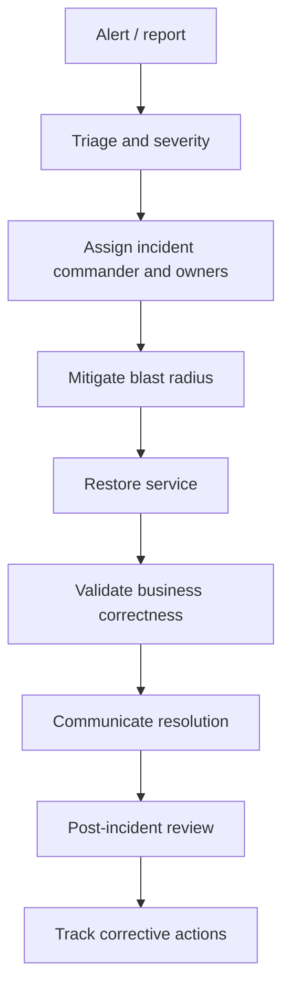

# Standardizing Handoff Processes and Operational Responsibilities

A Java function may be written, tested, and deployed by one team, yet once in production, multiple groups participate in keeping the service running: product teams, platform teams, security, database, network, support, and the cloud provider. Without clearly defining who owns the service, who handles alerts, who is authorized to change configurations, and who is accountable for recovery, incidents easily bounce between teams.

**Operational handoff** is the process of transitioning a service from development into a production-ready state with defined ownership, access permissions, documentation, telemetry, change procedures, support boundaries, and control evidence. Handoff is not merely handing over source code or deployment instructions. The receiving operations team must know how to detect problems, limit blast radius, recover, and contact the right people.

This lesson presents how to standardize service ownership and operational handoffs for Java serverless. Topics include RACI, service catalogs, SLIs/SLOs, on-call/escalation, runbooks, incident/change/release management, IAM and secret ownership, audit evidence, shared responsibility with cloud providers, FinOps ownership, and production readiness checklists.

## 1. Why Standardize Handoffs?

### 1.1. Serverless Still Requires Accountable People

FaaS frees engineering teams from directly managing physical servers or the function runtime's operating system. However, the owning application team remains accountable for:

- business logic, input validation, and API/event contracts;
- IAM roles, resource policies, secret references, and runtime configuration;
- timeouts, memory, concurrency, retries, and failure destinations;
- data, schemas, idempotency, and business recovery;
- logging, metrics, tracing, alerts, and dashboards;
- deployments, rollbacks, compatibility, and incident response;
- costs, quotas, retention, and compliance requirements.

Cloud providers operate the underlying service infrastructure under the shared responsibility model. That does not remove the application owner's accountability for how the function is configured and used.

### 1.2. What Happens When Ownership Is Unclear?

For example, suppose a queue backlog grows and orders stall:

- Developers think the platform team manages event source mappings.
- The platform team thinks the product team owns the queue and consumer logic.
- Support does not know who is authorized to redrive the DLQ.
- Security does not know who approves read access to production data.
- Nobody has a runbook specifying whether raising concurrency is safe.

While teams debate responsibility, the backlog keeps growing and may breach SLAs. A solid handoff answers these questions upfront, before an incident strikes.

### 1.3. Expected Outcomes

After handoff, the operating team can:

1. Identify the service owner and support teams at each layer.
2. Locate dashboards, alerts, runbooks, and deployment records.
3. Assess severity and invoke the right escalation path.
4. Execute pre-approved operational procedures.
5. Restore the service or switch to impact-reduction modes.
6. Identify data, security, and compliance risks during handling.
7. Know which actions require the application owner, platform team, or cloud provider.

## 2. Service Ownership and the Service Catalog

### 2.1. Every Service Needs One Clear Owner

Each production service should have one team holding ultimate accountability for business outcomes and operations. There can be many contributors, yet responsibility must never be diluted to the point where no one decides.

The service owner is typically accountable for:

- ensuring the service meets committed business outcomes and SLOs;
- technical backlog, dependencies, and lifecycle management;
- production readiness and operational documentation;
- triaging incidents and coordinating application bug fixes;
- reviewing cost, capacity, and security posture;
- maintaining owner, contact, and escalation information.

An individual may act as technical owner or primary contact, but ownership should attach to a team so it does not evaporate when personnel change.

### 2.2. Minimum Service Catalog

The service catalog is the canonical lookup for operational details. A record for a Java FaaS workload may include:

| Field | Contents |
| --- | --- |
| Service name | Unique service identifier |
| Business purpose | Business capability the service supports |
| Owner team | Ultimately accountable team |
| Technical owner | Technical owner/group |
| On-call route | Pager/team alias or on-call schedule |
| Criticality | Criticality tier by business impact |
| Environments | Dev, staging, production, and regions |
| Entry points | HTTP routes, event sources, schedules |
| Dependencies | Databases, queues, topics, APIs, secrets, network |
| Data classification | Data categories and handling requirements |
| SLO/dashboard | Dashboard and SLO links or names |
| Runbooks | Guides for handling primary scenarios |
| Deployment | Pipeline, IaC repository, release process |
| Recovery | RTO/RPO or appropriate recovery targets |
| Cost ownership | Cost center, budget owner, and tags |
| Support boundary | What the team owns vs. what platform/provider owns |

Never store passwords, access tokens, or secret values in the catalog. Store only references to the secret management system and instructions for requesting access.

### 2.3. File-Based Metadata

Illustrative service metadata example:

```yaml
service:
  name: order-events
  purpose: Process order lifecycle events
  ownerTeam: commerce-platform
  technicalContact: order-events-oncall
  criticality: high

runtime:
  language: Java
  javaVersion: "21"
  deploymentType: function
  environments:
    - staging
    - production

operations:
  dashboard: observability/order-events
  runbook: runbooks/order-events.md
  deploymentPipeline: ci/order-events-release
  onCallRoute: commerce-platform-primary

governance:
  dataClassification: confidential
  costCenter: CC-042
  recoveryTier: tier-2
```

This is an internal structure example, not a standard cloud provider schema. A real catalog should designate owners per field, a review process, and automated link health checks.

### 2.4. Owners Must Be Reviewed Periodically

When teams rename, services transfer groups, or dependencies change, the catalog and alert routes must be updated. Schedule periodic reviews and automated checks for services missing an owner, runbook, or on-call route.

## 3. RACI: Who Is Responsible for What?

### 3.1. Meaning of RACI

- **R — Responsible:** directly performs the work.
- **A — Accountable:** holds ultimate accountability and approves the outcome.
- **C — Consulted:** consulted before decisions are made.
- **I — Informed:** kept informed.

Each activity should have one clear Accountable party. There may be multiple Responsible or Consulted parties depending on scope.

### 3.2. Example RACI Matrix

Roles in the example:

- Product/Application team: owns business logic and the service.
- Platform team: owns deployment platforms, networking, and shared runtime tooling.
- Security/Compliance: sets policies, reviews, and monitors controls.
- SRE/Operations: operates on-call, reliability practices, and incident coordination.
- Cloud provider: operates cloud services per contract and the shared responsibility model.

| Activity | App Team | Platform | Security | SRE/Ops | Cloud Provider |
| --- | --- | --- | --- | --- | --- |
| Business behavior / API contract | A/R | I | C | C | I |
| Function code and dependencies | A/R | C | C | I | I |
| Runtime service availability | C | R | I | C | A/R per cloud service |
| Application IAM policies | A/R | C | C | I | I |
| Organization-wide guardrails | C | R | A | C | I |
| SLOs and business alerts | A/R | C | I | R/C | I |
| Shared observability platform | C | A/R | C | R | I |
| Application incident | A/R | C | C | R/C | I/C |
| Cloud service incident | C | R/C | I | R/C | A/R per support contract |
| Application release | A/R | C | C | I | I |
| Shared infrastructure change | C | A/R | C | R/C | I |
| Data classification / retention policy | R | C | A | I | I/C |
| Service cost allocation | A/R | C | I | C | I |

Adapt RACI to your organization. Never assign the cloud provider as owner of application code, data correctness, or customer-configured IAM policies. For managed services, the provider may own the control plane/runtime layer while the customer remains accountable for configuration and workloads.

### 3.3. Avoiding Gaps and Overlaps

Audit the matrix with these questions:

- Does any activity lack an `A`?
- Do multiple `A`s cause decision deadlocks?
- Are there alerts with no receiving team?
- Are there production permissions with no approving owner?
- Are there dependencies with no known owning team?
- Are there incident actions requiring provider support where nobody knows who opens the case?

When multiple teams collaborate, define clearly who coordinates and who holds final decision authority during an incident.

## 4. Shared Responsibility in Cloud Serverless

### 4.1. What Does the Provider Manage?

Depending on the FaaS offering and contract, the cloud provider typically manages some or most of:

- physical infrastructure, data centers, and hardware;
- managed service networking and control planes;
- host operating systems/hypervisors or runtime infrastructure per service model;
- control-plane/data-plane availability per SLA;
- patching and operating managed components that customers cannot directly access;
- provider-supplied billing, logging, and service health tools.

Exact boundaries differ across FaaS, container platforms, managed databases, queues, and support tiers. Review the provider's service-specific responsibility documentation and SLAs.

### 4.2. What Does the Customer / Application Owner Manage?

Application owners are typically accountable for:

- code, packages, dependencies, and runtime configuration;
- function timeouts, memory, concurrency, retries, and event source mappings;
- API authentication/authorization and input validation;
- IAM execution roles, resource policies, and network access;
- data, encryption configurations, retention, and backup policies;
- secret usage and rotation integration;
- observability, alerts, SLOs, and incident runbooks;
- deployments, rollbacks, compatibility, and business recovery;
- costs incurred by service usage.

### 4.3. Example Shared Responsibility Matrix

| Control Area | Provider Typically Owns | Customer / Application Owner Typically Owns |
| --- | --- | --- |
| Physical security | Data centers, physical access | Selecting appropriate regions/services and configuring data controls |
| Host/runtime infrastructure | Managed host/runtime platform | Runtime version, application package, and configuration |
| Identity | Identity service availability | Principals, roles, trust policies, least privilege |
| Data | Underlying storage per service | Classification, access, encryption settings, retention, backup/recovery |
| Network | Cloud backbone / control plane | VPC/subnets/security groups/endpoints and egress policies |
| Application security | Service platform | Input validation, authz, dependency patching, secure coding |
| Availability | Service SLA / control plane | Architecture, quotas, retries, fallbacks, SLOs, and DR |
| Compliance evidence | Provider attestations for their scope | Workload evidence, access reviews, data flows, and operational records |

Never treat a cloud provider's compliance certification as automatic proof that your organization's application is compliant. Certification scope must cover the relevant services, regions, and controls; customers must still furnish evidence for their own layers.

## 5. Operational Handoff: Moving from Development to Production

### 5.1. Handoff Is a Readiness Gate

Do not hand off a service merely because the deployment pipeline succeeded. Prior to production, the application team must demonstrate the service is observable, supportable, and recoverable.

Content areas required at handoff:

1. Service description and ownership.
2. Architecture, triggers, and dependency map.
3. SLOs/SLIs, dashboards, and alerts.
4. Runbooks and escalation paths.
5. Deployment, rollback, and configuration management.
6. IAM, secrets, data classification, and access reviews.
7. Backups, restores, replays, and disaster recovery.
8. Cost owner, budget, and FinOps metrics.
9. Known risks, limitations, and technical debt.
10. Platform and provider contact/support boundaries.

### 5.2. Architecture and Dependency Map

The handoff diagram must show:

- HTTP ingress / API Gateway and authentication boundaries;
- event sources, queues/topics/streams, and retry/DLQ paths;
- functions, versions/aliases/revisions, and runtimes;
- databases, object storage, caches, and external APIs;
- IAM principals/roles and trust boundaries;
- network paths, private endpoints, and egress;
- telemetry collectors/exporters and alert routes.

Document critical dependencies, timeouts, quotas, owning teams, and failure modes. The diagram must be concrete enough for responders to determine blast radius when any dependency fails.

### 5.3. Deployment Handoff

Deployment handoff documentation must specify:

- repository and release branches/tags;
- CI/CD pipelines and artifact identities/digests;
- IaC source of truth;
- environments and approval gates;
- how the exact same artifact promotes across environments;
- rollback targets and rollback conditions;
- migration/schema compatibility;
- who can deploy and who approves production releases.

Never share deployment credentials inside documentation. Use workload identities / short-lived credentials with least privilege.

### 5.4. Handoff Meeting and Sign-Off

An effective handoff session should include:

- an architecture and data flow walkthrough;
- a live demo of dashboards, alerts, and logs/traces;
- walking through a common failure scenario;
- testing deploy/rollback in an appropriate environment;
- verifying access permissions and escalation routes;
- logging open questions, owners, and due dates.

Sign-off confirms readiness criteria are satisfied or exceptions have approved owners. It does not remove ongoing accountability from the service owner.

## 6. SLIs, SLOs, and SLAs in Operations

### 6.1. Distinguishing SLIs, SLOs, and SLAs

- **SLI (Service Level Indicator):** a quantitative measurement of service quality, such as request success rate or p95 latency.
- **SLO (Service Level Objective):** an internal target for an SLI over a rolling or fixed time window.
- **SLA (Service Level Agreement):** a formal commitment to customers or partners, potentially backed by support terms or service credits.

SLOs should generally be stricter than SLAs so operations teams have time to detect and fix issues before breaching external commitments.

### 6.2. SLIs for HTTP Functions

Example SLIs:

- availability: ratio of valid requests receiving contract-compliant successful responses;
- latency: ratio of requests completing under a threshold;
- correctness: ratio of responses upholding business invariants;
- freshness: delay from event generation to processing completion;
- durability: ratio of accepted events durably persisted without loss.

Do not count every client-caused `4xx` as a service failure if it is a valid business rejection. Define numerators and denominators explicitly to avoid distorting SLIs.

### 6.3. SLIs for Queue/Event Consumers

Relevant indicators:

- ratio of successfully processed events;
- oldest message age;
- consumer lag per partition/shard;
- ratio of messages routed to the DLQ;
- event processing duration;
- duplicate or failed processing rate;
- end-to-end latency from event timestamp.

High queue depth does not necessarily violate an SLO if consumers still meet freshness targets. Conversely, low queue depth paired with high oldest message age may signal a poison message or stuck partition.

### 6.4. Error Budgets

With a 99.9% availability SLO over 30 days, the error budget is roughly 0.1% of time or request count depending on how the SLI is measured. For a request-based SLI with 10 million valid requests, the error budget is roughly 10,000 failed requests.

Error budgets balance release velocity against reliability. When budget burns quickly, teams can slow down changes, expand testing, or prioritize reliability work. Tailor policies to service criticality and customer contracts.

### 6.5. Do Not Measure Function Status Alone

A function can return HTTP `200` while the business transaction remains incomplete, an event failed to persist durably, or side effects were duplicated. SLOs should measure outcomes at the appropriate API/workflow boundary, not just invocation success.

## 7. On-Call, Escalation, and Incident Response

### 7.1. On-Call Ownership

The service catalog must list:

- primary on-call team/route;
- secondary/escalation team;
- support hours (24x7 or business hours);
- how to reach platform, security, and database owners;
- provider support plan and how to open a support case;
- who holds authority to shed load, disable triggers, or roll back.

Never rely on a single individual's name as a permanent contact. Use team rotations with backup coverage when the primary responder is unavailable.

### 7.2. Severity and Escalation

Example severity model:

| Level | Impact | Response |
| --- | --- | --- |
| SEV-1 | Widespread service outage, data corruption/loss, or severe impact | Activate incident command, page owners and executive escalation per policy |
| SEV-2 | Core functionality degraded, growing backlogs, or multi-customer errors | Immediate on-call response per internal SLA, coordinate dependency owners |
| SEV-3 | Limited impact with an available workaround | Owning team handles within published support hours |
| SEV-4 | Minor issue, no significant production impact | Log in backlog and schedule normally |

Response times and severity criteria must be standardized across the organization. The table above is illustrative and does not replace official incident policies.

### 7.3. Incident Roles

For major incidents, assign distinct roles:

- Incident commander: coordinates response and sets priorities.
- Technical lead: investigates and proposes technical mitigations.
- Communications lead: updates stakeholders and customers per policy.
- Scribe: records timeline, decisions, and action items.
- Service owner: validates business impact and approves business-facing workarounds.

One person may wear multiple hats in smaller incidents, but decision authority must remain unambiguous.

### 7.4. Incident Lifecycle



Prioritize containing impact and restoring the service safely. Never purge backlogs or blindly redrive an entire DLQ just to make dashboards green without confirming records can be reprocessed safely.

## 8. Runbooks: Guides for Controlled Action

### 8.1. Runbooks Differ from Architecture Docs

Architecture documents explain how a system is designed. Runbooks tell responders what to do when a specific symptom appears.

A runbook should include:

1. Title and symptom.
2. Scope/impact and suggested severity.
3. Dashboards, log queries, and metrics to inspect.
4. Common root causes.
5. Ordered diagnostic steps.
6. Bounded impact-mitigation actions.
7. Rollback/escalation triggers.
8. Recovery and business-correctness verification.
9. Prohibited actions or steps requiring approval.
10. Owner and last-reviewed date.

### 8.2. Example Runbook: Growing Queue Backlog

**Symptom:** oldest message age or consumer lag exceeds SLO.

**Checks:**

- enqueue vs. dequeue rate;
- function concurrency, duration, throttles, and error rate;
- database/API latency and throttling;
- DLQ depth and receive counts;
- which partitions/groups are stuck;
- recent releases and configuration changes.

**Mitigation:**

1. Determine whether downstream dependencies are overloaded.
2. If downstream is healthy with headroom, raise concurrency within tested bounds.
3. If downstream is overloaded, lower consumer concurrency and throttle producers.
4. Quarantine poison messages per policy without dropping critical records.
5. Redrive only after the root cause is resolved and idempotency is verified.

**Recovery:**

- oldest message age drops back within SLO;
- backlog trends downward steadily;
- DLQ stops growing abnormally;
- business completion rates and data reconciliation pass checks.

**Escalate:** engage database/platform owners if throttling or service health exceeds the application team's scope.

### 8.3. Example Runbook: Function Error Rate Spike After Release

**Checks:** which version/alias/revision is receiving traffic, error types, init duration, dependencies, config revisions, IAM changes, and schema compatibility.

**Actions:**

1. Determine whether errors are concentrated on the new version or across all versions.
2. Check health gates and business metrics.
3. If errors stem from the release and rollback is safe, shift traffic back to the last known good version.
4. If database/event schemas changed incompatibly, halt automated rollback and engage the migration owner.
5. Confirm post-rollback requests/events process cleanly with no duplicate side effects.

### 8.4. Example Runbook: Access Denied

**Checks:** execution role/principal, resource policies, secret references, region/account, deployment changes, and audit logs.

**Actions:**

- identify the exact denied action and resource;
- inspect recent policy changes;
- restore the previously reviewed policy if a release broke permissions;
- request security/platform owner review if new permissions are genuinely needed;
- never grant wildcard permissions as a quick fix;
- re-verify access using the runtime principal after remediation.

### 8.5. Runbooks Must Be Tested

An untested document may lack required permissions, list broken commands, or point to deleted dashboards. Periodically run game days or tabletop exercises and update runbooks after every incident.

## 9. Change Management and Release Governance

### 9.1. Categorizing Changes

Not every change needs identical approvals. Classify into:

- **Standard change:** repeatable, low-risk, backed by pre-verified procedures and rollback.
- **Normal change:** requires review and approval per change policy.
- **Emergency change:** urgent fix to restore service or mitigate risk; still requires auditing and post-change review.

Classification must follow organizational policy. Never abuse emergency changes to routinely bypass controls.

### 9.2. Change Records

A change record should contain:

- purpose and scope;
- affected services, environments, and resources;
- artifact digests and IaC/config revisions;
- risk and impact assessment;
- dependency, schema, and event compatibility;
- test and approval evidence;
- deployment window if applicable;
- rollback and compensation plans;
- owner, approver, and timestamps;
- post-change validation.

### 9.3. Separation of Duties

For critical production workloads, the author of a change should not automatically serve as the sole final approver. CI/CD can enforce branch protection, required reviews, signed artifacts, and environment approvals. Grant deployment permissions to pipeline identities rather than giving long-lived production credentials to every developer.

### 9.4. Emergency Access

Break-glass access requires:

- justification and incident/change ID;
- short expiration window;
- minimal permissions tailored to the scenario;
- approval or post-hoc review per policy;
- full auditing;
- automatic revocation or verified revocation at expiry.

Never share generic admin accounts. Emergency access must have an owner and post-incident review.

### 9.5. Rollback Is More Than Reverting Code

Rollbacks can be complicated by:

- database migrations;
- published event schemas;
- secret/config rotations;
- IAM policy edits;
- newly created resources already holding live data;
- irreversible external side effects.

Release plans must distinguish binary rollback, configuration rollback, infrastructure rollback, and business compensation as separate actions. Never delete new resources if live data or active consumers depend on them.

## 10. IAM, Secrets, and Operational Access

### 10.1. Separating Runtime Identities from Human Identities

Java functions should use dedicated execution roles or service accounts scoped strictly to their needs. Operators sign in using individual/federated identities, MFA, and time-bound roles. Never use a runtime role as a human login or share static access keys.

### 10.2. Least Privilege

Policies should constrain:

- specific actions;
- specific resource ARNs/IDs;
- environment, account, and region;
- network/tag conditions where appropriate;
- required secrets/resources only;
- time bounds or session context where supported.

Avoid using `*` across all actions/resources merely to silence permission errors. Where provider semantics require wildcards, document why and narrow scope using conditions.

### 10.3. Access Reviews

Periodically review:

- who holds production deployment permissions;
- who can read sensitive data;
- which functions can invoke other functions;
- which roles read secrets or decrypt keys;
- which policies can alter event source mappings, queues, or DLQs;
- provider support access or cross-account roles.

Revoke unneeded access promptly when team members change roles or services retire.

### 10.4. Secret Ownership and Rotation

Every secret needs an owner, purpose, consumers, rotation policy, and rotation verification method. Runtimes should fetch secrets via a secret manager/identity rather than embedding them in code, environment artifacts, or logs. Test rotation compatibility with connection pools/caches and plan for functions still holding older credentials in flight.

### 10.5. DLQ and Replay Permissions

Redrives can trigger side effects and heavy load. Restrict production replay permissions to designated groups; require change/incident references, rate limits, idempotency checks, and auditing. Support teams should not have unrestricted redrive permissions without understanding business semantics.

## 11. Data Governance, Retention, and Evidence

### 11.1. Data Classification

The service catalog should record what data a function receives, processes, and emits. Classifications may include public, internal, confidential, and restricted per organizational policy. Identify:

- data owner/steward;
- processing purpose;
- data residency/region;
- encryption at rest and in transit;
- access roles;
- retention and deletion rules;
- backup/restore rules;
- downstream processors and external providers.

### 11.2. Event Payloads and Logs

Never assume full event payloads belong in logs. Logs should capture essential metadata such as event ID, type, schema version, and correlation ID. Strip or mask PII, payment data, tokens, and secrets per policy.

If DLQs store full payloads, enforce encryption, access controls, and retention at least as strict as the primary data source. A DLQ holds real data, not harmless debug scraps.

### 11.3. Evidence to Retain

Depending on compliance scope, evidence may include:

- access reviews and IAM policy approvals;
- deployment, release, and change records;
- artifact digests, signatures/provenance, and scan reports;
- backup/restore test results;
- incident timelines and post-incident actions;
- SLO reports and alert reviews;
- data retention/deletion evidence;
- provider assurance reports and contract references;
- vulnerability remediation and exception records.

Evidence needs timestamps, owners, sources, and retention. Link to authoritative systems of record rather than duplicating scattered copies.

### 11.4. Audit Trails

Sensitive operations should produce audit events:

- deployments/rollbacks;
- policy/role edits;
- secret accesses/rotations;
- queue redrives/purges;
- data exports/deletions;
- emergency access activations;
- configuration changes affecting security or reliability.

Audit logs must be protected against unauthorized editing or deletion per policy. Never allow application owners to alter control evidence without an audit trail.

## 12. Backup, Recovery, and Continuity Ownership

### 12.1. RTO and RPO

- **RTO (Recovery Time Objective):** target duration to restore service after disruption.
- **RPO (Recovery Point Objective):** maximum acceptable data loss measured in time or recovery points.

RTO/RPO must derive from business impact, not merely cloud service feature specs. Having automated database backups does not automatically mean the application can recover end-to-end workflows within RTO.

### 12.2. Who Owns Recovery?

Assign explicit owners for:

- backup policies and encryption;
- restore execution;
- queue/event replay;
- DLQ triage;
- schema/data reconciliation;
- region/dependency failover;
- post-restore business validation.

Platform teams may supply backup/restore tooling; application owners must verify that restored data yields valid business state.

### 12.3. Recovery Testing

Periodically test:

- restoring databases into isolated environments;
- restoring objects by version/retention;
- replaying events over a time window;
- running idempotent consumers against duplicates;
- verifying sequence/ordering and aggregate totals;
- measuring actual duration against RTO/RPO.

Green backup jobs alone do not prove restores succeed. Recovery tests must produce evidence and follow-up actions whenever targets are missed.

### 12.4. Business Continuity During Dependency Failures

Runbooks must specify:

- which dependencies have fallbacks;
- which operations can be queued or deferred;
- which operations must fail closed;
- which data may be served stale;
- when to pause producers;
- who approves degraded operation mode;
- how to reconcile once dependencies recover.

Never use fallbacks to bypass security or record invalid business outcomes. For instance, payment authorization must never be assumed successful merely because the provider timed out.

## 13. Cost Ownership and FinOps Responsibility

### 13.1. Who Owns Costs?

Service owners must know their budgets, cost centers, cost per request, and cost per successful business transaction. Platform teams may manage shared infrastructure, yet application teams must understand the cost impact of invocations, retries, log volume, data transfer, and database usage.

### 13.2. Cost Allocation

Apply consistent tags/labels for service, environment, team, owner, and cost center. Shared costs such as NAT gateways, observability, or shared database clusters require allocation drivers and an owner for the allocation rules.

### 13.3. Cost Anomaly Runbook

When costs spike unexpectedly:

1. Identify the surging resource, service, and region.
2. Correlate against requests, invocations, retries, event rates, and recent deployments.
3. Check for event loops, retry storms, high log cardinality, and data transfer spikes.
4. Distinguish legitimate business growth from abnormal usage.
5. Apply mitigations such as rate limits, loop fixes, trimming log noise, or tuning capacity.
6. Never cut capacity if doing so breaks SLOs or recovery posture.
7. Record the owner, estimated savings, and post-change outcome.

## 14. Vendor and Cloud Provider Support

### 14.1. Defining Support Boundaries

The service catalog should document:

- cloud services and regions in use;
- SLAs and support plans;
- how to check provider service health;
- who is authorized to open support cases;
- details to provide (request IDs, regions, timestamps, resource IDs);
- data prohibited from sharing with providers;
- escalation workflow when a provider is unresponsive.

### 14.2. Preparing Evidence When Opening a Case

Gather at minimum:

- UTC timestamps and regions;
- service/resource identifiers;
- permitted request/invocation IDs;
- error codes and symptoms;
- impact scope and start time;
- troubleshooting steps already attempted;
- links to relevant status/metrics.

Never send secrets, raw customer payloads, or unnecessary PII. Use only organization-approved support channels.

### 14.3. Provider Incidents Do Not Exempt Application Recovery

When a provider suffers an outage, the application owner must still decide whether to pause producers, queue work, fail over, communicate impact, and reconcile after recovery. Provider availability responsibilities do not replace application business continuity.

## 15. Knowledge Transfer and Operational Documentation

### 15.1. Required Documentation

- service overview and owner;
- architecture and data flows;
- API/event contracts and schema versions;
- deployment and configuration guides;
- IAM/secret references and access request paths;
- dashboards, SLIs, and SLOs;
- runbooks and incident playbooks;
- backup, restore, and replay procedures;
- cost dashboards and budget owners;
- known limitations, dependency risks, and technical debt.

### 15.2. Documentation Needs Owners and Review Dates

Every critical document should carry an owner, last-reviewed date, next-review date, and version. Broken links or renamed dashboards should be caught by periodic checks.

### 15.3. Hands-On Knowledge Transfer

The receiving operations team should perform hands-on tasks under supervision:

- trace logs/traces from a request ID;
- triage an alert and open the corresponding runbook;
- inspect queue age and DLQs;
- deploy a release to staging;
- execute a rollback in a test environment;
- verify backup/restore evidence;
- declare an incident and walk the escalation route.

Reading slides does not prove operational readiness. Use tabletop exercises or game days to uncover missing permissions and documentation gaps.

## 16. Operational Readiness Review (ORR)

### 16.1. Criteria Categories

ORR is a review conducted before launching a service to production or ahead of high-risk changes. Criteria categories can include:

| Category | Verification Questions |
| --- | --- |
| Ownership | Are service owner, backups, and on-call routes assigned? |
| Architecture | Are dependency maps and failure boundaries documented? |
| Reliability | Are SLIs/SLOs, timeouts, retries, DLQs, and recovery plans in place? |
| Observability | Are dashboards, alerts, logs/traces, and correlation working? |
| Security | Are IAM least privilege, secret handling, and access reviews verified? |
| Data | Are classification, retention, encryption, and backups defined? |
| Change | Are CI/CD, approvals, artifact identity, and rollbacks verified? |
| Operations | Are runbooks, escalation, support boundaries, and game days complete? |
| FinOps | Are budgets, tags, cost owners, and unit costs defined? |
| Compliance | Are evidence, audit trails, and control owners established? |

### 16.2. ORR Outcomes

Possible outcomes:

- **Ready:** mandatory criteria are met.
- **Ready with accepted risks:** exceptions have owners, mitigations, and expiration/review dates.
- **Not ready:** mandatory controls are missing or risks are unacceptable.

Do not turn ORR into a rubber-stamp checklist. A "runbook exists" item passes only when the runbook is usable and on-call engineers know how to find it.

### 16.3. Example Handoff Checklist

- [ ] Service catalog lists owning team and escalation route.
- [ ] RACI assigns A/R across application, platform, security, and operations.
- [ ] Architecture and dependency map are up to date.
- [ ] HTTP/event triggers and retry/DLQ semantics are documented.
- [ ] SLIs/SLOs and business success definitions are agreed upon.
- [ ] Dashboards and alert routes have been tested.
- [ ] Runbooks exist for queue backlogs, function errors, access denied, and dependency outages.
- [ ] CI/CD, immutable artifacts, approvals, and rollbacks have been tested.
- [ ] IAM runtime/human identities and emergency access have been reviewed.
- [ ] Secret owners, rotation, and recovery paths are clear.
- [ ] Data classification, encryption, retention, and audit evidence are clear.
- [ ] Backup/restore/replay procedures have been rehearsed.
- [ ] Cost tags, budget, cost owner, and unit economics are established.
- [ ] Provider support plan and escalation routes are documented.
- [ ] Known risks and accepted exceptions have owners and review dates.
- [ ] The receiving operations team has completed knowledge transfer.

## 17. Example Handoff Record

A concise record that can live in the service catalog or change system:

```yaml
handoff:
  service: order-events
  release:
    version: 2.4.0
    artifactDigest: sha256:REPLACE_WITH_REAL_DIGEST
    infrastructureRevision: infra-7c21a
    configRevision: prod-config-18

  ownership:
    accountableTeam: commerce-platform
    primaryOnCall: commerce-platform-primary
    secondaryOnCall: platform-runtime-secondary
    securityContact: security-operations

  readiness:
    sloReviewed: true
    dashboardVerified: true
    runbookExercised: true
    rollbackTested: true
    restoreTested: true
    accessReviewed: true

  exceptions:
    - id: RISK-204
      owner: commerce-platform
      mitigation: Limit consumer concurrency until database index rollout
      reviewDate: 2026-12-01

  signoff:
    applicationOwner: approved
    operations: approved
    security: approved
```

Values above are illustrative. Never set `true` merely because a document exists; link to test or approval evidence. Never store tokens, secrets, or personal data in a handoff record.

## 18. Handoff Anti-Patterns

### 18.1. "Platform Team Owns Everything"

Platform teams typically own the paved road, runtime platform, and shared infrastructure. They do not automatically own each service's business logic, event correctness, data retention, or customer impact.

### 18.2. "Developers Deployed It, So Developers Are On-Call Forever"

Not every developer needs to sit on a 24x7 rotation. Team ownership, on-call rotations, and escalation must align with criticality and the support model. If a product team is not on call, an operations team needs the permissions and capability to respond alongside escalation paths back to the application owner.

### 18.3. Runbooks That Simply Say "Restart Function"

Functions are not always-on servers you can restart. For FaaS, identify the actual action: disable/enable event sources, shift aliases/revisions, lower concurrency, roll back configuration, redrive messages, or open a support case. Each action carries distinct side effects.

### 18.4. Shared Production Credentials

Shared admin accounts destroy attribution and auditing. Use individual identities, temporary roles, MFA, and pipeline identities.

### 18.5. Handoff Without Rehearsal

Documentation may be stale or responders may lack permissions. Game days and hands-on drills verify that procedures actually work.

### 18.6. Signing Off Without Exception Owners

Unresolved risks must carry an owner, mitigation, review date, and closure criteria. An unowned "known issue" becomes unmanaged operational debt.

## 19. Periodic Operational Checklist

### Weekly or by Criticality

- Check SLOs/error budgets, queue age, DLQs, and dependency health.
- Review alert noise, unowned alerts, and runbook links.
- Verify recent deployments and rollback readiness.
- Monitor cost anomalies, retry amplification, and resource quotas.

### Monthly or by Policy

- Review the service catalog, RACI, and on-call contacts.
- Review IAM access, emergency roles, and secret rotation status.
- Reconcile cost allocation and unallocated resources.
- Check vulnerabilities, dependency patches, and exception expirations.
- Review backup/restore/replay evidence per recovery tier.

### Quarterly or on Major Changes

- Run tabletop exercises or game days.
- Review RTO/RPO and business continuity.
- Confirm provider support/SLAs and data residency.
- Review data classification, retention, and audit evidence.
- Verify service owners and dependency ownership after organizational changes.

Adjust cadence to criticality, regulations, and internal policies. High-risk items require more frequent inspection.

## Conclusion

Standardizing handoffs gives Java serverless a clear ownership model spanning code, runtime, data, security, incidents, and cost. The service catalog and RACI clarify who decides; SLIs/SLOs and dashboards show how the service performs; runbooks, on-call, and escalation specify what to do during incidents; and change governance and audit evidence keep every change traceable.

Cloud providers manage the infrastructure layers of managed services, while application owners remain responsible for code, configuration, data, IAM, retries, event semantics, and business recovery within their scope. Handoff is truly complete only when the operating team holds appropriate permissions, understands dependencies, can locate documentation, and has rehearsed critical operations.

Maintain ownership and documentation as part of the service lifecycle. Every release, incident, dependency change, or org change can make operational details stale. Periodic reviews, game days, and owned evidence keep the service production-ready long after the initial handoff.
