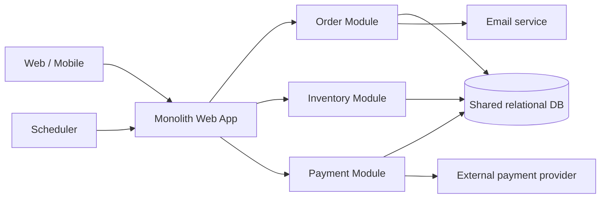
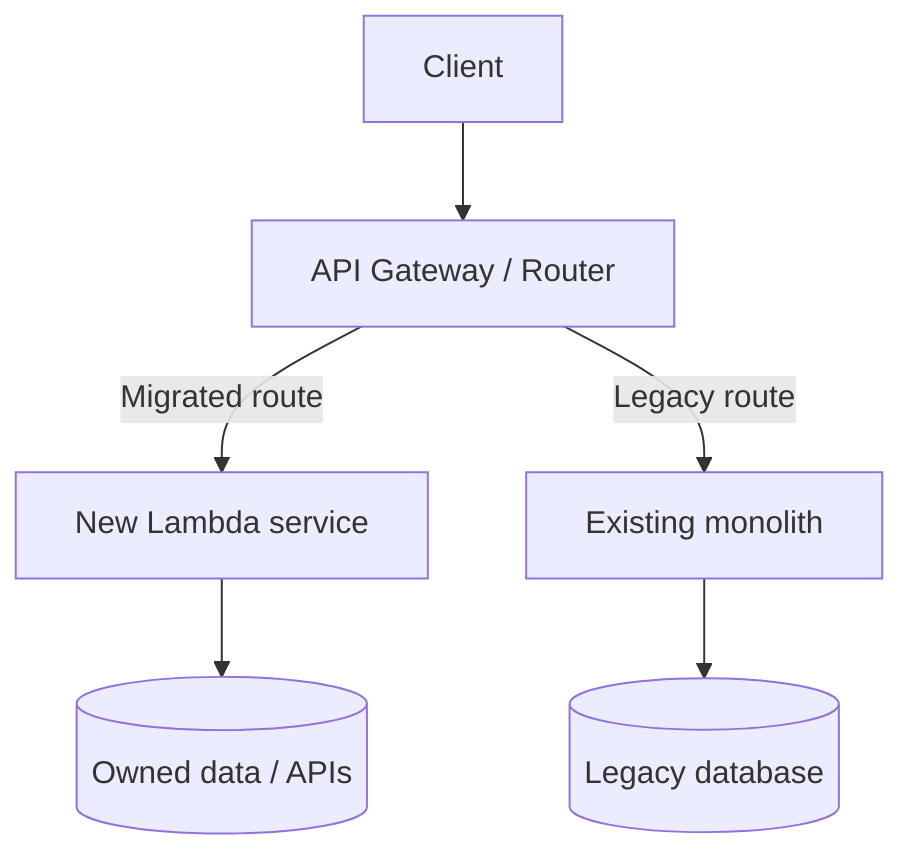
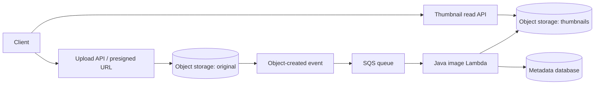

# Assessing the Existing Application and Choosing What to Migrate First

## 1. Why Shouldn't You Migrate the Entire Application at Once?

Migrating to serverless is not as simple as packaging every module into a Lambda function. An existing application usually contains many types of workloads: HTTP APIs, scheduled jobs, batch jobs, message processing, database access, long-running tasks, and components that keep sessions in memory. Each type has a different level of suitability for FaaS.

If you migrate everything at once, the team may simultaneously have to change the runtime, state management, networking, IAM, data flow, deployment, monitoring, and operational procedures. A large scope makes it hard to pinpoint the root cause when errors occur, complicates rollback, and drags out the transition timeline.

A safer strategy is to assess the existing application, choose a workload with clear boundaries and low risk to tackle first, and then use real-world experience to scale out. The first slice should validate how build/deploy, security, observability, data correctness, retry, cost, and rollback work on the target platform.

In the `CLOUD_SERVERLESS` module, the goal is to identify business capabilities suitable for running as Java functions triggered by HTTP, messages, or events; determine which parts should remain as-is; and sequence the migration based on benefit, complexity, and risk.

## 2. Start with a Current-State Inventory

Before picking a workload, you need to know what the application does and what it depends on. Gather information from code, deployment configurations, logs, metrics, tracing, databases, and discussions with the operations team.

A minimal inventory should include:

| Information Category | What to Collect | Why It Matters |
|---|---|---|
| Business capability | Functionality, owner, criticality, SLA/SLO | Determines business value and migration risk |
| Runtime | Java version, framework, JVM flags, native libraries | Checks compatibility with Lambda/target runtime |
| Workload | HTTP, queue, event, schedule, batch, stream | Determines trigger and execution model |
| Traffic | RPS, burst, concurrency, batch size, seasonality | Sizes memory, concurrency, and cost |
| Duration | p50/p95/p99, longest execution time, cold path | Checks timeout limits and latency |
| State | Session, cache, local files, in-memory locks, transactions | Identifies state that must be moved out of process |
| Data | Database, schema, volume, growth, consistency, backups | Determines data migration and ownership |
| Dependencies | Internal/external APIs, queues, file shares, DNS | Reveals coupling and network constraints |
| Security | IAM/service accounts, secrets, PII, encryption, audit | Determines permissions and compliance requirements |
| Operations | Deploy, rollback, alerts, incidents, on-call | Estimates operational change overhead |
| Cost | Compute, licenses, database, network, support | Compares current TCO and serverless TCO |

Do not rely solely on reading source code. An endpoint may look simple yet depend on a shared database, session store, filesystem, or an internal API accessible only from a specific subnet. Runtime data and production telemetry often show that real workloads differ from the development team's assumptions.

## 3. Draw a Dependency Map and Business Boundaries

Draw a component and data flow diagram before splitting functions. Each block should represent a capability or business responsibility, not just a Java class.



The diagram shows that Order, Inventory, and Payment are different business modules that all write to the same database. If you split them into functions immediately, the team may create distributed transactions and schema coupling. You must determine which module owns each table, the consistency rules, and how events are exchanged before splitting the runtime.

Evaluate each dependency using these questions:

- Can the dependency be invoked via a stable API or event?
- Can the schema evolve without breaking old consumers?
- Are there transactions spanning multiple modules?
- Does it rely on shared memory, the filesystem, or a local cache?
- Can access permissions be scoped per function/resource?
- If the dependency is slow or unavailable, can the workload retry or queue the work?

A good boundary has a clear input/output contract, clear state ownership, minimal shared mutable data, and can be deployed/rolled back independently.

## 4. Classify Workloads by Execution Model

Do not start with the question "which module is written in Java?". Start with how the workload is triggered and how long it needs to run.

| Current Workload Type | Signals | Suitability for Serverless |
|---|---|---|
| Stateless HTTP endpoint | Receives request, authenticates, performs short processing, returns response | Usually a good fit for Lambda + API Gateway or Function URL |
| Scheduled task | Runs hourly/daily, does not need a continuously running process | Usually a good fit for EventBridge Scheduler + Lambda |
| Queue consumer | Processes independent messages with retry and idempotency | Usually a good fit for SQS/EventBridge + Lambda |
| Event handler | Reacts to object uploads, domain events, or streams | Suitable when event contract and duplicate handling are clear |
| Short batch | Can be split into chunks with checkpoints and retries | Can use Lambda; long/large batches may need Step Functions, Batch, or containers |
| Long-running process | Runs for tens of minutes/hours, keeps state in RAM | Not suitable for a single Lambda; consider workflow/container/job services |
| Stateful session service | Holds sessions/locks/local state in process | Requires externalizing state or keeping on a more suitable platform |
| WebSocket/long-lived connection | Maintains connections and session state | Needs dedicated services; do not map each connection directly to a continuously running Lambda |
| CPU/GPU intensive | Long computation requiring specialized resources | Evaluate Lambda resource limits or dedicated container/compute |

A workload can be split into a short synchronous part and a long asynchronous part. For example, an order intake API only validates, saves the `PENDING` state, and sends a message; a worker handles payment/fulfillment afterward.

## 5. Use the 6R Model to Categorize the Application

The 6R framework is a way to classify migration strategies. It helps decide which parts to keep, which parts to replatform, and which parts need redesign.

| Strategy | Meaning | Example in a Java Application |
|---|---|---|
| Rehost | Move workload nearly as-is to different infrastructure | Move a Java VM to a cloud VM |
| Replatform | Make minimal changes to use better managed services | Move the database to a managed database while keeping the application unchanged |
| Refactor / Re-architect | Change architecture or code to leverage cloud-native/serverless | Extract HTTP handlers and queue workers into Lambda |
| Repurchase | Replace with a SaaS product | Replace an internal email system with a SaaS service |
| Retire | Decommission components that no longer provide value | Turn off unused reports or jobs |
| Retain | Keep as-is because it is not yet suitable or dependencies cannot change yet | Keep essential legacy systems in the current environment |

Migrating to serverless usually requires partial refactoring. Not every component needs refactoring: the database can be replatformed first, a batch job can stay in containers, and an unused module can be retired.

Do not apply 6R as a single fixed label for the entire application. One system can have different decisions per capability or workload.

## 6. Criteria for Selecting the First Workload

The first workload should provide high learning value while keeping scope under control. Favorable characteristics include:

- Has a clear business boundary and an accountable owner.
- Is triggered by HTTP, schedule, queue, or event with a stable contract.
- Has short execution or can be broken into small steps.
- Has minimal reliance on shared state and local filesystem.
- Can externalize state to a database/object storage/cache.
- Can be designed with idempotency and retries.
- Does not require atomic transactions across multiple systems.
- Has tests and telemetry to measure before/after.
- Can run in parallel with the legacy system during the transition period.
- Has a clear rollback or fallback path.

Examples that are usually good candidates to do first:

1. Scheduled reports or cleanup jobs that can run independently.
2. A webhook receiver that validates requests, stores the event, and enqueues processing.
3. A queue worker that processes each message independently.
4. Image/document processing after an object is uploaded.
5. A stateless HTTP endpoint with bursty traffic and short processing time.

Components that should usually not be tackled first:

- Core transactions writing to multiple shared database tables with complex consistency.
- Modules holding sessions/locks in memory with no replacement state store.
- Long-running processes that need to hold sockets or threads continuously.
- Workloads depending on native libraries without compatible binaries/runtimes.
- Components lacking an owner, tests, or telemetry.
- Systems with undefined compliance/network requirements.

This is not a blacklist. Difficult workloads can still be migrated, but foundational risks need to be resolved before selecting them as a pilot.

## 7. Scoring Suitability

A scorecard helps the team compare candidates against the same criteria. The score is a decision-support tool, not an algorithm that replaces technical review.

Example 1–5 rating scale:

| Criterion | Weight | What a High Score Means |
|---|---:|---|
| Business value / urgency | 15% | Clear business benefit and strong need for improvement |
| Event/HTTP boundary clarity | 15% | Independent trigger and contract |
| Statelessness / data isolation | 15% | Little local state, clear data ownership |
| Runtime compatibility | 10% | Java/dependencies fit the target runtime |
| Operational readiness | 10% | Has tests, telemetry, owner, and rollback |
| Scalability/elasticity benefit | 10% | Benefits from traffic bursts or event-driven scaling |
| Cost opportunity | 10% | Opportunity to lower TCO or pay per usage |
| Migration risk (inverse score) | 15% | High score means low risk and easy isolation |

Calculate weighted score:

```text
Weighted score = Σ (criterion score / 5 × criterion weight)
```

For example, a workload scores 4 on business value, 5 on boundary, 4 on statelessness, 5 on compatibility, 3 on operations, 4 on elasticity, 4 on cost, and 4 on risk. The total score is the sum of each normalized score multiplied by its weight. The team should document the evidence for each score and its confidence level.

Internal thresholds can be used, such as:

- 80–100: good pilot candidate if there are no hard blockers.
- 60–79: need to address dependencies or risks first.
- Below 60: retain, replatform, or choose another candidate first.

Do not let the total score hide a blocker. For instance, a high-scoring workload that requires cross-database transactions with a payment provider lacking idempotency still needs to be resolved first.

## 8. Example Comparison of Three Migration Candidates

Suppose an e-commerce system has three workloads:

| Candidate | Current State | Serverless Target | Main Risks | Preliminary Priority |
|---|---|---|---|---|
| Daily inventory reconciliation | Scheduled Java job, reads data and exports report | EventBridge Scheduler → Lambda/Step Functions → S3 | Execution duration, pagination, database load | High if chunkable |
| Order payment core | Writes order, reserves stock, calls payment, updates multiple tables | Could split orchestration + workers | Distributed transactions, idempotency, compensation | Lower for the first pilot |
| Product image resize | Receives uploaded file and creates thumbnails | S3 event → SQS → Lambda | Large files, duplicate events, memory, and timeout | High if sizes fit within limits |

Image resize is usually a good pilot because the trigger/event boundary is clear, outputs can be written to a dedicated prefix, and reprocessing can be made idempotent by object version/key. The payment core has high value but complex failure modes; it should be extracted after the team has inbox/outbox, idempotency, observability, and reconciliation in place.

## 9. Checking Java Runtime and Framework Compatibility

Evaluate the Java codebase before choosing the runtime:

- Is the Java version supported by the target runtime and still within its support lifecycle?
- Are the framework's startup time and memory footprint acceptable?
- Does it use heavy reflection, dynamic class loading, or large classpath scanning?
- Are there JNI/JNA calls, native executables, or architecture-dependent Lambda layers?
- Does it use background threads, internal schedulers, or long-lived connection pools?
- Does it assume the local filesystem persists long-term?
- Does it store state in static fields across requests?
- Does it rely on shutdown hooks or cleanup tied to process termination?

Java Lambda runs in an execution environment that may be reused, but you should not use static fields to store business state between invocations. Static fields are appropriate for immutable configuration or safely reusable clients; all business data must be stored in durable services.

Heavyweight frameworks like Spring can run on Lambda, but you must measure cold start, memory, and packaging. For small workloads, lightweight frameworks or plain Java handlers can reduce initialization time. GraalVM Native Image, SnapStart, and Provisioned Concurrency are specialized optimizations; there is no need to adopt them in the first migration step without baseline metrics.

## 10. Inspecting State and Sessions Before Splitting

An application running on VMs often relies on local state that the team does not notice:

- In-memory HTTP sessions.
- Local caches containing data with consistency requirements.
- Temporary files shared across requests.
- In-JVM locks synchronizing multiple threads.
- Internal schedulers running in-process.
- Connection pools or clients initialized for the application lifecycle.
- Uploaded files saved to local disk and processed in a later step.

In serverless, multiple execution environments can run concurrently and be created or destroyed at any time. Replace state with:

| Current State | Options to Consider |
|---|---|
| In-memory session | Stateless tokens or managed session store |
| Local files | Object storage such as S3 |
| Shared cache | Managed cache with explicit TTL and consistency |
| In-memory locks | Conditional writes, database locks, or distributed coordination |
| Internal scheduler | EventBridge Scheduler or workflow scheduler |
| In-process queue | SQS, EventBridge, Kinesis, or managed broker |
| JVM static business state | Database/cache/object store with clear ownership |

Do not migrate state merely by changing where it is stored. You must define the consistency, TTL, transactions, concurrency, and failure behavior of the new store.

## 11. Inspecting Data Ownership and Transaction Boundaries

Splitting a monolith into many Lambdas while letting every function read and write every table creates a distributed monolith. Deployments are separated, but data coupling remains intact.

Before extracting a module:

1. List tables/collections and their business owners.
2. Identify which module is allowed to write each type of data.
3. Find transactions spanning multiple modules.
4. Identify which read models can be eventually consistent.
5. Design event schemas and versioning.
6. Use outbox/CDC to reliably publish events when database updates succeed.
7. Use inbox/idempotency on the consumer side.
8. Establish reconciliation for unknown states after timeouts.

If a business flow requires multi-step ACID transactions on the same database, keep that core in one service first, and extract asynchronous side effects via an outbox. You do not need to break every piece of logic into tiny functions.

## 12. Choosing Triggers and Contracts for the New Workload

Select triggers based on how the business capability is invoked:

| Need | Suitable Trigger | Contract to Define |
|---|---|---|
| User needs an immediate response | HTTP/API Gateway | Method, path, auth, request/response schema, timeout |
| Run on a schedule | EventBridge Scheduler | Schedule, timezone, retries, missed invocations, and idempotency |
| React to domain events | EventBridge or broker | Event ID, schema version, ordering, retries, DLQ |
| Process backlog | SQS | Message identity, visibility timeout, batching, partial failures |
| Process continuous stream | Kinesis/Kafka | Partitions/shards, checkpoints, ordering, and replay |
| React to files | Object storage event → queue/worker | Object key/version, duplicate notifications, and file size |

For HTTP endpoints receiving long-running work, persist an operation record and return `202 Accepted` with an `operationId`; clients poll status via another endpoint. Do not hold an HTTP connection open while a worker runs for minutes if there is no genuine synchronous requirement.

## 13. Choosing How to Split Functions

A function should have one clearly explainable responsibility, but you do not need one function per method or per class.

Signals that you should split functions:

- Different triggers (HTTP vs. queue/event).
- Different security boundaries or different IAM permissions.
- Different scaling profiles.
- Different runtime/memory/timeout needs.
- Different ownership and release cadences.
- Different failure/retry policies.

Signals that you should keep logic in the same function/service:

- Steps require synchronous transactions and share the same owner.
- Splitting introduces extra network hops without clear benefit.
- Small, tightly coupled logic that always changes together.
- Splitting creates many deployments/resources without establishing data boundaries.

Avoid both extremes: a giant Lambda replacing the monolith as-is, or hundreds of overly tiny functions that make traces, permissions, and deployments hard to manage.

## 14. Choosing a Migration Strategy per Capability

Several common migration paths:

### Extract a Worker First

Extract a scheduled/batch/queue worker from the monolith. The worker receives events from a queue, processes state with clear ownership, and writes results to a store. This is usually a good step to validate retries, idempotency, deployment, and observability.

### Strangler Pattern for HTTP APIs

Place an API Gateway or routing layer in front of the system. Some routes move to new Lambdas while the remaining routes continue going to the monolith. Gradually replace routes by capability.



Do not let both the monolith and Lambda write to the same business record without a clear ownership/consistency mechanism. Strangler routing solves the traffic path; it does not automatically solve data migration.

### Event-Driven Extraction

The monolith writes business state and an outbox event in the same transaction. A relay publishes the event; a Lambda consumer handles the new capability. Once the consumer stabilizes, write responsibility or read models can gradually be shifted over.

### Replatform the Database First

If the application is primarily constrained by database operations, moving the database to a managed database can bring benefits before splitting code. However, Lambda scale-out can cause a connection storm; you need connection proxies, pool limits, and concurrency caps.

## 15. Coexistence and Data Management During Transition

For a period of time, the monolith and serverless services may coexist. You must define which system is the source of truth for each type of data.

Common patterns:

- **Single writer:** only one service is allowed to write an aggregate; other services call its API or send commands.
- **Outbox/CDC:** emit changes from database transactions so consumers can update read models.
- **Read replica/projection:** the new service reads its own model updated asynchronously.
- **Dual read:** read from the new system and compare results against the legacy system during validation.
- **Controlled dual write:** use only when an explicit idempotency/reconciliation protocol exists; avoid writing directly to two independent databases in the same request.

Naive dual writes like "write database A then write database B" have a failure window: A succeeds and B fails, or vice versa. When synchronization is needed, use outbox/CDC, sagas, or reconciliation workflows.

## 16. Data Migration and Cutover

Data migration may include initial data copying, syncing ongoing changes, checking for drift, and switching read/write ownership.

A cutover plan typically includes:

1. Back up data and verify restore capability.
2. Copy snapshot/baseline data.
3. Sync changes while the legacy system is still operating (CDC or log-based replication if appropriate).
4. Compare row counts, checksums, aggregates, and business invariants.
5. Pause or throttle writes during the cutover window if needed.
6. Sync the final delta.
7. Switch the writer/traffic in an observable step.
8. Monitor errors, latency, and data consistency.
9. Keep a rollback plan and define how to handle writes that occurred after cutover.

Data rollback is harder than code rollback. If the new system has already accepted writes, you cannot simply route traffic back to the legacy system unless the new data has been synced back. Define the rollback window, reverse replication, or a forward-fix procedure before cutover.

## 17. Assessing Network and Security Boundaries

The legacy application may run in the same subnet as databases, file servers, and internal services. Lambda/serverless services may need VPC configuration, private endpoints, DNS, routes, security groups, and NAT to reach those dependencies.

Evaluate:

- Does the function need to access private resources?
- Can managed service endpoints be used instead of the public internet?
- Do DNS and routing work from Lambda's subnets?
- Will NAT Gateway/data transfer increase costs?
- Do security groups restrict sources/destinations/ports properly?
- Is the execution role least-privilege per function?
- Are secrets retrieved from a secret manager and rotated properly?
- Do KMS keys/resource policies allow the new principals?
- Are there audit logs and traces to investigate requests across systems?

Do not expose databases or admin endpoints to the Internet just to make Lambda connectivity easy. Network/security design is part of the migration scope and must be tested in a production-like environment.

## 18. Assessing Reliability and Operational Readiness

Before migrating a workload, verify:

- Can the handler be re-run safely?
- Are retries bounded with backoff?
- Is there a stable idempotency key/event ID?
- Is there a DLQ or failure destination?
- Is the timeout budget consistent across dependencies?
- Are error, duration, concurrency, throttling, and queue age metrics in place?
- Are trace/correlation IDs propagated across HTTP/messages?
- Are alerts, runbooks, dashboards, and an owner established?
- Are there integration tests in a cloud sandbox?
- Are rollback/canary mechanisms and data recovery available?

A function can deploy successfully yet still not be production-ready if it lacks retries, idempotency, observability, and a DLQ handling process.

## 19. Evaluating Cost and TCO

Do not simply compare a monthly VM bill against Lambda request costs. TCO must include:

- Compute: VM/container baseline, Lambda requests/duration, Provisioned Concurrency.
- Storage/database: capacity, IOPS, backups, replication, managed service costs.
- Network: NAT Gateway, data transfer, private endpoints, and cross-AZ traffic.
- Observability: log ingestion, retention, metrics cardinality, trace sampling.
- Operations: patching, on-call, deployments, incidents, and platform engineering.
- Licensing: commercial Java libraries, middleware, database, or OS licenses.
- Migration: refactoring, data transfer, dual-run, testing, and training.
- Risk: downtime, duplicate side effects, compliance, and vendor dependency.

Serverless can be cheaper for bursty/intermittent workloads; steady workloads running continuously at high utilization may fit containers/VMs or other managed compute better. Provisioned Concurrency and always-on databases can dominate costs even when functions are invoked infrequently.

Calculate cost per successful business operation, not just cost per invocation. Include retries, failed invocations, downstream services, queues, networking, and observability.

## 20. Sequencing Migration in Waves

Divide the migration into waves with clear objectives:

| Wave | Scope | Learning Objective |
|---|---|---|
| 0 — Foundation | Accounts, IAM, CI/CD, IaC, logging, tracing, test sandbox | Establish a safe foundation to deploy and observe |
| 1 — Low-risk pilot | Independent scheduled task or webhook/worker | Validate triggers, retries, idempotency, and cleanup |
| 2 — Bounded capability | An HTTP API or event consumer with clear data ownership | Validate API contracts, state, and integration |
| 3 — Core workflow | Multi-step business processes, payment/order orchestration | Sagas, outbox/inbox, reconciliation, and SLOs |
| 4 — Optimize/retire legacy | Optimize costs, decommission legacy infrastructure, reduce shared dependencies | Finalize TCO and reduce operational footprint |

Do not move to the next wave just because the previous wave deployed. Exit criteria must be met: reliability, security, observability, data correctness, cost, and runbooks.

## 21. Example Pilot Plan: Image Processing

Suppose a Java monolith currently receives image uploads, resizes them, and saves thumbnails within the same HTTP request. Users must wait for processing to finish; upload traffic spikes during campaigns.

### Current State

- Web application receives multipart uploads.
- Images are temporarily stored on local disk.
- An image library runs inside the JVM.
- Thumbnails are saved on a shared file system.
- Requests time out when images are large or traffic spikes.

### Target Design



### Why Is It a Good Candidate?

- The file-created trigger is clear.
- Each object has a key/version identity.
- Workers can process items independently.
- Retries can happen per object version and write output to a deterministic key.
- No need to hold HTTP requests open during resizing.
- The queue absorbs upload bursts.

### Risks to Address

- Object-created events may be duplicated; the worker must be idempotent.
- Large files may exceed memory/time limits; enforce size limits or use containers/jobs.
- Native image libraries must be compatible with the Linux architecture/runtime.
- S3 event notifications and SQS can create infinite loops if outputs go to the same bucket/prefix; use prefix filters or a separate bucket.
- Metadata updates and thumbnail writes have a failure window; use `PROCESSING/COMPLETED/FAILED` states and reconciliation.

### Pilot Exit Criteria

- The upload API no longer holds requests open throughout resizing.
- The worker handles target image sizes within timeout/memory limits.
- Duplicate events do not produce incorrect thumbnails/metadata.
- DLQ and replay are tested.
- Queue age, processing duration, errors, and cost are tracked on dashboards.
- Fallback/rollback to the legacy processing path is available during the pilot.

## 22. Example Pilot Plan: Scheduled Reconciliation Job

A Java batch job currently runs on a VM every night to reconcile inventory and orders. If the job can be partitioned by shard or time window, it can be migrated incrementally:

1. EventBridge Scheduler emits the start event.
2. A coordinator Lambda creates a `runId` and partition tasks.
3. SQS or Step Functions distributes the tasks.
4. Java workers process each partition with checkpoints/idempotency keys.
5. Results are written to object storage/database.
6. The coordinator aggregates statuses and sends alerts upon completion.

Before migrating, measure job duration, record counts, query patterns, transactions, database load, and completion deadlines. If a partition exceeds Lambda's time limit or requires substantial resources, use AWS Batch, ECS/Fargate, or more appropriate compute instead of forcing it into a single function.

## 23. Shadow Traffic, Canary, and Rollback

Shadow traffic sends copies of requests/events to the new implementation to compare results without letting the new implementation execute real side effects. If shadow traffic calls payment/email APIs or writes to production data, it can cause duplicates; mock side effects or use a sandbox.

Canary shifts a percentage of real traffic to the new service and monitors:

- Error rate, p95/p99 latency, and timeouts.
- Data mismatches and business invariants.
- Retries, suppressed duplicates, DLQ, and queue age.
- Throttles, concurrency, and downstream pressure.
- Cost per successful operation.

Rollback must be designed in advance:

- Can routes/aliases be switched back to the old version?
- How will writes created in the new service be synced back?
- Who will consume events already enqueued that the new worker has not yet processed?
- Is the new schema compatible with old consumers?
- Can producers be paused without losing events?

Code rollback does not automatically roll back data. If schemas/events have changed incompatibly, a forward-fix or controlled reverse migration may be needed.

## 24. Migration Anti-Patterns

| Anti-Pattern | Consequence | Mitigation |
|---|---|---|
| Moving the entire monolith into one giant Lambda | Cold starts, timeouts, state, and deployment issues remain unchanged | Choose capabilities/triggers with clear boundaries |
| Splitting one function per method | Too many network hops, permissions, and deployments | Split by business responsibility and scaling boundary |
| Every function writing to shared tables | Distributed monolith and schema coupling | Define data owners and API/event contracts |
| Direct dual writes to two databases | Out-of-sync data when one write fails | Outbox/CDC, sagas, and reconciliation |
| Ignoring concurrency impact on the database | Connection storms and outages | RC, pool limits, proxies, and load testing |
| Testing only with local emulators | Misses IAM, VPC, triggers, and service semantics | Isolated cloud integration tests |
| Using warmers instead of a capacity strategy | Does not guarantee environments stay warm | PC/SnapStart/on-demand aligned with SLOs |
| Skipping observability during the pilot | Cannot diagnose errors or costs | Logging, metrics, traces, and alerts from day one |
| Big-bang cutover without rollback | Risk of downtime and data divergence | Canary, dual-run, and cutover criteria |
| Choosing serverless solely for low invocation pricing | TCO can be high due to networking, DB, PC, and telemetry | Calculate cost per successful business operation |

## 25. Process for Assessing and Selecting the First Workload

1. **Build an inventory:** capabilities, owners, runtimes, triggers, traffic, state, data, and dependencies.
2. **Draw a dependency map:** identify coupling, shared databases, and transaction boundaries.
3. **Classify workloads:** HTTP, schedule, queue, event, stream, batch, or long-running.
4. **Check FaaS fit:** execution duration, memory, CPU, concurrency, local state, and native dependencies.
5. **Assess data correctness:** event identity, idempotency, outbox/inbox, and consistency.
6. **Assess security/network:** IAM, secrets, VPC, DNS, encryption, and audit.
7. **Calculate TCO:** compute, database, network, observability, licenses, and migration costs.
8. **Score candidates:** business benefit, boundary clarity, readiness, and risk.
9. **Choose a small pilot:** independently runnable, measurable, and reversible.
10. **Define exit criteria:** SLOs, errors, data correctness, cost, security, and runbooks.
11. **Run shadow/canary:** compare outputs before shifting full traffic.
12. **Expand in waves:** move to the next workload only after the pilot meets criteria.

## 26. Pre-Migration Checklist

- [ ] Application inventory and owners exist for each capability.
- [ ] Dependency map and data ownership are documented.
- [ ] Workloads are classified by trigger and duration.
- [ ] Java runtime, frameworks, and native dependencies are verified.
- [ ] State/sessions/local files needing externalization are identified.
- [ ] Database transactions and shared schemas are reviewed.
- [ ] Event/API contracts, versioning, and idempotency plans are in place.
- [ ] IAM, secrets, VPC, DNS, and compliance are assessed.
- [ ] Traffic profile, SLOs, timeouts, and concurrency estimates exist.
- [ ] TCO includes networking, databases, logs/traces, and reserved capacity.
- [ ] Migration strategy is chosen per capability (6R).
- [ ] The pilot has a small scope, clear owner, and clear business value.
- [ ] IaC, CI/CD, cloud integration tests, and observability are ready.
- [ ] Canary/shadow strategy and rollback/data recovery plans exist.
- [ ] DLQ, replay, reconciliation, and failure runbooks are prepared.
- [ ] Exit criteria are defined before starting the pilot.

## References

- [AWS Cloud Adoption Framework](https://aws.amazon.com/cloud-adoption-framework/)
- [AWS Prescriptive Guidance: Migration strategies](https://docs.aws.amazon.com/prescriptive-guidance/latest/migration-retiring-applications/strategies.html)
- [AWS Serverless Land](https://serverlessland.com/)
- [AWS Lambda best practices](https://docs.aws.amazon.com/lambda/latest/dg/best-practices.html)
- [AWS Lambda event source mappings](https://docs.aws.amazon.com/lambda/latest/dg/invocation-eventsourcemapping.html)
- [AWS Prescriptive Guidance: Strangler Fig pattern](https://docs.aws.amazon.com/prescriptive-guidance/latest/modernization-decomposing-monoliths/strangler-fig.html)
- [AWS Database Migration Service](https://docs.aws.amazon.com/dms/latest/userguide/Welcome.html)
- [Transactional outbox pattern](https://microservices.io/patterns/data/transactional-outbox.html)

## Conclusion

Migrating to serverless should begin with understanding real workloads and dependencies, then selecting a capability with clear triggers, manageable state, and testable failure modes. Scheduled jobs, webhook receivers, queue workers, or file processing are usually better pilot candidates than core transactions with heavy shared state. Use an inventory, dependency map, 6R, and scorecard to prioritize; resolve data ownership, idempotency, security, networking, and TCO before cutover. Strangler routing, event-driven extraction, shadow traffic, and canary releases enable wave-by-wave transition, while rollback and reconciliation protect data while the monolith and serverless services coexist.
