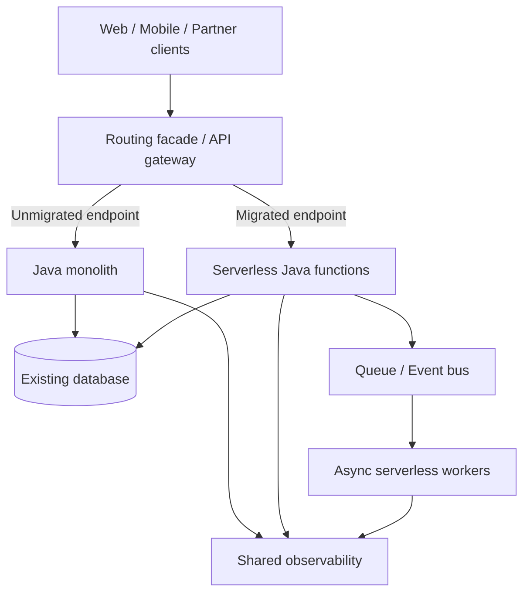
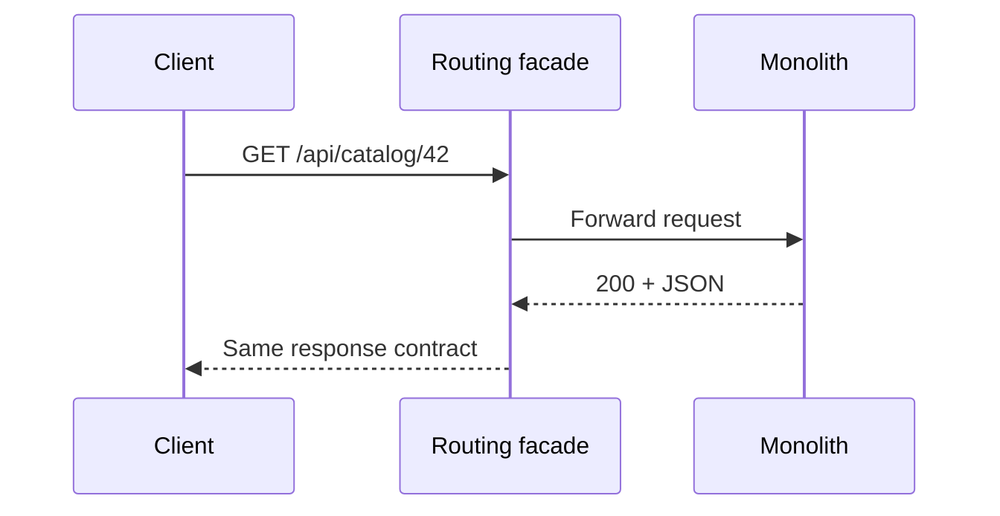
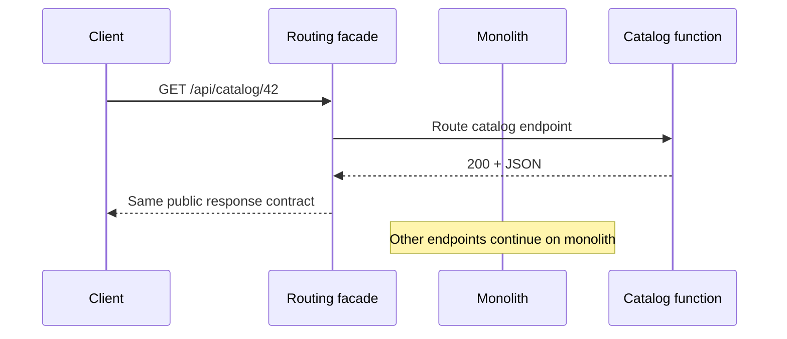
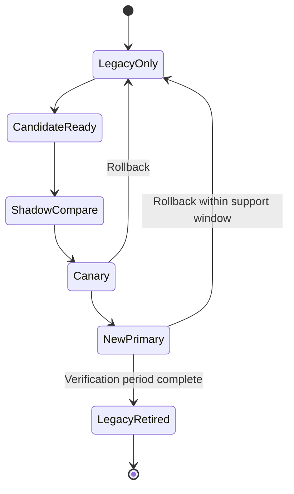

# Applying the Strangler Pattern to Replace Endpoints One by One

When migrating a Java monolith to serverless, rewriting the entire system at once usually carries high risk. A monolith may serve multiple business flows while sharing databases, sessions, transactions, and internal libraries. If everything is replaced simultaneously, a bug in one new part can impact all users and rolling back to the old version becomes difficult.

The **strangler pattern** is an incremental transition approach: place a routing layer in front of the existing system, then migrate individual endpoints or feature groups to new implementations. Unmigrated endpoints continue running on the monolith; migrated endpoints are routed to serverless functions. Once a new capability is stable, the corresponding code in the monolith can be removed.

The name comes from the image of a new vine gradually growing around an old tree. In migration, the new layer gradually takes over responsibilities from the legacy system without requiring a full replacement in a single release.

## 1. Strangler Pattern Architecture

The key component is the **routing facade** (routing layer). The facade receives requests from clients and decides whether to route them to the monolith or to the serverless implementation. The facade can be an API Gateway, API Management, reverse proxy, ingress, load balancer, or a team-operated gateway service.



Initially, the facade can forward 100% of traffic to the monolith. When a new endpoint is ready, add the corresponding route so requests go to the function. The remaining endpoints do not require changing public URLs or client contracts.

### 1.1. Role of Each Component

| Component | Responsibility |
|---|---|
| Client | Calls public APIs as before; does not need to know whether the implementation lives in the monolith or a function |
| Routing facade | Routes by path, method, headers, version, or rollout rules; enforces auth/rate limits if designed here |
| Monolith | Continues serving unmigrated endpoints and business flows that still depend on it |
| Serverless function | Owns and handles migrated endpoints |
| Data layer | Maintains the authoritative data source and write boundaries during coexistence |
| Queue/event bus | Decouples background work or emits domain events across components |
| Observability | Traces requests across the facade, monolith, functions, and dependencies |

The facade is a critical control point. If routes are misconfigured, requests may hit the wrong implementation or reach no backend at all. Therefore, the facade needs its own deployment pipeline, health/metrics, access logs, timeouts, and rollback procedures.

## 2. Which Endpoint Should You Migrate First?

Do not pick an endpoint just because it is small or has few lines of code. Evaluate business independence, data, transactions, traffic, and testability.

A good starting endpoint usually has these characteristics:

- Clear and stable HTTP contract.
- Relatively independent business responsibility.
- Does not rely deeply on the monolith's in-memory sessions or state.
- Can access data through a clear API/repository boundary.
- Can be tested independently with fixtures and integration tests.
- Has SLOs, logs, and metrics to compare before/after migration.
- Can be rolled back by switching the route back to the monolith.

Example prioritization:

| Endpoint | Characteristics | Suggested Migration Priority |
|---|---|---|
| `GET /catalog/{id}` | Reads data, few side effects, cacheable | High if data access is clear |
| `GET /profile/{id}` | Depends on tenant/authorization and personal data | Medium; verify identity and isolation |
| `POST /orders` | Creates transactions; transactions and idempotency matter | After data ownership and recovery are clear |
| `POST /payments` | Financial side effects, depends on providers and transaction state | Low for the first migration; requires careful design |
| `GET /reports/monthly` | Heavy queries, can be processed asynchronously | Suitable if workload and data can be separated |
| `POST /send-email` | Background job, can use queues and retries | Suitable with idempotency and a DLQ |

These are guidelines only. A read endpoint can still be sensitive if it returns multi-tenant data; a write endpoint can migrate smoothly if transaction boundaries and idempotency are already well-defined.

### 2.1. Build an Endpoint Inventory

Before altering routes, list endpoints with these attributes:

- HTTP method, path, request/response schemas, and version.
- Callers: web app, mobile app, partners, internal services, or scheduled jobs.
- Authentication, authorization, tenant, and rate limits.
- Data read/written, tables/schemas, and data owners.
- Transactions, side effects, and external dependencies.
- Traffic, p95/p99 latency, error rate, and peak concurrency.
- Retry behavior, idempotency, and ordering requirements.
- Other consumers calling the corresponding internal logic in the monolith.

An inventory helps uncover endpoints that appear independent but actually share services or transactions with other features. When dependencies are unclear, clarify them before switching routes.

## 3. Place the Routing Facade in Front of the Monolith

If clients currently call the monolith directly, the first step is placing the facade in front while still routing 100% of traffic to the legacy backend. This phase verifies that the facade does not alter the contract.



Once the facade is stable, you can migrate an endpoint:



### 3.1. Routing by Path and Method

Usually, rules should match specific method + path combinations and avoid overly broad wildcards. For example:

| Method + path | Backend | Status |
|---|---|---|
| `GET /api/catalog/*` | Catalog function | Migrated |
| `GET /api/orders/*` | Monolith | Legacy |
| `POST /api/orders` | Monolith | Legacy |
| `POST /api/notifications` | Notification function | Migrated |
| `GET /api/reports/*` | Monolith | Legacy |

If you migrate only `GET /api/orders/{id}` while keeping `POST /api/orders` on the monolith, ensure both implementations read consistent state and enforce the same authorization rules. Do not route by an overly broad path that accidentally sends `POST` requests to a function that does not support them.

### 3.2. Preserve the Public Contract

During migration, clients should generally continue using the same URLs and schemas. Aim to keep stable:

- HTTP methods, paths, query parameters, and headers.
- Request/response JSON fields, data types, and nullability.
- HTTP status codes and error formats.
- Authentication, authorization, tenant resolution, and CORS.
- Pagination, sorting, filtering, and rate limits.
- Correlation IDs and idempotency rules.

If the contract must change, version the API or perform a separate backward-compatible change. Avoid combining a runtime migration with major schema and business behavior changes in the same release whenever possible.

### 3.3. Forward Headers and Request Context

The facade must forward meaningful headers such as `Authorization` (if backends verify tokens), `X-Correlation-ID`, trace context (`traceparent`), locale, or idempotency keys. Trust only headers controlled or validated by the facade; never allow clients to send privileged headers like `X-User-Role: admin` that backends trust directly.

If the facade terminates TLS or validates JWTs, clarify whether backends receive the raw token or gateway-verified claims. Do not let the monolith and the function enforce divergent authorization rules.

## 4. Transition Each Endpoint Through a Controlled Lifecycle

An endpoint can progress through these states:

1. **Legacy-only:** all requests are routed to the monolith.
2. **Candidate-ready:** the new function is deployed, tested, and internally callable.
3. **Shadow/compare (if safe):** requests are observed or compared without creating duplicate side effects.
4. **Canary:** a slice of traffic is routed to the new function.
5. **New-primary:** 100% of endpoint traffic goes to the function; the monolith remains ready for rollback during a monitoring window.
6. **Legacy-retired:** legacy code and dependencies are removed after confirming no callers remain.



Not every endpoint needs shadow or canary stages. For low-traffic endpoints, internal smoke tests followed by a full route cutover in a small release may suffice. For critical or high-load endpoints, canaries and metric gates help limit the blast radius.

## 5. Routing Examples at API Gateway or API Management

The routing facade can be implemented with several technologies:

- AWS API Gateway can route some paths to Lambda integrations and other paths to HTTP integrations pointing at the monolith.
- Azure API Management can use operations, policies, or backend selection to route requests to a Function App or the monolith.
- NGINX, Envoy, Spring Cloud Gateway, or ingress controllers can act as reverse proxies and enforce routing rules.

Conceptual routing rules example:

```yaml
routes:
  - id: catalog-serverless
    match:
      methods: [GET]
      path: /api/catalog/**
    backend: catalog-function

  - id: orders-legacy
    match:
      path: /api/orders/**
    backend: java-monolith

  - id: notifications-serverless
    match:
      methods: [POST]
      path: /api/notifications
    backend: notification-function
```

This is pseudoconfiguration to illustrate the idea, not a ready-to-use configuration file for a specific gateway. Syntax and route precedence depend on the product. Verify that more specific rules are evaluated before wildcards, and write tests confirming methods/paths are not misrouted.

### 5.1. Traffic-Percentage Canary

Some gateways support weighted routing. For example, 5% of requests for an endpoint go to the new function and the remaining 95% go to the monolith. Measure outcomes per backend/version and increase the percentage incrementally.

Weighted routing works best when:

- Requests are independent and do not rely on in-memory session state.
- Both backends read/write compatible data.
- Both implementations share identical semantics and authorization.
- Requests can be handled properly regardless of which backend receives them.

Do not randomly split traffic for a multi-step workflow that requires backend or session affinity if state has not been externalized. Likewise, do not send the same write command to both backends just to "compare results"; that can create duplicate orders or double payments.

## 6. Shadow Traffic and Safe Result Comparison

Shadow traffic sends a copy of requests to the new implementation to observe outputs, while the duplicate response is discarded and never returned to the client. It helps compare latency, schemas, and logic on identical inputs.

However, shadowing is only safe when requests have no side effects or side effects are disabled/sandboxed. Never duplicate `POST /payments`, `POST /orders`, emails, or real data mutations. For read endpoints, ensure shadowed requests do not overload queries or leak data into test environments.

Techniques you can use:

- Shadow only GET/HEAD or read-only endpoints.
- Run the new function in compare-only mode without committing changes.
- Use a database replica/snapshot with read-only credentials.
- Mask sensitive data before forwarding to test environments.
- Compare normalized responses, ignoring timestamps, random IDs, or non-deterministic fields.
- Cap sample rate and concurrency to avoid adding load to the monolith.

If side effects cannot be suppressed, skip shadowing and use real canary requests with idempotency keys and controlled test tenants.

## 7. Data Strategy During Coexistence

Routing endpoint by endpoint does not automatically solve having both the monolith and functions read/write data. This is often the hardest part of a strangler migration.

### 7.1. Sharing a Database During Transition

One initial option is having the new function access the same database as the monolith. This avoids immediate data duplication and migration costs, though it creates coupling between both implementations.

If sharing a database:

- Define the source of truth for each entity/table.
- Designate which service owns write permissions and schema migrations.
- Avoid coupling the new function directly to internal monolith tables when a clear repository/API boundary can be established.
- Check transaction isolation, connection pools, and query load under scale-out.
- Ensure schema migrations remain compatible with both old and new code during coexistence.
- Track all remaining table consumers before transferring ownership.

You do not always have to split the database on day one. However, avoid letting both the monolith and functions become uncoordinated dual writers for the same data.

### 7.2. Single Writer Owner, Multiple Readers

Early on, you can keep the monolith as the write owner for an entity while the new function calls internal APIs or reads a controlled read model. Later, transfer write ownership to the new function/service through an explicit cutover.

A helpful rule is **one write owner per entity at a time**. If both implementations accept write commands, you must have explicit transaction/idempotency/optimistic concurrency mechanisms. Splitting traffic at the gateway alone does not guarantee write ownership because legacy endpoints, background jobs, and internal calls may still write to the same table.

### 7.3. Avoid Dual Writes Without a Recovery Protocol

For example, a request updates an order, writes to the monolith database, and writes to Redis/an event bus from the function. If the database commit succeeds but publishing fails, the two sides drift. If the whole request retries, it may create duplicates.

When events must be emitted alongside a transaction, use a transactional outbox: write the business change and outbox record in the same transaction; a publisher dispatches the event afterward. Consumers are idempotent by event ID. When synchronizing data across two stores, use CDC or a pipeline with checkpoints/replay and monitor replication lag.

Do not perform naive dual writes like this without a recovery protocol:

```java
// Anti-pattern: two independent operations without a shared transaction
legacyRepository.update(order);
eventBus.publish(new OrderUpdated(order.id()));
```

If the second operation fails, the database has changed while consumers remain unaware. An outbox or a durably stateful workflow resolves this issue.

### 7.4. Expand-and-Contract for Schemas

During endpoint-by-endpoint migration, old and new versions may run concurrently. The schema must stay compatible with both during that window:

1. **Expand:** add new columns/tables/indexes while keeping old fields.
2. Deploy code capable of reading both old and new structures.
3. Switch endpoints or writers to the new implementation.
4. Backfill/reconcile data and verify no consumers still rely on old fields.
5. **Contract:** stop writing old fields, then drop them in a separate release.

Do not drop or repurpose a column immediately once the new function deploys. The monolith may still need that column for unmigrated endpoints or background jobs.

## 8. Example: Replacing the Catalog Endpoint with a Java Lambda

Suppose the monolith currently exposes `GET /api/catalog/{id}`. The endpoint returns product details from the database. We migrate just this endpoint to a Java Lambda; order and payment routes stay on the monolith.

### 8.1. Keep the Response Contract

Legacy response:

```json
{
  "id": "p-102",
  "name": "Mechanical Keyboard",
  "price": 89.5,
  "currency": "USD"
}
```

The new function must preserve the exact schema, semantics of `price`, currency rules, and status codes. If the new implementation returns `price` in cents or renames the field to `amount`, clients break even though the route switched cleanly.

### 8.2. Illustrative Java Lambda Handler

The example below uses AWS Lambda Java events for API Gateway HTTP API payload format 2.0:

```java
package com.example.catalog;

import com.amazonaws.services.lambda.runtime.Context;
import com.amazonaws.services.lambda.runtime.RequestHandler;
import com.amazonaws.services.lambda.runtime.events.APIGatewayV2HTTPEvent;
import com.amazonaws.services.lambda.runtime.events.APIGatewayV2HTTPResponse;
import com.fasterxml.jackson.databind.ObjectMapper;
import java.util.Map;

public final class CatalogHandler implements
        RequestHandler<APIGatewayV2HTTPEvent, APIGatewayV2HTTPResponse> {

    private static final ObjectMapper JSON = new ObjectMapper();
    private final CatalogService catalogService;

    public CatalogHandler() {
        this(new DefaultCatalogService());
    }

    CatalogHandler(CatalogService catalogService) {
        this.catalogService = catalogService;
    }

    @Override
    public APIGatewayV2HTTPResponse handleRequest(
            APIGatewayV2HTTPEvent event,
            Context context) {

        String productId = event.getPathParameters() == null
                ? null
                : event.getPathParameters().get("id");

        if (productId == null || productId.isBlank()) {
            return response(400, Map.of("error", "product id is required"));
        }

        return catalogService.find(productId)
                .map(product -> response(200, product))
                .orElseGet(() -> response(404, Map.of("error", "not found")));
    }

    private APIGatewayV2HTTPResponse response(int status, Object body) {
        try {
            return APIGatewayV2HTTPResponse.builder()
                    .withStatusCode(status)
                    .withHeaders(Map.of("content-type", "application/json"))
                    .withBody(JSON.writeValueAsString(body))
                    .build();
        } catch (Exception e) {
            return APIGatewayV2HTTPResponse.builder()
                    .withStatusCode(500)
                    .withHeaders(Map.of("content-type", "application/json"))
                    .withBody("{\"error\":\"internal error\"}")
                    .build();
        }
    }
}
```

This snippet illustrates the handler; `CatalogService`, `DefaultCatalogService`, and the `ProductView` type are application components to implement. In production, distinguish dependency failures from not-found, log exceptions with a correlation ID, verify authorization/tenant, and do not swallow all exceptions into an uninformative 500 response. The AWS Lambda events dependency must be added to the build, and the handler signature must match the API Gateway payload format.

### 8.3. Route Cutover

After the function is deployed and internally tested:

1. Add the `GET /api/catalog/{id}` route pointing to the Lambda integration.
2. Keep `/api/orders/*` and `/api/payments/*` routes pointing to the monolith.
3. Run smoke tests using product IDs from the test dataset.
4. Compare status codes, response schemas, and latency against the monolith baseline.
5. Enable canary routing if supported by the gateway and observe errors/latency per backend.
6. Once stable, shift 100% of catalog traffic to the function.
7. Remove the catalog controller/repository from the monolith when no internal callers remain.

If the new endpoint fails, switch the route back to the monolith. You do not need to roll back the entire system or redeploy other endpoints.

## 9. Communication Between the Java Monolith and Functions During Transition

During coexistence, cross-calls may happen:

- The monolith calls a new function via HTTP/API Gateway.
- A function calls an internal monolith API for capabilities not yet extracted.
- Both publish/consume domain events.
- The gateway routes client requests to either backend.

Keep cross-boundary calls under explicit contracts. Avoid letting new functions import internal monolith classes directly or access monolith static singletons/sessions. If business logic must be shared, extract plain Java logic into an independent library module only if dependencies and lifecycles fit; do not pull the entire monolith container/application context into a function just to reuse one method.

### 9.1. Avoid Circular Call Loops

A temporary architecture can introduce cycles: the monolith calls function A, function A calls back to monolith B, and monolith B calls function A. Call loops increase latency, cause recursion or retry amplification, and complicate tracing.

For each capability, define the authoritative owner. Document allowed call directions and do not let two sides jointly own one business operation. When a capability moves completely, update the dependency graph and remove legacy call paths.

### 9.2. Sessions and State

The monolith may store sessions in HTTP sessions, local memory, or node-sticky sessions. Serverless functions must not rely on in-process state. Before migrating an endpoint:

- Use tokens/stateless sessions where suitable.
- Externalize sessions into a shared store if session state is required.
- Never assume two consecutive requests hit the same instance.
- Verify cookies, CSRF, CORS, and session invalidation.
- Do not let the facade route a single user's requests to two backends with incompatible session formats.

## 10. Security and Identity During Coexistence

Having two backends expands the security surface. Ensure both the monolith and functions enforce the same policy at public boundaries.

- Authenticate callers at the facade or backends under a single well-defined model.
- Do not trust client-supplied user/role headers.
- Forward JWTs/claims securely and validate issuer, audience, expiry, and scopes/roles.
- Assign each function its own execution identity with least-privilege access to databases, queues, and secrets.
- Restrict network ingress so backends cannot be accessed directly bypassing the facade if the architecture requires gateway-only access.
- Maintain equivalent rate limits, WAF, CORS, and request size policies throughout the transition.
- Do not log tokens, session cookies, or personal data in facade access logs.
- Ensure audit trails indicate which backend/version handled each request.

If the monolith uses broad database credentials, do not copy those credentials to every function. Scope permissions by capability or schema and narrow privileges as data ownership moves to new services.

## 11. Canary, Metric Gates, and Rollback

After switching routes, compare the new backend against the monolith baseline. Looking only at HTTP 2xx rates is not enough; responses can return valid HTTP statuses while having incorrect data or side effects.

Metrics to monitor:

| Category | Metrics | Purpose |
|---|---|---|
| Reliability | 5xx, exceptions, timeouts, retries | Detect implementation or dependency errors |
| Latency | p50/p95/p99, gateway integration latency | Compare user experience before and after migration |
| Capacity | concurrency, throttles, memory, connection counts | Detect scale-out putting pressure on downstream systems |
| Data correctness | Response diffs, reconciliation mismatches, duplicate operations | Detect business behavior differences |
| Async | Queue age, consumer lag, DLQ, event publish failures | Verify background processing flows |
| Business | Orders accepted, payment states, catalog availability | Ensure business outcomes actually complete |
| Cost | Cost per request/successful operation | Verify serverless meets cost targets |

### 11.1. Rollback Conditions

Predefine thresholds and evaluation windows, for example:

- The new function's error rate exceeds baseline/SLO across consecutive windows.
- p95/p99 latency exceeds agreed limits.
- Serious data mismatches or response contract violations occur.
- Queue age or DLQ depth grows continuously.
- Dependency saturation impacts the legacy backend too.
- Authentication/authorization shows signs of bypass or wrong tenant access.

When a gate fails, stop ramping traffic and route the endpoint back to the monolith. Capture correlation IDs, logs, traces, metric snapshots, and versions before rolling back. Do not blindly retry write operations to the monolith when you do not know whether the new function committed; check the idempotency key or operation status first.

### 11.2. Rollback Does Not Undo Data

Switching a route only changes where subsequent requests go. It does not undo database writes, published messages, sent emails, or processed payments. Therefore:

- Use idempotency keys for commands with side effects.
- Keep schemas compatible with both old and new code.
- Record operation/event IDs for reconciliation.
- Have reconciliation or compensation for business flows that cannot roll back directly.
- Do not delete legacy code before the rollback window closes and data stabilizes.

## 12. Testing Before Shifting Traffic

A new endpoint requires testing both logic and integration boundaries:

1. **Unit tests:** validation, mapping, business rules, and error handling.
2. **Contract tests:** request/response schemas, status codes, headers, error formats, and API versions.
3. **Integration tests:** databases, queues, secrets, identity, and external dependencies.
4. **Routing tests:** method/path hits the intended backend; wildcard routes do not capture unintended endpoints.
5. **Authorization tests:** the same principal/tenant receives authorization results equivalent to the monolith.
6. **Shadow/compare tests:** used only when no side effects occur and data is protected.
7. **Canary tests:** a slice of real traffic with metric gates and rollback.
8. **Load tests:** concurrency, cold starts, connection pools, and downstream capacity.
9. **Failure tests:** timeouts, dependency outages, duplicate requests, and message retries.
10. **Rollback rehearsal:** route back to the monolith and verify data still reads/writes properly.

Routing tests can use a case table:

| Request | Expected Backend | What to Verify |
|---|---|---|
| `GET /api/catalog/42` | Catalog function | Specific route takes precedence |
| `POST /api/catalog` | Monolith or 404 per contract | Not accidentally captured by a GET wildcard |
| `GET /api/orders/42` | Monolith | Unmigrated endpoints continue working |
| `POST /api/notifications` | Notification function | Auth and payload behave properly |
| `GET /api/unknown` | Gateway 404 or monolith per policy | Does not misroute to an arbitrary function |

## 13. When to Remove Old Endpoints from the Monolith?

Do not delete old controllers or tables immediately after shifting 100% of traffic. Before retiring them, verify:

- The gateway no longer routes to the old endpoint.
- No internal services, batch jobs, or scheduled tasks call the monolith method directly.
- No clients bypass the facade to hit the monolith host directly.
- Metrics/access logs show zero requests to the legacy implementation over a sufficiently long window matching traffic patterns.
- Data ownership and migrations have cleanly transferred.
- Backups, retention, audits, and rollback windows meet requirements.
- Runbooks and ownership of the new service have been handed over.

Only then remove the old code, configuration, IAM permissions, and dependencies. If the monolith still shares modules or tables with other capabilities, delete only what is genuinely no longer referenced.

## 14. Endpoint-by-Endpoint Migration Roadmap

A practical roadmap can be divided into phases:

### Phase 1: Establish the Routing Layer

- Place API Gateway/API Management/reverse proxy in front of the monolith.
- Route 100% of traffic to the monolith.
- Preserve URLs, auth, responses, and logging.
- Measure baseline latency, error rates, and traffic.

### Phase 2: Migrate Low-Risk Endpoints

- Pick independent endpoints, typically read-only or with controllable side effects.
- Define contracts, data owners, and dependencies.
- Build Java functions and test independently.
- Route internally/candidate, run smoke tests and canaries.
- Roll back via route if metrics miss targets.

### Phase 3: Separate Business Capabilities and Data

- Migrate capabilities with clear ownership one by one.
- Externalize sessions/state.
- Define event contracts and transactional outbox if needed.
- Transfer write ownership entity by entity.
- Use expand-and-contract for schemas.

### Phase 4: Migrate Transactional Flows and Background Work

- Migrate commands with side effects once idempotency, retries, and reconciliation are ready.
- Split queues/consumers for asynchronous workloads.
- Verify ordering, DLQs, replay, and RTO/RPO.
- Monitor business metrics, not just HTTP status codes.

### Phase 5: Decommission Legacy Parts

- Verify zero remaining callers and stable data.
- Remove unused routes, code, permissions, and resources.
- Update architecture/dependency graphs, runbooks, and ownership.
- Review costs and SLOs once migration completes.

## 15. Common Pitfalls When Applying the Strangler Pattern

| Pitfall | Consequence | Fix |
|---|---|---|
| Migrating many endpoints simultaneously | Hard to isolate errors and roll back | Migrate capability by capability with metric gates |
| Deploying a facade without observability | Cannot tell which backend served a request | Log route target, version, and correlation ID |
| Overly broad wildcard routes | Unmigrated requests hit the wrong function | Specific method/path rules and routing tests |
| Shadow requests mutating real data | Duplicate orders/payments/emails | Shadow only read-only endpoints or use sandbox/compare-only |
| Monolith and function both writing without an owner | Race conditions and data drift | Single write owner, idempotency, and transactions/outbox |
| Changing API contracts alongside the backend | Client failures are hard to diagnose | Keep contracts stable or version separately |
| Functions calling back into the monolith in loops | Latency, retry amplification, and coupling | Define capability owners and explicit call directions |
| Migrating endpoints while ignoring sessions | Users lose state or fail authentication | Externalize sessions and verify cookies/tokens |
| Rolling back a route and assuming data reverted | Side effects remain in the new system | Reconciliation, compensation, and idempotency |
| Deleting legacy code too early | No rollback path left | Retain legacy during the verification window; retire with evidence |

## 16. Checklist Before Migrating an Endpoint

1. Does the endpoint have a clear owner and business capability?
2. Are request/response contracts and status/error semantics documented?
3. Are callers, auth, tenants, sessions, and rate limits preserved equivalently?
4. Are dependencies and data owners identified?
5. Are there transactions or side effects requiring idempotency?
6. Can the monolith and function run safely side by side during coexistence?
7. Are schema/event contracts backward compatible?
8. Does the facade have routing tests for specific methods/paths and wildcards?
9. Are smoke tests, canary thresholds, and rollback routes in place?
10. Are metrics segmented by backend/version for comparison?
11. Are queues, DLQs, retries, and downstream capacity checked if the endpoint emits events?
12. Is there a runbook for handling data drift, duplicates, and replay?
13. Have you verified no internal callers remain before deleting old code?
14. Are there operational owners for the new function and a plan to retire the monolith?

## Conclusion

The strangler pattern lets you transition a monolith to serverless endpoint by endpoint while keeping public APIs and remaining legacy features intact. The routing facade serves as the control point separating traffic between the monolith and Java functions; each transition requires stable contracts, clear data ownership, testing, metric gates, and a rollback path. The toughest challenges usually involve data, transactions, sessions, and side effects while both implementations coexist. Progress from independent endpoints to more complex capabilities, avoid unrecoverable dual writes, keep schemas compatible, and remove old code only after confirming no callers remain. An incremental approach reduces blast radius and builds a measurable, controllable, and reversible migration path.
