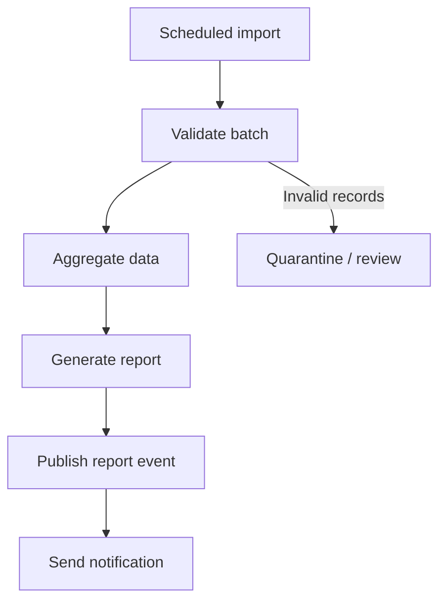

# Migrating Cron Jobs and Background Tasks to Functions or Serverless Jobs

Cron jobs and background tasks typically start as a command running on a server: reading data, generating reports, syncing systems, sending notifications, purging expired data, or aggregating end-of-day metrics. When migrating a Java application to serverless, development teams can replace fixed schedulers/workers with functions triggered by schedules, queues, or events; for longer workloads, they can use container-based serverless jobs or orchestrated workflows.

The migration is not just converting a cron expression into a new trigger. You must preserve schedule semantics, timezones, missed-schedule behavior, duplicate execution prevention, long-running job handling, checkpoints, retries, concurrency limits, and observability. Schedulers may deliver the same trigger more than once; jobs can stop mid-execution; multiple invocations can run concurrently if the previous run has not finished. Therefore, the design must be built around **logical runs**, durable state, and idempotency.

This lesson guides you through migrating Java cron jobs and background tasks to functions or serverless jobs on AWS, Azure, and Google Cloud. The focus is on choosing the right execution model, preserving schedule semantics, structuring batch/checkpoint processing, and executing a migration that can be verified, paused, or rolled back.

## 1. Classifying Existing Cron Jobs and Background Tasks

Before choosing a serverless service, classify jobs by execution duration, state, criticality, and trigger mechanism.

| Job Type | Examples | Characteristics to Consider |
| --- | --- | --- |
| Short periodic task | Refresh cache, sync a few hundred records | Short runtime, can finish within a single invocation |
| Scheduled batch | Daily revenue aggregation, invoice generation | Many records, needs batching and checkpoints |
| Long-running job | Export millions of rows, media processing | May exceed function timeout, needs a job/container or step splitting |
| Event-driven background task | Send email after order creation | Does not necessarily need cron; can be triggered directly by events |
| Polling task | Poll partner API every 5 minutes | Needs rate limits, cursors, and incremental data handling |
| Maintenance task | Delete expired data, object cleanup | Needs retention policy, dry-run, and scope limits |
| Multi-step workflow | Reconciliation, settlement, report export | Needs orchestration, per-step retries, and durable state |
| Singleton/coordination job | Period close, key rotation, snapshot creation | Needs distributed locks or an explicit single-writer mechanism |

Not every cron job should become a function. A task that runs once a month yet requires 4 hours of continuous CPU fits a serverless container job or batch service better than a short-timeout function. A background task triggered right after an event can eliminate polling schedules altogether if the event source is reliable.

### Pre-Migration Job Inventory

For each job, document:

- Job name, owner, business purpose, and criticality.
- Schedule, timezone, special/holiday schedules, and acceptable lateness.
- p50/p95/max duration and data volume.
- CPU, memory, disk, network, and dependency resources.
- Inputs/outputs, source of truth, side effects, and sensitive data.
- Concurrency constraints or dependencies on other jobs.
- Retry behavior, timeouts, alerts, and how operators trigger manual reruns.
- Where state is currently stored: database, files, process memory, or scheduler.
- Catch-up rules when schedules are missed or the system experiences downtime.

Measure at least one representative business cycle. Month-end jobs can differ drastically from 5-minute jobs; do not extrapolate capacity from a single small-dataset run.

## 2. Choosing a Function, Serverless Job, or Workflow

Three options are commonly combined:

| Model | Suitable When | Examples |
| --- | --- | --- |
| Scheduled function | Short, stateless or externally stateful work where one handler finishes within timeout | Checking expiring subscriptions, sending small digests |
| Serverless container/job | Long work requiring system libraries, large file processing, or high CPU/memory | Large data exports, batch ETL, media processing |
| Workflow orchestration | Multi-step jobs with long waits, per-step retries, branching, approvals, or checkpoints | Reconciliation, tenant onboarding, accounting period close |

You can use a scheduler to start a workflow, have the workflow split work across functions/jobs, and have workers process individual partitions. Do not hold a single invocation open for hours when the platform enforces time limits or the work can be partitioned.

### Quick Selection Matrix

- Job runs for seconds/minutes with small volume and few dependencies: scheduled function.
- Job can run longer than function timeouts or needs a custom executable/container: serverless job.
- Job has multiple steps, waits on external approvals, or needs independent step retries: workflow engine.
- Job needs to run as soon as data arrives: queue/event trigger instead of waiting for the next cron tick.
- Job requires a continuous daemon, persistent connections, or unbounded stream processing: consider a continuously running worker/service rather than forcing scheduled invocations.

## 3. Preserving Cron Semantics

Cron expressions are not standardized across schedulers. Before migrating, clarify what the legacy schedule means, then map it to the target syntax.

| System/Syntax | Typical Field Count | Common Order |
| --- | ---: | --- |
| Unix cron | 5 | minute, hour, day-of-month, month, day-of-week |
| Azure Functions NCRONTAB | 6 | second, minute, hour, day-of-month, month, day-of-week |
| AWS EventBridge Scheduler cron | 6 | minute, hour, day-of-month, month, day-of-week, year |
| Quartz cron | 6 or 7 | second, minute, hour, day-of-month, month, day-of-week, optional year |

For example, `0 2 * * *` in Unix cron usually means 02:00 daily. You cannot copy this string verbatim into Azure NCRONTAB because Azure puts seconds first. AWS EventBridge cron includes a year field and specific rules for day-of-month/day-of-week; some positions use `?` to mean unspecified.

### Schedule Mapping Table

| Business Intent | Illustrative Unix Cron | Illustrative Azure NCRONTAB | Notes |
| --- | --- | --- | --- |
| Every 5 minutes | `*/5 * * * *` | `0 */5 * * * *` | Azure adds leading `0` second |
| Daily at 02:00 | `0 2 * * *` | `0 0 2 * * *` | Must specify timezone |
| Monday at 08:30 | `30 8 * * 1` | `0 30 8 * * 1` | Check day-of-week numbering convention |
| First day of month at 00:15 | `15 0 1 * *` | `0 15 0 1 * *` | Check monthly schedule and timezone |

These strings only illustrate the two syntaxes; validate with the provider's scheduler parser or staging configuration. Never convert by adding/removing a field without verifying `day-of-month`, `day-of-week`, `?`, `L`, `W`, or extended symbols.

### `rate` and `cron` Have Different Meanings

- `rate(5 minutes)` typically represents a recurring interval measured from a service-defined anchor.
- `cron(0 2 * * ? *)` represents a calendar point in time, e.g., 02:00 every day according to the scheduler's timezone configuration.

If the requirement is "daily at 02:00 local time," use a calendar schedule with an explicit timezone. If the requirement is "every 5 minutes," a rate schedule may fit better. Do not replace a calendar schedule with a fixed 24-hour delay if the local wall-clock time must stay fixed across DST transitions.

## 4. Timezones and Daylight Saving Time (DST)

A cron job may be defined in UTC or local time. When migrating to serverless, explicitly set the timezone using an IANA name such as `Asia/Ho_Chi_Minh`, `America/New_York`, or `Europe/London` if the scheduler supports it. Avoid relying on a server's default timezone.

DST edge cases:

- When clocks spring forward, a local wall-clock time may not exist, e.g., 02:30.
- When clocks fall back, a local wall-clock time may occur twice.
- A schedule running "daily at 02:30" may be skipped or handled under provider-specific rules on DST transition days.
- `rate(24 hours)` is not equivalent to "every day at the same local time."

If the business logic does not depend on local time, UTC is usually easier to operate. If period closing must follow local time, use an IANA timezone and document the policy for non-existent/ambiguous times. Verify actual provider behavior rather than assuming all schedulers handle DST identically.

### Storing Scheduled Time in the Job Record

Store all of the following:

- `scheduledFor`: the logical time when the job was supposed to run.
- `startedAt`: when the worker actually began execution.
- `completedAt`: when it finished.
- `timezone`: the timezone used to compute the schedule, if applicable.
- `scheduleVersion`: the version of the schedule configuration.

Do not use `Instant.now()` as the business period if the job must process a specific period. For instance, a job closing revenue for the 16th must use the business date passed by the scheduler or derived from calendar rules, not the timestamp when a retry invocation ran.

## 5. Handling Missed Schedules, Catch-Up, and Misfires

A scheduler can miss delivering a trigger on time due to outages, quotas, retry configurations, or platform incidents. Upon recovery, decide whether the job should:

- Catch up on all missed periods.
- Run only the latest period.
- Coalesce multiple missed periods into a single aggregation run.
- Skip old periods if the data has expired.
- Raise an incident/require manual approval before catching up.

No single policy fits every job. For example:

| Job | Potentially Appropriate Catch-Up Policy |
| --- | --- |
| Daily subscription reminder | Skip stale reminders, send only the latest period |
| Daily transaction aggregation | Catch up each missing day so no reports are lost |
| Inventory sync | Run once to fetch the latest snapshot if the API supports it |
| Periodic interest calculation | Process every period faithfully per business rules with reconciliation |
| Expired data purge | Catch up by range while rate-limiting and verifying retention |

### Logical Period Job Key

Construct a unique key from the job and schedule period, for example:

```text
daily-revenue:2026-11-17
subscription-reminder:tenant-4821:2026-11-17
month-close:2026-10
```

This key distinguishes two invocations triggering the same logical run. If the scheduler delivers duplicates, a database unique constraint prevents creating two job runs for the same key. When catching up, each period gets its own key; do not use execution timestamp as the key.

## 6. Preventing Duplicate and Overlapping Runs

A job scheduled every 5 minutes that occasionally takes 8 minutes risks overlapping. Two invocations reading the same data or sending the same notifications can cause duplicate side effects.

Safeguards:

- Unique constraint on `(job_name, logical_run_key)` to create only one logical run.
- Distributed lease/lock so only one worker holds execution ownership at a time when singleton semantics are needed.
- Time-bounded lease with heartbeat/renewal; avoid permanent locks if a worker dies.
- Fencing token/generation so a stalled old worker cannot write after the lease moves to a new worker.
- Idempotency keys per record/side effect.
- Conditional updates/version checks when updating state.
- Separate "job was triggered" from "job completed."

Do not use Java's `synchronized`, `static boolean running`, or `ReentrantLock` for system-wide deduplication. Those mechanisms apply only within a single JVM; serverless runs across multiple independent instances/processes.

### Choosing an Overlap Policy

For each job, define one of these behaviors:

- **Forbid:** do not allow a new logical run to start while the previous run is active.
- **Queue:** hold the new run in a queue and run it afterward.
- **Allow:** allow parallel execution because partitions are independent.
- **Replace/coalesce:** cancel or merge older runs when only the latest state matters.

For example, cache synchronization can use coalesce; monthly close usually requires forbid; independent per-tenant processing can use allow with concurrency limits.

## 7. State Model for a Job Run

A job run needs durable state so operators know where work stands and can resume after failures.

| State | Meaning |
| --- | --- |
| `SCHEDULED` | Logical run has been registered |
| `PENDING` | Waiting for a worker to claim |
| `RUNNING` | Worker is actively executing |
| `RETRY_WAIT` | Waiting for the next retry attempt |
| `PAUSE_REQUESTED` | Requested to stop picking up new batches |
| `PAUSED` | Stopped cleanly at a safe checkpoint |
| `COMPLETED` | All required steps and validations finished |
| `FAILED` | Error requires intervention or retries exhausted |
| `CANCELLED` | Cancelled per policy and confirmed worker stop |

A job record may contain:

```text
job_name
logical_run_key
scheduled_for
status
attempt
started_at
heartbeat_at
lease_owner
lease_until
fencing_token
checkpoint
records_processed
records_failed
last_error_code
completed_at
```

Do not store secrets or sensitive payloads in job records when references suffice. State transitions should use transactions/conditional updates so two workers cannot both transition a job from `PENDING` to `RUNNING`.

## 8. Idempotency for Scheduled Tasks

Schedulers typically guarantee trigger dispatch on schedule, not that business side effects happen only once. A job can be invoked again due to timeouts, retries, duplicate delivery, or manual operator reruns.

Idempotent design:

1. Define a stable logical run key.
2. Persist the run key with a unique constraint.
3. Give each processed record its own business key/idempotency key.
4. Persist results and processed status in the same transaction when possible.
5. For external APIs, pass an idempotency key if the provider supports it.
6. If an external call outcome is ambiguous after a timeout, reconcile before retrying.

For example, an invoice email job can use the key `invoice-email:{invoiceId}:{templateVersion}`. If the worker re-runs, the system checks whether that key was already sent successfully. Do not use a single job-wide key if each invoice must be tracked independently.

### Exactly-Once and Operational Reality

Schedulers/queues have varying delivery/retry semantics; never assume "exactly once" across an entire business workflow. The standard design is at-least-once delivery combined with idempotent processing and deduplication. Even when a platform offers deduplication features, still protect side effects at the database or downstream layer because platform deduplication scopes and retention windows are bounded.

## 9. Splitting Long Jobs into Batches and Checkpoints

Functions have finite timeouts. If a legacy cron job runs for 45 minutes, do not simply raise the timeout or dump the entire logic into one function without checkpoints.

Batch-splitting pattern:

1. The scheduler creates a job run with a logical period and input snapshot.
2. An orchestrator/queue splits work into partitions or cursor ranges.
3. A worker claims a bounded batch.
4. The worker processes and commits results.
5. The worker updates the checkpoint after commit.
6. If more work remains, it enqueues the next batch.
7. When all partitions finish, reconciliation runs and marks the job `COMPLETED`.

Checkpoints should be durable cursors such as last processed ID, object key, page token, stream offset, or partition number. Do not store only a batch counter if underlying data can shift between runs.

### Keyset Pagination

For large databases, use stable cursors instead of large offsets:

```sql
SELECT id, status, created_at
FROM invoice
WHERE id > :last_id
  AND id <= :high_water_id
ORDER BY id
LIMIT :batch_size;
```

Capture `high_water_id` at the start of the logical run to fix the dataset boundary. Records arriving after that mark are handled by the next run or a change-capture mechanism. If concurrent updates occur, use optimistic locking/conditional updates to avoid overwriting newer data.

## 10. Retries, Timeouts, and Failure Policies

Distinguish two failure classes:

1. **Trigger delivery failure:** the scheduler failed to invoke the target function/job.
2. **Job execution failure:** the target received the trigger, but handler code failed or timed out.

Retries at the scheduler layer only retry delivering the trigger; they do not automatically know whether the business job finished. Job execution needs its own state and attempt tracking.

Retry design:

- Retry transient errors such as network timeouts or service unavailable responses.
- Do not retry deterministic input/schema errors without changing data or code.
- Use exponential backoff with jitter.
- Set maximum attempts and a retry deadline.
- Route failed jobs to `FAILED`/DLQ or operator intervention.
- Support manual reruns with the same logical run key or an audited repair run key.
- Do not retry the entire job if only one partition/record failed and can be retried individually.

### Timeout Budget

Set timeouts according to expected processing duration and business deadlines. If the scheduler fires at 02:00 and reports must be ready by 03:00, leave headroom for retries, reconciliation, and alerts. A 55-minute job timeout does not work if the next run starts in 30 minutes and overlap is forbidden.

If a job runs longer than function timeouts allow, break it into batches or use a serverless job/container with suitable execution limits. Never keep an invocation alive just waiting on a slow dependency for minutes when an event/callback pattern can be used.

## 11. Throttling Load and Protecting Downstream Systems

Multiple cron jobs firing at the top of the hour can create bursts against databases/APIs—the "thundering herd" problem.

Mitigations:

- Spread schedules using jitter or flexible time windows when business rules permit.
- Cap concurrency job-wide and per downstream dependency.
- Use queues to decouple schedulers from workers and absorb bursts.
- Limit batch sizes, connection pools, and request rates.
- Pause/slow down when downstream latency or error rates rise.
- Prioritize critical jobs and defer maintenance/best-effort work.
- Prevent multiple independent jobs from exhausting the entire connection pool simultaneously.

If 20 jobs all run at 02:00, stagger them across 02:00–02:20 or use flexible scheduler windows. If an exact timestamp is an accounting requirement, keep the exact schedule while throttling worker concurrency internally.

## 12. Choosing a Trigger: Schedule, Queue, or Event

Some cron jobs are essentially polling loops created because the legacy system lacked event notifications. When migrating, evaluate whether polling can be eliminated.

| Current State | Migration Option |
| --- | --- |
| Every 1 minute checking a queue for messages | Use a queue trigger/event source mapping |
| Every 5 minutes calling an API for new records | Use webhooks/CDC/events if supported by the partner; otherwise keep scheduled polling with cursors/rate limits |
| Nightly transaction aggregation | Scheduled function/job with a logical business date |
| Sending emails after order creation | Event-driven function instead of waiting for cron |
| Hourly cleanup of expired files | Scheduled job with retention filters and batching |
| Running a multi-step process on schedule | Scheduler launching workflow orchestration |

Event-driven architectures often cut latency and empty polling costs, but they depend on event source reliability, schemas, retries, ordering, DLQs, and replay. Do not replace polling with events if upstream cannot guarantee complete event delivery or lacks a reconciliation mechanism.

## 13. Java: Separating Business Logic from Scheduler Adapters

Do not couple business logic directly to cron expressions or cloud-specific trigger payloads. Separate three layers:

- **Scheduler adapter:** receives the trigger, extracts scheduled time, and invokes the application service.
- **Application service:** executes business logic, manages logical runs, leases, checkpoints, and idempotency.
- **Repositories/ports:** persist job state, data, and outputs in durable services.

Neutral interface example:

```java
import java.time.Instant;

public record ScheduledInvocation(
        String jobName,
        String logicalRunKey,
        Instant scheduledFor,
        String scheduleVersion
) {}

public interface JobApplicationService {
    void execute(ScheduledInvocation invocation);
}
```

AWS/Azure/GCP adapters only translate trigger payloads into `ScheduledInvocation`. The business service can be unit/integration tested without running a real scheduler.

### Do Not Run Local Schedulers Inside Functions

Do not use `@Scheduled`, `Timer`, `ScheduledExecutorService`, or background threads inside serverless functions to replace cloud schedulers. Runtimes can scale to zero, freeze, or terminate processes; each instance would spin up its own scheduler and cause duplicate runs. Use external schedule services to trigger functions/jobs.

## 14. Java: Idempotent Job Runs with Unique Keys

Example application service using a repository to claim a logical run:

```java
import java.time.Instant;

public final class DailyRevenueJob {
    private final JobRunRepository runs;
    private final RevenueRepository revenue;

    public DailyRevenueJob(
            JobRunRepository runs,
            RevenueRepository revenue
    ) {
        this.runs = runs;
        this.revenue = revenue;
    }

    public void execute(ScheduledInvocation invocation) {
        boolean claimed = runs.tryCreateOrClaim(
                invocation.jobName(),
                invocation.logicalRunKey(),
                invocation.scheduledFor(),
                Instant.now());

        if (!claimed) {
            return; // logical run already claimed or completed
        }

        try {
            revenue.aggregateForBusinessDate(invocation.scheduledFor());
            runs.markCompleted(
                    invocation.jobName(), invocation.logicalRunKey(), Instant.now());
        } catch (RuntimeException ex) {
            runs.markFailed(
                    invocation.jobName(), invocation.logicalRunKey(), ex.getClass().getSimpleName());
            throw ex;
        }
    }
}
```

This is an illustrative skeleton. `tryCreateOrClaim` must be implemented using unique constraints/conditional writes or lease transactions; a non-atomic "select then insert" fails when two invocations concurrently read "not found." For multi-batch jobs, `RUNNING` state and checkpoints must be renewed/committed per batch rather than only marking completion after processing the entire dataset.

Example SQL creating a unique key:

```sql
CREATE TABLE job_run (
    job_name          VARCHAR(120) NOT NULL,
    logical_run_key   VARCHAR(200) NOT NULL,
    scheduled_for     TIMESTAMP NOT NULL,
    status            VARCHAR(24) NOT NULL,
    attempt           INTEGER NOT NULL DEFAULT 0,
    lease_owner       VARCHAR(120),
    lease_until       TIMESTAMP,
    checkpoint        VARCHAR(500),
    started_at        TIMESTAMP,
    completed_at      TIMESTAMP,
    PRIMARY KEY (job_name, logical_run_key)
);
```

Database engines vary in timestamp/identity syntax; this schema only illustrates structure. Add optimistic versions/fencing tokens, error metadata, and operational query indexes as needed.

## 15. Java: Azure Functions Timer Trigger

Azure Functions for Java supports timer triggers via annotations. NCRONTAB puts seconds first. Example running every 5 minutes:

```java
import com.microsoft.azure.functions.ExecutionContext;
import com.microsoft.azure.functions.annotation.FunctionName;
import com.microsoft.azure.functions.annotation.TimerTrigger;

public final class CleanupTimerFunction {
    @FunctionName("CleanupTimer")
    public void run(
            @TimerTrigger(
                    name = "timerInfo",
                    schedule = "0 */5 * * * *") String timerInfo,
            final ExecutionContext context) {
        context.getLogger().info("Cleanup timer triggered");
        // Invoke application service; job must be idempotent.
    }
}
```

This example only illustrates the adapter. In production, inject the application service using your project's DI mechanism, pass the logical scheduled time if trigger metadata provides it, record job run state, and handle errors per retry/monitoring policy. Never simply log "triggered" and treat that as job success.

Timer triggers use host-managed storage/locks to coordinate across instances in a Function App. Configure host storage properly, understand scale/restart behavior, and verify `host.json`/runtime extension versions. Timer triggers do not replace application-level idempotency for side effects.

## 16. AWS: EventBridge Scheduler Triggering Lambda or Jobs

AWS EventBridge Scheduler supports `rate`, `cron`, and one-time schedules with timezones and targets such as Lambda, Step Functions, or AWS APIs via universal targets. For Java workloads:

- Short jobs: Scheduler invokes a Lambda Java handler.
- Multi-step jobs: Scheduler starts a Step Functions state machine.
- Container/long jobs: Scheduler can invoke APIs to launch an ECS task or Batch job with appropriate target configuration.
- Message-based work: Scheduler sends messages to SQS/SNS/EventBridge bus for rate-controlled workers.

Key configuration points:

- Scheduler execution role scoped strictly to its target.
- Retry policy and dead-letter queue for delivery failures.
- Flexible time window when exact-second start is not required.
- Timezone for calendar schedules.
- Input payload containing job name, scheduled period, schedule version, and correlation ID.
- CloudWatch alarms for target failures, Lambda errors/throttles, or workflow failures.

Distinguish Scheduler delivery success from Lambda business success. Scheduler may deliver the trigger successfully while the handler fails afterward. Maintain separate metrics/job state and execution-layer retries per policy.

### Lambda Timeout and Long Jobs

Lambda fits when each invocation completes within the function timeout. For longer work, split into batches, orchestrate with Step Functions, or move to ECS/Fargate/AWS Batch as requirements dictate. Do not stretch a single Lambda invocation to process millions of records when checkpoints/batching are easier to control.

## 17. Azure: Timer Triggers, Durable Functions, and Container Apps Jobs

Azure offers several options:

- **Timer Trigger:** periodic schedule invoking a function; suited for short tasks or initiating orchestration.
- **Durable Functions:** orchestrators/activities for long workflows, fan-out/fan-in, timers, retries, and checkpoints.
- **Azure Container Apps Jobs:** runs containers on a schedule, event, or manual trigger; suited for batches/jobs needing custom runtimes or durations beyond function limits.
- **Logic Apps:** suited for integration workflows and managed connectors without writing full orchestration code.

When using Timer Trigger:

- NCRONTAB has 6 fields, including seconds.
- Host storage and timer monitor state must be configured properly.
- Check timezone support by hosting plan/OS and configuration; never rely on a local dev machine's default timezone.
- Understand `UseMonitor` and schedule status for handling restarts/missed schedules.
- Jobs must be idempotent because operators, retries, or incidents can still trigger re-runs.

For long jobs, Durable Functions splits work into orchestrators and activities; activities must be idempotent since orchestrators replay history to recover state. Avoid arbitrary I/O or non-deterministic operations in orchestrator code; keep side effects in activities.

Container Apps Jobs let you schedule containerized jobs with configurable replicas, retries, and parallelism. This is a strong option when existing code relies on system libraries or runs longer than function timeouts while keeping job-based execution instead of always-on VMs.

## 18. Google Cloud: Cloud Scheduler, Cloud Run Jobs, and Workflows

Google Cloud provides composable building blocks:

- **Cloud Scheduler:** defines cron schedules and invokes HTTP endpoints, Pub/Sub topics, or supported targets.
- **Cloud Run service/function:** handles HTTP requests or events for short tasks.
- **Cloud Run Jobs:** runs container tasks to completion with configurable task counts and parallelism.
- **Workflows:** orchestrates multi-step flows, API/service calls, retries, and branching.
- **Pub/Sub/Eventarc:** turns work into messages/events for asynchronous workers.

Architectural pattern:

1. Cloud Scheduler invokes an authenticated endpoint or launches a Cloud Run Job.
2. Scheduler uses a service account authorized strictly for that target service/job.
3. The Cloud Run Job receives business period parameters and a job ID.
4. The job splits data across tasks/partitions and persists durable checkpoints.
5. The job writes outputs and status; Monitoring alerts on failed or prolonged executions.

Cloud Scheduler supports timezones in schedule configs. Set timezones explicitly, define retry policies, and do not treat a single HTTP delivery as proof the entire job succeeded. Cloud Run Jobs track their own execution/task statuses; monitor executions rather than only Scheduler HTTP requests.

## 19. Converting Polling Jobs to Event-Driven Where Possible

Some cron jobs exist solely because an application had to poll a data source periodically. If upstream provides webhooks, CDC, or event streams, polling can often be reduced:

| Before | Option to Consider Afterward |
| --- | --- |
| Every minute querying DB for new orders | Emit `OrderCreated` via outbox/event bus |
| Every 10 minutes checking a bucket for new files | Object-created event trigger |
| Every 5 minutes calling partner API for status updates | Webhooks; if unavailable, keep polling with cursors/backoff |
| Hourly scan for expiring subscriptions | Scheduled scan still fits time-based lookups |
| Nightly emails to eligible users | Event-driven when eligibility triggers, or scheduled cohort job per business rules |

Event-driven triggers reduce latency and empty polls, but introduce new requirements around event schemas, duplicates, ordering, DLQs, and replay. Do not replace polling with events if upstream cannot guarantee complete delivery or lacks reconciliation.

## 20. Managing Dependencies Between Cron Jobs

Legacy systems often have job chains:

1. Import data.
2. Validate data.
3. Compute aggregates.
4. Generate reports.
5. Send emails.

If you only migrate individual cron expressions independently, jobs can run out of order whenever an earlier step runs slow. Use workflow orchestration or completion events so downstream steps start only after upstream steps finish.

Example dependency graph:



Each step needs its own input/output contract, retry policy, timeout, and idempotency. The workflow should maintain state so it can resume from the failed step without unnecessarily re-running the entire chain.

## 21. Handling Jobs Dependent on Filesystems or Host Environments

Traditional cron jobs frequently rely on local filesystems, shells, system binaries, or VM environment variables. When migrating to serverless, audit:

- Do input/output files need durable storage? Use object storage instead of local disk.
- Are binaries/native libraries compatible with target runtimes/architectures? Consider container jobs.
- Does code write to the default working directory? Use bounded temp paths and clean up.
- Does it use `flock`/PID files to prevent overlap? Replace with distributed leases/job keys.
- Does it read crontab environments or shell profiles? Declare configs explicitly.
- Does it invoke OS commands? Package dependencies or replace with Java SDKs.
- Does it keep state in-process? Move to databases/object storage/queues.
- Does it require mounting a network filesystem? Verify serverless runtime support and semantics.
- Does it need a fixed outbound IP or private network access? Design VPC/VNet/connectors and account for cost.

If a job depends heavily on binaries and filesystems, container jobs generally require fewer code changes than functions. Even then, move state to durable storage and avoid relying on local disk across tasks.

## 22. Managing Secrets and Runtime Permissions

Background jobs often hold broad read permissions or trigger sensitive actions like payouts, deletions, or invoicing. You should:

- Use a dedicated workload identity per job/service.
- Grant only necessary permissions to specific databases/tables/buckets/APIs.
- Separate trigger/invoke permissions from runtime data-access permissions.
- Store secrets in a secret manager; never embed them in cron expressions or payloads.
- Separate deployment permissions from job execution permissions.
- Audit operator manual reruns and schedule changes.
- Restrict who can modify production targets, inputs, or schedules.

A scheduler granted permission to invoke every function in an account becomes a wide attack vector. Grant invoke access only to the designated target and validate payloads/authorization inside handlers.

## 23. Job Observability: Trigger Success Is Not Job Success

Dashboards should distinguish:

- Schedule expected count: number of logical runs that should have occurred.
- Trigger delivery count: how many times the scheduler invoked the target.
- Job started/completed/failed counts.
- Duration p50/p95/max.
- Time since last successful run.
- Schedule lag: `startedAt - scheduledFor`.
- Runtime/queue delay.
- Records scanned/processed/skipped/failed.
- Retry count and attempt number.
- Overlap/duplicate suppression count.
- Checkpoint age and backlog age.

A scheduler can report successful delivery while the Lambda or Cloud Run Job fails afterward. You need a dedicated job status store or execution metrics to confirm whether a logical run reached `COMPLETED`.

### Suggested Alerts

- No successful run within the expected window.
- Job has not started within acceptable lag bounds.
- Job runs longer than p95/budget or approaches its business deadline.
- Two runs with the same logical key are claimed or overlap abnormally.
- Retries/DLQ depth climb or checkpoints stop advancing.
- Failed/conflicted record count exceeds thresholds.
- Job completes with invalid output counts/aggregates.

Do not alert only on "function invocation errors." A job can return success while processing 0 records due to a bad filter; business validation is essential.

## 24. Cost and FinOps When Migrating Cron Jobs

Compare full costs:

- Function invocations, duration, memory/CPU, and provisioned capacity.
- Serverless job/container CPU, memory, task counts, and execution duration.
- Scheduler invocations or schedule counts if billed by the service.
- Workflow state transitions/step executions.
- Queue/event operations, retention, and DLQs.
- Database compute, queries, I/O, and storage.
- Object storage, network egress, NAT, and private connectivity.
- Log/metric/trace ingestion volume and retention.
- Build artifacts/image registries and vulnerability scanning.

A cron job running every minute generates 43,200 invocations per 30-day month even when there is no work to do. If a job mostly polls and runs empty, switching to event-driven or lowering frequency can save money. Conversely, a CPU-heavy 2-hour job may fit serverless containers/batch better than thousands of tiny function invocations.

Measure cost per logical run or cost per record processed, not just cost per invocation. An invocation processing 500 records differs vastly from one processing 1 record.

## 25. Step-by-Step Migration Process

A safe migration can proceed through these stages:

1. **Inventory:** list cron jobs, owners, schedules, dependencies, data, and side effects.
2. **Classify:** choose scheduled functions, serverless jobs, workflows, or event-driven replacements.
3. **Capture semantics:** record timezones, misfire/catch-up, overlap, retries, timeouts, and business periods.
4. **Externalize state:** move checkpoints, locks, and job status to durable stores.
5. **Make idempotent:** add logical run keys, unique constraints, and side-effect deduplication.
6. **Refactor adapters:** decouple business logic from cron/shell/VM environments.
7. **Build target:** provision schedulers, functions/jobs, IAM, queues, configs, and observability via IaC.
8. **Test:** verify schedules, DST, duplicates, missed runs, overlaps, timeouts, retries, and downstream outages.
9. **Shadow/dry-run:** run the new target read-only or with isolated outputs to compare against the legacy job.
10. **Canary:** shift one job/tenant/partition or one reconcilable schedule period.
11. **Cut over:** disable the legacy schedule at the exact boundary, enable the new schedule, and confirm a single primary coordinator.
12. **Observe:** monitor logical runs, business outputs, lag, retries, costs, and alerts.
13. **Rollback:** retain the ability to re-enable the legacy job and prevent both schedulers from running simultaneously.
14. **Retire:** remove legacy VMs/crontabs/credentials after a stability window and verify zero remaining dependencies.

### Shadow Runs Must Not Create Duplicate Side Effects

When running legacy and new jobs in parallel for comparison, only one side may write to production or send notifications/payments. The shadow run can read the same inputs while writing outputs to a separate table/bucket or running in dry-run mode. If both send emails or charge customers, it is not a safe shadow test.

### Cutover and Rollback

Before cutover, define:

- The last logical period handled by the legacy job.
- The first logical period handled by the new job.
- Who disables the legacy schedule and verifies its state.
- How to verify no runs overlap.
- Whether job state/checkpoints are transferred or initialized cleanly.
- On rollback, which scheduler acts as the sole coordinator.

Never deploy the new target and leave the legacy cron running. Two independent schedulers can create colliding logical runs.

## 26. Test Strategy for Scheduled Jobs

Test these scenarios:

| Scenario | Expected Outcome |
| --- | --- |
| On-time trigger | Creates correct logical run and processes the right period |
| Duplicate trigger | Only one logical run claimed; side effects do not repeat |
| Job runs longer than interval | Overlap policy is enforced |
| Delayed scheduler delivery | Uses `scheduledFor`, not current time, as the business period |
| Missed schedule | Catch-up/skip/coalesce follows business rules |
| DST transition | Non-existent/duplicate times follow policy |
| Function timeout | Batch/checkpoint enables safe resumption |
| Downstream 429/503 | Backoff, jitter, and concurrency cap apply |
| Worker dies holding lock | Lease expires; new worker claims with a higher fencing token |
| Poison/bad record | Quarantined/retried partially; does not block entire job indefinitely |
| Manual rerun | Audit reason and logical key are clearly tracked |
| Deploy mid-run | Revisions/schemas remain compatible and checkpoints stay usable |

Unit-test business logic with a mocked clock/time provider. Integration-test repositories, unique constraints, and leases. Test real schedulers in staging on short intervals while preventing accidental test triggers in production.

## 27. End-to-End Example: Migrating a Daily Revenue Report

Suppose a Java cron job on a VM runs at 02:00 to aggregate the prior day's revenue and generate a CSV. Currently it takes 25–40 minutes, is occasionally re-run manually, and overwrites old files.

A serverless design could be:

1. Scheduler emits a trigger with `businessDate` set to the target aggregation day.
2. A job coordinator creates logical key `daily-revenue:YYYY-MM-DD` protected by a unique constraint.
3. The coordinator builds a manifest containing the high-water mark, input snapshot, and output version.
4. The job partitions transactions by tenant/date.
5. A queue dispatches each partition to Java workers or serverless container tasks.
6. Workers process batches, write aggregates using upsert/idempotency keys, and save checkpoints.
7. When all partitions finish, reconciliation compares total amount/count against source transactions.
8. The job writes the CSV to object storage under a versioned object key.
9. The job marks `COMPLETED` and emits `RevenueReportReady`.
10. A notification function emails the link to recipients; the email uses an idempotency key per report version.

If the job fails on partition 7 of 20, only that partition retries. If the scheduler sends a duplicate trigger, the unique key blocks creating a duplicate run for the same business date. If the next day's job triggers while the prior day is still running, the overlap policy queues or rejects the new run per business rules.

## 28. Pre-Production Checklist

- [ ] Are cron jobs, owners, dependencies, inputs/outputs, and side effects inventoried?
- [ ] Is the right model chosen among scheduled function, serverless job, workflow, or event trigger?
- [ ] Are cron expressions converted and validated against provider syntax?
- [ ] Are IANA/UTC timezones and DST policies defined?
- [ ] Are `scheduledFor` and stable logical run keys present?
- [ ] Are policies defined for missed schedules, catch-up, skip, or coalesce?
- [ ] Are overlap policies and distributed locks/leases in place where needed?
- [ ] Is the job idempotent under duplicate delivery and manual reruns?
- [ ] Are long jobs split into batches/checkpoints or moved to appropriate serverless jobs?
- [ ] Are checkpoints and job state persisted durably?
- [ ] Do retries, timeouts, DLQs, and manual recovery have clear limits?
- [ ] Are backpressure/concurrency caps protecting databases/APIs?
- [ ] Are workload identities and least privilege configured for schedulers/workers?
- [ ] Are metrics tracking logical runs, duration, lag, record counts, retries, and last success?
- [ ] Does business validation distinguish trigger success from job success?
- [ ] Are shadow/dry-run tests free of duplicate side effects?
- [ ] Does cutover ensure only one scheduler coordinates production?
- [ ] Are rollback plans, runbooks, and checkpoint resumption procedures ready?
- [ ] Have total cost, cost per run, and cost per record been compared?

## 29. Official References

- [AWS EventBridge Scheduler – Schedule types](https://docs.aws.amazon.com/scheduler/latest/UserGuide/schedule-types.html)
- [AWS EventBridge Scheduler – Time zones](https://docs.aws.amazon.com/scheduler/latest/UserGuide/schedule-types.html#schedule-types-time-zones)
- [AWS Lambda – Function timeout](https://docs.aws.amazon.com/lambda/latest/dg/configuration-timeout.html)
- [AWS Step Functions – Standard and Express workflows](https://docs.aws.amazon.com/step-functions/latest/dg/choosing-workflow-type.html)
- [Azure Functions – Timer trigger](https://learn.microsoft.com/azure/azure-functions/functions-bindings-timer)
- [Azure Functions – Timer trigger for Java](https://learn.microsoft.com/azure/azure-functions/functions-create-scheduled-function)
- [Azure Durable Functions overview](https://learn.microsoft.com/azure/azure-functions/durable/durable-functions-overview)
- [Azure Container Apps Jobs](https://learn.microsoft.com/azure/container-apps/jobs)
- [Google Cloud Scheduler – Overview](https://cloud.google.com/scheduler/docs/overview)
- [Google Cloud Run Jobs](https://cloud.google.com/run/docs/create-jobs)
- [Google Cloud Workflows](https://cloud.google.com/workflows/docs/overview)
- [Google Cloud Scheduler – Cron job format and time zones](https://cloud.google.com/scheduler/docs/configuring/cron-job-schedules)
