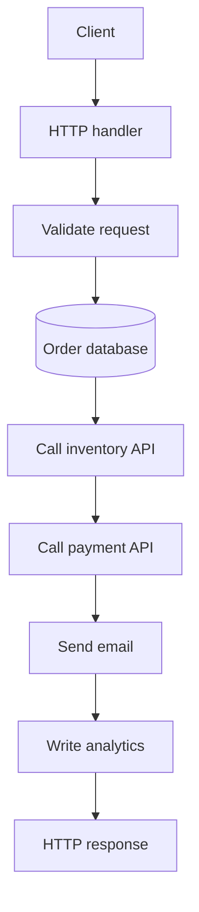
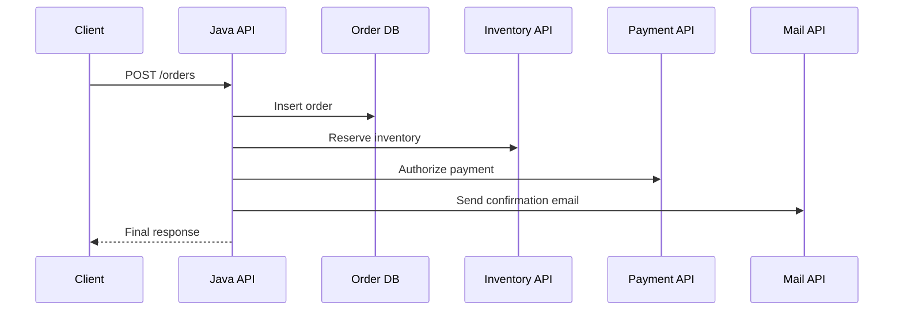
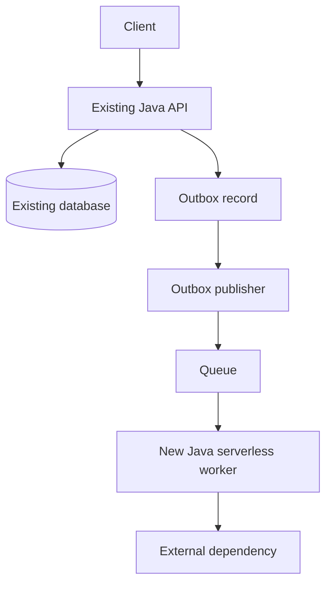
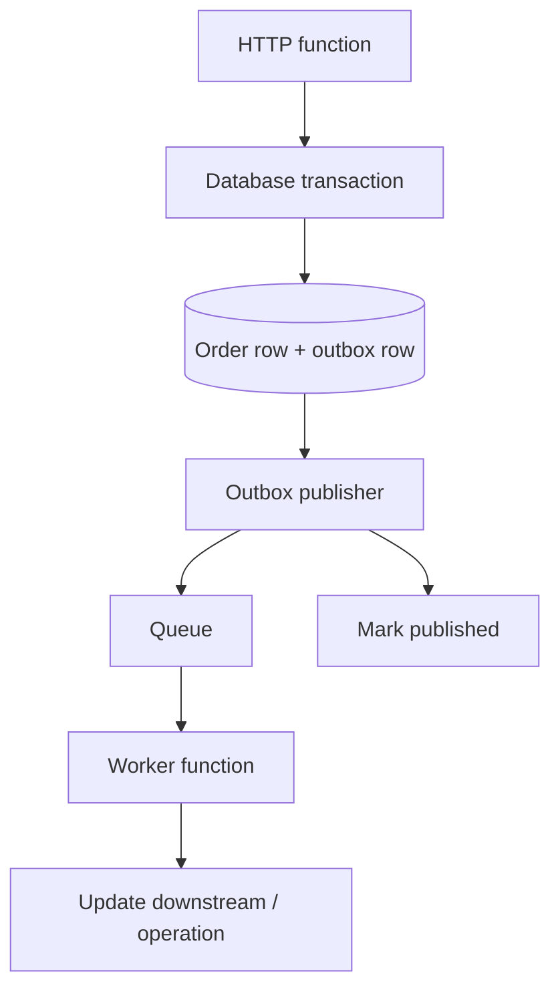
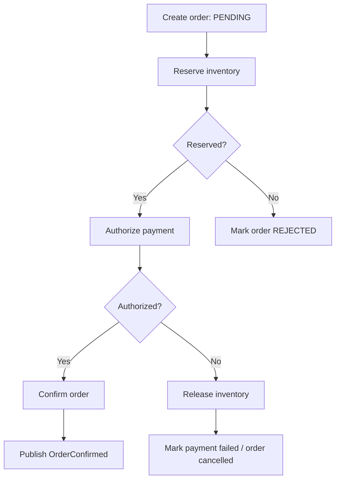

# Shifting Synchronous Processing to Queues Step by Step

An existing Java application often handles an entire business flow inside a single HTTP request: receiving the request, writing to the database, calling payment/inventory services, sending an email, and returning a response. This approach is straightforward when a system is small, but requests grow slower as dependencies accumulate. A slow API can hold threads and connections for too long, causing cascading timeouts while forcing users to wait for tasks that do not need to finish before responding.

Moving part of the processing to a queue decouples request intake from work completion. An HTTP function records the request and emits a durable message; a queue-triggered Java worker handles the work afterward, retrying independently and scaling with backlog. However, this shift also introduces eventual consistency, duplicate delivery, ordering concerns, retries, DLQs, and the need to track operation status.

A safe strategy is to migrate one independently separable boundary at a time, starting with side effects that do not need to complete before the HTTP response. Keep critical transactions and business decisions where invariants can be guaranteed; use an outbox so events are never lost after commit; design idempotent consumers; and only then expand to long workflows or sagas.

## 1. Why Move Synchronous Processing to a Queue?

Suppose an order creation API performs these steps:

1. Validate the request and check items.
2. Write the order to the database.
3. Call the inventory service to reserve stock.
4. Call the payment provider to authorize payment.
5. Send a confirmation email.
6. Write an analytics event.
7. Return a response to the client.

If all steps run sequentially, total latency roughly equals the sum of every step. A slow email provider can time out the API even after the order is already saved. If the client retries because it received no response, the API may create duplicate orders or payment attempts without idempotency.



Some work does not belong on the synchronous response path. Emails, analytics, search index updates, or report generation can usually run after the order is recorded. Offloading them to a queue lets the API respond faster and isolates failures in secondary dependencies.

### Benefits and Trade-Offs

| Benefit | Trade-Off to Handle |
|---|---|
| Faster HTTP responses | Clients need to understand `ACCEPTED/PROCESSING` states |
| Workers scale independently by backlog | Must control concurrency and queue age |
| Retries decoupled from the original request | Consumers may receive duplicate messages |
| Slow dependencies do not tie up HTTP threads | Workflows finish later and can fail after returning 202 |
| Easier isolation per step | Adds event contracts, monitoring, DLQs, and replay operations |
| Consumers can scale individually | Queues can mask growing backlogs without alerts |

A queue does not make dependencies faster and does not eliminate failures. It changes where pending work is buffered and how the system responds when a step cannot finish immediately.

### Measure a Baseline Before Changing Anything

Before migrating, record current behavior to distinguish real improvements from merely shifting wait time from HTTP requests into a queue. Collect request rates/bursts, concurrency, API and dependency p50/p95/p99 latency, timeout/retry/error rates, database connections/lock waits, side-effect completion time, and compute/network/database/observability costs. For example, if API latency drops from 4 seconds to 100 ms while queue age climbs to 20 minutes, overall business completion may actually degrade.



This diagram helps locate slow dependencies and separable side effects. Do not push validation, authorization, or invariants that must be decided before accepting a command into a worker just to shorten response times.

## 2. Choosing Which Work to Move to a Queue

Do not push an entire request into a queue just for the sake of using serverless. First classify each step by response requirements and consistency needs.

| Work Type | Can Run Async? | Rationale/Conditions |
|---|---|---|
| Request structure and authorization validation | Usually no | Must reject invalid requests directly and keep bad payloads out of queues |
| Pre-write invariant checks | Usually no | Business decisions must happen at the write boundary |
| Persisting order/operation intake | Usually no | Must commit durably before acknowledging acceptance |
| Sending email/SMS | Usually yes | Can complete afterward with retries and separate delivery state |
| Updating search indexes/read models | Usually yes | Projections can be eventually consistent |
| Business analytics/telemetry | Usually yes | Should not slow down the primary transaction |
| Payment authorization/capture | Workflow-dependent | Can be async, but needs operation state, idempotency, and reconciliation |
| Reserving inventory | Business-dependent | If stock must be guaranteed before confirming orders, needs an explicit reservation protocol |
| Long calculations or report generation | Usually yes | Fits asynchronous jobs with status polling |

### Decision Questions

- Does the user need the final result directly in the response?
- Is it acceptable to confirm "accepted" before completion?
- Can this step retry without causing duplicate side effects?
- Does this step require ordering relative to other steps?
- If this step fails, can it retry, compensate, or require operator intervention?
- What data must commit before the message is emitted?
- Where will users or partners check job progress?

If an operation requires immediate final confirmation and cannot accept an intermediate pending state, keep it inside the synchronous boundary or establish an explicit business protocol before splitting. Never return `200 OK` simply because a message entered a queue if the business operation has not finished; use appropriate semantics such as `202 Accepted`.

## 3. Migrating Step by Step with the Strangler Pattern

The strangler pattern lets you alter part of a system without rewriting the entire application. You can start by keeping the existing API and database, moving one side effect to a queue, and then incrementally extracting workers or domain services.



On AWS, a concrete target might be API Gateway → intake Java Lambda → Order DB + outbox → relay → SQS → worker Java Lambda → email provider. Clients receive an `operationId` to poll a status endpoint. Workers scale independently by backlog; the queue and DLQ have dedicated IAM, encryption, retention, and alarms.

### Suggested Migration Roadmap

1. **Measure baseline:** identify latency, timeouts, errors, and time-consuming dependencies.
2. **Pick one low-risk side effect:** e.g., emails or search index updates.
3. **Define the contract:** event ID, schema version, payload, retries, and statuses.
4. **Write outbox in the same transaction:** ensure orders never commit without their events.
5. **Deploy the consumer:** idempotent, bounded timeout, retries, and DLQ.
6. **Run shadow/limited rollout:** compare outcomes before shifting all traffic.
7. **Transfer ownership:** turn off the legacy side effect once the new worker is verified.
8. **Expand to the next step:** only once observability and rollback paths are ready.

Migrating emails or analytics first typically has minimal impact on core invariants. Once the outbox/consumer pipeline stabilizes, consider longer business steps like inventory reservation or payment orchestration.

### Maintain a Single Owner per Side Effect

During transition, a major risk is having both legacy synchronous code and the new worker execute the same side effect. For example, the API still sends emails directly while the consumer also sends emails from events. Use a feature flag or routing rule that explicitly defines who owns the side effect at each stage. In shadow mode, the worker only computes/records comparison results without executing real side effects.

Feature flags need safe defaults, an owner, per-branch metrics, and a retirement date. If enabling by percentage or tenant, hash on a stable business ID so the same order always follows one processing path; avoid per-retry randomization that could bounce an operation between legacy code and the new worker. Changing a flag must never drop or strand already enqueued backlog.

## 4. Designing Asynchronous APIs and Operation Resources

When an HTTP handler only accepts work, the response should clearly state that the request was accepted and provide an identifier for client tracking.

Example:

```http
POST /orders
Idempotency-Key: create-order-8a21
Content-Type: application/json

{
  "items": [
    { "sku": "BOOK-01", "quantity": 2 }
  ]
}
```

Response:

```http
HTTP/1.1 202 Accepted
Location: /operations/op-7392
Retry-After: 2
Content-Type: application/json

{
  "operationId": "op-7392",
  "status": "ACCEPTED",
  "statusUrl": "/operations/op-7392"
}
```

Client queries the operation resource:

```http
GET /operations/op-7392
```

```json
{
  "operationId": "op-7392",
  "status": "PROCESSING",
  "createdAt": "2026-11-17T09:30:00Z",
  "updatedAt": "2026-11-17T09:30:04Z"
}
```

An operation can use these states:

| State | Meaning |
|---|---|
| `ACCEPTED` | Request validated and durably recorded; processing not yet started |
| `PROCESSING` | Worker is actively executing |
| `WAITING` | Waiting on a dependency or next step |
| `SUCCEEDED` | Business completion criteria met |
| `FAILED` | Terminal failure per policy |
| `CANCEL_REQUESTED` | Cancellation requested; execution may not stop immediately |
| `CANCELLED` | Safely cancelled according to business rules |
| `MANUAL_REVIEW` | Cannot automatically conclude or remediate; requires human intervention |

An operation record can also include `businessId`, `progress` (only when measurable), `resultRef`, a safe `errorCode`, and `expiresAt` per retention policy. Never expose stack traces or secrets in responses. State transitions must use versions/conditional updates so stale messages cannot move a terminal operation back to `PROCESSING`.

Do not mark `SUCCEEDED` simply because queue publishing succeeded. Queue publishing only confirms work was accepted; an operation succeeds only when business completion criteria are satisfied.

### Status API Needs Clear Semantics

- `202 Accepted`: accepted for processing, final outcome not yet ready.
- `200 OK`/`201 Created`: use only when the contract clearly indicates business completion or immediate resource creation.
- `409 Conflict`: idempotency key reused with a different payload or invalid state transition.
- `404 Not Found`: operation does not exist or caller is unauthorized to know it exists.
- `410 Gone`: operation resource passed retention expiry if the API uses this semantic.

The status endpoint requires owner/tenant authorization. Never let users guess an operation ID and read someone else's status.

## 5. Defining the Message Contract

Queues only transport bytes; contracts determine how consumers interpret data. A message should have a stable envelope and the minimal necessary payload.

| Field | Purpose |
|---|---|
| `eventId` | Deduplication and delivery auditing |
| `eventType` | Identifies the event kind |
| `schemaVersion` | Deserializes payload by version |
| `operationId` | Links to the client-tracked operation |
| `aggregateId` | Related business entity |
| `aggregateVersion` | Detects stale or out-of-order events |
| `occurredAt` | Timestamp when the business event occurred |
| `expiresAt` | Business processing deadline if the command/event expires; use only when the domain has a deadline |
| `correlationId` | Correlates workflow steps |
| `causationId` | Direct cause that produced this event |
| `payload` | Data required by the consumer |

Example:

```json
{
  "eventId": "evt-01J9A6M3",
  "eventType": "OrderAccepted",
  "schemaVersion": 1,
  "operationId": "op-7392",
  "aggregateId": "order-481",
  "aggregateVersion": 1,
  "occurredAt": "2026-11-17T09:30:00Z",
  "correlationId": "req-8a21",
  "causationId": "cmd-create-order-8a21",
  "payload": {
    "orderId": "order-481",
    "customerRef": "customer-93",
    "items": [
      { "sku": "BOOK-01", "quantity": 2 }
    ]
  }
}
```

These values are dummy data. Never include access tokens, passwords, card data, or unnecessary personal data in messages. Queues, archives, and DLQs often retain data longer than initial HTTP requests; apply appropriate encryption, access controls, and retention.

### Events and Commands Are Not the Same

- `OrderAccepted` is an event announcing that an order was accepted.
- `ReserveInventory` is a command instructing the inventory service to reserve stock.
- `InventoryReserved` is an event confirming reservation succeeded.

Proper naming prevents consumers from assuming a request succeeded merely because a command was dispatched. Commands can be rejected; events describe facts that already happened.

### Choosing a Queue, Event Bus, or Workflow Engine

| Need | Typically Suitable Choice | Characteristics |
|---|---|---|
| A pool of workers processing commands/backlog | Queue like Amazon SQS | Competing consumers receive messages; visibility timeouts and DLQ |
| Multiple independent consumers reacting to the same domain event | Event bus like EventBridge or topic/fan-out like SNS | One event routes to multiple separate targets/queues |
| Ordering within a message group | SQS FIFO or stream partitions | Ordering scoped to message group/partition, not global |
| Continuous events with offset/checkpoint replay | Kinesis or Kafka | Shards/partitions, consumer offsets, and stream retention |
| Multi-step workflows with state, timeouts, and branches | Workflow engine like Step Functions | Orchestration, retry/catch, and execution state |

Do not share one competing queue if multiple consumers must all receive the same event; one consumer will steal messages from another. Use fan-out so each consumer group has its own queue, retries, DLQ, and pace.

## 6. Transactional Outbox: Guaranteeing No Lost Messages After Database Commit

Do not perform these two independent actions inside an HTTP handler:

1. Write the order to the database.
2. Send a message to the queue.

If the database commits but the function times out before publishing, the order exists while workers know nothing about it. If publishing happens first and the database rolls back, workers process an uncommitted order.

A transactional outbox writes the business row and outbox row in the same transaction. A separate publisher reads committed outbox rows and dispatches messages.



The publisher can still send duplicates if it publishes successfully and crashes before updating `published_at`. Thus consumers still require idempotency. The outbox guarantees durable event emission, not end-to-end exactly-once processing.

### Example Outbox Table

```sql
CREATE TABLE outbox_event (
    event_id          VARCHAR(128) PRIMARY KEY,
    aggregate_id      VARCHAR(128) NOT NULL,
    aggregate_version BIGINT NOT NULL,
    event_type        VARCHAR(120) NOT NULL,
    schema_version    INTEGER NOT NULL,
    payload           JSON NOT NULL,
    created_at        TIMESTAMP NOT NULL,
    published_at      TIMESTAMP NULL,
    attempts          INTEGER NOT NULL DEFAULT 0
);

CREATE INDEX idx_outbox_pending
    ON outbox_event (created_at)
    WHERE published_at IS NULL;
```

JSON column types and partial index syntax vary by database; PostgreSQL typically uses `JSONB`. With multiple publishers, use atomic claims/leases or `FOR UPDATE SKIP LOCKED` to avoid processing the same row concurrently. Never hold a database transaction open across network calls to a queue.

### Writing Order and Outbox in the Same Java Transaction

```java
public Order acceptOrder(CreateOrderCommand command) {
    return transactionTemplate.execute(status -> {
        Order order = orderRepository.insert(command);

        OrderAccepted event = new OrderAccepted(
                eventIdGenerator.next(),
                order.id(),
                order.version(),
                command.operationId(),
                order.customerRef(),
                order.items());

        outboxRepository.insert(event);
        operationRepository.markAccepted(command.operationId(), order.id());
        return order;
    });
}
```

All repositories must share the same transaction manager/connection. Publishers read only committed rows; never call the queue inside the business transaction. If `transactionTemplate.execute` returns null on rollback or throws an exception, the HTTP handler must not return `202`.

## 7. Outbox Publisher and Checkpointing

Publishers can run via schedulers, pollers, or CDC. With polling:

1. Claim a batch of unpublished rows using a time-bounded lease/lock.
2. Send messages to the broker.
3. Upon broker acknowledgement, mark rows published and record timestamp/message references.
4. On publish failure, increment attempts and schedule retry with backoff.
5. If the publisher crashes after step 2, rows may be resent; consumers deduplicate via event ID.

Never mark an outbox row published before broker confirmation. Doing so risks losing events on a crash between the two steps. Conversely, sending first and crashing afterward can emit duplicates, which is why consumers must be idempotent.

### Publishing Order

`ORDER BY created_at` is insufficient to guarantee business ordering when multiple publishers run in parallel. If per-order/aggregate ordering is needed:

- Write `aggregateVersion` in the same transaction.
- Partition publishers by `aggregateId` or a stable key.
- Use broker ordering/message groups where available.
- Have consumers check versions and detect gaps.

Ordering is normally guaranteed only within a single partition/message group, not across an entire queue. Retries can also cause older events to arrive after newer ones.

## 8. Java Queue Consumers: Idempotency and Operation Status

Queues generally provide at-least-once delivery. A message may be redelivered if a consumer finishes processing but its acknowledgement is lost, the function times out, or visibility timeout expires before completion.

Consumers should record processed event IDs using a unique constraint. Recording the inbox entry and updating business data in the same transaction prevents "marked processed while business update failed to commit."

```sql
CREATE TABLE consumer_inbox (
    consumer_name VARCHAR(120) NOT NULL,
    event_id       VARCHAR(128) NOT NULL,
    processed_at   TIMESTAMP NOT NULL,
    PRIMARY KEY (consumer_name, event_id)
);
```

In PostgreSQL, claiming can use an atomic insert:

```sql
INSERT INTO consumer_inbox (consumer_name, event_id, processed_at)
VALUES (:consumer_name, :event_id, CURRENT_TIMESTAMP)
ON CONFLICT (consumer_name, event_id) DO NOTHING;
```

Execute business updates only when the insert creates a row. The inbox insert and domain state update must share the same transaction; if the domain update rolls back, the inbox marker rolls back as well so the broker can retry.

Java skeleton:

```java
public void handle(OrderAccepted event) {
    transactionTemplate.executeWithoutResult(status -> {
        boolean firstDelivery = inboxRepository.insertIfAbsent(
                "inventory-reservation", event.eventId());

        if (!firstDelivery) {
            return; // Duplicate delivery: no repeated side effect.
        }

        operationRepository.markProcessing(event.operationId());
        inventoryRepository.reserve(event.orderId(), event.items());
        outboxRepository.insert(InventoryReserved.from(event));
    });
}
```

`insertIfAbsent` must use a unique constraint/atomic insert, not separate `SELECT` then `INSERT` without race handling. This example assumes reservation and outbox share the same database transaction. If inventory is an external API, you need API-side idempotency keys or a dedicated workflow state; an external HTTP call cannot be made atomic inside a database transaction.

### Do Not Mark Operations Succeeded Prematurely

An operation may span multiple steps. Update to `SUCCEEDED` only when final business criteria are met. If inventory succeeds while payment is pending, the operation can sit in `WAITING_PAYMENT`; if payment times out with an unknown outcome, use `PAYMENT_UNKNOWN` and reconcile instead of assuming failure and issuing a second capture.

## 9. Sagas for Multi-Step Workflows

When converting synchronous multi-step flows into asynchronous workers, a single ACID transaction no longer spans the entire workflow. A saga splits the workflow into local transactions and defines compensations when a later step fails.

Order example:

1. Create order in `PENDING` state.
2. Reserve inventory.
3. Authorize payment.
4. Confirm order.
5. Send notification.

If payment fails after inventory was reserved, the saga emits a command to release the reservation. If order confirmation fails after payment authorization, it voids the authorization depending on the provider's contract.



Compensations are not perfect physical rollbacks. Once an email is sent, it cannot be unsent; you can send a follow-up correction. Once a payment is captured, you issue a refund rather than deleting the transaction. Every forward step and compensation requires idempotency, state tracking, and auditing.

### Orchestration vs. Choreography

| Style | Characteristics | Best Suited When |
|---|---|---|
| Orchestration | A workflow/state machine coordinates steps and timeouts | Long flows, many branches, need unified visibility of overall state |
| Choreography | Services emit/consume events and react autonomously | Short flows, clear service boundaries, low coupling |

Choreography can become hard to observe when many consumers emit cascading events. Orchestration makes ordering obvious but introduces a workflow owner to manage. You can combine both: a workflow orchestrates major milestones while event-driven consumers handle internal sub-steps.

## 10. Retries, Backoff, and Dead-Letter Queues

Queue consumers must classify errors:

| Error | Recommended Behavior |
|---|---|
| Network timeout/connection reset | Bounded retries with exponential backoff and jitter |
| HTTP 429 | Honor `Retry-After`, reduce concurrency/rate |
| HTTP 5xx | Retry if operation is idempotent and retry budget remains |
| Validation/schema error | Do not retry endlessly; quarantine/DLQ and alert |
| 401/403 | Do not loop retries; fix credentials/permissions |
| Business rejection | Record terminal business state or compensation; do not treat as infra failure |
| Version gap | Buffer, replay missing events, or refresh snapshot |

Multi-layer retries multiply call volume. If an SDK retries 3 times, the application retries 3 times, and the queue redelivers 5 times, one message can trigger dozens of requests. Define which layer owns retries, the total attempt budget, and the business deadline.

### A DLQ Is Not Where Responsibility Ends

Messages landing in a DLQ need an owner, alarms, retention, reason codes, and an investigation workflow. When redriving:

- Preserve the original event ID so consumers recognize duplicates.
- Fix the root cause before replaying.
- Throttle redrive speed to avoid overwhelming downstream services.
- Track replayed, succeeded, deduplicated, and failed message counts.
- Never redrive messages whose side effects already succeeded without verifying state first.

### Partial Batch Failures

If one invocation processes multiple messages, understand the trigger's batch semantics. Some services let handlers return failed items so only failed records retry; otherwise, the entire batch may be redelivered. Consumers must remain idempotent because succeeded records can reappear alongside failed ones.

### AWS Lambda with SQS: Partial Batch Responses

When Lambda pulls batches from SQS, enable `ReportBatchItemFailures` on the event source mapping so the handler indicates which records need retries. Example using `aws-lambda-java-events`:

```xml
<dependency>
    <groupId>com.amazonaws</groupId>
    <artifactId>aws-lambda-java-events</artifactId>
    <version>${aws.lambda.java.events.version}</version>
</dependency>
```

Pin a version compatible with the AWS Lambda Java runtime and your application dependencies.

```java
import com.amazonaws.services.lambda.runtime.Context;
import com.amazonaws.services.lambda.runtime.RequestHandler;
import com.amazonaws.services.lambda.runtime.events.SQSEvent;
import com.amazonaws.services.lambda.runtime.events.SQSBatchResponse;

import java.util.ArrayList;
import java.util.List;

public final class OrderSqsHandler
        implements RequestHandler<SQSEvent, SQSBatchResponse> {

    @Override
    public SQSBatchResponse handleRequest(SQSEvent event, Context context) {
        List<SQSBatchResponse.BatchItemFailure> failures = new ArrayList<>();

        for (SQSEvent.SQSMessage message : event.getRecords()) {
            try {
                processIdempotently(message.getBody());
            } catch (PermanentMessageException error) {
                // Acknowledge only after durably recording quarantine/audit state.
                try {
                    quarantine(message.getMessageId(), error);
                } catch (RuntimeException persistenceFailure) {
                    failures.add(new SQSBatchResponse.BatchItemFailure(
                            message.getMessageId()));
                }
            } catch (Exception retryable) {
                failures.add(new SQSBatchResponse.BatchItemFailure(
                        message.getMessageId()));
            }
        }

        return new SQSBatchResponse(failures);
    }

    private void processIdempotently(String body) {
        // Deserialize, validate and commit inbox + business update atomically.
    }

    private void quarantine(String messageId, Exception error) {
        // Persist reason and safe diagnostic metadata; never store secrets.
    }
}
```

The event source mapping must have `ReportBatchItemFailures` enabled. `messageId` in the response only identifies which SQS record to retry; business idempotency still relies on the stable `eventId` inside the payload. If the function times out before returning the batch response, the platform receives no failure list and may redeliver the entire batch, so committed records must be idempotent.

### SQS Visibility Timeout and Redrive Policy

With Lambda + SQS, visibility timeout must be long enough for the function to process a batch plus buffer headroom. AWS recommends setting queue visibility timeout to at least six times the Lambda function timeout, plus the maximum batching window if configured. `maxReceiveCount` in the redrive policy sets how many receives occur before moving a message to the DLQ. Verify current recommendations against your event source mapping configuration and applicable AWS documentation.

## 11. Ordering, Concurrency, and Backpressure

Queues decouple producers and consumers, but they do not automatically pace downstream speed. If producers emit 500 messages/sec while workers process 100 messages/sec, the backlog grows by 400 messages/sec. After an hour, the queue holds massive pending work even though the API still returns healthy responses.

### Choosing Ordering Scope

- If every event required global ordering, queue/stream throughput would be severely bottlenecked.
- If ordering is only needed per order ID, partitioning/message groups by aggregate ID usually works much better.
- If events are versioned snapshots, consumers can discard stale events and apply newer versions.
- If events are deltas, consumers must detect sequence gaps and replay.

Never rely on client timestamps for ordering; clocks skew. Use aggregate versions or sequences issued by the source of truth.

### Capping Concurrency by Downstream Capacity

Fast worker scale-out can open too many connections against databases or partner APIs. Estimate:

\[
DownstreamConcurrency \approx WorkerConcurrency \times CallsPerInvocation
\]

If each invocation issues up to 3 parallel requests and worker concurrency is 100, the dependency can receive up to 300 concurrent requests. Cap worker concurrency, batch sizes, connection pools, and rate limits according to downstream budgets.

### Backpressure

Common mechanisms:

- Cap max worker concurrency/instances.
- Tune batch sizes and dispatch rates.
- Use queues as buffers while monitoring age/backlog.
- Set timeouts and bounded connection pools.
- Use circuit breakers/rate limiters for external APIs.
- Pause consumers when a dependency is down, if supported by the trigger.
- Separate queues by workload priority so non-critical jobs never block core transactions.

With Lambda + SQS, Reserved Concurrency caps total function invocations; `MaximumConcurrency` on the event source mapping caps concurrency for that mapping; batch size determines records per invocation. Also track `ApproximateAgeOfOldestMessage`, queue depth, Lambda concurrent executions/throttles, batch failures, and downstream connection/transaction rates. If backlog grows continuously, raising concurrency only helps when databases/providers have spare capacity.

Backpressure must pair with alerts. Setting concurrency too low can cause queue age to breach SLAs even when dependencies have capacity available.

## 12. Eventual Consistency and User Experience

After splitting processing, data in the order database, inventory, payment, and read models may update at different moments. The UI must represent intermediate states and never infer completion merely from request acceptance.

A flow might look like:

- `ACCEPTED`: order and operation committed, outbox written.
- `RESERVING_INVENTORY`: worker is reserving stock.
- `PAYMENT_PENDING`: waiting on payment provider.
- `CONFIRMED`: order confirmation criteria satisfied.
- `FAILED` or `MANUAL_REVIEW`: workflow cannot proceed automatically.

Clients can poll the status endpoint with backoff, receive webhooks/callbacks, or subscribe via a notification channel. Status APIs need `updatedAt`, safely displayable error codes, and retry guidance. Never return stack traces or internal dependency details.

### Read-Your-Writes

If a client creates an order and immediately queries it, the read model might not be updated yet. You can return a snapshot from the command response, temporarily route immediate reads to the source of truth, or return a consistency token/version so the query service waits until the projection reaches that version. Never assume all replicas update instantaneously.

## 13. Protecting APIs Against Client Retries

When an HTTP response is lost, the client does not know whether the server accepted the request. An idempotency key ensures the same logical request is processed as a single operation.

An idempotency record should store:

- Key and caller/tenant scope.
- Hash of the canonicalized request.
- Operation ID and status.
- Response/reference to replay for duplicate calls.
- Created/expiry timestamps.

If the same key arrives with a different payload, return a conflict instead of silently returning the prior request's result. TTL must exceed client retry windows and workflow durations; for financial side effects, retain according to business/audit policies.

Idempotency at the HTTP boundary does not replace the consumer inbox. One request may produce one event, yet that event can still be delivered multiple times.

## 14. Security When Moving to Queues

A queue introduces an additional storage and access boundary. When moving payloads from HTTP to messages, verify:

- Producers only have send permissions to necessary queues/topics.
- Consumers only have read/ack permissions and access to required dependencies.
- Queues/topics are encrypted and policies restrict principals; on SQS, use SSE-SQS or KMS per requirements.
- TLS is enforced between producers/consumers and the broker.
- DLQs/archives have equal or stricter access controls and retention.
- Payloads omit credentials and unnecessary data.
- Message authenticity is protected via IAM/resource policies or signatures as appropriate.
- Secret references are passed safely; never place raw secret values in events.
- Trace/correlation metadata contains no PII/secrets.
- Replay/redrive actions have auditing and separate permissions.

Never treat a queue as an inherently trusted internal zone just because it sits in the same cloud account. Producers, consumers, operators, and automation carry distinct privileges.

## 15. Observability for Asynchronous Workflows

Because the HTTP request finishes early, its trace does not automatically span until queue workers complete. Propagate `correlationId`, `operationId`, `eventId`, and W3C trace context via message attributes to connect producers and consumers. For long workflows, start a new consumer trace linked via span links rather than keeping a single trace open for hours.

Key metrics:

| Metric | Meaning |
|---|---|
| Queue depth/backlog | Number of pending messages |
| Age of oldest message | How long the oldest item has waited |
| Publish success/failure | Whether producers are emitting messages reliably |
| Consumer success/failure | Processing success rate |
| Processing duration | Worker execution time |
| Retry count | Number of redeliveries/retries |
| DLQ depth | Number of messages needing investigation |
| Operation completion time | End-to-end time from intake to final outcome |
| Operation terminal failure rate | Rate of workflows ending in failure |
| Cost per successful operation | Total compute, queue, network, database, and observability cost per completed business unit |

Do not monitor function invocation errors alone. A queue can accept messages cleanly while consumers stall. Alert on queue age, backlog growth, DLQ depth, and operation SLAs.

## 16. Phased Migration Rollout

A rollout can be structured into phases:

### Phase 1: Preparation

- Pick one separable processing step and designate an owner.
- Define event contracts, schema versions, and idempotency keys.
- Define operation statuses and client contracts.
- Design outbox, consumer, retries, DLQ, and backpressure.
- Record baseline latency, error rates, and dependency load.

### Phase 2: Build Consumer and Observability

- Deploy queue, DLQ, and worker in test environments.
- Test duplicates, out-of-order events, timeouts, and partial failures.
- Add metrics for queue age, operation completion, and retries.
- Verify IAM, encryption, and retention.

### Phase 3: Enable Outbox/Publisher

- Write outbox records in the same transaction as business data.
- Run the publisher in a bounded mode.
- Verify all events emit with zero skipped outbox rows.
- Reconcile events against source state.

### Phase 4: Shadow or Canary

- Shadow consumer computes/records comparison outputs without executing real side effects.
- Compare outputs against legacy synchronous logic.
- Enable for a small traffic share or controlled tenant group.
- Monitor queue age, duplicates, errors, downstream load, and operation SLAs.

### Phase 5: Transfer Ownership

- Shift a segment of side effects to the new worker.
- Disable the legacy synchronous side effect for that same segment.
- Keep rollback paths and consumer pause capability ready.
- Verify two producers/consumers never co-own the same action.

### Phase 6: Expand and Clean Up

- Ramp traffic incrementally.
- Drain legacy backlogs and DLQs.
- Remove legacy code once zero callers are verified.
- Update runbooks, dependency maps, SLOs, and service catalogs.

| Milestone | Exit Criteria |
|---|---|
| Baseline | Metrics for latency, errors, side effects, dependencies, and cost with an owner |
| Contract | Event schema, event ID, and operation statuses reviewed/versioned |
| Queue foundation | Queue, DLQ, IAM, encryption, alarms, and runbooks tested in sandbox |
| Consumer shadow/test | Duplicate, retry, DLQ, and failure handling pass checks |
| Outbox | Fault injection loses zero events after business commit |
| Limited rollout | Correctness, queue age, error rate, and downstream load within thresholds |
| Expand | SLOs and cost per successful operation meet targets |
| Remove legacy | Backlog drained, rollback window closed, zero legacy callers remain |

Never delete the legacy synchronous path before verifying recovery procedures. Rollback may require routing producers back to the synchronous path while avoiding re-executing operations already completed by workers.

## 17. Dual-Run, Shadow Traffic, and Avoiding Duplicate Side Effects

Dual-run helps compare legacy and new logic, but running both paths blindly causes double charges, duplicate emails, or double inventory reservations.

Distinguish:

- **Shadow computation:** runs new logic to compare outputs without writing real side effects.
- **Canary execution:** only a subset of requests/tenants actually routes through the new worker.
- **Dual write:** both systems write; use only with explicit consistency, deduplication, and cutover design.
- **Backfill/replay:** reprocesses historical data; requires checkpoints and idempotency.

For external side effects, never invoke both legacy and new implementations in shadow mode. Use mocks, sandboxes, or non-mutating output comparisons.

## 18. Testing Migration and Failure Scenarios

Required test cases:

1. Database commits successfully before the publisher runs; the event still publishes afterward.
2. Publisher sends successfully then crashes before marking published; consumer does not repeat side effects.
3. Consumer commits business update but acknowledgement is lost; redelivery is safe.
4. Malformed schema message; routed to quarantine/DLQ with an alert.
5. Downstream returns 429/5xx or times out; bounded retries with backoff apply.
6. Worker concurrency spikes; database/APIs stay within connection/rate budgets.
7. Out-of-order messages arrive; version guards prevent state regression.
8. Queue backlog spikes; workers drain within SLA.
9. Operation times out while external side effect succeeded; reconciliation discovers the true outcome.
10. Rollback to legacy path; already completed operations are not re-executed.
11. DLQ redrive; original event IDs and idempotency remain intact.
12. Client resends the same idempotency key; receives the same operation/result.
13. Worker times out before returning partial batch response; committed records do not cause duplicate side effects.
14. Message exceeds business `expiresAt`; worker rejects expired side effects per policy.
15. Two invocations concurrently claim one event ID; only one transaction applies the business update.
16. Feature flag toggles while backlog remains in queue; in-flight messages are still handled by compatible consumers.

### Pass Criteria

- Zero business events lost after transaction commit.
- Duplicate deliveries cause zero duplicate business side effects.
- Operation statuses accurately reflect workflow state.
- Queue age and backlog remain within SLA under target load.
- Dependencies are not overwhelmed by worker scale-out or retries.
- Pause, replay, and rollback work according to runbooks.
- Logs/traces/metrics correlate requests, operations, and consumers.

## 19. Common Pitfalls

| Pitfall | Consequence | Fix |
|---|---|---|
| Moving an entire flow to queues at once | Hard to debug and roll back | Extract one step, measure, and expand incrementally |
| Returning 200 upon enqueuing | Clients mistakenly assume work finished | Return 202 with an operation status resource |
| Writing DB then publishing directly without outbox | Events can be lost between operations | Transactional outbox/CDC with guarantees |
| Non-idempotent consumers | Duplicate messages cause duplicate side effects | Inbox/unique constraints and idempotency keys |
| Both legacy code and worker trigger side effects | Double emails/payments/reservations | Single owner per side effect; shadow mode never writes real effects |
| Infinite retries | Poison messages and growing backlogs | Retry budgets, DLQs, and manual repair |
| Unbounded worker concurrency | Downstream systems overload | Concurrency caps, batching, pools, and rate limits |
| Ignoring queue age | Backlogs grow while API looks green | Alert on oldest-message age and operation SLAs |
| Sharing one competing queue across consumers needing the same event | One consumer steals messages from another | Fan-out via event bus/topics to separate queues |
| Treating FIFO as end-to-end exactly-once | Consumers can still redeliver or repeat side effects | Enforce idempotency at business boundaries |
| Using timestamps for ordering | Clock skew lets stale events overwrite newer state | Use aggregate versions/sequences |
| Unowned DLQs | Failed messages are forgotten | Alarms, runbooks, retention, and redrive processes |
| Ignoring eventual consistency in the UI | Users see stale or seemingly regressed states | Operation resources, versions, and freshness semantics |
| Rolling back without checking completed operations | Side effects execute twice | Idempotency and migration/cutover ledgers |
| Deleting queues during rollback | Accepted pending work is lost | Keep queues/consumers to drain backlog cleanly |

## 20. Process for Shifting a Synchronous Flow to a Queue

1. **Measure and pick a boundary.** Identify slow/independent steps, invariants, and what must stay synchronous.
2. **Define the operation contract.** Specify 202 responses, operation IDs, statuses, cancellation, and retention.
3. **Define the message contract.** Event ID, schema version, aggregate version, correlation, and minimal payload.
4. **Design the outbox.** Commit business state and event records in the same transaction.
5. **Implement the publisher.** Claims/leases, retries, checkpoints, and per-aggregate ordering if needed.
6. **Implement the consumer.** Inbox/idempotency, state transitions, timeouts, and safe side effects.
7. **Design workflows.** Use sagas/compensation when multiple local transactions must coordinate.
8. **Configure retries/DLQ/backpressure.** Set budgets, concurrency caps, queue age alerts, and redrive owners.
9. **Secure and observe.** IAM, encryption, retention, trace context, and operation metrics.
10. **Test failures.** Duplicates, lost acks, timeouts, ordering, poison events, and downstream outages.
11. **Canary/rollout.** Run shadow computation first, then shift one traffic slice and one side effect.
12. **Measure and expand.** Compare latency, completion times, errors, backlogs, and dependency load; update runbooks/catalogs.

## 21. Pre-Production Checklist

- [ ] Only steps with clear asynchronous semantics are extracted.
- [ ] Invariants requiring synchronous guarantees remain enforced at the write boundary.
- [ ] HTTP API distinguishes accepted from completed and exposes an operation status resource.
- [ ] Client retries are protected by idempotency keys.
- [ ] Business rows and outbox events commit in the same transaction.
- [ ] Publisher uses claims/leases, retries, and never marks published before broker ack.
- [ ] Events include IDs, schema versions, aggregate versions, and correlation metadata.
- [ ] Consumers implement inbox/idempotency and handle duplicates safely.
- [ ] Ordering scope and version-gap handling are defined.
- [ ] Multi-step workflows have state machines and compensation where needed.
- [ ] Retries have backoff/jitter, deadlines, and retry budgets.
- [ ] DLQs have alarms, owners, retention, and redrive runbooks.
- [ ] Worker concurrency/batch sizes fit downstream budgets.
- [ ] Queue age, backlog, operation completion, and failures are monitored.
- [ ] Shadow mode executes zero real side effects.
- [ ] Canary, pause, rollback, and replay have been tested.
- [ ] Payloads/queues/DLQs have proper encryption, permissions, and retention.
- [ ] Runbooks, dependency maps, and service catalogs are updated.

## References

- [AWS Prescriptive Guidance: Transactional outbox pattern](https://docs.aws.amazon.com/prescriptive-guidance/latest/cloud-design-patterns/transactional-outbox.html)
- [Using Lambda with Amazon SQS](https://docs.aws.amazon.com/lambda/latest/dg/with-sqs.html)
- [Configuring partial batch response for SQS](https://docs.aws.amazon.com/lambda/latest/dg/services-sqs-errorhandling.html)
- [Amazon SQS visibility timeout](https://docs.aws.amazon.com/AWSSimpleQueueService/latest/SQSDeveloperGuide/sqs-visibility-timeout.html)
- [Amazon SQS dead-letter queues](https://docs.aws.amazon.com/AWSSimpleQueueService/latest/SQSDeveloperGuide/sqs-dead-letter-queues.html)
- [Amazon EventBridge event buses](https://docs.aws.amazon.com/eventbridge/latest/userguide/eb-event-bus.html)
- [AWS Lambda event source mappings](https://docs.aws.amazon.com/lambda/latest/dg/invocation-eventsourcemapping.html)
- [HTTP 202 Accepted — RFC 9110](https://www.rfc-editor.org/rfc/rfc9110.html#name-202-accepted)
- [Transactional outbox pattern — microservices.io](https://microservices.io/patterns/data/transactional-outbox.html)

## Conclusion

Shifting synchronous processing to queues should happen incrementally, starting with work that can finish after the response with minimal impact on core invariants. HTTP functions accept operations durably, a transactional outbox emits events, Java workers process idempotently, and operation resources let clients track progress. When workflows span multiple steps, sagas/state machines govern timeouts and compensation; retries, DLQs, ordering, and backpressure protect the system when dependencies fail or backlogs grow. Rolling out via shadow/canary with a single owner per side effect lowers transition risk. Migration is only complete when you can prove zero lost events, zero duplicate side effects, queues draining within SLA, and clear rollback/replay paths.
